# 更多决策模型、业务规则和决策表

在上一章中，我们使用 KIE Sandbox 中的 *Decision Models* 编写了第一条业务规则。虽然那只是一个友好的问候，但该业务规则的功能并不强大。本章将探索 KIE 的其他功能，以编写更强大的业务规则，解决更多现实生活中的问题。

在此过程中，我们将探索存储信息的不同格式。我们将使用 KIE Sandbox 中的工具为这些格式建模，从而更容易理解正在处理的数据。我们将创建第一个 **决策表**，并了解它们是如何以非常强大的方式表达业务规则的。我们还将探索其他节点类型，以帮助我们处理信息并为决策表准备数据。最后，我们将组合所有这些节点类型，创建一个非常强大的决策示例。

我们的目标是捕获业务流程中的决策过程，以提供有用的服务。为此，我们将涵盖以下主要主题：

+   - 让你的决策易于沟通
+   - 更强大的决策节点——决策表
+   - 其他类型的决策节点
+   - 添加节点以支持我们的决策表
+   - 更复杂的决策表
+   - 规则匹配与命中策略
+   - 一个更安全的决策表示例

让我们首先思考如何让我们的决策服务易于使用。

# 让你的决策服务易于使用

你可能没有意识到，在上一章中，你已经编写了你的第一个决策服务。在 KIE Sandbox 中运行我们的 *问候示例* 时，我们提供了输入（姓名以及是否是早上），做出决策，然后共享输出（**Good Morning** 或 **Good Afternoon**）。

虽然我们看不到很多同事会注册使用这项特定服务，但随着我们在本章中深入更复杂的示例，这种情况将迅速改变。现在值得思考的是，其他人在使用我们的服务时需要了解什么：

+   - 我们如何做出决策——一般来说，**决策模型与表示法（DMN）** 格式使这一点相当清晰。它肯定比其他解决方案（例如隐藏在代码或 Excel 中的函数）清晰得多。
+   - 需要传递给决策服务的数据，以及我们从中获得返回数据的格式。

在我们的问候服务中，我们期望一个字符串（姓名）和一个布尔值（是否是早上——真或假）。但决策模型允许我们更具体地说明输入和输出的数据类型。这是一件好事，因为它让人们更容易使用我们的服务。

在开始指定期望传入决策服务以及从决策服务传回的数据之前，值得思考一下 Excel 是如何建模数据的。

# ## 你的数据是什么形状——表格还是树？

Excel 非常出色——你从未真正需要考虑数据的形状或结构。所有 Excel 数据都是基于网格式布局的表格。一个典型的例子是 *图 4.1*——如果我们经营一家在线巧克力商店，可能会有的一张客户信息表：

| 客户编号 | 客户姓名 | 出生日期 | 居住国家 | 特殊请求 |
|---|---|---|---|---|
| 1029 | Jane Smith | 10-Mar-2001 | Netherlands |  |
| 2219 | Sita Patel | 18-Apr-1998 | New Zealand | Vegan |
| 8781 | Joseph Okoru | 22-Sep-1963 | Sri Lanka |  |
| 1123 | Peter Murphy | 04-Nov-02 | United States |  |

*图 4.1——一张非常简单的客户表*

这非常简单，在现实生活中，我们的列会比这里列出的更多——也许用来存储电子邮件、收货地址以及类似信息。但这足以展示 Excel 鼓励你使用的网格式布局。而且显然还有更复杂的工作表——例如对公司财务预测进行建模，整个工作表代表一家公司，而不是我们这里展示的每客户一行的布局。但我们的简单示例已经足以说明基于网格的数据的局限性。

当然，和大多数 Excel 工作表一样，它并不是一个真正的网格——**特殊请求** 的值是可选的（可以为空）。一个更大的问题（你可能已经在自己的 Excel 工作表中遇到过）是，额外数据并不完全适合网格模式。例如，如果我们还想在此电子表格中跟踪客户订单，我们有三个选项：

+   - 添加另一列存放第一笔订单，再添加一列存放第二笔订单，依此类推——我们可能会得到一个非常混乱的电子表格。
+   - 或者我们可以添加另一行（复制客户编号），并在添加的每一行中放入单独的订单详细信息。这给了我们更多存储信息的空间，但会使更新客户级别信息（如姓名）变得困难。
+   - 或者，我们可以为订单创建一个单独的表，并使用 **客户编号** 进行交叉引用。如果你使用过 SQL 数据库，就会熟悉这种方法。但将信息放在两个地方，会让人难以一次查看所有信息。

关键在于，数据的网格形状并不完全合适。

如果我们改为尝试一种不同的树形数据形状呢？图 4.2 是客户表中一行以树形（JSON）格式表示的内容：

```
{
  "CustomerInfo": {
    "Customer Number": 1123,
    "Previous Order": [
      "ord001", "Snap Crackle Bar",
      "ord002", "Turkish Delight"
    ],
    "Customer Name": "Paul Murphy",
    "Special Request": "lactose intolerant",
    "Date of Birth": "2001-11-02",
    "Country of Residence": "United States"
  }
}
```

图 4.2——JSON 格式的一位客户

如果你以前见过 JSON 文件，对这种布局会很熟悉，但让我们强调一下这种文件格式的一些关键特点：我们缩进了文本以使树状结构更清晰：

+   - 该文件只是一个具有约定布局的文本文件。它在很多方面类似于 **逗号分隔值（CSV）** 文件——另一种具有约定布局的文本文件。
+   - 你可以在记事本或其他文本编辑器中打开和编辑 JSON 文件。图 4.2 中带有颜色高亮的效果来自 VS Code（我们将在 *第 12 章* 中再次使用该编辑器）。
+   - 每个值都有名称——因此很容易识别关键信息，例如客户姓名。

+   - 虽然我们只显示客户表中的一行（因为树形格式不如网格/表格紧凑），但可以根据需要多次重复我们的 `CustomerInfo` 条目。
+   - 这种格式也更容易推断信息的类型（文本、数字和日期）。你还可以看到我们在哪里创建了自己的数据结构（主要的 `CustomerInfo` 结构，其中包含字符串、数字、日期，以及一个二级自定义订单结构）。
+   - 树形结构灵活得多。例如，我们能够为该客户添加多个订单。由于每个值都有名称，因此可以省略可选的 **特殊请求** 字段，而且文件仍然可读。

虽然 JSON 的设计初衷是让我们人类易于阅读和编辑，但好消息是，我们几乎总会有样本文件作为起点。例如，前面展示的 JSON 格式实际上是由 KIE Sandbox 生成的。我们将在 *第 5 章* 中连接 KIE Sandbox 到云端时展示更多相关内容。

> **更多关于 JSON 的内容**
> 
> 在上一节中，我们只介绍了 *足够的 JSON* 来为决策所需的数据建模。但 JSON 是一种广泛使用的格式，你很可能再次遇到它。如果你有兴趣了解更多，Microsoft 提供的指南相当不错，链接如下：`https://pnp.github.io/blog/post/introduction-to-json/.`

既然我们知道有更强大的数据格式可用，并且 KIE Sandbox 提供了数据类型编辑器来指定这些格式，那么我们如何使用该编辑器，让决策服务的其他用户更清楚地了解我们期望的输入数据格式以及我们将作为结果传回的数据类型呢？我们将通过一个示例，在编辑器中为客户数据建模。

## 在 KIE Sandbox 中为我们的数据建模

开始为我们的数据建模：

+   1. 打开 KIE Sandbox，网址为 `sandbox.kie.org`。
+   2. 在主页上，创建一个新的 **Decision**。
+   3. 在新的决策模型中，点击 **Data Types**。你应该会看到类似 *图 4.3* 所示的屏幕：


## 图 4.3 – KIE 中的 Data Type 编辑器

4. 点击 **Add a custom Data Type** – 屏幕底部附近的蓝色方框。

5. 输入名称 **tCustomer**。虽然我们可以选择几乎任何我们喜欢的名称，但开头加上的 **t**（代表 type）将使我们以后更容易将其识别为数据结构。

> **What is a type?**
> 把类型想象成一个饼干模具。用一个模具，我们可以切出并烤出任意多的饼干。

6. 在下拉菜单中，我们选择数据类型为 **Structure**。屏幕应类似于图 4.4：

## Custom Data Types

New Data Type

tCustomer Structure

## 图 4.4 – 新数据类型

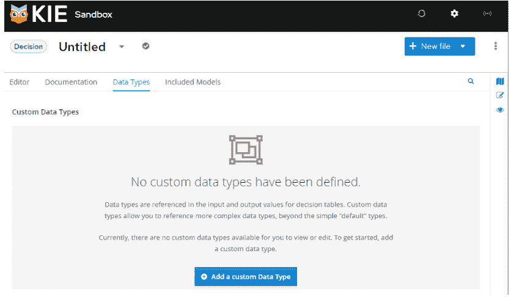

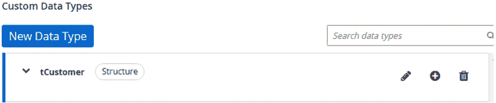

7. 我们的 **tCustomer** 等同于之前 Excel 电子表格中的一行。我们仍需告诉 KIE 每个客户类型内的各个信息片段。点击铅笔图标添加一个 **number** 类型的客户编号，然后点击勾选图标保存。

8. 点击 + 图标（客户编号下方）按顺序添加以下类型，如 *图 4.5* 所示：

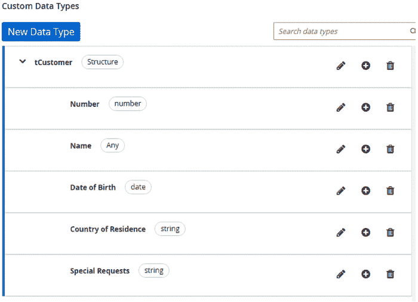

图 4.5 – 自定义数据类型

恭喜 -- 你刚刚在 KIE 沙箱中创建了你的第一个 **custom data type**。既然我们已经创建了 **custom data type**，让我们看看它在 Decision Model 中是什么样子。

> **Is customer name really needed on our data type?**
> 
> 在现实生活中，我们不太可能传入诸如客户姓名等个人身份信息。这是因为我们的决策服务不存储任何信息 -- 它只是对你传入的信息做出判断。
> 
> 出于许多原因，你不应该基于单个客户姓名做出决策。更可能的情况是，对于非常重要的客户，你可能会创建一个 **Special customer** 布尔字段。
> 
> 这些设计选择在我们开始考虑客户数据伦理使用时尤其重要，我们将在下一章中涉及这个问题。

### 在决策模型中使用我们的复杂数据类型

要开始在决策模型中使用我们的 tCustomer 数据类型，请执行以下步骤：

- 1. 首先通过点击该标签返回 Model Editor 屏幕。
- 2. 在编辑器中，拖入一个 Input data 节点并将其命名为 Customer – 还记得我们的饼干客户示例吗？tCustomer 是模具，我们将用它来创建一个实际的客户形状。
- 3. 点击属性图标（记住 – 它在编辑器的右上角）。在 Properties 面板中，指定我们想要使用刚刚创建的 tCustomer 数据类型。它应类似于图 4.6：

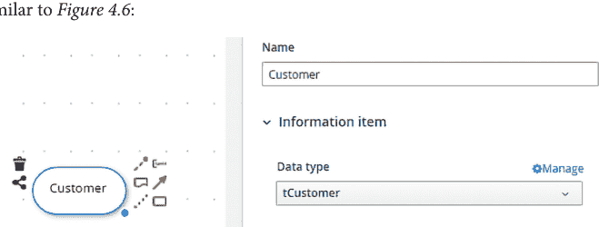

图 4.6 - 在决策模型中使用我们的数据类型

我们之前提到过，像 tCustomer 这样的结构化数据类型是与调用此决策服务的人之间的契约的一部分。为了演示这一点，如果我们点击 Run .. as form 按钮，我们可以看到 KIE 已根据我们的结构化数据类型自动生成了一个数据输入表单，如图 4.7 所示：

2. **Data type constraints** 屏幕出现。在 *图 4.9* 中，我们已经选择了 **enumeration**，它允许我们指定一组值。然后我们输入了在我们的 **Special Request** 字段中可接受的文本：**diabetic**、**vegan** 或 **lactose intolerant**。请注意，也可以用 **expression** 类型输入值列表（如果你选择这种方式，Sandbox 会给你一个示例来指导你）。

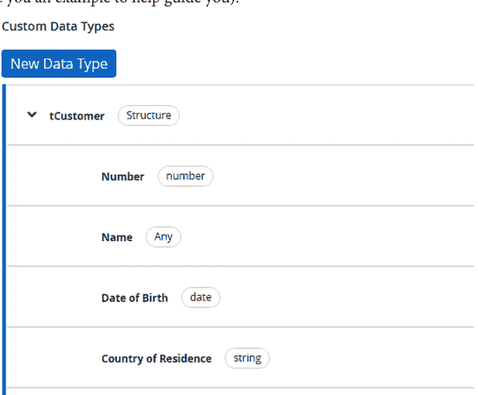

图 4.9 – 带约束的复杂数据类型

3. 记得点击 **OK**，或约束编辑器中的绿色箭头来保存我们的更新。

当我们返回到 **Run** 菜单时，你会看到（*图 4.10*）KIE 已识别新的契约并更新了用户界面，以便你只能选择与此限制一致的值：

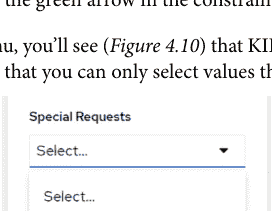

图 4.10 – 更新后的数据输入表单建议受约束的值

你会注意到，我们的示例（在 KIE 中建模）尚未匹配我们在 JSON 和 Excel 中建模的 Customer（带 Orders）。由于你已经使用过数据类型编辑器，创建订单对象并将其嵌套在客户中很容易：

- 1. 创建 **tOrder** 类型，并包含你需要的字段。
- 2. 编辑 **tCustomer** 数据结构并添加一个使用此 **torder** 类型的 (Previous) **orders** 字段。
- 3. 编辑 **list** 滑块，这使我们能够为每个客户添加多个之前的订单。

如前所述，**run** 屏幕上的自动生成表单将会更新 – 试试看！我们创建的数据类型的可下载副本可在本书的 GitHub 页面 https://github.com/PacktPublishing/AI-and-Business-Rules-for-Excel-Power-Users 上作为 04_Customer_Data.dmn 获取。

下载它会更容易，如果你不想一步步完成这些步骤 – 但请提醒自己上一章中给出的 GitHub 下载说明，以避免最常见的错误。

仅仅因为你可以用编辑器创建极其复杂的自定义数据并不意味着你应该这样做。让我们思考一下什么构成良好的设计。

### 什么构成良好的自定义数据类型？

由于你正在构建一个供其他人（包括未来的你）使用的服务，花时间使其尽可能易用是值得的。关于良好数据设计的书籍汗牛充栋，但在这个阶段，几个简单的指导原则会大有帮助：

- - 遵循人们在日常业务中的说法更好 – customers、delivery addresses、orders、product recommendations 以及其他类似术语。熟悉、清晰的名称使人们更容易理解，因为你镜像了他们已有的思维方式。
- - 几个简单的数据类型比一个大型复杂的数据类型更好。它们不仅更容易理解，而且使重用你的决策服务变得更容易。
- - 数据建模可以变得非常复杂。复制现有的电子表格和系统是一个良好的开端。一致性比拥有略有不同的数据模型造成的混乱更好。
- - 保持名称简单 – 我们的类型使用 **number** 而不是 **customer_number**，因为从上下文中已经很清楚它与客户相关。

最重要的是 – 不要害怕尝试。在本书的这个阶段，我们正在原型设计 – 以学习为重点地使用技术。在某个时候，我们很可能会（重新）从 *clean-sheet* 设计开始。这个 clean-sheet 设计将构建得更快，因为到那时我们将对自己在做什么有更清晰的了解。

既然我们可以使用数据类型来指定我们期望传入的数据，让我们在使用 Decision Tables 的更强大的 Decision Model 中使用它。

### 更强大的 Decision 节点 – Decision Tables

在第 1 章 Wrestling with Excel? You Are Not Alone 中，我们介绍了业务规则作为我们可以使用 when ... then 格式做出的决策，例如；When time is AM - say Good morning。

我们很可能有不止一条业务规则 – 否则，为什么要使用规则引擎呢？决策表只是以表格格式编写多个相似业务规则的一种格式，像这样：

| First | Input Value 1 | Input Value 2 | Output |
| --- | --- | --- | --- |
| 1 | When value1 = "Something" | AND value2 > 100 | "Matched" |
| OR 2 | When value1 = "Completely different" | AND value 2<100 | "Different match" |
| OR 3 | - | Value 2 = 100 | "Match on number only" |

表 4.1 – 映射为简单决策表的业务规则

输入值来自哪里？那就是我们之前构建的数据模型。我们用来连接不同节点的箭头意味着 KIE 知道决策表可用的数据（并会尝试为你自动生成表）。

Drools（KIE 底层的规则引擎）获取这些输入值并尝试在决策表中找到最佳匹配的行。寻找最佳匹配有不同的方法（HIT Policies）。我们将在示例中使用 First，因为它易于理解，但我们稍后会讨论匹配策略。

找到匹配后，输出列中的值将被返回。我们可以有多个输出值，但这里我们保持简单。

请注意，并非所有值都需要提供。表 4.1 第三行的连字符 - 告诉 KIE 对此规则在此列中不进行匹配。我们可以在想要匹配的值中使用一系列足够友好的表达式语言（FEEL）表达式，这意味着我们想要匹配的任何文本都必须用引号包围。

我们在决策表语法中实际上并不使用 AND 或 OR – 它们由表的布局隐含。我们在这里包含它们是为了清晰。同样，我们只是将模式写成我们想要匹配的内容（参见表 4.1 – 我们第一个规则的第一列）。

既然我们已经理解了决策表的概念，让我们使用 KIE Sandbox 中的工具来捕获我们的第一个决策表。

### KIE Sandbox 中的第一个决策表

KIE Sandbox 中的图形编辑器使创建决策表变得简单。我们将使用本章前面练习中创建的数据模型。这也在 samples 页面上作为 04_Customer Data.dmn 提供。


要向此决策模型添加决策表：

+   1. 在 KIE 沙箱中打开模型并将决策模型重命名为 **First Decision Table**。
+   2. 在编辑器视图中（目前应为空），拖放一个数据节点。将其命名为 **Customer**。
+   3. 打开此节点的 **Properties** 视图并将数据类型设置为 **tCustomer**（我们在本章前面创建的数据结构）。这在 *Figure 4.11* 中显示。
+   4. 返回主模型，拖放以创建一个决策节点。将其命名为 Recommended Product。
+   5. 使用箭头将两个节点连接起来（右键单击 **Customer** 节点以查看此选项）。你的决策模型应类似于 *Figure 4.11*：

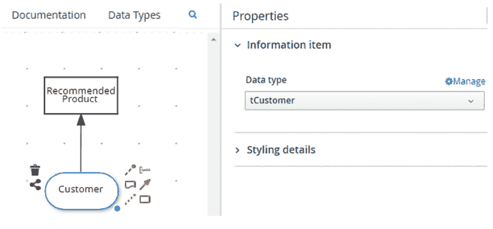

在下一步之前，我们的数据节点和决策节点必须已连接。如果没有，KIE 将无法为决策表自动生成字段，因为它不知道传递了什么信息。

让我们现在在 **Recommended Product Decision** 节点内创建一个决策表：

+   1. 选择 **Recommended Product Decision** 节点并单击 **Edit**。
+   2. 在出现的屏幕中，选择 **Decision Table** 作为我们想要使用的表达式类型。记住——我们之后没有机会更改这一点——所以如果你弄错了，你需要删除并重新创建一个决策节点。
+   3. 你应该会看到一个类似于 *Figure 4.12* 的空决策表。我们删除了一些自动生成的列并调整了列宽以使此屏幕截图更清晰：

### RecommendedProduct (Decision Table)

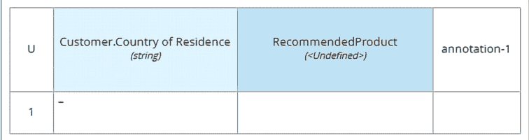

Figure 4.12 – Empty Decision Table

现在我们创建了一个空决策表，让我们按 Figure 4.13 所示填充一些值：

+   1. HIT Policy（表格左上角，见 Figure 4.13）– 要更改此值，双击并更改为 First。这样我们的示例更容易理解（如果匹配多条规则，则使用第一条规则）。
+   2. Output column（RecommendedProduct）。左键单击以将其类型设为 String，因为我们将推荐不同巧克力（糖果）棒的名称。
+   3. 要添加更多行，右键单击表格，然后从菜单中选择 Insert below。
+   4. 双击单元格以编辑其值。输入文本值时，记得在它们周围加上引号（否则 KIE 会认为它是一个变量），并删除 KIE 可能添加的连字符以表示它可以忽略的空单元格：

### RecommendedProduct (Decision Table)

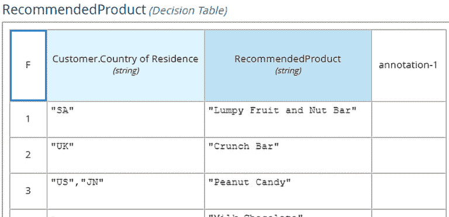

Figure 4.13 – Decision Table with input and output values

KIE 还具有围绕决策引擎的令人难以置信的节省时间功能——它可以分析你编写的规则并突出显示其中的任何空白。这在我们指定数字的输入和输出值范围或像我们对 **Special Requests** 数据类型那样限制有效文本列表时尤其强大。KIE 知道你应该编写规则来处理每个 **diabetic**、**vegan** 或 **lactose intolerant** 值。如果你没有这样做，KIE 会在编辑器的 **Problems** 选项卡中给出警告（不是错误）。

我们对规则的匹配越具体，KIE 就越容易突出显示我们可能存在的任何空白。将 HIT 策略更改为匹配 **First** 业务规则使我们的示例更容易理解，但你可以看到 KIE 警告你应考虑更准确的 HIT 策略。

决策表也很快。因为它们是以 When... Then 格式编写的业务规则，Drools 作为业务规则引擎可以优化规则，并且随着时间的推移实际上会变得更快。*Chapter 12, Inside the Rule Engine* 解释了其背后的机制，但现在，请将决策表视为建模决策时的首选解决方案。

### Decision Tables as your go-to solution (other nodes are available)

可以使用其他类型的节点来做出决策。例如，我们在 *Chapter 3, Your First Business Rule with the Online KIE Sandbox* 中的问候示例基于简单的 FEEL 表达式做出了决策。在现实生活中，我们不会对如此简单的示例使用决策模型或规则引擎。

将决策表作为表达业务规则的默认选项使用，使得更容易理解其他节点和表达式的作用：

+   - 我们使用决策表来表达做出决策的业务规则
+   - 我们使用其他节点来准备数据以输入到决策表

我们可以在从 *Figure 4.11* 开始填充的简单示例中看到这种模式——**Customer** 数据节点定义了我们期望的信息类型，而 **Recommend Product** 节点中的规则决策表做出了决策。那么，还有哪些其他类型的节点可以帮助准备我们的数据呢？

### More nodes that you can use

我们已经介绍了你最常用来建模决策的节点。但还有几种其他值得探索的节点。*Figure 4.15* 展示了 KIE 决策模型中可用的不同类型的节点：

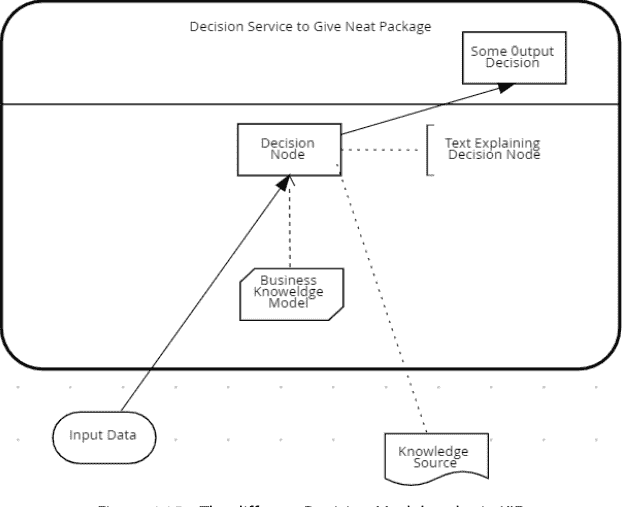

Figure 4.15 – The different Decision Model nodes in KIE

在 *Figure 4.15* 中看到的所有节点中，我们已经使用了数据和决策节点。但还有一些其他类型，我们很快就会用到：

+   - **Text nodes** 允许我们在决策模型中添加注释以解释正在发生的事情。它们仅用于信息，不会被评估。
+   - **Knowledge Source nodes** 也提供额外信息，但引用外部来源。例如，我们可能会使用知识来源链接到证明我们哪些产品对每种医疗状况安全的文件。它们仅用于信息，不会被评估。
+   - **Decision Services nodes** 有帮助，因为我们的决策模型可能会变得相当复杂。决策服务节点允许我们 *wrap* 这种复杂性以隐藏部分内部结构，使输入和输出期望更清晰。
+   - **Business Knowledge Models** 允许我们调用外部规则。这些可以是决策服务、其他决策模型、外部系统（通过 Java）或外部 AI 模型。我们还可以使用它们来使用 FEEL 定义可重用的函数，我们将在 *Chapter 9* 中更详细地介绍。

我们将在全书的示例中使用这些节点。但虽然我们使用了决策表，但仍有一些类型的决策节点我们尚未探索——让我们现在来看看它们。

### Other types of Decision Nodes

我们已经创建了两种类型的决策节点——本章前面使用的决策表和我们在 *Chapter 3* 中用于生成问候语的字面表达式。

但在创建决策节点时，我们必须从七种类型中选择一种。我们将在以下列表中逐一介绍它们。在某种程度上，决策节点这个名称具有误导性；通常，我们会将这些类型用作 *data preparation* 节点以输入到决策表：

+   - **Literal Expressions:** 这些是简单的 FEEL 表达式，大致类似于你在 Excel 中输入的公式。它们返回单个值。
+   - **Decision Tables:** 我们在本章中已介绍过这些。它们允许我们以 `when ... then` 格式对规则进行分组。
+   - **Functions:** 这允许我们定义可重用的逻辑。我们可以编写一个函数，接受巧克力棒重量和巧克力百分比的参数，然后返回该棒实际含有的巧克力克数。我们很快就会通过一个函数示例来讲解。
+   - **Invocations:** 这些是调用外部决策模型的另一种方式。它们与函数重叠，但在处理当前决策模型之外的逻辑时更有用。
+   - **Contexts:** 这些使我们的决策模型更简单。代替拥有大量单独的字面表达式，上下文允许我们将它们集中在一处。它们还为我们提供了按顺序执行这些表达式的选项。

最后，我们有两个返回结构化数据的决策节点类型：

+   - **Lists:** 这些返回简单的值集合。这些可以是不会改变的具体值，或者我们可以使用 FEEL 表达式来计算列表中的值。*Figure 4.16* 显示了我们的国家列表，建模为列表节点。编辑器只允许我们输入一列值：

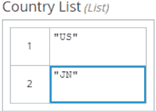

Figure 4.16 – A List Decision Node showing country codes


- **关系**：这些与列表类似，但可以把多个值组合在一起，如图 4.17 所示。此关系中的每一行都包含有关我们产品的有用信息。而每一列本质上是一个列表，如果我们想要访问所有产品的列表，这很有用：

### Product Info (Relation)

| # | Product (string) | Weight in Grams (number) | Vegan Suitable (boolean) |
| --- | --- | --- | --- |
| 1 | "Peanut Crunch" | 75 | true |
| 2 | "Caramel Biscuit" | 125 | false |

Figure 4.17 – Relation Decision Node showing product information

### Relations are not Decision Tables

由于表格格式，关系看起来与决策表非常相似。尽管外观相似，但它们的工作方式截然不同。关系会返回其包含的所有信息。决策表会匹配最佳行并仅返回该信息。

关系非常适合定义一次信息并在多个决策模型中重复使用。实际上，此产品信息表将使用调用从外部系统源中提取。对于现在，将信息建模为一个地方的关系效果很好。随着系统的演进，这也使其更容易在以后进行更改。

### Play around with the nodes

本节中介绍的大多数节点一旦开始使用就很容易理解。我们鼓励你在 KIE Decision 编辑器中尝试使用它们，并使用 Runner 查看输出。例如，图 4.18 显示了我们运行 Product Info 关系节点时的输出：

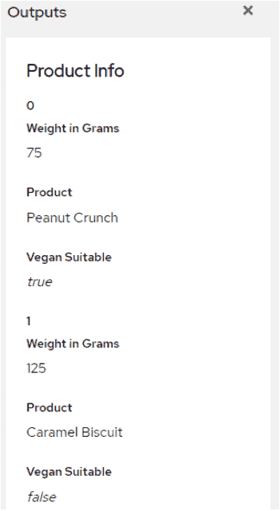

Figure 4.18 – Output from a Relation Decision Node showing product information

我们将在示例中使用一些这些表达式和节点来帮助你更好地理解它们。由于所有节点都是 **Object Model Group (OMG)** 决策模型标准的一部分，网上有很多关于每个节点的信息和示例。开始的好地方是 learn DMN 网站（是 KIE 的一部分）：https://learn-dmn-in-15-minutes.com/learn/decision-logic。Drools 网站（也是 KIE 的一部分）上有更详细的信息：https://www.drools.org/learn/dmn.html。

### Adding nodes to support our Decision Table

我们之前的决策表示例很简单：一个数据输入节点和一个生成输出的表。由于决策模型的强大之处在于将许多节点组合在一起，让我们开始构建一个链接多个节点的示例。

此示例将允许我们根据客户出生所在的星期几推荐不同的巧克力棒。这来自真实的例子，可能并不比你被要求建模的一些业务规则更离谱。

我们将基于之前决策表示例开始工作，可从本书的 GitHub 站点下载为 `04_First_Decision_Table.dmn`：

- 1. 打开 Decision Model 编辑器，并添加 **DayCalc** 决策节点。
- 2. 创建一条箭头连接现有的 **Customer Data Note** 以将数据馈送到这个新的 **DayCalc** 节点。
- 3. 创建另一条箭头连接 **DayCalc** 节点到现有的 **Recommended Product** 表。
- 4. 打开 **DayCalc** 节点的 **Properties editor** 并将输出设置为 **string**。它应如下 *Figure 4.19* 所示：

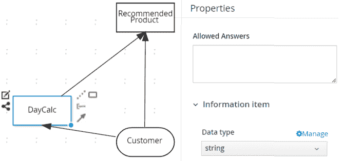

Figure 4.19 – Creating a Function Decision Node

- 5. 接下来，通过单击节点旁边的钢笔图标编辑 **DayCalc** 节点。
- 6. 在出现的屏幕上，将 **Expression type** 设置为 **Function**。
- 7. 通过单击 **Edit Parameters** 框编辑此函数的参数。在弹出菜单中，单击 **Add parameter**，如 *Figure 4.20* 所示：

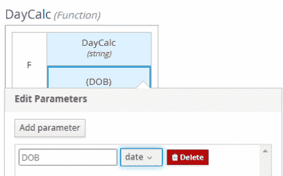

Figure 4.20 – Adding parameters to the function

- 8. 输入一个名为 DOB 的参数，并将其数据类型设为 **Date**。单击任意位置退出空白菜单。

9. 现在你回到节点编辑器，在表达式框中输入 day of week (DOB)。你猜对了——这是一个 FEEL 表达式，返回与此日期关联的星期几（例如 Monday 或 Tuesday）。通过此编辑，你的节点应类似于图 4.21：

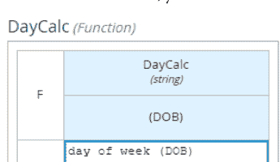

Figure 4.21 – Entering the function

如果我们正确输入了公式（没有拼写错误），你应该在 Run 面板中看到函数 DayCalc( DOB ) - Evaluated with success 的输出。

虽然知道 KIE 能理解我们的函数很有用，但我们还没有通过传入日期调用它并收到响应。

### Running our function

虽然我们已将决策模型接线以使函数可用于决策表，但查看正在发生的事情会很有帮助。为此，我们将向决策模型添加另一个节点以允许我们可视化输出：

- 1. 打开我们之前的示例，添加另一个决策节点，并将其命名为 Customer Birth Day。
- 2. 从 DayCalc 函数链接新节点。你的模型应类似于图 4.22：

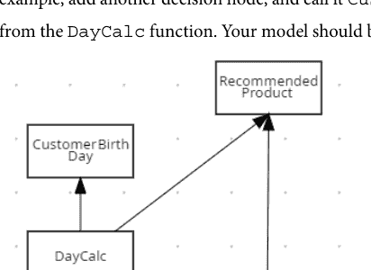

Figure 4.22 – Creating a Decision Node to test the function

- 3. 打开 **Customer Birth Day** 的属性，为其指定 **string** 数据类型。
- 4. 编辑 **Customer Birthday** 决策节点，并将 **Logic type** 设置为 **Context**。当然，调用函数的方式有很多，但这是一个练习上下文决策节点的有用借口。
- 5. 在你选择上下文类型后出现的屏幕上，按如下方式添加条目，使其看起来像 *Figure 4.23*。你需要插入新行并从下拉菜单中选择 **string** 数据类型。`DayCalc(Customer.Date of Birth)` 和 `Day of Week` 是字面表达式：

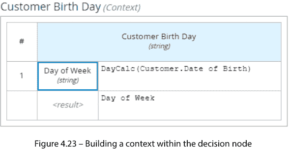

- 6. 打开 **Run** 面板并从 **Date of Birth** 输入字段的日期选择器中选择一个日期——例如 **2000-01-01**。
- 7. 立即，KIE 将评估决策模型，包括我们刚刚创建的 **Customer Birth Day** 节点。我们将看到客户出生的星期几；在此例中，是星期六。

> **Tricks of the trade**
> 
> 添加输出节点以便我们可以看到正在发生的事情是调试的有用工具（尝试找出为什么某些东西没有按我们想要的方式工作）。由于没有人第一次就能做对，我们在 *Chapter 9* 中更详细地讨论了有用的测试技术。

我们使用的 **context** 节点非常简单：一个计算和一个输出行。如果需要，我们可以添加额外的行并让 KIE 逐步构建结果。同样，在我们继续构建更复杂的决策表之前，值得在 KIE 编辑器中练习此示例。

### A more sophisticated Decision Table

我们添加了一个函数节点来计算客户出生的星期几。但我们仍然没有使用该星期几来推荐合适的产品。让我们更新我们之前的示例（可下载为 04_Customer_Birth_Day.dmn）以实现这一点：

- 1. 打开 Decision Model，右键单击 **Recommended product** 决策节点，并选择编辑图标。
- 2. 添加 **Input Clauses**（淡蓝色），使你拥有图 4.24 所示的三个输入列。你可以通过右键单击现有输入列并选择 **Add right** 来实现。
- 3. 双击每个输入子句以设置数据的来源，如图 4.24 所示。`Customer.Country of Residence` 和 `Customer.Number` 直接来自我们的数据模型。`DayCalc(Customer.Date of Birth)` 调用我们创建的函数（一次）并使结果可用于与规则匹配。
- 4. 我们调整了一些列的大小并拖放以重新排序——但这不会改变规则的功能。
- 5. 在表的正文中，输入如图所示的值。请注意文本值所需的引号。
- 6. - 值表示不尝试匹配，而注释只是解释正在发生的事情的注释，否则会被忽略。

RecommendedProduct (Decision Table)

| F | Customer.Country of Residence (string) | DayCalc(Customer.Date of Birth) (string) | Customer.Number (number) | RecommendedProduct (string) | annotation-1 |
|---|----------------------------------------|------------------------------------------|--------------------------|-----------------------------|--------------|
| 1 | - | - | <10000 | "Silk Tray" | Only first 10000 custom |
| 2 | "SA" | - | - | "Lumpy Fruit and Nut Bar" | |
| 3 | "UK" | "Friday" | - | "Crunch Bar" | |
| 4 | "US", "UK" | - | - | "Peanut Candy" | |
| 5 | - | - | - | "Milk Chocolate" | |

Figure 4.24 – A more sophisticated decision table

7. 打开 **Run** 面板以评估我们的模型。据预期，**US** 客户会被推荐 **Peanut Candy**。**UK** 客户会被推荐 **Crunch Bar**——但仅当他们出生于 **Friday** 时。否则，客户将收到默认建议的 **Milk Chocolate** 棒。并且任何在前 10,000 名客户中的人都会被推荐我们的特别 **Silk Tray** 优惠。


- **Collect**：这允许匹配多个。 如果我们使用此策略，我们建议至少向所有美国客户推荐两种产品（**Silk Tray** 和 **Peanut Crunch**）。 在此策略下还有第二个下拉选项，用于指定聚合器：**Min、Max、Count**（这些都适用于文本和数值），以及 **Sum**（仅适用于数字）。
- **Rule Order** 和 **Output order**：这些也允许并收集多个规则匹配。 然后这些匹配会按规则的顺序（像 **First** 一样），或按输出的顺序（像 **Priority** 一样）进行排序。

哪种 HIT 策略效果最好，将取决于你试图编写的规则。 你的重点应该是哪种策略能让规则更容易理解、更清晰，并且漏洞最少（因为你试图确保所有场景都得到覆盖）。 目前，我们建议你尝试不同的 HIT 策略以更好地理解它们——在 KIE 抱怨规则与策略不兼容时，注意 **Problems** 选项卡。

虽然编写规则以使其**唯一**（或任何更具体的 HIT 策略）起初更困难，但从长远来看会为你节省时间。 这是因为自动 KIE 分析允许你在现在（修复很容易的时候）识别漏洞，而不是以后（当你有一个恼怒的客户打电话抱怨没有提出他们可能喜欢的糖果棒建议时）。

### 一个更安全的决策表示例

虽然我们的决策模型非常强大，但就其当前形式而言，它非常危险。 它会向乳糖不耐受的客户推荐基于牛奶的产品。 更糟糕的是，它可能会向严重过敏的人推荐含有坚果的产品。

我们需要修复这个问题。 我们首先想到的是更新 **Product Recommendation** 决策表。 可以编写规则来实现这一点，但也很可能这样一个重要的决策会在我们编写的所有规则中丢失。 如果不是现在，未来某人可能会忘记这个重要的规则，可能导致致命后果。

更好的做法是*链式*我们的决策节点，以在决策模型中突出显示此健康检查规则的重要性。 *Figure 4.25* 是我们如何设计此方法的示例：

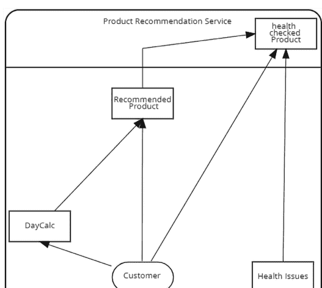

Figure 4.25 – A safer product recommendation service

此模型可作为 04_Product_Recommendation-collect.dmn 下载，但使用以下更改对我们之前的决策表示例进行重建也很简单：

1. 我们移除了 **Customer Birth Day** 决策节点，因为它不再用于测试，但保留了用于决策表的 **DayCalc** 函数。
2. 我们将 **Recommended Product** 决策策略上的 HIT 策略更新为 **Collect**。 对于我们的健康检查来说这没有区别，但比使用 HIT 策略 **First** 更好的做法。 否则，决策表保持不变。
3. 我们对 **Customer** 数据类型不做任何更改。
4. 我们添加了一个新的 **List** 类型的决策节点，指定我们需要关注的关键健康问题。 对于我们的示例，我们指定了 `lactose intolerant` 和 `nut allergy` 值，如 *Figure 4.26* 所示：

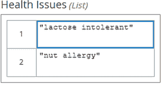

Figure 4.26 – Health Issues list

5. 我们添加了一个新的 **Health Checked** 产品决策节点。 虽然我们本可以使用一个小的决策表，但为了保持简单，我们将其设为如 *Figure 4.26* 中的字面表达式。 `if Customer.Special Requests in Health Issues then "Potential Health Issue - please check" else Recommended Product` 表达式可确保任何潜在的健康问题如果在 **Health Issues** 列表中就会被突出显示。 否则，规则会将决策表的推荐传递下去：

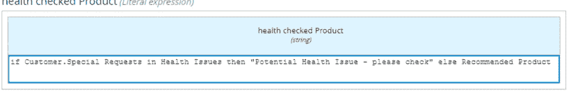

Figure 4.27 – Implementing our health check in a decision node

6. 最后，我们将决策模型包装为决策服务，以使人们关注使用正确的 **health checked Product** 节点，而不是任何中间计算。

当我们运行此决策模型时，我们仍然像以前一样进行产品推荐。 然而，如果存在任何潜在的健康问题，它们将被标记以供人工干预。

这种布局是标准做法——我们会在业务规则上谨慎行事，并在敏感情况下允许真正的现场人员做出最终决定。 由于人员只需处理一两个有趣的案例，而不是成千上万的无聊案例，因此对他们来说体验仍然更好。 它还使我们能够专注于编写适用于绝大多数情况的规则，因此我们不会浪费太多时间在可能只适用于极少数订单的情况上。

> ### Decision Models as a safety net for AI – neural networks
> 
> 稍后，当我们有数十万个订单时，我们可能会训练一个神经网络来取代我们的 **Product Recommendation** 决策表——正如我们在 *Chapter 11* 中所做的那样。 但我们会犹豫是否要信任神经网络来正确处理生死攸关的决策（例如坚果过敏）。
> 
> 我们无法保证神经网络在每种情况下的输出。 将基于规则的方法（例如带有神经网络的 **health checked Product** 节点）结合起来可以为我们提供一个安全网，确保重要的检查会按我们指定的方式精确执行。

### Summary

本章我们从决策模型有用的想法转变为亲手使用决策表和业务规则。 基于一家巧克力店的业务情况，我们构建了一个简单的产品推荐引擎，应该能为你的日常工作提供大量灵感。

我们在过程中使用了许多重要工具，并学习了如何使用结构化编辑器对数据建模，使其更清晰地显示信息将如何传入和传出我们的决策模型。 我们创建了决策表，功能日益强大，以展示决策解决方案的可扩展性有多强。 我们还查看了其他节点类型和表达式，它们帮助我们为决策表准备数据。

在这些工具背后，我们看到了许多重要概念——我们对 FEEL 表达式的强大功能有了更多了解。 我们研究了不同的 HIT 策略如何使我们的业务规则更易于理解并避免漏洞。 我们还看到了如何设计决策服务，以确保我们不会忽视可能影响人们健康的使命关键决策。

到目前为止，在本书中，我们一直使用 KIE 沙箱作为编写和执行决策模型和业务规则的工具。 但由于我们大部分工作时间都在 Excel 中，我们希望能够从电子表格中利用 KIE 和 Drools 的强大功能。 我们将在下一章中了解如何做到这一点。

大多数网站是只读的，或者接近只读，但如果你可以请求数据中心中的空间并像在手机上一样安装应用程序到其中呢？ 然后你将与数据中心中新安装的应用程序通信，而不是你的手机。 那就是云的非常简单的概念。

Excel 365，Office 的在线版本，就是一个例子。 你不知道托管你文档的数据中心的位置，但你确信 Microsoft 拥有所有安全检查来保护你的信息安全。 Microsoft 专注于在其数据中心运行 Office 365 应用程序，因此他们做得相当好，并且可以根据需求上下扩展所需的计算机。

对于在云中运行 Kogito 并部署你的决策模型，Red Hat 提供了一个几乎一键式部署按钮来在线托管你的决策模型。 这基于 Red Hat 的云产品 (**OpenShift**)，我们很快就会启动并运行。

### Reality check – why not connect Excel to the local KIE Sandbox?

从技术上讲，可以修改本书中的脚本技术，使 Excel 与 KIE Sandbox Extended Services——你在 *Chapter 3* 中安装的本地工具——之间进行通信。

然而，你真的不想这样做，原因如下：

- KIE Extended Services 的重点是帮助你的规则开发，并且它们可能会因版本而异（这会破坏连接到它的任何 Excel 表）。
- KIE Extended Services 在你的笔记本电脑之外不可用——这使得同事更难使用它。
- KIE Extended Services 每次都期望发送一份 DMN 决策模型的副本。 这对于浏览器中的 KIE Sandbox 来说是可以的，但我们无法从 Excel 中轻松访问模型。

实际上，你会发现一键式部署如此易于使用，以至于将决策模型托管在 OpenShift 上很可能会成为你的首选解决方案。 作为奖励，部署到云中会自动为我们提供一个用于生产的强大、可扩展的平台，这是本书的一个重要目标。

如果在本地运行决策模型对你至关重要（例如，在你公司场所的计算机上），请查看 *Chapter 10* 中使用 *Docker* 的技术，这应该能为你提供合适的解决方案。

### OpenShift – Red Hat’s piece of the cloud

Red Hat（IBM）的云产品称为 **OpenShift**。 它功能齐全，意味着它可以完成 Google、Amazon 和 Microsoft 等其他主要云供应商提供的几乎所有功能。 虽然可以将 Kogito 部署到这些其他云供应商，但我们选择 OpenShift，因为它为 Kogito 和我们的决策模型提供了一个简单的一键式部署。

功能齐全也意味着 OpenShift 有很多我们不需要在本书记载的按钮；我们将忽略这些，专注于你部署决策模型所需的内容。 如果你觉得需要了解更多，我们推荐 Packt 出版的 `https://` 上的 *OpenShift for the Absolute Beginner*。


www.packtpub.com/product/openshift-for-the-absolute-beginner-hands-on-video/9781838559090.

OpenShift 有一个名为 Developer Sandbox 的免费层级（不要与 KIE Sandbox 混淆）。这让你可以尝试部署，并在之后选择升级到付费订阅。显然，免费版本有一些限制，我们将在本节末尾提到。总的来说，Developer Sandbox 足以用于开发业务规则，但如果你是与付费客户一起使用，你可能需要升级到完整版本。

让我们逐步了解如何为 Developer Sandbox 注册、设置完成后如何访问 Sandbox、将 Sandbox 链接到 Developer Sandbox，以及将我们的决策模型部署到其中。

### 为 OpenShift Developer Sandbox 注册

为 OpenShift Developer Sandbox 注册的过程与加入 Gmail 或 Facebook 等热门网站类似。你访问网站，提供一些个人信息，验证你的电子邮件或手机号码，然后即可登录到该网站。我们将一步步带你完成这些步骤以开始使用：

- 1. 打开主 Developer Sandbox 页面 https://developers.redhat.com/developer-sandbox。
- 2. 虽然该页面包含大量信息，但其中很多我们不需要。点击 Start your sandbox for free 按钮：

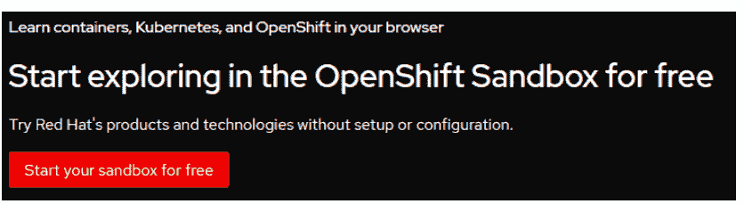

图 5.1 – 为 OpenShift Sandbox 注册

- 3. 输入你的电子邮件以开始设置 OpenShift 账户的过程。

你将被要求提供基本信息，包括密码。填写所有必要字段后，点击 Create My Account 按钮。

- 4. 在账户创建过程中，你将被要求确认你的手机号码。这是为了让人们更难为自己注册多个账户。你需要输入发送到你手机上的验证码。

- 5. 你还将在设置过程中被提示选择一个项目名称——这个名称之后无法更改，因此请选择一个你愿意与业务同事分享的名称。

- 6. 最后，在通过电子邮件发送给你的链接点击确认你的电子邮件地址后，你应该会看到 You’re ready to get started! 消息：

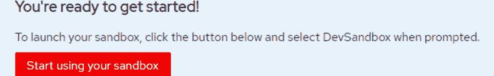

图 5.2 – OpenShift sandbox 设置成功

在注册过程中，你可能会在收到的电子邮件中看到一些你不太理解的措辞。例如，见下文：

```
Notice: Your Developer Sandbox for Red Hat OpenShift account is provisioned
```

沙盒有点像租一间公寓公寓。我们不拥有它，但在租期内只有我们才能访问建筑物的这一部分。我们期望在入住时它完全干净，没有前租户的任何痕迹，并且我们期望列出的所有功能（床、咖啡机等）都可以使用。Provisioned 意味着此设置过程已完成。

更好的比较

由于沙盒在我们使用后会被完全拆除并重建，更好的比较是德国式的租赁方式，即公寓被剥离到几乎只剩裸墙，每个租户都必须自行安装电器和家具。

电子邮件中的另一个提醒如下：

```
Your account will be active for 30 days. At the end of the active period, your access will be deactivated and all your data on the Developer Sandbox will be deleted.
```

Red Hat 允许我们免费使用他们的云，但他们必须在某处划清界限。30 天足够尝试本书中的想法，你可以使用相同的联系信息再次注册，获得多个 30 天周期。

总体而言，我们始终会保留决策模型的本地副本，并且决策模型运行结束后不会存储数据，但这是一个有用的提醒！

### 访问你的 OpenShift Developer Sandbox

现在我们已经设置好账户，前往 `https://developers.redhat.com/developer-sandbox` 开始使用我们的新云环境。网站应该会记住你已登录（如果需要也会提供选项），你可能需要点击 **Start Using your Sandbox** 以查看主 OpenShift 控制台，如 *Figure 5.3* 所示：

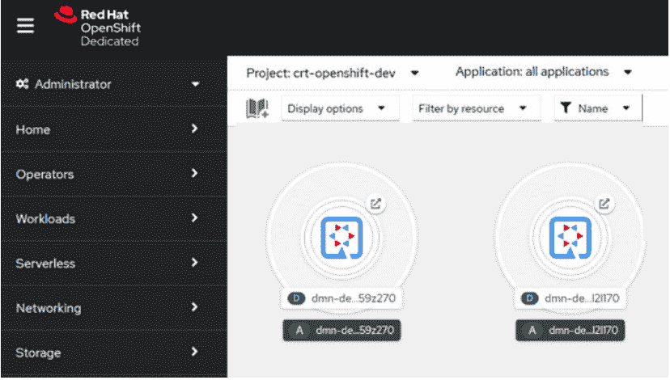

图 5.3 – OpenShift 控制台

这张图片展示了 OpenShift 云提供的强大功能。我们不会像往常一样对屏幕进行巡视；相反，我们将其作为我们已正确设置 Developer Sandbox 的确认。如果你好奇，可以四处看看，但我们将专注于获取两个关键信息，以便将本地 KIE Sandbox 与这片云链接起来。

### 两个重要的链接信息

在离开 OpenShift 控制台之前，让我们记下两个关键信息，我们稍后需要将其链接到我们的 OpenShift 实例。*Figure 5.4* 显示了控制台右上角项目名称下的菜单。你的项目名称会不同，但 **Copy login command** 保持不变。

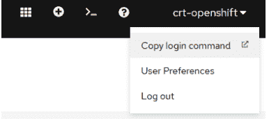

图 5.4 – 复制登录详细信息

选择 **Copy login command** 后，你将看到类似 *Figure 5.5* 的页面。此过程中的操作很多，值得一步步讲解：

- 1. 由于这是访问敏感信息，你可能需要再次登录。你会看到一个简单的屏幕，显示 **Display Token**。点击此链接将显示两条信息。
- 2. 查找以 **Your API token is sha256~_oNI_uw-qyD6A~-EI-Qhg1-sddfFezCFZ-gZxLxFZUo** 开头的行。请注意，*你的令牌会不同，因为它是唯一的并且每天都会更改*。
- 3. 复制从 **sha256** 开始到该行末尾的文本。
- 4. 最好将其保存到文本文件（使用记事本）中，因为我们需要从此页面复制第二个值。我们将使用此令牌代替用户名和密码，以便 OpenShift 在我们从 KIE Sandbox 连接时知道是我们。
- 5. 我们的第二个值是用于查找我们在云中 OpenShift 实例的 URL（网络位置）。该值在下一行以 **oc login** 开始。你需要取 **server=** 之后到该行末尾的文本，如 *Figure 5.5* 中突出显示的那样。同样，你的值是唯一的，会与图片不同。

```
oc login --token=sha256~_oNI_uw-qyD6A~-EI-Qhg1-sddfFezCFZ-gZxLxFZUo
server=https://api.sandbox.x8i5.p1.openshiftapps.com:6443
```

图 5.5 – 复制服务器详细信息

- 6. 将此服务器 URL 保存到某处——我们即将用它来链接到我们的 KIE Sandbox。

### 链接 KIE Sandbox 和你的 OpenShift 实例

如果尚未打开，请前往本地 KIE Sandbox https://sandbox.kie.org/。我们使用“本地”一词，因为到目前为止，所有决策模型都保存在我们本地笔记本电脑的网络浏览器中。

> **KIE Sandbox 持续演进**
> KIE 团队一直在不断开发沙盒，因此屏幕截图可能会与此处展示的略有不同。提供令牌通过设置菜单将 KIE Sandbox 链接到 OpenShift 和 GitHub 的基本概念将保持不变。

我们将 KIE Sandbox 链接到新的 OpenShift 云实例时，转向本地云：

- 1. 点击 KIE Sandbox 屏幕右上角的设置图标。
- 2. 在出现的弹出屏幕中点击 **OpenShift**，你应该会看到类似 *Figure 5.6* 的设置屏幕：

#### Settings

GitHub   OpenShift   KIE Sandbox Extended Services

Configure through the guided wizard instead→

Namespace (project) * ?

Host * ?

Token * ?

Connect

图 5.6 – 输入服务器详细信息

3. 虽然可以直接在此处输入详细信息，但第一次使用时点击 Configure through the guided wizard instead 更容易。

连接向导的第一步要求输入项目名称。如果你忘记了它，请返回 OpenShift；它在屏幕右上角。我们的项目是 crt-openshift-dev，你的会不同，必须与 OpenShift 设置完全匹配。图 5.7 显示了一个示例。完成后，点击 Next。

#### Settings

GitHub   OpenShift   KIE Sandbox Extended Services

- 1. Create your instance
- 2. Set credentials
- 3. Connect

In order to create your Developer Sandbox instance:
1. Go to the Get Started page
2. Follow the steps to launch your instance. You will be asked to log in with your Red Hat account.
3. Once your instance is up and running, inform the namespace (project) in your cluster you want to have the Decision Model deployed to.

Namespace (project)   crt-openshift-dev

This information is necessary for deploying your Decision Model into the right project namespace.

Next   Back   Cancel

图 5.7 – 连接向导步骤 1


- 4. 连接向导的第二步是图 5.8 – 它会要求输入我们之前保存的 Host 和 Token 详细信息。请注意顺序可能不同 – Host 会以 https 开头，而 Token 以 sha 开头。输入这些值后，点击 Next。

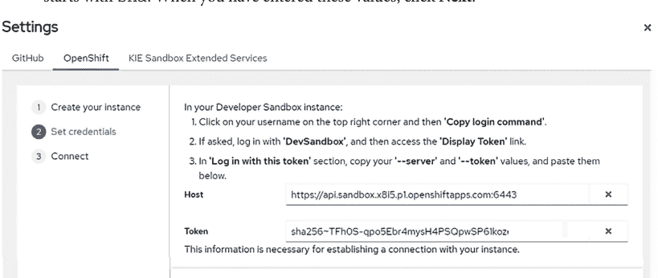

图 5.8 – 连接向导步骤 2

- 5. KIE Sandbox 将尝试连接你的 OpenShift 实例，如果成功，将显示“Connection successfully established.” 消息，如图 5.9 所示。点击 Save 完成此步骤。

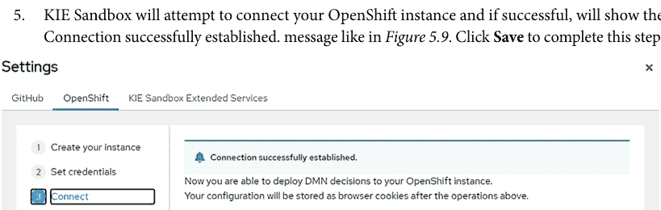

图 5.9 – 连接向导的步骤 3

### Troubleshooting your connection

最大的问题通常是设置连接时使用了错误的项目、主机或令牌名称。或者，你可能有正确的值但放在了错误的位置。你也可能有大部分值，但可能缺少令牌的最后一个字母。

令牌每 24 小时就会更改一次，所以不要害怕返回检查，并且当然要始终检查你的互联网连接是否正常以及你的 OpenShift 实例是否正在运行。

### Deploying your decision model to OpenShift

现在我们已经建立了连接，返回 KIE Sandbox 中的主决策模型编辑器屏幕。你可能需要点击编辑器右上角的 X。

我们将把上一章中制作的决策模型部署到 OpenShift。作为提醒，包含所有书籍示例的 GitHub 页面是 https://github.com/PacktPublishing/AI-and-Business-Rules-for-Excel-Power-Users，而你需要查找的具体示例是 04_Product_Recommendation-collect.dmn。如果你还没有它，你需要先下载并导入到本地沙盒中：

- 1. 在 KIE Sandbox 屏幕右上角，点击 Try on OpenShift，然后，如图 5.10 所示，选择我们想要部署的模型名称（在本例中，是我们的 Product Recommendation 示例）。

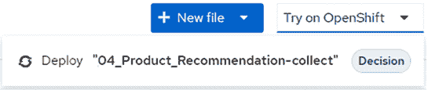

图 5.10 – 选择要部署的决策模型

- 2. KIE Sandbox 将会像图 5.11 那样要求确认：

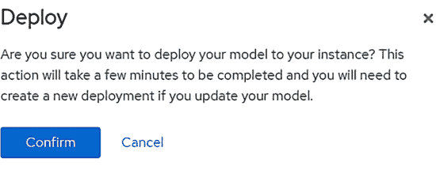

图 5.11 – 确认部署

- 3. 然后会出现一个简短的 *in progress* 消息，如 *Figure 5.12* 所示：

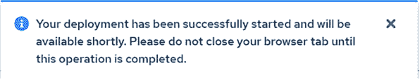

图 5.12 – 部署进行中

- 4. 当你的部署完成后，你会看到如图 *Figure 5.13* 的消息：

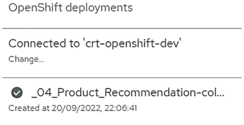

图 5.13 – 部署成功消息

- 5. 如果你点击绿色勾选框旁边的模型名称，如 *Figure 5.13* 所示（在本例中为 **Product Recommendation**），KIE Sandbox 会非常贴心地打开一个新网页，指向我们在 OpenShift 上部署的模型，如 *Figure 5.14* 所示：

图 5.14 – 我们在 OpenShift 上的已部署模型

这个屏幕看起来非常熟悉 – 它是 KIE 沙盒中输入-输出屏幕的一个版本，应该看起来很熟悉；沙盒的目标是在生产部署后使用时实现快速、迭代的开发且没有意外。

随意尝试一下；你会看到输入和输出按预期工作，但你将无法查看用于生成这些决策的模型。你也不希望最终用户更改你制定业务规则的方式。

毫无疑问你为这一成就感到自豪，所以请继续与同事分享。与沙盒不同，他们可以使用你使用的相同 URL 访问此页面。他们将能够使用此决策模型并惊叹于你迈出进入业务规则和 AI 的第一步。

在我们过于兴奋之前，我们需要记住我们仍然在使用 Developer Sandbox，而它有一定的限制。

### Important notes on the OpenShift Developer Sandbox

OpenShift Developer Sandbox 很棒，因为它是免费的（你可以先试后买），但它具有完整云服务的大部分实质性功能。然而，你需要记住免费版本的几个限制：

- 令牌需要每天续期。这意味着你需要使用上一节中的说明重新链接 OpenShift 和 KIE Sandbox。这并不麻烦，但你需要记住去做，否则沙盒会给你一个错误。
- Developer Sandbox 需要每 30 天续期一次，在此续期之前，OpenShift 中的所有数据将被删除。这不是问题，因为你始终会有决策模型的本地副本，而且你不应该在沙盒中存储任何数据在你的模型中。
- 默认情况下，部署到 OpenShift 的任何模型都是公开访问的。这对于与同事分享链接以供他们测试来说很棒，但你可能想要调查 OpenShift 中的安全和访问限制以限制谁可以看到你的模型。

最后一点需要记住的是，如果你让 OpenShift 沙盒保持运行，它将在 8 小时后被停用。你会收到类似这样的电子邮件：

```
In accordance with the usage terms of Developer Sandbox, we have
reduced the number of instances of your application to zero (0). You
can restart your application(s) by increasing the number of instances
from the Developer Sandbox User Interface.
```

有多种方法可以重启你的应用程序。也许最快的方法是执行以下操作：

- 1. 打开 OpenShift 网页控制台。
- 2. 在屏幕右上角，会有一组图标，如 *Figure 5.15* 所示：


图 5.15 — OpenShift 中的命令提示符图标

- 3. 点击 >_。这将导致你的应用程序重启；它还会打开一个位于屏幕底部的面板，看起来像终端，但这是一个副作用，我们不需要在其中输入任何内容。

所有这些限制在开发期间不会造成问题，但如果你确实打算将决策模型部署用于真实的业务用途，最好迁移到付费层级。

> **Remember the online resources**
> KIE Sandbox 和 Red Hat 团队在我们于 *Chapter 2* 中提到的在线资源上投入了大量精力。现在是重新查看它们的好时机。其中有一个特别好的关于将 KIE Sandbox 与 OpenShift 链接的视频，网址为 https://youtu.be/2zY85TXFNuw（或在 KIE YouTube 频道搜索 *DMN Dev Sandbox Developing and deploying DMN decisions in the cloud*）。

由于我们已经迈出了将模型部署到我们自己的笔记本电脑之外的重要一步，现在可能是讨论如何处理数据的好时机。

### Taking care of your data

我们很高兴看到立法朝着增加数据隐私的方向发展。作为处理数据的人员，我们有时会诅咒这些法规，但从很多方面来说，这只是确保我们希望无论如何都会寻求做到的事情：*在处理个人数据时保持尊重。*

个人数据是任何可以识别某人的信息——与姓名关联的电话号码、电子邮件（因为它通常包含名字或姓氏），或地址。例如，如果我们谈论的是一个男性，21 岁以下，住在 59 Bolton Square，很明显我们谈论的是谁。

即使你不住在欧洲，你也可能感受到了欧盟 **General Data Protection Regulation (GDPR)** 的影响。例如，如果你位于美国，并且正在处理居住在欧盟的客户，该法规仍然会保护该客户，并附带令人瞠目结舌的罚款威胁。还有许多其他本地等效法规（美国加州是最值得注意的）。

法规写得相当好，而且从第 1 天就开始遵循它们更容易。迄今为止，你的许多决策和个人数据都保存在公司内部（在 Excel 表格中）。GDPR 和数据保护法规仍然适用，但你会注意到我们开始将数据传递给外部服务（现在是 IBM/Red Hat，很快是 Microsoft）。这使得 GDPR 的话题变得更加重要。

好消息是，本书建议的方法可能会让你更符合 GDPR：

- 我们在上一章中谈到不要在业务规则中使用特定的个人信息。由于我们只应传递做出决策所需的信息，我们的系统受 GDPR 影响的可能性要小得多。


- IBM 和 Red Hat 在安全、客户保密以及确保符合 GDPR 方面花费了大量时间。这些厂商将声誉押在保持数据安全上，而这种安全级别并非每个小型公司（包括你的公司）都能达到。
- 本书提倡更正式的数据管理技术和决策方法。我们正从组织内散落的 Excel 电子表格（数据管理噩梦）转变为以连贯的方式存储和处理它们。这种方法也使 GDPR 合规变得更容易。

从良好的数据管理习惯开始，将使你的生活在以后变得轻松得多。另一个你以后会庆幸的好习惯是备份并对决策模型进行版本控制。让我们看看 KIE Sandbox 与 GitHub 的内置集成是如何让我们做到这一点的。

### 使用 GitHub 保存和共享你的决策模型

你可能没有太在意（除了 KIE Sandbox 中的 **Ephemeral** 消息），但你目前是将决策模型保存在与你的网络浏览器关联的本地存储中。虽然这对于入门来说很棒，但我们不建议将其用于长期使用。如果你的笔记本电脑丢失了——你有备份吗？你如何与同事共享决策模型？如果意识到自己犯了错误，想恢复 5 分钟前的版本怎么办？本地存储很难让你完成这些事情。

幸运的是，KIE Sandbox 提供了通往最佳协作网站的链接：GitHub。你可能还记得在 *第 2 章* 中我们介绍 KIE 和 Drools 项目时提到的 GitHub，它让数百名开发者能够协作、共享文件并浏览他们工作的不同版本。

GitHub 提供了私有仓库选项，你可以将其用于自己的项目并限制为仅希望协作的人员。需要注意的是，你的仓库是你的空间——它与托管在同一站点上的任何 Red Hat 项目无关，但这意味着我们需要设置自己的空间并将其链接到 KIE Sandbox。现在让我们逐步进行。

### 注册 GitHub 并获取你的 token

要使用 GitHub，你需要注册一个账户。该网站由 Microsoft 所有，并且其其他网站的登录（目前）还不可用。要获取你的 GitHub 登录，请执行以下操作：

1. 前往 GitHub 主页 `www.github.com`。
2. 你会看到一个欢迎页面，其中有一个大的 **Sign up for GitHub** 按钮。
3. 点击此按钮将带你进入 *图 5.16* 中的账户注册屏幕：

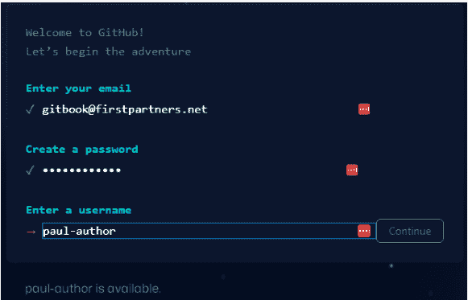

图 5.16 – GitHub 注册屏幕

4. 在输入你的详细信息（包括新用户名和电子邮件地址）后，点击 **Create Account** 按钮。
5. 你会收到一封验证电子邮件地址的消息。点击该邮件中的链接将带你进入 GitHub 上的个人主页。

### GitHub 上个人主页的导览

你在 *图 5.17* 中看到的页面与你在 *第 2 章* 中看到的 Kogito/Drools 项目页面不同。这是你在 GitHub 上的个人页面，提供了探索你可能想要交互的多个项目的选项。

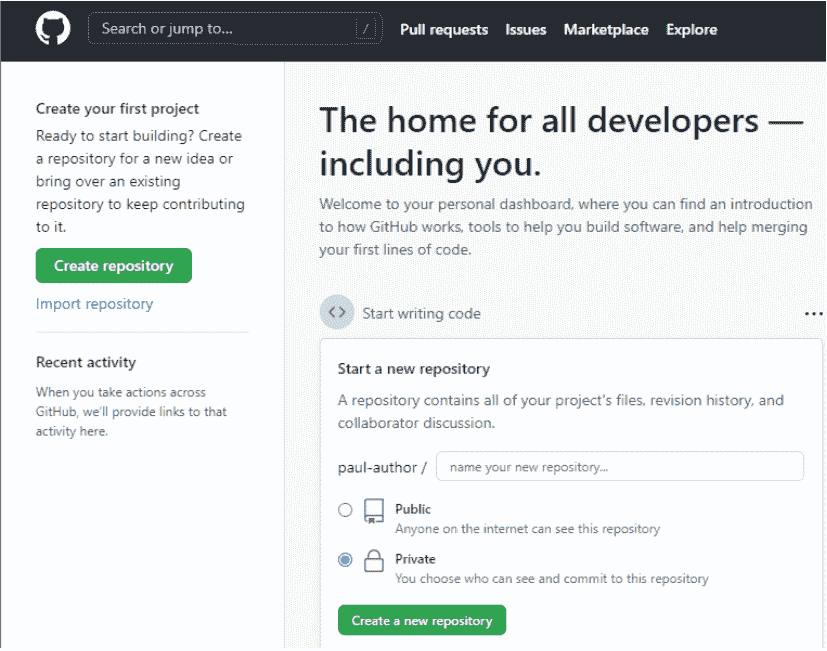

图 5.17 – 你的个人 GitHub 主页

这里有一个创建仓库的选项（使用此页面底部的绿色按钮），用于存储我们的决策模型文件，但 KIE Sandbox 也能为我们做到这一点（我们将在本章后面看到具体如何操作）。让我们专注于将 KIE Sandbox 与我们刚刚创建的 GitHub 仓库链接所需的步骤。

要创建 KIE Sandbox 与 GitHub 之间的链接，我们需要在 GitHub 上拥有一个个人 token。就像 OpenShift 一样，这个 token 替代了我们的用户名和密码，以便 GitHub 知道 KIE Sandbox 获准代表我们行事。要创建此 token，请按照以下步骤操作：

1. 在 GitHub 的右上角（任何屏幕），点击个人资料设置，如 *图 5.18* 所示。


图 5.18 – 你的 GitHub 个人资料设置

2. 搜索 **Developer settings**（左下角，列表末尾），然后像 *图 5.19* 中那样突出显示 **Personal access tokens**。

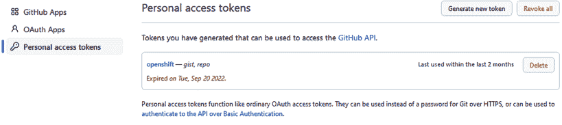

图 5.19 – GitHub 的 Personal access tokens 屏幕

3. 点击 **Generate new token** 按钮，然后在提示时确认你的 GitHub 密码。

4. *图 5.20* 中的屏幕将会出现，允许你设置与此 token 关联的权限。权限必须包括仓库范围，以便当 KIE Sandbox 使用 token 时，它可以创建新的仓库来存储模型。请注意，还有更多选项，但我们已裁剪图像以适应页面。

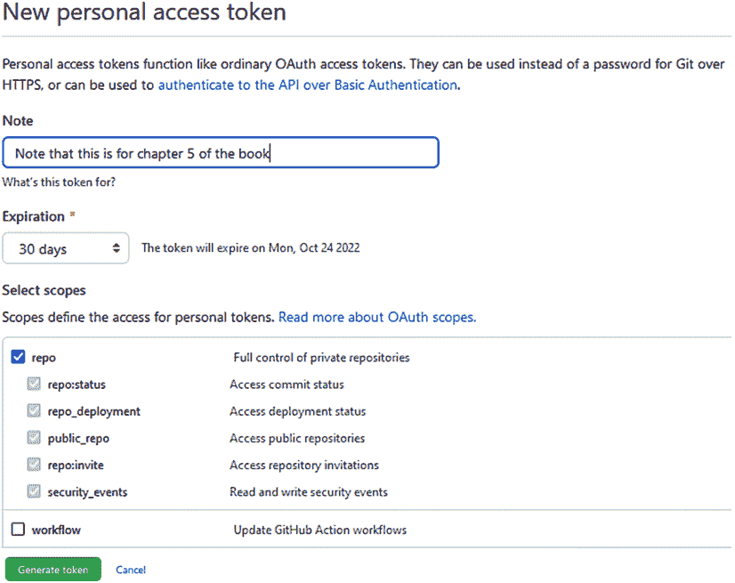

图 5.20 – 为新的个人访问 token 设置权限

立即复制屏幕上出现的 token（如下图 5.21 所示），因为它不会再次显示。我们很快就会在下一节的第一步中使用它，将 token 添加到 KIE Sandbox 以将其链接到我们的 GitHub 账户。

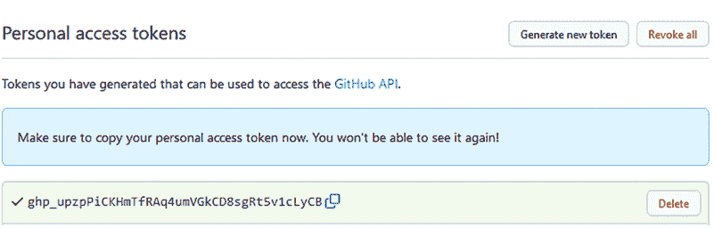

图 5.21 – 复制新生成的个人访问 token

> **关于 GitHub token 的更多信息**
> 我们只会给你足够的信息来使用 KIE Sandbox 创建与 GitHub 的链接，但如果你想了解更多关于 GitHub token 的信息，一个不错的起点是 https://docs.github.com/en/authentication/keeping-your-account-and-data-secure/creating-a-personal-access-token。

### 使用你的 token 在 KIE Sandbox 上协作

由于我们已经设置了 GitHub 账户并记下了唯一的访问 token，我们希望将 KIE Sandbox 与其链接：

1. 你需要先在常用页面 https://sandbox.kie.org 上打开 KIE Sandbox。
2. 点击右上角的人物图标选择 Connected Accounts，然后选择连接 GitHub 账户的选项。
3. 在此屏幕上粘贴你的 GitHub token。粘贴 token 后，你应该会收到一条确认连接的消息（如图 5.22）：

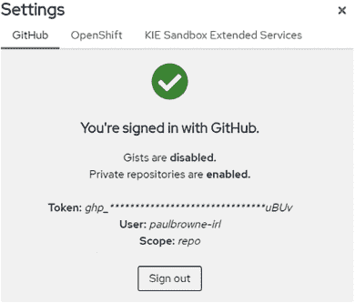

图 5.22 – 成功链接 KIE Sandbox 和 GitHub

4. 在收到此成功消息后，点击右上角的 x 关闭弹出窗口。

5. 现在，如果我们点击主 KIE Sandbox 右上角的 **Share** 菜单，你会看到我们有额外的选项，如 *图 5.23* 所示。请注意，我们为节省空间移除了几项菜单项，因此你可能需要在屏幕上向下滚动才能看到我们突出显示的选项，当然，你的 GitHub 用户名会有所不同。

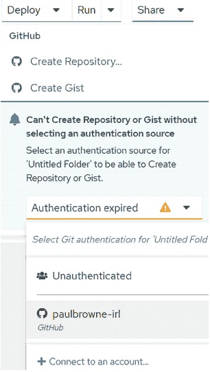

图 5.23 – 使用我们新创建的 GitHub 连接进行共享

6. 向下滚动并选择你刚刚连接的 GitHub 账户。

现在 KIE Sandbox 和 GitHub 已链接，让我们利用该链接解决之前看到的一些问题。

### 用于保存和项目协作的 GitHub 流程

一旦 KIE Sandbox 链接到 GitHub，我们将在屏幕右上角的 Share 菜单中拥有更多选项。由于我们担心本地存储，我们希望将决策模型保存在更稳健的地方：

1. 在 Share 菜单中，我们现在有了 Create repository 选项。点击它，你将看到如图 5.24 所示的选项屏幕：

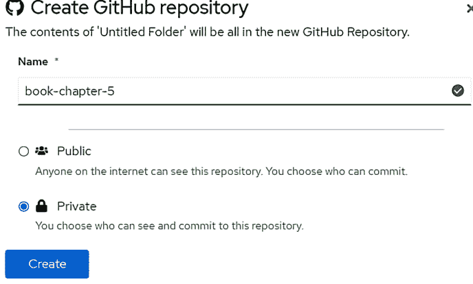

图 5.24 – KIE Sandbox 在 GitHub 中为我们的决策模型创建仓库

2. 输入仓库名称并选择创建为私有的选项（我们以后可以更改此设置）。

3. 经过几秒钟，你会看到一条确认消息，表明仓库已创建以及可以查看文件的链接，如图 5.25 所示：

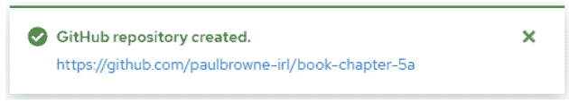

图 5.25 – 仓库已成功在 GitHub 中创建


在我们去检查保存在 GitHub 上的文件之前，花一分钟时间了解一下 KIE Sandbox 和 GitHub 链接后屏幕的其他变化是值得的。主要变化已在图 5.26、图 5.27 和图 5.28 中突出显示。

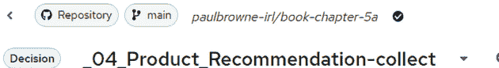

图 5.26 – 链接到 GitHub 时 KIE Sandbox 屏幕的变化，左上

- 单词 Repository 取代了 ephemeral，表示我们的决策模型正在保存在 GitHub 中。
- main 表示我们正在工作的分支。虽然完全在 main 上工作是可能的，但分支允许你在并行轨道上工作，并在准备好时将整套更改合并回主轨道 main。
- KIE 还显示了用户名/Git 仓库名称以及一个绿色勾号，表示一切正常。

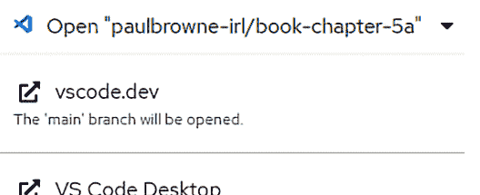

图 5.27 – KIE Sandbox 屏幕的变化，右上，VS Code 的新选项

屏幕上还出现了其他选项。在右上角，我们有在 Visual Studio Code 中打开决策模型的选项。我们将在第 12 章中更详细地介绍这一点。

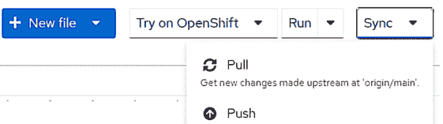

图 5.28 – KIE Sandbox 屏幕的变化，右上，新的同步选项

右上角还有一个新的同步菜单。Pull 和 Push 是你会经常使用的标准 GitHub 概念：

- **Pull** 用于你想要获取他人的更改并下载到本地副本以刷新时
- **Push** 用于你在本地进行了更改并希望将其发送到 GitHub 的主上游仓库时

当我们介绍编辑和保存决策模型的常见工作流程时，我们将演示这些概念。现在我们已经完成了变化的巡视，让我们检查 KIE 实际上如何在 GitHub 上保存了我们的仓库。

4. 返回你在 GitHub.com 的个人页面。你会看到 KIE 创建了一个私有仓库，如图 5.29 所示：

   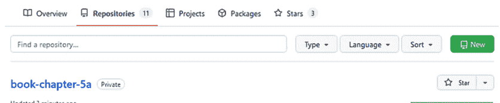

   图 5.29 – 在 GitHub 上创建的新仓库

5. 当你点击该仓库时，你会看到它包含我们所有的决策模型文件（如图 5.30 所示）：

   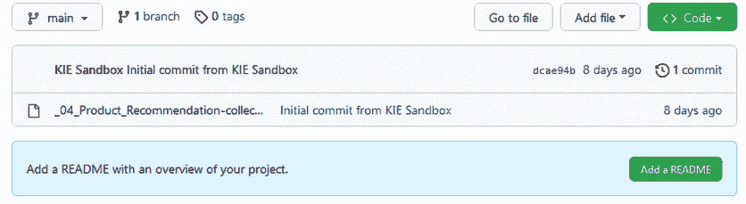

   图 5.30 – 决策模型在仓库中共享/存储

6. 如果你点击模型名称，你会看到它是一种标准的 XML 格式，充满了嵌套的 `<Tags>`；它只是一个 XML 文件。如果你使用 Chrome，KIE 有一个插件可以可视化和编辑此 XML 文件作为决策模型。然而，其功能与 KIE Sandbox 编辑器非常相似，因此虽然安装它很有用，但我们不会详细介绍。

更重要的是，现在我们已经将文件安全地保存在 GitHub 仓库中，让我们邀请选定的同事与我们一起协作。

### 分享你的仓库

由于我们将仓库设置为私有，我们需要邀请同事与我们协作：

1. 在 GitHub 上打开你的项目（非个人）设置页面。你可以在项目名称下找到它（如图 5.31 的最右侧）：

   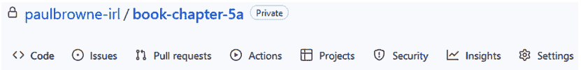

   图 5.31 – 在 GitHub 上找到项目设置

2. 一旦看到项目设置屏幕，点击协作者选项，你将有邀请同事的选项，如图 5.32 所示。

   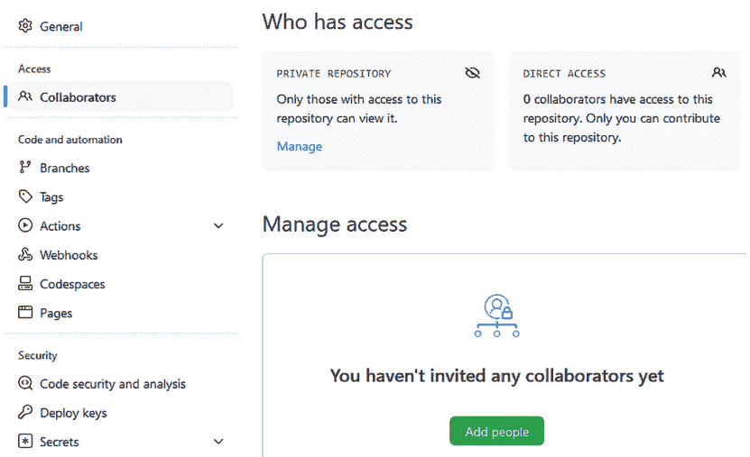

   图 5.32 – 邀请其他人协作决策模型

3. 当然，你需要知道他们的 GitHub 名称。一旦你邀请他们，他们将可以访问你的仓库（仅此项目）。

现在你的同事可以访问了，他们如何与你协作这些决策模型呢？Git 和 GitHub 如此强大的原因在于有许多不同的工作流程供你选择，而哪一个最适合你则取决于个人选择。

> **Git 和 GitHub**
>
> 本书将 **Git** 和 **GitHub** 视为可以互换的工具进行讨论，并且由于本书中使用的工具（KIE Sandbox，以及后来的 Visual Studio Code）已嵌入了 Git 协议，你不太可能直接使用 Git 工具。然而，了解 **Git** 是允许人们在项目中的多个文件上协作的工具，而 **GitHub** 是帮助你找到这些项目和人群的网站是有用的。

### 不同工作流程

你可能习惯于 Office 365，每个人都在一个文件的通用版本上工作。Word 和 Excel 足够快，可以实时看到更改，因此冲突更改通常不是问题。Office 365 提供简单的版本控制：如果别人做了你不喜欢的编辑，你可以回滚到上一个版本，或上周大家都认为可以的版本。

虽然我们目前只有一个文件，但我们很快就会进展到多个相互关联的模型，我们希望在这些模型上协作。这就是 Git 和 GitHub 为你提供更强大的协作工作流程的原因。

一个重要的区别是，虽然可以直接在 GitHub 上编辑文件，但大多数时候你使用的是本地副本。当你确信一切按预期工作时，才会将文件推送到上游仓库的主分支。

Git 的使用方式有很多，这正是它如此强大的原因。如果你想了解更多，请查看 Packt 关于 Git 的书籍，网址为 `https://www.packt.com/?s=github&post_type=product`。

现在，让我们讨论两种最常见的工作流程。

### 使用 KIE 的简单单人工作流程

使用 Git 和 KIE 也许最简单的方法如下：

1. 如我们所述链接 KIE 和 GitHub。这为你提供了决策模型的本地副本和 GitHub 网站上的备份副本。
2. 如前所述对决策模型进行更改。像以前一样，这些更改会自动保存在本地。
3. 定期将本地更改推送/提交到在线的 GitHub 仓库。

这是良好的实践——如果你丢失笔记本电脑，你将拥有工作的备份副本，并且它允许你在编辑时更勇敢，因为你拥有可以恢复的所有先前版本。它也让你习惯使用 Git 工作流程。

然而，Git 工具的真正威力在协作时变得更清晰。以下是你可能会使用的一种简单协作工作流程。

### 使用 KIE 的简单协作工作流程

我们假设你已经链接了 KIE 和 GitHub：

1. 按之前的说明邀请你的同事协作。
2. 你们两人都会有本地副本（在 KIE Sandbox 中），因此可以继续像以前一样编辑。
3. 你可以继续将更改推送到 GitHub，但你的同事可能需要创建一个拉取请求，请求你在接受或拒绝其工作合并到主分支之前检查其工作。
4. Git 会通知你任何冲突（例如，如果你们同时编辑了同一个文件），并给你机会解决它们。

你会注意到我们没有详细介绍这两种工作流程。Git 和 GitHub 的使用方式还有很多，但作为行业标准的协作工具，学习版本控制、主分支和其他分支、仓库以及推送和拉取文件的概念是非常值得的。至少，我们建议使用简单的单人工作流程来备份你的文件，并建立对 GitHub 工具的信心。

我们将介绍一个使用 GitHub 的最后示例，这并不是真正的工作流程，但在本书中尝试示例时很有用。

### 直接从 GitHub 导入模型

作为提醒，KIE Sandbox 首页上有几个导入决策模型的选项。这包括如 *图 5.33* 所示的选项，可直接从 GitHub 导入模型，其中 URL 是你想要使用的项目的首页。

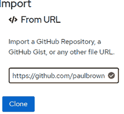

图 5.33 – 直接从 GitHub 仓库导入决策模型

这非常有用，因为 GitHub 托管了许多示例（如本书的示例），你只想下载并试用，而不想将其置于完整的版本控制之下。


### 摘要

在本章中，我们从单独编辑决策模型，转变为能够向同事展示工作成果并协作开发这些模型。

我们介绍了 OpenShift 作为 Red Hat 的云服务，并将我们的 KIE 决策模型部署到其中。我们还介绍了 GitHub 作为协作站点，并展示了如何将其用于常见的协作工作流程。

由于我们现在已经具备了与同事一起构建和部署决策模型的基础，我们将继续将其链接到许多同事使用的工具：从 Excel 调用我们的决策模型。

### 使用 Power Query 从 Excel 调用业务规则

在上一章中，我们探讨了如何协作共享和编辑决策模型。我们还看到了如何将它们部署到 OpenShift 云中，以便其他人可以通过自动生成的 Web 界面运行它们。

这非常令人印象深刻，但我们的同事很可能仍在使用 Microsoft Excel 进行大部分工作。我们如何将业务规则、AI 和决策模型链接到 Excel，并使所有工具协同工作？本章将介绍这一点，包括以下内容：

- 五种不同的链接规则、AI、决策模型和 Excel 的方法——使用 Power Query、Visual Basic for Applications、Script Lab、Office Scripts 和 Power Automate
- 使用 REST 的机器可读网页，以及如何将其链接到我们的决策服务
- Swagger——与 KIE 和 Kogito 决策服务更人性化的链接
- 使用 Power Query 调用决策服务，并通过逐步示例构建可扩展到您自己的工作的解决方案

到本章结束时，您将了解 Kogito 如何发布机器可读的网页，以及如何使用 Excel 中的 Power Query 链接到它。

#### 先决条件

开始之前，最好在笔记本电脑上安装 Microsoft Excel。虽然免费的在线版本（https://www.microsoft.com/en-us/microsoft-365/free-office-online-for-the-web）变得越来越强大，但本章中的一些技术（例如使用 Power Query）只能在桌面版本中完全运行。幸运的是，我们将在下一章中描述的 Script Lab 方法将适用于 Excel 的在线版本。而且我们将介绍其他替代方案（例如 Office Scripts 和 Power Automate），它们可以在 Excel 之外运行——并且与可以读取和写入 Excel 格式文件的其他工具（如 Google Sheets 和 OpenOffice）兼容。

由于我们将介绍很多将 Excel 链接到业务规则的方法，让我们先从概述开始。

#### 五种不同的链接规则、AI、决策模型和 Excel 的方法

在第 5 章末尾，我们看到 KIE 和 Kogito 会根据我们的决策模型自动生成一个网页。我们很快就会看到，这个页面的机器可读版本可以链接到 Excel。无论使用哪种技术，该页面都不会改变。图 6.1 显示了一些我们可以建立这种链接的方式。

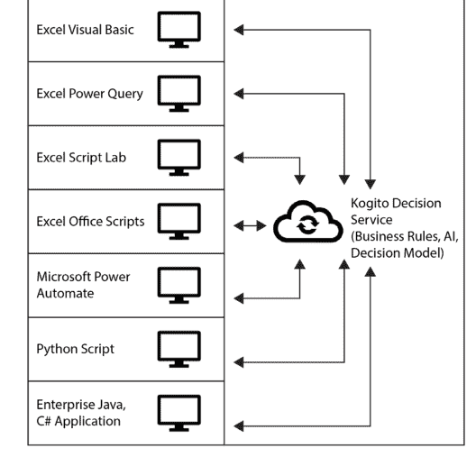

图 6.1 – 将 Excel 链接到我们的决策服务的多种方式

您可能熟悉此图中列出的一些技术——即使不熟悉，我们也将在下一节中介绍它们。关键点是，无论您选择哪种技术，核心的 Kogito 决策服务（包括您的业务规则和 AI）都保持不变。这使您可以选择现在最适合您的技术，同时确信您在决策模型上的投资在您转向其他工具时仍然有效。

在您使用业务规则的旅程中，很可能会看到同事使用 Python、Java 或 C# 等完整的企业级编程语言来调用它们。虽然这超出了本书的范围，但它可以让您放心，Kogito 为您提供了捕获、运行和共享业务规则的工具，这些工具在未来仍然有效。

首先，让我们介绍一下图 6.1 中提到的用于将 Excel 链接到决策服务的五种技术。值得一提的是，这五种技术都是行业标准，每种都有大量书籍和网络文章可供参考。无论您选择哪一种，它们都是您时间的好投资。您将在许多其他 Excel 工作中使用这些工具——不仅仅是链接到决策服务。

#### VBA

VBA 在几乎 30 年前推出时对 Excel 高级用户来说是变革性的。它允许 Excel 用户记录其操作、编辑生成的脚本，然后以接近企业级编程工具的方式回放。

虽然 VBA 的安装基数庞大，但它已经显露出年龄。如果您使用 VBA，那是因为您有一个遗留电子表格，或者您已经使用它很长时间了。别担心——我们没有忘记您。我们将在下一章介绍如何将 Excel 链接到决策服务。

#### Script Lab 和 Office Scripts

如果您今天开始自动化 Excel 电子表格，我们建议使用 Microsoft 的更现代的替代方案——Script Lab 或 Office Scripts。两者都基于使用代码操作 Excel 的相同概念，并且 Office Scripts 具有类似于 VBA 的记录器，允许您捕获操作然后编辑自动生成的脚本。不同之处在于 Script Lab 和 Office Scripts 都比 VBA 更容易与现代 Web 技术集成——例如，它们使用您可能在构建网页时已经玩过的 JavaScript 版本。

Script Lab 和 Office Scripts 之间有很大程度的重叠——两者都使用相同的 JavaScript 对象模型来操作 Excel。学习其中一个会自动为您学习另一个提供先发优势。这尤其重要，因为 Office Scripts 更新颖，预计 Microsoft 将继续扩展其功能。

目前，如果您想专注于电子表格的用户，Script Lab 更好。它允许您选择用户界面元素，并且可在 Web 和桌面上运行。它还允许您构建自定义函数，您可以从电子表格内部以类似于 =myCustomFunction (A1) 的格式调用它们。

Office Scripts 更适合在 Office 365 云中运行（目前，它们可以在 Excel 桌面版中运行但不能编辑）。它们更适合用户无需在场的自动化流程，因为它们可以从 Power Automate 调用。虽然功能稍弱（用户界面选项较少），但它们更易于学习，并且具有脚本记录器，这在入门时非常有帮助。

在现实生活中，您可能会根据要实现的目标在 Script Lab 和 Office Scripts 之间来回切换。我们将在下一章介绍 Script Lab，然后在 *第 8 章* 中使用 Office Scripts 作为 Power Automate 流程的一部分进行扩展。

#### Microsoft Power Automate

还记得在 *第 3 章* 中我们说决策模型不是工作流，因为它们是一次性执行的吗？Power Automate *是* 基于工作流的，允许您让计算机完成处理 Excel 和其他 Microsoft Office 文档时可能需要执行的许多重复手动步骤。通常，Power Automate 流程会跨越多个不同的系统，其中一个可能是为关键业务决策调用我们的决策服务，然后可能用结果更新 Excel 电子表格。我们将在 *第 8 章* 中更详细地介绍这种方法。

#### Power Query

我们最后一种技术是最简单的。Power Query 允许您将各种数据源引入 Excel，以可重复的方式操作数据，并允许您稍后从原始数据源刷新数据。它是数据分析师工具包中非常强大的元素，本身也非常值得学习。

我们对 Power Query 感兴趣的是，它可以从的数据源之一是 JSON，使用 REST API。这正是 Kogito 从我们的决策服务生成的机器可读格式。由于所有技术都链接到相同的 REST 和 JSON 格式，因此值得更详细地了解我们正在处理的内容。

#### 使用 REST 的机器可读网页

我们一直在谈论使用 REST 和 JSON 作为通用语言的机器可读网页。

**REST** 代表 **Representational State Transfer**，这是描述机器可读网页的另一种方式。让我们通过一个简单的示例看看它是什么样的，然后更详细地探索 Kogito REST API。

#### 一个简单的 REST 示例

REST 使用与浏览网页相同的许多基础设施——因此您可以使用 Web 浏览器打开 REST URL，例如 `https://api.github.com/repos/OfficeDev/office-js`，就像 *图 6.2* 中那样。此屏幕截图使用 Firefox 拍摄，因为它为我们着色 JSON，但 Edge 和 Chrome 也会给出类似的结果。请注意，将返回大量信息——我们已编辑图像以提高清晰度。


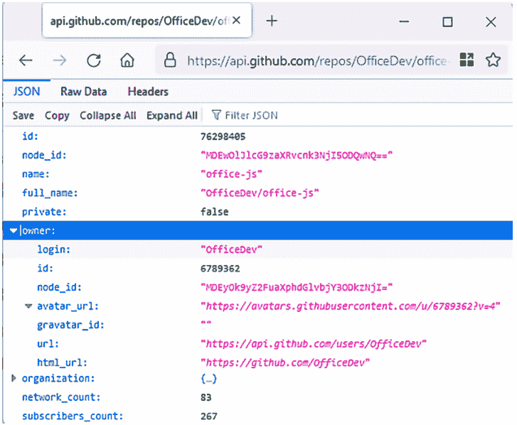

图6.2 – 一个简单的REST调用

这个REST调用为你提供关于托管在GitHub上的项目的信息。从URL中，你可以猜到它包含有关一个仓库（项目）的信息，而这个项目就是微软团队的Office JavaScript示例。查看返回的信息，在最底部，我们可以看到“订阅者数”——关注该项目的人数。

虽然REST格式主要由机器使用，但对人类也并非不友好。我们已经了解了以下几点：

- REST调用通过网络使用标准传输（你所熟悉的HTTP）进行。特别地，这是一个GET请求，我们想要传递的所有信息都包含在URL中。
- REST URL的结构能够提示将要返回的信息。从返回的JSON中，我们可以得到指向其他可能感兴趣的URL（或端点）的指针。
- 该调用返回JSON，这是我们在第4章首次遇到的格式，它让我们能够猜测大量信息的含义。实际上，它返回的信息太多了，但我们可以忽略所有内容，只关注我们正在查找的字段（订阅者数）。

- 如果我们刷新页面，会得到几乎相同的结果（除非在此期间有人关注了该项目）。这让我们了解到REST调用是*无状态的*——服务器接收我们的请求，处理它，然后忘记我们。我们的下一个请求将根据当时传入的信息被视为全新的查询。

我们的简单示例使用浏览器发出Web请求。正如你从截图中可能猜到的那样，REST并不真正关心是谁或什么在调用它，只要它是一个有效的请求。在这种情况下，*有效*意味着发起调用的客户端知道如何“说”HTTP，客户端调用的是正确的URL，并且向该URL传递了预期的信息。

### 更多关于REST——GET和POST请求

在前面的示例中，我们使用GET请求与服务器通信——所有信息都在URL中。GET是简单请求的最佳选择——例如，谷歌在搜索查询中使用它，你可以将诸如`https://www.google.com/search?q=packt+books`的URL复制粘贴到不同的浏览器中，每次都能得到相同的响应。

我们的请求很可能需要传递更复杂的信息，这就是为什么我们将使用POST选项。你可能在不知不觉中使用过这个选项，例如，在网页上填写表单然后点击提交。如果网页URL没有变化或没有显示你的数据，那么信息在幕后传输的方式就是通过POST调用。虽然POST调用很容易使用（我们很快就会看到），但在POST调用中，信息更隐蔽，但也更强大。

你可能已经猜到，REST远不止我们在这里介绍的“够用就好”的内容。如果你想了解更多，一个好的信息来源是`https://restfulapi.net/`。

我们学习REST的重点是与Kogito决策服务器通信。让我们更详细地看看这是什么样子，从Swagger开始——一个让REST更易于使用的工具。

### Swagger——连接Kogito的更友好方式

虽然REST并非不友好，但Kogito贴心地使用了一个名为Swagger的工具，使REST页面更容易理解。

我们将从*第5章*结束的地方继续，当时我们将决策模型部署到OpenShift云（开发沙箱）中，并分享了网页供同事们欣赏。现在值得回到那个网页——记得它看起来类似于*图6.3*。

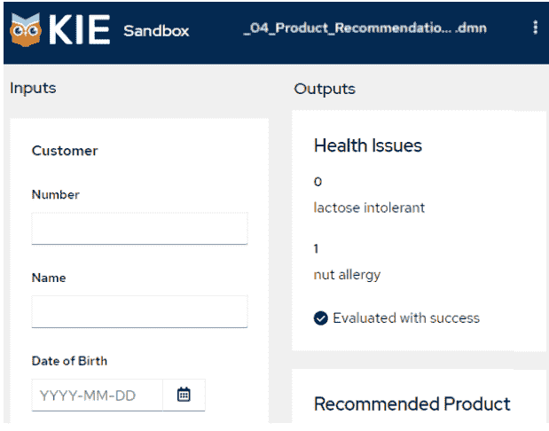

图6.3 – 提醒我们决策模型在云中的样子

### 记住——你可能需要重新启动/重新部署到OpenShift

友善提醒：OpenShift开发沙箱在24小时后超时——你可能需要再次按照第5章的说明操作，将KIE沙箱链接到OpenShift。你可能对这个每24小时续期一次的限制感到厌倦。我们将在第10章解决这个问题，届时我们会研究更多可以部署决策模型的地方。

通过Swagger API访问此页面的机器可读版本非常简单——点击页面右上角的点（在图6.3中），然后点击出现的Swagger UI。你将看到Swagger页面，其中概述了Kogito代表我们生成的REST接口，如图6.4所示。


图6.4 – 为我们的决策服务生成的REST API的Swagger摘要

在详细查看此屏幕之前，把它想象成走酒店或公寓楼的消防通道。你仍然在同一栋楼里，仍然在使用楼梯，但你会看到比平时更多的幕后细节，例如暴露的管道、未隐藏在面板后面的电缆、裸露的混凝土和砖墙。同样，我们在这里看到很多技术细节——所以我们将专注于将Excel链接到决策服务所需的关键点。

我们从第4章创建的最终模型得知，Product Recommendation Service是我们想要使用的服务——我们将模型包装在这个决策模型节点中，正是为了强调这是供我们外部调用的那个。在进一步探索此服务之前，让我们快速看一下暴露的其他端点：

- GET /{modelname}：允许我们下载原始决策模型
- POST / Upload：上传新模型——仅真正用于KIE工具
- GET / Upload/status：允许我们查看上传模型时的任何错误
- POST - {modelname}以及类似的{modelname}/dmnresult：允许我们查看完整模型中所有决策节点执行的结果

Product Recommendation Service还有一个带有/dmnResult标签的第二个版本。这与主服务相同，但添加了KIE执行决策模型时返回的Info、Warn和Error消息的信息。

设计像这样好的REST API是一门艺术——关于决策服务生成的主体（body）的更多信息，参见*图6.6*。


图6.6 – Swagger显示我们成功的REST调用

恭喜！你刚刚调用了你的第一个REST API！毫不奇怪，结果与网页相同。我们将花一些时间将Excel连接到这个REST API——所以尝试一下，传入不同的客户编号、国家、日期等，看看返回值如何变化。

在我们证明可以使用多个客户端调用决策服务之前，我们先来看一些关键信息。这也将帮助我们理解，在本章和后续章节的示例中，要成功进行REST调用需要做些什么。

### 一些关键信息——服务端点和内容

就在*图6.6*中的文本下方，Swagger还很贴心地列出了你刚刚执行的命令，其格式可以直接复制粘贴到命令提示符中——例如以下列表：

```bash
curl -X 'POST' \
  'https://dmn-dev-sandbox-yu88rl6qu490-crt-openshift-dev.apps.sandbox.x8i5.pl.openshiftapps.com/CustomerRecommendations/Product Recommendation Service' \
  -H 'accept: application/json' \
  -H 'Content-Type: application/json' \
  -d '{
  "Customer": {
    "Number": 0,
    "Name": "string",
```


```
"Date of Birth": "2022-10-23",
"Country of Residence": "string",
"Special Requests": "diabetic",
"Previous Orders": [
    0
]
}
}'
```

我们不会运行 Curl，但将这段文本复制粘贴到记事本等工具中然后保存是很重要的。这段文本包含了我们成功进行 REST 调用所需的一切信息，对于本章和下一章中的示例运行至关重要。具体来说，我们将使用以下内容：

- 网址（或 **端点**），以 `https://dmn-dev-sandbox...` 开头（你的链接会略有不同）。这是云中决策模型，我们所有的示例都链接到它。
- 我们要发送到该网址的 JSON（它在 `-d` 之后的部分，以 `{ "Customer ...` 开头）。它告诉我们需要发送的消息的布局。

**重要 – 第 6、7 和 8 章的大多数示例都需要此信息**
本章及接下来的两章中的大多数示例都会使用此端点，因此值得将通往此处的页面加入书签。在尝试将链接指向 Excel 之前，最好检查端点是否仍处于活动状态（你能看到图 6.3 中的网页吗？）。
如果你看不到该网页，请记住 OpenShift 的免费版本在 24 小时后会停止工作。在这种情况下，请按照第 5 章中的说明重新将 KIE 链接到 OpenShift 并重新部署决策模型。

### 其他桌面 REST 客户端 – HTTPie

由于 Swagger 是一个网页，因此并不明显 Swagger 页面与 Kogito REST API 是分开的，并且调用在两者之间传递。如果你使用 **HTTPie** 等桌面客户端来发出调用，就能更清楚地看到这一点。以下步骤并非严格必要，但有助于更详细地了解正在发生的事情：

- 1. 从 https://httpie.io/download 下载并安装 HTTPie。
- 2. 运行 HTTPie – 然后像图 6.7 中那样点击 **Headers** 按钮。这些头部值始终需要我们调用 Kogito 决策服务。如果你仔细查看之前的 curl 代码列表，你会注意到它们也在那里使用 `-H` 标志设置。


图 6.7 – 在 HTTPie 中设置头部

- 3. 点击主 Body 标签，在屏幕顶部的图 6.8 中设置我们决策服务的 URL。该 URL 是我们部署的 OpenShift URL 和决策服务名称的组合。方便的是，我们可以直接从之前看到的 curl 示例中复制粘贴它 – 它看起来像一个正常的（如果很长的话）网页请求，以 https 开头。

- 4. 在我们输入 URL 的框旁边，我们需要将请求类型设置为 POST。


图 6.8 – 在 HTTPie 中设置我们的 REST 调用

- 5. 我们需要指定 Body，或作为请求一部分发送的值。这些 JSON 值与我们之前的调用完全相同 – 因此复制并粘贴我们在 CURL 或 Swagger 列表中看到的 JSON。

- 6. 要发出请求，点击屏幕右上角的绿色 Send 按钮。

- 7. REST 调用的结果显示在主窗格中。200 是成功的标准网页代码，你会注意到由于我们指定了一个乳糖不耐受的客户，因此我们正确地收到了健康警告作为响应。

> **稍后 – HTTPie 作为调试工具**
> 即使你现在不安装 HTTPie，也请记住它以备后用 – 它可以帮助我们判断问题是否由我们编写的公式、我们发送的请求或我们调用的决策服务器引起。知道问题所在有助于我们更快地修复它。

既然我们现在知道如何进行成功的机器对机器网页请求，让我们使用 Excel 在我们的决策服务中发出其中一个请求。让我们从最简单的方式开始，使用 Excel 中的 Power Query。

### 使用 Power Query 调用决策服务

我们之前解释过，Power Query 允许你将 Excel 连接到各种数据源。我们将在下一节重点介绍如何使用它连接到决策服务 REST API。但如果你好奇它还能做什么，我鼓励你查看 Packt 的 Power Query 和相关的 Power BI 系列：https://subscription.packtpub.com/expert-reading-lists/power-bi-for-business-intelligence-beginner-to-advanced。

通过 Power Query 连接 Excel 需要许多简单的步骤，我们将逐一介绍：一个简单的 REST 调用、传递参数，以及更高级的 POST 调用，然后将它们组合起来链接 Excel 和我们的决策服务。

#### 一个简单的 Power Query REST 示例

我们将通过对外部 API 可能的最简单 Power Query 调用进行练习 – 我们之前遇到的 GitHub API https://api.github.com/repos/OfficeDev/office-js。

这是一个 GET 调用，没有参数，这使其成为完美的起点。完成的示例可以从本书的 GitHub 示例站点下载 – https://github.com/PacktPublishing/Business-Rule-Engines-and-AI-for-Excel-Power-Users 作为 06_simple_power_query.xlsx – 但我也鼓励你按照以下步骤操作：

- 1. 在 Excel 中，选择 **数据** 菜单，然后选择 **获取数据**。你应该会看到各种数据源，如 *图 6.9* 所示。

图 6.9 – Power Query 数据源选项

- 2. 对于这个简单示例，我们将使用 **从 Web**。稍后，我们将使用空白查询并从头开始编写连接。
- 3. 在打开的对话框中，输入我们的 API URL：`https://api.github.com/repos/OfficeDev/office-js`。你会看到此对话框只提供 GET 选项 – 对于我们的简单示例来说这很好。
- 4. 点击 **确定** 将打开 Power Query 编辑器。
- 5. 点击屏幕左上角的 **转换为表格** 按钮。这会将结果转换为在 Excel 中更易于操作的表格。

6. 你将能够在屏幕中央查看调用返回的结果 – 如 *图 6.10* 所示。


图 6.10 – Power Query 显示 REST API 调用的结果

我们将在 Power Query 编辑器中花费一些时间，因此值得查看一下这个屏幕：

- Power Query 返回的数据始终位于中央。毫不奇怪，它看起来与我们在网页浏览器中进行相同调用时的数据相同。
- 上面是 *公式栏* – 类似于 Excel 电子表格。然而，这些公式使用 Power Query M 语言，描述转换数据的步骤。
- 顶部是我们可以应用于此数据的各种命令。我们目前位于 **开始** 选项卡，但有选项可以转换数据、更改视图等等。
- 由于 Power Query 会记录你对数据的操作步骤，因此刷新数据时可以再次重放它们。在右侧，你可以看到 **已应用步骤** – 你已进行的步骤，将在刷新时重放。
- 左侧是当前 Excel 工作簿中所有查询的列表。由于这是我们的第一个 Power Query，只列出了一个。

#### 安全检查

Power Query 是以安全为目的构建的，因此在运行此示例时，它可能会询问你对该数据的敏感程度，如 *图 6.11* 所示。

图 6.11 – Power Query 数据敏感性检查

在这种情况下，数据是公开的，我们的 GET 调用中没有共享任何信息，因此在下拉菜单中选择公开值并点击保存。

现在我们能够在 Excel 中从 REST 网页源访问 JSON 数据，让我们做一些更有用的事情。

#### 在 Excel 中使用 Power Query REST 数据

在 Power Query 中拥有 JSON 数据很棒，但信息太多了，无法直接使用。我们需要在返回 Excel 之前过滤和转换此信息：

- 1. 在屏幕左侧右键单击我们的查询名称，并将其重命名为 office_js。
- 2. 在 Power Query 中右键单击表格的第一列。
- 3. 在出现的上下文菜单中，选择 文本筛选器 和 不以...结尾，如图 6.12 所示。提示：如果在上下文菜单中看不到此选项，请确保已执行上一个示例的第 5 步（将结果转换为表格）。


图6.12 – 筛选器上下文菜单

- 4. 在筛选器框中，设置__url值（包括下划线）。单击“确定”后，你会看到数据列表现在短多了，并且**应用的步骤**列表中添加了一个额外的步骤。
- 5. 通过从菜单中选择**转换**，然后再选择**转置**，来交换行和列。
- 6. 同样在**转换**菜单中，选择**将第一行用作标题**。
- 7. 虽然我们的数据比屏幕宽，但比之前整洁多了。它看起来与*图6.13*颇为相似：


图6.13 – 筛选器上下文菜单

- 8. 数据现在可以返回Excel了。从**开始**菜单中，选择**关闭并加载**。
- 9. 在出现的对话框中，选择新工作表作为工作簿中的目标位置。最好使用新工作表而不是现有工作表，因为如果外部来源的数据重叠，Excel会发出警告。一切顺利的话，Excel会将这些信息插入为表格，如*图6.14*所示：


图6.14 – 数据以表格形式加载到Excel中

# 1M-END：一种用于端到端图像压缩的两级深度神经网络统一架构

作者：Di Ma，Zekun Li，Shuyuan Zhu，Shiyin Qin，Bing Zeng

摘要——近年来，许多工作聚焦于使用深度神经网络的端到端图像压缩。然而，这些工作大多使用超先验...

索引词——端到端图像压缩，深度神经网络，学习型分析变换，学习型综合变换，量子...

## 1 引言

近年来，深度神经网络（DNNs）引起了越来越多的关注。在图像压缩领域，基于DNNs的端到端图像压缩方法取得了显著的性能...

在本文中，我们提出了一种用于端到端图像压缩的两级深度神经网络架构。第一级是基于非局部注意力的卷积神经网络（NLA-CNN），第二级是...

## 2 相关工作

传统的图像压缩方法，例如JPEG和HEVC，已被广泛使用...

## 3 提出的方法

本节将详细介绍所提出的架构。

### 3.1 第一级：NLA-CNN

NLA-CNN由编码器网络和解码器网络组成。编码器网络由分析变换...


图1：所提出的基于NLA-CNN的端到端图像压缩架构的3D视图。

```
```
Algorithm 1: Training Procedure
Input: Training images x;
Output: Reconstructed image x_hat;
1: Initialize the parameters...
2: for each epoch do
3:   ...
```
```


图6.17 – 创建我们的表以供Power Query使用

- 5. Power Query将创建一个以此名称命名的表，并打开Power Query编辑器。查询的名称将是在*步骤4*的对话框中给定的名称。

现在我们已经将该表命名并加载到Power Query中，可以在Power Query M公式中引用它。你应该已经从上一步打开了Power Query编辑器。让我们创建一个查询来读取此表中的信息：

- 1. 在编辑器左侧的**查询**窗格中，右键单击并选择**新查询**、**其他源**，然后选择**空白查询**。
- 2. 创建的新查询将被称为`Query1`或类似名称。通过*右键单击*它来重命名——在可下载的示例中，我们将其命名为`RestUrl-onestep`。
- 3. 通过单击**开始**菜单上的**高级编辑器**打开高级编辑器。
- 4. 出现的屏幕只是我们之前看到的公式栏的放大版本。替换Excel建议的任何文本。将其替换为以下查询：

```powerquery
let
    // "SourceUrl" with quotes needs to match the named
    // range on our Excel sheet. You may need to change {1} to
    // {0} depending on when your first line begins
        pSourceUrl = Excel.CurrentWorkbook()
    {[Name="SourceUrl"]}[Content]{1}[Column1]
in
    pSourceUrl
```

- 5. 确保文本与所示完全一致。单击屏幕右下角的**完成**以保存代码并退出屏幕。
- 6. Power Query将运行并返回您在电子表格中输入的参数。我们不打算展示截图，因为我们所做的只是将信息从Excel的一个部分转移到另一个部分——但这是一个关键步骤！

更重要的是，我们来分析一下刚才输入的公式中发生了什么。所有M公式都遵循标准的let ... in格式。let列出获取数据并转换数据的步骤。in将数据显示给用户。在本例中，let只有一行，但其中有四个关键操作：

- `Excel.CurrentWorkbook` 获取当前工作簿
- `{ [Name="SourceUrl"] }` 从该工作簿获取该名称的范围/表
- `[Content]` 返回该范围/表的内容
- 由于我们只想从整个内容中获取一个值，因此使用`{1}[Column1]`表达式来选择我们正在查找的行号和列名

如果你想在自己的工作簿中使用此示例，只需复制粘贴这些行即可。然后用你正在使用的范围或表的名称，以及你希望从该表获取的行/列来更新它即可。

**逐步操作日后会节省你的时间**
在可下载的示例中，我们将此示例保留为一个单独的查询，即使我们稍后会将其构建到更复杂的示例中。这使我们能够检查是否有任何问题——至少我们知道我们可以正确地从电子表格中读取值，并查看这些值是什么。

有关`Excel.CurrentWorkbook`和其他Power Query M公式的更多信息，请参阅Microsoft文档：https://learn.microsoft.com/en-us/powerquery-m/excel-workbook。

由于我们将不得不关闭Power Query编辑器以继续下一步，我们将其保存为**仅限连接**。这样可以让我们的查询在Excel中不显示结果。可以通过以下方式完成此操作：

- 在Power Query编辑器中选择**关闭并加载**
- 在出现的对话框中选择**仅限连接**

我们稍后将在本章中再次讨论参数。但首先，我们需要弄清楚如何在Power Query中发出POST请求，因为我们需要它来链接到我们的决策服务。

## 使用Power Query从Excel调用我们的决策服务

在本章前面，我们使用Power Query从Excel执行了一个简单的GET请求。但我们需要链接决策服务的API更复杂——它需要通过POST请求传入JSON数据。现在让我们基于已有的Power Query知识来构建这一功能，首先从一个不含参数的硬编码示例开始。

此示例可下载为06_power_query_decision_service.xlsx，我们将逐步完成：

- 1. 如果尚未打开编辑器，请打开它（**数据 | 获取数据 | 启动Power Query编辑器**）。
- 2. 创建一个新查询（在编辑器左侧的**查询**窗格中，右键单击并选择**新查询，其他源**，然后选择**空白查询**）。你还应将查询重命名为更有意义的名称。
- 3. 在**开始**菜单中打开**高级编辑器**，然后复制并粘贴以下文本：

```
let
    // the Rest URL we are calling - you will need to
    //update this with the value from your Swagger API
    RestUrl = "https://dmn-dev-sandbox.openshiftapps.com/
Customer Recommendations/Product Recommendation Service",

    // The JSON Values we will pass in to call the
    //decision Service
    Payload = "
    {""Customer": {
        ""Number"": 0,
        ""Name"": ""string"",
        ""Date of Birth"": ""2022-10-15"",
        ""Country of Residence"": ""UK"",
        ""Special Requests"": ""lactose intolerant"",
        ""Previous Orders"": [0]
    }}
    ",
    // Do the JSON Call
    Response= Web.Contents(RestUrl, [Content=Text.
ToBinary(Payload),
        Headers=[ #"Content-Type" = "application/json",
#"Accept" = "application/json"]]),
    //Convert the response for display
    JsonResult = Json.Document(Response)

    // display the results
in
    JsonResult
```


+   4. 你需要将以 `RestUrl` 开头的行中列出的端点更新为你在 OpenShift 部署中的值。提醒一下，这就是我们在 *Some vital information* 部分让你记下的值——以 ... `https://dmn-dev-sandbox-...` 开头的 URL。编辑此值时请注意引号。

+   5. 编辑完成后，点击 Power Query 中的 **Done**，然后点击 **Refresh Preview**。如果你今天忘记刷新 Power Apps 密钥，或为 `RestUrl` 输入了错误的值，你会收到 `[DataSource.Error] Web.Contents failed to get contents from ...` 错误。如果出现这种情况，请返回 *step 4* 并更正。

+   6. 第一次使用此查询时，Power Query 会询问你是否需要登录以使用此服务，如 *Figure 6.18* 所示。对于我们的所有示例，**Anonymous** 访问即可——但如果你在现实生活中部署此服务，你需要审查安全和登录选项。点击 **Connect** 退出此对话框。


Figure 6.18 – Power Query login check

+   7. 恭喜！我们从决策服务获得了预期的响应。Power Query 窗口的主区域应显示 **Potential Health Issue – please check** 消息。

在这次查询中发生的大部分事情我们可以猜到——因为它将我们在 Swagger 中看到的 REST 调用与 Power Query 公式格式合并了。但值得强调一下我们在本次查询中采取的关键步骤：

+   1. 请注意，`in` 部分中的每一行都用逗号分隔。这就是 Power Query 知道每一行是单独步骤的方式。编辑时请小心，因为如果你将其删除，Power Query 会报错！

+   2. 如我们所见并编辑的那样，以 `RestUrl = "http:// ..."` 开头的行设置了我们想要调用的 REST 端点。我们将其保存为变量，因为这样以后编辑起来更容易。

+   3. 我们创建了另一个变量 `Payload`，它几乎与我们在 Swagger 中之前使用的 JSON 文本完全相同。由于此文本中需要包含引号，我们使用了双引号，以便 M 不会混淆并认为我们过早结束了该行。

+   4. 行 `Response = ...` 使用 Power Query 的 `Web.Contents` 连接器执行 POST 调用。你会看到此连接器允许我们设置决策服务所需的标头。
+   5. 调用完成后，`JsonResult = Json.Document(Response)` 格式化返回的文本，以便 Power Query 知道我们使用的是 JSON 格式。
+   6. 查询最后的 `in` 部分指定了我们希望作为查询结果返回的变量。

很高兴我们终于使用 Power Query 将 Excel 连接到我们的决策服务。但虽然我们可以编辑查询，但这对于日常使用并不实用。编辑时很容易因逗号或双引号位置错误而破坏此查询。让我们使用我们之前学到的 Power Query 参数知识来修复这个问题。

### Calling the decision service using parameters

在本节中，我们将所有部分结合起来——从 Excel 到 Power Query 的 REST 调用和参数，执行 POST 调用，然后将信息带回 Excel。由于我们已经逐步介绍了各个步骤，因此为你提供一个完整的可下载示例是有意义的，`06_power_query_decision_service.xls` 位于本书的 GitHub 示例站点上。这使我们能够突出显示关键区域，以便你为自己的工作扩展此方法。

如果打开示例，你会看到主工作表和另外两个工作表标签，如 *Figure 6.19* 所示。


Figure 6.19 – Main sheet and other tabs of our full sample

此电子表格中有几个关键的 Excel 项目值得强调：

- 灰色高亮的区域是一个名为 `ParamsTable` 的命名范围/表。它包含我们希望传递给决策服务以获取巧克力或糖果棒类型建议的信息。
- 在 Params 表中，我们可以轻松更新 `Rest_api` 值。重要的是你现在要将其编辑为你自己的 OpenShift 实例的有效端点；否则，此示例将无法运行。它与我们在前一个示例中用于 `RestUrl` 的值相同。
- 第二个工作表标签 `1 DS no Param` 是我们前一个示例中硬编码 REST 调用的输出。
- 第三个工作表标签 `2 DS with Params` 是我们运行此示例时的输出。

如果打开 Power Query 编辑器，你会看到我们遵循了自己的建议，保留了几个早期查询以帮助调试。请注意，整个公式仍包含在一个名为 **2 Param-decision-service** 的单个查询中；否则，公式防火墙将阻止我们混合内部和外部数据源。

我们示例中的其他查询并非必需，但对于你在日常工作中演进此示例时很有用：

- **1 DS No Params** 是我们之前的硬编码查询。它可用于确认我们的决策服务是否接受 POST 请求，但未在最终查询中使用。
- 主要示例是 **2 DS With Params**。让我们在 Power Query 中以高级编辑器打开它并逐步介绍。以下脚本的前几行从电子表格中获取我们决策服务的 URL 并将其放入变量中：

```
let
    // the Rest URL we are calling - you will need to
    //update this with the value from the Swagger API
    // This example takes it from Excel
    RestUrl = Excel.CurrentWorkbook(){[Name="ParamsTable"]}
    [Content]{0}[Value],
```

接下来的几行与我们之前的硬编码示例相比是新的——我们从 Excel 读取参数到 M 变量。这使得在下一步中构建 JSON 字符串变得清晰易读：

```
//We set our values into variables and then build the
//JSON - it means we are less likely to break the
//Payload formula.
```

```
pCustomerNumber=Excel.CurrentWorkbook()
{[Name="ParamsTable"]}[Content]{1}[Value],
    pDateOfBirth=Excel.CurrentWorkbook(){[Name="ParamsTable"]}
[Content]{3}[Value],
    pCountryOfResidence=Excel.CurrentWorkbook()
{[Name="ParamsTable"]}[Content]{4}[Value],
    pSpecialRequests=Excel.CurrentWorkbook()
{[Name="ParamsTable"]}[Content]{5}[Value],
```

以下步骤使用我们刚刚读取的值构建 JSON 有效负载字符串。虽然三重引号 """ 看起来很奇怪，但它们是获得正确格式的 JSON 所必需的。

实际上，当你为自己的决策服务构建时，编辑起来比看起来容易——你将替换字段名称（例如 Number），注意不要破坏引号。如果你遇到问题，请参阅故障排除部分，了解如何快速查找和修复错误：

```
// The JSON values we will pass in to call the decision
// service
Payload = "

{""Customer"": {
    ""Number"": "" & pCustomerNumber & "",
    ""Name"": ""Joe Bloggs"",
    ""Date of Birth"": "" & pDateOfBirth & "",
    ""Country of Residence"": """ & pCountryOfResidence & """,
    ""Special Requests"": """ & pSpecialRequests & """,
    ""Previous Orders"": [0]
}}
"
,
```

我们的 JSON 调用几乎与之前完全相同，最终的 in 部分用于显示结果：

```
// Do the JSON Call

Response= Web.Contents(RestUrl,
    [
        Content=Text.ToBinary(Payload),
        Headers=[ #"Content-Type" = "application/json",
                  #"Accept" = "application/json"]
```

```
]
),

//Convert the response for display
JsonResult = Json.Document(Response)

// display the results

in
    JsonResult
```

要使用此示例调用我们的巧克力店决策服务，无需 Power Query 知识。关闭 Power Query 编辑器并返回 Excel，然后执行以下步骤：

+   1. 在第一个屏幕的表格中输入值——确保你有一个有效的端点。端点通常应对用户隐藏，但为了方便起见，我们的示例将其显示出来。
+   2. 转到我们示例的输出标签 **2 DS with Params**。
+   3. 右键单击表格并点击刷新以更新表格——有选项可每隔几分钟自动执行此操作。
+   4. 决策服务将处理提供的值并返回建议以在 Excel 表格中显示（如 Figure 6.20 所示）。对于示例而言，我们向提前订购的客户推荐 **Silk Tray** 产品，而更通用的 **Milk Chocolate**。如果你之前编辑过决策模型并部署了它，你的结果可能会有所不同。


Figure 6.20 – The results of our decision service call in Excel

这看起来可能只是一个简单的步骤，但当我们接近本书的一半时，这是一个关键里程碑。我们能够将以前嵌入 Excel 中的知识部署到决策服务中，利用业务规则和 AI，并将该服务链接回 Excel，以便大多数用户仍能访问它。


在您急于扩展此示例之前，我们想为您留下一些故障排除的关键步骤。您的 M 公式迟早会出问题，这些步骤将帮助您发现并解决问题：

-   我们已经了解了如何逐步分解查询，即使主查询可以一次性地完成所有操作。这样，只要我们正确读取参数，就可以检查任何我们想要的内容。
-   如果我们需要查看中间值（例如，我们正在生成的 JSON Payload），我们可以将查询的最后一行改为返回 Payload——只要记得再改回来即可。
-   我们可以使用 // 或 /* multiple lines*/ 之类的注释来注释掉我们想跳过的代码。
-   在这个示例中，我们将值显示为表格，但在实际中，我们会在 Excel 中进一步处理它们——使用我们之前见过的公式 =TableName[column_name] 来提取关键值。

如果您遵循这些步骤，遇到的任何问题都会更容易解决。更大的问题在于，您需要知道何时应该使用 Power Query 而不是我们提到的其他方法。

### 何时使用 Power Query

我们将 Power Query 作为将 Excel 与决策服务关联的首选方案是有原因的。它最接近 Excel 公式，而且 M 查询语言在构建解决方案方面非常强大。更好的是，所需工具都已内置于 Excel 中，因此任何收到您的电子表格的用户都能使用它。

然而，一切都在 Excel 中打包这件事本身也是一个不用的理由。用户对您的电子表格拥有完全控制权（即使您尝试锁定它）。大多数时候，这些更改是出于好意但很笨拙，但确实存在有人操纵 Excel 电子表格以掩盖其行为的欺诈案例。

在下一章中，您将看到我们介绍其他基于脚本的方法。Power Query 仍然可能是您会考虑的方法，但根据您要构建的解决方案，或许还有更好的选择。

### 总结

本章将您已熟悉的 Excel 世界与您在前几章中了解的 AI、业务规则和决策服务世界连接起来。为此，我们做了以下工作：

-   介绍了五种将规则、AI、决策模型和 Excel 关联起来的不同方法。
-   我们学习了使用 REST 的机器可读网页，以及如何使用 Swagger 链接到我们的决策服务——Swagger 是一种对 Kogito 决策服务更友好的链接方式。
-   我们使用 Power Query 调用了产品推荐决策服务。我们给出的分步示例是一个您可以在自己工作中扩展的解决方案。

即使您现在停止阅读本书，您也已经知道如何理清 Excel 电子表格并将业务规则转移到外部决策服务中。

那么本书后半部分还有什么要讲的呢？我们将介绍一些技术，以更好、更快、更灵活、更具可扩展性的方式来实现这一点。我们将从本章提到的一个领域开始——使用更强大的基于脚本的方法（Visual Basic、Script Lab 或 Office Scripts）将 Excel 链接到我们的决策服务。
