# 第 3 部分：
将 Excel、决策模型和业务流程自动化扩展为完整的企业解决方案

即使您在读完上一部分后停止阅读本书，您也会拥有一个将业务规则和 AI 集成到 Excel 中的端到端解决方案。但这些工具还有更强大的功能，非常值得进一步探索，以构建可扩展、健壮且企业级的解决方案。

本部分包含以下章节：

-   *第 7 章，在 Excel 中使用 Visual Basic、Script Lab 和 Office Scripts 应用业务规则，* 提供了三种基于脚本的替代方法，让您在如何将 Excel 与业务规则关联方面拥有更多选择。
-   *第 8 章，Excel 和 Power Automate 工作流中的 AI 与决策服务，* 介绍了微软的业务自动化工具，并展示了我们如何在流程中的关键节点使用模型做出决策。
-   *第 9 章，高级表达式、决策模型与测试，* 探索了 KIE 内置表达式语言的全部能力，并介绍了场景测试工具，以确保我们的决策模型按预期工作。

## 在 Excel 中使用 Visual Basic、Script Lab 或 Office Scripts 应用业务规则

在上一章中，我们说过，无论使用什么技术将 Excel 链接到决策服务，方法都是类似的。我们将在本章证明这一点。Power Query 是一个很好的方法，但也有局限性。我们将探索使用 Visual Basic、Script Lab 或 Office Scripts 链接 Excel 和决策服务——使用哪种方法由您决定。在此过程中，我们将涵盖以下主题：

-   使用 Visual Basic for Applications 从 Excel 调用决策服务
-   安装 Microsoft Script Lab，并使用它将 Excel 与我们的决策服务关联
-   Office Scripts 简介，以及使用该在线 Excel 脚本与我们的决策服务建立关联

为什么我们要介绍多种本质上做同一件事的方法？我们将在本章中解释这一点，并探讨每种方法的优缺点。

由于 VBA 在所有方法中拥有迄今为止最大的安装基数，因此本章从 Visual Basic for Applications (VBA) 开始是一个不错的选择。

## 使用 Visual Basic for Applications 调用决策服务

有很多充分的理由值得考虑使用 VBA 将 Excel 和您的决策服务关联起来。您可能拥有多年的 Visual Basic 经验。或者您可能继承了一个使用了大量 VBA 逻辑的代码库，而您的组织还没有准备好从中迁移。由于本章假设您熟悉 Visual Basic，如果距离您上次使用它已有一段时间，请参阅附录 A 以温习。

## 我真的需要了解 Visual Basic for Applications 吗？

这个问题的简单的答案是“不需要”。如果这是您第一次在 Excel 中编写脚本，您不需要了解 VBA，因为它是一个遗留解决方案。除非您或您的公司已经广泛使用 Visual Basic，否则请跳到下一节 *认识 Microsoft Script Lab——VBA 的现代版本*，了解一个更好的替代方案。

我对 Visual Basic 情有独钟。它是我职业生涯中一块重要的垫脚石，并且至今仍在为全球许多 Excel 电子表格提供支持。因此，怀着最大的敬意，我建议您尽可能*避免*使用 VBA。即使是在这一小节中，您也会认识到它的局限性——您无法控制用户机器上的安全限制、只能在台式机/笔记本电脑上运行（不能在 Office 365 中运行），以及在通过 Web 发送和接收 JSON 数据时的笨拙。请记住，Visual Basic 诞生于互联网腾飞之前，它的年代感已经说明了这一点。

从积极的一面来看，将业务逻辑从 VBA 和 Excel 迁移到 Kogito 决策服务是改善现状的良好第一步。所以，如果您拥有众多旧式电子表格之一，或者觉得这是必须走的路，请继续读下去！我们需要从电子表格用户会遇到的一个问题开始——安全检查。

## 运行 Excel 宏时的安全检查

在您从常规 GitHub 站点下载本章的第一个示例之前，我觉得有必要向您发出严厉警告：https://github.com/PacktPublishing/AI-and-Business-Rules-for-Excel-Power-Users。

下载示例文件 07_Decision_Service_VBA.xlsm 后，Windows 会立即给出安全警告。这是因为包含 VBA 的 Excel 文件若来自恶意作者，可能会像病毒一样运作。

更麻烦的是，Excel 文件是二进制文件，而且宏可以设置为在打开时自动运行。您将没有机会像本书其他示例那样对它们进行适当检查，那些示例可以在运行前用普通文本编辑器打开。还记得我们之前给出的关于尽可能避免使用 VBA 的提醒吗？本章后面的其他方法没有这些安全限制。

安全警告可能阻碍您的解决方案的采用

请记住，任何接收您分发的工作簿（包括 VBA 脚本）的用户都会收到类似的安全警告。根据个人经验，这些警告会引起与用户的摩擦，并干扰基于 VBA 的解决方案的成功发布——无论该解决方案有多好。

虽然我愿意相信您信任我这位作者（毕竟，我们一起读到了这本书的这个位置），但鼓励您执行从互联网下载的 VBA 文件并不是一个好主意。因此，您可能希望跳过下载，直接阅读后续页面上的文字说明。


如果您决定从前面的链接下载，则需要明确告诉 Windows 您信任该 Excel 示例文件。找到您保存文件的位置，右键单击它，然后选择 **属性**。在出现的对话框中，选择 **取消阻止**，如 *图 7.1* 所示。

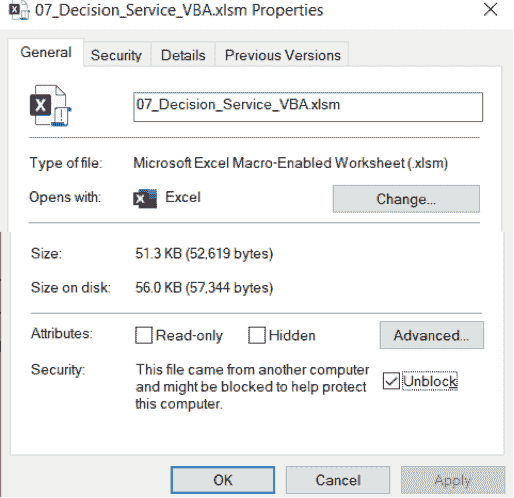

图 7.1 – 授予示例宏运行权限

## 通过 VBA 向我们的决策服务发送 JSON 调用

由于 Kogito 决策服务 Web API 无论何种类型的脚本调用它都相同，因此生成对其的 JSON 网络调用非常简单。请看以下示例：

```
```vb
Sub DecisionService()

    'Handle to the library that helps VBA call JSON Objects
    Dim ds_request As MSXML2.ServerXMLHTTP60
    Set ds_request = New MSXML2.ServerXMLHTTP60

    'Update this url to match our decision service
    'important – update this as your server key will be
        different
    ds_url = "https://dmn-dev-sandbox-0x11ooclw216-crt-openshift-dev.apps.sandbox.x8i5.p1.openshiftapps.com/Customer%20Recommendations/Product%20Recommendation%20Service"
```

```
crt-openshift-dev.apps.sandbox.x8i5.p1
.openshiftapps.com/Customer%20Recommendations/
Product%20Recommendation%20Service"

'use the library to setup our REST call
ds_request.Open "POST", ds_url, False
ds_request.setRequestHeader "Accept",
"application/json"
ds_request.setRequestHeader "Content-Type",
"application/json"

'build up our body JSON
ds_req_body = "{"{Customer}": {" _
    & " "Number": 0," _
    & " "Name": "Joe Bloggs ", " _
    & " "Date of Birth": "2022-10-15", " _
    & " "Country of Residence": "US", " _
    & " "Special Requests": "None", " _
    & " "Previous Orders": [0] }}" 

' send the request
ds_request.send (ds_req_body)
ds_request.waitForResponse

MsgBox (ds_request.getAllResponseHeaders)
MsgBox (ds_request.responseText)
```

您会注意到，尽管这是一种非常不同的语言，但许多方法与第 6 章中的 Power Query M 示例相似。让我们逐步讲解关键部分：

+   1. 我们从 Microsoft 创建辅助对象 MSXML2.ServerXMLHTTP60，它将执行实际的 JSON 调用。
+   2. 我们捕获我们的 REST 端点 URL。在您的部署中它会不同——它是您在第 6 章中使用的来自 OpenShift 的端点链接。像之前一样，您可能需要检查决策服务是否仍在运行，并在需要时重新部署或重启。
+   3. 我们准备对该 URL 的调用。调用类型（POST）和标头与我们在第 6 章中使用的一样。

+   4. 我们需要构建一个包含要传递给决策服务的信息的 JSON 有效负载。这包含在 `ds_req_body` 变量中。为简单起见，JSON 文本每次都相同。但您可以使用标准的 VBA 操作此字符串以从 Excel 电子表格中的单元格取值。

+   5. `send` 和 `waitForResponse` 消息会实际调用 REST 页面。

+   6. `getAllResponseHeaders` 和 `responseText` 允许我们显示从 JSON 调用返回给我们的值。

## 扩展我们的示例

为了保持此示例简单，我们对传递的值进行了硬编码。从 Excel 单元格读取这些值非常简单，可使用 *附录 A* 中所示的方法。另一个我们采用的捷径是之前的脚本仅在消息框中显示值。在现实生活中，您的解决方案可能会做更复杂的事情——例如将值更新回 Excel 电子表格。

由于 Excel 处理 JSON 很笨拙，您可能需要一些帮助来解析响应以提取所需的值。将广泛使用的 VBA-JSON 库下载并导入到您的 VBA 项目中是一个不错的第一步。它可在 `https://github.com/VBA-tools/VBA-JSON/releases` 获取。

书籍 GitHub 页面上的可下载代码示例提供了更多行，其中遍历了我们 JSON 调用返回的各个 JSON 值。但由于 JSON 会因服务而异，我们强烈建议您为其添加错误处理以处理所有可能的情况。

当您编写 VBA 脚本时，很可能您会在传递给 REST API 的文本中犯错。像 *第 6 章* 一样，我们建议使用 HTTPie 等工具来测试您传递进出的数据，以查看错误是在 REST API 中还是在您的 VBA 代码中。

即使从这段简短的代码示例中也能看出，VBA 存在没有原生 JSON 处理的问题。另一个缺点是，在您想要运行此代码的每台机器上，都必须手动设置项目引用。让我们看看如何修复它。

## 修复项目引用

如果在尝试运行 VBA 脚本时收到类似 **用户定义类型未定义** 的错误，则最可能的原因是您忘记指定要使用的附加库。这很容易做到，但需要在您希望运行该项目的每台机器上执行。步骤如下：

+   1. 在 Visual Basic 编辑器中，选择 **工具** 然后 **引用** 以打开引用编辑器，如 *图 7.2* 所示：

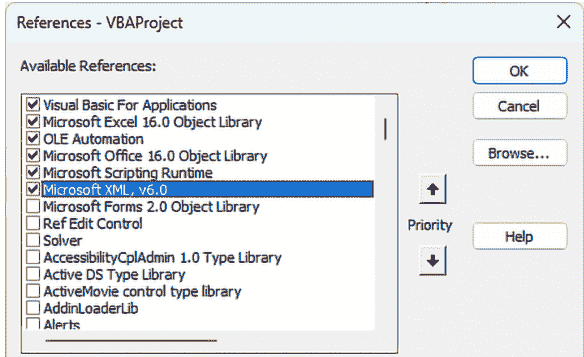

图 7.2 – 引用我们的代码示例所需的库

+   2. 选择我们需要的两个库——Microsoft 脚本运行时和 Microsoft XML。您可能需要向下滚动才能找到它们。

+   3. 单击确定，然后像之前一样运行代码示例。之后一切都应该能正常工作。

## VBA 之后的下一步

好消息是 Kogito 通过标准的 REST Web 接口公开 KIE AI、决策服务和业务规则。它与用于访问该接口的技术无关。因此，本书中描述的大多数更高级的技术对 VBA 开发者仍然可用。

虽然我们鼓励您查看其他技术解决方案，但我们也认识到您使用 VBA 调用决策服务是有充分理由的。正确操作后，将（部分）决策逻辑从 Excel 移出并放入基于 Kogito 的决策模型中，是理顺可能混乱的遗留代码库的重要第一步。让我们看一个更现代的方法——Microsoft Script Lab。

## 认识 Microsoft Script Lab – VBA 的现代版本

Script Lab 是 Excel 的免费 Microsoft 插件，可从官方应用商店下载。如果您是 Excel 脚本新手，以下是 Script Lab 为您提供的功能概述：

+   它允许您自动化 Excel 中的任何枯燥、重复操作。因此，一系列步骤只需按一个按钮即可执行。

+   它在 Excel 内为您提供编辑器——在您输入时提供指导以建议您正在查找的关键字。

+   它为您提供了一种保存和与他人共享解决方案的方法。

Microsoft Script Lab 就像 VBA 的现代版本。它利用熟悉的 Web 技术，如 HTML 和 JavaScript，并为响应式用户界面提供更多选项。即使您不了解这些技术，您也能看到投入时间学习它们的价值。Script Lab 也在您的笔记本电脑和 Excel 网页版中运行。它附带一个自动刷新的代码编辑器，让您能够快速进行代码-测试-更新-测试的循环，快速构建解决方案。

Microsoft 有一个值得一看的 1 分钟视频作为介绍：`https://www.youtube.com/watch?v=yt6os8zPUKc`。

像本书中介绍的所有工具一样，Script Lab 为您提供了清晰的路径和下一步以进一步发展您的解决方案。这可能是使用 Office Scripts（我们将在本章后面 *什么是 Office Scripts？* 部分介绍）、为 Excel 构建完整的插件，或在其他 Office 产品（如 Word 或 Outlook）上使用 Script Lab。由于 Script Lab 的编辑器使用与 Visual Studio Code 相似的技术，不仅功能强大，而且如果您决定将其用作高级编辑器，也能让您领先一步。

您在本章中经常会看到提到的一个术语是 **Office.js**。Office.js 指的是我们的脚本与 Excel 通信的方式，例如从单元格范围获取值，或更新工作表的背景颜色。Office.js 同时被 Script Lab 和 Office Scripts 使用，这使得在两者之间切换更容易。更多信息可在 `https://developer.microsoft.com/en-us/office` 获取。

> **记录器在哪里？**
> 
> 如果您熟悉 VBA，Script Lab 中最大的缺失就是记录器——让 Excel 捕获您的操作作为稍后可编辑的脚本的能力。记录器对于学习如何操作 Excel 对象（如范围和工作表）特别有用。值得庆幸的是，Office Scripts（见本章下一节）确实有此记录器，并且在两个工具中操作范围和工作表的 Office.js 接口是相似的。

我们可以用 Script Lab 做很多事情，而不仅仅是链接 Excel 与我们的决策服务。但首先，我们需要安装它，进行一次游览，并尝试一个 `Hello World` 示例以更熟悉它。

## 在 Excel 中安装 Script Lab

在桌面版 Excel 或 Excel 365 在线版上安装 Script Lab 都很容易，使用 Microsoft 官方商店。我们的屏幕截图显示了桌面版的步骤。在线安装非常相似：

+   1. 在 Excel 中，单击 **插入** 菜单，然后单击 **获取加载项**。
+   2. 在出现的 Microsoft Store 对话框中，搜索 `script lab`，如 *图 7.3* 所示：


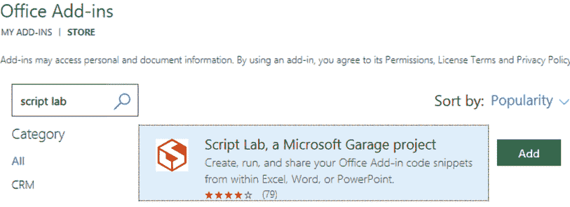

Figure 7.3 – Installing Script Lab through the Office Store

- 3. Click on **Script Lab** to make sure you have the official plugin from Microsoft.
- 
- 4. Click on the **Add** button, then accept the terms when requested. Click on **Trust this add-in**, as in *Figure 7.4*:

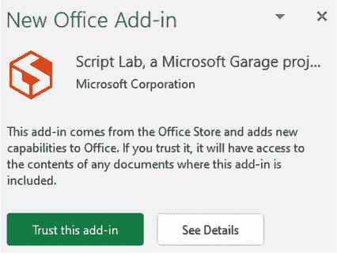

Figure 7.4 – New Office Add-in window

> **A more trustable model than VBA**
> 
> The new plugin model that Script Lab uses is designed to be secure and trustable from the ground up. When you clicked the **Trust this add-in** button, you gave it much more limited access than the VBA equivalent. This is good news – when we share our Script Lab solution with users, it’s much easier for them to trust and use it.

When you’ve completed these steps, you should have the **Script Lab** add-in installed. You’ll see a new **Script Lab** option on the Excel toolbar, and several icons, such as **Code**, **Run**, and **Help**, on the toolbar, as in *Figure 7.5*:

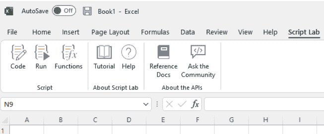

Figure 7.5 – Script Lab toolbar in Excel

Before we write our first script, it’s worth looking into the new features we’ve just added to Excel.

## Tour of Script Lab

Now that we have Script Lab installed, let’s take a look at its key parts, starting with our new toolbar shown in Figure 7.5:

- **Code**: This will open an editor where we can enter our scripts and supporting user interface elements.
- **Run**: This will allow us to run our script. It also gives us a **Run side by side** option – meaning we can make a change in the code pane and see the effect immediately.
- **Functions**: This allows us to create custom functions to augment the built-in functions, similar to functions such as =Sum() that are already built into Excel.
- There are plenty of links to supporting materials provided through the remaining buttons – **Tutorial**, **Help**, **Reference Docs**, and **Ask the Community**.

Click on the Code button. It will bring up the main Script Lab editing pane, as shown in Figure 7.6:

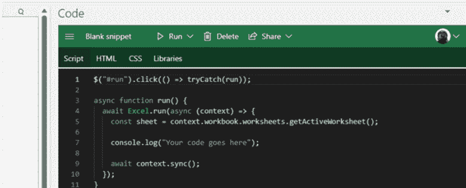

Figure 7.6 – Script Lab editor pane

Most of our work with Script Lab is done within this Code pane, in particular, the four main tabs:

- **Script**: This is the editor we use to write our scripts – the step-by-step instructions that Excel will follow.
- **HTML**: This allows us to build sophisticated user interfaces, based on standard web and HTML technologies.
- **CSS**: Also known as **Cascading Style Sheets**, this allows us to set the look and feel of our user elements/HTML pages. While we use the standard CSS in our examples, it’s good to know that we can tweak it if needed.
- **Libraries**: This allows us to import standard functionality into our Script Lab projects. Typically, we use Office.js, which we mentioned earlier, plus **jQuery** – an industry-standard library for interacting with HTML and web pages.

We’ll write scripts using the editor here shortly. But it’s worth completing our tour of this screen with some of the additional options on the top row of the Script Lab pane. The visible options on the top row are as follows:

- **Run**: The **Run** option does the same thing as the **Run** button we saw on the main **Script Lab** menu.
- **Delete**: This allows us to delete our current project.
- **Share**: This gives us options to share our projects. The gist options mentioned here are similar to how KIE Sandbox saves projects in GitHub. There is also a **Copy to Clipboard** option, which allows you to copy-paste the entire project in one go.
- **Login / Logout** (of GitHub).

Finally, we can click on the hamburger menu on the top left (three lines stacked on top of each other). This menu has additional options for managing snippets and projects, as shown in Figure 7.7:

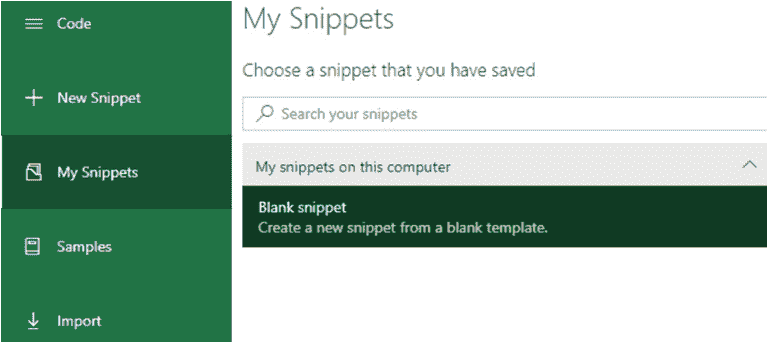

Figure 7.7 – Snippets and samples

These options include creating a blank new snippet and reviewing projects you previously created in **My Snippets**. There are also many well-documented examples under **Samples** that are well worth working through to explore Script Lab further. Finally, we'll use the **Import** option in the next section to quickly bring in the examples that we'll use later in this chapter.

As we finish our tour of Script Lab, it's worth taking a quick look at the Microsoft documentation to learn more. A good starting point is https://docs.microsoft.com/en-us/office/dev/add-ins/overview/explore-with-script-lab.

## Saving projects in Script Lab

Let's repeat something we mentioned in the previous section: Script Lab projects are not saved in the location that you may expect:

- Unlike in VBA projects, Script Lab projects are not saved as part of the current Excel sheet. This is a good thing as other users cannot modify or break the script. But it does mean that users need to install Script Lab to import the scripts. This is not a big deal but involves a separate step that we'll describe shortly.
- Scripts are not (as you also might expect) saved in the Excel folder on your laptop. This is because they need to work with the Office 365 version of Excel as well. In effect, they run within a web browser that is itself embedded in Excel, so both the online and desktop versions have a similar environment to work within.
- Because of this, Script Lab projects are hosted and saved within the web browser's local storage, not unlike KIE Sandbox. Like KIE Sandbox, there is the option to save the scripts automatically to GitHub using gists. We won't cover saving it in detail since it is so straightforward, using the **Login** and **Share** buttons we encountered previously.

Having the script separate from the Excel spreadsheet gives you more options. It is possible for you to give instructions on how to install Script Lab to all users.

But more likely, you would share the spreadsheet as normal, and then a smaller number of power users would perform the checks using the scripts. For example, a mortgage broker might pass out a loan application form in Excel to all clients, and only run the script on the returned spreadsheets. That allows the broker to keep their business knowledge about which loan to recommend private.

## Importing scripts into Script Lab

We previously shared and saved a Script Lab snippet in the book's sample GitHub folder as `07_Script_Lab_Hello_world.yaml`. We're going to use that in the next section, so it's worth importing that script into Script Lab now, as follows:

- 1. Download and open this script in an editor such as Notepad.
- 2. You’ll see that this text file contains some metadata about the platform it targets (Excel), plus a summary of all the information from the four tabs of the Script Lab editor.
- 3. Copy all of the text from Notepad (or equivalent). Make sure you don’t miss anything at the start or the end.
- 4. Open the hamburger menu in the top left of Script Lab, then select **Import**.
- 5. In the dialog box that appears, paste the text you previously copied, then click **Import**.

That’s it – you should have the Hello World project available to use in your copy of Script Lab.

> **TypeScript or JavaScript?**
> You’ll notice in the metadata that the script type is listed as TypeScript. This can do everything JavaScript can do, and more. While it’s slightly stricter, it’s a good habit to use TypeScript as it allows the editor to make more useful suggestions as you write your scripts.

## Hello World in Script Lab

At first glance, our script is complicated. But it gets easier to understand when you know that there is a standard format to our script and one place (in the middle) that we edit to create our own scripts:

```
// Register our function to run on Button click
$("#run").click(() => tryCatch(run));
// our hello world function
async function run() {
    await Excel.run(async (context) => {

        // Our main sample starts here
        console.log("Hello World");
        // Our main sample ends here

        await context.sync();
    });
}
/** Default helper for invoking an action and cover errors. */
async function tryCatch(callback) {
    try {
        await callback();
```


```javascript
} catch (error) {
  // Note: In a production add-in, you'd want to
  // notify the user through your add-in's UI.
  console.error(error);
}
}
```

让我们逐步分析脚本中的关键点。实际上，你只需要编辑我们在*第 4 步*中突出显示的脚本来做你想做的事情，其他行都是标准模板：

1. 第一行，以 `$("#run")` 开始，使用 jQuery 将 HTML 页面上的按钮（称为 **Run**）与同名函数关联起来。
2. 你可能会认出 `function run()` 是定义当按钮被点击时将被调用的代码块（我们在上一行设置的链接）。async 关键字意味着不要等待函数完成——这样 Excel 在函数运行时不会冻结。
3. 下一行，以 `await Excel.run(` 开始，是 Excel 脚本中的标准写法。基本上，我们将接下来的几行脚本传递给 Excel 引擎，然后等待结果。
4. 我们的代码将 `Hello World` 输出到控制台。在此行前后有注释，以显示这是主要编辑区域，如果你以后想扩展示例。
5. 由于之前的行告诉我们并行运行多个项目（前一行中的 async），`await context.sync` 强制 Excel 暂停并让所有内容跟上。
6. 注意闭合括号与开头括号的顺序相反。你可能不需要编辑此部分，但如果你要编辑，请注意保持这些括号对齐。
7. 最后，有一个 `try/catch` 辅助函数。它捕获任何错误，以确保无论发生什么情况用户都能得到更新。你不太可能需要编辑它。

虽然我们从逐步讲解中知道应该发生什么，但让我们仍然运行脚本：

1. 从 Excel 顶部左侧的主 Script Lab 工具栏中，点击 **Run**。选择并排运行的选项。
2. 侧边栏应如 *图 7.8* 所示进行更新。注意两个 Script Lab 图标，它们使我们能够并排查看正在运行的项目和脚本编辑器，并在两者之间进行实时更新：

   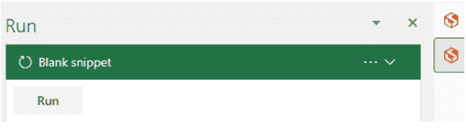

   图 7.8 – 运行 Hello World

3. 点击主窗格中的 **Run** 按钮。控制台应出现在侧窗格底部显示 **Hello World**，如 *图 7.9* 所示：

   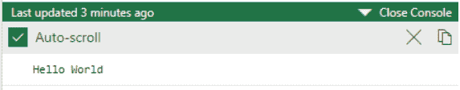

   图 7.9 – Hello World 结果

虽然这只是一个 Hello World 示例，但我们已经看到了标准 Script Lab 项目的结构。该结构不会改变——这使得我们下一步，从 Script Lab 调用决策服务，比写起来容易得多。

## 从 Script Lab 调用我们的决策服务

由于 Hello World 项目遵循标准的 Script Lab 格式，而我们对决策服务的调用也采用标准格式，因此不足为奇的是，当我们将两者结合起来从 Excel 中的 Script Lab 调用决策服务时，我们会熟悉大部分脚本。

与其重复大量熟悉的元素，我们建议你从 GitHub 书籍网站下载示例——它是 07_Script_Lab_Decision_Service.yaml。如前所述，将此文本在编辑器中打开，复制全部内容，然后打开 Script Lab 顶部左侧的汉堡菜单，选择 **Import**，并粘贴所有文本。

这样，我们就可以专注于以下逐步讲解中的有趣部分。

此文件中定义了用户界面的几个元素。在 Script Lab 中查看 **HTML** 选项卡，你可以看到客户号码的输入，如以下摘录所示。其他文本字段遵循类似的模式：

```html
<div class="ms-TextField">Customer Number
  <input type="number" id="cNumber" value="update me"/>
</div>
```

这些元素与其它 HTML 元素一起提供了如 *图 7.10* 所示的用户界面。为了保持简单，我们没有为所有可能传递给决策服务的信息包含字段——但如果你愿意，使用相同的模式添加它们是微不足道的。

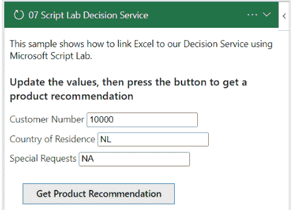

图 7.10 – 我们在 Script Lab 中决策服务示例的用户界面

让我们逐步介绍脚本选项卡中的行，并重点关注我们更改以使用 Script Lab 将 Excel 链接到决策服务的项目：

1. 与之前的示例一样，我们有一些注释和使用 console.log 的日志记录来解释正在发生的事情。
2. 我们将 url 设置为指向我们的决策服务。你需要更新此值。它与我们的 Power Query 示例相同；我们可以从 Swagger UI 获取。它是链接以 Customer Recommendations/Product Recommendation Service 结尾的链接。
3. 我们需要为 POST 调用设置 headers。我们将其定义为常量，因为调用 Kogito 决策服务时它们始终相同：

   ```javascript
   const headers = {
     Accept: "application/json",
     "Content-Type": "application/json"
   };
   ```

4. 我们定义了一个 payload，并带有默认值。这会生成与 Swagger UI 完全相同的 JSON。我们稍后将使用脚本更新这些默认值：

   ```json
   let payload = {
     Customer: {
       Number: 10000,
       Name: "Jane Doe",
       "Date of Birth": "2022 - 10 - 15",
       "Country of Residence": "NL",
       "Special Requests": "NA",
       "Previous Orders": [0]
     }
   };
   ```

5. 我们使用默认有效负载中的值更新用户界面。`$("#cNumber")` 是 jQuery 查找 HTML 字段的方式。`.val` 使用我们之前定义的负载 JSON 设置值。我们对所有字段重复此模式：

   ```javascript
   $("#cNumber").val(payload.Customer.Number);
   ```

6. 如 `Hello World` 示例中所示，我们将按钮链接到在按钮被按下时运行我们的主函数 `callDecisionService`：

   ```javascript
   $("#get-product-recommendation").click(() =>
   tryCatch(callDecisionService));
   ```

7. `callDecisionService` 使用与传递给 Excel 的相同 async 代码定义，正如我们在前一个示例中看到的那样：

   ```javascript
   async function callDecisionService() {
     await Excel.run(async (context) => {
   ```

8. 以防用户表单上的值已更改，我们用它们更新我们的 JSON 有效负载。这是步骤 5 的逆过程；我们对所有字段重复。`+` 符号强制值转换为数字：

   ```javascript
   payload.Customer.Number = +$("#cNumber").val();
   ```

9. 对决策服务的 `fetch` 调用被日志记录包围，这样我们可以看到传递到服务中和从服务返回的值。作为我们调用的一部分，我们使用之前设置好的 URL、headers 和 JSON 有效负载：

   ```javascript
   const response = await fetch(url, {
     method: "POST",
     headers: headers,
     body: JSON.stringify(payload)
   });
   const jsonResponse = await response.json();
   ```

10. 我们的决策服务返回大量我们不需要的 JSON 信息。我们使用 `let productRecommendation = jsonResponse["decisionResults"][0]["result"];` 获取我们想要的具体决策信息。

值得下载并再次浏览脚本。只需做一些小的更改，它就可以用来调用你自己的决策服务。我还鼓励你查看内置的 Script Lab 示例。它们涵盖了你可能想要用更复杂的用户界面元素扩展项目的大多数方式。

## 替代方法 – Script Lab 中的自定义函数

当你浏览示例时，你可能会注意到使用 Script Lab 创建自定义函数的选项。乍一看，这似乎很有吸引力——它允许你构建自己的专用函数，然后直接在 Excel 单元格中输入如下内容：

```
= callDecisionService (customerNumber, countryOfResidence, dateOfBirth ..)
```

然而，要使这种方法有效，你需要安装 Script Lab、注册自定义函数，并将函数输入到电子表格中。如果你错过了这三个步骤中的任何一个，你的电子表格就会损坏。

对于大多数用例，我们在上一章中介绍的 Power Query 方法更稳健。它在许多方面都像自定义函数一样运行，它内置于 Excel 中，并且不需要在首次使用时运行以将其与 Excel 注册。

关于 Script Lab 还有很多东西可以学习，它可以为你提供非常强大的基于 Excel 的解决方案。由于它和我们将在下一节中介绍的 Office Scripts 有很多共同点，因此花时间浏览 Microsoft 文档是一个很好的投资，网址为 https://learn.microsoft.com/en-us/office/dev/add-ins/reference/overview/excel-add-ins-reference-overview。如果你想深入研究任一工具，我还推荐以下书籍，以充分探索使用这些工具扩展 Excel 的强大功能 – https://leanpub.com/buildingofficeaddins。

## 什么是 Office Scripts？

虽然所有 Excel 用户都可以访问 Script Lab，但并非每个人都能访问 Office Scripts——目前还不能。由于我们已经知道它共享 Office.js 通过脚本操作 Excel 的方法，两者之间有什么区别？

- 虽然与 Script Lab 非常相似，但 Office Scripts 更易于使用。例如，一些样板 async 调用和错误处理函数对我们来说是隐藏的。
- Office Scripts 具有记录器，可以记录我们在 Excel 中的操作并将其转录为脚本。这对于学习 Office.js 特别有用。
- Office Scripts 预装在 Office 365 在线版中——尽管可能需要管理员启用。
- 更容易共享脚本。虽然（像 Script Lab 一样）脚本位于工作簿之外，但通过向工作表添加按钮，任何可以看到 Excel 表的人也可以看到脚本。


+   - Office Scripts 与 Power Automate 深度集成——这是一个我们在下一章会介绍的工具，它将允许你自动化 Excel 中大量手动步骤，而不仅仅是 Excel。

使用 Office Scripts 有好处，但也有一些缺点：

- Microsoft 仍在推广 Office Scripts，从路线图来看尚不清楚它何时会面向个人（非商业）用户提供。
- Office Scripts 只能在 Excel 的网页版中编辑。实际上，编辑器足够好用（并且由更强大的 VS Code 在线编辑器支持），因此这不是一个主要问题。完成的脚本*可以*在网页版和桌面版 Excel 中运行。
- Office Scripts 没有 Script Lab 完整的用户界面选项。

最终，如何将 Excel 与你的决策服务链接的选择取决于你还想用该工具做什么。让我们通过参观 Office Scripts 来帮助你做出选择。

## 熟悉 Office Scripts 环境

要检查你是否可以使用 Office Scripts，请打开在线（Excel 365）版本。如果已由管理员启用，你应该会看到 **Automate toolbar** 选项，如 *Figure 7.13* 所示。

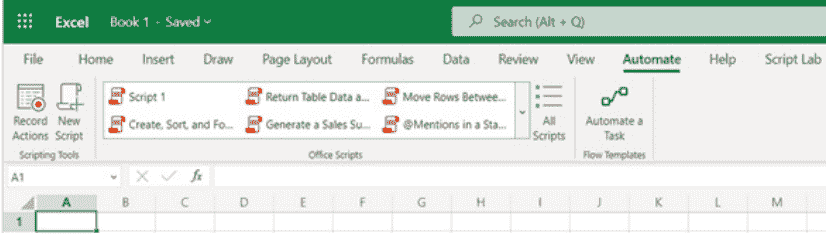

Figure 7.13 – Office Scripts toolbar

Office Scripts 的大部分布局与 Script Lab 相似。工具栏具有 **New Script** 和 **Sample Script Areas**。**Automate a Task** 按钮链接到 Power Automate（更多内容请见 *Chapter 8*）。

**Record Actions** 按钮的工作方式与 VBA 中同名工具类似。点击它会捕获你在 Excel 中执行的操作，并以脚本形式显示在屏幕右侧的窗格中。以下脚本示例是我们设置 Excel 表格中某些值时录制的：

```
```typescript
function main(workbook: ExcelScript.Workbook) {
  let selectedSheet = workbook.getActiveWorksheet();
  // Set range B2 on selectedSheet
```
```

```
selectedSheet.getRange("B2").setValue("This is a test");
// Set fill color to FFFF00 for range B2 on selectedSheet
selectedSheet.getRange("B2").getFormat().getFill().
setColor("FFFF00");
}
```

屏幕右侧的窗格布局与 Script Lab 类似——包含代码编辑器、运行代码的日志消息区域以及多个有用的命令按钮。

代码编辑器具有保存按钮。文件保存在你的 OneDrive 文件夹下的 Documents | Office Scripts 中。这不是自动保存（不像 Script Lab），因此在运行前请确保已保存。

右侧面板中的 ... 菜单提供 Add 按钮选项。选择它（不出所料）会在当前工作簿中添加一个按钮来运行脚本，如 Figure 7.14 所示。

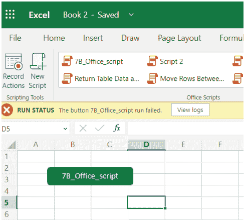

Figure 7.14 – Sharing our script via a button in our workbook

更重要的是，创建此按钮会自动将我们的脚本与可以查看工作簿的人共享。这可能是确保工作簿和脚本一起分发的 easiest 方法。但在 ... 菜单的 Share 菜单选项中还有更详细的共享选项。

由于 Office Scripts 的大部分布局与 Script Lab 相似，我们保持描述简短。了解更多的一个良好起点是 Office Scripts 文档 https://learn.microsoft.com/en-us/office/dev/scripts/。

让我们通过修改我们之前的 Script Lab 示例使其在 Office Scripts 中工作来证明这两种脚本方法相似。

## 从 Office Scripts 调用我们的决策服务

当我撰写本节时，将之前的示例转换为在 Office Scripts 中工作不到 10 分钟。与其重复之前的步骤，我们将展示如何将更新的示例导入 Office Scripts，然后回顾并突出我们必须做出的更改：

1. 从通常的 GitHub 站点下载完整脚本。示例文件名是 07_Office_Script_Decision_Service.txt。请注意 .txt 扩展名，因为我们以两种不同格式提供了相同的示例。
2. 在 Notepad 等编辑器中打开文件并复制所有内容。
3. 在 Excel 的在线版本中，选择 Automate 菜单，然后选择 New Script，并粘贴文件内容以替换此窗口中的所有先前内容。
4. 保存结果。

如果你更熟悉 Office Scripts 保存文件的位置，也可以直接将示例下载到 OneDrive 文件夹下的 Documents | Office Scripts。请注意文件格式略有不同——你需要的是 07_Office_Script_Decision_Service.osts 文件。请注意 .osts 扩展名。

如果下载示例不起作用，请检查你是否使用了正确的方法对应的文件。

示例中最大的变化是由于 Office Scripts 没有用户界面元素，我们已将其从示例中删除。虽然我们将传递给决策服务的值硬编码以保持简单，但很容易改为从单元格值读取这些值。

脚本中其他值得突出的关键更改如下：

- Office Scripts 为我们隐藏了大量复杂性。我们有一个简单的 main 方法，它始终以 ExcelScript.Workbook 作为参数，以便脚本可以操作当前工作簿。
- 由于示例使用 TypeScript，我们需要标记脚本使用的对象的类型——因此，我们的 main 方法中包含 workbook 标签：
- 我们的脚本设置 URL、标头、JSON 有效负载和 URL 并使用 Fetch 执行实际的 REST 调用，与之前相同。我们也以相同的方式从返回的值中选择产品推荐。
- 用于（重新）创建工作表和标题并显示产品推荐的脚本大致相同。任何细微差异都是由于使用了略有不同的 Office.js API 版本。
- 错误处理已自动内置，因此我们无需编写自己的函数来执行此操作。

```
async function main(workbook: ExcelScript.Workbook) {
```

脚本注释良好，在按下 Run 按钮开始之前值得阅读一遍。点击按钮后，你应该会收到 Run Succeeded 消息，并且可以查看更新后的 Excel 表格，如 Figure 7.15 所示：

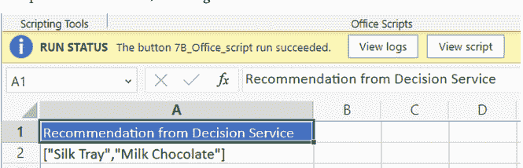

Figure 7.15 – Excel sheet online, updated with decision service results

由于我们保留了之前的示例中的日志记录，脚本输出信息窗口提供了大量关于刚刚发生的事情的信息，如 Figure 7.16 所示。同样，这些步骤与我们的 Script Lab 示例相同。

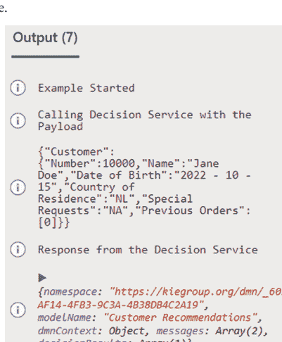

Figure 7.16 – Script logging output

我们将在第 8 章再次回到 Office Scripts。但就目前而言，恭喜！如果你运行了此示例以及之前的示例，你现在就有四种不同的方式将 Excel 与你的 Kogito 决策服务链接（并且知道另外两种方法）。这现在给你一个困难的选择——你应该使用哪种方法？

## 选择很多——但该链接哪一个？

我们提到将 Excel 与决策服务链接的多种不同方法是有原因的。没有一种最佳方法——你的选择将取决于你希望在项目中实现的其他目标。此表可能有助于你决定：

| Tool | Advantage | Disadvantage | Use when |
|---|---|---|---|
| Power Query | Built into Excel. Acts as a powerful function. | Users can break it. No UI elements. | Default method to get started. |
| Visual Basic | Very powerful. Includes UI elements. | Security warnings scare users. Outdated. | Using a legacy code base or team has VBA. |
| Script Lab | Modern version of Visual Basic based on web technologies. | Needs installing. | Looking for a rich user experience or if Office Scripts is not available. |
| Functions in Script Lab | Easiest to use – feels like a normal Excel function. | Needs three items aligned to work (Script Lab, the function to be registered, and the function to be in the workbook). | Niche – consider Power Query instead. |
| Office Scripts | Simpler than Script Lab. No installation needed. | Not available to all users. No UI elements. | After you outgrow Power Query – if it is available to you. |
| Power Automate | External to Excel. Harder for users to break. | More powerful but more complicated. | Need to call the decision service as part of wider workflow. |

Table 7.1 – Different methods for linking Excel and your decision service

如果你发现难以选择，这里有个好消息——将业务规则从 Excel 移出并放入 Kogito 等决策服务的任何步骤都是一个好的步骤。


一旦你实现了这一点，使用哪种方法将 Excel 链接到你的决策服务就没那么重要了——因为该方法很可能会随着时间的推移而演进。不管发生什么情况，业务规则现在都存储在 Kogito 中，并处于适当的版本控制之下——因此你知道它们得到了良好的管理。

例如，你可能从使用 VBA 的旧版 Excel 表开始。将迁移到决策服务（但保留 VBA）是一个快速的胜利，很快你可能会说服同事使用 Script Lab 作为现代等价物。之后，你可能会决定自动化整个工作流程，并通过 Power Automate 调用 Office Scripts 来实现。

它们都是可行的解决方案，而且随着更广泛项目的演进，这些步骤都很容易实现。

### Summary

本章建立在我们之前关于使用 Power Query 将 Excel 链接到决策服务的知识之上。我们还增加了实现此链接的另外三种方法——使用 VBA、使用 Microsoft Script Lab，以及使用 Office Scripts。对于每个选项，你都看到了一个完全可用的示例，可以为你的日常工作进行扩展。同样重要的是，我们给出了根据当前项目选择最佳链接技术的总结。

你会注意到，虽然我们将 Power Automate 引入作为链接 Excel 和决策服务的工具，但我们尚未（目前）对其进行详细讲解。在下一章中，我们将通过查看 Power Automate 工作流以及如何将决策服务用作其一部分，来完成深入指导的集合。

### Using AI and Decision Services Within Power Automate Workflows

我们在前两章中所做的是将业务决策从 Excel 移出，并放入托管在 Kogito 中的 Drools 决策服务中。这效果很好，但我们仍需要在需要时手动触发该流程。

在现实生活中，做出决策很可能只是我们回答客户问题所采取的众多步骤之一。是否可以将这项端到端的工作自动化，创建一个按需调用决策的流程？本章将向你展示如何在以下主题中实现这一点：

- What is a workflow?
- What is Power Automate, and why use it?
- Calling business rules and decision services from Power Automate
- Implementing our customer service flow in Power Automate
- Alternatives, such as Power Automate Desktop and Kogito business automation

Power Automate 是一个非常用户友好的工具——但也非常强大。我们在本章中的目标是让你了解 Power Automate 以及它如何帮助你。我们将展示在更广泛流程中链接 Excel 和决策服务的流程。但由于篇幅限制，Power Automate 中还有许多有趣的部分我们无法探索。希望我们能让你产生进一步学习的兴趣——因此我们还将为你的学习之旅提供下一步的指引。

#### Prerequisites

Power Automate 是 Microsoft 的（主要）在线托管工具——因此不足为奇的是，你需要一个 Microsoft 账户。有两种主要账户类型：

- 你可能已经拥有来自你工作或隶属组织的 Microsoft 账户（如果你是学生）。如果你可以访问 `Office.com` 或 `Outlook.com`，并且能够使用诸如 `yourname@companyname.com` 之类的凭据登录，那么你就拥有企业 Microsoft 账户。
- 你可能拥有个人 Microsoft 账户（例如 `yourname@live.com` 或 `yourname@hotmail.com`）——或者你可能已注册免费的 Office 在线版（`https://www.microsoft.com/en-us/microsoft-365/free-office-online-for-the-web`）。

这两个账户都应能让你访问 Power Automate，并启用大多数标准功能。然而，由于我们深入讲解了将流程连接到决策服务，本章使用了仅在企业或按月付费账户中可用的一些高级功能。幸运的是，Microsoft 为 Power Automate 提供了这些功能的免费试用——点击以下链接上的 **Start Free** 选项：`https://powerautomate.microsoft.com/`。

本章中使用的示例还假设你的机器上运行着 OneDrive。虽然对于运行 Power Automate 来说并非严格必要，但如果你打算跟随示例，现在安装它可能更容易。

> **Where are the downloadable samples for this chapter?**
>
> Power Automate 很棒，因为它非常直观。不幸的是，这使得分享示例变得困难——我们无法在 GitHub 站点上发布易于阅读的脚本。
>
> 虽然有分享 Power Automate 解决方案的方法，但由于本章篇幅限制，我们专注于为你提供清晰的逐步说明，以便你可以将 Power Automate 与你的 KIE 决策服务链接起来。

现在我们了解了将用于访问 Power Automate 的 Microsoft 账户，让我们先回顾一下什么是工作流。

#### What is a workflow?

每个公司都遵循工作流，即使这些步骤可能是手动的。Figure 8.1 给出了我们的巧克力店在响应客户时可能遵循的示例工作流：

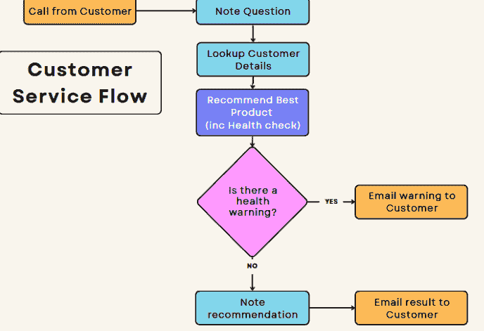

Figure 8.1 – Sample customer service workflow

这个工作流相当简单——接听客户电话，查找之前的详细信息，利用这些知识做出产品推荐，然后与客户分享该推荐。你可能编写或遵循过更复杂的工作流，但基本构建块保持不变：

- 与外部参与者的交互——在本例中，客户的来电触发了工作流的开始，而我们发给客户的电子邮件完成了它。
- 从内部系统读取和写入——例如，记录提出的问题，并在我们的系统中查找客户详细信息。
- 做出决策——在本例中，推荐最佳产品（包括健康检查）。这些步骤可能相当复杂（毫不奇怪），是我们可移交给托管在 Kogito 中的 KIE 决策服务的。
- 一旦做出决策，我们的工作流可能会分支到不同的路径——在我们的示例中，如果需要，我们会发送带有健康警告的不同类型的电子邮件。

这个工作流是有意保持简单的，因为我们将在本章中在 Power Automate 中实现它。但请记住 *Chapter 1* 中的示例——对进入医院急诊部的患者进行分诊？使用相同的构建块，我们可以绘制出处理并为患者推荐治疗的工作流。

由于这是一本主要关于规则的书，值得提醒我们业务规则和工作流之间的区别。

#### Differences between business rules and workflows

我们早在 *Chapter 3* 中就提到过这一点——由于业务规则和工作流都有图形格式，有时人们会感到困惑。需要记住的主要区别如下：

- 规则倾向于一次性工作，而我们的工作流可能需要数小时或数天才能完成。例如，如果我们需要执行手动步骤来审查我们的健康警告，我们就必须等待人类有空执行此任务。
- 工作流中的步骤相对简单（例如，发送电子邮件），而规则更适合复杂的决策。
- 理想情况下，我们的业务规则应存放在一个地方，而我们的工作流可能使用多个系统。即使是我们的简单客户工作流也可能跨越五个系统：一次电话通话，在一个系统上保存问题，在另一个系统上查找客户，对决策服务的调用，然后发送电子邮件。

由于规则和工作流关注不同的领域，它们配合得非常好。我们在工作流的一个步骤中运行规则（*Figure 8.1* 中的 *recommend product* 步骤）。你能想象如果工作流还描述了产品推荐流程会复杂多少吗？将其作为决策服务中的一个步骤来执行很有意义。

工具的另一个共同点是，两者都以图形格式描述业务知识，并且以我们可以直接执行的方式描述它——规则引擎或工作流引擎可以直接作用于图形图示，因此我们知道所描述的内容就是实际发生的内容。在其他类型的系统中，如果开发人员需要为我们进行转换，这并不总是如此。

> **Workflows instead of scripting**
>
> 如果你来自编程背景，你可能会认为编写脚本来执行 *Figure 8.1* 中的工作流是微不足道的——你是对的。
>
> 但随后，正如我们在 *Chapter 1* 中提到的，你会面临知识消失到代码中的问题。你会理解所遵循的步骤，但你的非技术同事不会。使用图形工作流允许他们与你一起审查和同意流程。


既然我们已经决定工作流和业务规则是一个良好的端到端解决方案，那么让我们认识一下 Power Automate，并了解为什么我们应该选择它作为我们的工作流工具。

## 什么是（以及为什么）Power Automate？

Microsoft Power Automate（以前称为 Flow）是市场上数百种工作流产品之一——如果你想自己查找，可以搜索 Workflow Engine。那么为什么本书选择它，尤其是在 Kogito 也内置了工作流引擎的情况下呢？

- 作为微软的产品，Power Automate 与 Office 深度集成，包括 Excel。托管版本可在线使用，无需设置，大多数 Office 用户均可使用。
- Power Automate 面向 Excel Power 用户——这与本书的读者群有很好的交叉。而 Kogito 的工作流引擎更复杂，面向开发者。而 Power Automate 取得了不错的平衡——使用简单，同时比 IFTTT.com 等面向消费者的服务更强大。
- Power Automate 遵循 Business Process Model Notation（BPMN）标准，因此本章中学到的许多概念都适用于其他图形化工作流引擎。我们将在本章末尾快速浏览 Kogito 工作流引擎（jBPM）时看到这一点。

那么，Power Automate 是什么？它是一种将工作流（如图 8.1 所示）与我们在每个步骤中想要执行的具体操作相结合，然后在特定条件为真时触发（或启动）工作流的方式——例如，在收到电子邮件时启动工作流。

由于它是基于云的，即使你的笔记本电脑关闭，甚至你在度假时，工作流仍会继续运行。因此，让我们来看看 Power Automate 并创建我们的第一个流程。

## 开始使用 Power Automate 在线版

Power Automate 可从 Microsoft Office 的多个区域链接，但最简单的地方是 https://powerautomate.microsoft.com/ 的主页。登录后（如果需要，可创建试用账户），你会看到一个主页/欢迎页面，其中包含大量示例流程模板，以及每个模板的学习材料指针。

值得探索这些资源（现在或以后）——本章范围之外还有很多其他 Power Automate 功能。相反，我们将在开始构建第一个流程之前快速浏览一下屏幕。

点击主页左侧的 My flows。你会看到类似图 8.2 的屏幕，虽然显然，你可能还没有列出任何流程（暂时）。这将是我们处理流程的主要区域，因此值得仔细查看屏幕。

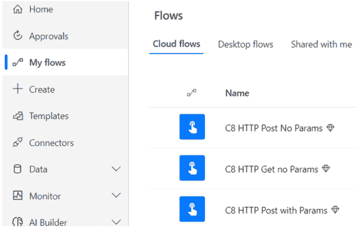

图 8.2 – Microsoft Power Automate 的主屏幕

左侧是我们在 Home 和 My flows 屏幕之间导航时已使用的菜单。它有创建流程的选项，我们稍后会使用，以及 Templates 选项，建议预建解决方案——在你自己的时间里值得探索，因为它展示了你可以用 Power Automate 做多少事情。

本章不会涵盖其他选项，但我们会简要解释它们，以鼓励你在自己的时间里查看它们：

- **Approvals** 用于需要审批的流程运行，并且你是被指定说“是/否”的人。
- **Connectors** 允许你将流程链接到许多不同的系统。
- **Data** 将你链接到底层的 Microsoft Dataverse，如果你已经使用过 Power Query 或 Power Apps，就会很熟悉。
- **Monitor** 允许你查看流程何时运行、流程是否成功完成，并提供解决任何问题的建议。
- **AI Builder** 链接到 Microsoft 人工智能（AI）工具——这里的选择可能非常具体。如果 Microsoft 为你准备了预建解决方案，那么使用它非常值得。但修改它们的选项很窄——在这种情况下，你最好使用本书中的其他 AI 方法或我们在第 11 章中会涉及的机器学习技术。

顶部还有一些其他菜单项值得探索：

- **Cloud flows** 就是我们将要创建的——它们在线运行，无论你的笔记本电脑是否开机。
- **Desktop flows** 是我们将在本章后面介绍的扩展。它们更强大（你笔记本电脑上能做的任何事情都可以用桌面流程自动化）和更受限制（你的笔记本电脑需要开机，并且通常由云流程触发）。
- **Shared with me** 允许你与同事协作和共享流程。请仔细阅读安全警告，如果/当你决定共享流程时。

请注意你正在使用哪个账户（屏幕右上角，图中未显示）——尤其是在使用试用 Power Automate 账户时，因为使用错误的账户可能会导致问题。

现在我们已经浏览了 Power Automate 屏幕，让我们深入并创建我们的第一个流程。

## 我们的第一个 Power Automate 流程

传统上，我们会从 **Hello World** 示例开始。我们不会这样做，因为我们从 Power Automate 的在线版本开始。由于流程托管在云中并旨在在你不在时独立运行，用户界面选项非常有限。在云中运行，即使你可以弹出消息框，谁会看到它呢？

相反，我们将从 *第 6 章* 中已经完成的一个示例开始——从在线 API 获取信息。你会记得这是一个简单的 GET 请求，返回有关托管在 GitHub 上的项目的的信息。我们的流程将有三个步骤：

1. 启动流程的触发器。
2. HTTP 请求操作，用于获取有关 GitHub 项目的信息。
3. 创建文件操作，以便我们可以保存结果并稍后查看。

要在 Power Automate 中开始构建此流程，请按照以下步骤操作：

1. 点击 **Create** 按钮。你会看到流程类型的选择，如 *图 8.3* 所示：

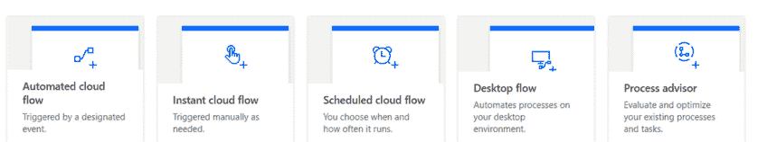

图 8.3 – 创建 Power Automate 流程

2. 我们将选择 **Instant cloud flow**，因为它是最简单的——我们的流程将在按钮触碰时启动。

### 其他流程类型是什么？

其他流程类型值得以后探索——**Automated cloud flow** 选项由触发器启动，例如收到电子邮件，或新文档更新到 SharePoint。**Scheduled cloud flow** 每 X 分钟/小时/天运行一次。**Desktop flow** 我们将在本章后面介绍，而 **Process advisor** 会提出建议以简化更复杂的流程。

3. 选择 **Instant cloud flow** 后，我们将获得不同的手动触发器选择，如图 8.4 所示（同样值得在自己的时间里探索）。在这里，我们为流程命名，然后选择 **Manually trigger a flow** 选项，然后点击 **Create** 按钮：

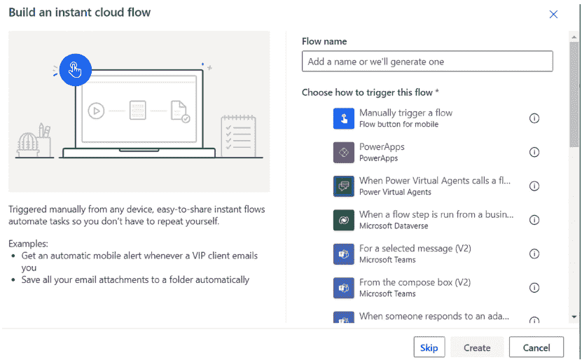

图 8.4 – 选择如何触发流程

4. Power Automate 将创建我们的流程，并带我们进入主流程编辑屏幕，如图 8.5 所示。我们流程中的第一步（手动触发器）已为我们创建。此屏幕还为我们提供了更改流程名称的选项（如果我们在上一步中没有更改），撤消/重做编辑步骤，保存我们的流程和流程检查器，以及我们稍后会使用的测试按钮。

6. Power Automate 将创建我们的 HTTP 操作。在图 8.7 中，我们已经输入了此操作的设置——不出所料，它们与我们在第 6 章中使用的相同——GET 方法和 URI 为 https://api.github.com/repos/OfficeDev/office-js。我们可以留空其他值。

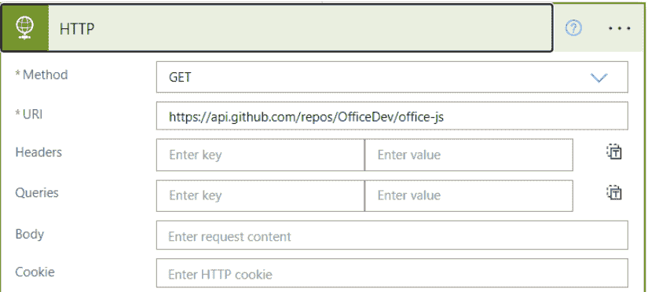

图 8.7 – 流程中的第二步 – HTTP Connector

7. 即使我们的流程现在更长，底部仍会有 New step 选项。点击它，然后搜索来自 OneDrive 的 Create file 选项。我们这次不会展示搜索过程；如果你有正确的操作，它将具有与图 8.8 相似的图标和外观：

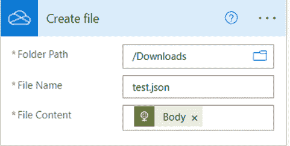

图 8.8 – 创建文件的设置

8. 在此操作中，我们选择文件夹路径——点击 Folder Path 字段将让你选择 OneDrive 中已存在的路径。注意，如果你刚刚为 Power Automate 创建了新用户名，你可能需要先使用此用户名和密码登录 OneDrive。我们选择了通用的 Downloads 文件夹，但任何现有文件夹都可以。


9. 在 **File Name** 中输入一个名称——我们选择了 test.json，因为那是我们将要保存的数据的格式。但对于本示例，任何允许的名称都可以。

10. 点击 **File Content** 框，我们会得到动态内容的选项。Power Automate 会根据之前的流程步骤建议值——在本例中，**HTTP** 操作返回 **Body**，其中包含它收到的响应。选择它，如图 8.8 所示。

11. 我们新创建的流程应如下图 8.9 所示。点击 **Save** 按钮。注意 Power Automate 可能给出的任何警告。

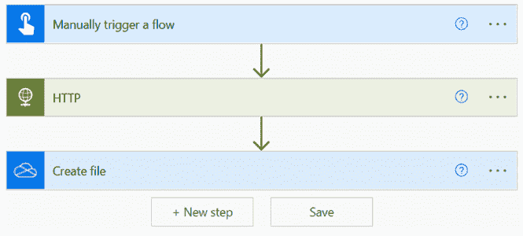

12. 点击屏幕右上角的 **Flow checker** 按钮。我们应该没有警告，但如果有警告，请按照建议解决。

13. 现在，点击 **Test Flow** 按钮。右侧会弹出一系列屏幕。由于流程类型，我们唯一的选项是手动测试。点击 **Test**，如图 8.10：

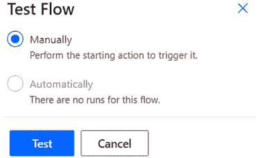

14. 运行流程所需的权限列表会出现在右侧。在本例中（如图 8.11），我们已经登录到 OneDrive，因此有权使用此账户。由于我们使用高级功能来简化示例（HTTP 连接），如果您未使用企业账户或免费的 Power Automate 试用版，此时会收到警告。

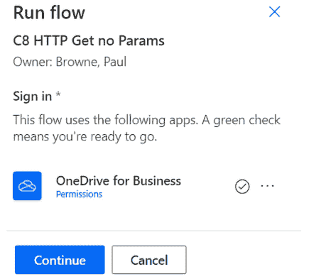

图 8.11 – 检查运行流程的权限

15. 点击 Continue 后，会弹出一条消息，允许您前往 Flow Runs 页面。点击该链接后会显示类似图 8.12 的图像。虽然我希望您也能看到 Succeeded 消息，但点击流程的日期可以查看该特定流程运行的更多详细信息。

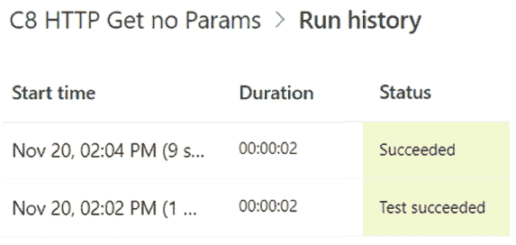

图 8.12 – 流程运行历史

在流程历史中，如果您的流程在 HTTP 请求上卡住，则说明您使用了错误的 URL——请检查并重试（同时也值得在网页浏览器中检查该 URL）。

由于添加更多操作到流程的步骤与我们之前的示例相同，我们不会再详细介绍。我们将展示我们要实现的目标流程，以及流程每个步骤的设置。凡是有其他不同之处，我们都会突出显示。其中一个不同之处是，我们需要准备一个 Excel 表格来输出结果。

## 准备我们的 Excel 输出表格

我们的 Excel 输出表格非常简单，但它会被 Power Automate 中的一些操作自动拾取——因此让我们逐步讲解创建过程：

- 1. 首先打开 Excel 并创建一个新的电子表格。
- 2. 创建两个标题，ID 和 JSON。
- 3. 选择单元格 A1:B2——然后插入表格。点击 我的表格有标题，然后点击确定以创建表格。
- 4. 使用 表格设计 菜单，为表格命名，如图 8.14 所示：

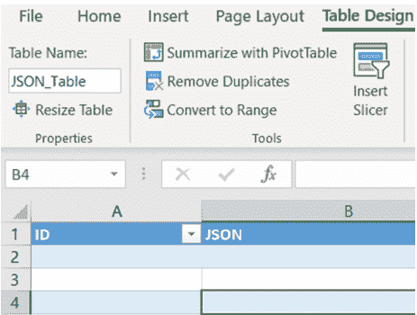

图 8.14 – 用于捕获输出的电子表格及表格

- 5. 将其保存在 OneDrive 中，使用一个您会记住的名称（如 Output.xls）。如果您的机器上正在运行 OneDrive，您可以直接将其保存到 OneDrive 文件夹中；否则，将其上传到网页版 OneDrive。

## 创建调用决策服务的流程

我们将创建的用于调用决策服务的流程将如下图 8.15 所示：

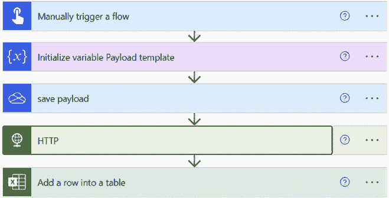

让我们逐步讲解创建过程：

- 1. 手动触发操作与之前的操作相同。
- 2. 创建一个 初始化变量 操作，如图 8.16 所示：

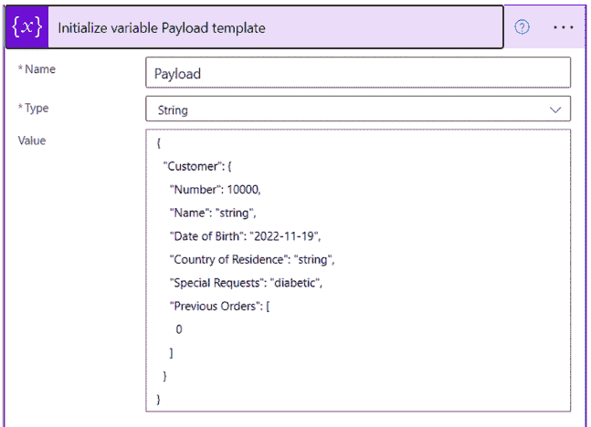

- 3. 在此步骤中，**Name** 为 `Payload`，**Type** 为 `String`，**Value** 为我们将传递给决策服务的 JSON。此 JSON 与我们在 *第 6 章* 和 *第 7 章* 中使用的负载完全相同，因此最好从那里复制，以确保拼写完全正确。

- 4. 添加另一个操作——**Create file**，这将为您提供如图 *8.17* 所示的选项屏幕：

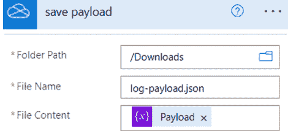

图 8.17 – 记录我们将要发送的负载

- 5. 这是我们之前示例中使用的同一个 OneDrive 操作——但这次我们在 HTTP 调用之前执行它（确保保存 `Payload` 变量）。这在我们动态构建 JSON 的未来示例中会很有用，并且有助于检查我们发送给决策服务的内容。

- 6. 我们更新 HTTP 调用，如图 *8.18* 所示——注意我们已删除了一些空白字段：

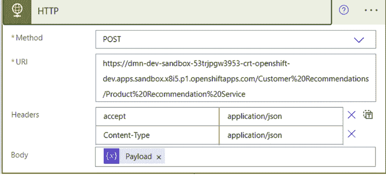

图 8.18 – HTTP 调用的设置

- 7. 根据 *图 8.18*，我们的 **Method** 类型现在为 `POST`。**URI** 是我们决策服务的端点（确保空格已转换为 `%20` 并且决策服务正在运行）。我们的标头按 POST 方法的要求设置，而 **Body** 是我们在流程中前面定义的 `Payload` 变量。

8. 在 HTTP 操作的高级设置中，检查我们未使用任何身份验证。

9. 在 Excel Online（Business）的设置中，添加一行到表格中；它应如下图 8.19 所示。确保您使用的是 Excel Business 连接器，因为有一个更简单的 Excel 连接器，选项要少得多：

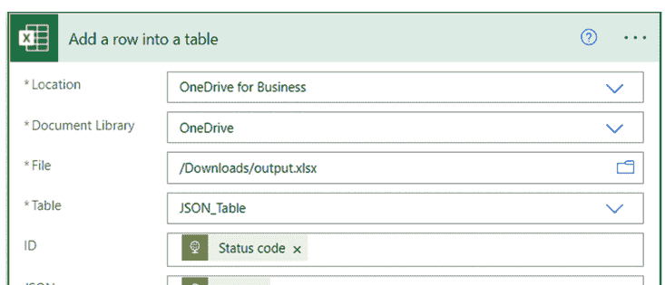

图 8.19 – 向表格添加一行

10. 在此操作中，如图 8.19 所示，选择位置为 OneDrive for Business。选择 OneDrive 的文档库选项。文件行上的文件夹图标应允许我们选择之前创建的 output.xlsx 文件。

11. Power Automate 会自动检测此 Excel 文档中的表格，这将帮助我们选择表格选项 JSON_Table——即我们之前添加的名称。

12. 从表格中，Power Automate 会自动检测其中的两个列——ID 和 JSON。我们将其设置为使用 HTTP 调用的状态代码和 Body 响应进行更新（使用动态内容选项）。

## 运行我们更新的示例

然后我们保存、测试并运行流程，我们的输出表格将被更新，如图 8.20 所示：

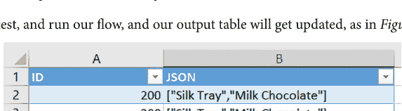

图 8.20 – 表格中的调用结果

正如预期的那样，我们的流程已运行，调用了决策服务，然后将结果附加到我们的 Excel 表格中。尝试在我们刚刚创建的 Power Automate 流程第 2 步中设置 Payload 变量的值，以确认服务按预期行为。

虽然这是一个更有用的流程，但值仍然是硬编码的，与本章开头图 8.1 中勾勒的客户服务流程相比，仍然缺少几个步骤。让我们现在修复这个问题。

## 在 Power Automate 中建模我们的客户服务流程

由于客户服务流程收集信息，让我们先来看看 Microsoft Forms。

## Microsoft Forms 简介

Microsoft Forms 是一项免费服务，是 Office 在线的一部分。您可能已经使用过它，或类似的服务，如 Google Forms 或 SurveyMonkey。Forms 可在 https://forms.office.com/ 获取。最好使用与托管 Power Automate 流程相同的 Microsoft 账户，这样有助于稍后将它们链接起来。

在此页面上，点击 New Flow 创建新表单。我们将逐步编辑它：

- 1. 表单最初未命名——点击为其命名。
- 2. 点击 Add New 添加您的第一个（文本）问题。让我们将其命名为 Email。
- 3. 再次点击 Add New 添加另一个文本问题。让我们将其命名为 Customer Number。
- 4. 点击此问题旁边的 … 选项，选择限制，并选择 Number。
- 5. 点击 Add New 添加一个选择题。添加 US、UK、NL、JN 和 UK 的选项。
- 6. 在屏幕上，点击此问题旁边的 … 选项。选择将其设为下拉菜单的选项。
- 7. 在右上角，点击 Preview。我们的表单现在应类似于图 8.21：


## 第8章示例

1. 电子邮件

输入你的答案

2. 客户编号

该值必须是数字

3. 居住国家/地区

选择你的答案

提交

图 8.21 – 设置表单以收集信息

8. 屏幕右上方有一个“发送”按钮。它会提供一个可共享的链接，类似于 https://forms.office.com/r/ETQ900ed1q7T （你的链接会有所不同）。记下这个链接，因为稍后我们需要用它来触发 Power Automate 流。

请注意，我们目前没有将出生日期或其他输入添加到决策服务中，因为我们可以稍后添加。目前，我们希望让示例保持简单。

如果你之前使用过 Forms，就会知道它会自动捕获响应。我们想做些更具动态性的事情，所以让我们为表单添加一个 Power Automate 流。

## 更新我们的 Power Automate 流

我们想要创建的流，模仿了本章开头的客户服务流，如图 8.22 所示。该流与之前步骤相同，但映射到了 Power Automate 操作：

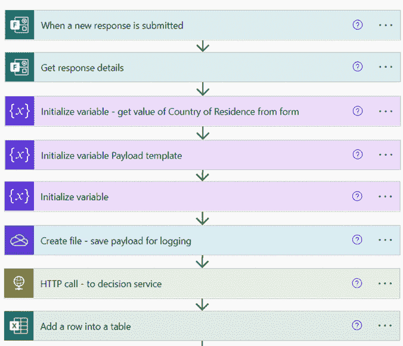

图 8.22 – 我们将构建的流

该流是我们上一个示例中所用步骤的演进。但由于流开头的触发器不同，我们需要删除手动流程触发器。

要删除先前流中的触发器，请点击现有触发器（第一步，“手动触发流”）边缘的 ...。选择“删除”。这样就空出了位置以添加替代触发器。

让我们逐步完成更新流的其他步骤：

+   1. 第一步是添加一个替代触发器。搜索 Forms 触发器“提交新响应时”，如图 8.23 所示：

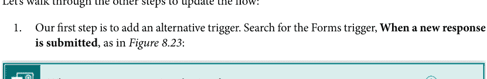

图 8.23 – 启动流的触发器

+   2. 下拉菜单让我们选择用于触发流的表单 – 选择我们在上一节创建的表单。

+   3. 在此触发器之后立即添加另一个操作 – **获取响应详细信息**。表单 ID 应为同一个表单，**响应 ID** 可以通过动态内容弹出窗口获取 – 它看起来应该像 *图 8.24*：

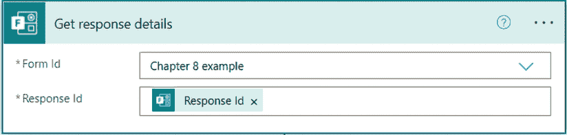

图 8.24 – 获取表单信息的句柄

如果我们忘记这一步，当我们尝试选择值时，表单 ID 不会作为建议弹出。

+   4. 在此步骤之后立即添加另一个新操作 – **初始化变量** – 如图 *8.25* 所示：

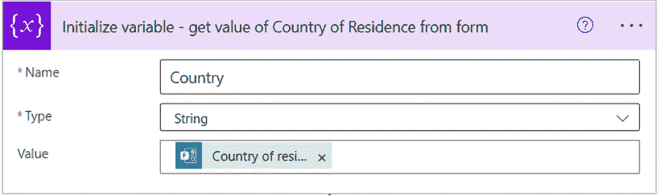

图 8.25 – 从表单获取居住国家/地区

+   5. 我们将变量命名为 `Country`，并将其类型设置为 `String`。我们设置的值（使用 **动态内容** 弹出窗口）是我们表单的 **居住国家/地区**。

+   6. 注意，我们重命名了这个（以及其他操作）的名称，以使内容更清晰 – 你不必这样做，但之后你会庆幸自己这样做了！

+   7. 我们更新初始化负载的步骤，如图 *8.26* 所示。它被重命名为 `Payload_template`。请注意，该值也略有不同 – 在 `Country of residence` 字段中有一个 `__cor__` 标记 – 我们稍后会查找并替换这个步骤。这个值没有什么特别之处 – 它只是一些易于理解、但不太可能自然出现在文件中的文本（以防止意外匹配）。

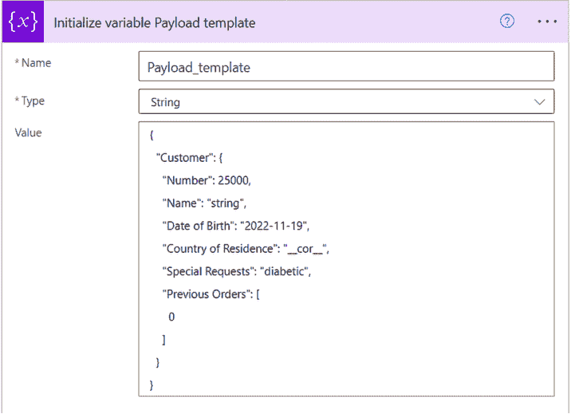

图 8.26 – 设置负载模板

+   8. 添加一个新的 **初始化变量** 操作。现在定义 `Payload` 变量，类型为 `String`，如图 *8.27* 所示：

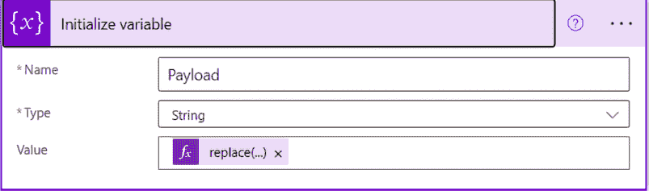

图 8.27 – 使用我们的值更新负载模板

+   9. 你会注意到，这个值由一些我们之前没有遇到的动态内容设置。*图 8.28* 对此进行了详细展示。我们需要选择表达式，因此在 **表达式** 中输入 `replace(variables('Payload_template'), '__cor__', variables('Country'))`，然后点击 **更新**。

通过这个流，该函数会查找负载模板中的 __cor__ 值，并用表单中的值替换它。

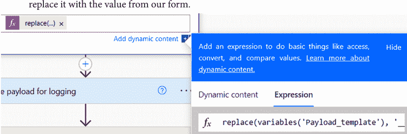

图 8.28 – 动态表达式的特写

10. 下一步，在发送之前保存负载，让我们能够发现任何错误。这与我们之前的示例类似，如图 8.29 所示。

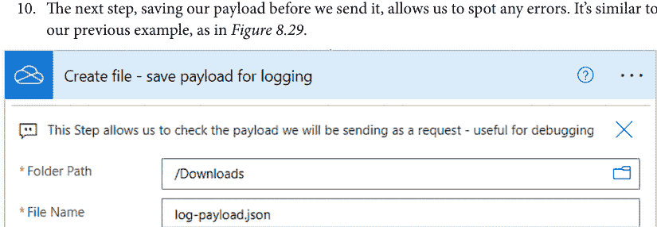

图 8.29 – 保存生成的负载

11. 接下来的步骤（执行实际的 HTTP 调用并将返回的值保存到 Excel 中）与我们之前的流相同 – 你可以通过查看图 8.18 和图 8.19 来确认。

12. 我们在流的末尾添加一个新步骤 – 发送电子邮件。确保使用 Outlook V2 操作，因为还有其他可用的连接器。收件人框使用表单中提供的电子邮件地址（通过动态内容值查找）。正文可以包含你想要的任何文本，并包含 HTTP 正文值，因为我们将通过电子邮件将结果发送给提供数据的人 – 如图 8.30 所示：

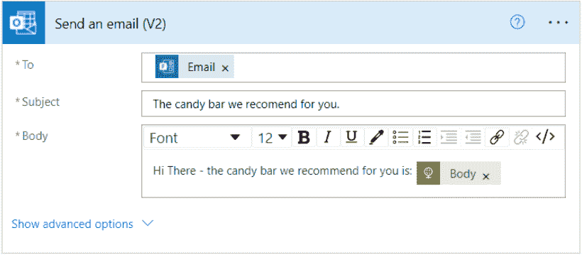

图 8.30 – 通过电子邮件发送产品推荐的操作

你会注意到，为了简洁，我们只使用了表单中的 `email` 地址和 `Country` 值。但重复*步骤 5 到 8* 可以让我们在调用决策服务时添加其他表单值。

## 运行我们的客户服务 Power Automate 流

启动我们的流甚至比之前的示例更简单 – 使用我们之前记下的可共享链接进入表单（我们的链接是 `https://forms.office.com/r/ETQ900ed1c7T`，但你的链接会略有不同）。在表单中输入一些值，然后点击 **提交**。该流会自动运行，并将包含决策服务建议的电子邮件发送出去。

如果你返回流并点击 **测试**，你会看到现在有另一个运行流的选项，如图 *8.31* 所示：

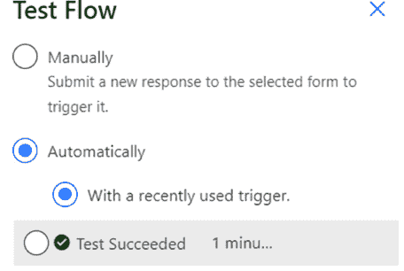

图 8.31 – 其他测试流选项

新选项允许你重放刚刚提交的表单 – 这不仅节省时间，还能确保每次运行都使用相同的值进行测试。

在结束本章的流之前，值得注意 **流运行** 页面，它可以让你查看每个 Power Automate 步骤的结果。它还会让你了解每个步骤完成所需的时间。如果你的流在 `Http Request` 上停滞了几秒钟，很可能是 `url` 值已过期，你可能需要刷新这些值。

## 扩展此示例的建议

我们的示例非常清晰，但如果你决定将表单中的其他值添加到决策服务调用中，你会很快发现这个示例变得繁琐——需要创建多个只使用一次的变量，以及多个查找/替换步骤。

你可能需要在自己的流中进一步演进这些步骤——以下方法值得考虑：

- 合并一些步骤。例如，直接在替换函数中使用表单值，而无需先创建变量。
- 使用 `concat` 表达式一次性构建 JSON 负载——将所有变量和 JSON 表达式的片段放在一行中。
- 使用外部脚本（如 **JavaScript** 或 **Office Scripts**）构建 JSON 负载。
- 在 Excel 中将 JSON 计算为表达式，然后在将 JSON 传递给决策服务之前读回该值。这样做的好处是最容易审查和更新。

> **为什么我们不在流中通过 Office Scripts 调用决策服务？**
> 我们刚刚提到 Power Automate 流可以调用 Office Scripts。那么为什么不使用*第 7 章*中的技术通过这些脚本调用决策服务呢？
> 
> 原因是安全模型限制了脚本在流中能做什么。这并不妨碍我们使用 Office 脚本来处理数据（例如，创建负载）。但进行外部调用的唯一方式是通过 HTTP 操作，就像我们在示例中所做的那样。

在我们的流中，我们发送相同的电子邮件内容，依靠决策服务返回的消息来高亮任何健康警告。实际上，你可能会在流中添加一个测试和一个分支操作，根据产品推荐结果发送不同的电子邮件。

我们不会详细讨论这些技巧，但你可以探索它们，以此为基础扩展本章所示的关键步骤。如果你想深入探索 Power Automate，Packt 作者 *Aaron Guillemette* 的这本书是一个很好的起点：https://www.packtpub.com/product/workflow-automation-with-microsoft-power-automate/


## 其他工作流 – Kogito 业务自动化和 Power Automate Desktop

本章之所以聚焦于 Power Automate 是有原因的，因为它是使用最广泛、最适合（Power）用户的友好型工作流工具。但你很可能会遇到另外两种工作流工具——Power Automate Desktop 以及随 Kogito 业务自动化而来的工作流。

### Power Automate Desktop

你（简要地）见过 Power Automate 的桌面版，因为在图 8.3 中创建新的云流时它是一个选项。如果你创建了一个桌面流，你会被提示安装桌面工具（尽管它已预装在 Windows 11 中；请参阅 Power Automate Desktop 文档了解更多详情）。你会看到如图 8.32 所示的启动屏幕：

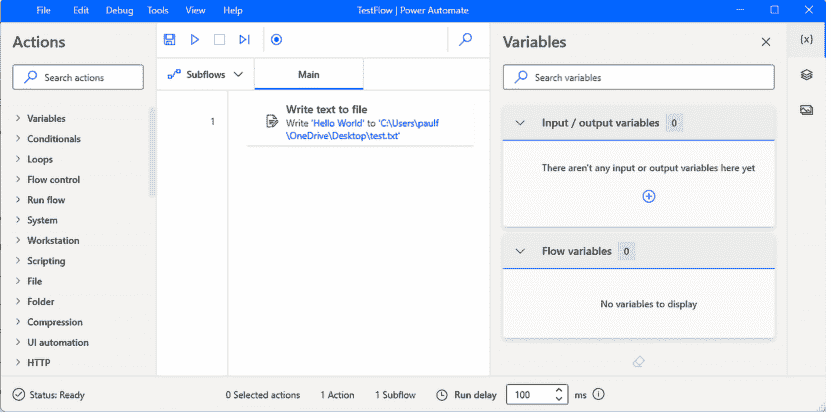

图 8.32 -- Power Automate Desktop

使用 Power Automate Desktop 的许多概念与使用云版本相似。Power Automate Desktop 也有 HTTP 连接器，且对所有用户开放，无任何高级限制。虽然这为你提供了将流链接到决策服务的额外选项，但也带来了一些权衡：

- 桌面流中的操作范围非常广泛——基本上使用笔记本电脑能做到的事情几乎都可以通过桌面流完成。
- 桌面流仅在用户登录时运行（即使机器已锁定）。云流则全天候运行（并且可以被触发）。
- 桌面流本质上作为云流的子流运行。它们可以手动触发以进行测试。
- 将云流和桌面流链接起来是一项高级功能，并非所有用户都可用，这可能会限制你日常的使用方式。

非常值得探索 Power Automate Desktop，以了解你如何在日常工作中使用它。但我们将在本章结束时快速了解一下你可能暂时不会使用的另一个工作流——Kogito 业务自动化。

### 快速了解 Kogito 业务自动化

早在第 3 章中，我们在图 3.1 中瞥见了创建工作流的选项。当时，我们专注于创建决策服务，但可能值得返回该屏幕并创建示例工作流，如图 8.33 所示：

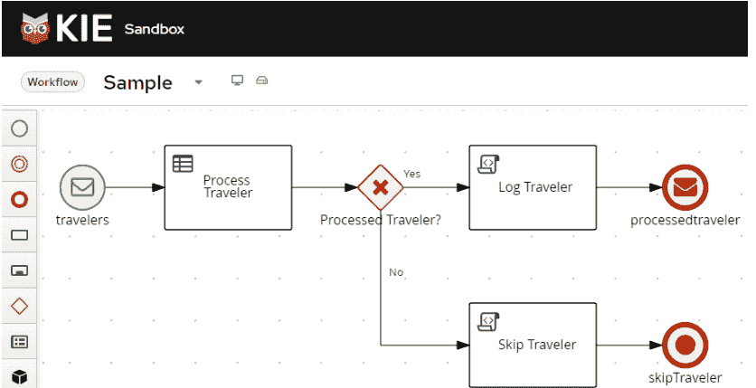

图 8.33 – Kogito 业务自动化示例

由于此工作流示例是图形化的，很容易看出它处理的是商务旅客预订。更棒的是，由于它是 Kogito 的一部分，Process Traveler 步骤可将业务规则无缝集成到工作流中。正如你所料，Kogito 工具遵循行业标准——因此你可以使用 Kogito 基于 BPMN 开发流程服务。

然而，虽然 Kogito 工作流对业务用户友好，但其工具（目前）并不像业务规则和决策服务那样独立。例如，在 KIE 沙箱中执行 Kogito 工作流流程的选项更为有限。

在许多情况下，我们会推荐使用 Kogito 工作流业务自动化（例如，如果你是 Java 开发者，或你与拥有支持技能的团队合作）。但作为一位寻求与 Microsoft Office 高度集成的工具的 Excel Power 用户，Power Automate 对于初学者来说可能是一个更好的选择。

### 总结

我们在本章开始时设定了期望，即虽然我们会介绍 Power Automate，但我们将重点放在如何将 Excel 链接到决策服务，作为完整端到端流程的一部分。

本章我们所涵盖的内容是工作流，以及为什么我们将 Power Automate 作为本书的工作流工具。然后我们转向如何从 Power Automate 调用业务规则和决策服务。最后，我们在 Power Automate 中构建了完整的客户服务流程，并查看了其他工作流工具，如 Power Automate Desktop 和 Kogito 业务自动化。

本章是关于将 Excel 链接到决策服务的 Microsoft 工具的第三章（共三章）——不仅使用 Power Automate，还包括 Power Query、VBA 以及 Script Lab/Office Scripts 等其他选项。鉴于这些工具的强大功能，值得进一步探索。

现在我们已将 Excel 链接到决策服务，我们在下一章中的注意力将集中在如何更充分地利用它。我们首先探索 FEEL 表达式语言以编写更强大的规则，并使用测试来确保规则确实按我们期望的方式运行。

### 高级表达式、决策模型和测试

如果你在听取了我们在*第 3 章和第 4 章*之后的鼓励后，可能已经尝试构建自己的决策模型。希望你随后在*第 6、7 和 8 章*中探索了将模型链接到 Excel 的不同方式，并找到了最适合你的方法。但随着模型的复杂性增加，你可能会发现事情并不像你希望的那样顺利。

本章旨在解决这个问题——我们将解释 FEEL 表达式语言的更多功能，以使你的业务规则更具表达力。我们将介绍如何构建决策模型以降低其复杂性。我们将介绍测试，以及为什么让你自己先破坏规则总比让别人先破坏要好。在此过程中，我们将向你展示 KIE 沙箱之外的编辑工具，让你了解 KIE 生态系统内工具的强大之处。

本章将涵盖以下主要主题：

- 先决条件和预读材料
- DMN 和 FEEL 表达式——扩展你已知的知识
- 动态列表、上下文和关系
- 你可以在决策模型中使用 Power FX 表达式吗？
- 关于构建和编辑决策模型的更多内容
- 帮助构建模型的常见决策模式
- 测试和破坏你的规则（在别人之前）

#### 先决条件和预读材料

正如你所期望的，对于更高级的章节，有助于你阅读过本书的前几部分！我们将要涵盖的大部分内容都建立在*第 3 章和第 4 章*的基础上。虽然我们会快速复习，但你需要访问运行扩展服务的 KIE 沙箱，如*第 3 章*所述。

我们之前推荐过关于**决策模型与标注（DMN）**和 FEEL 语言的额外阅读。与其涵盖每个函数，本章将重点关注那些对 Excel Power 用户来说可能不那么自然的领域（例如列表）。我们假设你已快速浏览了以下文档：

- `https://kiegroup.github.io/dmn-feel-handbook/`
- `https://learn-dmn-in-15-minutes.com/`
- `https://www.drools.org/learn/documentation.html` – 选择最新的 Drools 文档和用户指南

像之前各章一样，示例可从本书的 GitHub 站点下载，地址为 `https://github.com/PacktPublishing/AI-and-Business-Rules-for-Excel-Power-Users`。

你不需要将这些参考资料倒背如流——知道它们在需要时可以查阅特定工具包中的函数即可。让我们先回顾一下我们已知的知识。

#### DMN 和 FEEL 表达式——扩展你所知的知识

在*第 3 章和第 4 章*中，我们涵盖了 FEEL 表达式语言的许多关键点：

- 我们看到 FEEL 允许你编写框式表达式（就像你在 Excel 公式框中输入的那样）。你可以在许多不同的地方使用 FEEL 表达式——从决策节点到列表再到决策表。
- 一种 FEEL 表达式是文本和字符串操作——我们用它创建了 `Hello [your name]` 示例。如果你阅读过参考文档，你会看到 Excel 中大多数文本函数在 FEEL 中都有等价物。这包括将字符串转换为大写或小写、从文本开头、中间或结尾提取文本、替换值、测试文本是否以特定值开头或结尾，以及拆分或合并文本。
- 我们使用变量作为不同值的占位符。查看参考文档，你会看到用于操作布尔值和数字的函数与 Excel 非常相似。我们将在稍后更详细地介绍日期和时间处理，因为虽然概念很熟悉，但函数的格式略有不同。

> **三种类型的布尔值？**
> 
> 你会期望布尔值评估为 True 或 False。然而，FEEL 允许第三个值，Null（或 *空*），表示未显式分配值。


- 自定义数据类型允许我们使用基本构建块（例如文本、数字和布尔值）构建容器来保存我们的数据。我们还研究了数据的约束，以限制可使用的值。
- 列表可能看起来很熟悉（因为它们就像一系列单元格）。我们将介绍更多高级函数来操作它们，从而扩展这一概念。我们还将介绍用于测试范围的函数（想想列表，但具有顺序值——例如，`[1..10]`）。
- 与列表相关的是 **上下文**（也称为 **映射** 或 **关系**），它就像一组键值对——稍后会详细介绍，因为虽然它们易于使用，但对于 Excel 高级用户来说，这个概念可能还比较新。
- 我们看到了用于分支的 `if... then` 表达式，很快将介绍用于对列表数据进行操作的循环。
- 我们之前涵盖了 DMN 中的所有不同节点类型（文本、决策节点，包括决策表、输入数据和函数），并将返回调用，以便更好地组织您的决策模型。

在我们（重新）开始之前，有几个 FEEL 语言基础知识值得记住：

- FEEL 设计为 **无副作用**——评估表达式不应更改传递给该表达式的值。这与（例如）Visual Basic 代码不同，后者可能会更新 Excel 中单元格的值或颜色。
- FEEL 设计为 **可读性强**，甚至允许在变量和函数名中使用空格。如果您使用过另一种计算机语言（例如 JavaScript），您可能会觉得这很奇怪。
- 因此，值得记住的是，FEEL 会将任何未加引号的文本评估为变量名。`"Friday"`（带引号）将匹配该确切文本，而 `Friday`（不带引号）如果没有定义该名称的变量，KIE 会抱怨。两者（带或不带引号）都是 **FEEL 字面量**——KIE 可以将其评估为值的表达式。

我们将开始探索 FEEL 语言中的列表——这是一个功能强大但易于使用的概念。但由于列表的工作方式与 Excel 略有不同，因此值得查看一些更深入的示例。

### 动态列表、上下文和关系

您可能还记得在 *第 4 章* 中，我们通过使用 `List` 类型的决策节点图形化地创建了 `List`。如果您想刷新记忆，请查看 *图 4.25*——它非常清晰地展示了我们要查找的健康问题。但列表比这动态得多。我们已经说过，我们可以在任何地方使用 FEEL 表达式——这也包括在列表内部。例如，*图 9.1* 中的列表是有效的语法。此示例可以从示例站点 (`https://github.com/PacktPublishing/AI-and-Business-Rules-for-Excel-Power-Users`) 下载为 `c-09-dynamic-lists.dmn`。

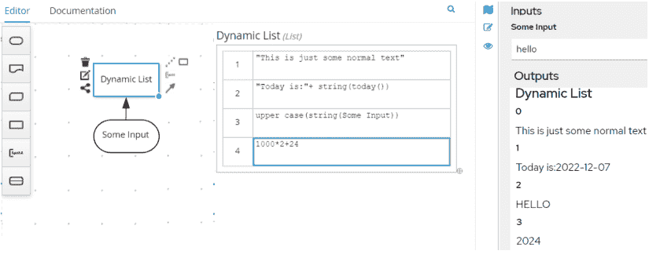

图 9.1 – 动态生成我们的列表值

我们已操作该图，以便在一个图片中显示主图、我们的列表值以及输入/输出。您需要在屏幕上按 **Edit** 节点和 **Run** 按钮来查看类似结果。

> **FEEL 中的日期和时间函数**
> 
> 正如您所期望的，FEEL 参考列出了许多日期和时间处理函数。我们在此示例中使用了 `now()` 函数，大多数日期函数的行为与 Excel 中的等效函数类似。
> 
> FEEL 指南对日期提供了很好的概述——即使它分散在指南的多个部分中。值得强调的一点是 `.` 语法——例如，表达式 `(2023,12,20).day` 函数将返回 20，类似地还有 `.year`、`.month` 等选项。
> 
> 您会注意到，对国际日期的支持不如 Excel  extensive——例如，它始终以年/月/日顺序列出——date("2023-12-20") 是 2023 年 12 月 20 日。请注意，我们如何使用字符串而不是数字创建了相同的日期。还有用于 **时间**、**日期和时间** 以及 **持续时间** 的类似构造函数选项。

让我们从左到右查看 *图 9.1* 中的示例：

- 我们有一个非常简单的决策模型——只有一个名为 **Some Input** 的输入。它将值输入到 `list` 类型的决策节点（我们称之为 `Dynamic List`）。
- 我们的列表有四个值。其中第一个是静态文本。第二个是今天的日期。第三个是我们输入值转换为大写。最后一个项目是我们计算的数字。
- 右侧是输入和输出。我们传入一个简单的值（`hello`）并得到四个值的列表返回——我们可以通过它们编号为 **0-3** 来判断它是列表。虽然这在脚本语言中很常见，但与 Excel 不同，Excel 从 1 开始计数行。

值得下载示例并尝试操作以进一步探索。

### 转换函数

您会注意到我们的示例使用了 string() 函数将当前日期转换为字符串并将 Some Input 传递为字符串——FEEL 不会自动转换值的方式像 Excel 那样。

还有用于转换为数字和日期的等效函数，有关如何使用它们的更多信息可在 FEEL 参考指南中找到。

虽然此列表中的项目是动态生成的，但它将始终具有相同的四个项目且顺序相同。我们可以用列表做一些更动态的事情。请看图 9.2，也可下载为 09 Step by Step Context.dmn。

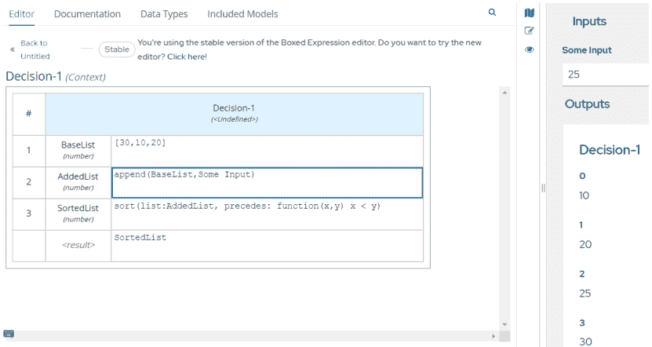

图 9.2 – 更动态的列表

此示例的决策模型再次很简单——输入节点馈送到决策节点——因此我们没有显示它。我们确实编辑了 Some Input 节点的属性以指定只允许数字，这意味着我们不必在函数中进行转换。如果您尝试自己创建此示例，值得注意的是，表格右列中的每个框都是字面表达式，并且名称应保持一致。例如，名称 Some Input 中包含空格，因此所有引用它的表达式也应包含该空格。

我们将决策节点设置为 Context 类型。虽然我们将在本章后面看到另一种使用上下文的方法，但此示例允许我们指定逐步说明，在每个步骤中操作列表(s)。每个步骤都是字面表达式：

- 1. 我们使用 FEEL 语法而不是图形格式创建 `BaseList`——`[30,10,20]`。
- 2. 我们创建另一个列表 `AddedList`，将 `BaseList` 与我们作为 **Some Input** 传入的数字结合。
- 3. 我们创建第三个列表 `SortedList`，并在其中对我们的列表进行排序。请注意 `sort()` 函数采用命名参数并允许我们指定排序方式，这使其非常强大。
- 4. 我们的最后一行指定我们想要返回的值（`SortedList`）。更改此值将允许我们查看我们创建的其他列表。清除此单元格（右键单击以获取菜单选项来执行此操作）将返回我们创建的所有三个列表。

在 *图 9.2* 中显示的示例中，我们传入的值为 25，它被添加到列表中并排序，给出输出列表 `[10,20,25,30]`。请注意使用方括号和逗号的语法，这使您能够以非常紧凑的形式编写列表表达式。

### 有关使用 FEEL 表达式操作列表的更多信息

现在您已经了解了列表的基础知识及其语法，其余函数应该会更容易理解。我们将快速浏览一下——很可能，您只需要知道这些函数存在。当您需要详细使用它们时，您可以使用前面提到的 FEEL 指南找到确切的参数：

- 我们在示例中看到了 `sort` 和 `append` 函数。`reverse` 和 `remove` 是它们的相反操作。
- Max、Mean、Min、Sum 和 Count 的工作方式与您预期的基本相同。
- `distinct values()` 从列表中删除重复项——例如，`distinct values(["One", "One", "Two"])` 将返回一个更短的无重复列表，`["One", "Two"]`。
- `index of()` 返回项目在列表中的位置。例如，`index of(["One", "Two", "Three", "Four"], "Four")` 将返回数字 4。`contains` 类似，但根据列表是否包含该值返回 `true` 或 `false`。

列表也可以包含列表——虽然这是一个简单的概念，但我们能给出的任何示例都会很快变得复杂！我们只提到 `flatten()` 将合并所有子列表为一个大列表。`concatenate()` 类似，但为您提供了对创建列表顺序的稍多控制。`sublist()` 允许您再次将此列表切分为更短的列表。


从我们在 *第 4 章* 中的示例中，你可能注意到我们的自定义数据类型可以包含列表。我们的 `Customer` 数据类型就包含了一个之前的订单列表。只是为了展示列表的强大功能，相反的情况也是成立的——我们可以有一个客户列表，每个客户都由 `Customer` 自定义类型表示。

### Lambda 函数

最近添加到 Excel 中的一项强大功能是 **Lambda 函数**。基本上，这些是我们可以在周围传递的函数，与我们使用变量或单元格引用时的方式类似。

类似的函数在 FEEL 表达式中已经存在。我们在 *图 9.2* 中看到了一个 Lambda 函数的例子——`sort()` 命令接受了一个命名参数 `precedes`，它被定义为 `function(x,y) x<y`。虽然我们在此案例中定义的排序顺序很简单，但它确实展示了我们能多大程度地自定义排序算法。

还有另外三个列表函数以类似的方式运行——请记住，这些是应用于整个列表的。对于以下示例，我们将创建 `mylist`，一个数字列表——`[1,2,3,4,5]`：

- `for i in mylist return i * 2` 将返回 `[2,4,6,8,10]`
- `some i in mylist satisfies i > 4` 将返回 true，因为存在一个值为 5 的值满足条件
- `every i in mylist satisfies i > 4` 将返回 false，因为只有其中一个（而非全部）列表元素满足条件

列表是 FEEL 表达式语言的基本构建块，许多与关系和上下文相关的函数都会返回一个列表。我们很快就会查看这些内容，但在那之前，我们先来看看范围，它们看起来与列表相似，即使它们解决的是略有不同的问题。

### 范围而非顺序列表

在我们之前的示例中，我们本可以把列表定义为 `[1..5]`——它仍然包含相同的 5 个数字，而且输入起来更短一些。这种范围语法对于更长的数字序列来说更简洁，例如 `[1..100]`。

尽管语法相似，范围并不能总是直接替换列表。在实践中，你会以不同的方式使用范围——更像 Venn 图，其中你关注的是范围之间的重叠。例如，`overlaps( [1..5], [3..8] )` 返回 true，因为两个范围都有 3、4 和 5 共同。

还有几个相关的函数可以测试一个范围是否在另一个范围之前（`before()`）或之后（`after()`），一个范围是否完全包含（`includes()`）另一个范围，或者一个范围的开始是否与另一个范围的开始或结束匹配。

阅读范围示例时，请注意两种不同类型的括号。(1 .. 10) 等价于 [2 .. 9]——圆括号语法会排除给定数字，而方括号则包含它们。两个范围都包含 2、3、4、5、6、7、8 和 9。

范围和列表都很好，但可能包含没有意义的值。让我们看看关系和上下文，它们解决了这个问题。

### 关系 – 信息表

请看图 9.3 中的关系，我们将在本章后面的图形上下文部分将其构建到物料清单示例中。

#### 产品详情（关系）

| # | Name (string) | Weight (number) | Grams of Cocoa (number) | Grams of Sugar (number) | Grams Milk (number) |
|---|---|---|---|---|---|
| 1 | "Silk Tray" | 400 | 150 | 150 | 90 |
| 2 | "Crunch" | 75 | 10 | 60 | 5 |

图 9.3 – 显示我们不同产品的配料的关系

即使没有我们解释，你也能猜到这个值表显示了进入我们产品的配料。它比简单的列表更具表现力和结构化。

在 KIE 沙盒中构建此关系很简单——我们创建一个类型为 Relation 的决策节点，然后添加所需的行和列。设置每列的数据类型也很重要。在创建此表时，我们将每个框设置为字面值——任何 FEEL 表达式都是有效的（不仅仅是此处显示的静态值）。而且虽然我们保持了此示例的简单性，但可以在框内表达式中嵌套其他表达式（例如，返回每个产品中包含的过敏原列表）。

此关系表可作为 09 Bill of Materials.dmn 示例的一部分从本书的示例站点下载。

现在我们已将值定义为关系表，如何引用它们？语法很直接，并且以下 FEEL 表达式引用图 9.3 中的表：

- Product Details.Name 返回一个列表，其中包含 Name 列的值，[Silk Tray, Crunch]。
- `Product Details[1]` 返回表中的第一行作为一个 **context**（更多内容见下一节）——一组键值对，例如 `{Name : "Silk Tray", Weight : 400, Grams of Cocoa: 150 }`。
- `Product [Name = "Crunch"] .Weight` 给出表中单个框的值——在本例中为 75。
- `Product .Weight [2]` 是使用行号的替代语法。在本例中，它也引用 Crunch 棒的重量（因此返回相同的值——75）。
- `Product [Weight>25] .Name` 是 **filtering** 的示例——更复杂的选择，将返回 ["Silk Tray", "Crunch"] 的列表，因为两者重量都大于此值。

### 两种常见的数据模式

很可能这些产品数据将在许多不同的决策模型中使用。一种常见模式是一次性定义关系表，然后将其包含在需要它的模型中——更多内容见 *链接决策模型* 部分。

另一种常见的数据模式是从外部数据库或 Excel 文件读取这些值。我们的 `Invocation` 节点也可以读取几乎任何数据源。但由于它使用 Java 代码来实现，因此超出了本书的范围。更多细节可在 KIE 文档 https://docs.kogito.kie.org/latest/html_single/#_kie_extended_functions 中找到。

关系非常适合 largely 静态且不经常更改的数据。如果我们想要类似表格的布局，但具有列表的动态特性，我们需要查看 **contexts**。

### 动态上下文

我们已经看到，前一行中的 `Product Details[1]` 表达式返回了一个上下文——在该情况下，是表格中一行 `{Name : "Silk Tray", Weight : 400, Grams of Cocoa: 150 }`。注意我们在 FEEL 表达式中创建上下文时可使用的语法：

- 使用大括号打开和关闭
- 使用逗号分隔项目
- 内容是一组 `key:value` 对

如果你以前编程过，你可能在 *map* 或 *dictionary* 的名称下遇到过上下文——两者可能更具描述性，暗示一旦我们知道键，就可以使用它来查找与其关联的值。

例如，如果我们将前面的上下文存储在 `myContext` 变量中，`get value( myContext, "Weight" )` 表达式将返回 400 的值。

使上下文更强大的原因是添加值很容易。例如，`context put (myContext, "Raising Agent", 1)` 将把该项目添加到我们的配料列表中。

虽然 FEEL 手册中完整记录了上下文函数的列表，但值得重点介绍 `context.merge()`，它允许我们合并上下文，以及 `context.get entries ()`，它返回上下文中所有值的列表。

还有几种其他图形化创建上下文的方法值得探索。

### 图形上下文

图形上下文允许我们以更直观的格式定义上下文，这对于让经验不足的同事理解我们的模型在做什么很有用。记住我们在图 9.2 中遇到了上下文的另一种用法。在那个示例中，我们使用 FEEL 表达式上下文逐步生成值，并使用 `result` 语句仅传回最终值。

如果我们删除或清除最终的 `result` 语句，所有生成的 values 都将作为一组 `key:value` 对返回。我们将通过一个示例来演示这一点，我们将在本章剩余部分构建它——物料清单决策模型。这在图 9.4 中显示，可从本书的 GitHub 仓库下载为 `09 Bill of Materials.dmn`。

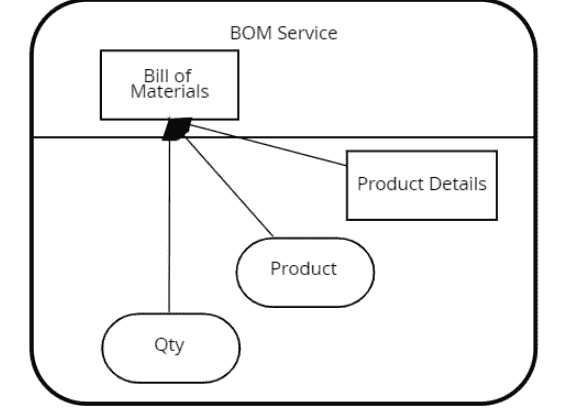

图 9.4 – 我们的物料清单决策服务

此决策模型有两个输入：`Qty`（Number）和 `Product`（String）。第三个节点 `Product Details` 我们之前见过——它是一个类型为 `Relation` 的决策节点，保存每个产品的配料信息。


这三者都汇入了一个 Context 类型的决策节点，其详细内容在图 9.5 中显示。

### Bill of Materials (Context)

| # | Bill of Materials (Any) |
| 1 | Name (string) | Product |
| 2 | Grams of Cocoa in Product (number) | Product Details[Name = Product].Grams of Cocoa |
| 3 | Grams of Cocoa in Order (number) | Qty*Grams of Cocoa in Product |
|  | <result> | Select expression |

图 9.5 – 一个图形化上下文

创建此上下文与之前类似——我们添加了多行，第一列的键相同，并使用字面表达式给出值。像之前一样，每一行都可以基于前一行——因此我们先指定产品名称，然后使用产品名称在包含所有产品详细信息的关联或表中查找值。最后，我们将输入的数量乘以所需的可可克数，以计算制造此订单所需的总可可量。

请注意没有指定结果——因此在运行时，所有值都将被返回，而不仅仅是单个结果。结果将以键值对的形式呈现——Name : Some-product-name。

我们可以通过在 KIE 沙箱中运行此模型来证明这一点，在那里我们将得到如图 9.6 所示的结果：

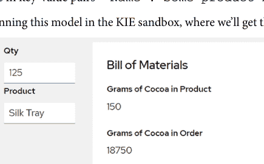

图 9.6 – 我们上下文的输出

这里，我们输入了 Silk Tray 的数量——这是一种较重的产品，含有大量巧克力，因此用 18.75 kg 的可可来制造它也就不足为奇了。KIE 沙箱以清晰的 key:value 格式显示上下文——将其与图 9.1 中的列表进行比较，后者具有类似的格式，但每个值旁边是数字而不是键。

### More reading on FEEL functions

这对于一本专注于 Red Hat 和 IBM 的 KIE 的书籍来说可能令人惊讶——但我也会建议查看来自 Oracle、Trisotech 和 Camunda 等其他厂商的 FEEL 指南。

由于 FEEL 是一个标准，他们所说的大部分内容都适用于 KIE——并且每个都从略微不同的角度解释概念。这是一种很好的方式，如果你在任何领域遇到困难，可以帮助你。

本节重点强调了 FEEL 与 Excel 函数之间的差异，逐步介绍了 Excel 用户可能难以理解的某些领域。最好的学习方式是深入实践，尝试为你的组织建模一些决策。

在离开函数之前，我们将查看另一种表达式语言——Power FX。

### Using Power FX expressions in decision models

**Power FX** 是微软的一种低代码表达式语言，其目标与 FEEL 并无太大差异。大致来说，如果你能取你在 Excel 中使用的公式，并删除对单元格的引用，使其不再绑定到电子表格，你就会得到接近 Power FX 语言的东西。这意味着你可以在 Power Apps 中使用 Power FX 来构建移动应用程序，并且语法越来越多地出现在 Power Automate 和其他 Microsoft 平台中。有关该语言的更多详细信息请见 https://learn.microsoft.com/en-us/power-platform/power-fx/overview。

Power FX 比 FEEL 更进一步——而 FEEL 是为无副作用而编写的，Power FX 完全可以产生影响（例如，更新单元格值或更改范围的颜色）。Power FX 还可以与比 FEEL 更广泛的系统集成，而 FEEL 专注于决策模型。

在 KIE 中使用 Power FX 表达式目前是一个实验性功能——正如团队在以下帖子中所述：https://blog.kie.org/2022/03/using-javascript-and-power-fx-with-dmn.html。

到目前为止，本章中我们专注于可在模型中使用的表达式语言。让我们更广泛地看看设计和构建决策模型的一些更高级功能。

### More on building and editing decision models

在之前的章节中，我们研究了构建决策模型，并通过探索 FEEL 表达式语言扩展了这一知识。本节将通过研究最佳实践来扩展我们对决策模型的知识。

在进入更复杂的决策模型之前，值得先了解一下 KIE Sandbox 编辑器中可用的键盘快捷键——我们在表中重点介绍了最有用的快捷键：

| Key | What it does |
|---|---|
| *Esc* | Unselect the current selection |
| *Delete/backspace* | Delete the current selection |
| *Ctrl + C* | Copy |
| *Ctrl + V* | Paste |
| *Ctrl + X* | Cut |
| *Ctrl + Z* | Undo the last edit |
| *Shift + Ctrl Z* | Redo the last edit |
| *Shift + Up arrow (or another arrow)* | Slowly move the selection up (or in another direction) |
| *Ctrl + Up arrow (or another arrow)* | Quickly move the selection up (or in another direction) |
| *Alt (hold) and drag the mouse* | Pan |
| *Ctrl (hold) and drag the mouse* | Zoom |
| *Shift + /* | Show the full list of keyboard shortcuts |

表 9.1 – KIE 沙箱中的键盘快捷键

除了这些键盘快捷键之外，还有几种其他编辑方法也很有用：

- 虽然 KIE Sandbox 编辑器非常好用，但有时它会不同步（尤其是在你的笔记本电脑休眠时）。刷新网页（并相信模型已保存到本地浏览器存储中）可以解决许多问题。
- 在浏览器沙箱中工作很棒，但在编辑标签和阅读文档标签之间切换可能会令人困惑。在你的 PC 上安装第二个浏览器，一个用于每个用途，是减少混淆的一个简单技巧。
- 与其他建议相比，这很微不足道，但你可以弯曲图表中的箭头，使你的图表更整洁，更容易被他人理解。
- DMN 标准将决策模型的图形和 XML 版本视为同等重要。可以直接编辑模型的 XML（例如，使用本章后面将介绍的 VS Code 编辑器）。虽然这非常强大（例如，在决策模型之间复制粘贴），但也很容易破坏东西。因此，请确保先保存备份副本（到 GitHub）。

到目前为止，我们一直专注于决策模型的各个元素，让我们谈谈优雅的决策模型——使用通用模式使用户更容易理解你的模型。

### Common decision patterns

如果你创建了大量电子表格，你可能会发现自己一次又一次地重复常见的模式。这可能是将说明或顶级数据放在电子表格的第一页。也可能是包含复杂公式的隐藏（或锁定）工作表。或者可能是旁边显示图表的透视表，以便人们可以快速概览或深入细节。

我们重复这些模式并非出于懒惰，尽管节省时间是件好事。我们会重复这些模式，因为它们有效，并且熟悉的模式更容易被人们理解。程序员称这些可重复的解决方案为 **设计模式**，并积极在问题解决过程中应用他们之前使用过的模式。

在决策模型中，你也会发现自己一次又一次地使用可重复的模式。其中最重要的是从一个决策模型调用另一个决策模型——因为这使我们能够将模型分解为可重用、更重要的是可测试的块。我们将在本章后面的部分专门讨论这两个概念。

在此之前，你可能会注意到，你已经（无意中）在自己的模型中创建了我们即将提到的模式。但是，由于模式旨在在团队之间和团队内部提供共同语言，我使用的是 Trisotech 的 Denis Gagne 和 KIE 团队的 Matteo Mortari 使用的模式名称：

- **Scoring** – 我们基于规则组合构建一个值——根据不同规则匹配情况加减分数。考试是经典的评分系统，但银行使用的信用评级或航空公司乘客筛查（用于额外安全检查）也是类似的例子。
- **Classification** 可以基于这些分数——例如，基于纯百分比的考试分数，其中 A 等级高于 85% 分数。这可能更微妙，分类会改变，使得只有前 10 名的人获得此等级。或者分类可以在多个值上进行——就像我们在 *第 4 章* 中提到的产品推荐服务，它考虑了居住国家。
- **Ranking** – 真实的在线产品推荐服务不会只建议一个值。例如，亚马逊会建议最多 10 个产品（在数百万个产品中），它认为你最有可能购买。你可以通过基于分数排序来实现这一点，也许会根据不同的分类规则进行修改。

最后一种模式更多是问题的框架——模型试图回答什么问题？做得正确的话，它将使理解和设计决策服务变得容易得多。

本节的关键收获是，其他人很可能遇到过与你非常相似的问题，即使他们在不同的领域或行业工作。留意可以重用的常见模式——一个良好的起点是 Gange 和 Mortari 关于该主题的演示文稿。SlideShare 链接是 https://www.slideshare.net/dgagne/introduction-to-some-dmn-patterns-and-their-value，KIE 博客上的帖子中链接了 YouTube 视频。


### 另一种模式——将决策模型链接在一起

在 Excel、决策服务和大多数计算机语言中，一种常见模式是将较大的解决方案拆分成可复用的部分。有点像乐高积木一样，这样让它们更容易理解和复用。而且，正如你很快会看到的，这也让它们更容易测试。但如果我们把解决方案拆分成许多部分，如何将它们链接在一起呢？让我们通过一个例子来演示。

我们尽量让本书中的示例尽可能逼真。但如果展示一个复杂到足以拆分成较小模块的示例，一个决策模型调用另一个决策模型的机制就会被复杂性掩盖。所以，我们反其道而行之——用尽可能简单的示例来链接模型。

我们从图 9.7 开始，也可以下载为 09-a-SimpleModel.dmn。

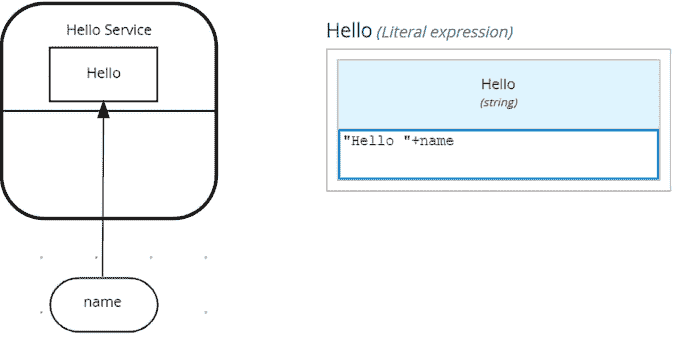

图 9.7 – Hello World 服务

这是第 3 章中图 3.19 的 Hello world 示例的稍加更新版本。它接收一个名称作为输入，然后向那个人问好。

在图 9.7 中，我们将决策模型和决策节点并排放置，以便更清楚——但除了将节点包装在决策服务中之外，没有重大变化。还值得注意的是，输入节点（Name）是 String 类型。我们还设置了决策服务的属性，让 KIE 知道它返回 String 类型——这有助于其他人包含并复用此模型。

#### 关于文件夹的提醒

由于只有在模型位于 KIE 中的同一文件夹内时才能导入它们，因此如果 KIE 沙箱连接到 GitHub 会很有帮助——如果需要提醒如何操作，请查阅第 5 章。系统会询问你使用什么文件夹名称——我们使用了 c09 作为文件夹名称，但更重要的是，我们要链接的两个模型都必须保存在该文件夹中。

创建此模型（或将其上传到沙箱）后，请按照我们在第 5 章中给出的说明，确保它同步到 GitHub。我们将其命名为`09-a-ImportModel.dmn`。现在，是时候创建第二个模型来引用我们的`Hello`服务了：

1. 单击**新建文件**并选择**决策**——它会在同一文件夹中创建一个空白文件夹。
2. 单击**包含的模型**选项卡——目前，它将显示**尚未包含外部模型。**
3. 单击屏幕右上角的**包含模型**。你将看到文件夹中的模型列表，如图 9.8 所示。如果看不到其他模型，请返回并检查 KIE 沙箱是否正确链接到 GitHub——两个模型都需要位于同一文件夹中。

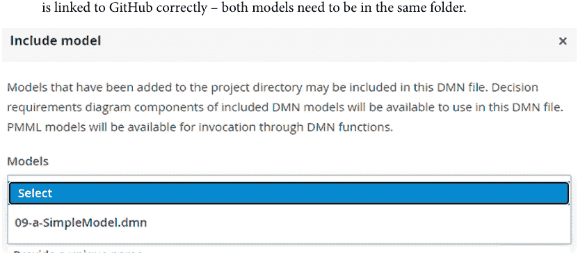

图 9.8 – 包含另一个模型

4. 选择`09-a-ImportModel.dmn`并给它一个名称。最好保持简短（我们称之为`simple`），因为我们将经常使用该名称。单击**包含**按钮确认。
5. 如果我们包含的模型有自定义数据类型，它们将（只读地）出现在**数据类型**选项卡中。模型中的**决策导航器**选项卡也会显示我们刚刚包含的组件，如图 9.9 所示。如果决策导航器尚未打开，你可以点击屏幕右上角的地图图标查看它。

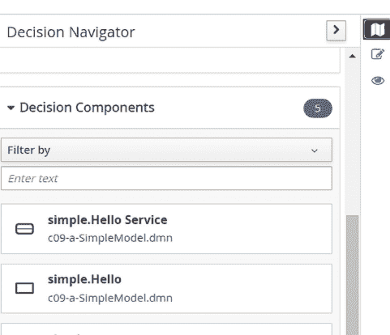

图 9.9 – 决策导航器中包含的组件

虽然可以使用所有这些组件，但决策服务才是用于在模型外部引用的那个组件。既然我们已经包含了模型，就可以随时调用它。我们将构建想要链接的两个模型中的第二个，如图 9.10 所示。


图 9.10 – 包含的组件

虽然这个第二个模型可以从本书的 GitHub 网站下载为 09-a-ImportModel.dmn，但它仍然很容易设置。从图 9.10 从左到右，我们看到以下内容：

1. 我们从决策导航器中拖放了 simple.Hello Service。
2. 我们创建了一个决策节点，并保留默认名称 Decision-1。
3. 我们从 Hello 服务链接到决策节点。这个方向很重要；幸运的是，沙箱编辑器不会让你按相反方向链接。
4. 我们创建了一个新的输入节点（保留默认名称 InputData-1），并将其类型设置为 String。我们将输入节点连接到决策节点。
5. 编辑决策节点时，我们将其类型设置为 Invocation。
6. 编辑 Invocation 节点时，确保名称完全正确很重要。我们设置的函数名称是 simple.Hello Service——与我们从另一个模型包含的节点拼写和大小写完全相同。
7. 编辑器会有一行用于输入我们想要传递的参数——将第一个参数名称从 p-1 改为 name。同样，这必须与我们包含的模型中的输入节点完全匹配。查看决策导航器以确保拼写正确。我们将此参数的类型设置为 String——也是为了与我们包含的模型期望的值匹配。
8. 我们设置要作为参数传递的值；单击“选择表达式”，将其设置为“字面表达式”，并包含我们输入节点（Input-Node-1）的值。参数的类型（String）必须与包含的服务期望的类型匹配。
9. 在 KIE 沙箱中，仔细检查没有突出显示的问题。然后，单击“运行”和“作为表单”。如图 9.11 所示，当我们输入名字 Peter 时，会得到 Hello Peter 作为返回。


图 9.11 – 调用外部模型的结果

#### 小示例，大影响

这是一个简单的例子——我们绝不会把像 Hello World 这样简单的示例拆分。但你的模型很快就会变得非常复杂，很高兴知道你可以将模型拆分为可复用的组件。

#### 链接物料清单示例

由于这是一个非常简单的示例，我们还提供了第二个更复杂的示例，其中我们复用了在图 9.4 中创建的物料清单服务。该示例可在 09-Call-BOM 下载。导入步骤以及到我们决策模型的映射与 hello world 示例类似。但是，我们想要传递多个参数，这可以通过在调用表中添加额外的一行来实现，如图 9.12 所示。


图 9.12 – 调用我们的物料清单服务

我们将在第 11 章中回到导入和调用模型——届时我们将使用类似的机制来使用和导入机器学习模型，使其与我们的业务规则一起工作。

既然我们知道可以拆分和重新组合模型，问题就变成了在哪里拆分模型。这是一个需要判断的决定，因为你需要权衡在一个页面上看到所有内容的便利性，与拥有许多更小、更容易理解的模型的简洁性。但两个有用的指导原则如下：

- 按照人们对现有业务的思考方式来建模——你的模型越遵循现有的部门、团队和流程边界，你的同事就越容易理解它们。
- 在便于测试的层级建模。如果你的模型太大，测试起来会非常笨重。如果模型太小，你会厌倦编写许多价值不大的琐碎测试。

由于测试非常重要，KIE 为你提供了几种自动构建和运行测试的选项——我们将在下一节中讨论。

#### 测试并破坏你的规则（在其他人之前）

如果你像我一样，让电子表格、程序或决策模型正常工作总是一种解脱。有时我们不愿意过于用力考验新作品，以防它崩溃。但无论我们是否寻找错误，任何隐藏的错误仍然存在，之后会回来咬我们一口。

更糟糕的是，错误被忽略的时间越长，修复成本就越高。现在（当模型还清晰地印在你脑中时）微不足道的更改，在几个月后（其间你已参与其他几个项目）可能需要几个小时才能找到。而且，如果问题被真实客户或最终用户看到，可能会非常昂贵——我们最终可能赠送大量免费巧克力并损害我们业务的声誉。

更令人沮丧的是，修复这个错误可能导致其他东西崩溃。例如，我们可能会更新物料清单，然后发现另一个决策模型依赖它，现在行为不正确。但有办法解决这个问题——通常称为敏捷、Scrum 或测试驱动开发。

#### 敏捷、Scrum 和测试驱动开发

幸运的是，在我们之前有很多人多年来遇到过这些问题。因此，有最佳实践和工具来帮助我们解决这些问题。从广义上讲，解决方案如下：

- 一点一点地编写测试，这样它们容易编写。每个测试的重点是测试单个部分。这样，我们就不会想留到最后，然后可能根本不写。这种方法称为**单元测试**，它比你之前可能参与的端到端测试要容易得多（尽管端到端测试仍有其用武之地）。
- 以标准方式编写测试，因此虽然每个单元测试都很简单，但它们共同形成了一个安全网，可以突出显示我们是否意外破坏了解决方案的另一个部分。
- 先编写测试，使它们成为我们试图开发的内容的契约，并且我们知道我们已经构建了我们承诺的一切。
- 自动运行这些测试，使它们成为游戏的一部分——我们的测试是否通过？如果绿灯亮起，太好了！如果没有，因为每个测试都非常简单，很容易找到并修复问题（然后再次运行，看看我们是否获得绿灯）。
- 使用与构建解决方案类似的工具编写测试，但将测试组织得像建筑上的脚手架一样。这样，很明显什么是支撑测试框架，而建筑物（或核心解决方案）不被触及。
- 让这些测试有趣且易于编写，使它们成为文档的一部分。有了良好的测试，查看你的决策模型的同事现在有了一个可用的示例，了解如何（重新）使用它。

这些要点是一种构建解决方案的理念和方法。你可能参与过遵循这些原则的项目，通常称为**敏捷、Scrum 或测试驱动开发。**


正确实施的话，编写测试所需的小额前期投入将以数十倍甚至数百倍回报。更妙的是，有测试的项目工作压力会小得多，因为你能在有足够时间修复且不会大费周章时，就及早发现问题。

> **健康警告 – 给项目贴上敏捷标签并不会使其成为敏捷**
> 一些管理者有诱惑将项目标记为敏捷，以此作为不做艰难项目规划工作的借口。但如果你不投入测试，后期会遇到严重问题（通常是在原项目经理离职后）。如果你有过这种经历，请对下一节保持开放心态——真正的测试优先项目解决了开发技术解决方案中的许多常见痛点。

关于敏捷、Scrum 和测试驱动开发，有大量信息可供查阅。我们将在下一节聚焦于 KIE 项目提供的支持这种方法的工具。我们将介绍 KIE 沙箱中内置的一个工具，以及一种更高级的方法，你可能希望在 Excel 中实现。最后，我们将预览 Business Central（我们在 *第 10 章* 中更详细地介绍）和 Visual Studio Code（我们在 *附录 B* 和 *第 12 章* 中介绍）中可用的一些高级测试功能。

### Run ... as Table

你可能在用 KIE 沙箱运行之前的示例时，使用 **Run ... as Form** 选项，注意到还有第二个选项（**Run ... as Table**）。让我们现在来看一下，因为这是迈向测试方法的一个良好步骤：

1. 我们在 KIE 沙箱中打开了物料清单选项（下载的模型：`09 Bill of Materials.dmn`）。
2. 在沙箱中，选择 **Run ... as Table**。会出现类似 *图 9.13* 的屏幕。请注意，我们已删除了一些列以提高清晰度，并添加了一些测试值以更清晰地展示表格运行器的工作方式。


图 9.13 – KIE 沙箱表格运行器

3. 此表格的每一行都等同于我们迄今为止测试模型时使用 Run ... as Form 的方式。如果我们将左侧的两个值（Qty 和 Product）作为输入，在右侧，我们可以声明我们期望的三个输出（产品中的可可克数、PD 中的可可克数：请应用 P-code 风格 Order，以及产品名称的确认）。

4. 这里的便利之处在于，我们可以同时看到多个不同的订单，从而能够快速检查是否有任何问题。

虽然表格运行器是一个有用的改进，但它在测试优先方法方面仍有不足之处。最重要的是，它不会标记测试失败的位置。例如，图 9.13 中的第三个值是一个负值，导致了虚假结果。但很容易就会错过这一点——即使你第一次看图时发现了这个问题，你能保证在需要检查的数百个输出表格中也能发现问题吗？

幸运的是，KIE 提供了修复此问题的工具。我们将在本章后面介绍这些工具——但由于它们尚未（嵌入）到 KIE 沙箱中，讨论一个基于 Excel 的解决方案是值得的。

### Test cases using Excel

如果你查看图 9.14，你会看到我们已在 Excel 中改进了表格运行器，以解决 rogue 测试被遗漏的问题。虽然它与图 9.13 的值相同，但一旦出现问题就会立即显而易见，因为它会被标红。


图 9.14 – Excel 中的测试场景

这是一个非常简单的想法，共有四组主要列：

- Given 是我们传入的值
- Expected 是我们认为决策服务应该返回的值
- Actual 是实际返回的值
- Flag 是用于检查 Expected 和 Actual 值是否匹配的列

我们不会给出在 Excel 中运行测试用例的工作示例，因为一旦你掌握了关键思想，实现起来就很直接。你可以使用你在第 6 章和第 7 章中学到的方法，设置此测试电子表格，将 Excel 与你的决策服务链接起来。

其他细节，例如条件格式，将由你决定，布局将与你构建的决策服务密切相关。

值得强调的是，在 Excel 中进行测试是一个完全可行的方案。我们在下一节中讨论的场景模拟方法更好——但它确实依赖于你可能需要支持才能设置的工具。你可能会发现下一节很困难，但可以实现。随着你逐步完成它，请记住你始终有在 Excel 中进行测试的备选方案。

### Scenario testing and simulation

Excel 方法的测试是好的，但使用与我们构建模型相似的工具编写测试会更好。这样，我们的测试就位于决策模型附近，更有可能被使用和更新。图 9.15 给出了 KIE 的 Scenario Simulation 工具的示例，它采用了这种方法。

| # | Scenario description | GIVEN: Product | GIVEN: Qty | EXPECT: Bill of Materials | EXPECT: Product Details |
| --- | --- | --- | --- | --- | --- |
| 1 | Silk Tray | "Silk Tray" | 125 | 18750 | 150 |
| 2 | Crunch | "Crunch" | 10 | 100 | 10 |
| 3 | Crunch | "Crunch" | -10 | 0 | 0 |

图 9.15 – KIE 场景模拟编辑器

图 9.15 在方法上与图 9.14 中的 Excel 测试场景非常相似。它具有相同的输入（GIVEN）和预期输出（EXPECT）。当我们运行场景模拟时，它会突出显示预期值和实际值之间的任何差异。

虽然这是 KIE 的真实截图，但截至撰写时，Scenario Simulation 工具尚未在沙箱中提供。值得再次核实，因为产品路线图不断演进，到你阅读本文时可能已发生变化。相反，此 Scenario Simulation 工具可在 KIE 两个高级决策建模工具中使用：

- **Business Central**，KIE 团队的较老决策建模工具，仍比沙箱功能更多。如你在第 10 章中将看到，Business Central 对业务用户非常友好。有几个设置步骤，大多数 Excel 高级用户能够遵循，但有些人需要支持。

- **VS Code**，面向开发人员而非业务用户的工具包的一部分。虽然许多 Excel 用户能够使用它，但本书的并非每个读者都想利用它所提供的强大功能。

本书的一个关键目标是为你提供良好的基础和清晰的下一步探索方向。微软的 VS Code 绝对是这些领域之一。

### What is VS Code and why use it to test?

你可以使用 VS Code 不仅用于编写决策模型，还可用于机器学习、Web 开发、数据科学和更传统的编程等广泛领域。为了鼓励你迈出这一步，我们将在下一节介绍 VS Code，并解释（在附录 B 中）如何使用它开始编写决策模型和场景测试。该附录使用 VS Code 的在线版本，无需安装，以便更快上手。

VS Code 是微软提供的免费文本编辑器和编码工具，其扩展程序可以处理几乎任何开发项目。在我们之前的一些示例中，我们在简单的文本编辑器（如记事本）中打开了一些文件。VS Code 为你提供了类似的编辑器，但可以同时打开多个类似文本的文件——请看图 9.16 中屏幕顶部的标签。


更妙的是，VS Code 为你提供代码着色和语法高亮，这看起来像是简单的装饰，但确实使文件更容易阅读。在屏幕截图左侧，你还会看到 VS Code 为你提供了类似 Windows 资源管理器的视图，显示解决方案中的所有文件——包括决策模型、场景模拟（可在屏幕截图的主面板中看到）以及支持文件，如文本、XML 和 .md markdown 格式的文档。

屏幕截图左侧的深灰色栏暗示了 VS Code 中可用的强大功能。图标会根据我们安装的插件而变化——在这种情况下，我们添加了 KIE 团队的 DMN 扩展。此栏上的其他图标允许你与 GitHub 仓库交互（比在 KIE 沙箱中更强大的方式），将项目部署到 Azure，并运行项目中的单个文件。


更令人印象深刻的是，尽管VS Code有桌面版，但这张截图是在Web浏览器中运行的VS Code中截取的（浏览器会自动设置Azure云托管的Codespaces来完成繁重的工作）。

屏幕的最后一部分（右下角）包含大量文本。如果你以前使用过终端（无论是Linux、macOS还是Windows），应该对此很熟悉。但由于需要输入命令而不是点击菜单和鼠标，这可能会让一些第一次看到它的读者感到畏惧。正是出于这个原因，我们在*附录B*中介绍了在VS Code中设置和使用场景模拟与测试，而不在本书主体流程中展开。

由于*附录B*中的说明是逐步给出的，大多数用户应该能够跟着操作。VS Code是一个强大工具，你将在许多不同项目中用到它，我强烈建议你深入尝试一下——附带的好处是让场景模拟工具可用于你的项目。

#### 总结与延伸阅读

本章我们链接了大量额外资源。KIE项目博客上有一些关于使用测试场景的非常有用的帖子和视频，非常值得花时间阅读。如果你想更详细地探索DMN，一个极好的下一步是阅读布鲁斯·西尔弗（Bruce Silver）的*DMN方法与风格*。

但在本书中，我们还没有完成这些主题。*第10章*（我们将在其中介绍安装Docker和Business Central）为我们提供了另一种运行场景测试编辑器的方式。这也很好，因为我们在*第11章*中介绍的机器学习比我们目前介绍的基于规则的AI更需要测试。最后，在*第12章*中，我们介绍DRL格式，这是一种更高级的规则编写格式，与我们在本章中进一步学习的图形化DMN表示法配合得很好。

本章旨在让你更深入地理解决策模型以及嵌入其中的FEEL表达式语言。由于更高级的模型更容易出错，我们介绍了一些使模型更易理解的模式，以及将许多简单模型连接起来的技术。我们了解了测试优先方法的重要性，以及KIE为支持该方法提供的工具。最后，我们初步了解了KIE中作为VS Code一部分的高级工具，以此鼓励你在沙盒之外进行更多探索。

*超越沙盒*可能是下一章的一个好标题——我们将继续探索更多托管决策编辑器和运行模型的方式。由于这涉及Docker，它为我们提供了更多本地和云端运行选项，并基于本章通过VS Code和Codespaces对Azure的初步了解继续深入。我们还将了解Business Central作为运行场景测试的另一种方式。
