## 第10章 使用Docker和云在Business Central中扩展规则

在上一章中，我们首次了解了**场景模拟工具**，它是一种测试复杂决策模型的手段。我们在*附录B*中介绍的说明可能也激发了你在VS Code中探索高级技术的兴趣。但由于那种技术方法并不适合所有人，你可能仍在寻找另一种高级的模型测试方式。

幸运的是，**Business Central**以更用户友好的包形式提供了相同的场景模拟工具。本章将介绍如何设置Business Central编辑器，并探讨它提供的一些额外规则编辑技术。特别是，我们将其视为一个企业级协作工具，用于共享和编辑决策模型。

由于我们将使用**Docker容器**来运行Business Central，我们还将解决在*第5章*中遇到的另一个问题。虽然我们已经知道如何在本地（笔记本电脑上）或云端（使用Red Hat OpenShift）托管决策模型，但你的IT部门可能想要介于两者之间的方案：在公司网络上托管决策服务。我们将探索容器作为实现此目标及其他部署选项的一种方式。

具体来说，我们将涵盖以下内容：

- 比较Business Central和KIE Sandbox来编辑我们的模型
- 镜像、容器、Docker和获取帮助
- 在笔记本电脑上安装Docker
- 运行Docker及Docker Desktop概览
- 在Docker中运行Business Central规则编辑器
- Docker和Azure中的KIE Server
- 决策模型部署选项摘要

到本章结束时，你应该有信心自己和同事能够部署一个可扩展的企业级规则编辑器，并创建一个可扩展的企业级服务器来托管你编写的业务规则。这将为你提供许多书中未涉及的额外探索领域。

> **阅读本章的两种不同方式——动手实践，或仅仅了解它可以实现**
> 虽然了解动手实践技术很有用，但本章的主要目的是为未来步骤指明方向。这为你提供了另一种阅读本章的方式；尝试理解什么是可能的，同时知道会有更懂技术的同事来执行部署。
> 
> 无论哪种方式，很高兴知道Kogito支持一系列部署选项。本章分享的信息将帮助你说服同事：KIE、Kogito和Drools是解决你所面临的业务和IT问题的可扩展技术栈。

### 前提条件

本章中的分步说明很简单。你唯一需要的是一台性能足够强大的笔记本电脑来运行Docker。大多数现代笔记本电脑都能满足这一要求。更多信息请访问 https://docs.docker.com/desktop/install/windows-install/。

如果你的笔记本电脑性能不够，可以询问同事网络上是否有其他计算机可以托管容器。Docker的全部意义在于它提供了多种部署选项。由于Business Central基于Web，你将能够远程访问它。

### 比较Business Central和KIE Sandbox

Business Central作为决策模型的基于Web的编辑器，听起来很像KIE Sandbox。如果你熟悉KIE Sandbox，你会发现Business Central中有很多相似之处，没错。但这有点像把家用车和最新的F1赛车作比较。两者都是四轮带引擎的汽车，但一个更容易驾驶，更适合去超市购物；另一个性能更强，但需要一队机械师的支持才能有效运行。功能上的一些关键差异如下：

- KIE Sandbox设计为易于使用，无需设置，非常适合像本书这样的教程。Business Central可能易于启动，但需要大约15-20分钟的准备才能编写第一条业务规则。
- Business Central比KIE Sandbox拥有更多功能，后者专注于决策建模的核心功能。核心决策模型编辑器和DMN实现完全相同，但有些附加功能（例如场景模拟工具）仅在Business Central中可用。


+   - The Sandbox 针对的是单个用户并带有一些团队功能，而 Business Central 则假设会有很多人一起在项目上工作。其许多高级功能都假设你的团队中有 *mechanic* 知道 Java（例如，设置数据类型）。
+   - KIE 沙盒和 Business Central 都使用 Git 作为存储模型的机制，因此可以构建一个工作流，让两个编辑器同时处理同一个决策模型。然而，正如你从 Business Central 所预期的那样，它提供了更强大的实现，这对于新用户来说可能令人望而生畏。

在本章中，我们将重点关注场景测试工具，因为这是你探索 Business Central 的一个令人信服的理由。我们还使用 Business Central 来演示 *第 12 章* 中的一些更高级的功能。我们的目标是为你提供一个良好的起点，并建议进一步探索的路径。

但首先，我们需要让 Business Central 运行起来，为此我们需要容器。

## 容器、Docker 和获取帮助

我们在 *第 2 章* 中介绍了 **容器**，它是让读者最快运行工具和示例的方式。更重要的是，容器可以帮助所有读者一致地运行示例，这意味着书中的说明与你在笔记本电脑上看到的情况相匹配。

过程很简单；我们安装我们选择的容器软件（Docker），然后使用 Docker 工具下载包含我们想要的软件和示例的镜像。

许多 Excel 高级用户会习惯安装软件。即使这是你第一次做，本节中的逐步说明也非常容易遵循。在开始之前，让我们记住你在 Excel 中尝试过的事情并非第一次就成功。你是如何修复的？

-   1. 你检查了你的输入和拼写——这是错误信息的最大原因。
-   2. 你仔细阅读了错误信息——很可能它会建议你可以做的事情来修复它。
-   3. 如果你正在遵循指南或书籍，你会重新检查说明，看看是否有遗漏的步骤。
-   4. 你将错误信息（或其关键部分）复制并粘贴到搜索引擎中。大多数时候，会有遇到相同问题的人知道如何修复它。至少，会有建议帮助你更接近解决方案。
-   5. 在尝试了所有这些步骤之后，你向同事或朋友求助。你分享了你尝试过的步骤，以表明你重视他们的时间，并且你确实在寻求他们的专业知识。

我们逐步说明的第一部分可以概括为 *在你的电脑上安装 Docker Desktop*。有一个非常支持且活跃的 Docker 社区可以帮助你做到这一点。而且由于 Docker 是企业标准，可能附近有人可以帮助你。*附录 C* 有一些很好的起点，特别是 *为 Docker 准备你的电脑* 部分。

大多数读者在按照下一节的说明安装 Docker 时不需要帮助，但知道如果需要的话有更多详细信息是很好的。

## 安装 Docker

既然我们知道有所有这些支持，让我们一步步在笔记本电脑上安装 Docker。本章中的说明分为两个清晰的部分：

-   1. 安装 Docker 以托管容器。
-   2. 下载一个包含你想在此容器中运行的示例的镜像。

确保第一部分正在运行，然后再开始第二部分——如果你知道确切是哪一部分导致了问题，寻求帮助会容易得多。

## 准备你的 Docker Hub 账户

稍后你将被要求提供你的（免费注册）Docker Hub 账户的详细信息。前往 docker.com 并点击网页右上角的 Sign In。然后你可以选择创建账户。记下你的用户名和密码以备后用。

## 下载和安装 Docker 软件

Docker Desktop 的下载和安装相当直接：

-   1. 开始时，前往 https://www.docker.com/products/docker-desktop/ 并选择适合你系统的安装程序（例如，Windows、Linux 或 Mac）。
-   2. 打开你在上一步中下载的 Docker 安装程序。
-   3. 点击 Yes for Do you want to allow Docker Desktop to make changes to your PC。如果此时要求输入管理员用户名和密码，请参阅附录 C 中的说明。
-   4. 在下一步——配置中点击 OK。请注意，你的版本号可能比此屏幕截图中显示的更高（更新）：

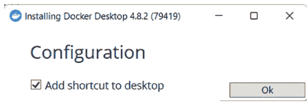

-   5. 在安装程序下载和解压文件时耐心等待。如果一切顺利，你将收到 Installation succeeded 消息——点击 OK 并继续到下一节（Docker Desktop 之旅）。

4. 当 Docker 启动后，你应该会看到主屏幕，如 **图 10.3** 所示。如果没有看到此确切屏幕，请尝试点击左上角的 **Containers**：

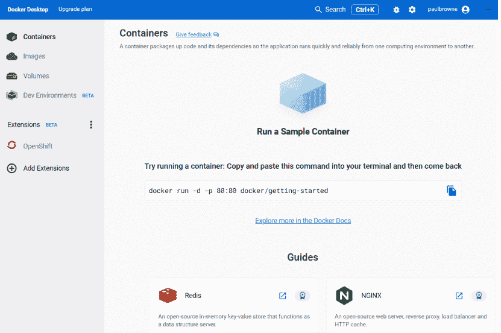

图 10.3 – Docker Desktop 主屏幕

5. 如果你的屏幕显示绿色 Docker 鲸鱼图标（在左下角），那么恭喜你，Docker Desktop 和后台引擎（服务）都正确运行。

虽然这不是一本关于 Docker 的书，但你将在此屏幕上花费一些时间来运行示例。花几分钟浏览一下是值得的：

-   - 屏幕底部中央的区域是 **Featured Images**，显示可在 Docker 中运行的容器范围。还有许多其他镜像来源（尤其是 Docker Hub 和来自 Red Hat 的 Quay）——我们将使用它们来运行示例。
-   - **Images**（标签）是你可运行的可用镜像列表。镜像是只读的且永不改变。目前你的电脑上可能没有多少镜像；我们将在本章后面展示如何下载一些。
-   - 左上角的 **Container** 标签页也允许你返回主页。容器是镜像的工作副本。随着你与之交互，它们会发生变化。此标签页还显示你正在运行的容器，并允许你停止和重新启动它们以及查看运行容器的消息日志。

-   - **Volumes** 就像容器可以存储其信息的磁盘。一般来说，Docker 会自动为我们管理它们。
-   - 左侧的其他标签页（**Dev Environments** 和 **Extensions**）是更高级的功能。我们在书中运行示例时不需要它们。

屏幕右上角还有一些更有趣的按钮：

-   - **Upgrade**、**Troubleshoot** 和 **Debug** 暗示了 Docker 更强大的高级功能。我们不会经常使用这些按钮。
-   - **Account** 允许你使用你在 docker.com 上创建的用户名和密码登录。现在登录 Docker Desktop 是个好主意——它会在我们下一节下载 Docker 镜像时提供帮助。

> **关闭 KIE Extended Services**
> 
> 由于我们即将运行第一个 Docker 镜像，现在是提醒你关闭 KIE Extended Services 的好时机。如果你忘记了，你将收到 Port already in use 错误，因为 KIE 服务和（部分）Docker 镜像试图做类似的事情并互相干扰。

## Docker Desktop 首次使用

Docker Desktop 是在我们下载后管理示例镜像的绝佳工具。但它目前没有提供下载这些镜像的方法。为此，你需要使用 **console**（也称为 **terminal** 或 **command prompt**）。通常，我们只需要使用控制台一次，因为在镜像下载后，我们可以在 Docker Desktop 中管理它。

作为 Excel 高级用户，你不必害怕控制台。它允许我们输入文本命令，就像在 Excel 中输入公式一样。就像在 Excel 中一样，拼写正确非常重要（这是错误的最大来源）。就像在 Excel 中一样，重要的是按下 *Enter*（或 *Return*）键，这样计算机就知道你已经输入完毕，可以开始工作了。

要在 Windows 上打开控制台，按 *Windows Key* + *R*，然后输入 cmd（并点击 OK）。你应该会看到一个类似 *图 10.4* 的黑白窗口：

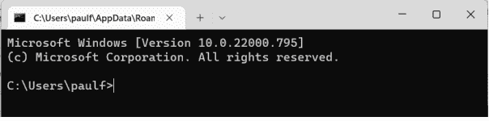

图 10.4 – Windows 上的控制台

在 Mac 上，按 *Cmd* + *Space* 打开 Spotlight，然后输入 *Terminal* 搜索它。


请注意，你的屏幕与此截图会略有不同 – **paul.f** 是我的 Windows 用户名，但你的会不同。但输入、按 *Enter* 以及让计算机开始工作的相同思路是一样的。

好消息是，在接下来的章节中，一旦我们使用控制台中的命令下载示例图片，图片会自动出现在 Docker Desktop 中。之后，我们将使用 Docker Desktop 来管理它们。

## 在 Docker 中运行简单的 Hello World 镜像

现在我们已经下载了 Docker，我们想测试一个简单的镜像。这样，我们就知道 Docker 运行正常，如果出现问题，我们就知道从哪里开始查找修复。

传统上，第一个示例是让计算机对你说 `Hello World`。Docker 让这变得很容易。要运行 Docker Hello World 示例，请按照以下步骤操作：

- 1. 通过按 *Windows Key* + R 打开命令提示符，然后输入 `cmd`。Mac 用户，请参阅前一节中有关打开终端的说明。
- 2. 在控制台中，输入 `docker run hello-world`，请特别注意拼写。
- 3. 确保按 *Enter* 键运行命令。你将看到 *Figure 10.5* 中显示的消息：

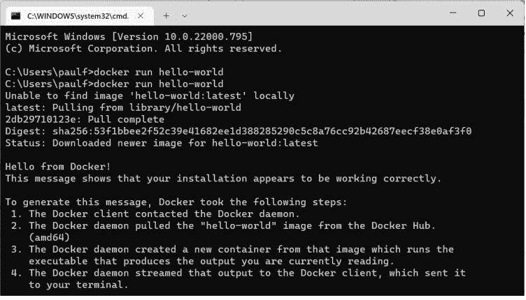

Figure 10.5 – Docker Hello World

- 4. 在 *Figure 10.5* 中，我们可以看到我们输入的命令（`docker run hello-world`），然后在我们按下 *Enter* 键后 Docker 生成的文本。由于它在本地找不到镜像，因此自动从 **Docker Hub** 下载最新版本并运行它。

- 5. 如果你在 Docker 的文本输出大约一半的位置看到 `Hello from Docker`，那么恭喜你 – 你刚刚在 Docker 容器中运行了你的第一个镜像！

> **Containers hide the hard stuff**
> 
> 在本示例中，我们跳过了 Docker 为我们做的复杂性 – 这就是我们使用 Docker 的原因。但如果你阅读 `Hello from Docker` 之后的文本，你会了解到幕后发生的步骤，而你不必担心这些步骤。

这个示例可能有点令人失望 – 我们花费了大量时间进行设置，到目前为止我们所取得的成就只是一条 `Hello World` 消息。但现在 Docker 已经运行起来，我们可以利用它所能做的事情 – 下载镜像并尝试 Business Central 作为更高级的 Business Central 规则编辑器。

## 在 Docker 中运行 Business Central 规则编辑器

既然我们已经设置了 Docker，让我们用它来运行 KIE 团队提供的第一个镜像。操作与运行我们的 Hello World 示例一样简单。虽然在 *step 2* 中需要仔细输入，但我们只需要做一次，因为之后它已在 Docker Desktop 中设置好：

- 1. 通过按 *Windows Key + R* 打开命令提示符，然后输入 cmd。
- 2. 在控制台中，输入 `docker run -p 8080:8080 -p 8001:8001 -d --name business-central quay.io/kiegroup/business-central-workbench-showcase:latest`，请特别注意拼写。
- 3. Docker 将花费数分钟下载和提取必要的层，如 *Figure 10.6* 所示：

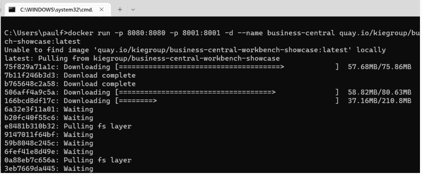

Figure 10.6 – Docker downloading the layers in the Business Central image

4. 命令提示符更新完成后，查看 Docker Desktop 容器选项卡。它应该显示 Business Central 在容器中运行，如 Figure 10.7 所示：

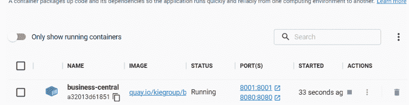

Figure 10.7 – Docker running our Business Central image

5. Figure 10.7 中的值与我们在启动命令中指定的值相匹配。docker run 要求 Docker 使用来自 quay.io/kiegroup/business-central-workbench-showcase 的最新镜像运行容器，如果需要则下载它。我们使用 -p 8080:8080 -p 8001:8001 指定了端口；否则，我们将无法在下一步中与之通信，我们还为其指定了 --name 值 business-central，以便在 Docker Desktop 中更容易找到它。

**Docker ports**
Docker 很棒，因为它在自己的隔离容器中运行镜像。这对安全性很好，但这也意味着如果我们不使用 -p 标志指定端口，我们就没有开口在笔记本电脑和安全容器之间通信。

6. 在 Docker Desktop 中，我们鼓励你点击容器名称所在行上的按钮以探索更多。我们的容器已经在运行，因此我们无需点击按钮来启动或停止它。

7. 点击容器名称 Business Central 也很有用。这会给我们来自 Business Central 日志的额外信息，如 Figure 10.8 所示。显示的大部分内容都是技术性的，但如果事情没有按预期运行，它是一个有用的建议来源。

Figure 10.8 – Business Central startup messages in the logs

通过一个（几乎简单）的命令，你就让 Business Central 运行起来了。从这里开始，你可以使用 Docker Desktop 启动和停止镜像，而无需再次使用基于文本的控制台。而且由于镜像已被下载，下次启动会快得多。

## 打开 Business Central 规则编辑器

本章的重点是让软件运行起来。为了庆祝我们走到这一步，让我们通过查看我们刚刚下载的 Business Central 规则编辑器镜像来犒劳自己。在 Business Central 容器仍在 Docker 中运行时，请按照以下步骤操作：

- 1. 在你喜欢的浏览器中打开以下 URL：http://localhost:8080/business-central。
- 2. 第一次加载可能需要几分钟，然后你应该会看到登录屏幕，如 Figure 10.9 所示。相信我们，Business Central 在首次使用后会加快速度。

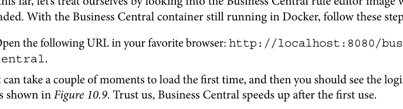

Figure 10.9 – Login screen for Business Central, running in Docker on our laptop

3. 标准 **username** 为 `krisv`，**password** 为 `krisv`。点击 **Sign In** 进入初始欢迎屏幕。

> **A bigger team – multiple roles in Business Central**
> 
> 该镜像的网页（https://quay.io/repository/keigroup/business-central-workbench-showcase?tab=info）给出了 Business Central 团队性质的想法，列出了其他几个角色。我们建议的用户名对于首次查看最有用。
> 
> 请注意，我们使用的是带有这些角色已定义的 showcase 镜像。RedHat 的 Quay.io 网站上还有其他更安全的镜像， intended for production deployment。

*Figure 10.10* 中显示的欢迎屏幕暗示了 Business Central 的强大功能，面向完整的企业用户。

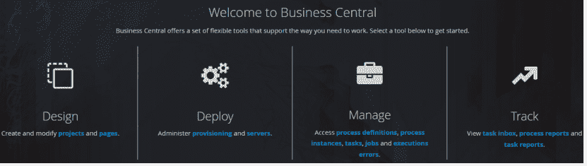

Figure 10.10 – Business Central welcome screen

虽然我们不会探索 Business Central 的所有功能，但了解其功能很有用。从左到右，选项如下：

- **Design** 大致相当于 KIE Sandbox（但功能更多），我们将在一分钟内进一步探索。
- **Deploy** 为我们提供了比仅 KIE Sandbox 更多部署模型的目标。它还为我们提供了配置这些环境（例如，用于开发、测试、暂存或真实生产使用）的选项。
- **Manage** 允许我们跟踪正在运行的决策流程和工作流。请记住，我们可能同时部署了多个决策模型需要关注。
- **Track** 为在部署流程中列为审批者的人提供了查看等待他们处理的请求的能力。

类似的选项可从大多数 KIE 屏幕左上角的 **Menu** 获得。但我们想要创建一个项目，因此如果你点击 **Design**，你将看到你的空间列表，如 *Figure 10.11* 所示：

Figure 10.11 – Spaces in Business Central

把空间想象成一个解决方案 – 在前几章的巧克力示例中，我们将所有决策模型（用于销售和营销，以及生产）包含在一个文件夹中。但实际上，使用 Business Central，每个部门都会有自己的空间。

点击进入一个空间显示它可以包含多个项目，如 Figure 10.12 所示，每个项目都相当于 KIE Sandbox 中的一个文件夹。虽然这些用于组织我们的决策模型和其他资产的层级或嵌套文件夹在我们首次打开 Business Central 时可能令人困惑，但对于大型项目，你会欣赏它们提供的结构。

Figure 10.12 – Projects within a space


现在我们快速浏览了 Business Central 中的一些初始屏幕后，让我们用它做点有用的事情。特别是，让我们运行 Scenario Simulation 工具来测试我们在 *Chapter 9* 中创建的模型。

## Scenario Simulation and testing in Business Central

在空间屏幕打开的情况下，让我们创建一个新项目。虽然我们通常会创建一个空项目，但为了本练习，我们将使用一个现有的示例并将我们的模型添加到其中。这样在完成本练习后你就有额外的资产可以探索：

+   1. 在 **MySpace** 屏幕上（如 *Figure 10.12* 所示），点击 **Try Sample**。
+   2. 在出现的选择屏幕上，选择 **Traffic Violation project**，然后点击屏幕右上角的 **OK**。
+   3. 这将设置一个类似于 *Figure 10.13* 的项目——此示例展示了司机因各种驾驶问题应支付多少罚款。

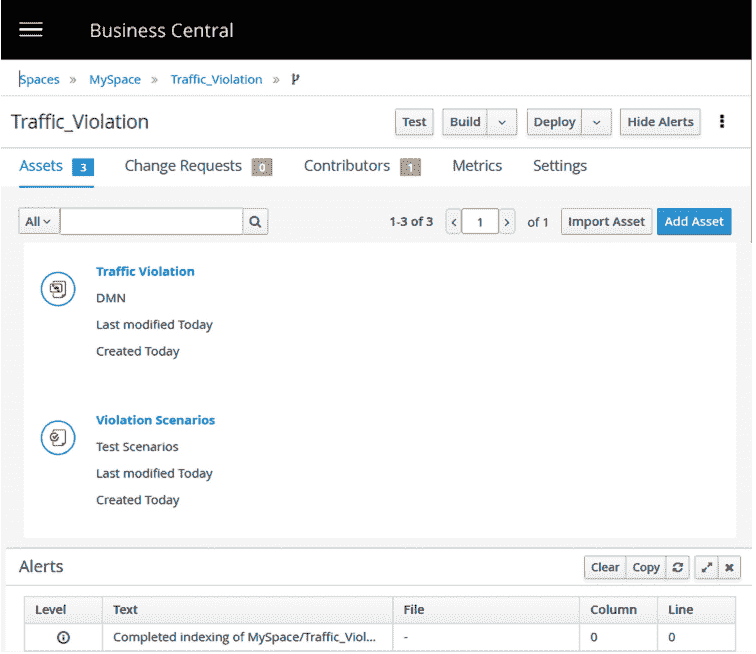

Figure 10.13 – Example project with a decision model and test scenarios

值得花一些时间浏览这个交通罚单示例。它是一个清晰的决策模型和测试场景的例子，值得详细检查。

Figure 10.13 中还展示了一些 Business Central 企业功能的清晰示例。面包屑显示了你通过项目层次结构到达此处的路径（**Traffic_Violation**）。屏幕还显示了与 Maven（**main**）的集成，运行此项目中所有测试场景的选项，将模型构建并部署到 KIE Server 的选项，跟踪变更请求和贡献者的选项，以及细粒度的设置；这些都是复杂的企业级功能。

## Setting up our test scenarios

由于我们想展示可以编辑在 KIE Sandbox 中创建的 DMN 模型，我们将导入我们在第 9 章中创建的模型，该模型可以作为 `09 Bill of Materials.dmn` 从本书的 GitHub 站点 https://github.com/PacktPublishing/AI-and-Business-Rules-for-Excel-Power-Users 下载。

要在 Business Central 中将我们现有的模型添加到此项目，请返回主项目屏幕（我们在 Figure 10.13 中展示的那个），然后执行以下步骤：

+   1. 点击 **Import Asset**，然后按 Figure 10.14 所示填写值，然后点击 OK。像在 KIE sandbox 中一样，选择一个简单但清晰的资产名称是个好主意——在本例中，我们使用 **bom**——因为我们在创建测试场景时以后需要它。

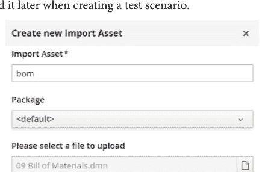

Figure 10.15 – Importing our Bill of Materials decision model in Business Central

2. Business Central 将导入决策模型并按 Figure 10.16 所示显示它：

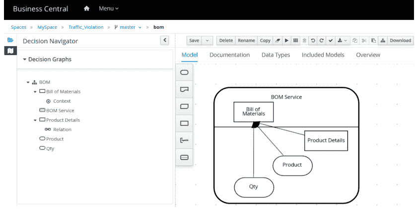

Figure 10.16 – Decision model editor in Business Central

我们的决策模型编辑器中应该有很多熟悉的内容；它与 KIE Sandbox 的工作方式完全相同。你还会看到额外的企业级功能来帮助你与同事协作，例如版本控制、自动布局、验证模型的能力以及带注释的保存选项。

由于我们的重点是 Scenario Simulation 工具，让我们创建一个新的测试 Scenario Simulation。点击 Traffic_Violation 返回到我们的主项目列表：

+   1. 从主项目屏幕（Figure 10.13 所示的那个）开始，这次不是 Import Asset，而是选择 Add Asset。Figure 10.17 所示的对话框将为我们提供各种可能的资产：

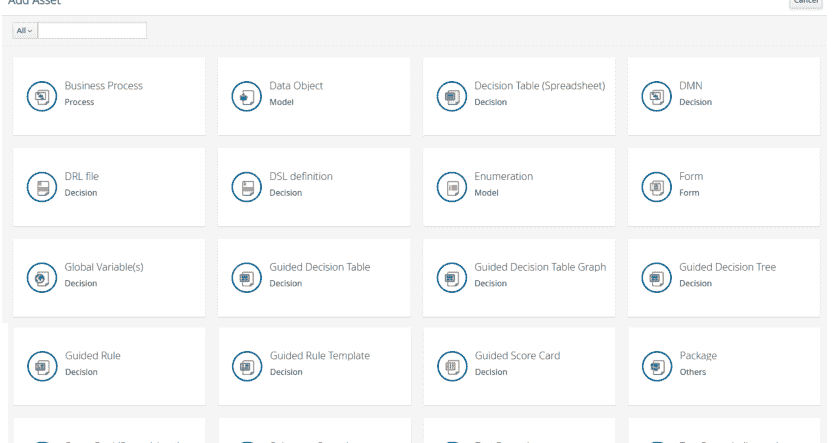

## Figure 10.17 – Possible assets we can add to the project

2. 我们不会详细介绍全部资产范围，尽管其中许多是你在 KIE sandbox 中遇到过的项目的更强大的版本。我们将在第 12 章介绍其中一些内容。但目前，我们想专注于创建一个新的 Test Scenario 选项，因此我们将选择该选项，注意不要选择 (Legacy) 选项。

3. 将出现一个 Create new Test Scenario 框，如 Figure 10.18 所示。我们为测试取了合适的名称，选择了默认包，选择了 DMN 作为 Source type（因为我们正在测试决策模型），并选择了我们刚刚导入的决策模型（bom.dmn）：

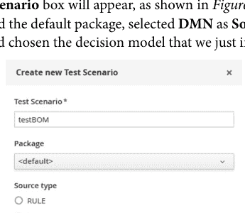

## Figure 10.18 – Creating a new test scenario

4. 点击 OK 后，Business Central 将根据它在我们的 BOM 决策模型中检测到的值自动生成一个测试场景。我们在 Figure 10.19 中展示了这一点。但请注意，我们已经在屏幕上填充了一些测试值并删除了一些建议的列，以更清晰地说明其工作原理。

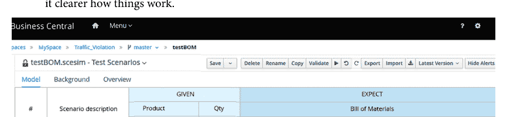

Figure 10.19 – Test values in our Scenario Simulation editor

这种格式很熟悉；它就是我们在第 9 章中看到的场景测试工具：

+   - 每行是一个我们想要尝试的单独场景，我们可以在 Scenario description 列中为每行命名。
+   - 我们在每个场景中将 GIVEN 列的值传递到中间。场景测试工具已识别出我们模型的输入（Product 和 Qty）并自动为我们设置了它们。
+   - EXPECT 下的列是该测试运行应返回的值。我们清理了一些建议的列，并使用 FEEL 语法来表示我们期望返回的关键值对。例如，第一个场景应返回以下内容：
+     ```
+     { Grams of Cocoa in Product : 10, Grams of Cocoa in Order : 100, Name : "Crunch" }
+     ```
+   - 这种语法非常紧凑（因此在书本示例中效果很好）。但你也可以使用 Test Tools 编辑器（如 Figure 20 所示）创建多个列并为其中每个列测试单个值。

## Test Report

Overview

Test Results: PASSED

Scenario Status

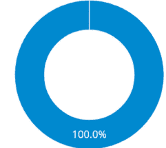

Figure 10.22 – Successful test run

能够以通过的测试结束 Scenario Simulation 部分真是太好了。虽然我们只添加了两个场景，但你可以看出设置多个场景并让 Business Central 突出显示任何失败的情况会变得非常有用作为安全网。最好自动运行这些测试，这样你就没有借口错过意外损坏的内容。我们在附录 B 中介绍的构建工具是朝着这个方向迈出的有用一步。

在本节中，我们使用 Docker 来支持编辑我们的决策模型。但我们也可以使用 Docker 来拓宽我们可以部署和运行模型的位置范围。

## The KIE Server in Docker and Azure

到目前为止，本书中部署和执行规则的两个主要环境是我们在第 5 章中描述的 OpenShift Sandbox 和我们在第 3 章中介绍的 KIE Extended Services。即使 KIE Sandbox 网页似乎正在运行规则，快速查看日志会显示是 KIE Extended Services 在执行规则的重活。

编辑器与服务器之间的这种分离非常强大。它意味着我们可以选择最适合我们的编辑器（KIE Sandbox、VS Code 或 Business Central）。然后我们可以选择最佳的服务器环境来部署我们的规则。

我们将在下一节看到，Docker 容器为我们提供了巨大的部署规则选项选择，选项多到无法涵盖每一个！但我们会给你可以了解更多的地方。我们将重点关注用其基于 Docker 的等效物替换 KIE Extended Services，然后部署更重量级的 KIE Execution Server，最后我们提供有关部署到 Azure 云的指针（以便在你了解部署到 OpenShift 等效环境的基础上进行构建）。

## Replacing the KIE Extended Services

让我们从最简单的例子开始：用其 Docker 等效物替换 KIE Extended Services。虽然这个例子展示了操作有多么容易，但大多数时候，KIE Extended Services 工作得很好。例外情况可能是如果你有一个专注于安全的 IT 部门，他们更希望你运行一个安全的容器而不是一个控制性较差的 .exe 文件。

为 KIE Server 运行 Docker 镜像与我们运行 Business Central 时所做的工作类似：

+   1. 打开命令提示符，按 *Windows Key* + R，然后输入 cmd。
+   
+   2. 在控制台中，输入 `docker pull -p 21345:21345 --name kie-services quay.io/kie-tools/kie-sandbox-extended-services-image:0.25.0`，特别注意拼写。
+   
+   3. 镜像下载并启动后，打开 Docker Desktop。点击 **kie-services** 容器名称查看日志。你会看到一条消息，如 *Figure 10.23* 所示，确认扩展服务现在在容器中运行。

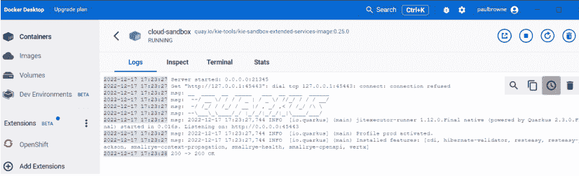

Figure 10.23 – The KIE Extended Services running in Docker

+   4. 现在我们可以打开 KIE Sandbox `sandbox.kie.org`，它将识别我们有一个本地服务器正在运行。
+   
+   5. Sandbox 可能抱怨我们运行的是错误版本。如果是这样，请记下版本号并重复 *step 2*，将版本号（25）替换为它期望的那个。

## Building your own server


> 与 Excel 不同，KIE 是一个开源项目，因此你可以选择构建一个服务器来满足你的确切需求。虽然这是一个高级技术主题，但 *附录 B* 中的说明几乎可以做到这一点。你可能会发现，如果运行项目附带的示例，你无意中构建了 KIE Extended Services 的等价物。

在 Docker 中运行 KIE Extended Services 是一个有用的演示，但在有限的情况下才有用，因为它旨在仅支持本地部署。让我们继续看一个更重量级的示例 – 在 Docker 中运行完整的 KIE Server。

### 在 Docker 中运行 KIE Server

如果我们已经有几个运行规则的好选择，为什么我们还要自己的完整 KIE Server？原因如下：

- Business Central 需要一个单独的服务器来部署规则。它没有像 KIE Sandbox 那样内置到 OpenShift 的便捷部署。
- 你的 IT 部门可能更喜欢让你的核心业务规则在本地服务器上运行，而不是在云中（更不用说在你的笔记本电脑上了！）。
- 最后，你可能已经说服同事接受基于规则的 AI 方法。此时，KIE Server 成为你大部分业务知识的存储库，有许多系统调用它来做出关键决策。你将希望对该存储库的存储位置有更多控制。

幸运的是，**Docker Compose** 为我们提供了一种运行多个 Docker 镜像（包括 KIE Server）的方法。

### 运行 Business Central 和 KIE Server – Docker Compose

**Docker Compose** 是一款在你安装 Docker Desktop 时自动安装的工具。它允许我们同时启动和停止多个 Docker 容器，并带有我们所需的所有设置。

Docker Compose 在某些方面比运行 Docker 更容易，因为所有棘手的部分，例如镜像名称和端口号，都包含在一个可下载的配置文件中。设置存储在一个结构化文本文件中，该文件旨在便于人类阅读（*YAML* 格式）。

我们准备了一个 Docker Compose 文件，详细说明了 Docker 如何下载并运行 Business Central 和 KIE Server 镜像。如果你正在寻找更详细的信息，它基于 KIE 团队的说明 https://quay.io/repository/kiegroup/kie-server-showcase。让我们逐步了解：

- 1. 从 Packt 出版的 GitHub 网站 https://github.com/PacktPublishing/AI-and-Business-Rules-for-Excel-Power-Users 下载 `docker-compose.yaml` 文件。在任何文本编辑器中打开它即可查看，如图 10.24 所示：

```
version: '3'

services:
  business-central:
    image: quay.io/kiegroup/business-central-workbench-showcase:7.73.0.Final
    ports:
      - "8080:8080"
      - "8001:8001"
  kie-server:
    image: quay.io/kiegroup/kie-server-showcase:7.73.0.Final
    ports:
      - "8180:8080"
      - "8007:8001"
    environment:
      KIE_SERVER_ID: sample-server
      KIE_SERVER_LOCATION: http://0.0.0.0:8180/kie-server/services/rest/server
      KIE_SERVER_CONTROLLER: http://0.0.0.0:8080/business-central/rest/controller
      KIE_MAVEN_REPO: http://0.0.0.0:8080/business-central/maven2
    depends_on:
      - business-central
```

图 10.24 – 运行 Business Central 和 KIE Server 的 Docker Compose 文件

- 2. 如果我们快速阅读一下，有一些设置是熟悉的（Business Central 镜像和端口号），有些是新的（下载和运行 KIE Server）。
- 3. 由于我们有两个镜像，每个镜像都在自己的容器中隔离，它们使用一个假想的网络（地址为 0.0.0.0）相互通信。你的网络管理员可能会建议更改此设置（例如，改为计算机的 IP 地址），但对于大多数人来说，此处使用的默认值将正常工作。
- 4. 如果尚未保存，请将此文件保存在你会记住的位置。确保文件名完全相同，全部小写：docker-compose.yml。
- 5. 要检查 Windows 是否未修改文件名，请打开 Windows 文件资源管理器，确保可以看到文件扩展名（打开选项并取消选中“隐藏已知文件类型的扩展名”旁边的复选框）。这允许你检查拼写是否与上一步完全相同。
- 6. 在文件名下方空白处右键单击，然后选择打开终端的选项。

> **如果我没有“打开终端”选项？**
> 就像之前一样，我们仍然可以使用 Windows + R 打开系统终端，输入 cmd，然后按 Ok。我们可以使用 cd（更改目录）命令移动到我们保存文件的位置。
> 在以下示例中，你必须输入 cd C:\Users\paulf\OneDrive\Downloads – 但请注意，你计算机上的名称会不同。

7. 通过在控制台中输入 dir 命令，然后按 Enter，检查我们是否在正确的位置（并且文件名正确）。你应该会看到类似于图 10.25 的内容：

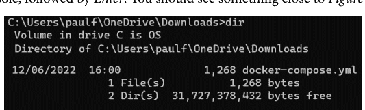

图 10.25 – 确保我们的终端在正确的位置打开

8. 确保我们的 .yml 文件的拼写完全相同，全部小写：docker-compose.yml。

9. 现在我们确定在正确的目录中，输入以下命令以使用此 Docker Compose 文件中的设置运行：docker-compose up（然后按 Enter）。

10. 你可能会收到一条要求先登录的消息。如果收到此消息，请输入 docker login，然后在提示时提供你的用户名和密码。登录后重复第 9 步。

11. 就像我们运行之前的镜像一样，Docker 会检查本地副本，然后在需要时获取 KIE Server 镜像。第一次下载可能需要几分钟。你会在控制台中看到进度消息。

12. 你可能会收到一条消息，称镜像名称与你计算机上已有的镜像名称冲突。如果发生这种情况，请打开 Docker Desktop，删除之前的镜像和容器副本，然后再次尝试 docker-compose up。

13. 当控制台中的消息数量变慢时，值得打开 Docker Desktop 以检查一切是否已正确启动。你应该会看到图 10.26 所示的屏幕：

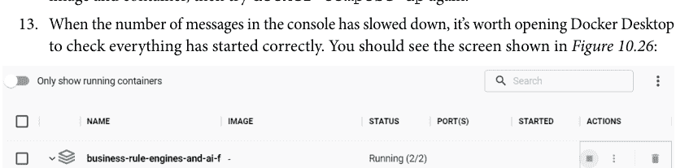

图 10.26 – Docker Desktop 显示我们使用 Docker Compose 启动的两个镜像

14. 检查两个容器是否都正确运行 – 在图 10.26 中，两者都是绿色（正在运行）。我们可以像之前一样看到 Business Central 正在运行，以及我们新的 KIE Server 镜像正在旁边运行。

### Docker Compose 只需一次

Docker 的一个怪癖是 Docker Compose 只需第一次下载和运行镜像 – 之后，我们可以在 Docker Desktop 中启动和启动容器，就像我们之前的示例一样。由于运行两个 Docker 容器相当占用资源，你可能会选择在处理另一个时停止一个以加快速度。不要忘记在需要时再次启动容器！

- 15. 为证明我们已启动并运行 KIE Server，请打开 http://127.0.0.1:8180/kie-server/services/rest/server。
- 16. 你可能需要使用用户名/密码 krisv/krisv 登录，然后你将被 KIE Server 功能的摘要迎接，如图 10.27 所示：

```
<response type="SUCCESS" msg="Kie Server info">
  <kie-server-info>
    <capabilities>KieServer</capabilities>
    <capabilities>BRM</capabilities>
    <capabilities>BPM</capabilities>
    <capabilities>CaseMgmt</capabilities>
    <capabilities>BPM-UI</capabilities>
    <capabilities>BRP</capabilities>
    <capabilities>DMN</capabilities>
    <capabilities>Swagger</capabilities>
    <location>
      http://192.168.68.114:8180/kie-server/services/rest/server
    </location>
    <mode>DEVELOPMENT</mode>
    <name>sample-server</name>
    <id>sample-server</id>
    <version>7.73.0.Final</version>
  </kie-server-info>
</response>
```

图 10.27 – 完整的 KIE Server 正在运行

从此摘要可以明显看出，完整的 KIE Server 比 KIE Sandbox 具有更多功能。我们想向你展示服务器，以便你知道有一个功能齐全的平台可以部署到，随着你开始为业务构建更高级的决策模型。如需了解 KIE Server 提供的全方位选项的更多信息（包括如何将模型从 Business Central 部署到此服务器），请查看 KIE 文档。

本着解释部署有多容易的精神，让我们快速了解一下我们如何使用 Docker 将 KIE Server 部署到 Microsoft Azure 云。

### 我们可以将 KIE Server 部署到 Azure 或其他云提供商吗？

如果我们只能选择一个云服务提供商来托管 KIE Server，那就是 Red Hat OpenShift。这是因为它具有集成（例如 KIE Sandbox 与 OpenShift 沙箱之间的集成），使决策模型部署变得更加容易。


而且如果你迁移到付费服务层，Red Hat OpenShift 提供托管服务，因此你只需部署模型，而非整个决策服务层。这更具成本效益。

然而，很可能出于战略原因，你的组织已经选择了单一的云服务提供商。好在，我们可以利用 Docker 容器的强大功能部署到所有其他主要云提供商（包括 Google Cloud Platform 和 Amazon Web Services）。本节中给出的步骤侧重于 Azure，因为你的组织很可能为 Office 365 平台与微软签订了订阅。

说明使用 Docker 命令行，因为我们想向你展示只需四步即可快速部署到 Azure。 由于大多数 Azure 新手更喜欢基于 Web 的界面，类似的选项也可通过 Azure 门户 https://azure.microsoft.com 获取，免费积分和入门教程。 我们将在第 11 章更详细地探讨 Azure 门户。

### 你可能已经在 Azure 上部署了

如果你按照附录 B 中的说明操作，你可能已经在 Azure 上部署了规则——使用 GitHub Codespaces 和 VS Code 在线会自动为你创建一个 Azure 容器。 该容器针对规则的开发和编写进行了优化，不适合日常业务使用。

Docker 工具与 Azure 高度集成。 如果你拥有 Azure 账户并设置了 Azure Container Instance (ACI) 在线托管 Docker 容器，以下四个步骤将允许你将容器部署到 Azure 云中：

- 1. 如同我们之前的示例一样，在笔记本电脑上打开命令提示符。
- 2. 使用 `docker login azure` 登录 Azure。
- 3. 使用 `docker context create aci myacicontext` 创建一个在线容器来托管我们的镜像。
- 4. 使用 `docker --context myacicontext run -p 80:80 hello-world` 命令在 Azure 上运行容器。

你会注意到，在我们的说明集中，我们部署的是 hello-world 镜像，而不是本章前面使用的 KIE Server 或 Business Central 镜像。 这就像把一辆 F1 赛车的钥匙交给你——你知道如何驾驶 Azure，但请在冲出去之前先暂停一下。

我们希望你在部署 KIE Server 到云中之前先三思而后行。 特别是，熟悉 Azure 安全功能，了解计费和预算影响，并选择合适的 Docker 镜像进行部署。 本章中使用的镜像针对易用性而非安全性进行了优化，因此请查阅 KIE 文档，了解哪些其他镜像最能满足你的需求。

部署 KIE Server 与我们列出的四个步骤类似，只是我们部署的是 *kie-server* 镜像而不是 *hello-world*。 现在我们知道可以把 KIE Server 部署到云中，是时候提醒自己一下本书中涵盖的所有部署选项了。

### 决策模型部署选项汇总

早在 *第 2 章*，我们就向你承诺了运行决策模型的四种主要方式。 现在我们已经完成了将规则部署到基于 Docker 的服务器的工作，让我们再次回顾这些选项。 我们部署规则的选项包括以下内容：

- - *使用基于 Web 的规则编辑器运行 KIE Sandbox*：我们自 *第 3 章* 和 *第 4 章* 起在本书的大部分内容中都使用了此解决方案，因为它非常容易上手。
- - *在你自己的笔记本电脑或其他可访问的计算机（服务器）上运行容器*：我们在本章和 *附录 C* 中详细介绍了这些方法，容器为我们提供了广泛的部署选项。
- - *在云中运行镜像（由 Microsoft 或 IBM/Red Hat 托管）*：我们在 *第 5 章* 中介绍了这种方法，当时我们将规则部署到 OpenShift。 我们在 *第 9 章* 和 *附录 B* 中扩展了这种方法，将其部署到 Azure 上的 Codespaces 和 VS Code 在线。 本章介绍了使用容器的更多云端选项。
- - 我们仍有最后一种方法，即 *自行搭建技术栈*：虽然我们不会涵盖这一点，但也许你比刚开始阅读本书时更有信心去探索这个选项。 我们建议将 KIE 文档作为下一步。

### 总结

本章为你提供了另一种访问 Scenario Simulation 工具的选项，这次使用 Business Central。 由于我们运行 Business Central 的方法依赖于 Docker，我们利用容器技术探索了部署 KIE Server 镜像的多种方式，从笔记本电脑本地到扩展到云端部署。 这让我们确信，随着决策模型的使用增长，我们在组织内部编辑和部署业务规则的选项还有很多。

我们将在 *第 12 章* 重返 Business Central，在那里我们将其作为展示一些高级规则编辑技术的平台。 Docker 在下一章中也将派上用场，我们将使用它来托管机器学习的 Docker 镜像。 我们还将重返 Azure，使用 Machine Learning Studio 作为训练模型的工具。

本书的重点是 AI 中的基于规则的决策模型。 但如果我们不涉及 AI 的另一个主要领域——机器学习，那就说不过去了。 在下一章中，我们将学习如何结合两种 AI 方法的优点，利用 KIE 提供的工具。

## 11

## 基于规则的 AI 和机器学习 AI——结合两者之长

当我们在 *第 1 章* 中将规则引入为本书对 **人工智能（AI）** 的主要方法时，我们提到 **机器学习（ML）** 是一种互补技术。 自那以后，我们花了 10 章的时间专注于业务规则并将其与 Excel 集成。 所以，是时候我们重返 AI 的 ML 方面了——重点是如何结合这两种 AI 方法，以在你的业务中实现 AI 的最有效利用。

采用图形化方法，我们将基于我们在线巧克力店的示例数据探索 ML 背后的思路。 我们将介绍笔记本、Python 和 **Azure Machine Learning（Azure ML）**，并应用这些工具训练一个简单的 ML 模型。 我们将把训练好的模型集成到基于规则的决策模型中，以改进我们在 *第 4 章* 中首次遇到的推荐示例。 最后，由于本章篇幅有限，更多是为进一步学习打开大门，我们将指明你在 ML 之旅中可以探索的其他技术解决方案和选项。 具体来说，我们将探讨以下主题：

- - 业务规则作为机器学习的准备
- - 机器学习的图形化介绍
- - 在 Azure ML 中训练模型
- - 部署两种 AI（机器学习和规则）
- - 运行我们的集成模型

首先，我们将首次了解机器学习，并看看基于规则的 AI 方法如何帮助你的组织为使用它做好准备。

## 技术要求

本章中我们使用的所有工具和技术都可在云中使用，因此无需在笔记本电脑上安装新软件。 虽然 Azure 是一个高度复杂的产品，但它完全在线，我们将逐步指导你设置图形化机器学习笔记本。

有两个你在前几章中遇到过的项目值得提醒你：

- - 在本章末尾，我们将使用 KIE Sandbox 将机器学习 AI 与基于规则的 AI 结合起来。 运行 KIE Extended Services（我们在第 3 章中设置）可能会有所帮助。
- - 像往常一样，本章的所有示例都在 GitHub 站点 https://github.com/PacktPublishing/AI-and-Business-Rules-for-Excel-Power-Users 上。

## 业务规则作为机器学习的准备

在第 1 章中，我们建议结合两种 AI 方法（规则和 ML）来构建自动驾驶汽车。 ML 方法非常适合模糊的需求（例如识别道路上站着的是狗还是孩子）。 规则更适合我们能够明确表述且必须始终实施的需求（例如，避让孩子但不要为动物避让，因为这可能导致更严重的事故）。

你的组织应采用类似的方法——有些规则可以由人类专家明确编写（例如，购房者必须为房屋贷款提供 20% 的首付款）。 而有些经验更难表达——一位资深银行官员可能感觉贷款申请有欺诈嫌疑，需要进一步调查，但可能难以准确解释原因。 在我们的业务中，我们很可能需要规则和机器学习方法来模仿这两类知识。

先从哪种方法开始？ 除非你是 Google、Amazon 或 Meta（Facebook），否则你的组织不会拥有训练尖端 ML 模型所需的数百万（甚至数百或数百万）示例。 即使是银行，一年也可能只看到数千份贷款申请。 但大多数企业都会有一位了解这些申请规则的专家——这使得基于规则的方法成为显而易见的起点。

但阻碍组织采用机器学习的不仅仅是数据缺乏。 稍后在本章中，我们将一步完成 ML 模型的训练。 那么，为什么不是更多组织使用它们呢？ 说白了，问题在于收集和准备数据所需的时间和步骤，以及之后如何利用模型的建议。

组织不会专门组建团队来收集和准备数据，除非他们知道它会很有价值。 但组织在实际训练模型之前并不知道哪些数据有价值。

请记住，ML 项目更像耕种（你准备土地，然后希望获得收成），而不是建筑（这是企业 IT 部门非常擅长的）。


简而言之，规则让你能够展示 AI 的价值，同时让团队就位以收集转向机器学习所需的数据。你将在本章后面看到，我们将用在线巧克力店来采用这种方法。但在到达那一点之前，先做一个快速的机器学习图形介绍是值得的。

## 对机器学习的图形介绍

不要害怕数学——它只是数字而已。由于每个数字都可以在图表上绘制，我们可以将机器学习视为模式、图像以及教会计算机识别这些图像。

虽然这种方法很简化，但事实是，没有人足够聪明，能够完成机器学习所需的全部数学运算。即使你完全理解其背后的理论，人脑也不可能在某些 ML 项目中使用的数据点的数万亿（没错——万亿）个维度中思考。而且即使我们做到这一点，所需计算的 sheer 体量也需要比人类一生更长的时间来完成。

幸运的是，机器学习中的 *machine* 意味着有工具可以帮助我们。有可用的预构建工具包（库），我们将用它们来训练我们的模型。虽然了解每个工具包的优势是有帮助的，但你可以用以下方法走得很远：

- 1. 收集并准备我们的数据，然后将其拆分为训练集和测试集。
- 2. 在高层理解不同的算法，并选择三到四种最有可能给我们结果的算法（即使我们仍不完全确定哪一种）。
- 3. 根据数据训练一个推荐模型。
- 4. 使用测试集数据，查看模型表现如何。
- 5. 选择表现最好的模型并部署用于日常使用。

微软和其他厂商甚至有工具来帮助自动化选择和测试最佳模型的过程。虽然本章只是介绍，但我们使用的工具包允许你进行实验并为你的数据找到最佳方法。让我们开始处理我们自己的数据——从我们在前几个示例中见过的在线巧克力店开始。

## 查看我们在线巧克力店的销售数据

假设我们为巧克力店实施了我们在前几章中讲解的基于规则的推荐引擎，并且推荐效果非常好，以至于我们的销售额超出了预期。我们现在有数十万客户，当我们运行销售报告以查看不同国家哪些产品最受欢迎时，我们得到一个类似图 11.1 所示的表格（仅显示许多行中的前 11 行）：

| Order | Country | Customer Age | Country-Region Code | Qty Silk Tray | Qty Lumpy Bar | Qty Peanut | Qty |
|---|---|---|---|---|---|---|---|
| 1 | South Africa | 64 | 396 | 80 | 31 |  | 552 |
| 2 | Netherlands | 44 | 214 | 55 |  |  | 166 |
| 3 | South Africa | 63 | 400 | 79 |  |  | 237 |
| 4 | New Zealand | 56 | 228 | 70 |  |  | 210 |
| 5 | South Africa | 72 | 398 | 91 |  |  | 548 |
| 6 | United States | 80 | 139 | 100 |  |  | 300 |
| 7 | Japan | 87 | 300 | 109 |  |  | 110 |
| 8 | Ireland | 59 | 411 | 74 |  |  | 444 |
| 9 | South Africa | 64 | 402 | 81 |  | 55 | 244 |
| 10 | United States | 68 | 122 | 86 |  |  | 260 |
| 11 | Japan | 62 | 329 | 78 |  |  | 468 |

图 11.1 – 我们在本章中将使用的部分示例数据

这些信息非常有价值——以前，我们的决策是基于我们在 *Wikipedia* 上找到的信息做出的最佳猜测。现在，我们知道人们真正想要什么。而且随着我们深入调查，肯定会有一些惊喜。

> **谨防 HIPPOs**
> 分享这些信息时要小心——大多数公司都有 **高薪人士的意见（HIPPOs）**，它们可能正确也可能不正确，但往往很难改变。

你会注意到我们已经开始处理这些数据。我们根据出生日期计算了客户年龄，并在示例中为客户分配了国家-地区代码（在我们的示例中，地区代码在 100 左右的是美国，地区代码在 400 左右的是南非）。我们还将销售额按产品线拆分到不同的列中。这些更改很有用，因为 ML 模型需要数字作为输入，但同时（正如我们很快会看到的）它们使我们的数据更容易绘制图表。

如果你愿意，可以从 GitHub 页面下载我们用于生成图表的数据副本。图表在 `11_ML_learning.xlsx` 中，还有一个 CSV 等价物（用逗号分隔的文本版本），对我们的工具包来说更容易使用。

> **关于示例数据的健康警告**
> 本章示例使用虚构数据并不奇怪，这是一个约 100 行的简单数据集，旨在使我们的示例更清晰。真实生活中的数据会大得多、嘈杂得多，清晰的模式更少，但关于每个客户的信息也会多得多。
> 
> 简而言之，请不要基于此信息或分析开设网络商店。相反，请将其作为灵感来更详细地探索你自己的信息。

使用示例图表，让我们在 Excel 中绘制一个简单的散点图，如图 11.2 所示。我们对数据进行了一些过滤，只显示两个产品线的销售额。我们可以识别出两个清晰的集群——美国人（记住他们在我们的数据中地区代码在 100 左右）倾向于大量订购 Peanut Candy 棒。而南非人（地区代码在 400 左右）倾向于订购较小的 Lumpy Raisin and Nut 棒。

在对现实的极小致敬中，我们在南非有一笔 Peanut Candy 棒的销售——也许是有人从纽约搬到约翰内斯堡学习。这不会影响我们的分析，但有时你可能需要从数据中删除此类异常值：

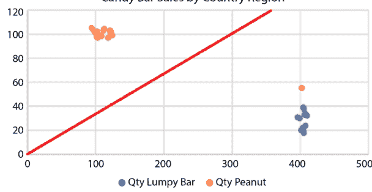

图 11.2 – 我们的销售数据绘制为散点图

你会注意到在图 11.2 中，我们在图表上画了一条线来分隔两个集群。鉴于我们简单的图表，线以上的任何订单很可能都是 Peanut Candy，线以下的任何订单很可能都是 Lumpy 巧克力棒。因此，对于新客户，我们可以根据他们的国家代码和订单数量基于此简单模型做出推荐。

这条线可以用公式 x=3y 绘制。不要担心公式本身——记住这是虚构数据。重要的是我们可以画一条线来分隔这两个组。一旦我们知道公式是什么，我们就可以根据他们落在线的哪一侧来为新客户做出预测。这就是 ML——学习在哪里画线。

到目前为止，我们的集群很容易识别，但我们已将信息过滤到两种产品。如果我们将 Silk Tray 销售添加到图表中，情况会混乱得多，如图 11.3 所示：

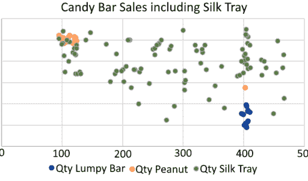

图 11.3 – 包含 Silk Tray 数据的销售数据图

不要太努力在 *图 11.3* 中寻找模式——我们无法画一条线来分隔组。数据，尤其是美国销售数据（图表左上部），看起来非常混乱。

然而，如果我们向图表引入另一个特征（或维度），情况会清晰得多。在 *图 11.4* 中，你会看到我们添加了更多信息（客户年龄）将图表从 2D 移至 3D。

> **绘制图表的其他工具**
> 
> Excel 很棒，但没有简单的方法来绘制 3D 散点图（甚至 4D，如果允许我们下一个图表中使用的颜色）。我们将在下一节介绍我们用于绘制此图表的 Python 笔记本。你将能够修改和旋转图表视图以检查数据。

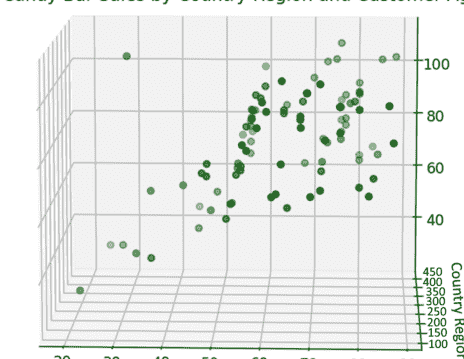

图 11.4 – Silk Tray 数据的 3D 散点图

我们已仅过滤 Silk Tray 销售并旋转了图表视图。现在很清楚客户年龄是一个强预测因子——从左下到右上有一条趋势线显示，年长的客户更有可能购买 Silk Tray。

这个例子展示了 ML 的三个关键点：

- 选择合适的图表会揭示很多，就像选择合适的算法会使我们数据中的模式更清晰一样。
- 更少的信息有时意味着更清晰——过滤我们的数据可以帮助我们看到潜在模式。
- 更多特征（或维度）通常使区分组更容易。

大多数人可以从 2 到 3 维思考，但很难可视化 4 维，甚至 40 维。幸运的是，我们可以用计算机完成大部分工作，这也很好，因为有些模型（如 GPT-4）实际上有效拥有 1.4 万亿个维度来处理。

在图 11.5 中，我们添加回了其他产品并尝试根据客户年龄、客户位置和订单规模对它们进行分组：

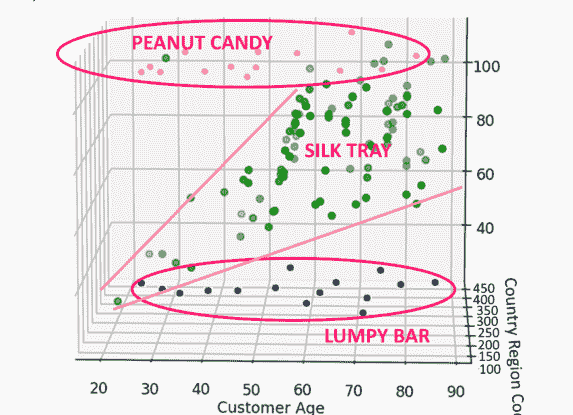

图 11.5 – 具有可能客户分组的 3D 散点图

使用此图表，如果我们知道客户年龄、客户地区代码和订单规模，我们可以预测订单的主要部分会是什么：

- Peanut Candy——如果订单数量很高
- Lumpy Bar——如果订单来自南非


- Silk Tray——适用于所有国家/地区的老年客户，如果我们不确定推荐什么，这也是一种安全的猜测

这些线条在图表上很清晰，但我们如何将其描述为计算机可以用来自行预测的数学公式呢？幸运的是，有工具包可以帮助机器学习公式。我们将使用交互式 Python 笔记本来尝试这些工具包。

> **使用机器学习还是业务规则？**
> 
> 我们的样本足够简单，您也可以将其作为业务规则实现——毕竟，我们仅用三条要点就描述了推荐模型。在下一章中，我们将认识到 *决策树* 算法，它可以帮助我们发现数据中隐藏的业务规则。
> 
> 并非所有数据集都适合这种方法。现实生活中的数据会复杂得多，更适合机器学习。

## 介绍笔记本和 Python

我们在 *图 11.4 和 11.5* 中绘制的图表都是使用 Python 脚本在笔记本中绘制的。值得一看一下笔记本，以便熟悉格式，因为我们稍后将使用笔记本来训练我们的 ML 模型。我们用来绘制 3D 图表的笔记本位于 Packt Publishing 样本 GitHub 站点上。`c11_scatter.ipynb` 文件的开头如下所示：

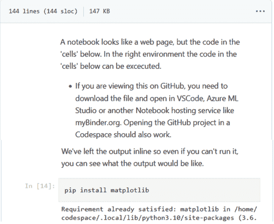

图 11.6 – 用于生成 3D 散点图的 Python 笔记本

如果您查看图 11.6 中的笔记本，您会看到它混合了以下内容：

- 文本，解释笔记本的作用。
- 单元格，浅灰色。这些有点像 Excel 单元格——您可以在其中输入公式，它们将被求值或执行。在这种情况下，`pip install matplotlib` 告诉笔记本我们希望使用 Matplotlib 来绘制图表。
- 输出——以等宽字体显示的单元格后的文本，以 `Requirement already satisfied` 开头。在图 11.6 中，我们保留了显示我们已拥有 Matplotlib 的输出。

如果您在 GitHub 上查看此示例，您将看不到运行示例所需的 **Execute ▶** 按钮。如果您已经使用过 GitHub Codespaces（参见附录 B），您会知道我们可以很容易地解决这个问题：

1. 转到 GitHub 上项目的首页并单击绿色的 **Code** 按钮。
2. 单击出现的 **Codespaces** 选项卡，然后单击 + 创建一个新的 codespace，然后 **Open in ... Browser**。
3. VS Code 在线编辑器将出现。等待几秒钟让它完成加载。
4. 在这种情况下，打开笔记本（`11_scatter.ipynb` 文件）。笔记本将打开，看起来几乎与图 11.6 完全相同。
5. 不同之处在于，当我们选择代码单元时，我们有选项可以在笔记本网页中执行它，如图 11.7 所示：

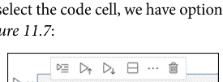

笔记本是一个标准概念，是 ML 的基石。因此，虽然在 VS Code 在线（Codespaces 或在您笔记本电脑上的 VS Code 本地）中使用它们很容易，但还有许多其他选项。您可能会看到它们被称为 **Jupyter** 笔记本（可在网上运行，或在浏览器中运行于 `mybinder.org`）。如果您更喜欢该平台，还有 Google Colab，或者如果您想在本地托管它们，还有 Jupyter Docker 镜像。

最后，微软的 Azure ML 可以托管我们的笔记本。这就是我们将在本章后面用来训练模型的方法，因为它还为我们提供了许多额外的 ML 工具。

## 什么是 Python 以及为什么在笔记本中使用它？

如果您打开了笔记本，您会看到它使用了一种名为 **Python** 的脚本语言。

这是一个不错的选择——Python 不仅易于 Excel 高级用户理解，而且可能拥有最广泛的工具包和 ML 库供您使用。作为奖励，您可能会在其他情况下使用 Python。

本书中的 Python 示例很容易理解。但如果您有兴趣了解更多，Packt Publishing 有很多好书：`https://subscription.packtpub.com/search?query=python`。

在我们开始使用笔记本和 Python 来训练我们的 ML 模型之前，我们需要快速了解一下在我们的模型中可用的各种分类器。

## 朴素贝叶斯和其他分类器

我们在本章中提出了一些非常简单的陈述：所有数学都是一个图；画一条线可以分离该图上的簇；ML 是关于找到画线的地点。

我们能够做出这些高层次的陈述的原因是，已经有很多工作投入到 ML 算法中，并且这些算法可供我们下载并在 Python 中使用（例如，使用 `sklearn` 包）。并且我们可以在此包中在算法之间切换，以找出什么效果最好，而无需理解其背后的数学细节。

当然，了解一些数学知识会帮助您更快地取得进展，这就是为什么我鼓励您阅读以下文章的原因，该文章以图形化、无代码的方式解释了关键算法：`https://www.freecodecamp.org/news/a-no-code-intro-to-the-9-most-important-machine-learning-algorithms-today/`。

虽然这篇文章解释了不同的方法，但一个好的默认方法是 **朴素贝叶斯** 算法。它之所以朴素，是因为它假设您的数据中的各个特征或维度之间没有联系，而这通常是不真实的。但它确实提供了一个良好的起点，因为它在许多数据集上提供了合理（但不突出）的结果。只要证明数学是可理解的，谷歌搜索 **naïve Bayes Excel implementation** 即可找到一个演示，证明它可以在电子表格中计算。我们将坚持使用 Python 版本，因为它速度快得多。

## 简单分类器与神经网络

我们将在本章中使用的 ML 算法称为简单分类器。它们有效、简单易用且速度快。通常，这些类型的分类器只需一次遍历训练数据即可开始工作。对于许多问题，这些简单分类器会得到良好的结果。

对于更复杂的问题，我们可能会使用神经网络。我们在 *第 12 章* 中涉及了这些内容，因为神经网络是近年来 AI 喧嚣的主要原因。神经网络需要在训练数据上进行多次 *训练*，并且可配置性更强（网络的结构和使用的初始权重）。

我们采取了实用方法，本书中的工具包如 `sklearn`、PMML 和 KIE 使您在了解每种方法的工作原理后轻松在方法之间切换。

## 在 Azure Machine Learning 中训练模型

由于我们本章的目标是提供一个广泛的介绍，我们将使用 Azure ML 训练我们的第一个朴素贝叶斯模型，以为您提供进入微软提供的其他工具和技术的门户。Azure ML 并不是严格必需的——Python 笔记本很乐意在 VS Code 在线中使用我们在本章前面介绍的方法运行。如果您遵循这种方法，请跳到 *逐步训练 ML 模型* 部分。但由于 Azure 提供了面向 Excel 高级用户的额外 ML 工具，因此值得按照下一节中的说明在 Azure ML（以前称为 ML Studio）中启动并运行。

## 设置 Azure Machine Learning

要开始使用，如果您的组织还没有账户，请在 `https://azure.microsoft.com/en-us/products/machine-learning/` 注册免费试用。微软通常提供 200 美元的积分，许多服务在第一年免费。

我们不会详细介绍账户创建过程（包括通过电话号码验证），因为它与许多在线服务类似。我们假设您已创建账户，已登录，并且第一次看到 Azure 主屏幕，如 *图 11.8* 所示：

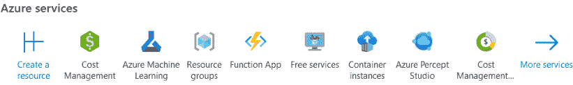

图 11.8 — Microsoft Azure 主屏幕

## Azure Machine Learning

创建机器学习工作区

基础   网络   高级   标签   查看 + 创建

# 资源详细信息

每个工作区都必须分配给一个 Azure 订阅，在那里进行计费。您使用资源组像文件夹一样组织和管理资源，包括您即将创建的工作区。

了解有关 Azure 资源组的更多信息

订阅 *

免费试用

资源组 *

c11

创建新

# 工作区详细信息

配置您基本的工作区设置，如其存储连接、身份验证、容器等。了解更多

工作区名称 *

chapter-11-samples

区域 *

美国东部

查看 + 创建

< 上一步

下一步：网络

图 11.10 – 创建新的 Azure Machine Learning 工作区

此屏幕上的大部分值都由 Azure 预先填充。重要的值是订阅（应默认为免费试用）、资源组（Azure 将创建多个项目来支持项目——将资源组视为将它们保存在一起的文件夹）和工作区名称（或项目的名称）。

虽然还有其他屏幕，但我们建议您对这些屏幕使用默认值。因此，单击“查看 + 创建”按钮，然后在出现的确认屏幕上单击“创建”是可以的。

您可能需要等待一段时间，显示“部署进行中”消息，然后才会出现“部署完成”消息。单击“转到资源”选项以查看我们新创建的工作区。在此工作区中，将有一个“启动 Machine Learning Studio”选项。单击后，您应该会看到如图 11.11 所示的屏幕：


## 图 11.1 – Microsoft Azure Machine Learning Studio

你可以在前一屏幕中看到 Azure 以及 Azure ML 的强大功能，图 11.11 屏幕上的选项（主区域和左侧导航栏）也能体现这一点。我们鼓励你探索更多，但由于我们的重点是运行笔记本，请点击 Notebooks 图标下方的 Start now 选项。你的屏幕应该看起来像图 11.12 所示：

## 图 11.12 – Microsoft Azure ML Studio 中的 Notebooks

在这张截图中，你会注意到我们已经从本书的 GitHub 站点下载了示例数据和示例笔记本文件（11_ML_learning.csv 和 11-naive_bayes.ipynb）。我们通过点击文件夹正上方的 + 图标将它们上传到 Azure，然后在出现的 Trust and Overwrite 弹出窗口中选择 Yes。

与 Codespaces 不同，Azure ML 并不会自动为我们配置计算实例——即运行脚本的引擎。要执行此操作，请点击屏幕左下方的 Compute 图标（看起来像一台电脑），然后在出现的屏幕上选择 + New 按钮。你将看到创建计算实例向导，如图 11.13 所示：

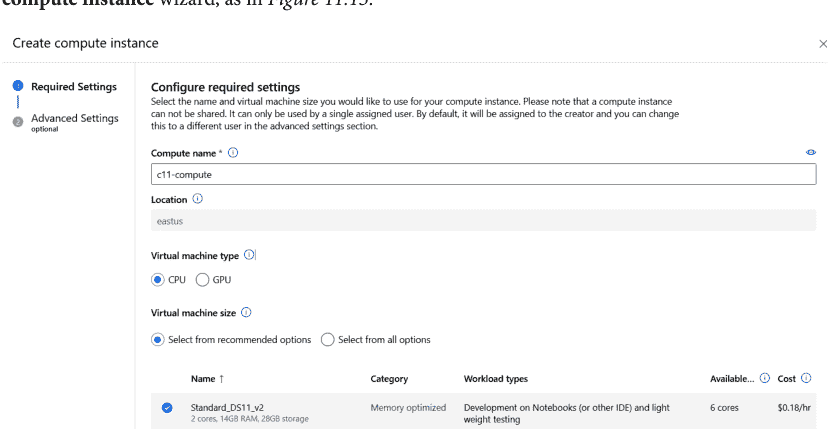

图 11.13 – 创建 Azure 计算实例

你会注意到我们选择了最小（也是最便宜）的计算镜像，因为我们的示例模型很小且训练非常容易。但你也可以为使用更大数据集的重负载工作选择更强大的实例。这也是使用 Azure 相比在笔记本电脑上训练大型数据集的另一个优势。

关于管理 Azure 云计算支出非常重要的一点提示：点击 Next: Advanced Settings。在该屏幕上，设置选项以在设定的时间段后自动关闭你的计算实例。

当我们点击 Create，然后打开笔记本时，Azure 应该会自动将笔记本链接到我们刚刚创建的计算实例。

## 机器学习模型的逐步训练

无论我们是在 Azure ML 中打开示例笔记本（11-naive_bayes.ipynb）还是在其他查看器中打开，你都应该会看到与图 11.14 所示类似的屏幕：

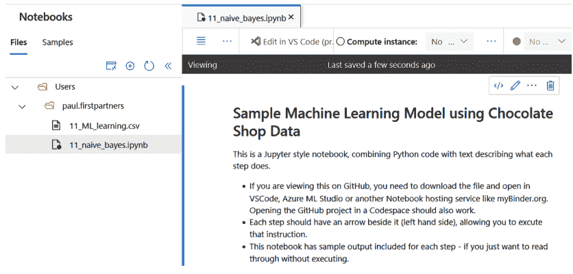

图 11.14 –托管在 Azure 中的我们的 ML 笔记本

ML 的笔记本格式（包含文本、可执行单元格、输出以及执行每个单元格的按钮）与我们之前看到的 3D 图形笔记本完全相同。因此，我们将重点逐步讲解笔记本，并假设你每次都按下 Execute ▶ 按钮来运行笔记本中的每个步骤。如果你心急，笔记本顶部也有一个选项可以一次运行所有步骤——你仍然可以看到每个步骤的输出。

笔记本格式意味着每个步骤都有非常详细的文档，因此我们将从高层次上讲解发生了什么：

- 1. 第一个单元格确保我们能够访问运行笔记本所需的 ML 工具包。当你第一次运行此步骤时，需要等待几分钟，因为 Python 会下载所需的库。从第二次开始会更快：

```
pip install numpy matplotlib seaborn scikit-learn nyoka sklearn2pmml
```

2. 下一个单元格告诉 Python 我们在脚本中想要使用的支持库和工具包。虽然此步骤看起来是多余的，但在较大的脚本中，了解我们使用的是哪些支持工具包是很重要的，尤其是名称相似时：

```
# Standard tools for manipulating numeric data
import random
import seaborn as sns; sns.set()
import numpy as np
import pandas as pd
# For Generating our Graph later.
import matplotlib.pyplot as plt

#Import Gaussian Naive Bayes model
import sklearn
from sklearn.naive_bayes import GaussianNB

# For exporting our model later
from sklearn2pmml import sklearn2pmml
from sklearn2pmml.pipeline import PMMLPipeline
```

3. 现在，我们笔记本的真正工作开始了。下一个单元格包含 Pandas（用于处理表格数据的支持库）来加载我们的示例数据集：

```
# Load the information
sales_data = pd.read_csv("11_ML_learning.csv")
# print it so we can see a sample of the data we are
working with
print (sales_data)
```

4. 图 11.15 显示了此数据的样本：

|  | Order Number | Country | Customer Age | Country-Region Code |
|---|---|---|---|---|
| 0 | 9 | South Africa | 64 | 402 |
| 1 | 14 | United States | 68 | 103 |
| 2 | 84 | United States | 70 | 118 |
| 3 | 16 | United States | 80 | 108 |
| 4 | 21 | United States | 77 | 101 |
| ... | ... | ... | ... | ... |
| 94 | 93 | UK | 56 | 198 |
| 95 | 94 | Sri Lanka | 77 | 260 |
| 96 | 97 | Sri Lanka | 73 | 253 |
| 97 | 98 | New Zealand | 58 | 230 |
| 98 | 99 | UK | 69 | 190 |

|  | Qty Silk Tray | Qty Lumpy Bar | Qty Peanut | Qty Main Product |
|---|---|---|---|---|
| 0 | NaN | NaN | 55.0 | 244 Peanut Candy |
| 1 | NaN | NaN | 97.0 | 268 Peanut Candy |
| 2 | NaN | NaN | 97.0 | 451 Peanut Candy |
| 3 | NaN | NaN | 98.0 | 500 Peanut Candy |
| 4 | NaN | NaN | 98.0 | 389 Peanut Candy |
| ... | ... | ... | ... | ... |
| 94 | 71.0 | NaN | NaN | 142 Silk Tray |
| 95 | 97.0 | NaN | NaN | 292 Silk Tray |
| 96 | 92.0 | NaN | NaN | 370 Silk Tray |
| 97 | 73.0 | NaN | NaN | 220 Silk Tray |
| 98 | 87.0 | NaN | NaN | 522 Silk Tray |

[99 rows x 9 columns]

图 11.15 – 在 Python 中加载的示例数据

5. 在下一个单元格中，特征和标签标识了我们用于预测的列（特征）以及每种情况下预期的输出（标签）。这有助于训练我们的预测模型。

为了让示例保持简单，我们仅在两个特征上进行训练。实际上，你可以使用 10 个甚至 100 个特征进行训练，并通过实验找到预测最清晰的特征：

```
features = sales_data[['Customer Age' ,'Country-Region Code']]
features.columns=["Customer_Age","Country_Code"]
label = sales_data["Main Product"]
```

6. 我们的笔记本缺少一个常见的步骤——将数据拆分为 80% 用于训练，并保留 20% 的行来测试训练的有效性。由于我们的示例数据步骤非常小（100 行），我们将在后面的步骤中通过视觉方式进行检查。无论如何，我们可以尝试不同的算法，看看哪种效果最好。

7. 下一个单元格设置我们要使用的算法为本步骤中的 GaussianNB：

```
model = PMMLPipeline([("classifier", GaussianNB(),)])
```

## 尝试其他学习算法

这是我们编辑以切换到不同方法的行。请查阅 sklearn 文档了解详情，但它们的设计易于切换。测试每一种，看看哪种最适合你。

大多数情况下，你会用另一种算法的名称替换 GaussianNB。我们在第 12 章中这样做以演示决策树。

8. 该单元格还在一行简单的代码中训练我们的模型：

```
model.fit(features, label)
```

## 就这样吗？在一行中训练模型

你可能会惊讶于训练我们的模型只需要一行简单的代码。训练 ML 模型的大部分工作在于事先收集和准备数据。

9. 包含 for loop in range(1000): 的单元格基于随机数据进行 1,000 次预测，并捕获结果以便在下一步轻松绘制图表。我们不会突出显示此代码示例，因为它相当长。关键行是：

```
predicted= str(model.predict([[age,country_code]]))
```

此行调用我们的模型进行预测（并将预测转换为文本）。

10. 从 %matplotlib inline 开始的单元格生成如图 11.16 所示的图表，以可视化这组预测：

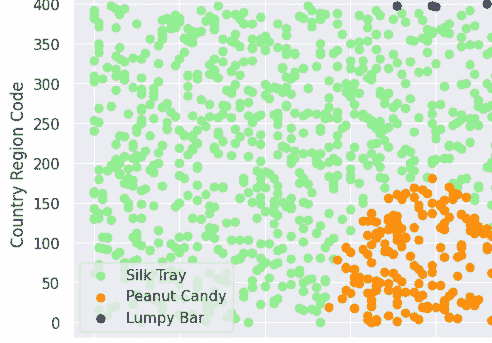

图 11.16 – 朴素贝叶斯预测的预测图

我们的图表应显示三种关键类型的预测：

- 默认推荐，以绿色覆盖图表的大部分，客户应购买我们的 Silk Tray 巧克力盒
- 在右下角（基于地区 100 左右的美国老年客户），我们建议他们购买 Peanut Candy 棒
- 在右上角的一个小区域（基于南非的老年客户），模型应建议他们购买 Lumpy Raisin 巧克力棒

如果你重新打开最初使用的 CSV 文件中的数据集，你会发现这些预测与我们的训练数据一致。请注意，我们正在绘制预测结果，而不是原始训练数据——多次运行此笔记本，你会看到我们的预测每次略有变化。

> **预测不佳？垃圾进，垃圾出**
> 由于有些人将 ML 视为神奇的黑箱，值得提醒自己，模型的品质仅与用于训练的数据质量一样好。
> 在这种情况下，由于样本数据量非常小，我们需要警惕**过拟合**——模型对与我们用于训练的小批量完全相同的客户效果非常好。但模型没有经验来处理训练之外的情况，很容易感到困惑。

由于下一节是要结合 ML 和基于规则的 AI，我们在笔记本中的最后一步是使用以下代码行导出我们新训练的模型：

```
sklearn2pmml(model, "11_chocolate_recommendations.pmml")
```

这是在 ML 中常见的模式——在一个操作中训练模型，然后在单独的步骤中部署和使用训练好的模型。使用 PMML 和 KIE 部署训练好的模型是我们下一节将要介绍的内容。

快速提醒——即使你使用的是 Azure 的免费积分，现在也是一个好时机点击 Azure 门户中的 Compute 选项卡，并关闭你的计算实例以最大限度地减少账单。

## 部署两个 AI 组合（ML 和规则）

ML 很棒，但这本书主要是关于 AI 业务规则的。我们将两者的结合的第一步是打开并编辑我们 Azure 中的 PMML 模型，如图 11.17 所示。此 PMML 模型是在我们 Python 笔记本的最后一步生成的。你可能需要在 Azure ML 中点击 Refresh 按钮才能看到此新生成的模型：


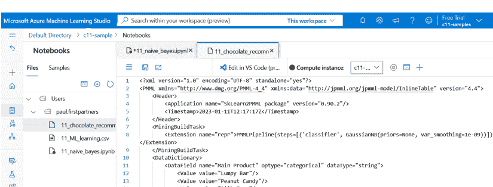

图 11.17 – 由 ML 脚本生成的 PMML

如你所见，PMML 是一种 XML 格式，在很大程度上是人类可读的。它还有一个优点，即它是一种行业标准，因此，即使该模型是由 sklearn 和 Python notebook 生成的，我们也能够将其导入 KIE 并执行。一般来说，互操作性运行得很顺畅——但有点类似于组装宜家（Ikea）的柜子，有时需要用木槌轻轻敲几下才能把所有部件安装到位。

在我们的案例中，需要对 PMML 文件进行两处编辑，以便 Kogito 能够使用它：

-   在第二行，将版本号（4_4）改为 Kogito 支持的版本号。在撰写本文时，这个版本是 4_2。这一行中列出该版本号两次——请同时修改两处，使其成为 <PMML xmlns="http://www.dmg.org/PMML-4_2" xmlns:data="http://jpmml.org/jpmml-model/InlineTable" version="4.2">。
-   找到以 <NaiveBayesModel 开头的行，并编辑它以使其以 <NaiveBayesModel modelName="chocolateRecommendation", 开头，保持该行其余部分不变。这会告诉 Kogito 模型的名称，Kogito 将在决策模型和表示法（DMN）编辑器中显示该名称。
-   从 Azure ML Studio 导出编辑后的文件，并在你的笔记本电脑上保存一份副本。

该文件的编辑版本位于本书的 GitHub 网站上，文件名为 11_chocolate_recommendations.pmml。

## 结合规则与机器学习的决策服务

首先，让我们向你展示我们将要构建的决策模型，它在一个决策服务中结合了规则和机器学习（ML）的优点，如图 11.18 所示：

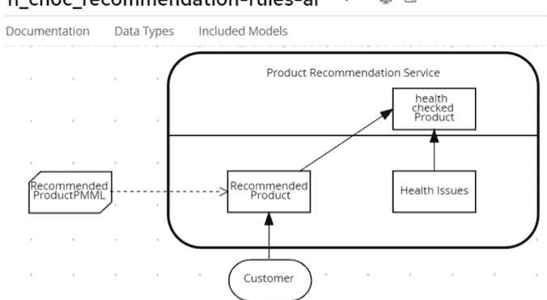

图 11.18 – 结合 AI 规则和机器学习的决策服务

你可能已经认出这是基于我们在第 4 章中构建的产品推荐服务。有两个关键差异，我们稍后将更详细地介绍：

-   我们导入一个 **RecommendedProductPMML** 外部模型，使用的模型导入技术与我们在第 9 章中使用的完全相同。该模型就是我们刚刚使用 Azure ML 训练的 PMML 模型。
-   我们更新了 **RecommendedProduct** 节点，使其基于外部 ML 模型做出推荐（以前，我们使用决策表）。

没有改变的是我们决策的两步性质。我们首先推荐一个产品，然后进行第二次基于规则的检查，以确保我们不推荐可能引起健康问题的产品（例如，花生过敏）。

> **规则和 ML 协同工作是一个关键概念**
>
> 当我第一次看到规则和 ML 以这种方式协同工作时，我非常兴奋——它非常清晰地将两种 AI 的优点结合在一起。
>
> 我们可以使用机器学习来了解客户偏好，但仍然可以通过业务规则来保证重要规则（如健康检查）的执行。而将它们全部放在一个模型中，可以清楚地知道在我们的决策服务中实际将执行什么。

### 将 ML 模型导入决策模型的关键点

如 *图 11.18* 所示，该模型可以下载为 `11_choc_recommendation-rules-ai.dmn`，并且可以轻松导入 KIE Sandbox。如果你希望构建自己的决策模型，可能需要导入更新的 PMML 文件，这里有一些步骤值得强调：

-   1. ML 模型（PMML 文件）可以像任何决策模型一样上传到 KIE Sandbox。上传后，模型将类似于 *图 11.19* 中显示的模型：

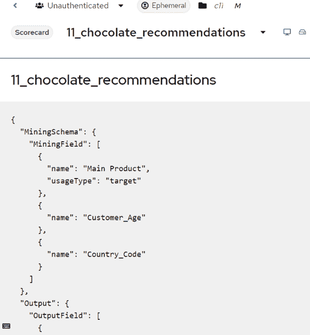

图 11.19 – KIE Sandbox 中的推荐服务

-   2. 两种类型的模型都需要保存到同一个文件夹中，导入才能正常工作——在本例中，我们将该文件夹命名为 `c11`，如 *图 11.19* 右上角所示。

-   3. 在我们的决策（DMN）模型中，我们需要引用新导入的 ML 文件。在 KIE Sandbox 中，转到 **包含的模型（Included Models）** 选项卡，单击 + 图标以添加新模型，然后从下拉菜单中选择我们刚刚导入的模型。给它一个容易记住的名称，例如 CR。这些步骤与我们在 *第 9 章* 中执行的步骤相同，你的屏幕现在应如下所示：

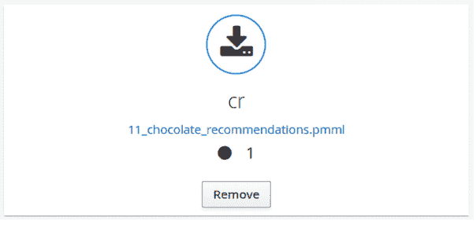

图 11.20 – 在我们的决策模型中引用 ML 模型

-   4. 在我们的决策模型中，我们拖入了一个新的业务模型知识节点——它是 *图 11.18* 最左侧的节点。我们按照 *图 11.21* 对其进行编辑：

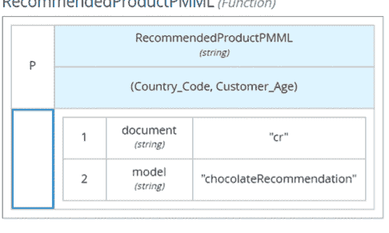

图 11.21 – 业务模型知识节点

我们对节点进行了几处编辑，包括更改名称。我们将类型设置为 **PMML**，因此截图左上角有一个 P。这会提示 KIE Sandbox 询问我们要引用哪个文档和模型——通过随后出现的下拉菜单，我们选择了 `cr` 和 `chocolateRecommendation` 值。

我们还编辑了参数的名称和类型（Country_Code 和 Customer_Age）——KIE Sandbox 有一个编辑器可以指导你，但请确保两者与 PMML 模型中的内容一致。

-   5. 对 ML 模型的实际调用是通过决策节点，即 **调用（Invocation）** 节点完成的。在我们之前在 *图 11.18* 中看到的决策模型中，它被称为 **推荐产品（Recommended Product）**。在 KIE Sandbox 编辑器中打开它，应该会显示如下内容：

*推荐产品（调用）*

| # | 推荐产品 *（数字）* |
|---|---|
|  | `RecommendedProductPMML` |
| 1 | **Country_Code** *（数字）* — `=fn_convert_country_to_code(Customer.Country of Residence)` |
| 2 | **Customer_Age** *（数字）* — `=fn_convert_dob_to_age(Customer.Date of Birth)` |

图 11.22 – 调用节点

就像我们在 *第 9 章* 中调用其他外部模型时一样，RecommendProduct PMML 名称需要与业务模型知识节点的名称匹配，参数的名称和类型也需要完全相同。请注意，我们使用函数将出生日期和国家转换为 ML 模型期望的数值。

-   6. 我们不更改健康检查节点——它仍然是一个使用字面表达式的简单规则，但它也可以很容易地成为决策表或其他类型的 DMN 节点。我们在 *图 11.23* 中再次展示它，因为它是证明 ML 和业务规则良好协作的关键部分：

*经过健康检查的产品（字面表达式）*

```text
if Recommended Product in Health Issues then "Potential Health Issue - please check" else Recommended Product
```

图 11.23 – 未更改的健康检查业务规则

如果我们运行这个决策服务并传入一位居住在美国的客户的大额订单，ML 模型很可能会推荐花生糖果棒。如果我们的客户已知有过敏史，我们的第二条业务规则将触发，产生 **存在潜在健康问题 – 请检查** 消息作为决策服务的推荐。

### 运行我们的集成模型

如你所见，KIE Sandbox 支持编辑同时包含 ML 和基于规则的元素的决策模型。到目前为止，我们理所当然地认为可以使用 KIE Sandbox *编辑*这些组合模型。

*执行*组合规则和 ML 模型特性的能力已经存在于其他 KIE 决策模型工具中——例如，你可能在 *附录 B* 中使用过的 VS Code 插件。虽然它已列入路线图，将添加到 KIE Sandbox 扩展服务中，但（在撰写本文时）尚未实现。

虽然我们已经证明了本章的主要观点（ML 入门），并展示了这两种方法协同工作的强大威力，但这仍然是一本实用书籍。我真的很想为你留下一些工具，用于运行这些组合的 ML 和规则模型。因此，*表 11.1* 展示了你现在作为 Excel 高级用户执行这些组合模型的选择：

| 运行组合 ML 和规则模型的选项 | 优点 | 缺点 |
|---|---|---|
| *KIE Sandbox（及扩展服务）* | 实现后是最简单的选项。 | 在路线图上——日期待确认。 |
| *VS Code 插件* | Kogito 提供了 DMN 决策服务中 PMML 的工作示例。更多内容见 *第 12 章*。 | 技术性稍强，但与我们 *第 9 章* 中介绍的测试场景相比，难度相当。 |
| *Business Central* | Drools 文档中给出了示例。运行 Business Central 的内容涵盖在 *第 10 章* 中。 | 如果你拥有具备一些 Java 知识的企业支持，Business Central 会发挥最佳效果。 |
| *使用 Power Automate 集成 ML 和规则模型* | 对 Excel 高级用户来说最易于使用的解决方案——我们将在 *第 12 章* 中介绍。 | 需要使用 Python 将几个易于使用的组件组合在一起。 |

表 11.1 – 执行组合规则和 ML 模型的选项

正如我们将在 *第 12 章* 运行 Kogito 附带的完整 PMML 示例时看到的那样，执行组合规则和 ML 模型的能力已经可用。挑战在于使其易于被 Excel 高级用户使用——因此，在下一章中，我们还将基于我们已经掌握的 Power Automate 和 Python 知识，提出一种易于使用的方法。在我们探讨这一点之前，让我们先总结一下本章所学的内容。


### Summary

本章所涵盖的主题是机器学习本质上就像在图表上画一条线的想法，而学习的部分则是教机器找到这条线应该放在哪里。我们通过基于朴素贝叶斯的简单学习模型进行了讲解，并在实现该模型的笔记本中，标出了可以插入其他算法的位置。我们在 Azure ML 上运行了该笔记本并生成了一个图表，以测试我们的预测是否与预期一致。

将训练好的模型导出为 PMML 文件后，我们将其纳入了一个基于规则的决策模型。我们使用这种技术更新了之前的巧克力棒推荐服务，并展示了构建结合两种 AI 类型优势的模型是完全可行的。最后，我们讨论了作为 Excel 高级用户执行这些组合模型的选项。

在下一章也是最后一章中，我们将继续介绍高级主题以供进一步探索。该章将扩展我们在本章中初步涉及的几个主题——包括神经网络、可解释 AI，以及在企业环境中部署组合的机器学习和基于规则的模型。

### Further reading

本章的写作目的是让你对机器学习充满信心并产生了解更多欲望。我们介绍了几个关键主题，你的兴趣可能会引导你深入其中，从了解更多关于 Azure 和 Azure ML，到深入 Python 笔记本及其实现的各种算法。所有这些主题在 Packt Publishing 都有相关书籍可供阅读。

此时，重新查看 Kogito 和 Drools 文档也很有价值，重点关注 AI 工具和集成，因为其中的大部分信息现在对你来说会更有意义，同时也能提供将规则和机器学习决策服务组合部署到生产环境的实用步骤。

我强烈推荐的一本非 Packt 出版的书籍是 *Mathematics for Machine Learning*。它可在 `https://mml-book.github.io/` 免费/开放获取。虽然写得非常清晰易懂，但它仍然是一本数学书。因此，虽然阅读起来引人入胜并能提升你对机器学习的知识，但对于理解本章介绍的技术来说并非必需。
