## 12 What Next? A Look inside Neural Networks, Enterprise Projects, Advanced Rules, and the Rule Engine

由于这是本书的最后一章，我们将利用它来扩展我们在前 11 章中遇到的工具和概念。我们还想回答 *下一步是什么？* 这个问题，因此我们将重点关注你在读完本书后可以探索的领域。我们将按以下顺序介绍这些领域：

- 我们将首先演进上一章中使用的笔记本，演示 **决策树** 作为另一种分类算法。
- 决策树提供了更高的 **可解释性**。我们将更详细地探讨这一点，并展示如何将其转换为我们在 *Chapter 4* 中首次遇到的业务规则和决策表。
- **神经网络** 是你可能遇到的最复杂的分类器之一。我们将通过 Excel 给你一个高层次的介绍，然后展示如何在 Python 中生成它们。
- 神经网络功能强大，但在生成结果的方式上并不透明。我们将介绍 KIE 工具集的一部分 **Trusty AI** 来解释决策。
- KIE 的另一个关键特性是其执行 **组合机器学习和人工智能模型** 的能力。我们将展示如何使用 KIE 自带的示例模型来执行它们。
- KIE 的示例非常全面，但一些读者可能想要一种替代方法。我们建议使用我们在 *Chapter 8* 中介绍的工具，在 Power Automate 流程中组合 **机器学习和规则模型**。
- 另一种类型的 **企业解决方案** 基于 Java。我们将介绍 Red Piranha 作为可在此基础上构建的模板，利用其读取整个 Excel 电子表格的能力。
- Red Piranha 还可以在更 **高级的 DRL 规则格式** 中执行规则。我们将查看这种格式并发现，在幕后，我们一直在使用规则。
- 最后，由于 DRL 规则格式有助于阐明规则引擎的实际工作原理，我们将深入引擎内部，查看使其运行如此快速的 **RETE 和 PHREAK** 算法。

由于主题众多，本章我们将采取略有不同的方法。我们仍然旨在为你提供可工作的示例，但它们通常在链接的文档中，而不是完全逐步展开。我们将以适合 Excel 高级用户的方式介绍主题，对于最困难的主题（我们深入研究了一个示例 Kogito 项目），我们将提供一个更简单的替代方案。我们从 *Chapter 11* 的延续开始，使用我们在那里遇到的笔记本，但采用另一种机器学习算法。

### Technical requirements

本章是在已有工具的基础上构建的，而不是引入任何新工具——因此如果你一直读到本书的这一部分，就无需安装任何新软件。

最详细的示例（*Running the KIE machine learning examples using Java and VS Code*）对 Excel 高级用户来说仍然可访问。而且我们紧接着提供了另一种更简单、部分读者会更喜欢的替代方案。

本章中提及的示例都可以在本书的 GitHub 站点获取：https://github.com/PacktPublishing/AI-and-Business-Rules-for-Excel-Power-Users。

### Another machine learning method – decision trees

在 *Chapter 11* 中，我们使用朴素贝叶斯训练了一个机器学习模型。当时我们提到，只需更改一行代码即可替换其他机器学习方法。如果你查看本书 GitHub 页面上的 `12_tree.ipynb` 笔记本，你会看到我们确实就是这样做的。笔记本中创建分类器的那一行现在如下所示：

```
model = PMMLPipeline([("classifier", DecisionTreeClassifier(),)])
```

在 Azure 或其他笔记本托管选项中运行笔记本的方式与上一章相同，因此我们不再重复。更重要的是，当你运行笔记本时，你会得到一个预测图表，如 *Figure 12.1* 所示：

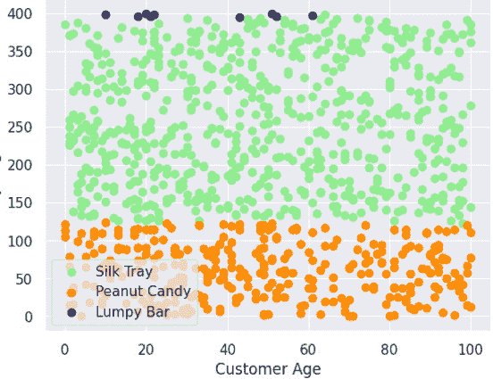

Figure 12.1 – Predictions from the decision tree model

将此结果与上一章中的 *Figure 11.16* 进行比较。虽然预测总体相似，但粒度不如前者。这个模型在很大程度上是基于国家推荐 Silk Tray、Peanut Candy 或 Lumpy Bars，对客户年龄的考虑很少。

> **Reminder – try out different machine learning algorithms**
> 
> 我们在上一章提到，你应该尝试三种或四种最可能的算法，并测试它们在你的数据上的表现。在这个例子中，我们进行了图形化检查，以查看预测的性能如何。
> 
> 实际上，我们会使用 scikit-learn 将数据拆分为训练样本和测试样本，并生成 **混淆矩阵** 来比较每种算法表现的硬性数据。

不要因此而却步使用决策树处理自己的数据。由于我们的样本非常小（100 名客户）且仅基于 2 个输入进行训练，这是一个不切实际的测试，更有利于朴素贝叶斯。但我们在笔记本末尾还添加了一行额外代码，要求笔记本显示它生成的决策树，如 *Figure 12.2* 所示。

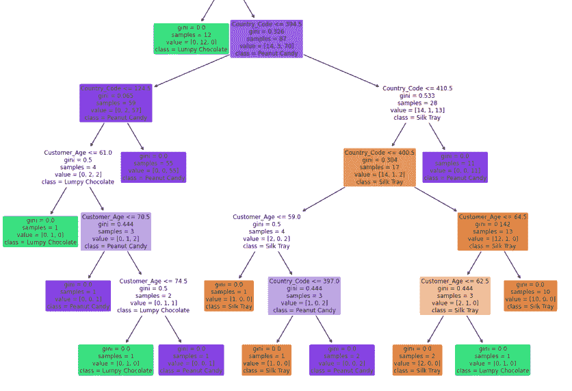

Figure 12.2 – Decision tree generated by the algorithm

我们不会逐一讲解整棵树，但树状图确实解释了模型如何做出预测。你可以看到它使用的 Country_Code 和 Customer_Age 值，以及根据传入模型的值向下分支。有时它可以快速做出决定（例如，左上角的框是早期推荐 Lumpy Bars），有时需要经过几个层级（例如，右下角的框推荐 Silk Tray）。

你会注意到，有多条不同的路径可以做出相同的产品推荐，这意味着决策树可以做出相当细致的预测。但让我们记住两个关键点：

- 决策树是人类可读的。我们没有深入太多细节，但你已经对正在发生的事情有了高层次的理解。
- 决策树是自动生成的。Figure 12.2 中使用的所有值都是机器学习根据数据自动发现的分支位置和方式，以便将树拟合到可用数据。


你可能会忍不住立刻深入进去，开始调整权重，看看是否能让模型预测出更好的结果。但与其调整这个模型，不如让我们展示一种更好的做法，使用你在第4章中见过的工具。

## 决策树和决策表

在第4章中，我们把决策表作为捕获业务规则的关键格式。我们如果看看图12.2中的树，就能想象如何编写这些规则。由于我们的树有25个节点，我们很可能会有25+个节点——我们这里只展示了前3个：

| U | Customer Age | Country Code | Recommended Product |
|---|---|---|---|
| 1 | >20 | <100 | Peanut Candy |
| 2 | >50 | >=100 and <400 | Silk Tray |
| 3 | >50 | >=400 | Lumpy Bar |
| ... |  |  |  |

Table 12.1 – Decision table generated from the decision tree

请记住，前两列（Customer Age 和 Country Code）是我们的输入，最后一个列是我们推荐的产品。

你还会注意到，我们已将 Table HIT Policy 设置为 U 或 unique。决策树会一直分支，直到到达一个单一的、最终的推荐节点。因此，决策树对应的决策表永远只能匹配一行或一条规则与一个值。KIE 沙箱足够智能，可以检查表格并在规则重叠时警告你（如果两条规则会被相同的值触发），但前提是你将 HIT 策略设置为 unique。

更棒的是，KIE 为你提供了一个工具（kie-dmn-ruleset2dmn）来在决策树和表格之间自动转换。如果你想进一步研究，KIE 文档和博客详细介绍了如何使用该工具。

更重要的是，我们在本节中学到的内容如下：

- 机器学习并不总是必须是一个黑箱——存在决策树等算法可以解释决策是如何做出的。该算法可以有效地自动发现我们数据中的业务规则。
- 无论我们是手动将树翻译成规则还是通过 rules2dmn 工具，我们都可以将算法移入人类可读的决策表格式中，以便根据需要进行编辑。

我们将在下下个部分重新讨论 AI 中的可解释性，以及它为何如此重要。但现在，我们面临一个困境——我们可能被迫选择一个性能不如替代方案的算法（决策树），纯粹因为它可以解释自己的行为，而替代方案是朴素贝叶斯。

让我们在下一节通过引入神经网络使这个困境更糟。它们更强大，但它们如何做决策却更不清楚。

> **Spoiler alert – we solve this problem in the section after next**
> 在 *Ethics and explainability in decision making – how KIE helps* 部分，我们解决了如何选择最强大的算法同时仍让它解释其决策过程的困境。你真的以为我们会提出一个严重问题却不给你解决方案吗？

## 神经网络在机器学习中

这不是一本关于神经网络的书。但由于我们介绍的工具（KIE 和 Python notebooks）也能让你更有效地使用神经网络，因此值得对其做一个简单的介绍。

为了看到神经网络可以解决的问题，想象一下我们取了我们的销售图（*第11章的 Figure 11.4*）并添加了我们巧克力脆棒的销售数据。我们可能会得到类似图12.3的图：

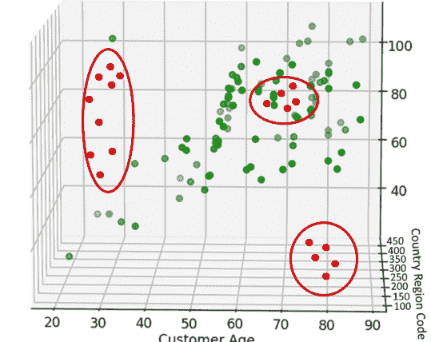

Figure 12.3 – More complicated sales data

这个图更难描述——虽然我们用红色圆圈标出了巧克力脆棒的销售，但右上角的组与 Silk Tray 订单混在一起。我们无法用一句话来描述这个模式，也没有额外的特征（或维度）可以用来澄清这种情况。对于处理这种复杂模式，神经网络效果最好。

> **Reality check – don’t give up on simple classifiers too easily**
> 
> 为了澄清最后的说法，由于我们需要保持示例简单，对于这个数据集，简单的分类器如 **support vector machines** 或 **k-nearest neighbors** 可能仍然能给你足够好的结果。我鼓励你先在自己的数据上尝试这些分类器。
> 
> 然而，在某个阶段，你会遇到一个对这些算法来说太复杂的数据集，这就是神经网络的强大之处发挥作用的地方。

### 在 Excel 中实现的神经网络

神经网络很重要，你几乎肯定已经听说过它们了。你可能会惊讶我们可以在 Excel 中实现一个，如 *图12.4* 所示。实际的 Excel 文件可在本书的 GitHub 站点上作为 `12_Neural_Network.xlsx` 获取：

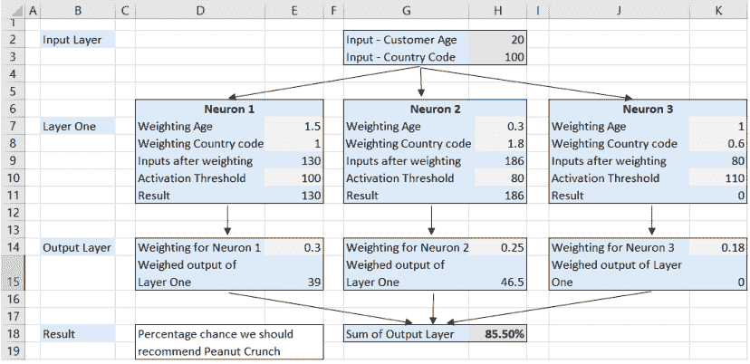

你应该能够轻松理解这个概念，因为你可以在 Excel 中逐步操作：

- 通常，我们只关心工作表顶部绿色区域的 **inputs**（**Customer Age** 和 **Country Code**）以及工作表末端的推荐 **output**（也在绿色中）。输出是我们客户购买 Peanut Crunch 棒的百分比概率。
- 为了计算我们的输出，我们将输入通过三个神经元，每个神经元模式相同。我们可以在每个神经元内设置不同的权重（浅灰色框）。
- 这些权重值允许我们修改对每个输入的重要性程度，我们用它来计算我们的 **Inputs after weighting** 字段。

- 然后我们有 **Activation Threshold**。在这个例子中，激活函数是全有或全无。如果加权后的输入高于阈值，我们就传递它。如果没有，我们传递零。也可以使用其他（更微妙和复杂）的激活函数。
- 我们的 **Output Layer** 对来自前一层神经元的值应用权重。这个权重（灰色）也可以调整。
- 最后，我们的 **Result** 是输出层中三个神经元的总和。这个输出代表该客户购买 Peanut Crunch 棒的百分比概率。

这种类型的网络是 **feedforward perceptron**。尽管名字很令人印象深刻，我们可以从 Excel 文件中看到它只是一些简单的计算。而且在工作表中，有我们可以调整的值来朝着我们想要的结果构建。那么是什么使这种网络有效呢？这要归功于我们如何训练网络。我们将在下一节解释训练的工作原理。

### 训练我们的神经网络——你能做得更好吗？

如果你已下载并尝试过 Excel 文件，你会看到我们的模型在预测美国客户的 Peanut Crunch 棒销售方面相当有效。但它在为南非客户推荐产品方面就不太好了。对于大约400的国家代码，它会生成荒谬的值，例如客户购买概率为357%。

如果你被要求在 *不改变网络结构* 的情况下调整灰色输入来帮助这些客户，你会怎么做？

1. 你会收集一组训练数据（南非地区代码跨所有范围），在大多数情况下说我们应该预测购买 Peanut Crunch 棒的低概率。
2. 带着这个最终目标，你会调整工作表中的值（灰色），以产生更接近我们想要的结果（**backpropagation**）。
3. 你会用一系列值（来自美国和南非的值）测试更改，并查看整个模型与理想结果相差多远。
4. 如果我们的更改是改进，我们就继续朝同一方向进行更改（**gradient descent**）；否则，我们丢弃上一次的更改并尝试另一个方向。
5. 我们重复此训练进行设定次数的迭代，或直到我们不再在模型结果中看到明显改善。

如果你已按照这些说明调整了电子表格，恭喜你；你已经训练了你的第一个神经网络。如果你因为练习太繁琐而推迟了，或者你猜测机器可以为我们完成工作——也恭喜你。你已经看到了你将需要的大多数工具。


## 决策中的伦理与可解释性 – KIE 如何助力

我们在第 5 章讨论伦理时曾提到尊重客户数据的重要性。虽然这在商业上是明智之举，但我们的做法也受到了欧洲 GDPR 立法的驱动，该法规即使你不住在该地区也具有全球影响力。

欧盟正在提出类似的 AI 立法，预计其影响范围同样广泛。与 GDPR 一样，其关注点也是那些同样符合商业利益的事情。既然你正在阅读一本关于业务规则和 KIE 的书籍，那么当它开始实施时，你比大多数人准备得更充分。原因有很多，但我们将重点关注两点——为什么 AI 规则默认是可解释的，以及 KIE 如何为神经网络做出的决策提供更多解释。

## 业务规则默认可解释

吸引我们采用业务规则方法来做 AI 的原因之一是，规则默认是可解释的。这在内部允许我们的业务专家审查并确认我们的基于规则的业务模型是否按预期运行。这意味着如果欧盟新的 AI 法案要求对客户解释为何被拒发住房贷款，规则可以被审计并分享决策原因。需要指出的是，无需公开整个决策模型，只需公开直接导致决策的那部分即可。

从技术上讲，我们完全可以写一条不道德的规则，拒绝给像 Murphy 这样爱尔兰姓氏的人提供住房贷款。但由于此类规则在组织各层级都高度可见且可审查，因此会被迅速发现并删除。而且如果没有被删除，你也不太可能想为一家保留明显歧视性规则的公司工作。

但如果存在我们甚至意识不到的更微妙的歧视怎么办？

## 机器学习中的可解释性

机器学习存在偏见的一个（臭名昭著的）案例是美国法院使用的量刑指导系统。由于它是一个在有偏数据上训练的神经网络，而来自较贫困地区的人此前曾被判更重的刑罚，因此它无意中开始歧视更可能居住在这些地区的人群。在任何时候都没有规则（或训练数据）说明任何特定群体应受到更严厉的对待——但效果是一样的。

由于训练好的决策模型是一个黑箱，因此无法审计决策。而且它在群体层面运作（平均而言，某些群体被判更长的刑期），这使得影响微妙且对任何个人而言并不立即明显。你不应该等到新法律出台才想避免在自己的业务中出现类似情况，那么你可以采取哪些实际步骤？

一个解决方案是使用决策树作为机器学习系统的基础。正如我们之前看到的，我们可以将决策树转换为业务规则，并受益于它们提供的所有透明度和可审计性。但与之前的例子一样，决策树可能并不总是能给出最佳预测，你可能会发现自己在可解释性上牺牲了准确性。

为了解决黑箱情况，KIE 团队正在构建一套 **TrustyAI** 工具。KIE 博客上有技术细节，KIE YouTube 频道上的视频也非常清晰。这些工具使用三种主要技术来照亮以前是黑箱的预测模型：

- **LIME** 说明每个特征（或数据类型）对结果的相对重要性。如果你想到上一章中的 *Figure 11.16*（Naïve Bayes 预测的图），可以把该图描述为一系列形状。虽然大多数预测模型会更复杂，但 LIME 通过关注预测点周围的局部区域来克服这个问题。使用 LIME 生成清晰的图有助于检查是否存在偏见。
- **Counterfactuals** 使我们能够通过询问需要对输入值做多小的改动才能得到我们想要的结果来澄清模型。对模型进行系统性地执行此操作可以帮助我们检测偏见。
- **Shapley Additive Explanations (SHAP)** 旨在解释每个输入对最终决策的贡献程度。它通过获取平均决策，然后在其周围生成混合数据点（带额外数据）来实现。

虽然这是对 TrustyAI 技术的高层次介绍，但本节确实验证了选择 KIE 作为 AI 模型托管平台的合理性。KIE 本身就是未来-proof AI 的良好选择，因为业务规则本质上是透明的。当你将规则和机器学习结合到模型中时，KIE 为你提供了在业务中保持透明度和可解释性的工具。

说到结合规则和机器学习模型，我们在上一章的 KIE Sandbox 编辑器中结合了这两种类型的 AI。现在让我们看看如何执行这些组合模型。

## 执行组合的规则和机器学习模型

在 *第 11 章* 末尾，我们列出了在 KIE 中执行组合业务规则和机器学习模型的四种不同方法。探索不同选项是有充分理由的，因此我们将按以下顺序介绍其中三种：

- 1. 我们首先探索随 KIE 示例提供的方法，因为这些官方示例最稳健。具备一定的技术知识会使此方法更容易。
- 2. 作为旁注，我们看一下使用 Business Central 的方法。它可能更适合较小的团队。虽然 Business Central 是一个用户友好的工具，但它更适合能够借助技术和企业支持的用户。
- 3. 最后，我们提出一种适合寻求最实用解决方案的人的方法。结合 Power Automate 和 Python 是目前最容易让 Excel 高级用户使用的方法。

当然，如果你在阅读本文时第四种方法（在 KIE Sandbox 内执行组合模型）已经可用，我强烈建议使用它。对于现在，让我们从随 KIE 提供的示例开始。

## 使用 Java 和 VS Code 运行 KIE 机器学习示例

KIE 提供了示例来演示如何执行组合的机器学习和基于规则的决策模型。它是我们之前在第 11 章使用 KIE Sandbox 遇到的相同决策模型格式，但其中一些支持工具最初是面向非业务用户受众的。

本节假设你已按照附录 B 中的说明进行操作——设置 VS Code 在线。一个有决心的 Excel 高级用户（有或没有同事支持）应该能够毫无问题地遵循这些步骤。从完成附录 B 开始，你已经熟悉以下内容：

- 通过在 GitHub 页面上点击绿色按钮来启动 Codespaces（VS Code 在线）。
- 在 VS Code 在线编辑器中，确保我们已安装 DMN Editor。这意味着我们可以像在 KIE Sandbox 中一样编辑决策模型。
- 使用 VS Code 编辑器中的终端（文本区域）启动脚本来运行我们的测试。

请注意，本节的 GitHub 站点与本章之前的示例不同，我们在此示例中使用的文件夹也与附录 B 中使用的不同。但除此之外，许多步骤是相同的：

- 1. 前往主 Kogito 示例 GitHub 页面：https://github.com/kiegroup/kogito-examples。
- 2. 确保你已登录 GitHub，然后在 Codespaces 中打开项目。进入 kogito-examples 文件夹并点击出现的绿色 Code 按钮。
- 3. 当 VS Code 编辑器打开时，确保已安装 DMN 插件，以便查看和编辑决策模型。请记住，这份 Codespaces 副本是一个全新实例，因此你需要再次进行那些（简单）的插件设置步骤——请参阅附录 B。
- 4. 我们希望在主 VS Code 编辑器中查看模型。按 Ctrl + P 搜索项目中的所有文件并开始输入 KiePMMLRegression.dmn。你的屏幕应类似于图 12.5，显示决策模型已在 VS Code 编辑器中打开。


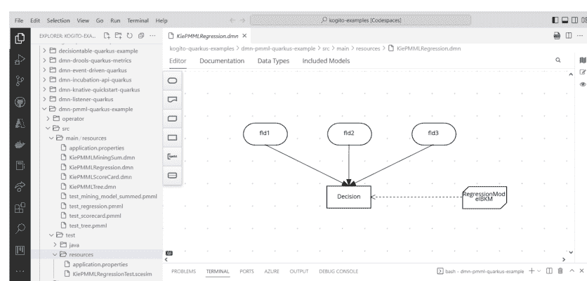

图12.5 – 组合机器学习与决策模型

5. 请注意，这个文件夹中还有其他几个模型，但我们选择了 `KiePMMLRegression.dmn`，因为它与我们第11章训练的模型最接近。该决策服务有三个输入字段，然后调用内嵌的机器学习模型，基于输入进行预测。

> **VS Code 与 KIE Sandbox 的区别**
> 在 VS Code 中运行决策模型与 KIE Sandbox 中有所不同。例如，没有 **Run... as Form** 按钮来试用模型。取而代之的是，我们可以编写 Java 代码来调用模型（本章稍后我们将展示一个使用 Red Piranha 项目的示例），或者使用我们在第9章和附录B中遇到的场景测试工具。

6. 场景测试是更简单的选择，特别是在 `KiePMMLRegressionTest.scesim` 文件中已经设置好了一个场景。你可以通过左侧的文件夹结构（`test/resources/`）进行导航，也可以按 Ctrl + P 并输入文件名快速跳转到该文件。场景测试非常简单——浅蓝色的前三列是输入值，第四列是我们期望的预测值。如图12.6所示：

| 场景描述 | 给定：fld1（值） | 给定：fld2（值） | 给定：fld3（值） | 期望：决策（值） |
|---|---:|---:|---|---:|
| 第一种情况 | 3.0 | 2.0 | "y" | 52.5 |
| 第二种情况 | 3.0 | 2.0 | "x" | 46.5 |
| 第三种情况 | 4.0 | 3.0 | "y" | 89.5 |
| 第四种情况 | 4.0 | 3.0 | "x" | 83.5 |

图12.6 – 示例场景测试

7. **图12.7** 展示了以 PMML 保存的机器学习模型的一个片段，Kogito 将在测试中运行该模型。与其他分类器一样，PMML 可以非常紧凑，文件中大部分内容是输入和输出字段的详细定义。

```xml
<RegressionModel algorithmName="linearRegression" functionName="regression">
  <MiningSchema>
    <MiningField name="fld1"/>
    <MiningField name="fld2"/>
    <MiningField name="fld3"/>
    <MiningField name="fld4" usageType="predicted"/>
  </MiningSchema>
  <Output>
    <OutputField name="result" targetField="fld4" />
  </Output>
  <RegressionTable intercept="0.5">
    <NumericPredictor coefficient="5" exponent="2" name="fld1"/>
    <NumericPredictor coefficient="2" exponent="1" name="fld2"/>
    <CategoricalPredictor coefficient="-3" name="fld3" value="x"/>
    <CategoricalPredictor coefficient="3" name="fld3" value="y"/>
  </RegressionTable>
```

图12.7 – PMML 回归模型片段

8. 在终端中，我们需要导航到演示机器学习与决策模型组合的特定示例。最快的方式是在终端（屏幕右下角的大文本框区域）输入 `cd kogito-quarkus-examples/dmn-quarkus-example/`。你可以在*图12.5*中看到它。

9. 在运行测试之前，请确认我们位于正确的文件夹中。在终端中输入 `ls`，检查返回的文件列表中是否包含 `pom.xml` 构建文件。

10. 运行我们的组合决策模型就像我们在*附录B*中演示的场景测试一样。输入 `mvn clean test` 来执行此模型中已有的场景测试。

11. 与之前的示例一样，首次运行时，许多支持库将被下载到镜像中。随着每个测试的运行和通过（这也是我们所预期的），你会收到更新。

12. 你将看到运行的多个测试的摘要，以及详细报告（位于 **Surefire** 报告文件中，这些文件将保存到新创建的 Target 文件夹中）。

正如预期的那样，一切都很顺利。Kogito 使用测试中的参数执行了我们的组合模型，输出与我们场景每一行的预期结果完全匹配。

> **这里没有意外**
> 
> KIE 团队在发布代码之前会自动运行这些测试，所以如果任何测试失败，那才是令人意外的。
> 
> 不过，偶尔会出现 Codespaces 比 KIE 团队更早升级到最新版本 Maven 的情况。这通常不应该导致问题，但偶尔确实会引发 Maven 构建错误。如果你不幸遇到这个问题，你有以下选择：
> 
> - 等待。团队升级到最新版本的 Maven 后会解决问题。通常这很快——几天而不是几周。
> - 在你的笔记本电脑上安装 VS Code。虽然这很简单，而且我们在*附录B*中给出了提示，但你可能需要技术支持。
> - 更改 Codespaces 使用的 Maven 版本。通常，你会希望使用比当前安装版本稍旧一些的版本。说明见 `https://maven.apache.org/install.html`，但同样，我们建议寻求更有技术经验的同事的支持。

## 接下来做什么——探索其他模型并构建自己的模型

既然我们已经更加适应了这种更具技术性的规则编辑环境，你可能会想阅读以下文章，其中包含了对我们刚刚运行的示例的更多详细信息：`https://blog.kie.org/2021/01/how-to-use-a-pmml-file-in-dmn-editor-vscode.html`。

你可能还想进一步探索测试项目。这个文件夹中还有其他值得探索的决策模型和单元测试。最后，值得拿一个你自己训练的机器学习模型，按照示例让 KIE 和 Kogito 来执行它。

我们承诺了两种更简单的模型执行方式，可能更适合那些不想使用 VS Code 的读者。让我们快速了解一下 Business Central，它与我们刚刚运行的示例非常相似。

## 在 Business Central 中执行机器学习与规则模型

在第9章中，我们看到 Business Central 有许多我们当时没有时间去探索的功能。其中之一就是编辑和执行组合机器学习与规则模型的能力。由于其方法（基于场景模拟测试工具和决策模型编辑器）与我们在上一节中使用 VS Code 所介绍的内容非常相似，我们就不提供详细的操作步骤了。

如果你对这个领域感兴趣，或者想要一些有用信息来帮助你在 VS Code 中更好地执行模型，以下几点可能有助于你进一步探索：

- - Red Hat 有两篇关于 Business Central 中 PMML 模型的好文章，从 `https://developers.redhat.com/blog/2021/01/14/knowledge-meets-machine-learning-for-smarter-decisions-part-1#artificial_intelligence__machine_learning__and_data_science` 开始。
- - KIE 团队在 YouTube 上有一个很棒的视频，覆盖了类似主题——搜索 `[KIELive#42] The Intelligent Decisions journey with DMN and PMML`。
- - Drools 文档中的 Pragmatic AI 部分包含了一个使用 Business Central 作为编辑器的复杂房屋贷款示例的详细演练：`https://docs.drools.org/8.29.0.Final/drools-docs/docs-website/drools/pragmatic-ai/index.html`。

Business Central 和 VS Code 在线方法有很多共同点。我们也值得介绍一个完全不同的替代方案，它更侧重于工作流，许多人会觉得这是最容易的。

## 替代方案——在 Power Automate 流中集成规则和机器学习

我们组合规则和机器学习决策服务的另一种方法非常简单，基于我们在*第8章*中介绍的 Power Automate 工具。*图12.8* 展示了我们设想的流程：

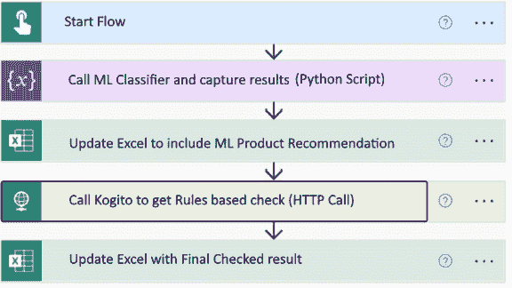

图12.8 – 集成了机器学习与规则的 Power Automate 流

这个流程可以在 Power Automate Online 或 Power Automate Desktop 中实现。无论哪种方式，该流程在概念上都非常简单，只有五个步骤：

1. 我们以正常方式启动流程——此流程有一个手动触发器，但它也可以轻松地是在线表单提交。
2. 在第二步中，我们从 Power Automate 调用我们的机器学习模型（并且只调用机器学习模型）。
3. 我们将机器学习模型的结果更新到 Excel 中。
4. 我们使用第6、7和8章中介绍的任一种技术，单独调用基于规则的决策服务。我们确保传入所有信息，包括之前从机器学习模型收集到的结果。
5. 我们用最终决策服务调用的结果更新 Excel。

> **别担心——我们很快就会介绍如何做到这一点**
> *第2步是我们目前唯一还没展示的步骤——它相当简单，你会在下一节中看到。*

如果我们对巧克力棒推荐服务采用这种方法，第2步可能会向美国客户推荐花生脆棒，而第4步则进行基于规则的健康检查，以避免对任何有过敏症的人造成伤害。

许多 Excel 高级用户发现这种 Power Automate 方法比使用 VS Code 更容易——不仅因为工具在他们掌控之中，而且将事情分成简单、独立的步骤也更容易理解和测试。既然我们已经知道如何实现其他步骤，让我们专注于如何从 Power Automate 调用机器学习模型。

## 从 Power Automate 调用机器学习模型

从 Power Automate 操作中调用机器学习模型的方式有很多种。我们在本章和前一章中大量使用了 Python，而 Power Automate 对 Python 有很好的支持，因此我们将采用这种方法。尽管有很多扩展脚本的方式，但我们会让 Python 脚本保持简单。当你在本书的 GitHub 网站上查看 `12_use_existing_pmml_model.py` 这个脚本时，它会如图12.9所示：


## 简单脚本演示在 python 中运行存储为 pmml 的预训练模型

from pypmml import Model

#Import our previously trained model
model = Model.fromFile('11_chocolate_recommendations.pmml')

## call the model - note the format on how we pass in the parameters needed
result = model.predict({'Customer_Age': 50, 'Country_Code': 100})

## print the result
print(result)

Figure 12.9 – Python script to call a pre-trained machine learning model

This Python script to run our pre-trained model has four simple steps:

- 1. We import the pypmml toolkit because we’ll need it to open our pre-trained model.
- 2. The next step opens the machine learning model we trained in the previous chapter.
- 3. The step to get the prediction from our model is similar to the one we used in the previous chapter (although PMML expects input numbers in simple JSON format instead).
- 4. We print the result. For the value we passed in step 3, it will produce a message of 'probability(Peanut Candy)': 0.15329348021087122, 'probability(Lumpy Bar)': 0.0}.

There are so many different ways to extend and use this script. How you do this will depend on the Power Automate flow that you want to use it in. For example, you may want to pass in a value to a Python function, or you may want the script to open and read its inputs from an Excel file. Likewise, you might want to return a simple value, or instead open an Excel sheet and update that. All are easy to do using Python and its supporting toolkits – and a good summary of all the toolkits for working with Python and Excel is available at https://www.python-excel.org/.

Testing this script in VS Code online

If you wanted, you could also run this Python script in VS Code online. The steps are like the previous VS Code examples. Just remember in the terminal that we may need to type pip install pypmml to make sure we have installed the supporting toolkits. To run the script, type python 12_use_existing_pmml_model.py.

This section has given you multiple options for running decision models with machine learning and/or rules. Since the most likely longer-term deployment of your models is as part of a wider enterprise system, we wanted to show you Red Piranha as a template enterprise project for your rules.

# Red Piranha as a template enterprise project

The main focus of this book is to show you as an Excel power user how to leverage the power of a business rules engine. That gives you a workable solution, but it is likely that your decision models will sooner or later be deployed as part of a larger enterprise system. That’s a good thing! Remember the full enterprise system diagram we saw back in Chapter 2? Your decision models won’t need to change, but now they will have a more robust infrastructure around them.

As an Excel power user or business rules author, you don’t need to know the full detail of how to do this. But since you’re investing your time in this area, it is very reassuring to see how it can be done. The section will show you a working example of such an enterprise system using the Red Piranha project.

Before we start, we have two other reasons for introducing the Red Piranha project:

- Red Piranha shows you another way of integrating Excel data with KIE. Previously, we passed selected cells. Red Piranha allows us to load entire Excel sheets into the rule engine.
- Red Piranha is based on Spring Boot, a widely used Java framework. So, it’s a useful starting point for you if you wanted to explore the Java world.

Red Piranha allows to you specify an input Excel file, then state which rules file or decision model to apply to it, and finally say which output Excel file you want to use (so your original file never gets overwritten). It’s a more robust approach since it works on named ranges within the Excel file – it’s harder for edits to make the Excel file break.

The Red Piranha project grew out of the examples in the previous book by the author (JBoss Drools Business Rules) and subsequent work. But please view it as a proof of concept – a useful way to demonstrate the concepts of a full production system before building the actual system. We’ll shortly take a detailed look inside the Red Piranha project. But first, let’s use the Docker skills we acquired in Chapter 10 to quickly download and run it.

# Running the Red Piranha Docker image

Make sure we have Docker Desktop or the background service running using the instructions in Chapter 10. Not only does Red Piranha package the KIE/Drools rule engine with examples to make it easier to use with Excel, it also provides an easy-to-use Docker image. Let’s get that Docker image up and running:

- 1. Open Command Prompt by pressing Windows Key + R, then type cmd.
- 2. In the console, type docker run -it -p 7000:7000 --mount type=bind,source=c:\some-shared-folder,target=/some-shared-folder paulbrowne/redpiranha:latest. Then, press Enter to execute the command (only at the end).

Be careful – everything should be lowercase. Note that there are two dashes in front of mount, and note the direction of the / slashes.

# Why this detailed command?

The basic syntax to run Docker and get the latest Red Piranha image is simple. The -p 7000:7000 flag means we can communicate with the web server within the container on that port. Similarly, the --mount flag means Windows Explorer can see the files shared by the container to this folder.

Depending on how your laptop is set up, you may get an Access Denied message. You may need to create C:\some-shared-folder if it doesn't exist. You may also need to right-click on the folder and select Properties and then Sharing to allow full sharing with everyone.

- 3. There will be several messages as Docker pulls the layers needed to run Red Piranha. When this is complete, you should see text like the following:

```
.       ____          _            __ __
 \ \ / ___'_ __ _ _(_)_ __  __ _ \ \ \ \
( ( )\___ | '_ | '_| | '_ \/ _` | \ \ \ \
 \/  ___)| |_)| | | | | | | || (_| |  ) ) ) )
 '  |____| .__|_| |_|_| |_|\__, | / / / /
 =========|_|==============|___/=/_/_/_/
 :: Spring Boot ::          (v2.6.2)

2022-05-27 20:47:59.429  INFO 1 --- [           main]
net.firstpartners.Application       : Starting
Application v2.0.1-SNAPSHOT using Java 17.0.3 on
8de964479f93 with PID 1 (/workspace/BOOT-INF/classes
started by cnb in /workspace)
2022-
2022-05-27 20:48:02.974  INFO 1 --- [           main]
net.firstpartners.Application: Started Application in
3.965 seconds (JVM running for 4.529)
net.firstpartners.core.Config@5856dbe4[
    sampleBaseDirAlternate=src/main/resources/examples/
    sampleBaseDirDefault=/workspace/BOOT-INF/classes/
```

```
examples/
  showFullRuleEngineLogs=false
]
```

Once you see the application started message, the image is ready to use. We mentioned that Red Piranha has a mini-web server, so why don't we take a look at the web pages it has available?

- 1. Open a web browser on your laptop and go to http://localhost:7000/.
- 2. Your web browser will connect to the Docker image using the access (on port 7000) that we specified earlier. You should see a page similar to Figure 12.10:

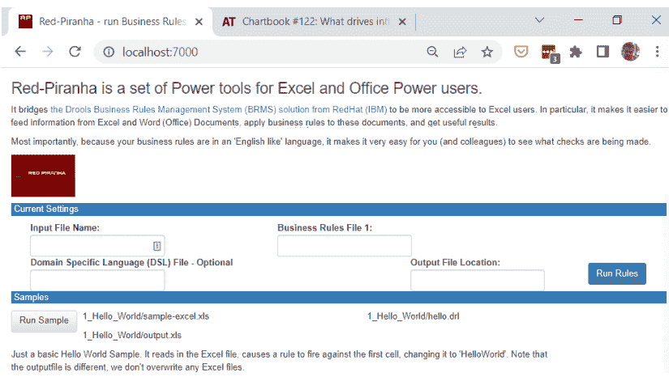

Figure 12.10 – Red Piranha ready to run the business rules samples

- 3. First, we going to run the Hello World sample. If you read down the page, you should see a heading, Samples, and just below that, a button, Run Sample. That sets the Excel input, rules, and output files for this example.
- 4. Click on the Run Sample button to tell Red Piranha/KIE to apply rules to the Excel file.
- 5. Once the sample has run, you should see a Rules Complete message and, further down the screen, you’ll see Hello World.

*Congratulations* – you’ve just run your first business rule using Red Piranha. In the rules, we want to highlight three important things:

- Near the top of screen, Red Piranha lists the Excel file it read (input) information from, the file with the Business Rules it supplied to the Drools rule engine, and the Excel file it wrote the output information to.
- Further down the screen, we should see information about all the information being read in from Excel, messages as the rules fire, and what is about to be output into another Excel file. Much of this is clickable, so it’s worth spending a few moments to explore it now.

# Too much information?

Since Red Piranha maps all of the data available in Excel into a format KIE can use, a lot of information can be displayed. It uses **named ranges** in Excel to decide which data to extract and convert.

We’ll explore the exact conversion format soon, but the data format being used within Red Piranha is similar to the custom data type we set up in the KIE sandbox in Chapter 4. Figure 12.11 shows (some) of the information it has converted from Excel during the conversion process.

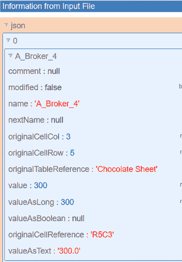

Figure 12.11 – Information that Red Piranha has read from Excel


如果你更喜欢在控制台中查看，也可以在控制台中打印出所有这些信息。

你会注意到，屏幕上还列出了其他几个示例。也值得对它们进行探索。不过，你可能更想在 Red Piranha 中运行自己的示例。

> **Red Piranha 的不同版本**
> Red Piranha 正在积极开发中，因此你在屏幕上看到的内容可能会与此处显示的屏幕截图略有不同。始终会提供一个稳定的 Docker 镜像，以及一个稳定的 main（默认）分支。

## 在 Red Piranha 中运行自己的文件

虽然这些示例很有趣，但你可能希望通过 Red Piranha 运行自己的文件。鉴于网页（如图 12.10 所示）提供了如何选择自有文件（Excel 输入文件、规则文件或输出文件）的说明，因此操作很简单。Red Piranha 的 GitHub 页面上也有详细说明。不过，为了节省你的时间，这里重点介绍四点：

- Docker 会在与笔记本电脑隔离的容器中运行 Red Piranha。这对安全性非常有利，但意味着你需要考虑如何让 Red Piranha 访问笔记本电脑上的文件。幸运的是，我们用于启动 Docker 容器的命令使用了 `-mount` 标志，将计算机上的文件夹 `c:\some-shared-folder` 链接到 Docker 容器内的文件夹 `\some-shared-folder`。
- 挂载这些文件夹后，可以将包含输入数据的 Excel 文件保存到 `c:\some-shared-folder\someinput.xlsx` 文件夹中。然后，我们只需在图 12.10 所示的 Input File Name 框中填入 `\some-shared-folder\someinput.xlsx`，即可告知 Red Piranha（在 Docker 中运行）从该文件读取数据。
- Red Piranha 会将 Excel 文件（或 Excel 文件中的命名区域）转换为一组自定义的 Cell 对象。图 12.11 中展示了这一转换过程，这对于编写与这些 Cell 对象中包含的数据进行匹配的规则很有帮助。
- 虽然 Red Piranha 支持决策模型，但大多数示例使用的是更高级的 DRL 格式。我们将在本章稍后探讨这种格式，因为了解它非常有用。

虽然 Docker 让使用 Red Piranha 变得很容易，但使用 Codespaces 和在线 VS Code 自定义项目，以便完全按照你的需求运行，也几乎同样简单。毕竟，它是开源项目，所以让我们来尝试一下。

## 使用 Codespaces 和 VS Code 查看 Red Piranha 项目内部

即使你不打算以 Red Piranha 为起点深入进行 Java 开发，查看其代码也很有用。这样，你可以更深入地了解自定义数据模型（Cells）的布局，并编辑示例 DRL（规则）文件。

在 Codespace 中运行 Red Piranha，与本章前面运行 Kogito 示例的方式几乎完全相同：

- 1. 在 GitHub 上打开项目：https://github.com/firstpartners-net/red-piranha。
- 2. 点击菜单中出现的绿色 <>Code 按钮，然后点击 + 按钮，在默认的 main 分支上创建 Codespace。
- 3. Codespaces 启动几分钟后，在线 VS Code 编辑器会在浏览器中出现。
- 4. 在终端中输入 `cd code`，进入正确的目录。然后，要使用 Spring 和 Maven 启动 Red Piranha，请输入 `mvn spring-boot:run`。
- 5. 项目将启动（根据需要下载库），并显示一条包含 Spring 徽标及其所使用目录的消息。
- 6. 最终，VS Code 会显示类似图 12.12 的消息，表明应用程序已启动。

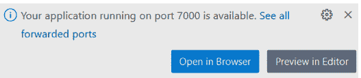

图 12.12 – Red Piranha 在在线 VS Code 中于云端运行

- 7. 点击 Open in Browser，将打开托管在云端的 Red Piranha 版本。该页面应与图 12.10 中的页面完全相同。

恭喜！你刚刚在云端构建并运行了第一个企业级 Java 项目。为了鼓励你更详细地探索 Java（以及 Red Piranha 源代码），下面给出一些有用的起点：

- Red Piranha 是一个标准的 Spring Boot 项目。关于该框架的详细信息，请访问 https://spring.io/projects/spring-boot。
- 如果你编辑 Red Piranha 代码（例如更新规则或添加所需功能），Spring 应该会自动检测到更改。但如果没有检测到，你可以停止项目（在 VS Code 终端中使用 Ctrl + C），然后从第 4 步重新开始。
- 项目中一个值得查看的关键文件是 `Cell.java`，因为它定义了规则可用数据的结构。从 Excel 中提取数据时，数据会被转换为一系列 Cell 对象。对象的概念类似于你在第 4 章 KIE 沙箱中创建的自定义数据类型。
- 除非你是 Java 开发人员，否则通常不需要修改太多项目结构。不过，由于 Spring Framework 会将许多 Web 请求映射到 `RedController.java`，因此如果你对此感兴趣，这会是一个很好的起点。

• 你主要需要编辑规则文件。*图 12.11* 展示了编辑器中打开的第二个 Red Piranha 示例的 DRL 规则文件：

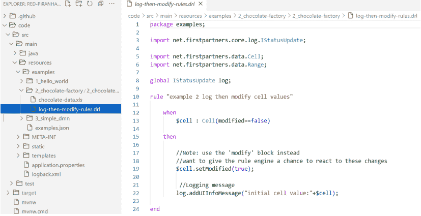

图 12.13 – VS Code 中第二个 Red Piranha 示例的 DRL 规则文件

该规则文件采用 DRL 格式，KIE 同样支持这种格式。由于 DRL 是一种更高级的规则格式，下面一节将详细介绍这种规则格式。

## VS Code 和 Business Central 中的高级 DRL 规则

在*第 1 章*首次介绍业务规则时，我们使用了一种略显正式的 when … then 格式——当某件事为真时，就执行某个操作。*图 12.11*中 Red Piranha 示例的规则完全遵循这一格式：

- **当**一个 Cell 对象被标记为未修改
- **则**将状态标志更新为已修改/向控制台打印一条消息

因此，基本格式很简单，也非常易于人类阅读。以这种方式编写单条规则时，可以使用许多强大的功能，而且 DRL 文件还可以与本书大部分篇幅中使用的决策模型混合搭配。

> **决策表中的每一行都等价于一条 DRL 规则**
> 
> 我们曾介绍过，决策表中的列分别对应 when（条件），以及匹配后激活的列（决策表右侧的 then 部分）。因此，你可以将决策表中的每一行视为等价于 DRL 文件中的一条规则。

正因为如此，我们才让你（以及你的同事）得以一窥规则引擎内部，并展示近 20 年持续开发所带来的复杂能力。下面总结一下为什么应该使用 KIE，而不是自行构建解决方案：

- 开发人员——你希望使用来自 Red Hat 和 IBM 的尖端 AI 工具 KIE。这相比自行构建工具，在简历上更具优势。
- 业务用户——你希望享受近 20 年开发成果带来的益处，并拥有一批现成的技术人员来支持项目。此外，你还可以获得 IBM、Red Hat 以及更广泛社区提供的全部创作工具、培训和支持。

KIE 多年来的开发成果在许多方面都能胜过自行构建的解决方案（例如，你不可能获得一个像 KIE Sandbox 那样清晰易用的自建版本）。不过，我们将重点关注 RETE-PHREAK 算法，因为它也能解释规则引擎为什么运行速度很快——比 Excel 更快，也比自定义代码更快。

## 使用 RETE 和 PHREAK 方法运行规则（快速）

最初的 RETE 算法由 Charles Forgy 博士提出（发表于 1974 年至 1979 年间的论文中），它奠定了 KIE 和 Drools 等规则引擎所依据的理论基础。PHREAK 算法则是 Drools 团队进行的一次根本性重写，利用了此后 40 年间的技术进步。两篇论文的详细内容都可以轻松地在网上找到，而且很值得阅读，但关键在于：所有这些思想都已经预先内置于 Drools 中，我们不必自行构建。

请记住，决策模型中的几乎所有元素（包括决策表）都可以转换为类似于 when...then 格式的规则——可能还会附加一些属性，用于指定哪些规则应当组合在一起。当然，这是一个过度简化的说法。Drools 文档详细说明了工作内存中实际发生的情况——工作内存是 Drools 执行所有这些评估的空间。不过，下面是一个总结：

- 1. 首先，我们的规则（包括决策模型）会被加载到工作内存中。规则的左侧（when 部分）会被评估。如果一条或多条规则的 when 部分全部或部分相同，我们就不需要对其进行两次评估——可以将这部分规则连接起来。这意味着我们可以将规则构建成一个网络，其形式与图 12.12 类似。
- 2. 请注意，在这个网络中，Drools 还对右侧（规则的 then 部分）进行了一些分析。这是因为规则触发时，then 部分可能会发生变化，而这些变化又会使其他规则参与执行。
- 3. 虽然我们在第一步就构建了这个网络，但也可以在规则执行期间动态更改它。不过，为了保持简单，我们将忽略这一能力。


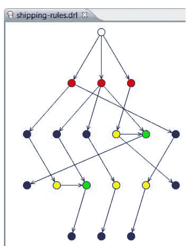

图12.14 – 我们简单项目中的示例Rete树

+   4. 接下来，我们将事实加载到工作内存中。事实可以简单到就是我们在KIE Sandbox的早期示例中传递给决策模型的客户数据。
+   5. 工作内存中事实的存在会激活某些规则（规则的when部分现在为真）。与传统代码不同，如果有多个规则可触发（议程），规则引擎会通过冲突消解来决定触发哪个规则（以及按什么顺序触发）。
+   6. 某个规则执行then条件时，可能会引起工作内存中事实的变化，从而使得曾经在议程上的规则不再排队等待触发。但其他规则的when部分可能匹配，因此它们会被添加到议程中。
+   7. 针对新/更新的事实评估规则的过程称为真值维护。规则引擎中也有避免循环规则的措施（即规则更新某个事实，该事实迟早会导致同一规则再次触发）。

事实上，自定义的解决方案不具备经过数十万用户测试的网络分析能力和健壮性。而且构建RETE网络意味着每次变化时只需评估一小部分规则——这与传统解决方案不同，传统解决方案需要评估所有可能的方案，而且可能评估多次。因此，业务规则越多，规则引擎的速度优势越明显。

最后，这只是Drools团队为优化引擎所做众多工作中的一小部分。希望这能帮助您确信选择Drools规则和KIE决策服务能够超越您之前在Excel中遇到的问题。

回到*第1章*，我曾承诺帮助解决您业务中面临的一些Excel问题。我希望您同意，您在本书中学到的工具将为您和您的同事带来更健壮、更快速、更智能的工作环境。但除非您主动改变，否则一切都不会改变，因此祝您在应用所学知识时好运。

在探索过程中，我鼓励您分享所学。当您与Excel、AI、决策模型和业务规则社区分享经验时，我希望能在线上与您相遇。
