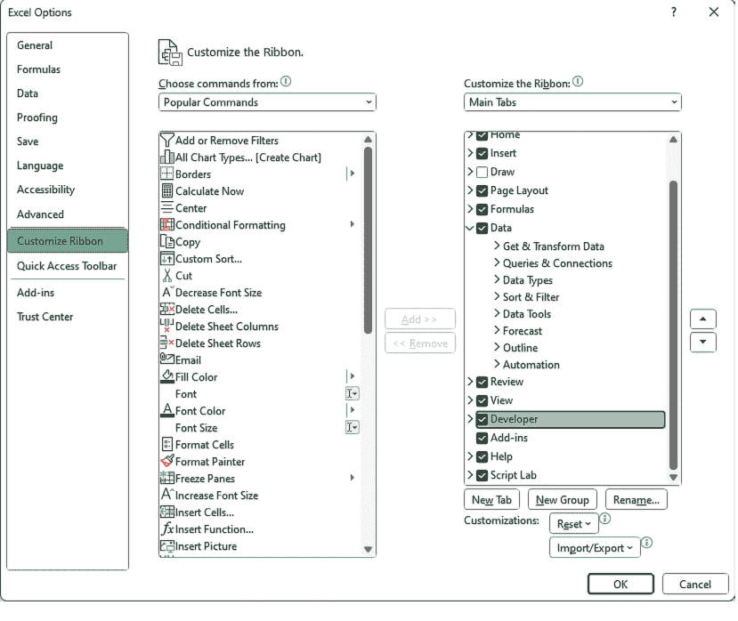
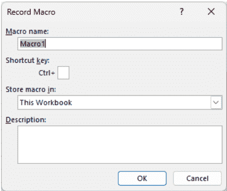
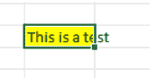

## 附录A

## Visual Basic for Applications简介

*第7章*向您展示了如何使用**Visual Basic for Applications（VBA）**调用决策服务。由于并非每位读者都使用过VBA，我们附上本附录助您入门。

### 宏和VBA简介

VBA于1993年推出（没错，1993年）时是革命性的。早期版本的Excel和其他电子表格有**宏**，但宏只不过能重放用户的按键操作。VBA提供了将用户操作录制为编程语言（类似于当时流行的**Basic**语言）的能力，然后允许用户在代码编辑器中修改这些代码。它为Excel高级用户（比如您！）提供了一条简单的学习解决问题的途径，同时也为升级到更具可扩展性的企业解决方案敞开了大门。

如今，VBA在Excel中默认不开启，因此您需要启用它才能看到其模样。我们首先启用Excel功能区上的**开发工具**选项卡：

+   1. 在**Excel选项**菜单中，选择**文件**选项，然后选择**自定义功能区**。您将看到一个类似于*图AA.1*的对话框：

图A.A.1 – 在Excel中启用“开发工具”功能区

+   2. 在此对话框中，在右上角选择**自定义功能区**下的**主选项卡**。
+   3. 在下面的框中，确保选中**开发工具**工具栏选项。
+   4. 单击**确定**，对话框将关闭，**开发工具**选项卡将出现在工具栏上。

开发工具工具栏提供了几个有用的选项，您可以在闲暇时自行探索。现在对我们来说最有用的可能是**录制宏**功能。让我们通过这个功能来录制操作步骤，查看并修改生成的代码，然后重放这些步骤：

+   1. 在**开发工具**工具栏上，单击**录制宏**。将出现类似于*图A.A.2*的对话框：

图AA.2 – Excel中的“录制宏”对话框

2. 对于这个简单示例，我们对默认的宏名称（Macro1）以及将宏存储在当前工作簿中感到满意。因此，单击“确定”按钮。

3. 现在我们在录制操作，让我们修改一个单元格——具体哪个并不重要。输入一些文本并将背景颜色改为黄色——如图AA.3所示：

图AA.3 – 我们录制的一些示例更新

4. 在“开发工具”菜单上，单击“停止录制”按钮。

5. 我们想查看Excel的VBA为我们捕获的代码。在“开发工具”工具栏上，单击“宏”，然后选择“宏1”|“编辑”。宏编辑器屏幕将显示您录制的内容，如图AA.4所示：
