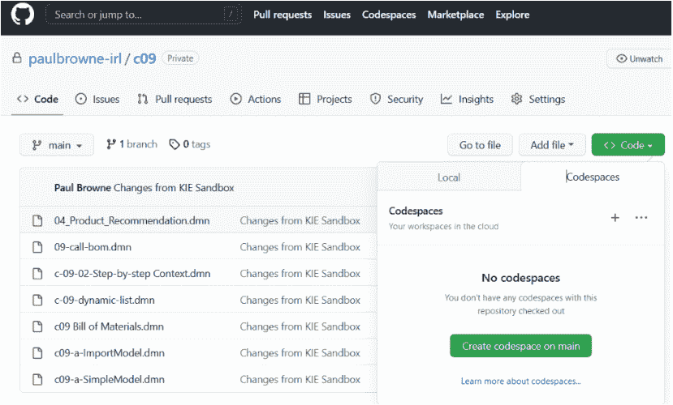
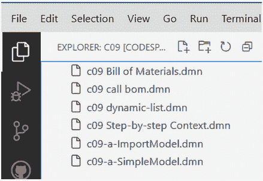
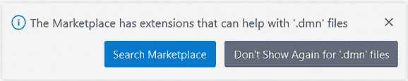
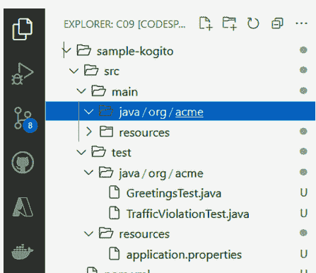
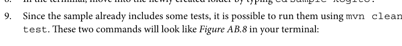
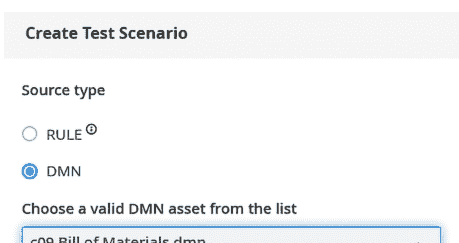

## 附录B

## 使用VSCode、Azure和GitHub Codespaces进行测试

虽然使用VSCode超出了本书的范围，但许多读者仍然可以轻松上手。微软发布了GitHub Codespaces——VSCode编辑器的在线版本，使这一过程变得更加简单。由于它完全在Azure云中运行，并且可以通过浏览器访问，因此您无需在笔记本电脑上安装任何软件。

如果您已阅读过第9章，您可能会来到本附录学习如何使用VSCode（在线版）运行场景模拟工具。我们将涵盖设置该工具所需的全部步骤，以及一种您可能更喜欢的替代方法，因为该方法还允许您运行展示场景测试的KIE示例。

本附录还提供了VSCode的介绍。如果您有兴趣探索的不只是决策模型，还包括数据科学、机器学习以及Python、JavaScript、Java和C#等编程语言，VSCode会为您打开一系列其他可能性。我们不会介绍那些领域所需的特定插件——但我们会提供如何安装DMN插件的说明，这可是您在那些领域迈出下一步的很好基础。虽然本书并非面向开发人员，但本章中的步骤也是您开始使用更强大的开发工具所必需的内容。

与其他附录一样，我们假设您愿意探索更技术性的话题。虽然我们提供了适合Excel高级用户的分步说明，但不会深入探讨如何解决所有可能的问题。为此，我们建议您在需要时向更有技术经验的同事寻求帮助。如果您确实卡住了，还有另一种运行场景模拟工具的途径，即使用Business Central，我们在第10章中介绍过。

最后，如果您更愿意在笔记本电脑上运行VSCode（而不是在云中在线运行），我们在本附录末尾提供了一些相关说明。许多步骤将是相同的。

### VSCode和Codespaces入门

关键的第一步是确保您已创建GitHub帐户，并使用网络浏览器登录该网站。如果您已经完成第5章的练习，应该已经完成了这一步。登录后，打开包含您的决策模型的仓库——图AB.1显示了包含我们在第9章中使用的模型的仓库。

> **VSCode.Dev还是Codespaces？**
> 在KIE Sandbox中，您会看到一个在**VSCode.Dev**中打开项目的选项。这*不是*您要找的。它将打开一个Visual Studio编辑器，让您修改决策模型。但您仍然需要在此编辑器中找到**连接到Codespaces**按钮来配置Azure云，后者负责处理繁重的工作或运行/测试规则。
> 对大多数人来说，通过GitHub按照下面的说明打开**Codespaces**会更快。



微软现在已将Codespaces（免费和付费选项）推广到大多数GitHub帐户。要开始设置Codespaces来运行这些文件，请按照以下步骤操作：

+   1. 如图AB.1所示，打开仓库后，右上角应该有一个大的绿色Code按钮。单击该按钮，我们可以在主分支上创建Codespace（这是我们在大多数情况下想要的）。


## 云机器设置

虚拟机设置好后，值得再次返回如图所示的 Codespaces 菜单 AB.1。

Codespaces 菜单中的 … 符号可让您管理 Codespaces 在 Azure 上运行的虚拟机。它们允许您在不使用时停止机器，这很重要，因为我们在免费套餐中只能使用有限的小时数。

此 … 菜单还允许我们将虚拟内存大小从标准的 4 GB 增加到 8 GB。如果在后续步骤中运行命令时不断收到 killed 消息，增加内存大小应该有助于解决此问题。

2. 单击绿色按钮后，您应该会看到 Codespaces 正在设置的消息持续几秒钟。然后，VSCode 编辑器将出现在您的网络浏览器中，并列出来自您存储库的文件以供编辑，如图 AB.2 所示。

   

   图 AB.2 – VSCode 在 Codespaces 中显示待编辑的决策模型列表

3. 点击其中一个决策模型文件。VSCode 将检测到它有可用的扩展来编辑 .dmn 文件，并会提供查找扩展的建议，如图 AB.3 所示。

   

   图 AB.3 – VSCode 建议有可用的扩展来编辑您的决策模型

值得在浏览器中的 VSCode 屏幕上进行一次浏览。我们假设您已经在第 9 章中浏览过 VSCode 屏幕，但值得确认一切看起来都很熟悉。

我们鼓励您对决策模型进行编辑，探索源代码控制选项卡（从左上角数起第三个图标），并将项目推送和拉取到 GitHub（确保点击同步按钮并检查它们是否出现在 GitHub 网页上）。虽然机制与 KIE Sandbox 编辑器相同，但您有更多选项（例如添加提交信息）。

如果文件不同步（例如，如果有人同时在 KIE Sandbox 中编辑了它们），VSCode 中有选项可以帮助您解决这些冲突。了解更多信息的良好起点是 https://vscode.github.com/。在本附录中，我们将继续介绍在 VSCode 中设置场景测试。

## 在 VSCode 中设置场景测试

现在我们对 VSCode 环境有了一些了解，让我们使用它来设置 KIE 场景模拟和测试工具。由于 VSCode 是一个专注于开发的高级文本编辑器，测试工具设计为作为构建过程的一部分自动运行。

> **什么是构建工具？**
> 构建工具用于将文本源文件转换为可运行的项目。构建工具可以执行的步骤包括下载支持库、将文本编译为可运行代码、将项目打包为可部署文件以及运行指定的测试。由于 KIE 和 Kogito 是一个基于 Java 的项目，Maven 是标准的构建工具。

作为构建工具，Maven 还可以为我们自动化许多设置步骤。本节中建议的步骤基于 KIE 团队的以下文章：https://blog.kie.org/2021/04/how-to-use-test-scenario-editor-to-test-your-dmn-asset-in-vscode.html。因为该文章提供了清晰的示例，以下说明使用了稍旧版本的 KIE 以匹配它。如果您是第一次使用场景测试工具，额外文档带来的好处是值得的。

然而，由于 KIE 发展迅速，我们也必须为您提供使用最新版本的方法。考虑到这一点，请注意以下事项：

- 下一节中列出的 *替代方法* 可以使用 KIE 项目源的最新版本运行——代价是需要更深入地了解项目。
- 如果您打算为开发目的设置 Kogito 项目，最好遵循官方说明：https://docs.kogito.kie.org/latest/html_single/#proc-kogito-creating-project_kogito-creating-running。

请记住，如果您复制粘贴以下任何代码示例来设置场景测试，请确保所有文本都在一行上：

1. 在 VSCode 中，转到终端（屏幕右下角的文本框）。输入以下命令，全部在一行上，然后按 Enter 键：

   ```
   mvn archetype:generate -DarchetypeGroupId=org.kie.kogito -DarchetypeArtifactId=kogito-quarkus-archetype -DgroupId=org.acme -DartifactId=sample-kogito -DarchetypeVersion=1.10.0.Final -Dversion=1.0.0-SNAPSHOT
   ```

   此命令告诉 Maven 构建工具（mvn）使用来自 org.kie.kogito 的模板生成测试项目（archetype:generate），具体为基于 quarkus 的示例。它在 org.acme 文件夹下生成示例。生成的项目名为 sample-kogito，版本号为 1.0-SNAPSHOT。

2. Maven 将自动下载必要的支持库。如果您没有增加虚拟机的内存大小（如我们之前建议的那样），此步骤很可能会失败并出现 killed 消息。如果您收到此类错误，在调整内存大小后重复完全相同的构建命令是可以的。

3. 在构建过程进行到一半时，您可能会被要求确认（提示时按 Y）。几秒钟后，构建过程应完成，您应会看到成功消息，如图 AB.6 所示。

   ```
   [INFO] Parameter: groupId, Value: org.acme
   [INFO] Parameter: artifactId, Value: sample-kogito
   [INFO] Parameter: version, Value: 1.0.0-SNAPSHOT
   [INFO] Project created from Archetype in dir: /workspaces/c09/sample-kogito
   [INFO] ------------------------------------------------------------------------
   [INFO] BUILD SUCCESS
   [INFO] ------------------------------------------------------------------------
   [INFO] Total time: 10.309 s
   [INFO] Finished at: 2022-12-10T23:16:14Z
   [INFO] ------------------------------------------------------------------------
   ```

   图 AB.6 – Maven 项目构建成功

4. Maven 将在 sample Kogito 下创建大量新文件夹——如果展开它们，将看起来像图 AB.7：

   

   图 AB.7 – Maven 为我们的 Kogito 示例生成的目录

5. pom.xml 文件是 Maven 用于理解我们想要构建的项目类型的配方书。在 VSCode 编辑器中打开它。我们将对其进行修改以告诉 Maven 我们想要包含 Kogito 场景测试工具。

6. 在 pom.xml 中，查找 </dependencies> 行。用以下行替换它，以便项目中仍然只有一个 </dependencies> 标签：

   ```
   <dependency> <groupId>org.kie.kogito</groupId> <artifactId>kogito-scenario-simulation</artifactId> <scope>test</scope> </dependency> </dependencies>
   ```

7. 按 Ctrl + S 保存此文件。

8. 在终端中，通过输入 cd sample-kogito 进入新创建的文件夹。

9. 由于示例已包含一些测试，可以使用 mvn clean test 运行它们。这两个命令在您的终端中看起来像图 AB.8：

   

   图 AB.8 – 更改目录并运行测试

10. Maven 将自动下载所需的测试库并运行测试。您的构建成功方法现在包括运行的测试数量及其状态，如图 AB.9 所示。

    ```
    [INFO] Tests run: 2, Failures: 0, Errors: 0, Skipped: 0
    [INFO]
    [INFO] -------------------------------------------------------------
    [INFO] BUILD SUCCESS
    [INFO] -------------------------------------------------------------
    [INFO] Total time: 01:42 min
    [INFO] Finished at: 2022-12-13T20:45:46Z
    [INFO] -------------------------------------------------------------
    ```

    图 AB.9 – 测试运行成功

11. 如果您需要了解每个测试的成功或失败的更多信息，请查看新创建的 target 文件夹。其中的 surefire-reports 子文件夹将包含每个测试的详细信息。

虽然在项目中运行测试很棒，但我们仍然还没有运行 Scenario Simulation 测试。现在让我们解决这个问题。

## 在 VSCode 中运行场景测试

将场景测试设置到这些自动测试中需要最后几个小步骤：

1. 我们的决策模型（dmn 文件）目前位于项目的根文件夹中。要包含在 Maven 测试中，它们需要位于 sample-kogito/src/main/resources 文件夹中。将文件拖放到此位置。

   > 移动决策模型文件很重要
   > 如果您不移动决策文件，以下大多数步骤似乎都能正常工作，但实际测试不会正确运行。

2. 为了让自动测试知道它们应该运行 Scenario Simulation，请在 sample-kogito src/test/testscenario 文件夹中创建 KogitoScenarioJunitActivatorTest.java 文件。

3. 在编辑器中打开此新文件并放入以下内容——这将自动选取并运行任何 scesim（Scenario Simulation）测试：

   ```
   package testscenario;

   @org.junit.runner.RunWith(org.kogito.scenariosimulation.runner.KogitoJunitActivator.class)

   public class KogitoScenarioJunitActivatorTest {}
   ```


4. 我们将在 sample-kogito 的 `src/test/resources` 目录中创建 `test1.scenarios` 文件。

5. 第一次打开该文件时，我们会看到一个如图 AB.10 所示的对话框：



图 AB.10 – 创建测试场景

6. 选择 DMN，然后从下拉列表中选择我们的“物料清单”模型，并点击“创建”按钮。主场景模拟器编辑器将打开。我们使用与第 9 章中类似的值填充了它，如图 AB.11 所示：

| # | 场景描述 | GIVEN | | EXPECT | |
| | | 产品 | 数量 | 物料清单 | 产品详情 |
| | | 值 | 值 | 值 | 值 |
| 1 | Silk Tray | "Silk Tray" | 125 | 18750 | 150 |
| 2 | Crunch | "Crunch" | 10 | 100 | 10 |
| 3 | Crunch | "Crunch" | -10 | 0 | 0 |

图 AB.11 – 我们的测试场景

7. 现在，当我们使用 `mvn clean test` 运行场景时，这些场景将包含在自动测试中：

```
[INFO] Tests run: 6, Failures: 1, Errors: 0, Skipped: 0
[INFO]
[INFO] -------------------------------------------------------
--
[INFO] BUILD FAILURE
[INFO] -------------------------------------------------------
--
```

你会注意到，在这种情况下，我们遇到了构建失败——场景测试工具正确地指出，我们的“物料清单”决策模型不能很好地处理负值。我们可以在 Surefire 报告和日志中查看更多详细信息，以帮助我们调查并修复该模型。

> **测试优先方法——测试失败是好事**
>
> 我们想强调，本附录这一部分的说明故意设置为会失败。这是因为我们采用了**测试优先**的方法——我们在决策模型中实现预期行为（例如，处理负数）之前，就编写了模拟预期行为的测试。

将测试视为我们与用户之间的业务契约。测试为我们提供了一张安全网，能突出显示模型未按预期运行的情况，提醒我们还需要进行的修改，同时也能在将来意外破坏任何功能时向我们发出警报。由于这是附录，我们将把必要的模型更新留给读者完成，并重新运行场景测试以确保它们通过。接下来，我们将演示运行场景模拟工具的另一种方法。

## 替代方法 – 从 Kogito 场景示例开始

上一节中的分步说明非常清晰，帮助我们理解为了执行测试需要编辑哪些文件。

作为一种替代方法，许多人倾向于拿一个现有项目，然后添加自己的场景。由于 Kogito 示例是每晚 KIE 构建的一部分，这些示例应始终处于可用状态。此方法允许你向一个已知配置正确的项目添加决策模型和测试场景。

最好先完成前面的一组说明。我们很快就会看到，Kogito 示例中有大量文件。如果我们知道要查找哪些文件，会有所帮助。步骤如下：

+   1. 在 GitHub 上打开演示场景的 Kogito 示例项目，网址为 `https://github.com/kiegroup/kogito-examples/tree/stable/kogito-quarkus-examples/dmn-quarkus-example`。
+   2. 确保你已登录 GitHub，然后在 Codespaces 中打开该项目。如果你不在项目的主页面上，则需要导航到顶层文件夹 `kogito-examples`，然后绿色的 **Code** 按钮选项才会出现。
+   3. 在 Codespaces 中打开 `kogito-examples` 项目后，我们需要导航到我们刚才查看的特定示例。在终端中，输入 `cd kogito-quarkus-examples/dmn-quarkus-example/`。
+   4. 如果我们在控制台中输入 `ls` 并看到 `pom.xml` 构建文件，就知道我们位于正确的文件夹中。

5. 像前面的示例一样，输入 `mvn clean test` 来执行此模型中已存在的场景测试——这些示例是交通违规决策模型的场景测试，该模型很容易理解，因为我们在*第 10 章*中详细讨论过。

6. 与前面的示例一样，你将获得场景测试进度的摘要（在终端中）和详细信息（在 Surefire 报告中）——对于 Kogito 示例，我们希望此时所有测试都能通过。

现在我们有了一个用于运行场景测试的项目，我们可以像前一个示例中描述的那样，将决策模型（物料清单）和测试场景添加到相同的项目位置。在线 VSCode 支持从笔记本电脑拖放文件以将其添加到项目中。

你不需要编辑 `pom.xml`，也不需要添加 Java 测试文件，因为这些步骤已包含在项目中。

在某个时候，你可能会最终将 Kogito 示例修改为你自己项目的基础。我们鼓励你这样做，因为尽管这超出了本书的范围，但这是向 Java 开发人员与决策模型和业务规则交互方式迈出的一步。

## 在笔记本电脑上运行 VSCode

正如我们刚才看到的，在 Azure 云和 Codespaces 中运行 VSCode 非常方便。虽然需要一些设置，但很多工具都已为你预先配置好。但有时，工具没有最新更新，如果 KIE 期望不同的版本，这可能会导致其抛出错误。

无论出于何种原因，在笔记本电脑上运行 VSCode 是完全可行的——但在按照上述步骤操作之前，你需要确保笔记本电脑上已安装以下软件工具：

+   - 来自 Microsoft 的 VSCode
+   - Java（**Java 开发工具包（JDK）**）
+   - Maven，来自 Apache 的构建工具

我们没有介绍在笔记本电脑上安装这些工具，因为云版本不需要它们，而且这些工具都是免费的，相关网站上有完整的安装说明。
