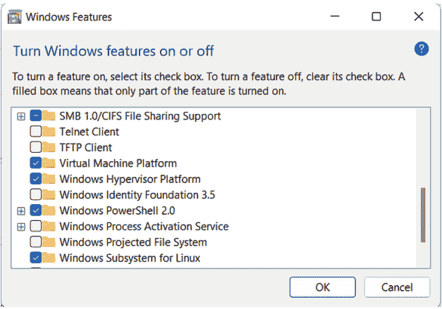
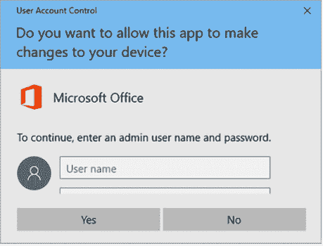

## 附录 C

## Docker 故障排除

虽然本书主要介绍 KIE 而不是 Docker，但我们确实希望提供足够的细节来让一切正常运行。*第 10 章*和本附录中的主题很简单，但已经超出了我们对 Excel 高级用户的合理预期。使用 Docker 为我们提供了运行 Business Central 并将其部署到云端的途径——这两个领域都需要一个团队，而不仅仅是个人来构建。所以，不要害怕向同事寻求帮助！

在理想情况下，你不需要阅读本附录，因为它包含在启动 Docker 时出现问题时的修复建议。我们在编写这些说明时考虑到了 Excel 高级用户——所以如果你是一位经验丰富的 Docker 开发人员，你可能希望直接阅读 Docker 指南来开始故障排除。

本附录包含三个主要部分：

+   - 准备笔记本电脑以使用 Docker
+   - 尝试运行 Docker 时对错误消息进行故障排除
+   - 有关 Docker 的更多帮助

与其他附录一样，我们将比本书正文章节更快地推进，并且我们假设你愿意根据需要自行搜索更多信息。我们无法涵盖所有可能的错误，但我们会尽力解决大多数常见错误。

作为让镜像正常工作的最后一条建议——请记住，像 *Podman* 这样的工具可以替代 Docker。虽然我们未在书中介绍它们，但如果所有其他尝试都失败了，这或许是一个替代方案。

## 为 Docker 准备笔记本电脑

在安装 Docker 之前，你可能还需要采取一些简单的步骤来准备计算机：

+   - 在幕后，Docker 将使用两种复杂技术之一来运行容器：Hyper-V 或 WSL。

+   - Hyper-V 是一种非常巧妙的技术，它允许在容器（如 Docker）中运行的软件以几乎与原生应用程序一样快的速度运行。它是硬件和**操作系统（OS）**支持的结合。
+   - **适用于 Linux 的 Windows 子系统（WSL）**允许你在 Windows 笔记本电脑上运行 Linux 操作系统（以及在其上运行的企业解决方案）的全部功能。如果这听起来与 Docker 给你的功能相似，那你的想法是对的。这两种技术使用了许多相同的组件，即使它们针对不同的目标进行了优化。
+   - Docker 选择的方法将取决于你笔记本电脑的规格。为简单起见，以下说明将逐步介绍如何在两者之间切换。

## 在 Hyper-V 和 WSL 之间切换

要在你的笔记本电脑上启用 Hyper-V 和 WSL，请执行以下操作：

+   1. 单击 Windows 键图标。
+   2. 在出现的菜单中，单击设置图标以打开设置。
+   3. 右键单击 Windows 按钮，然后选择**应用和功能**。
+   4. 在右侧的**相关设置**下，选择**程序和功能**。
+   5. 选择**启用或关闭 Windows 功能**。
+   6. 检查**Hyper-V**、**虚拟机平台**和**适用于 Linux 的 Windows 子系统**是否已启用（如屏幕截图所示）；如果没有，请勾选它们并单击**确定**。



图 AC.1 – 在你的笔记本电脑上启用 Hyper-V 和 WSL


7. 安装完成后，可能会要求你重启笔记本电脑。
8. 笔记本电脑重启后，返回 **设置** 并确保这些选项仍然被选中。

如果你愿意，微软官方关于启用 Hyper-V 的指南可在 `https://docs.microsoft.com/en-us/virtualization/hyper-v-on-windows/quick-start/enable-hyper-v` 获取。

## 故障排除 Docker – 一些显而易见的事情

大多数人不需要本书的这一节。但如果你确实需要它，那么你会放心地知道，你并不是唯一遇到这些常见问题的人：

- 检查你的笔记本电脑是否满足运行 Docker 的技术要求（笔记本电脑类型和 Windows 版本）。这些要求列在 `https://docs.docker.com/desktop/windows/install/`。如果不满足，Docker 会给出明确的错误信息。
- 在安装软件时，你可能会看到类似以下截图的弹出窗口。这意味着你的计算机受你的 IT 团队控制。这主要是好事（因为它阻止了恶意软件），但这也意味着你需要他们的支持来安装 Docker：

  

  图 AC.2 – 管理员权限对话框

- Windows Defender 有时会阻止网络和互联网访问——我们希望允许它，因为我们需要能够连接并运行我们的示例。
- 采用类似的方法，检查你是否已连接到互联网（打开一个网页浏览器）——连接中断会导致奇怪的错误。
- 如果你在安装过程中出现中断（例如，连接中断或你按错了按钮），值得卸载 Docker 并重新开始安装过程。
- 仅半开玩笑，但你是否尝试过关闭并重新打开笔记本电脑？对于以下说明的某些部分（例如，在打开 Hyper-V 和 WSL 之后），重启笔记本电脑是必需的。
- 安装 Docker 后，有时启动需要几分钟时间。检查你是否有正在运行的容器或需要暂停的内容，然后重试说明。
- 记住，本书介绍了四种不同的运行示例的方法。你可能会遇到问题（例如，你的笔记本电脑是 32 位且无法支持 Docker 或 Hyper-V），而对此没有办法。

## 故障排除 Hyper-V 和 WSL

如果为你打开 Hyper-V 和 WSL 成功了——那么可以随意跳过本节。如果没有，你可能收到错误信息，指出问题与 Windows 或硬件有关。记住，你只需要其中一个正常工作即可运行 Docker。

### Windows 相关错误信息

你的 Windows 版本可能不支持 Hyper-V。例如，它在 *Windows 10 家用版* 中不可用。你可以选择利用免费升级到 Windows 11（包括内部预览版），看起来它在允许此功能方面更宽松。有关升级到 Windows 11 的更多信息，可在此处找到：`https://www.microsoft.com/en-gb/windows/windows-11`。

你可能 *被困* 在 Windows 10 家用版且不愿为升级到 Windows 10 专业版付费。如果你的硬件支持，仍有变通方法，但你需要可能需要请求朋友或同事提供支持的技术知识。例如，以下链接中的变通方法解释了如何使用 **VMware**（一种替代虚拟化技术）在 Windows 10 家用版上运行 Docker：`https://www.freecodecamp.org/news/how-to-run-docker-on-windows-10-home-edition/`。

### 硬件相关错误信息

就硬件支持而言，好消息是最近几年销售的大多数笔记本电脑都应支持 Hyper-V。更好的消息是，严格来说，Docker 运行并不需要它。因此，即使你无法启用 Hyper-V，仍值得检查是否可以安装 Docker——但请特别注意错误信息。

然而，这些硬件相关的 Hyper-V 变通方法可能变得相当技术化。我们没有链接到这些变通方法，因为它们需要深入的技术知识——但请知晓，如果你需要并且感觉技术上足够自信来处理它们，它们可以在 Google 上找到。

## 更多关于 Docker 的帮助

如果需要更多帮助，值得查看 Docker 网站（这些链接适用于 Windows，但 macOS 和 Linux 也有同等详细的说明）：`https://docs.docker.com/desktop/windows/install/` 和 `https://docs.docker.com/desktop/windows/troubleshoot/`。

如果你不喜欢这些指南的风格，还有许多其他视频和 *如何操作* 指南可以带你完成流程：

- `https://www.systemconf.com/2020/07/05/docker-installation-on-windows-10`
- `https://www.geeksforgeeks.org/how-to-install-docker-on-macos/`
- `https://www.digitalocean.com/community/tutorials/how-to-install-and-use-docker-on-ubuntu-20-04`

还有很多社区论坛可以发布问题并寻求帮助（Docker 和第三方网站）。最后，如果你没有同事可以帮你，有很多 Docker 专家可以付费寻求支持——Freelancer.com 是我过去使用过的网站，但还有很多其他选择。

## B

- **业务规则**
  - 键格式 16, 17
  - 为机器学习（ML）准备 268, 269
  - 实际情况 17, 18
  - 规则引擎 19, 20
  - 运行 56
  - 与决策模型对比 58, 59
  - 与工作流对比 186
  - 使用 42, 43
  - 编写 46-51
- **业务规则引擎** 21
  - 选择 26, 27
- **业务规则管理体系（BRMS）** 27

## C

- **层叠样式表（CSS）** 168
- **循环规则** 322
- **分类器** 276
  - 与神经网络对比 277
- **云**
  - 部署 101, 102
- **Codespaces** 330
  - 用于自定义 Red Piranha 317-319
  - 使用 330-333
- **组合模型**
  - 执行 305
- **命令提示符** 245
- **逗号分隔值（CSV）文件** 75
- **复杂数据类型**
  - 在决策模型中使用 79, 80
- **条件格式** 19
- **冲突解决** 322
- **混淆矩阵** 297
- **控制台** 245
- **约束**
  - 用于描述数据 80-82
- **容器** 241
  - 部署到 Azure 云 264
  - 支持 Drools 40, 41
  - 支持 KIE 40, 41
  - 支持 Kogito 40, 41
- **上下文节点** 94
- **上下文** 213, 219
- **Copilot**
  - 参考链接 14
- **反事实** 305
- **国家代码** 299
- **自定义数据类型**
  - 创建 82
- **客户年龄** 299
- **客户服务流程**
  - 考虑方法 207
  - Microsoft Forms 200, 201
  - 在 Power Automate 中建模 200
  - 更新 Power Automate 流程 201-206
- **客户服务 Power Automate 流程**
  - 运行 206

## D

- **数据**
  - 用约束描述 80-82
  - 在 KIE Sandbox 中建模 76-78
  - 规则匹配 96
  - 使用 113, 114
- **使用 KIE 进行决策**
  - 业务规则 304
  - 伦理 304
  - 机器学习中的可解释性 304, 305
- **决策模型与标注（DMN）** 27, 57, 74, 212, 213, 287
- **决策模型编辑器**
  - 在 Business Central 中 254
- **问候决策模型** 64
  - 示例导入 64
  - 逐步说明 65-67
- **决策模型** 57
  - 优点 57, 58
  - 构建 223
  - 使用复杂数据类型 79, 80
  - 部署选项 265
  - 部署到 OpenShift 109-112
  - 编辑 223
  - 修复错误 61
  - 链接 225-228
  - 导入 ML 模型 289-291
  - 命名 62
  - 之前的自动保存决策模型 63
  - 与 GitHub 保存和共享 114
  - 速度考虑 321
  - 测试项目探索和构建 309
  - 从源上传 63
  - 与业务规则对比 58, 59
  - 与工作流对比 58
- **决策节点** 83, 90, 91
  - 类型 88-90
  - 使用 87
- **决策模式** 224
- **决策服务** 200
  - 通过 Office 脚本在流程中避免调用 207
  - 通过 Power Query 调用 139
  - 通过 VBA 调用 159, 160
  - 创建 Power Automate 流程以调用 195-199
  - 使用 74
- **使用 VBA 调用决策服务**
  - 示例扩展 163
  - 发送 JSON 调用 161, 162
  - 修复项目引用 163, 164
  - 运行 Excel 宏时的安全检查 160
- **决策表** 83-87, 299
  - 示例 97-99
  - 运行函数 93, 94
  - 首选解决方案 87
  - 在 KIE Sandbox 中 83-86
  - 添加节点以支持 91-93
  - 更新版本 95, 96
  - 与单个 DRL 规则对比 320
- **决策树** 285-299
- **设计模式** 224
- **桌面流程** 190
- **开发者**
  - 与之协作 37
- **开发者沙盒** 103
- **Docker**
  - 在 Docker 中运行 Business Central 规则编辑器 247, 248
  - 运行 Hello World 镜像 246, 247
  - 安装 242
  - 准备笔记本电脑 341, 342
  - 故障排除 343
- **Docker Compose** 260
  - 运行 Business Central 和 KIE Server 260-263
- **Docker 容器** 239
- **Docker Desktop** 245
  - 下载 242
  - 主屏幕 244, 245
  - 安装 242
  - 启动 243
- **Docker Hub** 246
  - 准备账户 242
- **Docker 网站**
  - 参考链接 345
- **领域特定语言（DSL）** 320


# Drools 27

选择，作为规则引擎 28
URL 27

**动态上下文** 219, 220
**动态列表** 214-216

# E

**企业软件架构师**
  职责 38-40
**企业解决方案** 6
  构建 37
  设计 37
  示例 7
  与 Excel 对比 8

**Excel**
  避免，作为规则引擎使用 20
  业务 4
  业务专家 8
  编码 8
  知识 8, 9
  在中安装 Microsoft Script Lab 164, 165
  需要 3
  神经网络，实现 301, 302
  问题 4
  解决方案 5, 6, 23
  分割 22, 23
  技术专家 8
  测试用例 232
  与企业解决方案对比 8
**Excel，链接决策服务**
  方法 181
**Excel 模型数据**
  形状 74-76
**Excel 输出表**
  准备 196
**Excel，到本地 KIE 沙箱**
  连接，注意事项 102
**执行单元格按钮** 275

# F

**前馈感知器** 302
**FEEL 表达式**
  用于操作列表 216
**FEEL 函数** 222
**FEEL 语言** 212, 213
  日期和时间函数 214
**FEEL 字面量** 213
**过滤** 219
**流程** 187
**流程类型** 190
**足够友好的表达式语言 (FEEL)** 51, 83

# G

**通用数据保护条例 (GDPR)** 113
**GET 请求** 132
**GitHub**
  模型，直接从导入 125
  个人主页 115-118
  注册 114
  令牌，获取 114
  令牌 118
  令牌，用于在 KIE 沙箱上协作 118-120
  用于保存和共享决策模型 114
**GitHub 流程**
  用于保存和项目协作 120-122
**GitHub 流程，用于项目协作**
  仓库，共享 123
  工作流 124, 125
**梯度下降** 302
**图形化上下文** 220-222

k-最近邻 301
知识即一切 (KIE) 27
  优势 29, 31
  资源 35, 36
  选择，作为规则引擎 28
  URL 27
  用于简单协作工作流 125
  用于简单单人工作流 124
Kogito 27
  URL 27
Kogito 业务自动化 209, 210
Kogito/Drools 项目
  资源 35, 36
Kogito/Drools 规则引擎 40
Kogito 场景示例
  使用 338, 339
L
Lambda 函数 217
笔记本电脑
  为 Docker 准备 341, 342
  运行 VSCode 339
LIME 305
列表
  使用 FEEL 表达式操作 216
字面量表达式 215
M
机器学习算法 297
  参考链接 276
机器学习 (ML) 13
  在 Business Central 中执行 310
  图形化方法 269
  在 Power Automate 流程中集成 310, 311
  神经网络 300
预构建工具包 269
使用业务规则准备 268, 269
机器学习 (ML) 业务规则
  在决策服务中组合 288
  部署 286, 287
机器学习 (ML) 模型
  从 Power Automate 调用 311-313
  执行 305
可机器读取的网页
  使用 REST 130
宏 325-328
映射 213
Microsoft Excel
  链接到 AI 128
  链接到业务规则 128
  链接到决策模型 128
  链接到 Excel 128
  先决条件 127, 128
Microsoft Forms 200, 201
  URL 200
Microsoft Power Automate 130, 187
  客户服务流程建模 200
  需要，选择作为工作流工具 187
  先决条件 184
Microsoft Script Lab 164, 165
  自定义函数 176
  从中调用决策服务 172-176
  Hello World 170, 171
  在 Excel 中安装 165, 166
  导航 167-169
  在中保存项目 169
  脚本导入 169, 170
ML 模型
  导入到决策模型 289-291
ML Studio 277

# N

**朴素贝叶斯** 276
**命名范围** 145, 313
**自然语言处理** 14
**神经网络** 303
  在 Excel 中实现 301, 302
  在机器学习中 300
  训练 302
  训练，工具 303
  与分类器对比 277
**笔记本** 274-276

# O

**对象管理组 (OMG) 格式**
  参考链接 58
**对象模型组 (OMG)** 91
**Office.js** 165
**Office Scripts** 129, 130, 176, 207
  从中调用决策服务 179, 181
  缺点 177
  环境 177, 178
  与 Script Lab 对比 176
**在线巧克力商店**
  从中查看销售数据 269-274
**开放容器计划**
  URL 41
**OpenShift** 102
  部署决策模型到 109-112
  实例，与 KIE 沙箱链接 106-108
  链接信息，组成部分 105, 106
**OpenShift 开发者沙箱**
  访问 105
  重要说明 112, 113
  注册 103, 104
**开源** 29, 30
  优势 30

IT 帮助台，支持 31-34
安全 31
**操作系统 (OS)** 342
**OptaPlanner** 28
**过拟合** 286
**重叠** 299

# P

**PHREAK 算法**
  用于快速运行规则引擎 321, 322
**PMML** 287
**POST 请求** 132
**Power Automate**
  从中调用机器学习模型 311, 313
  URL 187
**Power Automate Desktop** 208, 209
**Power Automate 流程** 189
  其他选项 195
  构建 189-194
  创建，用于调用决策服务 195-199
  Excel 输出表，准备 196
  集成机器学习 310, 311
  集成规则模型 310, 311
  运行更新示例 199, 200
  更新 201-206
**Power Automate 在线**
  使用 187-189
**Power FX** 222
  参考链接 222
**Power Query** 130
  使用高级编辑器 145
  调用带参数的决策服务 150-154
  使用 M 语言 145
  使用 M 语言引用命名范围 145-147

# Index

需要 154
传递参数 144
在 Excel 中使用 REST 数据 142-144
REST 示例 139-141
安全检查 141
用于调用决策服务 139
用于从 Excel 调用决策服务 147-150

**预测**
  类型 286
**流程顾问** 190
**生产** 30
**产品推荐服务**
  探索 135, 136
**项目经理**
  与之协作 38
**概念验证阶段** 30
**Python** 274-276
  在笔记本中使用 276

# R

**范围** 217
**阅读精彩手册 (RTFM)** 33
**Red Hat** 29
**Red Hat Decision Manager** 28
**Red Hat OpenShift** 263
**Red Piranha**
  作为模板企业项目 313
  使用 Codespaces 和 VS Code 自定义
    317-319
  文件，运行 317
  版本 317
**Red Piranha Docker 镜像**
  运行 313-317
**关系** 213-219
**表述性状态转移 (REST)** 130
  示例 130, 131

GET 请求 132
POST 请求 132
参考链接 130
用于可机器读取的网页 130
**RETE 算法**
  用于快速运行规则引擎 321, 322
**规则引擎** 19
  Drools，选择 28
  KIE，选择 28
  使用 RETE 和 PHREAK 方法快速运行 321, 322
  速度，考虑 320, 321
**规则模型**
  在 Business Central 中执行 310
  在 Power Automate 中集成
    流程 310, 311
**作为表运行** 231

# S

**销售数据**
  从在线巧克力
    商店查看 269-274
**显著性** 320
**场景模拟工具** 239
**场景测试**
  在 VSCode 中设置 333-336
**计划云流程** 190
**脚本编写** 186
**Script Lab** 129, 130
  与 Office Scripts 对比 176
**Scrum** 230
**搜索精彩网络 (STFW)** 33
**Shapley 加性解释 (SHAP)** 305
**单个 DRL 规则**
  与决策表对比 320
**软件架构师**
  与之协作 37

# T

**状态机** 320
**存储层** 39
**支持向量机** 301
**Surefire 报告文件** 309
**Swagger** 132-135
  探索产品推荐服务 135, 136
  服务端点和内容 136, 137
**系统或云管理员**
  与之协作 38

**模板企业项目**
  Red Piranha 作为 313
**终端** 245
**测试用例**
  使用 Excel 232
**测试驱动开发** 230
**测试人员**
  与之协作 37
**工具**
  用于绘制图表 272
**TrustyAI 工具** 305
  技术 305
**真值维护** 15, 322
**类型** 60

# U

**单元测试** 230
**用户类别**
  业务用户 26
  业务用户，加入现有规则项目 26
  个人使用或探索 26
**用户界面层** 38

**用户界面专家**
  与之协作 37

# V

**变量** 60
**Visual Basic for Applications (VBA)** 6, 129, 325-328
  用于调用决策服务 159, 160
**VMware** 344
**VSCode** 233, 234
  高级 DRL 规则 319, 320
  在笔记本电脑上运行 339
  场景模拟编辑器 234, 235
  场景测试，执行 336, 337
  场景测试，设置 333-336
  用于自定义 Red Piranha 317-319
  用于运行 KIE 机器学习示例 306-309
  与 KIE 沙箱对比 307
  使用 330-333
**VSCode.Dev** 330
**VSCode 在线**
  脚本，测试 312

# W

**Windows 子系统 for Linux (WSL)** 342
  故障排除 344
**工作流** 58, 185, 186
  与业务规则对比 186
**工作内存** 321
**WSL，故障排除**
  硬件相关错误消息 344
  Windows 相关错误消息 344


## 你可能喜欢的其他书籍

如果你喜欢这本书，你可能也会对 Packt 出版的以下其他书籍感兴趣：


### 探索 Microsoft Excel 的隐藏宝藏

David Ringstrom

ISBN: 978-1-80324-394-8

- 探索隐藏且被忽视的功能，节省你的时间
- 实施灾难预防和恢复技术
- 提高所有用户的电子表格可访问性
- 增强数据完整性和电子表格韧性
- 使用 LAMBDA 创建无需代码的自定义工作表函数
- 使用 Power Query 创建无需代码的报表自动化
- 轻松集成电子表格自动化技术


### VBA Automation for Excel 2019 Cookbook

Mike Van Niekerk

ISBN: 978-1-78961-003-1

- 了解 VBA 编程语言在 MS Office 套件中的作用
- 发现 VBA 编程的各个方面，如其术语、语法、过程、函数和表单
- 调查 VBA 编辑器的元素、功能和特征，以编写和编辑自定义脚本
- 利用范围自动化 Excel 工作表
- 探索错误处理和调试技术以捕捉程序中的错误
- 创建并使用自定义对话框从用户收集数据
- 自定义和扩展 Office 应用，如 Excel、PowerPoint 和 Word

## Packt 正在寻找像你这样的作者

如果你有兴趣成为 Packt 的作者，请访问 authors.packtpub.com 并立即申请。我们已与成千上万的开发者和技术专业人士合作，就像你一样，帮助他们与全球技术社区分享他们的见解。你可以提交通用申请、申请我们正在招聘作者的特定热门主题，或提交你自己的想法。

## 分享你的想法

现在你已经读完了 *AI and Business Rule Engines for Excel Power Users*，我们很想听听你的想法！如果你是在 Amazon 购买的这本书，请点击这里直接前往该书在 Amazon 的评论页面并分享你的反馈，或在你购买的网站上留下评论。

你的评论对我们和技术社区都很重要，将帮助我们确保提供优质的内容。

## 下载本书的免费 PDF 副本

感谢你购买本书！

你喜欢随时随地阅读，但又无法随身携带印刷书籍吗？你的电子书购买与你选择的设备不兼容？

不用担心，现在每本 Packt 书籍都免费提供一本无 DRM 的 PDF 版本。

在任何地方、任何地点、在任何设备上阅读。直接从你喜爱的 technical 书籍中搜索、复制和粘贴代码到你的应用程序中。

福利还不止于此，你可以每天通过电子邮件获得独家折扣、新闻通讯和精彩的免费内容

按照以下简单步骤获取福利：

- 1. 扫描二维码或访问下面的链接
- 2. 提交你的购买证明
- 3. 就这样！我们会直接将你的免费 PDF 和其他福利发送到你的电子邮件


```
https://packt.link/free-ebook/9781804619544
```
