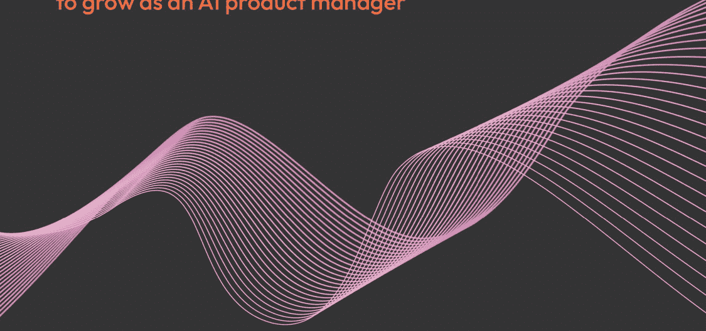

# AI 产品经理手册 - 第二版：构建、集成、扩展并优化产品以成长为 AI 产品经理

## 贡献者

## 关于作者

Irene Bratsis 目前负责 Presage 的产品工作，这是一家总部位于纽约的制作公司和杂志；同时她也是独立顾问，最近曾担任国际 WELL 建筑研究院（IWBI）数字产品与数据总监。她拥有西蒙斯大学经济学与国际关系学士学位。Irene 还完成了麻省理工学院 xPRO 的大数据与分析证书课程，并参加了 Thinkful 的密集型数据科学项目。

在加入 IWBI 之前，她曾在特斯拉担任运营分析师，在 Gesture 担任数据科学家，在 Beekin 担任数据产品经理，并在 Tenacity 领导产品工作。Irene 曾担任“数据女性”（Women in Data）纽约分会的联席负责人，目前负责组织并主持 WaiTalks——由“AI 女性”（Women in AI）组织的在线系列讲座。作为 Trusted AI 的创始成员，Irene 为 Data Driven Investor、Analytics Vidhya、Towards Data Science 等知名媒体撰写文章，也活跃于自己的 Medium 和 LinkedIn 主页。Irene 现居纽约。

## 关于审稿人

**Josh Atlas** 是一位经验丰富的产品管理领导者，拥有超过 15 年经验，涵盖金融科技、电子商务、AI/ML 和数字营销。他在推动产品创新和运营效率方面拥有良好的业绩记录，为 Meta、Google Nest、Walmart 等全球组织以及 Vivid Labs 等初创公司提供了有影响力的解决方案。他的专长包括领导跨职能团队、应对复杂挑战，以及构建以客户为中心的产品，包括 AI 驱动工具和下一代 NFT 应用。

除了传统产品管理工作外，Josh 还设计并构建了先进的 AI 智能体，包括 Josh-GPT——一个数字孪生，作为其专业知识和经验的交互式延伸，体现了他对生成式 AI 和对话技术创新的深度投入。他的贡献还延伸到多个变革性项目，例如缩短 GoodLeap 的贷款生产周期、在 Meta 推出“一键徽章创建系统”，以及设计面向太阳能采用的客户导向 AI 聊天机器人。

Josh 热衷于利用数据、协作和设计思维来创造解决现实问题的产品，同时促进团队和利益相关者之间的战略协调。

> 我想向我的妻子表达衷心的感谢，感谢她的耐心和坚定不移的支持，这是我成功的基石。你的鼓励和对我的信任支撑我走过了每一个挑战和成就。感谢我的家人和朋友，感谢你们持续的灵感和爱——没有你们，我不可能做到这些。

## 加入我们的 Discord

与其他读者、AI 专家和作者本人一起阅读本书。

提问、为其他读者提供解决方案、通过“问我任何事”（Ask Me Anything）环节与作者交流，以及更多互动。

扫描二维码或访问链接加入社区。

https://packt.link/aipm

机器学习 • 208  
可解释性 • 209  

## 明智地选择你的优先事项 ..... 211  
确保清晰 • 212  
增加复杂性 • 214  
品牌建设 • 216  

## 你在讲什么故事？ ..... 217  
设定场景 • 219  
角色 • 219  
情节推进 • 219  
知识 • 220  
行动号召 • 220  

## 案例研究 ..... 221  
## 总结 ..... 224  
## 参考文献 ..... 224  
