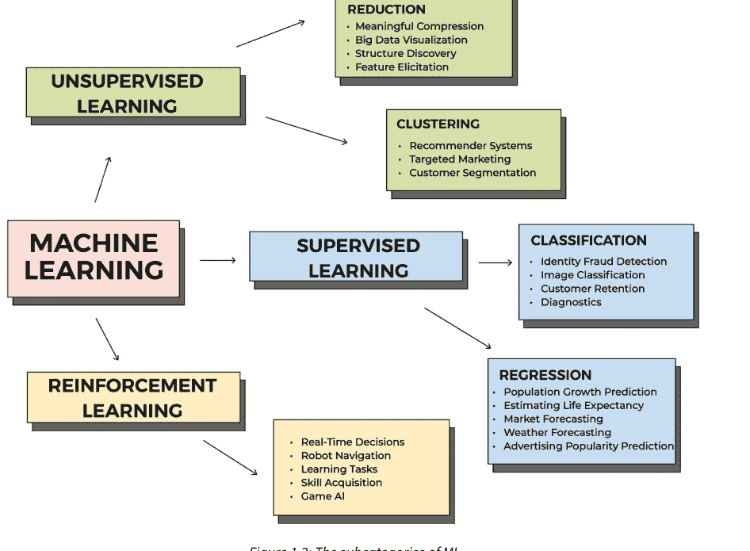
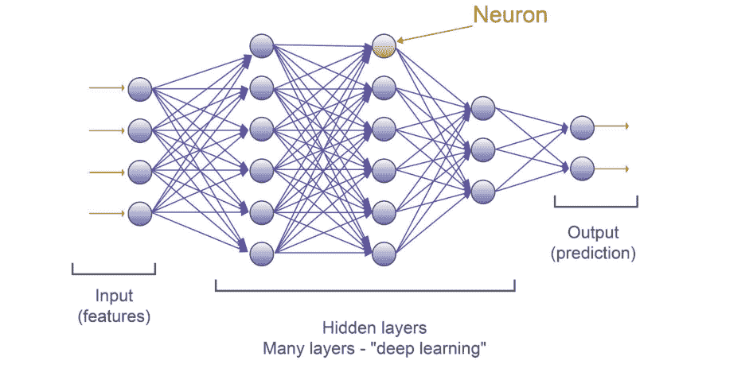
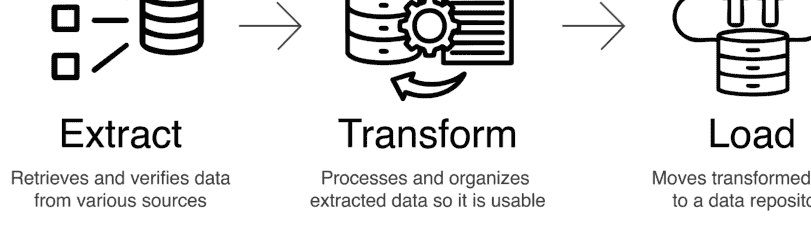
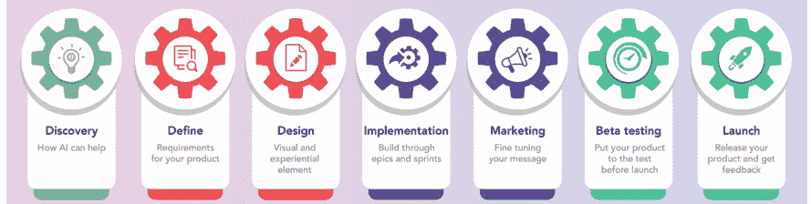

## 第18章：成为优秀AI PM意味着什么？ 397  
## 一个多角色的职位族 398  
技术熟练度 • 398  
技术专家 • 399  

## 本书面向的读者

本书面向有志成为AI产品经理、AI技术专家和创业者的人，也适合那些对将AI产品变为现实的相关考虑感兴趣的人。如果你已经在从事产品管理工作，并对构建AI产品有好奇心，本书将对你有所帮助。如果你已经以某种身份从事AI开发工作，并希望将这些概念引入产品管理领域、承担更偏向业务的角色，本书同样适合你。尽管书中有些章节更偏技术，但所有技术内容都可视为入门级，人人都能理解。

本书的第1部分旨在概述AI领域的整体格局、该领域中可能存在的产品类型，并纵览整个行业。第2部分将提供更多关于AI原生工具产品管理的实用、应用型内容。第3部分延续这一格式，但重点是将传统软件产品转型为AI产品。在这两个部分中，你会看到更多适合手册使用的图表、流程图、清单和可视化辅助材料。最后，第4部分作为本书的最新部分，将聚焦于AI职业本身的管理，作为一份帮助你在PM角色中成长并探索发展路径的手册。

## 本书涵盖内容

第1章《理解构建AI产品的基础设施与工具》概述了管理AI产品的基础设施的主要概念和领域。

第2章《AI产品的模型开发与维护》深入探讨了模型开发与维护的细微差别。

第3章《机器学习和深度学习深度剖析》更广泛地讨论了传统深度学习和深度学习算法之间的差异及其用例。

第4章《AI产品的商业化》讨论了我们在市场上看到的AI产品的主要领域，以及有助于商业化的伦理和成功因素的示例。

第5章《AI转型及其对产品管理的影响》探讨了未来AI如何融入主要市场领域。

第6章《理解AI原生产品》概述了推动AI原生产品成功所需的战略、流程和团队建设。

第7章《将ML服务产品化》探索了从零开始构建AI产品时可能遇到的艰辛与考验。

第8章《面向垂直行业、客户和同行群体的定制化》讨论了AI产品如何随着不同类型的垂直行业、客户类型和同行群体而变化和演进。


*第 11 章《管理 AI 原生产品》*回顾了与领导力和愿景、以及以 AI 原生方式构建的产品利益相关者和运营对齐相关的持续 AI 产品经理考量。

*第 12 章《AI 的涨潮》*重新审视了第四次工业革命的概念以及针对目前尚未利用 AI 的产品的蓝图。

*第 13 章《行业趋势与洞察》*深入探讨了我们看到的 AI 在各行业中的各种发展趋势，以及产品团队在实现 AI 时可以采取的可及路径

*第 14 章《将产品演进为 AI 产品》*是关于如何交付 AI 功能并升级产品的现有逻辑以成功实现 AI 商业成功的实用指南。

*第 15 章《AI 产品设计的角色》*重新聚焦应用于产品团队的 AI 设计和沟通基础，这些团队希望通过 AI/ML 功能演进传统软件产品。

*第 16 章《管理不断演进的 AI 产品》*回顾了与领导力和愿景、以及采用 AI 功能和能力的传统软件产品的利益相关者和运营对齐相关的持续 AI 产品经理考量。

*第 17 章《开启 AI 产品经理职业生涯》*带领渴望从事 AI 产品经理职业的读者经历理论和应用基础的旅程，以为其萌芽的职业生涯奠定成功基础。

*第 18 章《成为一名优秀的 AI 产品经理意味着什么？》*分解了 AI 产品经理的各个方面，以及希望在该角色中脱颖而出的人在技术、业务、沟通、领导力和问题解决方面的考量。

*第 19 章《作为 AI 产品经理的成熟与成长》*探讨了 AI 产品经理可以通过规划理想的 AI 产品经理路线图、通过学习路径保持信息更新、建立网络以加深联系以及与他人分享经验和智慧来在职业生涯中成熟的各种方式。

## 下载彩色图像

我们还提供了一份包含本书中使用的屏幕截图/图表彩色图像的 PDF 文件。您可以在此处下载：https://packt.link/gbp/9781835882849。

## 使用的惯例

本书中使用了多种文本惯例。

CodeInText: 表示文本中的代码词、数据库表名、文件夹名、文件名、文件扩展名、路径名、虚拟 URL、用户输入和 Twitter 账号。例如：“One of our hyperparameters for this random forest example was setting our cross-validation to 10.

**粗体：**表示新术语、重要词语或您在屏幕上看到的词语。例如，菜单或对话框中的词语在文本中以这种方式出现。例如：“This phenomenon is called **overfitting** and it’s a big topic of conversation in data science and ML circles.”

## 留下评论！

感谢您从 Packt Publishing 购买本书——我们希望您喜欢它！您的反馈对我们改进和成长至关重要。一旦您完成阅读，请花一点时间在亚马逊上留下评论；这只需要一分钟，但对像您这样的读者来说意义重大。

扫描下面的二维码即可获得您选择的免费电子书。


https://packt.link/Nz0WQ

## 下载本书的免费 PDF 副本

感谢您购买本书！

您喜欢随时阅读但无法随身携带印刷书籍吗？

您的电子书购买与您选择的设备不兼容？

不用担心，现在每本 Packt 书籍都免费附带一份无 DRM 的 PDF 版本。

在任何地方、任何地点、在任何设备上阅读。直接从您喜爱的 technical 书籍中搜索、复制和粘贴代码到您的应用程序中。

福利还不止于此，您可以获得独家折扣、新闻通讯以及每日发送到您邮箱的精彩免费内容。

按照以下简单步骤获取福利：

+   1. 扫描二维码或访问以下链接：


https://packt.link/free-ebook/9781835882849

+   2. 提交您的购买证明。

+   3. 就这样！我们会直接将您的免费 PDF 和其他福利发送到您的电子邮件。

## 1

## 了解构建 AI 产品的的基础设施和工具

人工智能产品的前沿看起来很像我们的宇宙：不断扩张。随着我们更深入地以新的方式概念化我们所参与的产品、组织和行业，每年扩张的速度都在加快。奠定坚实的基础是理解这一转型的必不可少的一部分，这也是本书的目标。由于我们生活的几乎每个方面都预计会以某种方式受到 AI 的影响，我们希望您在经历这一过程后，对 AI 采用将如何影响您支持的产品或希望有一天构建的产品更有信心。

本书的第一部分将作为全景概览。我们将涵盖术语、基础设施、AI 算法类型以及做得好的产品，到本部分结束时，您将了解在尝试构建 AI 策略时需要考虑的各种因素，无论您是希望创建原生 AI 产品还是为现有产品添加 AI 功能。我们将在第一部分介绍理论概念，并将在第二部分和第三部分用于更实用的内容，在那里我们将更具体地看到这些理论概念的应用。在第四部分，我们将讨论您如何构建和发展您的 AI 产品经理职业生涯。

管理 AI 产品是一个高度迭代的过程，产品经理的工作是帮助您的组织发现基础设施、培训和部署工作流程的最佳组合，以在目标市场中最大化成功。AI 产品的性能和成功在于理解管理 AI 管道的所需基础设施，其输出随后将被集成到产品中。在本章中，我们将涵盖从数据库到部署策略再到您可以用来管理 AI 项目的工具的一切，以及如何衡量产品的有效性。

本章将作为第一部分后续章节的高层次概述，但首先它将提供术语的定义，这在当今营销主导的 AI 竞争格局中往往很难获得。这些天，感觉每个产品都是 AI 产品，营销部门对这个术语的使用毫不犹豫，使其几乎毫无用处。我想写这本书的一个重要原因是我自己在希望尝试理解各种“AI”产品时在竞争格局中导航的挑战。

我觉得如果我在使用 AI 时难以理解市场上产品的构建方式，鉴于我对机器学习的熟悉，那么其他人又有什么希望呢？我怀疑这在短期内不会改变，但消费者和客户对 AI 的能力和具体细节的流利度越高，**机器学习 (ML)**、**深度学习 (DL)** 和数据科学，我们就越应该看到关于产品如何构建和优化的清晰度。了解 AI 的背景对于任何考虑构建或支持 AI 产品的人都很重要。

在本章中，我们将涵盖以下主题：

+   - 定义 – AI 是什么以及不是什么
+   - 旧的 – 探索 ML
+   - 新的 – 探索 DL
+   - ML 与 DL – 理解差异
+   - ML 中的学习范式
+   - 顺序 – 最优流程是什么以及流程的每个部分位于何处？
+   - DB 101 – 数据库、仓库、数据湖和湖仓
+   - 管理项目 – IaaS
+   - 部署策略 – 我们对这些输出做什么？
+   - AI 中的成功 – 管理良好的 AI 公司如何正确处理基础设施
+   - AI 的承诺 – AI 将带我们走向何方？

## 定义 — AI 是什么以及不是什么

1950 年，一位数学家和第二次世界大战英雄 Alan Turing 在他的论文 *Computing Machinery and Intelligence* 中提出了一个简单的问题，这个问题是，*机器能思考吗？* 今天，我们仍在努力解决同一个问题。也许现在更甚，因为我们拥有像 ChatGPT 和 Claude 这样易于访问、功能强大的 **大型语言模型 (LLMs)** 来模糊界限。视你问谁而定，AI 可以是许多东西。互联网上存在许多地图来定义 AI 的广泛类别，从医疗保健和金融中使用的专家系统到更简单的 ML 形式再到像神经网络这样更先进的模型。随着我们继续本章，我们将涵盖 AI 的许多方面，特别是那些适用于当今市场上出现的产品的方面。就跨行业产品中应用的 AI 而言，在本书中，我们将主要关注 ML 和 DL 模型的各种应用，因为这些通常在任何营销中使用 AI 时在生产中使用。我们将使用 AI/ML 作为涵盖 ML 应用范围的统称，我们将涵盖大多数人会认为的 ML 的主要领域，例如 DL、计算机视觉、自然语言处理和人脸识别。这些是大多数人在行业中会遇到的应用 AI 的方法，熟悉这些应用将服务于任何希望进入 AI 的产品经理。如果可以的话，我们希望帮助任何希望从另一个产品管理背景扩展到该领域的人选择最吸引他们的 AI 领域。


首先，让我们看看什么是机器学习，什么不是机器学习。我们能表达得尽可能简单的方式是：如果一台机器从过去的行为中学习，并且由于这种学习，其成功率有所提高，那就是机器学习！学习是主动的元素。没有模型是完美的，但我们确实从使用模型中学到了很多。大多数模型都会有一些超参数调优的元素，但所有模型在训练过程中都会有学习的参数。每个模型的使用都会产生一定的性能结果，数据科学家和机器学习工程师会用这些结果来衡量性能并加以改进。

如果存在固定不变的硬编码规则，那就不是机器学习。人工智能是计算机科学的一个领域，而所有程序员本质上都在做同样的事情：给计算机提供一套指令让其执行。如果你的当前程序在任何方面都不会从过去学习，而只是按照硬编码的指令执行，我们就不能称之为机器学习。相反，你可能在其他程序中听说过 *规则引擎* 或 *专家系统* 这样的术语。它们被视为人工智能的一种形式，但它们不是机器学习，因为虽然它们是人工智能的一种形式，但规则本质上是在复制人的工作，而系统本身并不会自行学习或改变。

我们正处于人工智能采用的棘手时期，很难在网上找到关于什么构成了人工智能产品的信息。营销部门急于给产品贴上人工智能标签，但市场上仍然没有一个基准来解释这意味着什么。这进一步让消费者和技术人员都对人工智能这个术语感到困惑。如果你对这些术语感到困惑，特别是当它们被应用到你在网上看到的推广产品时，你绝对不是一个人。

另一个令人困惑的领域是人工智能这个通用术语。对大多数人来说，人工智能的概念让人想起 1980 年代的 *终结者* 系列、2013 年的电影 *Her* 中失控的操作系统，以及其他关于不可避免的技术毁灭的未来主义描绘。虽然我们今天使用的 AI 确实可能带来很多伤害，但上述电影中的描绘代表的是被称为 *强人工智能* 或 *通用人工智能* 的概念。AGI 是一种理论化的、潜在的未来人工智能状态，在这种状态下，机器可以在没有任何人工监督或干预的情况下执行高价值的经济任务。我们距离 AGI 这样先进的东西还有一段路要走，但我们已经拥有了被称为 *人工狭窄智能* 或狭窄人工智能 的东西。

ANI 也常被称为 *弱人工智能*，这就是你在网上看到的产品上贴满“AI”一词时通常所指的意思。ANI 正如其名所示：人工智能的狭窄应用。也许它擅长与你交谈、预测某些未来价值，或整理事物；也许它在这些方面是专家，但其专业知识不会渗透到其他领域。例如，GPT-4 是一种为最广为人知的对话式人工智能之一 ChatGPT 提供动力的模型，它可能具有先进的理解和对话能力，但它不能进行脊柱手术。如果它能做到这一点，它就不再是 ANI 了。这些人工智能的主要领域在与人类智能相比时被称为“强”和“弱”。

但即使这也可能是一个有争议的观点。微软研究团队于 2023 年 4 月发表了一篇论文，详细介绍了他们对 GPT-4 及其接近 AGI 的程度的探索，题为 *Sparks of artificial general intelligence: Early experiments with GPT-4*。

- 第一个群体与通过统计模型不断进步的模型的出现有关。
- 第二个群体与试图模仿我们自身自然神经智能的模型的出现有关。

口语上，这些分别被称为传统机器学习和深度学习模型。在本节中，我们将研究传统的统计机器学习模型，以便了解机器学习模型的历史相关性和普及程度。一些最可靠和最流行的机器学习模型已经存在了很长时间。**线性回归**模型可以追溯到 1800 年代末，并通过英国数学家卡尔·皮尔逊和弗朗西斯·高尔顿爵士的工作而流行起来。他们的贡献催生了今天使用最广泛的机器学习算法之一，尽管不幸的是，两人都是著名的优生学家。卡尔·皮尔逊还被认为在 1901 年发明了**主成分分析**，这是一种减少数据集中维度的方法。


在数据集的上下文中，维度是你用来描述和分析数据的类别或变量。可以把它们想象成“标签”或“属性”，为数据集中包含的元素提供上下文。例如，客户数据库可能包括年龄、性别和位置等维度

一种流行的机器学习方法，**朴素贝叶斯分类器**，在 1960 年代出现，但它们基于英国统计学家托马斯·贝叶斯的工作及其条件概率定理，该定理来自 1700 年代。逻辑函数由比利时数学家皮埃尔·弗朗索瓦·维尔休斯特在 1800 年代中期引入，而**逻辑回归**模型由英国统计学家大卫·考克斯于 1958 年推广。

一种用于分类和回归的最简单机器学习模型之一，**KNN 算法**，源于 1951 年统计学家埃velyn Fix 和 Joseph Lawson Hodges Jr. 代表美国武装部队与伯克利大学合作完成的技术分析报告。K-means 聚类，一种机器学习聚类方法，最早由 UCLA 的数学家 James MacQueen 于 1967 年提出。正如你所见，今天在机器学习模型中最常用的许多算法的根源可以追溯到我们现代历史的很早之前。它们的简洁性和优雅性增加了它们今天的相关性。

## 深度学习的简史

1943 年，Warren S. McCulloch 和 Walter Pitts 发表了一篇论文，*A logical calculus of the ideas immanent in nervous activity*，通过创建一个基于我们大脑中固有的神经网络的计算机模型，将数学与神经学联系起来，该模型基于算法的组合来创建一个“阈值”，以模仿我们如何通过自身的生物神经元网络传递信息。然后，在 1958 年，Frank Rosenblatt 发表了一篇论文，被广泛认为是神经网络的祖先，名为 *The Perceptron: A Perceiving and recognizing automaton*。这在本质上是第一个、最简单、最古老的 ANN。

然后，在 1997 年，Sepp Hochreiter 和 Jürgen Schmidhuber 发表了他们的开创性工作，题为 *Long Short-Term Memory*，这有效地使深度学习能够“解决以前的循环网络算法从未解决过的复杂的人工长时滞任务”。这一发展之所以如此重要，是因为它使序列的概念对于深度学习问题保持相关性。由于神经网络涉及隐藏层，很难让时间的概念保持相关性，这使得许多问题难以解决。例如，传统的循环神经网络可能无法像 **长短期记忆** 那样自动完成句子，因为它不理解完成句子所涉及的时间序列。

今天，大多数深度学习模型需要大量的数据，这意味着为深度学习提供动力的神经网络需要大量的示例来理解某物例如是狗还是马。如果你仔细想想，这实际上与我们大脑的工作方式关系不大。一个刚刚出现并学习关于世界的幼儿可能只需要提醒一两次狗和马的区别，但你可能不会提醒他们这种区别数千或数百万次。在这种意义上，深度学习正在朝着需要越来越少的示例来学习的方向发展。当然，如今我们能够为深度学习模型收集大量的数据，但模型本身也在不断发展，以在不需要太多数据的情况下改进，最终目标是能够用少量数据训练的深度学习模型。

到目前为止，我们已经介绍了塑造机器学习和更具体地说是深度学习领域的某些历史和影响。虽然我们还没有深入探讨太多技术概念，但这为我们提供了一个良好的基础，以便了解机器学习和深度学习如何随着时间的推移而发展，以及为什么它们变得如此突出。在下一节中，我们将更深入地实践，更好地理解深度学习。

## 新的——探索深度学习

我们在本书中概念上将机器学习和深度学习分开的部分意图，实际上是为了在你的脑海中建立对这些概念的关联。对于该领域的绝大多数技术人员来说，当你看到产品描述为机器学习或深度学习时，会出现特定的模型和算法。这里快速提醒一下，深度学习是机器学习的一个子集。如果你对这两个术语感到困惑，只需记住深度学习是机器学习的一种形式，它已经发展和演变形成了自己的生态系统。我们的目标是尽可能地揭开这个生态系统的神秘面纱，以便你作为产品经理能够自信地理解深度学习产品中存在的动态。

深度学习的基础思想围绕着我们自身的生物神经网络，深度学习使用通常是 ANN 的总称来解决复杂问题。正如我们将在下一节中看到的那样，深度学习中形成的生态系统很大程度上受到了我们自身大脑的启发，而“原始”神经网络就存在于大脑中。这种灵感不仅来自人类大脑的功能，特别是通过示例学习的概念，也来自其结构。


由于这并不是一本面向深度学习（DL）工程师的过度技术性书籍，我们将避免深入探讨与深度学习相关的术语和数学知识。不过，对人工神经网络（ANN）有一个基本了解将会很有帮助。在我们阅读本节时，请记住，神经网络由人工神经元或节点组成，这些节点在层中彼此相邻堆叠。通常有三种类型的层：

- 输入层
- 隐藏层
- 输出层

虽然我们将介绍各种类型的人工神经网络，但这些深度学习算法的工作原理有一些基础知识需要掌握。要从层和节点的角度来思考。本质上，数据通过每一层的每个节点传递，基本思想是每个节点和层都有权重和偏置在传递。人工神经网络通过处理训练数据，得出最有助于解决当前问题的模式。一个至少有三层的人工神经网络（即输入层、输出层以及至少一个隐藏层）就足够“深”，可以被归类为深度学习算法。

这就解决了层的问题，但节点呢？最简单的模型之一（我们将在本章后面详细讨论）是线性回归模型。你可以把每个节点看作一个微型线性回归模型，因为这就是人工神经网络中每个节点内部发生的计算。除此之外，每个节点所做的不仅仅是线性回归计算，它还会对结果应用一个非线性激活函数。这个激活函数将非线性引入模型，使人工神经网络能够捕捉到线性回归无法捕捉的数据中的复杂模式和关系。每个节点都有自己的数据、该数据的权重，以及用于衡量的偏置或参数，最终得出一个输出。所有这些节点大规模执行这些计算，其综合效果让你对人工神经网络的工作方式有所了解。如果你能想象一个有数百层的大规模网络，每一层内都有许多节点，你就开始能够理解为什么人工神经网络得出某些结论会是难以理解的。

深度学习通常被称为黑盒技术，这正触及了其背后的核心原因。凭借我们的数学能力，人类可以解释为什么一个简单的线性回归模型中会出现特定的错误率或损失函数。我们可以概念化一个拟合曲线的模型可能出错的方式。当我们向模型展示真实世界的数据时，我们也能理解它所面临的挑战，因为这些数据不会呈现完美的曲线。但如果我们将规模扩大，试图概念化可能数以十亿计、每个都代表一个线性回归模型的节点，我们的大脑就会开始吃不消。

尽管深度学习经常被视为尖端技术进展，但正如我们在前一节中所看到的，这段旅程也很早就开始了。

## 无形的影响

理解影响机器学习和深度学习的内在关系以及两者相关的历史是很重要的。这是故事叙述的基础部分，也有助于更好地理解这项技术与周围世界的关系。对许多人来说，理解AI/ML概念可能令人困惑，除非你来自技术或计算机科学背景，否则这些主题本身可能看起来很吓人。许多人充其量只能获得对这项技术及其由来的初步了解。

我们希望通过让更深层次的理解更容易获得，来赋能任何有兴趣探索这项将塑造未来众多产品和内部系统的底层技术的人。事实上，似乎已经存在一种偏见——大多数深入了解机器学习和深度学习的人已经来自计算机科学背景，无论是通过正规教育，还是通过训练营和其他技术培训项目。这意味着，在大多数情况下，有机会接触这些知识并在这一领域进行学习和创业的人，传统上以白人和男性为主。

除了人口统计学特征外，从学术角度来看，对这些技术的投资水平也有所上升。让我们来看一些数字。斯坦福大学的AI指数显示，全球顶尖大学研究生阶段的AI投资增长了41.7%。在本科阶段，这一数字跃升至102.9%。此外，在过去十年中，48%的AI博士获得者为了追求私营部门的高薪而离开了学术界。另外，十年前计算机科学博士中只有14.2%与AI相关，而现在这一数字已超过23%。尤其是美国，正在留住它所培养和吸引的人才。来美国攻读AI博士学位的外国学生，留在美国的比例为81.8%。

这幅图景所描绘的，是一个急需AI/ML人才和技能的世界。对AI/ML技能组合的高需求，特别是对人口统计学上多样化AI技能组合的需求，使得人们很难留在学术界，因为私营部门对那些离开学术界的人给予了丰厚的回报。在创业圈中，许多风险投资家和投资者在知道一家公司拥有AI博士员工后，就能自信地巩固他们的投资，无论该公司的产品是否需要这种重度的专业知识。对拥有这些抢手技能的人力资源给予高度重视的趋势，很可能不会很快消失。

另一个需要记住的关键点是机器学习团队与产品团队之间的关系。如何选择、构建、调优和维护模型以获得优化性能，是数据科学家和机器学习工程师的工作。利用这些性能知识来优化产品体验本身，则是产品经理（PM）的工作。如果你在AI产品管理领域工作，你将与数据科学和机器学习团队密切合作（我们将在本书后面更详细地了解具体角色）。

我们还希望对你作为AI产品经理将与之共事的人员做一个区分。取决于你的组织，你要么与数据科学家和开发人员合作部署机器学习，要么与机器学习工程师合作，他们既能训练和维护模型，也能将其部署到生产环境。我们强烈建议与所有这些受影响的团队以及DevOps保持牢固的关系。

我们梦想着这样一个世界：来自不同能力和背景的人都能进入AI领域，因为多样性是迫切需要的，而我们面前的机会如此之大，不应让一直以来的守门行为继续占上风。不仅AI的构建者需要理解底层技术及其应用如此强大的原因，对于利用这项技术能力的业务利益相关者来说，同样重要的是也要理解摆在他们面前的选择和能力。归根结底，没有什么事情是复杂到无法简单解释的。

## 机器学习与深度学习——理解二者的区别

在本节中，我们将探讨机器学习与深度学习之间的关系，以及它们如何为构建者和用户带来各自的期望、解释和阐明。无论你是在开发融入了自20世纪50年代以来就存在的机器学习模型的产品，还是在使用近期涌现的尖端模型，你都需要理解这两种情况的影响。将机器学习或深度学习整合到你的产品中会产生不同的后果。大多数情况下，当你看到产品上的AI标签时，它是用机器学习或深度学习构建的，因此，我们希望你在读完本章后，能够坚定地理解这些领域之间的差异，以及这种差异将对你未来的产品产生什么切实的影响。

作为产品经理，你需要与技术同行建立大量信任，以便共同构建一个在技术上尽可能出色的产品。我们将在这里介绍一些基础知识，并在后面详细阐述这些概念。首先让我们看一下我们将讨论的一些关键概念是如何相互关联的：



图1.2：机器学习的子类别


## DL

DL 是 ML 的一个子集，但这两个术语在口语中常被几乎当作独立的表达来使用。其原因在于 DL 基于神经网络算法，而 ML 可以被视为...其余的算法。DL 指的是具有神经网络的模型，而所有其他模型（包括语言模型和计算机视觉模型）都被称作 ML。在前面介绍 ML 的章节中，我们研究了获取数据、用其训练模型，并使用该训练好的模型预测新的未来数据点的过程。每次使用模型时，你都会通过了解误差率来看到它与正确答案的偏差程度，从而可以反复迭代，直到拥有一个足够好用的模型。每次，你都是基于具有某些模式或特征的数据来创建模型。

这一过程在 DL 中是相同的，但 DL 的关键区别之一在于模型的深度——数据中的模式或特征很大程度上是通过所谓的特征学习或通过分层系统进行的特征工程，由 DL 算法捕捉。以下是其工作原理的示意图：



图 1.3：ANNs 的工作原理

我们将在第 3 章详细讨论所使用的各种算法，因为它们有一些细微差别，但随着你继续加深对现有 ML 类型的理解，你也会开始将构成这些 AI 主要领域（ML 和 DL）的各种模型进行归类。出于营销目的，你在很大程度上会看到诸如 ML、DL/神经网络，或只是使用 DL 算法时的通用总称 AI 等术语被引用。

了解这些术语在实践中和模型层面的含义有何不同，以及它们如何被非技术利益相关者传达非常重要。作为 AI PM，我们在两个世界之间走钢丝：工程正在构建什么，以及营销正在传达什么。如前所述，每当你听到 **黑盒模型** 这一术语时，它指的是神经网络模型，即 DL。其原因在于 DL 工程师 often 无法确定他们的模型是如何得出某些结论的，从而对模型正在做什么产生不透明的看法。这种不透明性是双向的，既针对工程师和技术人员，也针对下游体验这些模型效果的客户和用户，而他们并不知道模型如何做出某些判定。

对于 AI PM 来说，DL 对可解释性构成挑战，因为我们几乎无法理解模型是如何以及为何得出结论的。根据产品背景，可解释性的重要性可能有所不同。销售团队可能面临的最大反对意见之一是客户无法购买黑盒模型产品；在我们自己的一些工作经历中，这也经常出现。另一个固有挑战是这些模型本质上是自主学习的，因为它们不需要工程师为其选择数据中最相关的特征；神经网络本身执行特征选择。它们在工程师的很少干预下学习。将模型视为 *是什么*，而下一节的学习范式则视为 *如何*。

## ML 中的学习范式

在本节中，我们将介绍监督学习、无监督学习、半监督学习和强化学习之间的差异，以及所有这些学习类别如何应用。再次强调，学习类型与是否对数据进行标注以及用于奖励模型良好性能的方法有关。最终目标是了解哪种学习模型能为你提供在考虑是否将其用于产品时所需的那种性能和可解释性。

### 监督学习

如果人类在标注数据（也称为结构化数据），并且机器也希望正确标注当前或未来的数据点，那就是监督学习。因为我们人类知道机器试图得出的答案，所以我们可以看出它们与正确答案的偏差程度，并继续训练和重新训练模型，直到找到我们满意的模型性能水平。

监督学习模型的应用包括分类模型，其目的是像垃圾邮件过滤器那样对数据进行分类，或回归模型，其目的是寻找变量之间的关系以预测未来事件并发现趋势。请记住，所有模型都只能工作到一定程度，这就是为什么它们需要不断训练和更新的原因，AI 团队经常使用集成建模或尝试各种模型并选择表现最好的一个。无论如何它都不会完美，但随着足够的指导，它会让你越来越接近真相。

## LLMs、NLP、GANs 和生成式 AI

正如“AI”是一个总称术语，“生成式 AI”也是如此。正如其名称所暗示的，生成式 AI 是 AI 的一个领域，全部关于生成新内容，无论是文本、图像，甚至是代码。驱动生成式 AI 的 ML 模型创建的输出与它们从中学习的训练数据非常相似。

当你想到生成式 AI 时，主要想到的是先进的 DL 模型；这些模型可以分为三大类：

- **潜在变量模型：** 这些模型试图从给定的训练数据中破译隐藏因素（潜在变量）。从它们接收到的可见数据中，它们试图理解隐藏在该数据中的决定因素。潜在变量模型的例子包括 **变分自编码器（VAEs）** 和 **基于能量的模型（EBMs）**。使用这类模型制作的工具的例子包括 Artbreeder、NSynth（Google Magenta）、AutoCAD 的生成式设计和 DeepLog。Netflix 的推荐系统也部分由 VAEs 支持。
- **对抗模型：** 这些模型更像是一场游戏，即有两个对抗模型“协同作战”以获得最佳结果。一个模型生成数据，而另一个模型评估其生成的内容，以确保其足够优秀以作为输出提供。对抗模型的例子包括 **生成对抗网络（GANs）** 和对抗 EBMs。使用这类模型制作的工具的例子包括 DeepArt、Jukebox（OpenAI）、Adobe Photoshop（内容感知填充）、DALL-E、GANimation、GameGAN（NVIDIA）、FaceApp 和 Prisma。
- **序列模型：** 这些模型擅长按序列预测输出，并且能够在上下文中使用之前元素。它们为长文本生成铺平了道路，因为它们能够一步一步生成，同时考虑生成输出之前的所有内容。序列模型的例子包括自回归模型、Transformer 模型和扩散模型。使用这些模型制作的工具的例子包括为 ChatGPT 提供动力的 GPT 模型（OpenAI）、Smart Compose（Google）、MuseNet（OpenAI）、PixelCNN 和 Google Translate。

进入市场的最著名生成式 AI 模型之一 ChatGPT，由 OpenAI 训练，于 2022 年 11 月才推出，在此之前几乎有十年的时间由庞大的开源开发者和科学家社区完成的工作。现在它已经发布，许多科技巨头正试图在市场上推出类似产品展开竞争。即使他们在 ChatGPT 在市场上占据主导地位的情况下难以创造真正有竞争力的产品，一些竞争产品也已出现，包括 Google 的 Bard 和 Gemini、Microsoft 的 Bing Chat，以及 Anthropic 的 Claude 和 Mistral。想想看：这些模型如此复杂，需要如此多的计算能力和数据，以至于即使对于比大多数国家 GDP 还要富裕的科技公司来说，也是一个难以匹敌的挑战。


这些模型之所以特别，是因为它们是可以被对 AI 和深度技术几乎一无所知的人使用的 DL 模型。原因在于它们在发布到市场时，是由提示驱动的。这意味着你必须真正向它提出一个问题或给出一个“提示”才能得到结果。由于数据的数量庞大，其中大部分是书面文本、图像和网页内容，它们擅长理解某人想要什么，以及某人可能想要阅读或看到什么。这些 DL 模型理解问题并生成响应的过程被称为 **自然语言处理 (NLP)**。

**聊天机器人** 或 **对话式 AI** 是设计用来模拟人类对话的计算机程序。它们使用 NLP 来理解并响应用户发出的文本或语音输入。把它们想象成虚拟助手，可以以不同方式处理客户服务任务，例如回答问题、提供推荐或提供客户支持。NLP 由两个部分组成：

- **自然语言生成 (NLG)**：AI 通过识别词语背后的含义、识别已知实体以及理解用户消息背后的意图，来解释并理解接收到的文本或语音。
- **自然语言理解 (NLU)**：AI 然后根据其使用 NLU 所理解的内容，[content]

这些模型之所以特别，是因为它们是可以被对 AI 和深度技术几乎一无所知的人使用的 DL 模型。原因在于它们在发布到市场时，是由提示驱动的。这意味着你必须真正向它提出一个问题或给出一个“提示”才能得到结果。由于数据的数量庞大，其中大部分是书面文本、图像和网页内容，它们擅长理解某人想要什么，以及某人可能想要阅读或看到什么。这些 DL 模型理解问题并生成响应的过程被称为 **自然语言处理 (NLP)**。

**聊天机器人** 或 **对话式 AI** 是设计用来模拟人类对话的计算机程序。它们使用 NLP 来理解并响应用户发出的文本或语音输入。把它们想象成虚拟助手，可以以不同方式处理客户服务任务，例如回答问题、提供推荐或提供客户支持。NLP 由两个部分组成：

- **自然语言生成 (NLG)**：AI 通过识别词语背后的含义、识别已知实体以及理解用户消息背后的意图，来解释并理解接收到的文本或语音。
- **自然语言理解 (NLU)**：AI 然后根据其使用 NLU 所理解的内容，生成连贯且上下文适当的响应，例如简单的确认、更详细的说明，或更深入的信息。

利用这种 NLP 能力的模型被称为 LLM。大多数 LLM 使用结合了无监督、监督和强化学习的训练过程。以 ChatGPT 为例，该模型是在包含非结构化数据的海量数据集上进行预训练的。

对于有兴趣了解无监督预训练步骤中使用示例数据集的人，可以在这里探索：https://pile.eleuther.ai/。

涉及的阶段如下：

1. 它的第一阶段是无监督学习。
2. 训练过程的下一阶段是监督微调，在此阶段它会经历一个纠正阶段，人类评审员会介入告诉它何时做对了。
3. 在最后的学习阶段，它会进行强化学习，以便在反馈回路中引入奖励系统，从而进一步提高其性能。

我们将在本书后面的章节中进一步深入探讨生成式 AI 模型及其所依赖的 DL 模型的相关性和细节。但就目前而言，这就是关于生成式 AI 基础知识的简明总结。在我们讨论 ML 流程的最佳流程之前，让我们看看在 AI 领域取得成功需要什么。

## Succeeding in AI — how well-managed AI companies do infrastructure right

ML 系统的复杂性体现在，许多严重依赖 ML 的大型科技公司都设有专门的团队和平台，专注于构建、训练、部署和维护 ML 模型。以下是构建 ML/AI 项目时可选择的几个示例：

- **OpenAI Platform from OpenAI：** OpenAI 的 AI 管理平台涵盖了用于开发、部署和管理 AI 模型的工具和系统。这包括他们用于支持 GPT-4 等模型以及其他 AI 技术的创建和运营的训练基础设施、部署管道和监控系统。
- **MLflow from Databricks：** MLflow 是 Databricks 开发的开源平台，可帮助企业管理完整的 ML 生命周期。它允许你使用任何库、框架或语言运行体验并进行协作。主要优势是：
  - 实验跟踪让你可以看到模型在实验之间的表现。
  - 模型管理帮助你在团队成员之间管理模型的所有版本。
  - 模型部署让你在工具中快速查看部署情况。
- **TensorFlow Extended (TFX) from Google：** 这是 Google 基于 TensorFlow 构建的最新产品，是一个用于部署生产级 ML 管道的端到端平台。它为你提供以下优势：
  - 团队内部和团队之间的协作
  - 用于可扩展、高性能环境的强大功能
- **Michelangelo from Uber：** Uber 是公司内部为协作和部署创建自己的 ML 管理工具的绝佳例子。之前，他们使用不同的语言、模型和算法，团队各自为政。在实施 Michelangelo 后，他们能够做到以下几点：
  - 将不同的技能和能力整合到一个系统下。
  - 使用可靠、可重现且标准化的管道，以规模化创建、管理和预测及部署其数据。
- **FB Learner Flow from Meta：** Meta 也为管理其众多 AI 项目创建了自己的系统。由于 ML 是其产品的基础部分，Meta 需要一个平台来实现以下功能：
  - 每个已实施一次的 ML 算法都能在以后被他人重复使用。
  - 每位工程师都能编写可重复使用的训练管道。
  - 使模型训练变得简单且自动化。
  - 每个人都能轻松搜索过去的项目和实验。

## Step 1 — Definition

虽然本书的大部分内容将仅关注与产品管理相关的 AI，但你可以使用此流程来实现任何 AI 系统，即使它没有专门集成到你的产品中。正如任何 PM 所知，你不会在没有先解决要解决的问题的情况下就开始寻找解决方案。无论你的 AI 系统的用途如何，你都希望阐明你想用 AI 解决的具体问题以及你希望通过它实现的目标。这使你能够将该问题与其实解决方案可能带来的业务影响联系起来。将 AI 系统与业务影响以及它如何帮助实现业务目标保持一致是第一步，因为你将要求你的组织为建立 AI 系统投入大量投资。

在他们批准你的请求之前，他们会有很多问题。弄清楚如何回答这些问题以及如何建立成功标准将是你的主要任务。规划大部分工作并建立需求和约束将是你创建 AI 系统的前期投资的一部分。作为 AI PM，能够识别与基础设施、数据可用性和计算能力相关的限制和需求，将确保你为自己做好充分准备。你需要的不仅是领导层的批准，还需要利益相关者的批准。在大多数情况下，你需要与关键利益相关者进行协商，以便对你试图解决的问题提供合理且审慎的答案。

## Step 2 — Data availability and centralization

本质上，你需要一个中央位置来存储你的 AI/ML 模型和算法将从中学习的数据。根据你投资的数据库或使用的遗留系统，你可能需要一个提取、转换、加载 (ETL) 管道和数据工程，以便使数据和元数据层可供你的生产化 AI/ML 模型摄取并从中提供洞察。把这想象成为你的 AI/ML 系统创建所需的管道。确定你需要训练和测试 AI 模型的数据类型和数量，以便你能从各种来源收集正确的数据，从而建立你的集中式、集成训练数据集。

AI 以数据为食，如果你的数据交付系统笨重或缓慢，你将在生产中后期遇到问题。选择你喜欢的数据存储方式本身就很棘手。你不知道随着规模扩大你的技术栈会如何演变，因此选择一种经济高效且可靠的解决方案本身就是一项任务，就像清理和处理你决定使用的数据一样。你还希望将数据集拆分为训练集、验证集和测试集。根据你选择的模型和目的，你可能还选择用生成的数据点或外部数据源来增强你的数据集。

例如，当我们在之前合作的一家网络安全公司开始增加越来越多的客户时，我们注意到某些面向客户的仪表板的加载时间滞后了。问题的一部分是客户数量及其元数据过大，无法支持我们已有的管道。


## Step 5 – Deployment

根据产品组织的规模，你很可能拥有数据科学家，他们会与机器学习工程师协同工作，后者会将模型方面所做的工作转化为成功部署到生产环境中的成果。这就是部署环境为训练好的模型准备就绪，以便将其集成到已在生产中运行的现有系统或应用程序中的阶段。模型通常通过 API 或 Web 服务集成到这些系统中。这也是设置持续跟踪模型性能和运行状态的日志的地方。

如果你不使用工具来监控响应时间、准确率和错误等性能指标，以及系统健康状况和性能，就无法了解模型的表现情况。这也是实施安全措施以确保模型及其使用的数据保持加密、安全并仅可供授权用户访问的地方。

## Step 6 – Continuous maintenance

此时，你已经拥有模型和算法，并且选择了向其提供数据的方式。现在，你将进入不断维护该系统的流程。在 DevOps 中，这被称为持续集成（CI）/持续交付（CD）。在后面的章节中，我们将介绍 IT 运营人工智能（AiOps）的概念，但就目前而言，以下是针对 AI 流水线持续维护量身定制的阶段列表。以下是持续维护流程的四个主要组成部分：

- **CI：** 测试/验证代码和组件，以及数据、数据模式和模型。
- **CD：** 对模型进行代码更改或更新会持续传递，以便一旦你做出更改，它们就会在进入生产环境之前被安排在测试环境中出现，且不会中断。
- **CT：** 我们提到过持续学习对机器学习很重要，而**持续训练**将这一过程产品化，以便随着新数据馈送的刷新，你的模型能够持续从新数据中训练和学习。
- **CM：** 我们不能让机器学习/人工智能模型持续运行，而不使用**持续监控**来确保不会出现严重问题。

如果你不不断迭代流程，或不勤勉地记录此流程的每一步，就无法负责任地管理人工智能项目。你的模型和超参数会变得陈旧。你的数据也会变得陈旧，而当这种迭代过程停滞时，它将不再有效。你的文档本身也会变得陈旧。性能是你需要不断保持更新的东西，因为性能不足是显而易见的，无论是否面向客户。话虽如此，事情也可能出错。

保持对人工智能系统管理的关注具有严重的伦理原因。根据产品的用途和用途，性能滞后或模型刷新频率可能导致人们失业、无法获得有竞争力的抵押贷款利率，或被判不公平的监禁。由不当的模型维护引起的下游影响可能导致严重后果。我们建议探索本章末尾的 *Additional resources* 部分，以了解更多示例和信息，了解停滞的人工智能系统如何对环境和人们造成破坏。

你可能还会遇到 lakehouse 这个术语。市面上有许多数据库、数据仓库和数据湖。然而，我们所知唯一的湖仓是由 Databricks 公司推广的，它提供类似数据湖的东西，但具有数据仓库的一些功能，即能够展示数据，使其可供非技术内部用户使用和摄取，并用其创建仪表板。这里最大的优势在于，你可以提前存储数据并为存储付费，同时能够在下游访问和操作数据。

## Data pipelines

无论你使用什么技术来维护和存储数据，你仍然需要建立流水线，以确保数据在流动，你的仪表板能够根据业务需求及时刷新，并且数据能够按需流动。处理和传递数据的方式也有多种。你可能以批处理（批处理）的方式进行，以在不同时间间隔移动大量数据，或使用实时流水线，以便数据在生成后立即实时获取。如果你希望利用预测分析、启用报告，或建立一个用于移动、处理和存储数据的系统，数据流水线可能就足够了。然而，根据你的数据用途和所需的转换程度，你很可能同时使用数据流水线以及更具体地说是 ETL 流水线：



Figure 1.4: The ETL process (icons obtained from Flaticon.com)

ETL 代表 extract, transform, and load，因此你的数据工程师将为更高级的系统创建特定的流水线，例如将所有数据集中到一个地方、添加数据或数据丰富、将数据与 CRM 工具连接，甚至在系统之间转换数据并为其添加结构。这是因为在使用数据仓库或数据库时这是必要的步骤。如果你只使用数据湖，你将拥有所有必要的元数据来分析它并按需获得洞察。在大多数情况下，如果你正在使用 AI/ML 产品，你将与数据工程师合作，他们将为你的产品成功提供所需的数据流，因为你很可能同时使用关系数据库和数据仓库。启用 AI/ML 功能所需的分析很可能需要由专注于 ETL 流水线的数据工程师来支持。

管理和维护该系统也将是数据工程师的工作，我们鼓励每个产品经理与支持其产品的工程师保持密切关系。ETL 流水线通常以批处理方式更新，而不是实时更新。例如，如果你使用 ETL 流水线来更新有关客户如何使用你的产品以便在平台中提供面向客户的洞察的历史每日信息，则每天更新两次批处理可能是最佳选择。然而，如果你需要内部业务用户使用的仪表板实时获取洞察，而这些用户依赖该数据做出日常决策；那么你可能需要使用持续更新的数据流水线。

现在我们了解了存储数据的不同可用选项以及如何为业务选择合适的选项，让我们讨论如何管理我们的项目。

## Managing projects — IaaS

如果你希望在组织中创建 AI/ML 系统，你必须将其视为一个需要不断维护的生态系统。随着时间的推移，我们将看到越来越多的托管服务和**基础设施即服务（IaaS）** 方案出现，尤其是在人工智能在公司内部用于优化以及产品优化的兴起。随着行业向 Determined AI 和 Google 的 AI Platform 流水线工具等公司转变，以满足市场需求，这一转变正在进行中。这一需求的核心是希望减轻公司在开始构建人工智能系统这一庞大任务时感到困惑的负担。

正如 DevOps 团队随着大规模软件开发而变得流行，这是数十年错误的结果，我们将看到 MLOps 和 AIOps 出现类似的情况。开发解决方案和将其投入运营是两个需要协同工作的关键领域。对于 AI/ML 系统来说更是如此。现在的趋势是 IaaS。根据 Gartner 的说法，生成式人工智能和应用现代化是 “IaaS is forecast to experience the highest end-user spending growth at 25.6%” 的原因（2024 年），预计 2025 年将增长 29.1%。理解这一概念很重要，因为许多刚接触人工智能的公司往往不了解正确进行人工智能所需的成本、存储、计算能力和投资，特别是对于需要大量数据进行训练的深度学习 AI 项目。

> **Artificial intelligence operations (AIOps)** focus on using ML and AI to automate and enhance IT operations and infrastructure for things like issue detection and predictive analytics to prevent outages, manage incidents, analyze root causes, or optimize system performance.
> 
> **Machine learning operations (MLOps)** focus on optimizing and managing the life cycle of ML models from development and deployment to monitoring and maintenance. The goal is to ensure models are efficiently integrated into production environments.


目前，大多数公司并没有连续数十年运行 AI/ML 项目的经历，也没有专门的团队。像 Meta、亚马逊、苹果、Netflix 和谷歌这样的科技公司正在引领管理 AI/ML 的文化规范，但大多数需要拥抱 AI 的公司并不属于科技行业，而且对于采用 AI 将给其工程团队带来的技术债务，它们大多毫无准备。管理并整合遗留系统与新的 AI 技术和能力，围绕 AI/ML 生命周期构建结构，首先引入足够的技术技能来实现这一切，确定计算资源和存储需求的范围，管理云服务和本地服务及基础设施，以及管理成本，这些都是 AI 产品经理需要考虑和准备的复杂问题。

为让 AI 项目落地而采取的捷径，将需要代码重构或改变数据的存储和管理方式，这也是为什么为采用 AI 制定战略和规划如此关键。除了规划和成本之外，AI 产品经理还需要帮助组织衡量其正在规划的 AI 项目的成败，特别是当这些 AI 项目直接支持其产品时。设置性能指标、衡量对业务的影响、建立采用和满意度模式，并将其与投资回报率（ROI）挂钩，这些都是 AI 产品经理工作的重要方面。这就是为什么现在涌现出这么多 IaaS 服务，也是为了帮助工程团队在未来需要变更时保持敏捷。随着时间推移，维持 AI 团队正常运行所需的基础设施也会发生变化，而使用 IaaS 提供商的好处在于，你可以运行所有项目，并且只为 AI 开发人员实际使用数据训练模型的时间付费。

## 部署策略——我们如何处理这些输出？

一旦你对所选模型（包括其性能和错误率）感到满意，并且有良好的基础设施来支持你的产品和所选 AI 模型的用例，你就可以进入流程的最后一步，将这些代码部署到生产环境。维护一个适合你的产品和组织的部署策略，将是我们上一节所述的持续维护的一部分。你需要考虑诸如需要多久重新训练模型、刷新训练数据以防止模型衰减和数据漂移等问题。你还需要一个持续监控模型性能的系统，因此这个过程将非常特定于你的产品和业务，尤其是因为这些重新训练时期需要你的系统停机。

> 随着时间的推移，如果用于训练 ML 模型的数据中的底层模式或关系发生变化，ML 模型的性能可能会逐渐下降。这被称为模型衰减。
>
> 当 ML 模型使用的数据发生变化或偏离模型最初训练所用的数据时，由于模式已经改变，模型的预测可能会变得不太准确。这被称为数据漂移。

例如，一家电商公司想要尝试一种新的定价算法，以了解它是否会对销售产生影响，它可以将用户分为两组。一组看到旧的定价模式，另一组体验新的定价算法。由于这两组会反映真实的定价和购买决策，因此可以在一段时间内对两组的结果进行比较。这将使公司能够监控网站，并比较两组客户的销售业绩、用户参与度和转化率，从而了解新定价算法的真实影响。

## 金丝雀部署策略

在这里，我们看到一种更渐进的部署方法，你实际上会创建用户子集，让他们体验你的新模型部署。在这里，我们看到接触新模型的用户数量随时间逐渐增加。这意味着你可以在不同用户组之间留出缓冲时间，以了解他们对这个新模型的反应和互动。本质上，你是在向新一批用户发布之前，用自己不同的用户组作为测试者，从而也能逐步捕获错误。如果你有耐心和勇气，这是一个缓慢但有回报的过程。

例如，如果一个照片分享社交媒体应用想要测试一项新的照片编辑功能，它可能只将该新功能部署到一个小型的测试组，也就是“金丝雀”组。他们可以监控这个小组的性能、采用情况和反馈，以识别该功能可能存在的更大问题，然后再将其推广到整个用户群。用较小的群体测试功能，可以最大程度地降低更大范围推出时可能存在的潜在风险。在初始实验成功后，他们有机会根据反馈进行更改或改进，然后再向更广泛的受众开放。

还有更多策略可供选择，但请记住，这些策略的选择将取决于以下因素：

- 你的产品性质
- 预算，这是你的客户和用户最关心的
- 你的指标和性能监控
- 你的技术能力和知识
- 时间线

除了部署之外，你还需要帮助你的企业了解他们应该多久进行一次代码重构和分支管理。

## 示例

让我们以一个食品配送服务为例，它希望为应用程序推出一项新功能，以改进配送时间预测。他们在金丝雀、A/B 测试和影子部署方法之间进行了权衡，并考虑了以下优缺点：

- **影子部署：** 将新的配送时间功能与当前的配送时间功能并行运行。新功能会收集客户互动数据，但只有当前的配送时间功能会实际向用户显示配送时间。让我们看看这种方法的优缺点：
  - **优点：** 产品团队可以在真实条件下测试新功能，而不会真正影响用户。
  - **缺点：** 由于用户实际上不会与新配送时间功能互动，产品团队将无法真正了解用户会如何受到该功能的影响，以及它是否会影响用户参与度或用户行为。
- **A/B 测试：** 产品团队会将用户分成两组，第一组使用当前的配送时间功能，第二组使用新的配送时间功能。优缺点如下：
  - **优点：** 产品团队可以比较当前功能和新功能在预测配送时间方面的有效性，以及它们对用户、用户行为和参与度的影响。
  - **缺点：** 对这些功能的测试需要仔细考量和设计，以确保两组用户能够公平比较。产品团队还需要注意不要意外地让用户重叠。
- **金丝雀：** 产品团队可以仅对其 5% 的用户测试新的配送时间功能，并监控他们的反应。以下是优缺点：
  - **优点：** 这使产品团队能够监控任何对用户行为和参与度的不利反应，并在更多用户体验到问题之前修复任何问题。
  - **缺点：** 小规模用户组可能无法反映其整个客户群。一些不在金丝雀组中的用户细分可能对新功能更敏感。

最终，产品团队决定采用 *A/B 测试部署*策略，因为他们不想冒金丝雀组未知情况的风险，也不想像影子部署策略那样，在没有任何用户直接体验变化的情况下推出功能。他们希望一次性获得新功能对用户参与度、用户行为和配送准确性的清晰、可比较的衡量结果。看到发布将如何在真实场景中影响用户，并与现有功能进行直接比较，是至关重要的。由于公司拥有适当处理 A/B 测试的基础设施以及全面分析结果的手段，他们决定对其配送时间预测功能进行 A/B 测试。

现在我们已经讨论了不同的部署策略，让我们从宏观视角看看 AI 将把我们带向何方。


## AI的承诺——AI将带我们走向何方？

那么，这个AI应用时代将走向何方，对所有行业又意味着什么？在这一点上，我们看到的是一股具有地缘政治影响力的行业力量，一个在技术上显而易见的决策，伴随着巨大的责任、成本和机遇。只要公司和产品经理意识到妥善维护AI项目所需的风险、成本与投资水平，将其作为好奇心的源泉，并将AI/ML应用到能早日成功并从这些知识中积累经验的项目上，那些投资于AI的企业就会发现他们正体验到AI的承诺。这一承诺植根于将预测和优化进行量化。以下是一些例子：

- 亚马逊35%的销售额来自其个性化和推荐引擎，因为它能根据用户的行为、偏好和过往购买记录有效地推荐产品。由于这占其总收入的35%，这对他们AI投资的ROI以及整体营收都产生了重大影响。
- Netflix的内容推荐引擎能够个性化推荐，提升用户参与度和留存率，每年带来10亿美元的价值。通过减少流失并提高客户留存率，公司能够降低获取新客户的成本以及因客户流失而损失的营收。
- Shopify使用AI在其交易中检测和防止欺诈，帮助其整个商家社区感到平台安全。这些工具帮助公司避免了退款和损失，并通过拦截超过2000万次欺诈性授权，显著降低了欺诈成本。

当你的三分之一收入来自AI算法时，几乎没有什么可争论的。无论你在AI/ML上投入多少，都要确保通过合理规划和制定策略、寻找了解该领域及潜在危险的有能力人才，以及选择可扩展的合适基础设施来限制重构，从而最大程度地发挥其效用。

只要你的AI/ML项目直接与影响成本节约或收入的结果挂钩，如果你在监督这些项目，你就很可能会在自己的职业生涯中取得成功。从小处着手、将其应用于明确的业务目标、跟踪该目标并展示其效果的建议是一种明智的策略，因为本章详细介绍了维护AI项目的众多领域，以及可能遇到障碍的潜在领域。如果你无法向甚至最犹豫不决的高管传达AI的力量和能力，那么证明时间、人力投入和基础设施支出的合理性将面临挑战。

这对你的*技术资源*（数据科学家、数据工程师和ML工程师）以及*业务利益相关者*也至关重要。了解你将使用的ML算法，或获得一些关于如何最好地存储数据的建议是一回事，但如果你不通过自己的项目进行迭代，并从中不断积累哪些方法最有效的知识，你就无法真正具备在组织内成为变革推动者所需的熟悉度和流畅度。我们通过迭代来学习，通过成功完成任务来建立信心。作为产品经理，你也将如此。

- *利用Lakehouse让你的数据战略面向未来：* https://www.databricks.com/resources/ebook/the-data-lakehouse-platform-for-dummies
- *计算机器与智能：* https://phil415.pbworks.com/f/TuringComputing.pdf
- *MLOps基础架构的关键要求：* https://cloud.google.com/blog/products/ai-machine-learning/key-requirements-for-an-mlops-foundation
- *TikTok如何使用机器学习？：* https://dev.to/mage_ai/how-does-tiktok-use-machine-learning-5b7i
- *通用人工智能的火花：GPT-4的早期实验：* https://arxiv.org/pdf/2303.12712
- *全球科技巨头，与经济体规模对比：* https://www.visualcapitalist.com/the-tech-giants-worth-compared-economies-countries/
- *2024年AI指数报告：* https://aiindex.stanford.edu/report/

## 加入我们的Discord

与其他用户、AI专家和作者本人一起阅读本书。

提出问题、为其他读者提供解决方案、通过“问我任何事”环节与作者聊天，以及更多精彩内容。

扫描二维码或访问链接加入社区。

https://packt.link/aipm


在每个阶段，我们都会涵盖主要的基础领域，从构思到发布一个可接受的产品初版。这些步骤是逐步展开的：

- 1. 在**发现**阶段，你进行头脑风暴，思考你想要满足的市场需求，以及为什么这个需求需要由AI来增强。
- 2. 在**定义**阶段，你引入产品的产品需求。
- 3. 在**设计**阶段，你引入最终产品的视觉和体验元素。
- 4. 在**实施**阶段，你将其构建出来。
- 5. 在**营销**阶段，你为更广泛的受众构思信息。
- 6. 在**培训**阶段，你测试你的产品，确保其按预期使用。
- 7. 最后，在**发布**阶段，你将产品发布给更广泛的受众以获取反馈。

这可以通过以下框架来说明：



*图2.1：新产品开发（NPD）阶段*

让我们在接下来的章节中更详细地了解这些阶段。

# 第1步 – 发现

在这个阶段，你正在构思。你试图确定你要解决的特定问题，而在机器学习（ML）产品的背景下，第一阶段的关键部分是首先理解为什么你要用ML来解决这个特定问题。借用西蒙·斯涅克（Simon Sinek）的畅销书《从“为什么”开始》中的一句话，这就是你“找到你的为什么”的地方。在这个阶段，你要思考当前问题的基本要素，并试图确定问题中最紧迫的部分，以便日后解决未满足的需求或服务不足的客户。

这需要收集关于你所面临特定问题的定性和定量客户反馈，以及进行市场和竞争分析，以了解当前有哪些潜在解决方案。这里最大的重点是创造力——进行头脑风暴，提出潜在的解决方案，然后你可以分析并进一步探索（或丢弃）这些方案。并非所有问题都能用AI/ML解决，在使用新兴技术时，培养辨别力并审慎批判地考虑何时使用它们非常重要。在某些情况下，可能没有足够高质量或多样化的数据来让AI/ML成为你试图解决问题的合理方案。或者，非常简单，规则和公式可能就足以解决你的问题，而无需训练ML算法。在许多情况下，与其可能带来的收益相比，ML可能是成本过高的解决方案。

```
from sklearn import neighbors
from sklearn import neighbors
from numba import jit
import numpy
import matplotlib.pyplot as pyplot
import seaborn
from sklearn.datasets import make_regression
from sklearn.model_selection import train_test_split
from sklearn.neighbors import KNeighborsRegressor

# Build our model.
knn = neighbors.KNeighborsRegressor(n_neighbors=6)
knn.fit(X_train, Y_train)
knn.score(X_test, Y_test)
```


尽管这似乎有悖常理，但获得如此高的分数很可能意味着我们的模型运行得并不好，或者它特别适合训练数据，但在新的数据集上表现不佳。虽然这似乎有些矛盾，尽管模型试图尽可能接近1，但过于接近是非常可疑的。这是因为我们总是预期模型会有缺陷——总会有一些损失。当模型在训练数据上表现得异常出色并获得高分时，这可能只意味着模型被校准到了该数据样本，而在新的数据样本上表现不会那么好。

这种现象被称为**过拟合**，它是数据科学和ML圈子里的一大话题。原因在于，从根本上看，所有模型都是有缺陷的，除非你尽职尽责地选择了最佳模型，否则不能轻易信任。这种选择正确模型、训练它并让其投入实际使用的博弈，必须在严格监督下进行。如果你正在为产品或服务收费，并试图赢得那些未来会为你和你的产品背书的客户的信任，这一点尤其重要。如果你是AI/ML产品经理，你应该寻找随着时间推移逐步变得更好的良好性能，并且应该对一开始就出现的出色模型表现高度警惕。我曾有过一次经历，训练期间的模型表现被视为理所当然，直到我们已经向客户公司售出一份合同后，我们才发现该模型在应用于客户真实数据时表现非常糟糕。结果，我们不得不回到原点，重新训练一个新模型，以便在将该模型部署到客户工作流程之前获得我们所期望的性能。


关于神经网络的简要说明：虽然训练生成式 AI 模型会因主题和模型用途的不同而有所差异，但其过程仍会遵循相似的流程。你仍然需要优先考虑干净且多样化的数据样本，你仍然需要深思熟虑选择哪种神经网络最适合你想要的性能，并且你仍然需要尽力考虑（并优化）你的损失函数。这个过程将通过各种训练和验证的循环持续进行，直到你有足够的信心认为你的生成式 AI 模型能够基于你提供的训练示例生成新的输出。你为性能调整超参数、在可能的情况下最小化损失、并积累足够的数据来让模型取得成功这一目标，与其他机器学习模型的目标保持一致。

一旦你拥有了全面且具有代表性的数据来训练你的模型，并且你已多次训练这些模型并相应地调整它们以获得你所寻求（并向客户承诺）的性能，你就可以继续前进！

现在我们已经回顾了模型训练的一些主要方面，我们可以继续讨论部署会是什么样子。请记住，从构思产品、选择在产品中使用的合适模型，到根据训练效果评估该模型的性能，整个过程都是协作性的。这种协作在你训练完模型后不会结束，而是会加剧。这是因为你现在需要考虑如何将这些模型集成到产品的基础设施中以供客户使用。让我们在以下部分深入探讨这一点。

# 部署 – 训练后会发生什么？

在 *第 1 章* 中，我们讨论了在生产环境中管理你的 AI/ML 产品时可使用的部署策略。在本节中，我们希望你能从 DevOps 角度了解可用的途径，在那里你最终会在训练工作区或训练环境之外在生产环境中使用和部署模型。也许你正在使用类似 GitLab 的工具来管理代码仓库的分支，以用于产品中 AI/ML 的各种应用并在那里进行实验。然而，一旦你准备好在重新训练后更改或更新你的模型，你将定期将新模型推送到生产环境。这意味着你需要一条能够定期支持这种实验、重新训练和部署的管道。本节将主要关注我们将一个完成的机器学习模型投入生产（实时环境）后需要考虑的问题，在该环境中它将被终端用户访问。

你如何管理这些未来的部署将因你的 AI/ML 产品是 **企业对企业（B2B）** 还是 **企业对消费者（B2C）** 而有很大差异：

- 如果你管理的是 B2C 产品，你可能会分阶段进行更改，并且你可能会使用 *第 1 章* 中概述的部署策略来管理更新后产品被接收的方式以及哪些用户群体何时会看到新的更新模型。这就是 B2C 产品的本质：一个产品面向成千上万甚至数百万的个人消费者，而你的一个产品对不同的用户意味着不同的东西。
- 如果你的产品是 B2B 产品，那么你通常在客户层面管理期望。一个客户使用你的 AI/ML 产品的体验可能与另一个客户不同。你使用的模型也可能因客户而异，因为你用于训练模型的数据对每个客户来说都是不同的。

在本节中，我们涵盖了在生产环境中测试和排查模型使用情况时最重要考虑因素的一些内容，以及定期监控以保持监督水平的重要性，不仅是为了跟上模型的<|message|>
技术性能和稳健性，也是为了保持合乎道德。在下一节中，我们将更专注于在构建包含 AI/ML 组件的产品时应注意的伦理考虑，以负责任地构建并借鉴一些行业最佳实践。

### 伦理再训练 – 我们更新模型的频率的伦理问题

当我们思考人类所拥有的惊人力量时，我们为权衡不同选择或决定是否信任某人而采用的复杂大脑运作，我们可能会觉得难以或不可能相信我们可以用机器完成我们思维能力的哪怕一小部分。我们中的大多数人在没有完全理解驱动这些体验的机制的情况下做出选择、筛选和判断。然而，就机器学习而言，除了神经网络之外，我们可以理解驱动某些判定和分类的底层机制。我们喜欢机器学习能够反映我们得出结论的能力这一想法，并且我们可以使用批判性思维技能来确保该过程尽可能地摆脱偏见。

AI/ML 的力量使我们能够自动化重复、枯燥、缺乏灵感的行动。例如，我们宁愿用算法取代内容审核员，这样人类就不需要每天承受在互联网上标记令人不安内容之苦。然而，机器学习模型尽管有其美妙的能力，但却无法像我们一样进行推理。当有偏见的自动化结构或随着时间推移而退化的结构以直接影响人类的方式部署，并且部署未被密切且定期地监控性能时，它们就有可能造成大量伤害。这种在规模上、在所有 AI/ML 的实时部署中可能造成的伤害，正是让伦理学家和未来学家夜不能寐的原因。

然而，AI/ML 的部分危险在于自动化过程本身。我们在上一节中讨论过的漂移类型会影响模型从其学习的训练数据中推导出意义的方式。生成式 AI 模型尤其可能对这种停滞特别敏感，因为它们的目的非常概括。由于每天都有新数据不断产生，保持对它们进行训练的诱惑非常大。但成本也同样高昂。通常，大型语言模型在特定时期进行预训练，然后这些预训练模型被打包并出售给公司，公司再用自己的特定数据样本进行自己的训练以创建更专业的模型。

值得注意的是，尽管 ChatGPT 已推出一段时间，但截至 2024 年 3 月，其最后一次知识更新实际上是 2022 年 1 月。虽然英语本身自 2022 年 1 月以来可能没有显著变化，但我们所知的世界已经发生了变化。人们越来越多地使用像 ChatGPT 这样的 LLM 来了解周围的世界，并且他们将这些模型输出解读为事实。让我们以一位使用 ChatGPT 并将其输出视为事实的 AI 产品经理为例。这可能会通过导致决策偏见而影响其角色和职责，从而导致基于不准确信息的决策。基于错误信息的决策可能导致产品功能误导、目标不一致或策略无效。

关于生成式 AI 模型，特别是 LLM 的伦理，需要考虑到对这些模型的依赖度增加。我最近与一位招聘人员会面，他告诉我像南新罕布什尔大学这样的学校正在裁员，因为他们使用 ChatGPT 等工具生成课程内容。虽然我们可以说他们很可能（希望如此）有人工编辑来检查课程内容的准确性，但如果他们有足够的信心用 LLM 取代员工，这并不会降低 LLM 管理者以伦理方式在考虑到对其依赖度增加的情况下最优维护其模型的重要性。

### 问责制的现状

即使性能和维护看起来正常，这也不意味着模型没有在行事放纵，从而对终端用户或可能在终端用户下游受到影响的人类造成现实世界的伤害，无论他们是否实际与模型交互。这是一个常见的例子是面部识别软件的普遍且不必要的应用。

2022 年 2 月，拜登总统签署了两项扩大美国 AI 问责制的立法：《2021 年军事人工智能法案》和《2021 年 AICT 法案》。*Fortune* 杂志的 Will Griffin 写道：*"虽然这项立法远不及与欧盟模式一致、并为许多 AI 伦理界人士所期望的监管呼吁，但它为深思熟虑且不可避免的 AI 伦理监管制度播下了种子。"* 重要的是要记住，AI 伦理和法规因居住地而异。在美国，我们在为遏制 AI 不当行为而制定的立法方面，以及在执行现有法律方面，都落后于欧洲标准。

2023 年 10 月 30 日，拜登总统签署了一项关于“安全、可靠和值得信赖的人工智能”的行政命令，旨在尽量减少 AI 的风险。该行政命令指导的新标准要求开发 AI 系统的开发人员透明地与美国政府分享测试结果和“关键信息”，并授权 **国家标准与技术研究院**（NIST）在 AI 系统发布前制定测试和安全标准，限制 AI 设计的生物材料，并通过水印限制 AI 生成内容。该行政命令的其他值得注意方面围绕着保护美国公民数据的隐私、打击算法偏见和歧视、消费者保护、减轻 AI 带来的工人伤害，以及促进 AI 创新和竞争。

虽然行政命令很好，但其效果可能各不相同，目前尚不清楚它们将如何向前执行。它们是朝着正确方向迈出的一步，10 月 30 日的行政命令冗长且周到，但这正是使其容易被解读的原因。在没有精确定义的立法和硬性法规的情况下，它们可能变得几乎毫无意义。行政命令也容易受到后续总统上任后限制其措辞或完全撤销它们的影响，如果它们不符合当前政府的优先事项。


从立法角度来看，人工智能仍被视为一片“蛮荒西部”，随着本十年中人工智能产品的应用场景日益扩展，我们很可能会看到在进一步界定人工智能如何与我们互动方面取得长足进展。AI产品经理需要了解地方和全球层面立法如何变化，以便更好地为AI产品的概念构思、构建和管理方式的潜在变化做好准备。近期，美国在发布《人工智能权利法案蓝图》方面取得了进展，该蓝图涵盖以下领域：

- 安全有效的系统
- 算法歧视保护
- 数据隐私通知与解释
- 人工替代、考量和后备

目前，我们将采用欧洲标准来框定AI/ML产品经理应如何思考其产品，因为即使没有强制执行AI伦理的专门法律，企业家和技术人员仍可能因其算法选择而面临风险，例如失去客户、遭遇负面报道或被起诉。

欧盟委员会将以下四个关键领域列为伦理原则：

- **尊重人的自主性：** “AI系统不应无正当理由地使人类处于从属地位、胁迫、欺骗、操纵、条件化或驱赶。相反，它们应被设计为增强、补充和赋能人类的认知、社交和文化技能。人类与AI系统之间的功能分配应遵循以人为本的设计原则，并为人类选择留有有意义的机会。”
- **防止伤害：** “AI系统不应造成或加剧伤害，也不应以其他方式对人类产生不利影响。这要求保护人类尊严以及心理和身体的完整性。”
- **公平性：** “虽然我们承认对公平有许多不同的解释，但我们认为公平既有实质性维度，也有程序性维度。实质性维度意味着承诺：确保利益和成本得到平等公正的分配，确保个人和群体免受不公平偏见、歧视和污名化的影响。”
- **可解释性：** “这意味着流程需要透明，AI系统的能力和目的需要公开传达，并且决策——在可能的范围内——需要向直接或间接受影响的人解释清楚。如果没有这些信息，决策就无法得到应有的质疑。关于模型为何产生特定输出或决策（以及哪些输入因素组合导致了该结果）的解释并不总是可能的。这些情况被称为‘黑箱’算法，需要特别关注。”


更多详情，请参阅 Danilo Bruschi 和 Nicla Diomede 所著的《*评估AI伦理及其在网络安全中应用的框架*》一文，网址为 https://doi.org/10.1007/s43681-022-00162-8。

2024年2月2日，欧盟成员国代表一致投票通过了《欧盟人工智能法案》，使其成为全球首部全面的人工智能法律框架。其影响不仅限于欧盟成员国，还将波及全球无数公民。《AI法案》首先将AI系统分为多个类别：

- 最小风险
- 有限风险
- 高风险
- 不可接受风险

这一概念在当今的任何护栏中明显缺失。根据AI系统的级别或类别，责任将包括风险评估、技术文档和记录保存、透明度和披露，以及依照该法案所包含框架的合规要求。这也是一项具有强制力的立法，对于违规的公司/个人，将根据其各自产品的AI类别处以巨额罚款。


# 在组织中实施伦理标准

许多公司可能会倾向于在公司内部设立AI伦理岗位，将其变成那个人的问题，或者在未能达到某些标准时将其当作替罪羊。但如果你所做的仅止于此，那便是管理AI项目伦理的一种懒惰且不道德的方式。更好的做法是，培训并赋能所有参与构建AI/ML产品的人员，让他们意识到相关的伦理问题，以及可能对客户或与产品交互的第三方造成的潜在伤害。

虽然我们必须认识到，正如本章前面所讨论的，持续更新模型对于在ML和AI方面保持良好伦理至关重要，但同样重要的是，要审视你的产品可能如何影响到那些甚至不使用你的产品的下游人群。

我们并非存在于真空中。正如我们在本章前几节中看到的，许多因素已经在与AI/ML产品中使用的算法作对，即使只是为了应对数据持续输入输出所造成的自然混乱，你也必须时刻保持跟踪。模型对各种漂移的自然倾向正是要求我们关注伦理的原因。根据TechTarget的《*今日所学*》播客近期一期的内容，信用报告与分析供应商FICO开展了一项针对AI用户的调查，结果显示67%的受访者不监控其模型的准确性或漂移，这相当令人震惊。这些AI用户是直接负责构建和维护AI系统的人，这说明不道德的AI/数据实践所带来的问题已成为常态。

- 国家人工智能研发战略计划2023更新：https://www.whitehouse.gov/wp-content/uploads/2023/05/National-Artificial-Intelligence-Research-and-Development-Strategic-Plan-2023-Update.pdf
- 事实说明：拜登总统发布关于安全、可靠和可信人工智能的行政命令：https://www.whitehouse.gov/briefing-room/statements-releases/2023/10/30/fact-sheet-president-biden-issues-executive-order-on-safe-secure-and-trustworthy-artificial-intelligence/
- 算法正义联盟：https://www.ajl.org/library/research
- AItruth.org 的 12 条信任原则：https://www.aitruth.org/aitrustpledge
- Intel.gov 面向情报界的人工智能伦理原则：https://www.intelligence.gov/principles-of-artificial-intelligence-ethics-for-the-intelligence-community
- 欧盟委员会可信AI伦理指南：https://www.aepd.es/sites/default/files/2019-12/ai-ethics-guidelines.pdf
- 联合国教科文组织人工智能伦理：https://en.unesco.org/artificial-intelligence/ethics
- 关于伦理AI的“今日所学”播客，嘉宾为FICO首席分析官Scott Zoldi：https://www.techtarget.com/searchcio/podcast/How-machine-learning-model-management-plays-into-AI-ethics

## 参考

- 找到你的为什么，Simon Sinek：https://simonsinek.com/books/find-your-why/
- 由欧盟委员会设立的人工智能高级别专家组：https://www.aepd.es/sites/default/files/2019-12/ai-ethics-guidelines.pdf
- 在人工智能（AI）伦理传播中构建信任：通过框架理论分析AI伦理指导原则：https://www.proquest.com/docview/2721197134
- 美国必须赢得人工智能伦理竞赛：https://fortune.com/2022/02/15/america-must-win-the-race-for-a-i-ethics-tech-artificial-intelligence-politics-biden-dod-will-griffin/
- S.1776 - 2021年军事人工智能法案：https://www.congress.gov/bill/117th-congress/senate-bill/1776/text?q=%7B%22search%22%3A%5B%22S.1776%22%5D%7D&r=1&s=1
- S.1705 - 2021年 AICT 法案：https://www.congress.gov/bill/117th-congress/senate-bill/1705/text?r=82&s=1


### 加入我们的Discord

与广大用户、AI专家和本书作者一起阅读本书。

提出问题，为其他读者提供解决方案，通过“问我任何问题”活动与作者聊天，还有更多内容等你发现。

扫描二维码或访问以下链接加入社区。

https://packt.link/aipm


其思路是，你会在模型中多次运行这些步骤，直到对性能感到满意为止。还记得 *第1章* 中有监督学习和无监督学习的区别吗？由于MLP使用反向传播，通过调整权重来最小化错误率，因此MLP是一种有监督的深度学习算法——基于标签数据，它们能准确知道自己与正确结果之间的差距。这些算法也常用于与其他ANN集成，作为最后的优化阶段，因为它们在处理表格数据中的复杂非线性关系方面具有很强的能力。在业务用例中，它们最适合分类问题，如客户细分与个性化、欺诈检测、预测、预判和评分。

### 案例研究

一家金融服务公司希望更新其信用评分系统，因为现有模型基于传统统计模型，正迅速过时。鉴于市场数据的涌入和复杂性，其旧系统已变得效率较低。该公司正在寻找一种更先进的模型，既能处理海量数据以及各种数据类型和来源，又能改进信用风险的预测。如果新模型能够降低违约率（首要目标）并提高优质客户的批准率（次要目标），那么这笔投资就是成功的。以下是AI产品经理团队在测试的深度学习模型中选择MLP的原因：

- MLP可以轻松集成到现有系统中，并能处理复杂、多样化的数据集。因此，这是一个实用的选择，因为它与公司现有基础设施顺利集成。
- MLP擅长对特征之间的非线性交互进行建模，这使得它有助于捕捉信用风险的复杂性。
- 该公司拥有多样化的数据，包括交易历史、信用行为、人口统计数据以及附加的外部数据源，这意味着他们必须投资于一种能够优雅处理高维数据的深度学习模型。MLP在数据处理上表现出很强的通用性，并能有效识别高风险客户，从而实现了首要目标。

以下是其他经过测试但最终未被选中的深度学习模型列表：

- CNN：由于公司的数据主要是表格数据，包括交易记录和信用评分，因此CNN并非很好的选择。
- RNN：这些模型更适合时间序列或序列数据，因此它们无法充分捕捉公司数据的复杂性。
- 自动编码器：这些模型帮助公司识别高维数据中的相关特征，但最终，该模型更多是在指出关联性，而非对某人是否构成信用风险进行分类。不过，在最终确定使用MLP之前，用自动编码器进行实验还是很有用的。

部署了新的深度学习驱动系统后，该公司的违约率降低了18%，优质客户的批准率提高了10%。这意味着产品团队的首要目标和次要目标均已达成。

## 径向基函数网络

径向基函数网络（RBFN）于1988年伴随着D.S. Broomhead和David Lowe的论文《多变量函数插值与自适应网络》而问世。RBFN与本章中将要介绍的大多数其他ANN不同，它们只有三层。大多数ANN（包括前面讨论的MLP）都有输入层和输出层，并在期间包含若干隐藏层，而RBFN只有一个隐藏层。另一个关键区别是，在RBFN中，输入层不是计算层，仅将数据传递到隐藏层，因此这种ANN速度极快。这些深度学习算法是前馈网络，因此计算实际上只经过两个层：隐藏层和输出层。

将这些网络看作类似于我们在前一章中讨论的KNN算法会很有帮助，该算法旨在根据目标值周围的数据点来预测数据点。原因是RBFN试图根据点之间的距离、半径或欧几里得距离来逼近值，并将数据以圆形或球形的形式聚集成簇，以便更好地理解复杂的多变量数据集，这与*第1章*中K-means聚类算法的做法相似。这是一种高度通用的算法，既可用于分类问题，也可用于回归问题，既支持有监督方式，也支持无监督方式。

## 自组织映射

自组织映射（SOM）由Teuvo Kohonen在20世纪80年代提出，是另一种无监督竞争性学习ANN的示例，算法将多变量数据集降维为一张二维“地图”。每个节点都会与其他节点竞争，以确定是否应激活自身，因此它本质上就是一场大规模竞争，这就是它如何实现自组织的。然而，在结构上，SOM与大多数ANN非常不同。除输入层外，只有一个层或节点，称为Kohonen层。节点本身之间的连接方式也与更传统的ANN不同。

SOM的训练方式反映了我们大脑自组织并映射输入的能力。当我们感知到某些输入时，大脑会将这些输入组织到适合我们看到、听到、感觉、闻到或尝到的特定区域。SOM也会将数据点聚类到特定分组中。其实现方式是通过一个学习/训练过程：算法将数据通过输入层和权重发送出去，随机选择输入数据点与节点进行测试，直到根据节点与数据点之间的距离选出一个节点，然后更新该节点的权重。这一过程会重复进行，直到训练集完成并选出最优节点。

SOM也属于K-means或前面提到的RBFN这类聚类算法，它们都可用于在未标记或尚未发现的数据集中寻找关系和分组。

与前面使用前馈函数的CNN示例不同，RNN以循环方式工作。数据不是从输入层通过隐藏层最终到达输出层，而是来回循环往复，这正是其短期记忆的保留方式。这意味着数据先经过输入层，然后在隐藏层中循环，最后才传递到输出层。务必注意，RNN只有短期记忆，因此才需要LSTM网络。下一节将详细介绍。

本质上，RNN实际上有两个输入：

- 第一个是初始数据，它穿过神经网络。
- 第二个其实是网络沿途获取的信息和上下文。

这种工作流程也是它有效将自身权重调整为适应当前和先前输入的框架，因此它会在循环过程中不断修正方向。这种追溯调整权重以最小化错误率的过程称为反向传播，你会在*第1章（深度学习简史）*中回忆到，这是一项重大进步，帮助深度学习取得了如此大的成功。

可以这样想象：RNN实际上是一组神经网络，通过反向传播不断重新训练并优化准确性，因此它也被视为一种有监督学习算法。由于RNN是一种非常强大、稳健的深度学习算法，我们可以看到它被广泛应用于图像描述与理解、时间序列预测、自然语言处理和机器翻译等任务。

RNN擅长处理序列数据，并且非常重视上下文，因此特别适合时间序列数据、DNA和基因组数据、语音识别以及语音转文本等功能。

### 长短期记忆网络

长短期记忆（LSTM）网络基本上就是具有更强记忆能力的RNN。通常，它们以LSTM网络群的形式出现，因为它们会将RNN层连接起来，从而能够跨滞后期或更长时间保留输入。与计算机非常相似，LSTM可以对其所拥有的记忆进行写入、读取或删除操作。因此，它们能够学习在一段时间内需要保留哪些数据。正如RNN不断调整权重并优化性能一样，LSTM也通过自身的权重为存储或删除的数据分配重要程度，从而实现同样的目标。

LSTM通过LSTM单元模仿我们自身随时间丢弃无关或琐碎信息的能力；这些单元可以让信息作为输入进入、被完全遗忘或排除，或者让其通过并影响输出。这些分类方式被称为门控，它们使LSTM能够通过反向传播进行学习。


由于其在不同应用和用例中的灵活性，生成式AI模型被用于从面部识别、数据增强与合成、异常检测、超分辨率成像与增强，以及内容创作（无论是视频、声音、图像还是文本）等方方面面。在接下来的章节中，我们将探讨当前广泛使用的几类主要生成式AI模型，以及它们的一些优势和缺点。

## 生成对抗网络

生成对抗网络（GANs）是我最喜欢的ANN类型，因为它本质上由两个相互对抗的神经网络（生成器和判别器）组成，因此得名，它们竞争的目标是生成能够以假乱真的新数据。正是由于这种生成能力，GANs被用于图像、视频和语音生成。它们最初也用于无监督学习，因为其具备生成和自我调节能力，但它们同样可以用于监督学习和强化学习。它们的工作方式是：其中一个神经网络被称为生成器，另一个是判别器，两者在这一生成过程中相互竞争。

GANs首次发表于2014年Goodfellow等人的一篇突破性论文中，标题为*Generative adversarial networks*，文中指出GANs“同时训练两个模型：一个生成模型G，用于捕获数据分布；一个判别模型D，用于估计样本来自训练数据而非G的概率。G的训练过程是最大化D出错的概率。”

我们可以将判别模型和生成模型看作一枚硬币的两面。判别模型着眼于某类图像可能具有的特征，例如，寻找模型当前正在学习的所有狗的图像之间的关联。生成模型则从类别本身出发，向外扩展该类别在图像中可能具备的潜在特征。以“太空小猫”这一类别为例，生成模型可能会查看提供给它的示例数据，并推断出如果它要生成一张图像，就应该生成涉及太空和小猫的内容。随后，判别模型会接收生成模型创建的图像，并根据自身学习确认“太空小猫”类别中的任何图像都必须同时包含小猫和太空作为特征。

另一种解释方式是，生成模型将标签映射到潜在特征，而判别模型将特征映射到标签。对我们来说，GANs最有趣的地方在于，它们实际上是在通过自己版本的图灵测试——无论通过还是失败。你如何知道是否通过？如果GAN正确地将生成的图像识别为伪造图像，那么它算是通过（或未通过？）了自己的测试。这实际上取决于你如何看待这一通过或失败。如果它将伪造/生成的图像错误地标记为“真实”图像，则意味着生成模型相当强大，因为它自己的判别器未能正确判别。但反过来，由于这是一枚双面硬币，这也意味着判别器需要加强，以具备更强的辨别能力。GANs确实非常“元”。

GAN运行其过程的步骤如下：

1. 首先，一个生成器神经网络接收数据并返回一张图像。
2. 然后，该图像与来自真实世界数据集的其他图像一起被输入判别器。
3. 接着，判别器输出介于0和1之间的数值，作为其判别的每张图像的概率，其中0表示伪造，1表示真实的真实世界图像。
4. GANs还使用反向传播，因此每次判别器做出错误判断时，GAN都会从之前的错误中学习，以修正其权重并优化准确性。

由于GANs的对抗性质，将两个神经网络相互对抗所产生的效果为我们提供了一种能够生成最逼真图像的工具。但GANs擅长的不仅仅是图像；它们也非常擅长生成合成数据。神经网络需要海量数据，因此创建合成数据往往是充分喂饱它们的最佳方式，但缺点是，如果生成的合成数据过多，模型会自我崩溃。GANs在图像转换方面也很出色，所以你经常会看到它们被用于从卫星图像生成地图，或用于允许你编辑艺术风格、在图像之间切换滤镜，甚至提升模糊图像分辨率的产品中。由于它们非常擅长生成多样化的输出，它们也被用于改进**自然语言处理**（NLP）。GANs的超能力在于，通过使用它们可以派生出多样化的图像、文本和视频。


> 在深度学习的语境下，合成数据是指人工生成而非从真实世界事件和观察中收集的数据。它对于训练、验证和测试深度学习模型很有价值，尤其是在获取足够真实世界数据具有挑战性、耗时或成本高昂的情况下。

然而，如果GANs没有足够多样化的数据样本可供学习，它们也会像任何ANN一样受到影响。生成的图像往往存在缺陷，每当生成的图像给某人的手添加第六根手指时，你就能看到这些缺陷。这些模型试图根据给定的提示预测用户要求的输出，因此当输出过于残缺以至于不真实时，我们经常会看到生成图像或视频的局限性。它们也难以训练，且可能不稳定。在伦理方面，由于GANs常常如此专注于图像生成，并且其图像生成如此清晰，它们可能被那些试图通过宣传和虚假信息影响政治、经济、社会或文化格局的人用于恶意目的。

## 自编码器

自编码器模型是我们将要介绍的最简单的生成式AI模型，因为它们主要存在是为了减少数据中的噪声，并学习如何重建所获数据中的基本模式。因此，它最常用于无监督学习任务，如数据压缩、去噪和特征提取，以识别数据样本中最重要的特征，这意味着它通常与其他模型一起作为更大模型流水线的一部分使用。让我们分解其层级结构：

- 自编码器的第一部分称为**编码器**。这部分模型有一个输入层，输入数据从这里流入。这些输入流经两个隐藏层，从而降低数据的维度。编码器阶段正是如其名称所示：将接收到的输入数据转换为代码，传递给第二部分。


在OpenAI的Prafulla Dhariwal和Alex Nichol撰写的一篇题为*Diffusion models beat GANs on image synthesis*的论文中，作者将许多优势归功于扩散模型，并让我们了解到它们如此成功的一个重要原因，他们表示：“GANs目前凭借FID、Inception Score和Precision等样本质量指标，在大多数图像生成任务上保持着最先进的水平。然而，其中一些指标并未完全涵盖多样性，并且已经证明GANs捕获的多样性不如最先进的基于似然的模型（扩散模型）。此外，GANs通常难以训练，如果没有精心选择的超参数和正则化器，就会崩溃。虽然GANs保持最先进水平，但它们的缺点使其难以扩展并应用于新的领域。因此，人们已经做了大量工作，以实现具有GAN级样本质量的基于似然的模型。虽然这些模型捕获了更多多样性，并且通常比GANs更容易扩展和训练，但它们在视觉保真度方面仍有不足。此外，除了VAE之外，从这些模型中进行采样的墙钟时间比GANs更慢。”

我们在上述段落中看到了许多优势，涉及训练难度、输出多样性、模型崩溃和可扩展性。不过，他们接着说，尽管他们“相信扩散模型是生成建模的一个极具前景的方向，但它们在采样时仍然比GANs慢，因为需要使用多个去噪步骤。”取决于扩散模型的大小，速度将是一个问题，因为每个去噪步骤的训练时间可能比GANs长五到二十倍。

## Transformer模型

虽然许多**大型语言模型**（LLMs）是使用其他ANN（如我们在本章前一节中提到的RNN和LSTM）创建的，但该领域的最新进展来自Transformer模型。Transformer已成为NLP领域的宠儿，很大程度上归功于它们出色的处理序列数据的能力。可以想象，一个能够整体理解上下文并回应用户提示的模型，在语言理解方面堪称重大突破。流行的Transformer模型包括Stable Diffusion、GitHub的Copilot、Quora的Poe、微软的MS Copilot、Anthropic的Claude、谷歌的BERT、T5和Gemini模型，以及OpenAI的GPT模型。

Transformer于2017年首次由一组谷歌研究人员在一篇题为*Attention is all you need*的论文中提出，它使模型能够分析整段文本，而不是尝试按顺序理解文本。这意味着，Transformer模型不是逐个单词地理解，而是能够对整个提示进行更全局的理解。它通过为试图分析或生成的文本中的不同单词分配权重或不同级别的“注意力”来实现这一点。这是通过一种称为并行化的过程完成的。

Transformer模型的另一个重大进步是，与RNN或LSTM相比，它能够在海量数据集上进行训练，同时还能支持如此大量的参数。目前世界最先进的LLM——GPT-4由OpenAI所有，目前拥有1.8万亿个参数。你可以将参数视为模型从训练数据中学习到的单个“经验”或变量。请注意，这与超参数不同，超参数是机器学习工程师可以用来校准或微调模型的一组不同工具。


话虽如此，判定何为“伤害”或“AI系统”的标准一直在变化，而且将继续变化，正如我们在本书**第2章**中介绍当前的法规和立法运动时所看到的那样。公司、技术人员、领导者以及组织高管往往要等到伤害造成之后才会受到审查或问责。并非每个人都以道德指南针行事，许多人可能会支持建造他们明知会造成伤害的产品。许多人会主动选择视而不见。

如果你正在以某种可能对他人造成伤害的方式使用机器学习（ML）或深度学习（DL），如果存在明显的偏见，影响到代表性不足或少数群体（无论种族、性别还是文化），请回到构思阶段。无论这种伤害是直接的还是下游的，情况都是如此。这是机器学习对我们所有人构成的普遍风险：我们将社会偏见编码到AI中，却没有采取必要的预防措施来确保我们提供给算法的数据真正无偏。

构建人工神经网络（ANN）的工程师无法深入内部真正解释ANN是如何做出决策的。正如我们在前面（尽管是浅显的）关于深度学习算法的解释中所看到的，ANN结构建立在现有的机器学习算法之上并进行扩展，因此几乎任何人都无法真正解释这些网络是如何得出某些结论的。然而，欧盟提出的一些最令人鼓舞的立法——即**第2章**中讨论的《人工智能法案》——正是为了解决这个问题。该法案坚持要求公司不仅要证明其AI系统所构成的风险水平，还要以白皮书的形式证明其发现，明确阐述潜在危害，从而解决困扰深度学习模型的主要问题。更进一步，他们还希望提出要求，传达用于创建AI系统的训练方法，这可以在AI的发展过程中带来更大的信任和透明度。这对于推动AI监管和安全来说，是令人鼓舞的、积极的一步。

深度学习算法通常被称为黑盒，因为它们拒绝对其工作逻辑的基础进行真正深入的分析。所有深度技术模型都是如此，包括最流行、最有效的生成式AI模型。由于人工神经网络的性质和复杂性，深度学习天然具有不透明性。请记住，ANN实际上只是对影响其各层内每个神经元的权重进行微调。它们基本上是复杂的模式发现器，利用数学和统计来优化其权重系统。在多次训练迭代中，它们对每个数据点都要进行数百次这样的操作。我们根本没有足够的脑力或语言来解释这一点。

你也不必非得是DL工程师才能真正理解你的产品如何影响他人。如果你作为一名产品经理（PM），无法充分阐明DL在你的产品中是如何被使用的，而且至少无法证明你的DL产品输出不会对他人造成伤害，那么这可能不是一个你应该全力投入的产品。既然我们已经看到DL通过流行的生成式AI模型变得更加易用，我们也看到了DL的不透明性可能加剧，并在市场上引发更多不信任。虽然DL目前更容易获得，但它仍处于研究阶段，许多PM在将其纳入产品时应该谨慎，因为存在可解释性问题。我们敦促PM在尝试涉足DL时要谨慎。在对待像DL这样复杂且充满潜力的事物时，如果缺乏对同行和客户的管理意识和责任感，只会给世界增添更多混乱和伤害。

AI产品经理在确保其构建的AI系统在设计、部署和监控过程中充分考虑伦理方面发挥着关键作用。以下是一份最佳实践清单，旨在帮助AI产品经理检查是否已覆盖所有基本要点：

-   定期安排对AI系统的审计，通过解决训练数据集和模型预测中的偏差，确保某些群体不会受到歧视。像IBM的Fairness 360工具包和TensorFlow的“公平性指标”指南等工具可以提供帮助。
-   建立工具来跟踪预测和用户交互，以便在出现可能暗示伦理问题的异常模式时触发系统警报。
-   为AI系统创建易于访问的文档，使用户/开发者能够提问或提出疑虑。
-   通过用户调查和反馈表主动征求反馈，以获取有关系统性能和伦理问题的信息。
-   定期审查训练数据和模型输出，以确保公平性和包容性。
-   在整个开发生命周期中记录伦理考量和决策，尤其是关键决策，并使用**可解释AI（XAI）**方法（如LIME或SHAP）来记录模型的可解释性和决策过程。DataCamp有一个很好的资源，可在此处找到：https://www.datacamp.com/tutorial/explainable-ai-understanding-and-trusting-machine-learning-models
-   与法律团队定期审查AI法规和立法变化，并在组织内设立AI伦理审查委员会，以展示对伦理问题的尽职调查。
-   如果你的组织还没有跨职能的治理和伦理委员会，请帮助组建一个，确保领导层、技术和法律利益相关者都有代表，以便你们可以共同讨论战略决策。
-   从一开始就将伦理原则嵌入设计过程，确保**公平性、问责制和透明度（FAT）**在你的产品团队或组织内始终保持不变。采用IEEE或OECD等伦理框架，这些框架概述了负责任的AI开发。

我们是否总是必须如此谨慎？未必。如果DL应用在通过检测癌症拯救生命方面变得非常出色，或者在应用于机器人技术时效果更好，我们岂能阻碍进步？然而，DL模型的医疗应用在准确性和安全标准方面受到严格审查。随着时间的推移，我们将看到对AI系统的法律、立法和监管监督只会越来越多，而不是更少。与传统ML模型相比，DL模型的复杂性和深度使得追踪某些决策或预测是如何做出的变得困难。如果你是一名AI产品经理，你必须帮助组织准备好应对这种模糊性。

-   *通过反向传播误差来学习表征*：https://www.iro.umontreal.ca/~vincent/ift3395/lectures/backprop_old.pdf
-   *变分问题的数值解*：https://www.sciencedirect.com/science/article/pii/002247X62900045
-   *感知机：一种感知和识别自动机*：https://websites.umass.edu/brain-wars/1957-the-birth-of-cognitive-science/the-perceptron-a-perceiving-and-recognizing-automaton/
-   *神经活动中内在思想的逻辑演算*：https://www.cs.cmu.edu/~epxing/Class/10715/reading/McCulloch.and.Pitts.pdf
-   *AI教育*：https://aiindex.stanford.edu/wp-content/uploads/2021/03/2021-AI-Index-Report_Chapter-4.pdf
-   *扩散模型在图像合成上胜过GANs*：https://arxiv.org/abs/2105.05233
-   *注意力就是你所需要的一切*：https://arxiv.org/pdf/1706.03762

## 留下评论！

感谢您从Packt Publishing购买本书——我们希望您喜欢！您的反馈非常宝贵，有助于我们改进和发展。读完本书后，请花一点时间在亚马逊上留下评论；只需一分钟，但对像您这样的读者来说意义重大。

扫描下方二维码，即可获得一本您选择的免费电子书。

https://packt.link/Nz0wQ


# 4 将 AI 产品商业化

现在我们正处于 **人工智能**（AI）整合的时期，我们看到 AI 的用例在各行各业中不断 proliferate。在我们管理 AI 产品的工作中，我们确实一直依赖 AI 顾问和博士级顾问来帮助我们进行建模并 orchestrate 我们的数据战略，以支持全规模的 AI 运营。然而，随着 AI 这一不断上涨的巨浪继续渗透到各个公司和用例中，我们看到对通过先进模型取得突破的依赖减少了。现在最重要的，是熟悉即使是简单、可靠模型的用法。专业化有其时间和地点。数据科学和 AI 是庞大的 umbrella 术语，但基于我作为产品经理的经验，我看到对数据和 AI 通才的真实需求，他们能够理解用例本身以及它们如何与商业视角相关联。

在智能手机之前的 AI 突破时代，我们没有广泛的用例选择，因为数据并不像现在这样丰富。生成式 AI 模型的兴起也在数据可用性方面有所帮助，因为许多 ANN 需要大量训练数据来训练和优化这些模型。在许多情况下，神经网络也被用来创建合成数据。现在数据丰富了，我们看到了一种深刻的转变——重点不再是研究和发现最前沿的算法，而是获取足够的人才来使用经过验证的模型和算法。

我们特别喜欢的正是 AI 民主化的概念，或者说 AI 正在变得更容易被研究和大型科技公司之外更多群体所接受。尤其是在 2024 年，生成式 AI 模型在用例和应用方面席卷了整个 landscape。仅 ChatGPT API 就现在负责了市场上今天存在的众多生成式应用的 proliferate。

作为一名产品经理，你对这一点的哲学将真的取决于你问谁。一些产品经理认为，创造最佳产品的方法是从 AI 角度进行自己的突破性研究。其他产品经理认为，你可以用已经普及或存在很长时间的模型，比如回归模型，取得很多进展。这仍然是事实，甚至在生成能力方面更加相关。其原因在于训练生成内容的复杂 ANN 的成本可能高得令人望而却步，因此在目前，我们将看到市场向由资金雄厚、开源组织训练的模型开放。

产品经理的目标是帮助实现一个产品，它不仅是商业上的成功，也是工业上的 triumph。我们到底用工业 triumph 指什么？如果我们能促使你将一个真正能为世界提供新颖、必要且有用的产品的产品推向市场，我们就实现了撰写本书的核心目标。我们也会认为那是一次 triumph。

可解释性是产品经理非常感兴趣的一个大领域。当你处理公众或敏感主题时，或者如果你有高知名度或企业客户可能在下游面临风险时，能够轻松解释你的 AI 产品、它如何得出某些结论以及其内部运作机制的想法变得非常重要。我们不想说服你应该成为什么样的产品经理；相反，我们想为你提供可供考虑的选项。

本章的目的是突出近年来 AI 产品中的一些 promising 发展，以提供多种视角，说明 AI 如何在多种不同的商业模式中得到利用。这不是关于模仿其他公司，而是更多地欣赏 AI 哲学、行为、伦理和实践如何从一种商业模式转变到另一种商业模式。对我们来说，这对于部门层面的产品管理至关重要。作为产品经理，你负责产品的商业成功，理解 AI 如何与你的商业模式相关对你的风险管理很重要。

有了这些，让我们探索 AI 产品管理做得最好的例子，并看看这种成功如何在所有领域、预期和意外的领域影响业务。在本章中，我们将通过不同商业模式和产品提供的 lens 来审视一些 AI 公司的例子，包括 **企业对企业（B2B）** 例子和 **企业对消费者（B2C）** 例子。我们还将审视在未饱和和服务不足的市场（蓝海）以及饱和和竞争激烈的市场（红海）中蓬勃发展的公司。本章的目的是突出企业在将 AI 产品推向市场方面蓬勃发展的几个关键领域。

本章将涵盖以下主题：

- 专业人士 – B2B 产品做得对的例子
- 艺术家 – B2C 产品做得对的例子
- 先驱者 – 蓝海产品的例子
- 反叛者 – 红海产品的例子
- GOATs – 差异化颠覆性和主导战略产品的例子

### 专业人士 – B2B 产品做得对的例子

专业人士是分组产品的一个很好的起点。AI 首先会 gravitate 向能够盈利并允许研究和优化的用例。因为 B2B 产品是为其他企业制作并由其他企业使用的产品，其用例完全面向商业世界。这影响到从营销方式到购买、销售、使用和谈判的一切。许多 B2B 产品都谈到产品可以为客户在多个层面满足的业务影响。这是一个学习 AI 可能有用的应用的绝佳方式。

随着 AI 公司供应量的增加，它们需要数据来训练。其中一个与数据和 AI 产品扩张相关的伦理挑战是，能够提供大量数据而不泄露可以识别你为个人的信息，也称为 *私人个人信息（PPI）* 或 *个人身份信息（PI）*。总部位于英国的 AI 公司 Hazy 就为其客户提供这一点：利用合成数据派生洞察、理解信号并共享数据的能力。由于数据饥渴的深度学习模型的特性，合成数据在训练神经网络时是首选，因此 Hazy 拥有光明的未来。在最初的 300 万美元种子融资轮之后，它在 2023 年 3 月由 Conviction VC 领投的 A 轮融资中获得了 900 万美元的融资。其最近一轮融资包括来自 UCL Technology Fund 和微软风险投资基金 M12 的资金。

一家成功的 B2B 公司的本质在于其为其支持的企业创造成功的能力，尽管我们坚定地处于大数据丰富时代，机器学习和深度学习仍然需要大量的数据来定期学习和再训练。Hazy 在缓解企业在数据可用性方面的痛点方面做得非常出色，这在客户群的忠诚度中显而易见。Hazy 保持这种忠诚度的另一种方式是通过教育客户了解传统匿名化或屏蔽现有真实数据方式的伦理和法律影响。

在生成式 AI 和 LLM 的世界里，Mistral AI 正在成为 OpenAI 的 ChatGPT 产品的一个强劲竞争对手。他们最强大的 B2B 产品是 Mistral Large，该产品已以超过 1500 万美元的价格售予微软，以支持其 Azure 平台。他们的另一款产品 Mistral 7B，是其基础模型的开源版本，也已被 Hugging Face 等公司使用，并且可免费使用。像 Mistral AI 这样的公司正在将强大的 LLM 的概念并将其定制用于更专业的用途。这是在 AI 民主化方向上的重要一步，因为它允许那些想要采用 AI 而无需承担开发自己的 LLM 的巨大成本、承诺和时间的公司。当像微软这样的大公司接受第三方这种类型的合作伙伴关系时，很明显这是一种可以帮助改变 B2B 格局的解决方案，使生成式 AI 变得更易于访问。

另一个在 B2B 市场推动成功的 AI 公司的绝佳例子是总部位于加州的游戏公司 GGBP。虽然他们不自己创建游戏，但他们使用 AI 来减少游戏文化中的毒性，并为游戏公司提供一个仪表板，让他们可以从 moderation 角度看到用户表现。随着游戏公司持续更认真地审视其游戏社区的安全和健康，他们将越来越依赖 GGBP 等公司来确保所有用户都感到安全。Moderation 一直是社交媒体公司和游戏公司共同讨论的话题，很高兴看到一家 AI 公司在这个领域取得成功。

GGBP 在 2023 年 7 月由 SK Telecom Ventures 和 Samsung Ventures 领投的最近一轮融资中获得了 1000 万美元的融资。他们的成功作为积极提醒，强调了在特定领域利用 AI 而非人类工人的重要性。雇佣人类审核员的最大问题首先是它对他们心理健康的情感 toll，因为他们一天到晚进行扫描。扫描有害或暴力语言不是胆小者的事，持续不断地发现图形或仇恨内容可以让最强壮的人也泄气。可以为 AI 在伦理上帮助我们解决我们作为人类宁愿不被指派的问题而提出强有力的论据。


现在，让我们把目光转向另一款令人上瘾的应用。这一次，它鼓励的可能是一种更健康的瘾：对知识的渴求！总部位于宾夕法尼亚州的多邻国（Duolingo）利用深度学习，以一种更高效、更具针对性的方式帮助人们学习语言。这款游戏化、个性化的应用月活跃用户超过3亿，提供30多种语言。

多邻国的主要理念是它与你一同学习，并根据它判断你即将遗忘的单词为你提供重复练习。这种重复模仿了我们自然学习的方式，而应用中基于积分的游戏化行为则为你提供了情感上的鼓励，让你每天坚持15分钟。

另外，多邻国一开始并不是一家人工智能公司。它成立于2009年，一旦开始尝试个性化和A/B测试，便迅速意识到应该开始使用机器学习进行测试。在本书后面，我们将讨论如何为现有的非AI产品添加AI功能。多邻国为我们提供了一个成功做到这一点的公司案例。具体来说，多邻国使用RNN进行单词排序和翻译，使用LSTM识别文本中的长期依赖关系，使用CNN进行特征提取和提升文本理解，使用像BERT和GPT这样的Transformer模型来理解和生成自然语言并提供上下文反馈，以及使用强化学习来个性化学习体验，并根据用户的进度和行为调整内容。

最后，生成式人工智能热潮中最引人注目的成功案例之一是名为Midjourney的图像生成应用。在科技界罕见的是，该公司以40名员工和0融资实现了2亿美元的收入。自2021年公司成立以来，Midjourney的创始人戴维·霍尔兹（David Holz）一直被投资者的融资提议所淹没。它通过Discord聊天应用运行，这使得易用性和可及性成为其成功的标志之一。它已成为希望测试生成式人工智能能力的创意爱好者和专业人士的首选工具。公司专注于可持续、有机的增长，这也是其受欢迎的重要原因，订阅价格在10美元到120美元之间。

我们想在本章中加入Midjourney的另一个原因是其令人鼓舞的劳工实践。通过采用民主、扁平的组织结构，并在其公认屈指可数的员工中推行利润分享模式，他们能够通过提供许多美国公司无法提供的东西——真正的同志情谊——来留住忠诚的员工。甚至他们对融资的漠不关心，也有助于为那些建立了公司的人提供有形和无形的回报。许多有前途的初创公司被风险投资家抢购，而这些风投往往有着与所投资初创公司相冲突的目标和优先事项，因此看到一家公司逆势而行并取得成功是件好事。初创公司的创始人常常觉得不融资就无法成功，可一旦获得融资，却眼看着公司的愿景和使命被妥协。在Midjourney，我们看到功能强大的生成式AI模型以极低的成本提供给人们，其明确目的就是把创意AI能力交付给艺术家。

我们决定将这一群体称为*艺术家*，因为艺术捕捉了时代精神和社会集体中涌动的各种能量。这与市场“看不见的手”的理念非常契合。产品-市场契合的概念也同样模糊。市场想要什么就要什么，我们都直接或间接地构成了市场，而创造真正艺术的公司会在市场所在之处与它会面。例如，人们对外语学习感兴趣并不奇怪。

世界日益全球化。全球就业市场支持着世界各地可以远程或本地工作的人们，因此，在过去10到15年里，人们似乎越来越想要移居或仅仅出于好奇而学习一门语言。

人们普遍想要自我表达，尤其是在共同经历新冠疫情的集体退缩时期，这支持了这样一个想法：一个全球性的社交媒体应用可以帮助你几乎毫不费力地创作内容。TikTok和多邻国以某种方式捕捉到了集体的需求，为数百万人带来了宽慰和轻松。对于Midjourney，我们还看到一款应用，它专注于消除“生成式AI将取代艺术家”的恐惧，坚定而经济地将AI能力交付给艺术家本身。但这并非没有争议。像Midjourney和OpenAI这样的公司正被艺术家集体起诉，指控其侵犯版权，因为这些模型在未经艺术家知情或同意的情况下，使用了真实艺术家的作品进行训练。

B2C应用的本质就是挖掘大众的集体需求。消费者与那些和其他企业打交道的人不同。这里不会有成群的潜在把关者妨碍你找到能买且愿买的客户。当你向消费者销售产品时，你只需要赢得一个人的心智。在某种程度上，你会忍不住想对所有人都面面俱到。但要迎合数百万种潜在观点是不可持续的。我们可以想象，也很难选择和优先排序功能。但捕捉到一种能激励并吸引数百万用户的情感需求，就会像钟声般回响，每个听到回声的人都会感受到它的光辉。多么有艺术感啊！

## 先行者——蓝海产品的范例

当我们想到先行者时，我们会想到那些带着好奇心进入未知领域并因勇敢而获得回报的人。蓝海尤其难以驾驭，因为你是在为产品创造需求，本质上是在创造一个市场。要在这种市场的不确定性中生存下来所需的信念和远见，很少有人能长期坚持。布道、实验和使命建设使先行者脱颖而出。被开辟出的第一条道路本身就带着内在的价值。所有后续道路都要感谢你奠定基础。

对于先行者，我们想关注的是一些正在为其产品寻找新类别或新用例的公司。这些公司正在开辟新路径，为它们提供的东西创造需求，并且它们以多种方式为自己创造需求。这就是所谓的**蓝海**：一个仍在形成中的竞争格局，（目前）竞争还不多，而且必须为自己的需求大声疾呼。在红海中探索市场相对简单，因为已经开辟了如此多的路径，已经有了一个蓬勃发展的生态系统可供学习和航向。但先行者必须为获得这些知识付出努力。

## 反叛者——红海产品的范例

先行企业所做的布道工作，有一部分也适用于竞争格局。当你处于蓝海时，竞争对手是你的朋友，因为他们证明了你的产品和解决方案存在的合理性。你的竞争对手越多，你作为一家企业的可信度就越高，你就越能帮助创建一个由少数关键参与者组成的支持性生态系统。在许多方面，先行者正在向各个方向拓展和开垦新天地。

红海是指那些已经变得不宜生存的市场，竞争格局完整、成熟且发达。在这种环境中，许多路径已经形成，你必须选择其中一条来立足和耕耘。你仍然可以选择创造新事物，也可以采用许多策略来击败竞争对手并实现专业化，但你的挑战在于要有足够的直觉看清下一步该怎么走。拥有如此多元且蓬勃发展的竞争对手生态系统的挑战之一是，很难知道自己真正想朝哪个方向前进，或者哪些竞争对手真正在抢走你的业务。

Intercom 是一家创立于爱尔兰、总部位于旧金山的公司，已成长为全球客户沟通与支持软件领域的重要参与者。在竞争高度激烈的红海环境中，他们面对的是一个拥挤的市场，其中不乏 Zendesk、Drift、HubSpot 等成熟平台。这些竞争对手提供类似的客户互动解决方案，如实时聊天、聊天机器人、AI 驱动的工作流、自动化消息、CRM 集成以及客服工单追踪。功能趋同、价格敏感以及对现有需求的聚焦，意味着他们在自己所处的红海中差异化时，策略空间有限。

为了脱颖而出，Intercom 强调了其 AI 能力，例如聊天机器人和预测工具，以简化客户互动并提供更直观的客户体验。由于他们强调以人为中心、对话式的客户服务方式，他们也成为了以客户为中心的选择。其他优势，如易用性、统一平台、强大的集成和 API 生态系统以及社区管理，也帮助巩固了他们的市场地位。他们在 AI 和自动化方面的大量投资，使他们能够自动化处理日常任务，如回答常见支持问题和筛选潜在客户，从而让客户和用户专注于解决更复杂的问题。

另一个红海竞争格局中的典型例子是 Lilt，一家同样位于加利福尼亚的机器翻译公司。本地化和翻译行业也经历过不少内耗；这是一个充满翻译服务和技术提供商的市场，而 Lilt 将两者结合起来。从 AI 的角度看，Lilt 的特别之处在于，据其首席执行官斯宾塞·格林（Spence Green）称，它是“世界上第一个也是唯一的交互式、自学习神经机器翻译系统”。其创始人在 Google Translate 工作期间看到了机器翻译的不足，于是创建了 Lilt 作为回应，他们的努力获得了回报。该公司最近的一轮 C 轮融资于 2022 年 4 月筹集了超过 5500 万美元，截至撰写本文时，总融资额已超过 9000 万美元。


AI 医学影像领域迅速发展，因为医疗保健和生物医学领域一直是 AI 应用的巨大兴趣（和资金）领域。其中脱颖而出的是一家公司 Gleamer AI。他们的产品 AI Copilot、BoneView、ChestView 和 BoneMetrics 已能够对各种发现进行图像解读、检测和分析。来自法国，他们的市场渗透令人难以置信，已被超过 1,200 家医疗机构信赖，遍布 34 多个国家，并在一年内协助完成了超过 1500 万例患者检查。

当我们想到叛逆者时，我们想到的是勇气。在竞争激烈的市场中竞争需要很大的勇气。竞争对手众多，很容易分心并精疲力竭。每个竞争对手都代表着你产品可能成长的一个潜在方向。如果专注度足够高，其他机会可能难以捉摸，而试图成为所有人所需一切的公司都会因这种缺乏专注而受苦。产品经理和领导层需要共同努力，确保产品有清晰的愿景，并且公司能够作为一个团队围绕这一愿景团结起来。对我们来说，叛逆者是无所畏惧的，探索这种无畏可能有助于理解在红海中发现的成功公司。也许这种无畏来自于一家公司在市场上不断面对众多对手时所培养出的实践勇气。最终，你会停止为小事而焦虑，并获得激光般聚焦视野的礼物。

## The GOATs — examples of differentiated disruptive and dominant strategy products

现在，我们将把注意力转向主要市场策略，并查看每个策略的 *有史以来最伟大*，或 *GOAT*，示例。市场策略指导你的以产品为导向团队的努力。你将追求拥有太多选择还是不够选择的客户？你将创建一个比竞争对手更有效或更差的产品？在制定商业计划时，这些似乎是显而易见的问题，但一旦公司开始运营并开始获得一些客户，这些决定可能就不像公司成立之初那样具体了。

我们从初创企业世界中学到的最伟大教训之一是，习惯于提出那些似乎已深植于公司使命和理念、因此显得显而易见的问题。我们在之前的经历中曾不情愿地提出这些问题，但现在不会了。如果公司足够心动，它们可以改变策略，但每次改变都可能给公司带来潜在风险。市场策略影响从你如何构建产品到如何销售产品的方方面面。对市场策略这些方面的缺乏清晰认识可能导致构建出不合适的产品。对产品沟通和销售缺乏清晰认识可能导致获取不适合公司的客户。

Wes Bush 在其著作 *Product Led Growth* 中的以下图表为我们展示了公司在增长中可以使用的四种策略的四个象限：

此前，西班牙快时尚公司 Zara 在创建和交付系列方面的最快周转时间为 3 周。SHEIN 将其缩短至 3 天的新最佳水平——这确实是 AI 和机器学习的令人钦佩的应用。尽管可能有效，但这个例子也很复杂，因为它突出了 AI 有效性与世界整体之间的冲突。快时尚本身就加剧了环境影响以及对使用 AI 的伦理担忧。快速周转和低成本导致不可持续的做法、过度浪费和恶劣的劳动条件。但重要的是要记住，虽然 AI 可以提高运营效率，并且它确实为 SHEIN 带来了提升，但它并不能从根本上解决快时尚造成的根本问题。为了缓解这些担忧，公司必须将 AI 与道德和可持续的做法结合使用。

另一家主导高度竞争生态系统的公司是 Hugging Face，它不仅为小型公司提供机器学习代码库、模型、数据集和用于演示 AI 驱动产品的网络应用，而且通过开源社区来实现这一点。他们还最近与 AWS 合作，为其开源社区提供机器学习能力，而这些功能通常仅对能够负担得起的 AWS 客户可用。该公司可行性的证明在于融资；它在 2023 年 8 月的 D 轮融资中筹集了超过 2.35 亿美元。

主导策略是一种通过做得更好且成本更低来削弱市场竞争的策略。这很有效，因为它在两端都最大化了回报。它既能获得想要工作做得更好的客户，也能获得只想付更少钱的客户。这是你赢得的相当大一块蛋糕。做得好的话，采用这些策略的公司基本上可以印钱。但权力越大责任越大。始终应讨论伦理与财务成功之间的权衡，所有规模的公司都需要警惕自己对世界产生的影响。

## The disruptive strategy

在颠覆性策略中，你仍然以更少的钱出售产品，但它也提供更少的东西。谁想要这个？那些服务过度、被选项轰炸，但实际上只需要相对简单工具的人，而与他们必须选择的竞争选项相比，这些工具更简单。我们找不到比 Canva 更好的例子了。你可以使用 Canva 编辑照片并创建从社交媒体帖子到简历的任何内容，其工具极其用户友好且简单。

这家澳大利亚创意平台利用 AI 为客户提供更多他们正在寻找的模板和内容。他们通过使用 CNN 进行图像处理任务，如背景去除和对象识别，使用 BERT 和 GPT 等 Transformer 模型自动生成设计建议和从图像中提取文本，使用 GAN 创建新的设计元素和增强图像质量，以及使用强化学习优化设计推荐和布局建议来实现这一点。虽然它提供的功能少于 Adobe 的 Photoshop 或 Microsoft Office 套件，但它确实提供了其用户特别需要的东西，而且使用免费或便宜。

它迅速成长为独角兽，因为它 expertly 满足了客户的需求。Canva 通过进行广泛的市场研究来了解潜在用户的需求和痛点，并分析现有设计工具以识别市场差距和发现改进领域来实现这一点。它还根据设计复杂性、行业特定需求以及用户是否为专业或非专业用户对受众进行细分，使公司能够为不同用户群体量身定制产品。Canva 成功的最大贡献者之一是 Freemium 模式，吸引了广泛的用户。那些有更具体需求的人可以通过付费功能来解决，但 Freemium 模式使 Canva 能够在用户设计旅程的不同阶段满足用户。

颠覆性策略最有趣之处在于能够通过向潜在客户展示不同角度来影响他们。颠覆改变了市场中现有权力结构的范式，一个新的品味制定者出现，激励其竞争对手和客户尝试有关他们如何请求和使用产品的新事物。这种范式转变为整个市场带来了新颖性和专业化的礼物。也许工作做得更差，但这对一群新的潜在客户是有益的。也许这个新群体是其他竞争对手从未想过要服务的。Canva 也让我们一窥颠覆性策略可能面临的潜在危险。最近，这家独角兽公司在新闻中因将其面向企业的订阅服务年费提高 300% 或更多而被报道，导致用户威胁要放弃该软件转投竞争对手，并声称它不再是让他们最初购买的“简单且负担得起的替代品”。Canva 的回应是，新价格反映了其新 AI 驱动产品体验的真实价值。在这种情况下，Canva 似乎正在放弃其颠覆性策略，转而采用更……差异化策略。这个例子也提醒我们，投资 AI 很可能产生成本，而你的公司随后必须将其转嫁给用户和客户。这一决定反过来可能会影响你的以市场为导向的策略。

## The differentiated strategy

在差异化策略中，你可能会销售一种在某个细分市场中专业化的优质产品，但你也会为这种专业化收取更高的费用。我的差异化策略示例是一家与我关系密切的公司：一家我曾合作过的英国基于机器学习的房地产科技公司 Beekin。Beekin 并不是一家比竞争对手提供更便宜服务的房地产技术平台，但当时，它提供了一个其他房地产科技公司无法提供的下一代平台。我们构建了一个机器学习原生平台，从进行市场评估到预测未来行为，以为租户提供最佳价格。我们的客户在竞争工具方面没有太多选择，因为他们的替代方案是拥有陈旧规则引擎的房地产科技巨头，而房地产科技领域的竞争格局才刚刚被 AI 颠覆。


*   TikTok 如何使用机器学习？：https://dev.to/mage_ai/how-does-tiktok-use-machine-learning-5b71
*   Canva：https://www.lifecatcanva.com/en
*   Lilt 公司信息：https://www.crunchbase.com/organization/lilt
*   Hugging Face：https://huggingface.co/
*   Mistral AI：https://mistral.ai/
*   Gleamer AI：https://www.gleamer.ai/
*   Midjourney：https://www.midjourney.com/home
*   Canva 称其 AI 功能值得 300% 的价格涨幅：https://www.theverge.com/2024/9/3/24234698/canva-price-increase-300-percent-ai-features

## 在 Discord 上加入我们

与其他读者、AI 专家和作者本人一起阅读这本书。

提出问题、为其他读者提供解答、通过 Ask Me Anything（AMA）活动与作者交流，以及更多互动。

扫描二维码或访问链接，加入社区。

https://packt.link/aipm


## 局限性及采用不均

AI/ML 的使用仍存在一些局限，包括：数据不完整、不一致、不可靠且过时；模型透明度常常是一个监管问题；源于模型训练数据的偏见与公平性问题；伦理问题；以及模型对历史数据过度拟合，从而无法很好地泛化到当前数据。目前，建模的使用方式仍需要大量人工投入。

2023 年，美国证券交易委员会（SEC）提出了一系列 AI 规则，并对 AI 模型的开发和使用展开调查。尽管 SEC 自身也在使用 AI 分析复杂数据，评估市场风险和潜在欺诈，但他们仅将 AI 用于帮助经济与风险分析部（DERA）确定检查的优先级；如需了解更多详情，可参阅 https://perkinscoie.com/insights/blog/artificial-intelligence-sec-proposals-and-concerns。尽管存在这些趋势，且越来越多具有竞争力的大语言模型（LLM）涌入市场，我们仍看到 AI 在金融领域的采用陷入停滞，但有两个显著例外：

- 资产管理
- 共同基金

这些领域之所以例外，是因为 AI 在金融科技中的采用并不均衡，而这两个领域受到了青睐。资产管理和共同基金采用量化策略，是高度数据驱动的领域，能够受益于 AI 处理和建模复杂金融数据的能力。金融的其他领域则可能面临监管、安全和数据隐私问题。根据《哈佛商业评论》最近的一篇文章，在该领域，由“技术和数据主导”带来的重大颠覆，最有利于“被动型”基金经理的崛起，而不是历史上“主动型”基金经理的趋势。这意味着，随着时间的推移，数据和 AI 的影响力让基金经理更信任指数的成长与繁荣，而不是那些凭借“信息优势”进行“选股”并收取高额费用的基金经理。也就是说，在宏观层面，规模化分析更多数据所带来的收益，正在超越传统上那种更深入、微观层面分析所带来的收益。

从金融交易到股票交易，再到通过个性化提升客户留存率，再到金融活动监管和风险管理，我们在这一部分已经看到了几个 AI 如何影响整个行业的例子。随着更易获得的生成式 AI 应用和试点项目的兴起，我们将看到 AI 在合规、客户体验、欺诈检测、风险评估和金融分析中发挥越来越重要的作用，这些都是与金融行业活动密切相关的内容。

## 产品视角

最后，我们想从产品视角出发，以更具哲学意味的方式来探讨 AI 的采用对价值、财富和金钱这些概念本身意味着什么。如果你从事金融科技工作并支持金融产品，你可能不仅关心这将为客户带来的价值，还会关注产品商业化面临的风险。本节中的金融案例提醒我们，在构思用例和产品时，最重要的是把传递价值放在首位。

无论你从事 Web3 与区块链技术、传统银行业务，还是金融产品监管，你都在寻求以一种让你的产品帮助用户改善某种结果的方式，来利用 AI/ML。帮助的形式多种多样。当你正处于构思的苦战中，希望提供市场需要的东西时，请考虑那些能帮助人们更快、更轻松或以其他更高效方式得出结论的产品。也许是让你的客户获得更高利润，或是最大限度地降低他们的成本；也许是帮助你的客户预测未来的不确定性；也许是为他们提供一条扩大家族财富、实现财务独立的途径；也许你的产品正在利用 AI/ML，通过个性化来更好地了解你的客户。这同样具有巨大的价值。

如果你正在思考如何最好地利用 AI/ML 来打造你的金融科技产品，请从如何为最终用户和你的企业带来最大收入和价值的角度来思考。以下是一些可以采用的方法：

-   你可以在多大程度上为客户提供个性化服务以建立忠诚度？无论是提供投资或投资组合建议的 AI 驱动顾问、定制化的银行产品与服务、个性化的贷款方案、储蓄计划，还是信用卡推荐，在原本信息密集且令人眼花缭乱的市场中，你很可能有某种方式向客户传递价值。

-   你如何创造更好的客户体验，从而让客户更加信任你？客户可以极大地受益于智能体和聊天机器人，它们能处理客户咨询、提供支持、自动化任务、增强客户服务、主动推荐解决方案、提供市场分析、发送定向营销活动、提供个性化奖励、忠诚度计划和预测性分析，或分析客户的行为和交易模式。

-   你可以在哪些方面为自己和其他企业提升运营效率？自动化后台运营、合规检查、文档处理、交易对账、数据管理、报告、风险评估、交易监控、欺诈预防和异常检测，都是可供 AI 集成的选项。

现在，让我们来看另一个领域：医疗保健。

## 疾病与健康——AI 与纳米技术在整个医疗保健领域带来的益处

AI 在医疗和保健行业中的应用持续取得巨大成功，例如在革新诊断、个性化治疗方案和运营用例等方面。AI 工具正被用于分析 X 光、MRI 和 CT 扫描等医学影像，其效率和准确性均超过人类水平。AI 在检测肿瘤、骨折和心脏疾病等方面的用例之所以成功，是因为它们能够及早发现异常，从而帮助许多国家本已人手不足、资源捉襟见肘的医疗系统。

我们还看到，AI 在个性化方面取得了长足进展。根据个体的遗传、环境和生活方式因素量身定制治疗方案已经取得成功，这得益于 AI 分析基因组序列等大型数据集的能力。专注于肿瘤学和癌症研究的 AI 应用，正通过为个体优化治疗路径，帮助减少癌症治疗选择中“一刀切”的做法。甚至药物发现与开发的路径也被缩短了，这得益于那些专注于分析生物数据、预测新化合物如何与人体相互作用的 AI 应用。


- **残疾医疗保健：** 必要性是发明之母，而残疾也是 AI 已服务一段时间的大型医疗保健领域。 结合机器人技术、计算机视觉、语音辅助、音频辅助、语音转文本和智能家居技术，我们一直在并将继续在 AI 应用于能够帮助与视力、听力、嗅觉、味觉、触觉、行动能力、心理健康、理解、沟通和学习相关的残疾人士的情境中应用。

Parrots 公司创建了一款名为 Polly 的医疗辅助 AI，正在帮助患有神经系统疾病的人。Polly 帮助其客户通过 360 度视觉更好地物理地看到周围的世界，并在家中或户外导航，通过分析眼动追踪技术进行实时预测以预判需求，并帮助他们向周围的人传达需求、想法和愿望。 本质上，它是一个特定用例的单一平台上的整套产品。Wheelmap 是一款众包导航应用，帮助你找到轮椅可达的路线，通过参与反馈循环的用户社区不断积累知识。Biped 是一家生产智能背带的公司，已开发出一种像背包一样佩戴的产品，帮助盲人和视力受损者在导航世界时避免潜在的碰撞风险。
- **心理健康和自杀预防：** 这些是我们看到 AI 应用投入巨大资金的领域。 我在 2020 年与数据科学项目的一位同事合作，创建了我梦想的产品。 它是一款专注于心理健康的对话式 AI，能够了解你、与你共同制定目标并记录你的情绪。 我们有兴趣利用 AI 作为实时日记和自我反思仪表板，并可选择在你选择与治疗师合作时分享这些数据和仪表板。

在构建想法和 MVP 的过程中，我们进行了研究，发现了其他以各自方式解决心理健康和自杀预防问题的公司。 最初，我们希望面向所有消费者，但发现如果语言模型要有效，就必须根据更特定群体的需求进行相当大的定制。 例如 ResolveX 这类公司正在利用 AI 与自杀热线合作，消除人工和行政任务，以便工作人员能够专注于电话另一端的人。Woebot 开发了一款使用认知行为疗法技术的聊天机器人，帮助与抑郁和焦虑作斗争的人。
- **视力增强：** Google 的 DeepMind 因其利用 AI 对视网膜图像进行分析来帮助检测视网膜疾病和心血管风险因素的能力而声名鹊起。Be My Eyes 公司与 OpenAI 合作，将其 GPT-4 模型整合到其 Virtual Volunteer 产品中，这是一款面向盲人或视力低下的 AI 驱动视觉助手。 自 2015 年成立以来，Be My Eyes 已将其惊人的 630 万志愿者与用户联系起来，帮助他们完成日常任务，但现在他们已将基础模型或 LLM 整合到产品中，他们正朝着实现“全球改善‘可访问性、可用性和信息获取’”的目标迈进 (https://www.bemyeyes.com/blog/introducing-be-my-eyes-virtual-volunteer)。
- **无线植入物：** 2024 年 2 月，一枚 Neuralink 芯片成功植入 29 岁瘫痪男子 Nolan Arbaugh 的大脑中，使其成为首个植入人体受试者的无线 AI 产品。这一里程碑为那些因身体行动能力受限而遭受严重健康状况的人带来了可及性。 当被问及它是如何工作的时，他将其比作在《星球大战》电影中使用“原力”来操控光标 (https://www.wsj.com/tech/neuralink-shows-first-patient-using-its-brain-implant-device-67a8b03a)。

## 产品视角

在医疗保健领域，我们看到从构思、MVP 到发布周期中同样具有使命驱动的元素，但所有人的福祉再次成为主要焦点，因为正如经常发生的那样，如果产品本身没有经过彻底测试，并且使用这些产品的下游影响没有得到研究，这些产品可能会对用户和客户产生重大影响。 虽然始终重要的是要提出正确的想法并将你的想法的可行版本推向市场以供用户测试，但在医疗保健用例中，至关重要的是所有领域都得到充分考虑，因为你处理的是人们的健康和安全。

根据本节讨论的示例，在诊断、发现、研究和护理质量之间，AI 可以帮助我们改善在世界范围内提供健康和福祉的方式。 正如我们在 2020 年全球大流行中所见，并在随后几年中继续看到，服务于我们今天的医疗保健系统和应用在许多国家变得越来越低效和脆弱，无论其发展状况如何。 如果你正在思考如何最好地利用 AI/ML 为你的医疗保健产品提供支持，请考虑如何增强性能、缩短患者的护理时间并改善患者结果。 在构思该领域的产品时，你可以采用以下一些方法：

- 你可以在 AI 用例中融入多大程度的个性化，以帮助改善患者结果和患者体验？ 个性化目前正被用于通过在个人和集体层面分析患者数据来优化个性化治疗。 你能帮助患者识别新的治疗方案或计划，特别是对于癌症或罕见疾病等复杂疾病吗？ 专注于你的 AI 应用如何帮助预测未来健康风险或帮助预防性护理的方式。

- 你如何更好地改善像药物发现和研究这样的长期医疗保健流程？ 降低研发成本并缩短新药和疗法上市时间是让产品进入市场的好方法，这些产品对客户、用户和患者具有高投资回报率和采用成果。

- 是否有办法帮助整个医疗系统提高运营效率？ 在保险公司、提供者、诊所和医院系统之间，有足够的官僚主义繁文缛节，而通常是行政人员、医生和患者本人承担了满足其保险需求和成本的大部分工作。 如果你的产品可以减轻这些主要参与者的负担，市场肯定会奖励你。

有一整套音乐应用使用 AI 生成新音乐，例如 SOUNDRAW、OpenAI 的 Jukebox 和 Boomy，或生成歌词，例如 Audoir。 或者，也许我们可以探索 AI 如何以多种方式改变我们优化电影档期、推广电影、预测电影成功、编辑电影甚至制作电影的方式。 AI 生成内容在 2023 年美国编剧工会 WAG 和 SAG-AFTRA 罢工期间的谈判中占据了很大一部分。 长达数月的时间里，无数人聚集在一起抗议那些试图削弱演员和编剧劳动和创造力的网络，而演员和编剧正是好莱坞大片得以实现的人。 几乎没有哪个创意行业在未来不会受到 AI 的影响，而这一趋势随着生成式 AI 模型的兴起和普及而只会加剧。 LLM 和其他生成式 AI 模型的兴起不仅带来了丰富的可访问创造力，而且极大地加快了 AI 有效说服你的能力。 这些强大的模型为我们作为技术人员、AI 产品经理和客户提供的能力是与一台不像机器的机器互动的能力。 随着 AI 应用变得更加社交，这些新模型和能力的使用将在未来变得更加普遍。 我们已经超越了生成式 AI 模型生成长篇文本的先前限制的阈值，这是一个巨大的进步。

到目前为止，生成式模型已经存在足够长的时间，我们都见过 AI 生成的自拍、图像、视频和歌曲。 对新奇的眼光来说，它们可能短暂地令人娱乐和着迷。 但看过几个之后，你就都看过了。毫无疑问，随着模型的改进，输出质量会提高。 但我坚持认为，看到艺术家像使用任何其他媒介一样使用 AI，不仅将艺术带入世界（并为该艺术获得适当的报酬），比起制作一部像布拉德·皮特那样疲惫、公式化的 AI 生成电影更有趣。

我们在本节中提到的所有产品都始于一个创造产品的想法，该产品可以为消费者带来生活的丰富性，并且这些产品团队从这些开创性的想法中构建了 MVP。

## 产品视角

MVP 应该迅速发布到市场，以便你开始收集用户如何与之产生共鸣和工作的反馈，从而让你在生产过程中进一步迭代。 在我们刚刚讨论的许多示例中，公司构建了 MVP，然后对其进行了测试，他们发现目标市场有压倒性的意愿和好奇心，以至于现在每个上述领域都有许多竞争产品。 构建一个可以快速测试和改进的 MVP 不仅有助于你自己的业务，而且还创造了一个更大的市场，吸引更多竞争对手。

为了最好地利用 AI/ML 构建 MVP，你可以采用以下一些方法：

- 从 AI 的狭窄用例开始，并将该用例与你的业务需求保持一致
- 在可以的情况下利用来自开源库或 AI 平台（如 TensorFlow、Hugging Face 或 Google Cloud AI）的预建 AI 模型
- 就 MVP 的数据需求达成一致，并在其上线后持续收集用户如何与之互动的数据，以微调产品体验并不断改进


- 上线 MVP 后，定期利用客户反馈来指导你的产品开发周期
- 就 MVP 如何得出结论或判断的解释性达成基准，你将把这些解释传递给用户和客户
- 在可能的情况下利用自然语言来促进采用。如果人们可以选择使用自然语言并用自己的母语有效地与技术交流，他们会乐意采用。

构建 MVP 是一种工具，可以让你及早获得信号，确认你拥有正确的想法、市场和目标客户群。这有助于你快速有效地平衡客户需求与自身的商业成功。我们也可以称之为产品市场契合。然而，当应用于政府部门时，这会如何改变？我们将在下一节中探讨这个问题。

## 政府与自主性——AI 将如何塑造我们的边界和自由

使用 AI 并非全是乐趣。海量数据的可得性以及 AI 的同时出现，使我们面临威权主义风险和压迫抬头的危险，也带来了集体赋权以对抗全球民主威胁的能力。当前，我们看到权力与保护以非常不同的方式被行使，基于一套共享的社会价值观体系，存在一些鲜明的矛盾。政府将越来越需要专注于保护本国生态系统以及应对气候变化带来的后果，并且在此关注下，也需要一定程度的投资。私营部门只能做到有限的事，我们希望政府机构能够利用其影响力造福公民。让我们看看 AI 将如何在政府职能中被利用，以及这对我们所有人作为消费者和创造者意味着什么。

以投票为例，至少在美国，投票在最近几届总统选举中占据了众多头条。微软等公司正在开发电子投票系统，如 ElectionGuard，作为其捍卫民主计划的一部分，以实现未来安全、可信且可验证的投票流程。

AI 在政策制定本身也发挥着作用。AI 和大数据可以在立法过程中被利用的阶段有几个。我们看到 AI 在立法和政策层面可以发挥帮助作用的多种用例：

- 模式检测和识别选民最希望解决的话题：
  - 英国政府设有数据科学校园，利用 AI 分析社交媒体和其他来源以检测模式并识别公众最关心的关键问题。这使政府能够了解公众对各种话题的情绪并协助政策制定（https://datasciencecampus.ons.gov.uk/）。
  - 新加坡政府启动了“智慧国”计划，利用 AI 分析来自各种来源的数据，包括直接来自公民的反馈，以检测新兴趋势和公众关切话题，从而针对相关公共参与策略（https://www.smartnation.gov.sg/）。
- **在颗粒度层面创建分析和预测：**
  - 爱沙尼亚的 e-Residency 项目利用 AI 帮助非爱沙尼亚人在线启动和管理企业，以吸引更多境外电子居民和投资者（https://www.e-resident.gov.ee/）。
  - 澳大利亚的“国家地图”分析地理和社会经济数据，以帮助实现更好的城市规划、资源分配和灾害管理，通过为举措和响应提供实时洞察（https://nationalmap.gov.au/）。
- **生成数据以支持研究结果：**
  - 美国人口普查局利用 AI 处理和分析其开展的人口普查和调查产生的海量数据，以便提供准确的人口估计和人口统计数据，支持政策决策和资源分配（https://www.census.gov/data/data-tools.html）。
  - 加拿大的“开放政府”数据计划帮助处理、生成并使来自各种公共来源的数据可用，以增强透明度并鼓励公众参与政府（https://open.canada.ca/en）。
- **实施和诊断反馈以了解某些政策的执行情况：**
  - 荷兰“AI for Government”项目利用 AI 监控和评估政策的实施情况，并提供诊断反馈以评估其有效性，帮助改善举措和立法的效果（https://nlaic.com/en/about-nl-aic/）。
  - 韩国“数字政府”项目利用 AI 跟踪和分析各种政策和项目的绩效，并帮助提高公众对政策成果的满意度（https://www.dgovkorea.go.kr/）。
- **评估某些政策的最终有效性：**
  - 新西兰的“政策项目”利用 AI 通过提供模拟和预测建模来评估各种政策的影响，以帮助完善政策并增强经济成果（https://www.dpmc.govt.nz/our-programmes/policy-project）。

如果政府选择与私营部门合作或投资自身开发 AI 应用以应对政策制定，我们很可能会看到民主进程的扩展。

在更广泛的社会层面，我们可以看到一些 AI 的新颖应用，这些应用很可能会持续到未来。缓解偏见是 AI 可以在政府层面帮助解决的问题，因为政策影响着不同的人口群体及其经历的交叉性。Algorithm Audit 等公司正是通过其偏见检测工具做到这一点。其产品首先分析用于训练和测试模型的数据。它还使用各种统计方法来评估和可视化不同类型的偏见，以检查某些群体是否被模型不公平地代表或对待。最后，它提供建议和补救措施以减轻偏见并随时间监控模型。

使用 AI 的伦理困境的一部分在于算法偏见问题，这一话题最近由麻省理工学院媒体实验室研究员 Joy Buolamwini 在 Netflix 纪录片 *Coded Bias* 中广为人知。Joy 已将她的工作向前推进，通过建立自己的组织（并有效地建立了自己的运动）——算法正义联盟，来继续倡导算法偏见。我们也开始看到 Pipeline Equity 等公司倡导薪酬透明度和跨人口群体的公平，以缩小薪酬差距并为组织提供坚实的商业证明，说明为何应投资薪酬公平。他们通过开发利用数据检测和分析招聘、**多元化、公平和包容性（DEI）**、晋升和薪酬公平中的偏见的 AI 工具来有效实现这一点。他们还通过开发指南、最佳实践、研究以及监管框架的标准，并建立培训资源来传播意识和教育人们了解 AI 中的风险和偏见，从所积累的数据中学习。

就政府机构而言，AI 无疑是房间里的大象。特别是自主武器和大规模监控的使用因可理解的原因而最具争议。人们希望感到安全，但他们也不希望隐私被滥用。我有幸在 2020 年参加 Women in Trusted AI 的一次虚拟会议上，与美国陆军人工智能特遣部队首席 AI 伦理官、美国军事学院英语与哲学系教授兼副主任 Dave Barnes 上校进行了交谈。那次对话的最大收获是承认每个国家仍在努力如何最负责任和有效地使用 AI 并理解潜在的危害和风险。很明显，政府之间还有很多工作要做，以设定限制并理解 AI 被利用的全部能力。我们看到更多关于如何限制 AI 在 *国防* 中负面外部性的讨论。关于自主武器，美国国防部的人工智能原则如下：负责任、公平、可追溯、可靠且可治理。这种情绪或许最好由联合人工智能中心主任、空军中将 Jack Shanahan 表达：“*战争的复杂性和速度将随着我们建设未来的人工智能就绪力量而改变。我们欠美国人民和我们军队的男女同胞以反映我们自由开放社会的国家价值观的人工智能伦理原则。*” 如果社会被控制和压迫，就不会自由或开放。

大规模监控亦然。AI 可被用来赋能政府压迫和控制其公民，也可被用来保护他们。大规模监控也在渗透到私营部门，许多私营公司选择使用面部识别，这几乎无法选择退出，即使是去电影院或酒吧这样简单的事。最近的 AI 全球监控（AIGS）指数显示，全球 AI 监控的使用正在增加。

以下摘自 Steven Feldstein 的 *The Global Expansion of AI Surveillance*（https://carnegieendowment.org/research/2019/09/the-global-expansion-of-ai-surveillance?lang=en）：


“指数显示，51% 的先进民主国家部署了 AI 监控系统。相比之下，37% 的封闭独裁国家、41% 的选举独裁/竞争性独裁国家，以及 41% 的选举民主/非自由民主国家部署了 AI 监控技术。自由民主政府正积极使用 AI 工具来巡逻边境、抓捕潜在罪犯、监控公民的不良行为，并从人群中揪出疑似恐怖分子。这并不一定意味着民主国家在非法使用这项技术。决定政府是否会将这项技术用于压制性目的的最重要因素是其治理质量——是否存在侵犯人权的历史模式？是否存在强大的法治传统和独立的问责机构？这应该能为居住在民主国家的公民提供一定的安心。”

随着生成式 AI 模型的兴起，政府将不得不投资于 *数据合成与评估* 的监管，以确保对来自 LLM 和其他形式的生成式 AI 的监控数据的责任。虽然这些模型在生成新数据方面尤其出色，但确保生成的数据正确、安全且合法又是另一回事。我们越来越多地看到 LLM 提供商因违反知识产权法而被起诉的问题，这是一种很可能持续下去的趋势，并将影响艺术家和创作者，他们的内容被用于训练 LLM，而这些内容也可能包含在与用户共享的输出中。像 CloudFactory 这样的公司正在推广“Human-in-the-loop AI solutions”，以对抗长期、可扩展 AI 系统缺乏问责的问题。

这对 AI PM 意味着什么？首先，如果你身处 *authoritarian tech* 领域，无论你的政治立场如何，生意都蒸蒸日上！更重要的是，这意味着我们作为 AI PM 有责任支持并创造我们相信的产品。我们参与构建这些产品的投入和参与会产生巨大的影响，具体取决于受众以及你是否将目标锁定在政府或军事抱负上。你应该批判性地思考你推向市场的产品，看看如何将公共利益与自身的成功结合起来。这些政府案例也经历了从构思 MVP 到发布并获取反馈的过程。唯一的区别是这些产品在影响公众的领域中实施，而我们认为在潜在影响如此巨大的情况下，负责任地使用和开发这些产品是最难做对的事情。

## Basic needs — AI for Good

在我职业生涯起步于销售和客户管理时，我理所当然地认为它具有竞争力。但我第一次加入 AI/ML 社区时，最让我震惊的是它有多么协作和仁慈。你可以参与的开源项目非常多。你可以将项目发布在 Kaggle 上并赢得比赛。你可以在 Stack Overflow 上找到几乎无限的问题解决方案。我发现通过联系在 AI 领域分享观点的<|message|>


- *Biofourmis*: https://biofourmis.com/
- *Standigm*: https://www.standigm.com/about/company
- *Bullfrog AI*: https://bullfrogai.com/
- *Deepcure AI*: https://deepcure.com/our-approach
- *Cytoreason*: https://www.cytoreason.com/company/
- *全球人工智能监控的扩张*: https://carnegieendowment.org/files/WP-Feldstein-AISurveillance_final1.pdf
- *DOD 采用人工智能伦理的 5 项原则*: https://carnegie-production-assets.s3.amazonaws.com/static/files/WP-Feldstein-AISurveillance_final1.pdf
- *Algorithmic Justice League*: https://www.ajl.org/
- *Netflix 上的《Coded Bias》*: https://www.netflix.com/title/81328723
- *Algorithm Audit 的偏见检测工具*: https://algorithmaudit.eu/technical-tools/bdt/
- *新的网络威胁需要新的方式来保护民主*: https://blogs.microsoft.com/on-the-issues/2019/07/17/new-cyberthreats-require-new-ways-to-protect-democracy/
- *人工智能在电影行业中的应用方式*: https://smartclick.ai/articles/how-artificial-intelligence-is-used-in-the-film-industry/
- *AI 歌词和诗歌生成器*: https://www.audoir.com/
- *Boomy*: https://boomy.com/
- *OpenAI Jukebox*: https://openai.com/blog/jukebox/
- *SOUNDRAW*: https://soundraw.io/
- *OpenAI 更新 GPT-4o，重夺最佳 AI 模型王冠*: https://www.zdnet.com/article/openai-updates-gpt-4o-reclaiming-its-crown-for-best-ai-model/
- *与人工智能一起开创香水新纪元：IBM Research 与 Symrise 正在合作*: https://www.symrise.com/newsroom/article/breaking-new-fragrance-ground-with-artificial-intelligence-ai-ibm-research-and-symrise-are-working-together/
- *AI 驱动的 Chef Watson 如何为烹饪带来创造力和创新*: https://bernardmarr.com/how-ai-enabled-chef-watson-is-bringing-creativity-and-innovation-to-cooking/
- *Renaissance Technologies：历史上表现最好的投资公司*: https://quartr.com/insights/company-research/renaissance-technologies-and-the-medallion-fund
- *IDC 全球人工智能和生成式人工智能支出——行业展望*: https://blogs.idc.com/2024/08/21/idcs-worldwide-ai-and-generative-ai-spending-industry-outlook/
- *金融行业告诉我们关于人工智能未来的信息*: https://hbr.org/2023/08/what-the-finance-industry-tells-us-about-the-future-of-ai
- *HCA Healthcare 与 Google Cloud 合作将生成式人工智能引入医院*: https://investor.hcahealthcare.com/news/news-details/2023/HCA-Healthcare-Collaborates-With-Google-Cloud-to-Bring-Generative-AI-to-Hospitals/default.aspx
- *主要基于眼动反应的脑部疾病计算机视觉*: https://pmc.ncbi.nlm.nih.gov/articles/PMC8096911/
