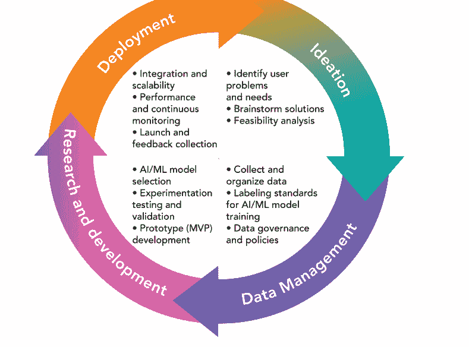
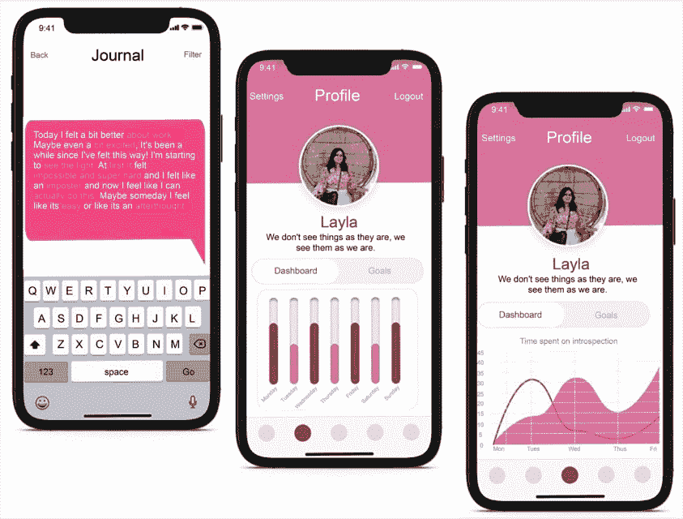
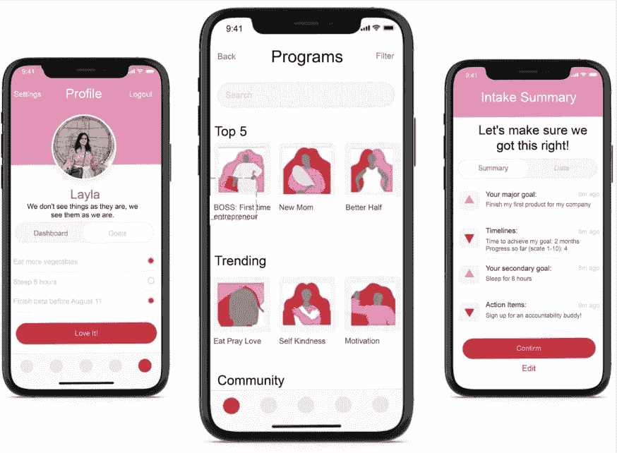
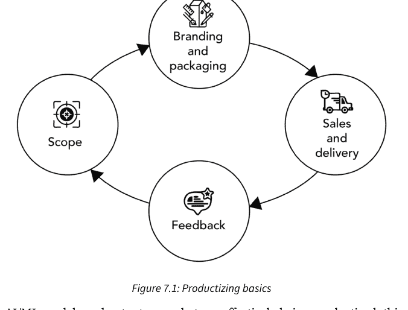
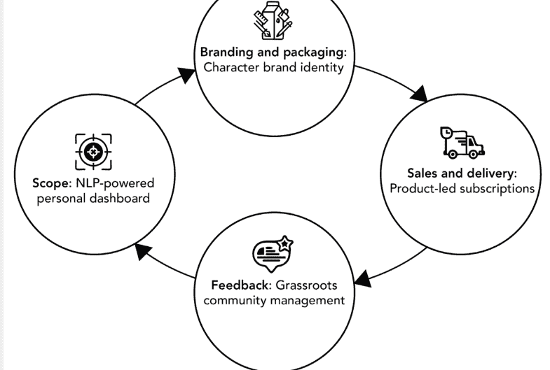
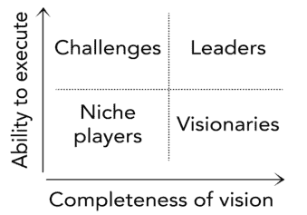
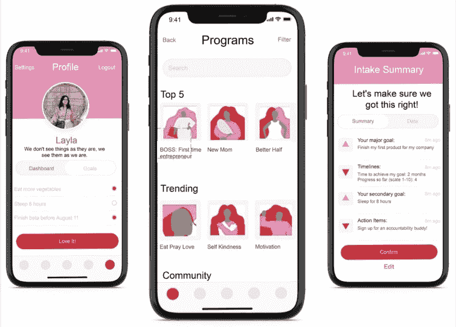

# Part 2

# 构建 AI 原生产品

了解管理 AI 项目所需的工作是 AI 产品管理的先决条件。现在我们已经在第 1 部分中介绍了这些基础知识，我们就可以继续在构建原生 AI 产品时，将该 AI 项目的输出进行情境化。

本部分包含六章，涵盖了从一开始就用 AI 构建新产品上市时涉及的各个相关领域。我们将介绍创建 AI 原生产品的基础知识，如何将为其提供动力的 AI/ML 服务产品化，如何为不同群体定位该产品，构建时可以采用的 AI/ML 选项，以及所有这些如何与性能基准测试、成本和增长相关。我们将在本部分结束时了解设计、发布和管理 AI 原生产品的战术和战略考虑。我们将借助一个案例研究来帮助情境化所有这些概念，该案例研究将贯穿本部分的所有章节。

本部分包含以下章节：

- 第 6 章，了解 AI 原生产品
- 第 7 章，产品化 ML 服务
- 第 8 章，为垂直领域、客户和同行群体定制
- 第 9 章，AI 原生产品的产品设计
- 第 10 章，基准测试性能、增长黑客和成本
- 第 11 章，管理 AI 原生产品

- 产品化 AI 驱动的输出——AI 产品管理有何不同
- 为群体定制——垂直领域和客户分组的考虑
- 销售 AI——产品管理作为销售的更高层次

## AI 产品开发阶段

无论您的组织是否足够健全，可以为 AI 产品开发的各个阶段支持多个产品团队，还是足够精简，以至于由一支精简团队在每个阶段推动产品，您都希望了解这些不同阶段，以便能够在每个阶段定义成功。

关于产品管理是什么或应该是怎样的，存在各种观点。很少有大学在本科或研究生课程中开设产品管理课程。由于产品世界仍处于萌芽阶段并每天都在发展，我甚至可以说，PM 的角色在公司之间在期望、角色和职责方面有所不同。我们将在此尽力以最佳方式描述各个阶段，以概括 AI 产品开发的核心方面。

无论如何，作为 AI PM 或 AI 产品的负责人，您希望考虑您的产品与这些阶段的关系，以便识别产品当前所处的阶段，以及需要做什么才能使其完全成熟。以下是 AI 产品开发关键阶段的定制版本：



图 6.1：AI 产品开发阶段

### 阶段 1 — 构思

正如传统的软件产品生命周期一样，作为 PM，您会参与构思阶段。您可能会看到它被称为创新或设计阶段。无论您怎么称呼它，这都是功能头脑风暴发生的阶段，而作为 PM，您是影响产品方向的关键利益相关者。这也是您权衡纳入各种功能的成本/收益的阶段，以及确定产品的不可妥协之处。

传统软件开发与 AI 产品开发在此阶段的一个区别是，在继续之前对构思的关注更为重要，因为投资 AI 产品的成本很高。因此，您希望在产品开发生命周期中继续之前，高度关注此阶段。您不希望在产品开发深入进行后才回到起跑线，意识到自己对如何利用 AI 为产品服务有了更好的想法，然后不得不浪费数月的工作、特定技术栈的集成时间、存储以及昂贵的人力成本。

理想情况下，构思阶段的工作会产生产品外观的图景，使用 UX  mockups/线框图和调查，以及收集您需要的要求，以便正确规划 MVP 的范围。作为 PM，您角色中最重要的部分可能是理解您正在解决的实际机会或问题。这对市场角度和 ML 角度都是如此。

就 ML 而言，您使用 AI 来解决以下类型的问题：

- **异常检测：** 应用 AI/ML 来识别不符合预期行为模式的罕见或不寻常模式（例如，欺诈检测）
- **聚类/同行分组：** 应用 AI/ML 根据相似性将数据点分组为不同的集合（例如，用户细分）
- **分类：** 应用 AI/ML 根据既定类别集为数据分配标签（例如，垃圾邮件检测）
- **回归：** 应用 AI/ML 根据训练数据预测数值（例如，预测房价）
- **推荐：** 应用 AI/ML 根据既定偏好建议相关项目或内容（例如，购物车推荐）
- **排序：** 根据标准对项目进行排序或优先排序（例如，搜索引擎结果）
- **优化：** 从一组潜在解决方案中找到最佳解决方案（例如，驾驶路线优化）
- **生成：** 基于输入示例/提示创建新数据/示例（例如，图像生成器）

明确您在市场上要解决的带大写 P 的 Problem，以及根据我们刚才讨论的八项能力列表，您要解决的 ML 问题，将是您作为 PM 最重要的任务。其余一切都是次要的。


## Phase 2 — Data management

一旦你对自己正在构建的内容和原因有了清晰的认识，你就会投入资源为产品成功奠定基础。在整本书中，我们提到 AI、ML 和深度学习（DL）产品，但重要的是要记住这些产品的原始口语说法是：数据产品。从核心来看，任何以任何方式利用 AI/ML 的产品首先都是数据产品，而且没有大量高质量、干净的数据，任何数据产品都无法做好任何事情。在构思之后，对支持所有数据的所需基础设施进行组织和扩展是第一个应用步骤。你需要了解支持数据收集和数据处理所需的系统的要求、约束和词汇，因为这些数据处理将使你的 AI 产品正常运行，而你将在帮助做出这些决策方面发挥核心作用。

在这个阶段，你也在定义在 AI/ML 模型中使用的最佳特征。我们在前几章讨论了特征工程。简单回顾一下，这是指你在数据集中寻找用于训练模型的主要方面或特征。你可以将特征视为在模型准备和训练中包含最重要的单个数据列。你也不希望将此完全留给你的数据科学家、工程师和架构师。作为产品经理，你需要深入参与并了解将被选为训练模型中最相关和最终输入的各种特征，这些模型将构成你的产品。

一旦确定，这就是为支持此数据馈送而建立数据管道的阶段。对你如何为组织和产品建立健全的数据收集和准备、数据存储以及数据管道实践有良好的把握，在此步骤中也至关重要。这些数据实践将使你能够利用数据用于内部用例和传统分析，它们也将成为你的 AI 产品的真正基础。虽然通常会有数据团队处理这些问题，但 AI 产品经理了解这些决策如何从资源管理和规划的角度影响其产品的效能和成本是很重要的。

到本阶段结束时，你应该能够回答以下问题：

- **我们需要什么样的数据才能使这个 MVP 成功？**
  确定用于训练和模型开发所需的数据类型，以确保你最终选择的模型能够为高性能和高准确度做好准备。
- **组织目前是否没有投资于支持此 MVP 成功的基础设施需求？**
  确保组织的数据管道和存储解决方案足以处理 MVP 需要的适当支持的数据量和种类。哪些约束或限制会影响你的数据基础设施？

到本阶段结束时，你应该具备以下内容：

- **已测试的方法和模型的文档：** 这应包括经过评估的强力模型候选者，以及用于评估其性能的指标。用于选择最终模型或模型集合的标准应明确定义导致选择的业务和技术因素。包括这些模型是如何被测试的，以及是否存在可能无法在真实条件下良好扩展或泛化的担忧。这还应包括任何 A/B 测试结果、队列分析以及用于各种模型的置信区间的文档。
- **MVP 的明确可接受性能阈值：** 包括内部利益相关者和终端用户都可接受的精度、准确度和其他性能指标的阈值。这将有助于确保 MVP 在部署后表现良好，并且在性能低于此阈值时集成触发器、日志和警报，将确保你的团队在出现性能问题时保持主动。识别潜在风险，例如偏差或随时间推移的性能下降。
- **数据科学家和 ML 工程师为使 MVP 成功所需工具、资源或基础设施：** 除了支持数据管理所需的基础设施外，还需要支持 AI/ML 团队的基础设施。确保你的技术团队拥有开展有效研发所需的一切，包括平台、计算能力和支持其工作的其他工具。
- **将模型选择和性能与业务目标和客户需求联系起来的产品需求和用户故事：** 通常，当我们构建和思考技术投资和限制时，我们正在优化资源。但请记住将技术与最重要的事情联系起来：为目标用户提供价值。围绕正在进行的研究创建一个叙述，并说明它如何影响客户、用户以及整体业务的成功。
- **完善和迭代 MVP 的计划：** 请记住 MVP 只是起点。从那里开始，你对产品进行未来迭代。MVP 如何持续改进？你的模型将如何重新训练？多久一次？新数据和性能反馈将开始围绕你的 MVP 形成动力，因此请制定计划来把握这一动力。

## Phase 4 — Deployment

我们在这里使用部署作为一个总称，指的是研发阶段之后发生的一切。此时，你已经确定了一个或一组模型，该模型满足你的产品构思和 MVP 要求，并得到数据基础设施的支持，并且经过了彻底的测试。现在，你准备好构建支持基础设施，以确保该模型及其输出可以集成到最终用户将体验到的更广泛产品中。这是部署阶段，你将数据科学家和 ML 工程师的工作与全栈开发人员的工作结合起来，并将其真正集成到将支持这些 AI/ML 输出的更大产品中。

你的产品可能有许多 *features*，其中只有几个是 AI 功能，或者你的产品的核心可能是 ML。无论你的产品在 AI 方面的根基如何，你都需要将从投入时间构建的模型中得出的 ML 发现部署在更大的 UI/UX 上下文中。由于必须在你的 AI/ML 代码和生产代码之间进行这种整合的舞蹈，你也可能会经历自己的部署研发阶段。选择合适的 ML 模型和技术是一个独立的过程，与选择展示和使用该 ML 研发输出的合适方式以及如何维护这些输出是分开的。

部署阶段的更广泛背景实际上是创造 ML 输出的连续性和交付。这也是你将围绕产品持续维护和交付创建流程和结构的地方，这些流程和结构已在第 2 章中概述。

以下是本阶段你应该已处理的一些方面：

- **将 MVP 集成到你的产品或平台中的考虑：** 确保前端和后端系统完全集成到你的 MVP 中，以便 AI 功能和 UI/UX 无缝融合。记录部署过程和模型如何集成到 MVP 中的细节，以便知识得以保留并易于转移。
- **生产基础设施已为模型服务做好设置：** 生产中使用的模型需要保持可扩展、可靠和响应迅速。维护适当的微服务、API、容器或平台，以保持模型在生产中的部署顺畅。
- **模型监控和维护的自动化：** 设置触发器、日志和标志来监控生产中的模型，并在性能低于你设定的阈值时提醒你。跟踪性能和检测潜在问题可以触发在最需要时进行模型再训练或更新。确保你的 MVP 建立了管道，以确保为其提供动力的模型随着新数据的收集和使用而保持相关性。通过压力测试模型来保持性能标准，以确保生产性能指标与第 3 阶段设定的预期一致。
- **生产后来自客户和用户的反馈循环：** 无论是通过产品调查、问卷、客户电话还是焦点小组，拥有收集和应用对 MVP 的用户反馈的方法将有助于识别改进领域并最大限度地减少边缘情况或非预期偏差。

现在我们已经介绍了 AI 产品开发生命周期的各个阶段，让我们关注首先让魔术发生的人：AI 产品团队。为新的 AI 产品组建新团队很棘手，而且很难为产品的需求充分招聘。每种产品和公司都有不同的需求，因此我们将在本节中尽可能保持客观。


## AI/ML/data 策略师/架构师

这对大多数公司来说将更像是一个咨询性角色。理想情况下，此人将帮助获取人才，并制定方法论和工作流程，以支持您的 AI/ML 功能/团队的整体运作。这可能是您在 AI/ML 之旅开始时聘请的角色，以帮助做出关于为 AI 项目或产品团队的各个角色招聘谁、您的技术栈应包含什么，以及与实验和部署相关的某些工作流程应如何设置的关键决策。

此人可能在您的产品开发的规划和初始阶段（前 6–8 个月）留任，也可能在资源更充足的环境中作为产品经理留任。此人理想情况下也应精通 AI 伦理原则。如果您是一家初创公司，并且从零开始创建公司和产品，这可能是您的技术联合创始人，能够担任您的技术决策者。此角色也可能被称为数据架构师角色。

## 数据工程师

我们已经有了 AI 产品/项目团队如何运作的架构师；现在，我们将根据与 AI 策略师合作得出的蓝图，由数据工程师开始为我们的数据管道奠定基础。如果您从零开始建立 AI 产品，请寻找能够帮助支持您团队数据工程理念选择的数据工程师。请注意，此人不应向 AI 产品经理寻求正确的数据设置。相反，他们将向 AI 产品经理说明各种数据工程选择对 AI MVP 的意义。

您将使用数据网格、数据织物、数据湖还是数据仓库？由于您正从头开始为 AI/ML 原生产品建立此功能，您希望聘请一位有信心和经验来指导您进行适当设置的人。迁移和更改您的数据架构可能代价高昂且耗时。如果您在开始时就获得所需的帮助，将为您节省潜在的麻烦，并为您提供可持续、可扩展的基础设施，让您充满信心地成长。

## 数据分析师

许多公司的路径是在开始用 ML 扩展这些分析之前，先在已建立的数据分析基础上进行建设。传统的操作顺序是通过首先聘请出色的数据分析师来获得对数据的清晰度和控制权，他们将迅速弄清楚您已有数据中哪些内容有趣且值得探索。在此角色中，您正在寻找能够以好奇心和探索精神快速分析您的大量数据的人。

此人可能是您的专家查询制作人员，与您的数据工程师协同工作，通过您建立的工作流程传递查询，以驱动您的 AI/ML 产品。这些招聘还将改进您内部使用的分析，以改进内部流程，以及您通过产品或平台的仪表板 UI/UX 向客户传递的分析。

UI/UX 的全部内容是如何最有效地为终端用户提供价值。最大限度地减少挫败感来源并激发愉悦时刻是此功能的主要关注点。优秀的 UI/UX 设计师或研究人员将指导您产品可见的更改，您的终端用户将体验到这些更改。此角色是 AI 产品经理的关键合作伙伴，因为它可以帮助验证客户痛点或市场战略决策。虽然面向市场和产品团队可能会基于数据做出决策，但 UX 研究可以提供客观的第三方视角。我们建议让此功能保持持续参与，以便您在构建产品进一步迭代时从用户那里学习，这些迭代最符合您的用户——以及由此延伸的他们的买家——的认可。

## 客户成功专家

通过 UI/UX 设计和研究进行倾听的适当渠道很重要，但最终，您的客户希望您也能回应——而不只是通过产品本身。如果您正在创建 B2C 产品，您可能不需要庞大的客户成功团队，但如果您向其他企业销售 AI/ML 产品，您肯定需要。客户成功团队的存在是为了确保您的客户正确使用您的产品并从中获得预期价值。

他们也是您数据和 AI/ML 功能的绝佳反馈来源。客户成功专家为 AI/ML 产品提供反馈循环，使其能够随着时间的推移而构建和改进。他们在帮助扩展产品功能以及与产品协作确定终端用户可能非常喜欢看到的潜在新功能方面也非常有帮助。如果您是 AI/ML 产品经理，请确保您与客户成功团队保持温暖开放的关系，因为他们是您在第一线最大的知识来源。他们是真正与您的客户交谈的人！

## 营销/销售/面向市场团队

这另一个很可能在您产品开发之旅的开始和整个过程中参与的团队。我们将销售和营销归为面向市场，因为这本质上就是此功能所做的。它向您的市场传达信息：您潜在客户的整个格局。在这里，您将结合您的技能组合来优化您的产品语言契合度或市场将看到的关于您产品的[content]

## AI/ML/data 策略师/架构师

这对大多数公司来说将更像是一个咨询性角色。理想情况下，此人将帮助获取人才，并制定方法论和工作流程，以支持您的 AI/ML 功能/团队的整体运作。这可能是您在 AI/ML 之旅开始时聘请的角色，以帮助做出关于为 AI 项目或产品团队的各个角色招聘谁、您的技术栈应包含什么，以及与实验和部署相关的某些工作流程应如何设置的关键决策。

此人可能在您的产品开发的规划和初始阶段（前 6–8 个月）留任，也可能在资源更充足的环境中作为产品经理留任。此人理想情况下也应精通 AI 伦理原则。如果您是一家初创公司，并且从零开始创建公司和产品，这可能是您的技术联合创始人，能够担任您的技术决策者。此角色也可能被称为数据架构师角色。

## 数据工程师

我们已经有了 AI 产品/项目团队如何运作的架构师；现在，我们将根据与 AI 策略师合作得出的蓝图，由数据工程师开始为我们的数据管道奠定基础。如果您从零开始建立 AI 产品，请寻找能够帮助支持您团队数据工程理念选择的数据工程师。请注意，此人不应向 AI PM 寻求正确的数据设置。相反，他们将向 AI PM 说明各种数据工程选择对 AI MVP 的意义。

您将使用数据网格、数据织物、数据湖还是数据仓库？由于您正从头开始为 AI/ML 原生产品建立此功能，您希望聘请一位有信心和经验来指导您进行适当设置的人。迁移和更改您的数据架构可能代价高昂且耗时。如果您在开始时就获得所需的帮助，将为您节省潜在的麻烦，并为您提供可持续、可扩展的基础设施，让您充满信心地成长。

## 数据分析师

许多公司的路径是在开始用 ML 扩展这些分析之前，先在已建立的数据分析基础上进行建设。传统的操作顺序是通过首先聘请出色的数据分析师来获得对数据的清晰度和控制权，他们将迅速弄清楚您已有数据中哪些内容有趣且值得探索。在此角色中，您正在寻找能够以好奇心和探索精神快速分析您的大量数据的人。

此人可能是您的专家查询制作人员，与您的数据工程师协同工作，通过您建立的工作流程传递查询，以驱动您的 AI/ML 产品。这些招聘还将改进您内部使用的分析，以改进内部流程，以及您通过产品或平台的仪表板 UI/UX 向客户传递的分析。

UI/UX 的全部内容是如何最有效地为终端用户提供价值。最大限度地减少挫败感来源并激发愉悦时刻是此功能的主要关注点。优秀的 UI/UX 设计师或研究人员将指导您产品可见的更改，您的终端用户将体验到这些更改。此角色是 AI PM 的关键合作伙伴，因为它可以帮助验证客户痛点或市场战略决策。虽然面向市场和产品团队可能会基于数据做出决策，但 UX 研究可以提供客观的第三方视角。我们建议让此功能保持持续参与，以便您在构建产品进一步迭代时从用户那里学习，这些迭代最符合您的用户——以及由此延伸的他们的买家——的认可。

## 客户成功专家

通过 UI/UX 设计和研究进行倾听的适当渠道很重要，但最终，您的客户希望您也能回应——而不只是通过产品本身。如果您正在创建 B2C 产品，您可能不需要庞大的客户成功团队，但如果您向其他企业销售 AI/ML 产品，您肯定需要。客户成功团队的存在是为了确保您的客户正确使用您的产品并从中获得预期价值。

他们也是您数据和 AI/ML 功能的绝佳反馈来源。客户成功专家为 AI/ML 产品提供反馈循环，使其能够随着时间的推移而构建和改进。他们在帮助扩展产品功能以及与产品协作确定终端用户可能非常喜欢看到的潜在新功能方面也非常有帮助。如果您是 AI/ML PM，请确保您与客户成功团队保持温暖开放的关系，因为他们是您在第一线最大的知识来源。他们是真正与您的客户交谈的人！

## 营销/销售/面向市场团队

这另一个很可能在您产品开发之旅的开始和整个过程中参与的团队。我们将销售和营销归为面向市场，因为这本质上就是此功能所做的。它向您的市场传达信息：您潜在客户的整个格局。在这里，您将结合您的技能组合来优化您的产品语言契合度或市场将看到的关于您产品的消息。您将使用您的面向市场会议来决定以下事项：

- 关于您产品的术语
- 您将在市场上如何定位它
- 您将允许您的销售团队在演示中与潜在客户讨论多少专有技术和算法魔法
- 您将提供多少可解释性
- 您将如何传达您对产品做出的技术决策
- 出于竞争精神，您将从世界上屏蔽多少关于您产品的信息

随着您构建和改进产品，您的面向市场团队将与您同在，您将定期讨论如何传达即将推出的功能或版本的信息。

| 质量保证 QA 工程师 | 确保 AI 功能在功能、可靠性和性能方面经过测试，减少部署后问题。 | 工程 |
| 云架构师 | 帮助扩展 AI 基础设施，优化云资源使用并处理大规模部署策略。 | 工程 |
| 业务分析师 | 将业务需求转化为技术需求，提供额外的清晰度和利益相关者一致性。 | 分析 |
| 伦理与合规官 | 评估模型在伦理考虑、偏见和监管合规方面的情况。 | 法律/合规 |

表 6.1：关键和非关键角色

现在您熟悉了梦想团队可能的样子，让我们来看下一个关键组成部分——您的技术栈。

## 投资您的技术栈

了解将为您提供最大灵活性的技术栈和语言，是开始您的技术栈之旅最重要的部分。作为 PM，您会定期思考构建某物的价值与构建它所需的成本或工作量之间的关系。这就是为什么您不能忽视您的技术栈。可能很诱人将它留给 CTO 决定投资哪个技术栈，但如果此技术栈以任何方式直接涉及您产品的构建，就不是那么容易外包。赋能您的利益相关者会影响您 AI 产品的工作量和成本，因此您希望确保参与这些关键决策的制定。

您还希望通过培养对技术栈何时对您的产品构成限制的理解，与您的技术 counterparts 建立信任。如果您需要为增加复杂性以实现产品成功或客户获取而提出案例，应该由您提出。您将与您的数据科学和数据工程团队密切合作，创建适当的渠道，以可靠的方式将相关数据传递到您的模型中，以便参与构建您产品的其他利益相关者可以信任现有的基础设施。以下是您作为 AI PM 应该牢记的一些关键因素：

- 技术栈中最大的考虑是关注适当设置您的基础设施，以处理随着业务增长您的数据规模。构建能够处理数据清洗、存储、安全、准备和监控的正确技术栈，将是支持您的 AI 项目或产品团队的基础。这与构建您的数据战略密不可分。
- 除此之外，您将寻求为 AI 项目中的许多角色创造协作环境，以便参与其中。在分析师、数据科学家、ML 工程师、更广泛的工程团队以及您纳入 AI 团队组建的任何领导者和顾问之间，您希望为所有这些不同成员创建沟通和协作的渠道。


- 与许多 AI 程序一样，你也会寻找自动化流程和工作流的方法。AI/ML 技术在不断变化和改进，因此当你投资将自动化应用于 AI 程序本身时，你会获得很大的进展。利用你才华横溢员工的智慧来做更高层次的决策，并运用他们解决复杂问题的能力。任何可以自动化、刷新或标准化的事情都应该这样做。这与敏捷和精益开发的原则一致。重构代码和进行优雅的改进应该主动进行，因此请确保负责任地将其规划到你的迭代中，并利用你的技术栈优势来帮助团队取得成功。

尽管团队会使用 R、Java 和 C++ 进行机器学习，但 Python 是目前用于机器学习应用最广泛的编程语言。主要原因之一是它是一种相对简单的语言，拥有丰富的库和工具来帮助机器学习和数据分析。Python 还有像 pandas 和 NumPy 这样的库，用于数据处理和操作等任务，以及像 Matplotlib 和 Seaborn 这样的数据可视化库。还有其他流行的机器学习库，如 TensorFlow、PyTorch、scikit-learn 和 Keras，可进一步扩展你的机器学习模型。由于 Python 被如此广泛地使用，如果 AI 产品经理要在私营部门工作，他们应该对它相对熟悉。

管理机器学习实验本身就是一项艰巨的任务，我们已经看到诸如 MLflow、Weights & Biases 和 Neptune.ai 等工具用于管理版本和实验。你还可以使用 Cloudera Data Science Workbench、Seldon、Dataiku、DataRobot、Domino、TensorFlow Extended、Kubeflow 和 SageMaker 等工具，为你的数据科学家提供一个工作站，用于构建、实验、部署和训练机器学习模型。让我们看看一些对完整模型管理最有用的工具，这涉及很多方面：

- 在生产环境中使用机器学习时，你需要跟踪每个模型的版本，以及该模型的代码、元数据和配置。
  **工具：** MLflow、Data Version Control（DVC）和 Weights & Biases（W&B）。

- 你还需要将每个训练好的模型打包到某个可部署的容器中，以便在准备好将特定模型部署到生产环境时使用。
  **工具：** Docker、TensorFlow Serving 和 Seldon。

- 由于你经常处理大量不同的模型，你需要将所有版本存储在某种中央存储库中，以便轻松检索不同的版本。
  **工具：** Model Registry（MLflow）和 Amazon SageMaker Model Registry。

- 根据你使用的模型以及每个模型的需求，你需要一种更自动化的方式，用新数据重新训练你保存的模型。
  **工具：** Kubeflow、Airflow 和 Tecton。

## 将 AI 驱动的输出产品化——AI 产品管理的不同之处

在本节中，我们将探讨传统产品与 AI/ML 产品在产品管理上的差异。乍一看，AI/ML 产品似乎与传统产品没有太大区别。我们仍然在创建价值、用途、性能和功能方面的基线，并尽可能优化该基线。这对每个产品以及更广泛的产品管理实践都是如此，并且不会因为我们的产品使用 AI 而改变。

AI 产品真正的区别在于，你本质上是在将一个服务产品化。请想一想。为了让 AI 发挥作用，它必须从你（或你的客户）的数据中学习。不同的模型可能在不同类型的数据上表现更好。不同的数据集对你的模型会需要不同的超参数。这就是 AI/ML 的本质。在某种程度上，这意味着你可能会发现自己的产品构建和结构方式甚至可能因客户而异，尤其是在初期客户很少的时候。

这实际上意味着你要了解所有客户如何从你为他们提供的 AI/ML 服务中受益，并建立一个标准流程来重现该过程，以便所有客户都能获得最大收益。将服务产品化的一般建议是首先找到一个利基市场或特定的客户群。我们在本章前面介绍了 UI/UX 设计师/研究员角色；这些人将帮助你充分利用你的客户群及其偏好。如果你能理解 AI 如何通过你的产品最大程度地帮助客户，并且能够专注于对客户成功至关重要的价值，那么你就迈出了产品化的第一步。

然后，主要焦点将是如何最好地构建你的产品和内部流程，这样你就不必在每位客户身上从头开始。起初这将是探索性的。也许某些模型在某些客户的数据上比其他模型效果更好。也许有些特定用例直到某位客户提出需求才出现。产品化的基本理念是找到有价值的东西，并通过头脑风暴来了解还可以在哪些地方利用之前的项目、成果或流程，以造福所有人。不浪费，则不匮乏。如果你能为了所有客户的利益而循环利用某些东西，这将增加产品的成功以及产品所获得的集体喜爱。

将服务产品化在咨询领域是一个熟悉的概念，咨询顾问们一个项目接一个项目地工作，往往不得不几乎从零开始与客户建立新的合作。但鉴于我们的大脑是模式检测机器，最终我们会开始看到类似的请求或类似的用例出现。为特定类型的客户、垂直领域、画像或用例创建可重复的流程，正是产品化的精髓。这正是我们在 AI/ML 产品上所做的。这也是一种更好地预测客户为何以及如何专门来找你和你的产品的方式，这样你就知道如何分享与客户直接相关的成功案例和案例研究。产品化的行为也将极大地赋能你的营销、销售、客户成功以及更广泛的 GTM 团队。

在许多方面，“产品化”机器学习的工作发生在工程团队内部，他们负责构建应用程序来管理数据科学和机器学习工程师为工程师提供的模型。无论你是否在构建 AI 产品，你都需要工程师和开发人员；这些建设者将伟大的想法、愿景甚至路线图转化为你可以体验到的切实产品。他们还负责确保整个产品能够扩展、足够健壮以承受各种用户行为，并确保产品与各种平台和技术兼容。

正如我们在本节中所看到的，AI/ML 产品整合关乎在模型输出与这些输出试图服务的用例或群体之间找到平衡。许多产品经理在构建 AI/ML 产品的经验中发现，他们可能需要针对特定群体定制自己的产品。因此，接下来，让我们探讨一下 AI 定制的需求（如果出现的话）。

## AI 定制

通过产品化的行为，你可能会开始为产品创建分组或群体。你可能会发现某些模型最适合某些类型的客户，并围绕这一点构建结构。将你的产品提供分组为用例，并以不同或最优的方式与这些群体沟通，这是在从产品化中获得的智慧的基础上建立的。更进一步，你会自然而然地开始进行垂直化。

了解商业模式、垂直领域和特殊客户群体的各种考虑因素，将是你产品进入市场方式的重要组成部分。例如，如果你支持的是 B2C 或消费型产品，你会希望在信息收集方面投入更多，在构思阶段获取更多终端用户的直接反馈。因为你要创建的产品可能会被数百万用户使用，你需要牢牢把握这些终端用户的偏好和期望，以便让产品最大程度地符合客户的声音。这类产品还可以受益于快速实验和迭代，这样你就可以在产品推出后开始收集反馈，甚至在 AI/ML 模型本身达到你期望的性能水平之前。

如果你支持 B2B 或面向企业的应用程序，你可能会在产品构思和部署上花更多时间，以便专注于你希望争取到的特定客户群体。对于商业应用程序，你可能会创建一个非常复杂的产品，它执行许多重叠的操作，但面向的是非常小众的用户群体。你还可能拥有各种文档完备的工具，为客户提供类似的解决方案，因此保持与市场的功能对等可能是这类产品更需要考虑的因素。

你的企业规模也会影响你作为 AI 产品经理在组织中的角色定位。例如，如果你的组织足够大，可能会为前面提到的产品周期的每个阶段分配一个独立的产品经理。也可能有多个产品经理支持 AI 产品功能的不同方面。还可能有一个产品经理专门负责产品的 AI 功能，并由更高级别的产品经理或产品总监监督整个产品组合。在较小的组织中，可能只有一个 AI 产品经理在产品生命周期的所有阶段监督整个产品，或者进行构思以持续维护该产品。


公司规模的另一个差异在于**数据**本身。根据公司规模的大小，获取数据的难易程度或数据质量会有所不同。作为产品经理，让数据可用并处于可用状态可能比在初创公司更困难，也会占用更多时间，因为你需要访问需要管理治理权限的孤立数据组。甚至让这些数据整合在一起也可能很困难，这取决于每个数据孤岛的约定。相反，初创公司可能连积累足够用户都很困难，还会遇到数据量的问题。数据可用性和质量对大公司和小公司来说都是公认的难题。

如果你的产品是**高度垂直化的**，这也会影响你作为AI产品经理的工作表现。例如，一个专门面向医疗保健、金融科技或教育领域的产品，可能需要一位对这些不同垂直领域具备领域知识和专业技能的产品经理。即使同一位产品经理为这些垂直领域维护同一产品，你也可能会看到产品的三个不同版本，因为这些特定垂直领域的权重、阈值和性能指标很可能大相径庭。根据你所提供的产品类型，你甚至可能会看到一种超专业化现象，产品甚至为每一位客户都进行了大幅定制！高度定制化的机器学习产品必须适配客户的数据，就可能出现这种情况。

归根结底，为特定受众构建和打磨产品，其核心在于创造一款畅销的产品。我们需要了解我们的受众——产品的购买者和使用者——才能打造出真正为他们服务的东西。在下一节中，我们将讨论销售的概念，以及从产品管理的角度来看这意味着什么。

## 销售AI——产品管理是更高阶的销售

在AI产品管理中，销售体现在多个方面。传统意义上的销售是：创造一款市场愿意购买的产品。这是任何传统产品经理角色中固有的部分。你对市场、产品和销售团队的理解，使你对推向市场的解决方案、解决方案的性能，以及销售团队阐述你所构建解决方案价值的能力充满信心。此外，AI带来了机遇和挑战：即销售AI功能本身的能力。

在本书前面部分，我们提到AI/ML项目在部署到生产环境时面临的困难；造成这一情况的原因有很多，但最主要的原因之一是无法向更广泛的组织推销AI的价值。这对于任何希望从事AI产品工作的产品经理来说都非常重要，因为你需要培养这种理解力和能力，既要向外部市场推销你的产品，也要向内部利益相关者和领导者推销。无论你是在大型组织还是小型初创公司工作，情况都是如此。

Waterbear公司正在构建一款旗舰产品Akeira，旨在帮助应对因Covid-19疫情而加剧的心理健康问题，特别是针对18岁以上的女性。最初，这只是一个帮助人们更好地了解自己的构想，如今已变成一款实用产品，人们用它来更清晰地了解自己的情绪和心境如何随时间变化。该产品利用NLP扫描用户在应用内输入的日志条目，帮助用户设定想要努力的目标和重点领域，并推荐活动和问题，以更好地帮助他们实现个人目标。

尽管早期在融资和获取用户方面遇到了困难，他们现在已达到一个里程碑。他们获得了A轮融资，并已获得必要的资源来拓展新客户和建设内部团队。他们帮助个人更好地了解自己、克服心理障碍的使命正在顺利推进。Waterbear的方法是全面性的；他们希望建立一个职能无缝整合的组织，不仅确保高效的产品生命周期，还能为公司扩展和员工福祉保持健康的节奏。

基于本章讨论的概念，我们将详细分析该产品如何走过AI产品开发周期的各个阶段，各职能如何协同运作来运营该产品，他们的技术栈是什么样的，哪些AI输出对产品影响最大，他们目前如何实现产品的垂直化，以及他们当前的GTM策略是什么。

### AI产品开发周期

首先，让我们回顾一下本章前面介绍的产品开发生命周期的各个阶段，看看Akeira的情况如何：

- **构思：** Akeira产品团队首先分析了用户如何能在心理健康工具中找到价值，从而提供实时情绪支持、分析和安慰。他们考虑了各种AI功能，如情绪分析、用于治疗会话的**自然语言理解（NLU）**，以及通过对话数据进行情绪追踪。团队还进行了可行性研究，以确保数据需求与潜在的解决方案和模型相匹配，这些模型需要支持心理健康情境所需的复杂语言理解，例如识别痛苦或语气。
- **数据管理：** 团队获取了与心理健康相关的对话数据集、匿名治疗记录、情绪追踪日志以及相关的社交媒体互动数据，用于支持所训练和使用的AI/ML模型。情绪基调和情感被分类和标注，为第三阶段将要测试的AI/ML模型提供输入准备。
- **研发（R&D）：** 团队尝试了多种语言模型，但最终选择了谷歌的BERT模型。上一阶段收集并标注好的心理健康数据被用来针对特定任务微调BERT，例如识别对话中的心理健康线索。在集成到可工作的原型或MVP（称为Akeira）之前，BERT还经过了理解上下文、意图和情绪情感的阈值测试。之后，该原型被分享给了一小组测试版用户。
- **部署：** Akeira被整合进一款同名心理健康应用，并设置了监控工具来追踪它在实时交互中识别情绪线索并作出回应的表现。在测试版用户积极使用该应用后，团队建立了维护和监控机制，确保测试版用户正确使用应用并获得益处。反馈机制也到位了，用于收集用户的顾虑和问题。这些反馈机制成为应用的主要特色，确保Akeira能够定期收集关于其反应准确度和敏感性的反馈，以便相应调整未来的迭代版本。

### 团队构成

让我们来看看Akeira团队可能是什么样的：

**产品：** 公司最早做出的一项招聘决定，是为其梦寐以求的创始首席产品经理职位找到一位合适人选。他们寻找的是有构建专注于NLP的AI工具经验的人，但他们也看重热情。一旦找到一位在构建帮助人们的产品方面有良好记录、并对心理学和福祉有个人兴趣的人，他们就能信任这个人来定义公司旗舰产品的战略、愿景和路线图。

由于这个人过去构建过AI产品，他们能够与领域专家、治疗师、数据科学家、机器学习工程师、测试人员、客户成功人员和设计师良好合作，将产品提升到新的水平。他们能够将这些内部工作与研究、竞争分析、用户反馈和外部数据源结合起来，了解产品未来可能存在哪些机会。他们明白，自己的目标不仅是让产品保持相关性，还要不断创新，并与所服务市场的需求保持一致。

**数据科学与机器学习：** 服务于该产品的数据科学和机器学习团队任务艰巨。他们负责构建和训练为Akeira提供支持的模型。

数据科学家定期从用户数据中收集洞察，以更好地了解哪种用户行为能带来产品的最佳使用效果。他们的工作主要集中在各种模型的A/B测试上，并使用统计、概率和预测方法来处理NLP，以持续改进他们的AI模型，同时定期与产品和机器学习同事分享发现。他们还花费大量时间，用来自合作治疗师的专业技术数据来增强各种**大型基础模型（LFMs）**，以确保产品的可行性。他们的大部分时间都花在探索数据、为模型进行特征工程、选择最佳部署模型，以及利用知识和专业知识解释模型结果上。他们主要使用Python编程，并将这些模型作为输出移交给合作的机器学习工程师。


- **数据与机器学习：**
  - 使用 Amazon S3 存储桶存储海量数据
  - 使用 Amazon Athena 查询和分析他们的数据
  - 使用 Apache Spark 对模型进行预处理和特征工程
  - 使用 Jupyter Notebook 进行机器学习模型自研
  - 使用 GitHub 管理模型版本
  - 使用 Amazon SageMaker 全面管理其机器学习管道（构建、训练和部署）
  - 使用 SageMaker Ground Truth 作为标注服务，用于与用户仪表板相关的所有组件，以捕捉诸如实体识别、文本分类和情感分析等内容
  - 使用 SageMaker Clarify 作为其自然语言处理模型的去偏工具
  - 使用 Amazon EKS（Elastic Kubernetes Service）将与 Akeira 相关的所有自然语言处理应用容器化
- **工程：**
  - 使用 AWS Lambda 函数处理来自用户的新的数据的预处理和后处理，以便快速将数据输入生产中的模型
  - 使用 Amazon API Gateway 处理连接驱动产品的自然语言处理模型的 API
  - 使用 Amazon CloudWatch 监控性能日志
  - 使用 AWS X-Ray 调试自然语言处理服务的 issues
  - 使用 AWS KMS（密钥管理服务）进行数据保护和数据加密
  - 使用 AWS IAM（身份和访问管理）控制对特定用户的访问
  - 使用 GitLab 进行代码管理
  - 使用 Jenkins 进行 CI/CD
- **其他团队：**
  - 使用 Intercom 进行用户反馈、支持票据和应用内调查
  - 使用 InVision 设计一页纸文档、产品营销材料和白皮书
  - 使用 Google Forms 进行用户调查
  - 使用 Lookback 进行大规模的正式调查

## AI 输出

关于 Waterbear 的 Akeira 产品，用户日志会被记录并整合到用户在日常生活中可以参考的仪表板中。以下是在应用中可能出现的示例：



图 6.2：带有日志和个人数据的 Akeira 仪表板

由于该应用是面向消费者的移动应用，终端用户分享的文本将被分析和选择关键词。应用首先会以聊天的形式来了解终端用户，因此 Akeira 的首要目标——确保与之交谈的人被看见、被理解并得到认可得以实现。自然语言处理模型不仅会分析明确分享的文本，还会根据用户意愿连接社交媒体和其他文本输入，以建立对其整体状况的全面理解。这些就是输入。

消费者看到的输出将显示在仪表板和目标模块之间的切换中。仪表板模块能够展示各种可用于衡量整体健康和福祉的指标。整体的 Akeira 评分将作为特定时期内整体情绪状态的视觉指标进行分享。

其他关键绩效指标和可视化也会包含在仪表板中。在这里，你可以考虑诸如情绪追踪器、应用参与度及其与情绪的相关性、带有进度条的自我关怀指标、与身体活动相关的可视化、感恩分数以反映终端用户可以培养对其生活中进展顺利的方面感激的领域，以及社交追踪器，让用户从鸟瞰视角了解其社交健康：



*图 6.3：显示可用程序的 Akeira 仪表板*

第二个切换项是其已建立的目标模块，该模块专门涵盖通过自然语言处理模型建立并经用户确认的目标；这些目标更具具体性，并根据终端用户对 Akeira 的具体使用量身定制。目标将有既定的成功标准，以便一旦朝着目标取得进展，就能记录并庆祝。

最后，所有这些各种指标和关键绩效指标将为每个终端用户带来高度个性化的洞察，例如反馈展示、鼓励自我反思、正念或甚至身体和心理健康的行动提示。如果人工智能产品的目标是通过数据传递价值，那么应用体验就需要有一种表达这种价值并将其反映回终端用户的方式。这就是 Akeira 和 Waterbear 与其客户群沟通的方式。

## GTM 策略和垂直化

Waterbear 在完成原型后，早期向一小群测试用户开放，以更好地了解像 Akeira 这样的产品的兴趣和可行性。目标市场最初是 18 岁以上的成年女性，并专注于真实且有机营销活动，让用户在他们所在的地方相遇：无休止地在线滚动。由于 Waterbear 的两位创始人都是女性，她们能够通过 Women in AI 的初创加速器建立早期潜在投资者和顾问网络。

像 Akeira 这样的产品的市场也是一种蓝海市场。虽然存在 Woebot、Wysa、Moodnotes 和 Pacifica 等直接竞争对手，但大多数都是简单的情绪追踪器或聊天机器人，并没有完全捕捉到 Akeira 所能提供的复杂性。其他间接竞争对手如 Talkspace、BetterHelp 和 Cerebral 只能将你与该领域的心理健康专业人士联系起来。由于 Akeira 是直接和间接竞争对手的结合，它能够通过产品驱动的方法聚集一批忠诚的专用用户。

使用基于心理健康应用市场状况的 **总可用市场（TAM）** 0.6 十亿的保守估计，Waterbear 能够发现针对女性的心理健康应用的共享 **可服务可寻址市场（SAM）** 刚刚超过 3.5 亿美元。由于他们在专注于扩展之前优先考虑了单一旗舰产品的缓慢、有机增长，他们最初的 **可服务可获得市场（SOM）** 刚刚超过 500 万美元。

最后，虽然 Akeira 最初是为直接面向消费者而创建的，但 Waterbear 的 GTM 团队发现，有大量用户可能来自正在寻找可交付给员工的对话式人工智能解决方案的企业，以帮助提升他们的创造力、幸福感和福祉。

Akeira 未来的探索将扩展到其他垂直领域，如不同年龄段、性别以及超越单纯福祉的使用案例。请在第 2 部分的后续章节中关注我们的 Waterbear 案例研究，我们将为示例增加更多复杂性。

## 总结

产品经理的工作永无止境。总是会有更多声音、观点和需要考虑的因素。协调所有利益相关者、技术、领导层、市场分析、客户反馈以及对产品的热情并不是一件容易的任务。在本章中，我们介绍了人工智能产品开发生命周期的各个阶段以及可能构成人工智能产品梦之队的各种角色。我们还介绍了可以帮助该团队构建产品的技术栈，以及帮助产品脱颖而出并与将购买和使用产品的群体产生共鸣的各种重点领域。希望本章能帮助你理解在着手构建人工智能原生产品时最重要的因素。

# 7

# 产品化机器学习服务

在 *第 6 章* 中，我们简要提到了产品化的概念以及这对人工智能输出意味着什么，见 *产品化人工智能驱动的输出 – 人工智能产品管理有何不同* 部分。我们将在本章中扩展这一概念，探索在构建人工智能产品时可能出现的种种挑战和磨难。与其将人工智能产品视为传统软件产品，不如将其视为你正在学习产品化的服务。**产品化** 是将服务、流程、技能或想法转化为一种向更广泛市场呈现的方式的过程。

首先，我们将了解产品化的一些基本原则，以及人工智能产品与传统软件产品之间的差异和相似之处。虽然我们在之前的章节中已经涵盖了一些这些要素，但我们将在本章中进一步扩展这些想法。接下来，我们将探讨产品化如何根据商业模式本身而变化。我们将研究 **人工智能运维（AIOps）** 和 **机器学习运维（MLOps）** 在产品化中在管理各种产品及其性能比较方面所发挥的作用。最后，我们将以产品化循环如何通过反馈不断刷新结束。

到本章结束时，你将了解以下主题：

- 产品化原则
- 理解人工智能与传统软件产品之间的差异
- B2B 与 B2C – 产品化商业模式
- 一致性和 AIOps/MLOps – 依赖和信任
- 性能评估 – 测试、再训练和超参数调优
- 反馈循环 – 关系建立

## 产品化的基础

产品化是一个在咨询中经常出现的概念，其中服务提供被固化为可以有效定制和转售的明确实体。这指的是能够创建一致的工作流程，你可以依靠它以传统产品所要求的方式交付一致的结果。


在深入探讨产品管理原则及其与 AI/ML 服务的特殊性之间的对齐之前，让我们先解决一些基本概念，即产品化本身意味着什么。以下流程图通过四个主要领域展示了“产品化”的过程：定义你最终得到的产品的范围，将品牌和包装与该范围保持一致，以支持该范围；培训你的销售和交付团队以适当传达产品的范围；以及建立反馈循环来告知你的工作范围（或建立新的产品化服务）。



图 7.1：产品化基础

由于 AI/ML 模型和输出本质上就是被产品化的对象，这意味着需要为以下内容设定标准，如前述流程图所示：

- **Scope:** 定义范围确立了你的产品将为客户和用户提供的边界。这就是你定义功能、功能性、可交付成果以及终端用户可以期望的输出的地方。范围还指导内部团队更好地理解优先级和期望。它也有助于为未来的迭代和变体创建路线图。你可以在此阶段提出的一些问题是：
  - 你作为产品提供的功能、可交付成果和输出是什么？
  - 你的客户可以从你的产品中持续期望什么？
  - 你是否会有针对不同客户的不同模型？
  - 每个客户的数据是否会保持分离以训练独立的模型，还是你会一次性将模型训练在所有客户的数据上？
- **Branding and packaging:** 你设定的任何范围都会影响你的品牌和包装选择。如果你将模型和可交付成果分组为队列，你实际上需要将它们作为单独的产品进行品牌化，每个产品都有自己的营销资料（白皮书、一页纸、博客文章等）、合同和**服务水平协议（SLAs）**、文档、品牌形象和信息传递。你可以提出的一些问题是：
  - 该产品的核心价值主张是什么？
  - 品牌声音如何与该产品保持一致？
  - 该产品最好如何视觉呈现？
  - 品牌和营销工作是否与该产品的目标市场保持一致？
  - 品牌和营销工作是否需要在各种目标客户群中进行定制？
- **Sales and delivery:** 你的销售团队需要接受你各种产品的培训，无论它们如何形成。他们需要了解如何谈论每个产品以及每个产品的能力和价值主张。你在这里也需要就交付方法达成一致。你可以提出的一些问题是：
  - 是否有一个平台或门户可以管理并交付每个产品？
  - 它是手机上的应用程序吗？
  - 你将在交付架构中嵌入多少自动化水平？
  - 产品将如何定价？会有分层吗？
  - 销售推介或演示中解决的关键痛点是什么？
  - 如何在销售周期中传达价值？
  - 上线流程会是什么样的？
- **Feedback:** 你需要某种方式来衡量你的产品在受众和队列群体中的反响。你希望这样做是为了确保你有满意的客户，他们的需求正被你的产品满足，但你也希望反馈能被纳入产品未来的*scope*：
  - 客户反馈将如何收集、使用和分析？
  - 负面反馈将如何被解决并为未来的迭代和产品更新确定优先级？
  - 存在什么沟通计划来与客户分享改进和更新？
  - 将跟踪哪些客户成功指标？

现在我们已经回顾了产品化的一些基础知识，让我们探讨这些方面如何根据上下文而变化。

## AI 与传统软件产品管理

理解传统软件与 AI 产品之间的差异，并不是简单地比较两组不同的产品。虽然这很有帮助，但这是一个宏观趋势，而理解两者的最大原因是为了预测所有产品将如何随着 AI 而演进。从产品经理的角度来看，传统软件产品和 AI/ML 产品之间存在许多差异。在本节中，我们将首先介绍它们的不同之处，然后指出两者之间的相似之处，以便我们对产品管理 AI/ML 产品时应期望的情况有一个全面的认识。这将帮助我们建立一个基线，以及与传统产品管理工作的偏差。

### 产品有何不同？

虽然 AI 产品在很大程度上建立在传统软件开发的基础上，但作为产品经理，你应该意识到它们有许多关键差异。AI 能够发展传统软件产品，你会在产品圈听到这被称为应用 AI。这指的是在研究环境或实验室之外对 AI 的应用，用于构建技术产品。基本上，将 AI/ML 付诸使用、测试和优化模型的准确性和精确度，并通过反馈循环随着时间的推移对其进行演进，这构成了应用 AI。

以下部分将涵盖传统软件产品与 AI 产品之间最大的差异，包括可扩展性、利润率和不确定性。

### 可扩展性

应用 AI 产品与传统软件产品之间的主要差异之一在于可扩展性领域。由于 AI 对训练数据的质量和特殊性非常具体和敏感，你很可能会遇到扩展此类产品的问题，因为你可能会遇到如此多的边缘情况，以至于不得不重新设计或开始在用户群内创建队列。这导致 AI Forum 所称的集体 AI 疲劳，这种疲劳来自直接从事 AI 开发的人员，以及领导层和整个市场本身，都源于将 AI 应用于商业用途时的可扩展性问题。

这个问题不仅在于 AI 对准确性的挑战；事实上，你需要大量数据才能使高级 ML 和深度学习（DL）模型良好运行并提供良好的性能，但你也需要这些模型足够健壮，能够适用于一般化的用户群体、情况、上下文和位置。在传统软件产品中，你可能不需要这种程度的粒度就能取得成功，但对于应用 AI 产品，你可能会认为需要为每个用户或用例提供高度个性化的模型。

这种感觉可能并不远离最优现实。这也意味着 AI 对边缘案例的概念特别敏感，而对于 AI 产品而言，构成边缘案例的阈值可能比其传统软件对应产品更低。虽然边缘案例会影响所有软件产品，但传统软件公司在迭代方面具有固有的优势，因此一旦你构建并发布产品，你就可以在无需大量定制的情况下将其销售给几乎所有客户。

我们将在本章后面讨论商业模式的差异，但可扩展性问题会因你的商业模式选择而加倍受影响。例如，如果你是一家 B2B 公司，你的 AI 产品在不同客户之间可能会表现截然不同，因为他们的训练数据差异可能太大。如果我们将其与 B2C 公司进行对比，你可能是在非常具有代表性和多样性的数据上训练你的模型，但你的个人消费者与产品的互动方式可能会大不相同。

无论是训练数据问题还是终端用户使用产品的方式问题，问题都是一样的：你必须考虑来自外部影响的如此多视角和对产品的需求，以至于在保持一致的产品构建的同时，使所用模型的扩展几乎不可能。甚至就可接受的产品性能水平达成一致也可能在时间、成本和精力上效率低下，更不用说实际获得你需要的准确性水平，以便最终拥有足够一致的产品，可以作为最小可行产品出售。

要达到客户信任的水平，让最早的客户看到产品价值并持续使用它，需要大量的前期工作，而且你无法保证这种高强度的客户获取会像传统软件产品那样随着时间推移而消退。对于应用 AI 产品，获取和留住客户的过程可能会保持在持续的艰苦节奏中，这进一步加剧了可扩展性问题，直到一定程度。然而，人们正在努力构建和发现改进模型的方法，这些方法对海量数据依赖性较低。

根据 AI Forum 的说法，“数据收集成本高昂，需要标注和标记（在医疗保健中由临床医生完成）、清理和准备，这可能占 AI 训练成本的 50%。需要数据所有者（例如患者）的同意才能使用其私人数据，有时还需要为数据管理者提供额外激励以共享数据。数据隐私和安全法律可能为共享、存储、访问和处理数据带来障碍。”

这强化了这样一个观点：与传统软件产品相比，数据本身的数量对于可扩展 AI 产品的商业成功而言是次要的，训练数据的质量和多样性更为重要。它不仅需要在数据样本中以统一的方式标准化；它还需要有足够具有代表性的数据点来涵盖用户的多样性——其理念是，你的数据越多样化，就越能够预测一旦部署到公众中，一般用户将体验到的需求和使用情况。

获得干净的数据说起来容易做起来难。大多数现实世界的数据集都充斥着数据卫生问题。Tableau（https://www.tableau.com/learn/articles/what-is-data-cleaning）提供了如何解决这一问题的精彩总结：“数据清洗是修复或删除数据集中不正确、损坏、格式不正确、重复或不完整数据的过程。在合并多个数据源时，数据被重复或错误标记的机会很多。如果数据不正确，结果和算法不可靠，即使它们看起来正确。没有一种绝对的方式来规定数据清洗过程中的确切步骤，因为流程会因数据集而异。”


AI/ML 产品对数据的质量尤其敏感，而这种敏感性因蓄意篡改或数据投毒问题而进一步加剧，在这种情况下，最终用户会攻击 AI/ML 系统，以故意操纵为其提供动力的训练数据。

## 利润率

我们已经讨论过构建 AI 组织相关的成本，如果你要构建应用型 AI 产品，就必须这样做。这些成本是传统软件产品与应用型 AI 产品之间最大的差异因素之一。由于开发、数据和维护成本可能非常高，它们会影响你的利润率。为了说明可能出现什么问题，我们找到的最佳例子来自《哈佛商业评论》(https://hbr.org/2022/03/how-to-scale-ai-in-your-organization)，其中提到“...一家金融机构在 10 分钟内损失了 20,000 美元，因为其中一个机器学习模型开始出现异常。由于无法了解根本原因——甚至无法识别出哪个模型出现故障——公司别无选择，只能切断系统。所有模型都被回滚到更早的版本，这严重降低了性能并抹去了数周的努力。”想象一下在如此短的时间内损失如此多的钱，却仍然无法知道问题出在哪里！

话虽如此，应用型 AI 的某些方面比其他方面更盈利，这取决于时间范围：

- 根据 Forbes (https://www.forbes.com/sites/forbesfinancecouncil/2020/09/01/past-the-ai-hype-when-is-ai-actually-profitable/) 的说法，我们在应用型 AI 上看到的最快的短期回报是当它支持客户行为时，这是有道理的，因为它直接影响销售，是收入驱动因素之一。这将是应用型 AI 的用例，例如产品推荐、规模化定价算法或广告个性化/优化，它们可以为你的网站带来更多流量，或帮助客户根据其特定的支出和购买习惯、成本意识或品味和偏好选择更多产品。
- 应用型 AI 的中期回报更多的是当 AI 用于改进产品或以某种方式改善用户体验时。这可能看起来像提升用户生产力的产品自动化。对于本书的大部分内容，我们一直在讨论这些 AI 应用，因为它们直接影响单个产品及其性能。作为一名产品经理，这很可能是你关注应用型 AI 的主要领域，也是就产品性能和在客户以及更广泛市场中的地位而言最适合它发挥作用的地方。由于这本质上是一种中期回报，而且你的 AI 成本在很大程度上会提前投入，你将需要从收入和性能两个角度管理工程、领导层和面向客户团队的期望。
- 应用型 AI 最重大的长期回报是当它影响公司的声誉时。这意味着 AI 的应用方式提升了公司在声誉上的信任度，特别是与竞争对手和同一领域的同行相比。但获得这种水平的 AI 领先地位需要大量时间，这也揭示了 AI 的双刃剑本质。最终，你的竞争对手会跟上并也会付费进入你的领域。这就是竞争的本质，作为产品经理，我们理解我们的产品在市场上受到审视，而且理应如此。也就是说，这些盈利领域并不完全是孤立的。我们刚刚讨论的 AI 短期优势如果你的产品专注于营销、推荐系统或广告等，也可能渗透到这一领域。

我们讨论的 AI 长期优势也可以适用于将应用型 AI 集成到你的产品中，如果产品提供的优质 AI 如此出色，以至于影响了你在所选市场或垂直领域中的声誉地位。作为产品经理、技术人员或企业家，你将不得不应对 AI 带来的成本以及其优势，并制定计划，说明你希望如何开始利用应用型 AI。在起步时，最好的方法之一是首先了解 AI 可以为你的产品和公司整体带来的好处，然后起草你自己的计划版本并向领导层提出。传达 AI 的有效性以及你对它将如何影响盈利能力的理解，将有助于你在组织内部建立信誉。它还将为利益相关者提供一个途径，使他们能够理解挑战和机遇，并最终为计划做出贡献。

一旦你有了这个计划，你就可以开始跟踪 AI 应用于各个领域的相对盈利能力，并在组织内部拥有拥护者/支持者来保持 AI 的可见性。如果你能就 AI 支出和利润率容忍阈值达成一致的特定承受能力，将更容易在继续应用型 AI 之旅时驾驭 AI 的水域，因为这将迫使你在有数据、经济回报和保持热情的情况下投资 AI。它也会让你的财务团队感到满意。

## 不确定性

最后一个重大差异是概念性的。AI 为产品管理的工作带来了大量不确定性。对于产品经理来说，这可能是迄今为止本书中最重要的部分。应用电子商务、银行、旅游和社交媒体等领域已知产品管理模式的产品经理，在构建 AI 产品时只能走这么远。产品经理需要适应他们的思维和他们的方法，以应对 AI 可能引入到其产品中的不确定性。

对于传统软件产品，其确定性特征是硬编码的。算法仍然存在，但它们不会随着时间的推移而改进或学习；它们是静态的。但对于 AI 产品而言，这些特征更具流动性。必须由构建者和使用者明确或直觉地就期望设定和性能达成一致。如果由于模型训练不足而没有达到该性能水平，就必须进行更多训练。如果无论投入多少训练都无法获得性能，你最终可能就没有产品可售！这种不确定性在传统软件中得到缓冲，因为你的性能目标并不像构建 AI 产品时那样是不断变化的目标。

我们在这里提出 AI 产品与传统软件产品之间的差异，是因为我们希望所有有投资和意愿创建 AI 产品的人都能为成功做好准备。如果你能在构建新产品时预见到潜在的障碍，你就能更好地为团队准备好克服这些障碍。

## 产品有何相似之处？

传统软件产品和 AI 产品之间存在许多相似之处，因为从根本上说，AI 产品实际上是内置了产品化 AI/ML 服务的传统软件产品。因此，我们在这里概述的相似之处涉及敏捷产品开发以及数据。原生 AI 产品以及支持它们的 AI 管道输出遵循与大多数传统软件产品相同的构建流程。它们也是以驱动它们的重点数据为重点构建的。对于传统软件产品来说，这仍然是事实。

### 敏捷开发

在传统软件开发中，你遵循某种方法论来构思、跟踪工作并保持与某个框架或计划的一致性。如今，大多数软件公司不再使用瀑布方法，而是选择使用敏捷、Scrum、看板或精益方法论的某种版本。这意味着大多数软件公司采用迭代和实验性方法来构建和发布产品。它们将宏大的业务目标转化为具体的任务，这些任务最终会在任何一次冲刺结束时形成交付成果。一旦完成这些交付成果，它们就会经过评估流程，以确保它们通过测试满足各种期望。

这种方法核心是*敏捷性*。当你随着时间的推移构建产品的特性时，你有时间在功能和概念上测试这些特性。这是在产品或特性上花费时间和精力、资源的一种经济方式，然后看看它在客户群和更广泛市场中的反响。这种敏捷性使科技公司能够取得成功：当他们发现产品或特性与用户群体没有共鸣时，他们能够在构建过程中进行更改和调整。无论你的产品是否支持 AI/ML 功能，这都将是事实。

我们甚至会更进一步说，AI/ML 将这种敏捷性的核心提升到了下一个层次。因为 AI/ML 产品持续从之前的形态构建，它们不断演进并适应对性能、准确性或速度的新需求。你不能在真空中构建 AI 产品。随着时间的推移，AI 产品将经历多次转变，正因如此，它们始终处于更新或升级以满足其输出期望的状态。对于生成式 AI 产品来说尤其如此，因为驱动它们的深度神经网络具有不透明性。

由于工程师无法真正解释生成模型为何产生某些输出，因此必须通过外部影响，如重新训练并通过提示调优和用户反馈加强训练，持续地对模型进行更改。提示工程本身需要在公司为生成式 AI 产品准备市场的方式中成为永久性要素，因为提示本身指导了生成过程。如果没有持续不断地进行调整的方式，特别是在这一领域，你就不会知道哪些提示策略最有效。敏捷性必须成为常态。


同样值得注意的是，传统软件产品与AI产品之间的界限正变得越来越模糊。这是因为大多数软件公司已经开始将AI/ML集成到现有产品中，或推出了AI原生产品。管理各类产品的产品经理（PM）都希望加深对AI/ML的了解，以便在自己的领域内保持竞争力，无论他们是否打算深入AI领域。接下来，让我们把注意力转向AI/ML产品如何根据其商业模式，尤其是B2B和B2C产品，进行定位和构建。

## B2B与B2C——产品化商业模式

在构建和交付产品时，B2B与B2C商业模式之间的一些最大差异包括领域知识和实验程度。在本节中，我们将重点讨论这两个方面，因为它们对这两种商业模式下AI/ML产品产品化的形态影响最大。如果深入探讨AI/ML产品更像服务这一观点，那么这两种商业模式的预期最终结果将有所不同，因为它们服务不同类型的客户和不同的整体需求：

-   对于B2B产品，一个强烈的需求是展示高度的*领域知识*并聚焦于此。由于B2B产品通常服务于已被验证的商业利基市场，它们必须经常证明自己在该利基市场中具备专业知识。

-   对于B2C产品，我们看到的是对*实验*的关注，因为这些产品并非利用已存在的商业需求，而是试图挖掘其客户群自身可能尚未意识到的更集体性的需求。这需要高度的实验。

在接下来的章节中，我们将进一步阐述这些观点。

## B2B产品的领域知识——理解你的市场需求

首先，在B2B产品中，领域知识至关重要。这是因为用例极其具体，产品本身解决的是特定行业和领域所特有的细分业务问题。产品经理要在B2B领域发挥作用，就必须与客户的需求、工作流程和主要痛点紧密相连，因为他们的产品解决的是非常具体的用例。这并不是说该领域的产品经理必须来自他们所服务的特定行业，但他们确实需要投入大量时间与用户群体建立共情，以便在以下方面发挥作用：

-   **建立可信度：** 这一耗时的过程可以体现为多种形式；进行客户访谈、紧跟行业趋势、了解竞争格局以及竞争对手为客户提供的价值和功能，都是为产品所竞争领域建立可信度的工作的一部分。这也是理解产品将要服务的各类用户的初步工作。如果你是该领域的产品经理，并花时间建立清晰的购买者和用户画像，确保自己了解他们的个人需求、问题和“待完成工作”，那么你就是在为成功铺路。

-   **销售周期：** B2B客户的期望门槛很高，因为这个领域很可能充斥着大量可供选择的竞争产品。在许多情况下，这些客户会经历多轮**征求建议书（RFP）**和深入的**概念验证（PoC）**流程，以确保他们购买的产品符合其用例。对于AI/ML产品而言，这些PoC可能使你的组织付出高昂成本，因为你需要从客户那里获取足够大的样本，使用这些数据训练模型，并在其性能达到可接受水平、能够展示给潜在客户时，向他们展示你的产品及其能力。

-   **在生态系统中构建：** 这意味着这些产品往往备受关注，每一双关注的眼睛都可能对产品抱有自己的期望和异议，因此在构建B2B产品时，你确实需要意识到多种视角。这也意味着在构建产品的过程中，你规划发布日程时要考虑到每个版本都可能包含影响客户个人工作流程的功能，因此你往往需要注意发布到生产环境的频率和负载。这一点尤为重要，因为B2B产品通常需要集成到现有的企业工具、API或其他平台中，所以你已经在某种既定框架内工作。

这种领域知识会逐步积累，直到你作为产品经理以及你的整个组织成为所服务领域的思想领袖。由于B2B领域是一个小世界，一旦某个产品及其领导团队引起轰动，消息就会在专业领域内传开。在内部和外部建立可信度，从根本上与所获取的行业专业水平成正比。

这进一步印证了对AI/ML B2B产品的期望相当高。你的用户和购买者会审视你的AI产品所依托的技术栈，以及其性能和准确性。他们会希望你提供可解释性的证据，说明产品为何有效，这可能会让使用生成式AI或深度学习模型构建的AI产品变得棘手。与此同时，他们还会测试和试用其他可用的AI/ML解决方案来与之比较。这意味着你必须对发布极为谨慎，确保在推向生产时不会有任何性能滞后，同时要清楚其他企业正依赖你的产品。

以一家AI公司为例，该公司希望开发一种预测性维护工具，在设备故障发生前进行预测，以避免制造环境中的停机。开发该工具的AI工程师需要了解不同类型的机械及其遭遇的特定故障模式。AI模型需要了解某些设备的运行限制，才能正确解读传感器数据。还需要领域专家来识别振动、温度或压力等关键数据点，帮助AI产品团队决定哪些数据与预测故障最相关。在B2B环境中，不同客户的需求可能千差万别，因此产品团队需要深入了解将使用其工具的客户公司，以及与其环境最相关的复杂细节和定制化需求。

客户旅程的每个阶段都需要管理期望。B2B产品存在于庞大的生态系统中，使用某一产品的公司可能会将该产品的输出传递给其他工作流程或自己的客户。B2B产品经常与其他软件解决方案集成，以简化工作流程或增强运营。例如，项目管理工具可能从时间跟踪应用中获取数据来生成报告。这些报告的数据可以输入团队协作平台，以确保利益相关者及时了解情况，依此类推。

这使得B2B公司有责任维护公司和产品的声誉，并在营销工作中更加透明。长期关系建设是B2B产品成功的基础，因为合同往往是多年的，有时销售周期也很长。这给AI/ML产品团队带来了更多压力，要求他们远离黑盒算法，销售能够对自己的输出负责的产品，因为人们更需要透明度、责任感和可解释性。如果B2B产品未能实现性能或预期结果，企业希望了解原因，通常是通过正式的现场会议。B2B公司客户拥有巨大的议价能力，因为各方风险都很高，合同成本也很高。B2B产品受益于参与度高的客户，这些客户希望产品达到一定的性能水平，而反馈和协作有助于改进产品。

## B2C产品的实验——发现你目标群体的需求

对于B2C产品，由于不会对所服务的领域如此高度聚焦，你所服务市场的压力会稍小一些，但这会带来另一种压力：构建一个能够普遍吸引更广泛受众的产品的压力。撒一张更大的网会带来其他需要关注的领域，以下是一些关键考虑因素：

-   **获取客户洞察：** 作为在B2C环境中构建产品的产品经理，你会以更具实验性的方式对待你的产品和所服务的市场，并通过跟踪客户与产品的互动和使用行为，来获得关于什么对客户最有用的洞察。你可以组织焦点小组、培养测试版用户，或通过产品内调查对客户进行访谈，但由于你无法像B2B产品那样进行客户访谈，你只能通过客户在产品内的行为来理解他们对产品的印象。

-   **提升客户体验：** 这种商业模式还将所有用户和购买者画像合而为一，因为通常情况下，使用产品的人也正是购买产品的人。理解客户群的主要驱动力、渴望、希望和梦想变成了一项非常模糊的任务，因为你要捕捉的是同时适用于所有用户的潜在需求、痛点和愉悦时刻。这使得产品经理难以与其终端用户产生共情。由于大多数用户不会签署B2B产品那种年度合同，持续吸引消费者的压力始终存在，因为他们随时可能离开。这给产品、领导层和开发团队带来了压力，要求他们持续为客户群提供留下并选择他们的理由。创建一种精简、直观、标准化的体验是一回事，但决定在所有体验中优先选择哪一种则是另一回事。


- **投资于数据分析：** 由于B2C产品要求其构建者具备鸟瞰式视角，这意味着产品经理必须对数据分析和指标保持高度敏锐。投资于理解客户终身价值和客户获取成本，并跟踪这些指标，是在B2C领域保持盈利和可持续经营的重要一环。B2C为产品经理提供了一个便捷的途径，可以将AI/ML应用于客户获取与留存，因为他们与产品最终用户的接触点非常少。消费领域的产品经理还需要深入研究消费者的人口统计特征和个性化特质，以便更好地决定该构建什么。如果你发现某个地理区域、性别、世代或子类型的人群对你的产品最感兴趣，那么你可能会在未来的路线图中，围绕他们来规划新功能和版本发布。

我们多次提到，AI/ML产品本质上具有实验性，因为你希望以最能显著影响产品的方式利用AI/ML，才能值得其所需的重投入。这在B2C产品中更是如此，因为你构建和使用AI是为了交付能够节省消费者金钱或让他们感到愉悦的东西，同时利用产品产生的数据来决定如何调整产品方向。B2C产品经理依赖数据和数据分析来定期对其产品做出全局决策。尽管这种情况在很大程度上正在改变，但传统上在B2B领域，市场营销工作主要面向买家，因为他们是最终的决策者。这与B2C领域形成鲜明对比，因为在B2C领域，你的市场营销工作直接与你能从数据中提取和推断出的集体信息相关联。

让我们考虑一家AI公司，它希望提供一款个性化造型工具，根据客户的偏好、购买历史和反馈向他们推荐服装。由于该工具将同时适用于所有用户，通过微调性能和优化用户体验进行实验将是成功的关键。这可能需要进行不同算法、学习范式或过滤方法的实验，以找到能最好捕捉用户群体偏好和行为的最佳组合。A/B测试和对个性化标准的迭代将使产品团队能够为用户和客户尝试不同的推荐格式、风格和解释，以最大化购买量、客户满意度或正面反馈。然后，可以找到最有效的方法并推广到所有用户。

实验在某种程度上是有趣的，但归根结底，它必须产生成果。到目前为止，这对AI/ML消费产品施加的最大压力是表现良好、维持庞大用户基础并让消费者满意的压力。这意味着消费者希望使用一款能说到做到，并且界面美观的应用。由于他们不像B2B客户那样关心使用产品的下游风险，消费者并不特别关心它为什么有效，只关心它确实有效。这意味着可解释性问题在B2C领域被最小化，黑盒或深度学习算法的使用受到较少的审视。

B2B和B2C商业模式各有其独特的挑战组合，但归根结底，两种商业模式中的参与者都必须足够了解客户，才能创造出真正为他们带来价值的产品。一旦你为客户构建了有价值的东西，你就进入了一个新阶段。这一阶段的关键在于持续交付这种价值，不仅赢得客户，而且长期留住他们。在下一节中，我们将深入探讨在MLOps或AIOps的帮助下持续交付价值所需的关键要素。两者在本节中将互换使用。

## 使用AIOps/MLOps

在内部产品团队以及客户群体中维持信任、信赖和一致性，需要致力于特定的仪式化实践。将获取干净数据、跟踪基础设施中的数据流、跟踪模型训练、版本和实验、设置部署计划以及监控推送到生产环境的管道等工作仪式化，都是确保你掌控AI/ML管道来龙去脉所必需的工作。这种仪式化实践被称为MLOps或AIOps。在接下来的几节中，我们将探讨与AIOps和MLOps相关的一些重要考量。

## 一致性与AIOps/MLOps——依赖与信任

MLOps对你的业务最大的贡献，在于维持构建一个持久AI/ML产品所需的一致性。让我们探讨AIOps/MLOps的优势，以及它们如何帮助你保持一致：

- **管理ML管道：** 如果你正在管理ML管道，你需要学会如何依赖MLOps团队，并为你的团队成功做好准备。你不想陷入10分钟内损失2万美元（正如本章前面“利润率”部分所看到的那样），却对问题根源毫无头绪的境地。至少，你应该对问题出在哪里有一些线索。MLOps能够帮助创建和管理ML管道本身、扩展这些管道，以及在大规模下移动敏感数据。最终，损害客户对产品依赖和信任的风险是巨大的。
- **将AI/ML产品化：** 我们本章中已经详细讨论了产品化以及它在AI产品管理的不同语境下是什么样子，但MLOps实际上才是产品化功能发生的地方。将一项服务拆分成更小的部分，并管理、标准化为可复现、可规范化的片段，这就是“产品化”的工作。就此而言，MLOps确实是我们真正将AI/ML产品化的载体。为了建立客户期望产品具备的一致性和可信度，MLOps的仪式需要固化到你的流程中。你永远不知道何时需要回滚到特定版本的模型，或者精确找到某个具备正确因素组合的实验。MLOps创造了你的团队所必需的组织性和专注力，以便掌控如此繁多的实验。

Splunk、Dynatrace和Moogsoft等工具用于AIOps，提供分析和监控工具，帮助IT团队分析机器数据和日志。这些是用于应用程序和基础设施的AI驱动监控解决方案，用于确保你的AI程序正常运行。在许多情况下，它们还具有主动监控功能以及事件响应和管理功能，以帮助在出现问题时（以及问题持续多久）进行故障排除。

MLflow、Kubeflow、数据版本控制（DVC）、Seldon和Weights & Biases等工具用于MLOps，管理从实验到部署的AI/ML生命周期。管理和扩展ML工作流、维护AI/ML项目版本、A/B测试、管理不同部署策略以及可视化性能指标，这些工具都能为ML、工程和数据科学团队提供这些功能。

既然我们已经介绍了创建MLOps组织以帮助跟踪AI/ML管道的一些好处，让我们探讨如何在该管道基础上构建并评估所用模型的状态。在下一节中，我们将重申一些关于测试、重新训练和超参数调优的概念，以确保你的AI/ML管道能够定期刷新并优化性能。

## 性能评估——测试、重新训练与超参数调优

如果没有一个定期验证、训练和重新训练的完善AI/ML管道，你将无法很好地掌控产品的性能。在AI/ML性能评估中，为信任、依赖和一致性建立基线以及具体基准，对于构建有效的AI/ML运营至关重要。AI产品经理可以预期围绕这一点帮助建立标准和基准。如何定义你的标准取决于你，但最重要的是你确实以某种方式定义了它。以下是你可以潜在地应用于AI/ML项目中的一些典型MLOps标准：

- **准确率：** 保持一个与精确率和召回率相平衡的准确率阈值，以确保你的模型不会偏向假阳性或假阴性。你也可以设定一个模型性能标准，确保在定义的时间段内，95%的模型预测都在可接受的误差范围内。
- **延迟：** 为实时应用建立延迟阈值，这样如果你的AI产品试图在某个时间窗口内检测欺诈，你就能在适当的时间内从模型获得响应。
- **审计跟踪：** 保留模型版本和性能评估的记录。
- **信任指标：** 你可以采用用户调查来建立信任评分，确保超过80%的用户对你的模型或产品的预测感到有信心。
- **方差：** 监控你的模型性能，确保在定义的时间段内，关键指标（如准确率或召回率）的方差不超过5%，以证明你的产品是一致的。


MLOps 帮助我们强调重新训练和超参数调优模型以交付性能的重要性。以下是你的 MLOps 团队可能会执行的一些任务：

- 你的 MLOps 团队基本上将由数据科学家以及 ML 和 DL 工程师组成，他们的任务是调整模型构建的超参数、测试这些模型，并在需要时重新训练它们。这需要与管理用于测试的数据以及产品界面的代码库协同完成。
- 除了测试和验证模型以及清理和探索数据之外，MLOps 团队成员通常还会进行软件测试，例如代码测试、单元测试和集成测试。
- 在许多情况下，你的 AI 产品实际上将是传统软件产品，在更广泛生态系统的子集中融入 AI/ML 功能，这与传统软件开发是一致的。这意味着 MLOps 在许多情况下可以确保你的整体产品与 AI/ML 交付物和输出一起正常运作。对于生成式 AI 模型也是如此，这些模型需要定期评估多样性、连贯性、困惑度和事实准确性。在竞争激烈的情况下，保持性能标准尤为重要。
- MLOps 非常适合的另一个主要领域是最大程度地降低数据漂移和系统性能下降的风险。我们在本书前面的章节中介绍了几种不同类型的漂移，但这里要重申的是，这是一种可能悄然来袭的风险。模型性能下降可能由多种原因导致，影响所有 AI/ML 模型，包括生成模型。也许训练和生产阶段对数据所做的假设存在差异；也许数据本身发生了变化；也许训练数据中存在从未被发现的隐藏偏见。无论原因如何，通过 MLOps 对生产环境中的模型进行持续监控，将是你捕捉这些细微差别和 AI/ML 输出变化的最佳防御手段，从而尽可能降低 ML 管道中任何问题所带来的风险。

在本书的第 1 章和第 2 章中，我们介绍了持续维护的概念，包括**持续集成（CI）**、**持续部署（CD）**和**持续训练（CT）**。MLOps 的这些基本领域与 DevOps 相对应，而 DevOps 在传统软件开发中很常见。主要区别如下：

- CI：在 MLOps 中，CI 不仅仅是测试和验证代码，还涉及验证和测试模型、数据模式以及数据样本本身。
- CD：CD 不仅仅是在 MLOps 中部署软件包，而是培养一种自动化的 ML 管道部署流程，该流程经过优化，用于部署模型预测服务，或在前面出现问题时自动回退到更早的版本。
- CT：在 MLOps 中，CT 不仅仅是测试软件包本身，而是重新训练和测试正在被积极依赖的模型。

## 案例研究

基于第 6 章中的案例研究示例，在本章中，我们将加深对 Waterbear 及其旗舰 B2C 产品 Akeira 的理解，以更好地理解本章概述的一些原则，以及它们如何出现在我们的工作示例中。我们将使用图 7.1 所示的流程图，来指导我们如何在案例研究示例中分解本章的原则：



图 7.2：Akeira 的产品化基础

以下是所涉及的步骤：

- 范围：在这里，该产品是一款 B2C 移动应用，使用自然语言处理（NLP）来消化用户输入到仪表盘中的数据，该仪表盘用于跟踪他们既定目标的进展。终端用户可以预期，每次他们在应用中提交新内容时，仪表盘都会定期刷新。Waterbear 目前向 18 岁以上的女性提供 Akeira，但正在为 18 岁以下的女孩、18 岁以下的男孩、18 岁以上的男性、18 岁以下的非二元性别者以及 18 岁以上的非二元性别者创建不同的用例。每一个都将是一个不同的产品。目前，他们的语言模型正在基于每个客户的数据进行训练，不过他们正在测试一个混合模型，该模型将把较小的本地化语言模型与来自整个客户池的训练数据合并起来。
- **品牌与包装**：尽管 Waterbear 确实有一个整合的博客，但他们计划根据其不同产品的角色来建立独立的品牌标识。Akeira 是他们的旗舰产品，她被描绘为女性，以反映其目标用户群体。由于用户通过应用分享有关他们生活和情绪状态的个人信息，Waterbear 希望通过围绕 Akeira 的身份构建个性和氛围来个性化体验。Akeira 的许多最终用户是 Z 世代和千禧一代女性，因此 Akeira 的感觉、外观和声音都迎合了这一用户群体。
- **销售与交付**：对于 Akeira 和 Waterbear 而言，交付是通过所有主要设备平台的应用商店进行的。由于它是一个以产品为主导的组织中的消费品，大部分销售来自营销工作、易于安装、易于使用以及基于客户满意度的续订。Akeira 通过订阅模式运营，消费者按月付费。
- **反馈**：目前，Akeira 拥有超过 20 万月活跃用户，其产品团队管理客户反馈的唯一可持续方式主要是通过应用内调查。他们的客户成功专家团队还会通过社交媒体网站（如 Reddit、TikTok、Instagram、Facebook 和 X（前身为 Twitter））在线回应反馈。偶尔，他们会在主要城市举办快闪活动。所有反馈也会通过 Waterbear 的 NLP 能力进行处理，以便发现持续改进的领域和新功能。他们就是这样发现了新的用例和用户群。根据现有用户和尚未符合条件但具有潜力的用户的反馈，他们发现还有大量用户群体会从他们的产品中受益匪浅。

## 总结

在本章中，我们了解到产品化行为涉及将一个概念、一项服务或一项技术开发成适合你希望吸引的客户的商业产品。正如我们在本章中所看到的，这项工作不仅仅是让你的产品运行起来，并创建一个潜在客户能神奇找到的落地页。产品化需要批判性地理解你所处的商业模式，以及你为之构建的最终受众。请记住，AI 产品可以看作是被构建到传统软件产品中的 AI/ML 服务。这意味着，AI 产品产品化的另一个重要部分是以一种对内部运营团队以及将依赖你产品的客户都可重复和可预测的方式，对 AI/ML 服务进行标准化和常态化。

如果你能够理解你的市场，建立内部结构以确保 AI/ML 管道输出的一致性，并通过营销工作和产品的持续性能来传达这种一致性，那么你就成功地完成了产品化。但仅仅产品化可能还不够。根据你所服务市场的具体情况，你可能需要针对特定的用例、垂直领域、客户细分和其他同类群体进一步定制你的产品。由于 AI/ML 模型性能高度依赖于训练数据，因此可能存在某些数据集合在针对一个模型运行时表现不同。可能需要进行进一步的专门化。如果你发现这适用于你的产品和市场，请继续阅读第 8 章，我们将在那里深入探讨定制化的概念。

## 参考资料

- *超越 AI 炒作：AI 何时才能真正盈利？*：https://www.forbes.com/sites/forbesfinancecouncil/2020/09/01/past-the-ai-hype-when-is-ai-actually-profitable/
- *如何在你的组织中扩展 AI*：https://hbr.org/2022/03/how-to-scale-ai-in-your-organization
- *SaaS 指标入门：毛利率和净利润*：https://www.capchase.com/blog/saas-metrics-101-gross-margin-and-net-profit
- *数据清理指南：定义、好处、组成部分以及如何清理数据*：https://www.tableau.com/learn/articles/what-is-data-cleaning
- *为什么商业人工智能产品无法规模化*：https://ai-forum.com/opinion/why-commercial-artificial-intelligence-products-do-not-scale/

## 留下评论！

感谢您从 Packt Publishing 购买本书——我们希望您喜欢！您的反馈非常宝贵，有助于我们改进和成长。阅读完成后，请花点时间在亚马逊上发表评论；这只需一分钟，但对像您这样的读者来说意义重大。扫描下方二维码即可获得一本您选择的免费电子书。

https://packt.link/Nz0WQ


# 8

# 为垂直行业、客户和同行群体定制

在本章中，我们将理解产品如何在**垂直行业、客户和同行群体**（规模相似、不一定同属一个垂直行业但具有互补性的客户群体）中演变和细分。这一分析的目的是理解你如何开始思考产品管理在引导AI产品面向特定群体时所扮演的角色，以及最终AI能为你为这些群体做些什么。AI和机器学习是强大的工具，但其通用力量需要被针对性地应用，才能让它们的价值得到充分体现。调整AI模型以满足行业特定需求、根据客户的人口统计特征、行为或公司规模来个性化AI解决方案，以及利用数据在跨行业和跨领域间分享洞见，都是解决方案落地时实现定制化的方式。在许多方面，**产品经理（PM）**的工作就是让这种价值对从客户到开发者的所有人都尽可能清晰可见。因此，我们将讨论产品如何在领域、垂直行业和用例方面被情景化的各种方式。

正如我们在前面章节中讨论过的，产品经理的角色涉及很多方面，本质上是多面的。你参与设计产品、组织产品演进过程中的工作流程、分析客户反馈、将反馈整合到整体业务目标中、研究新方法与改进、构建与公司战略相符的更大产品战略，并最终在各级层面与所有利益相关者、开发者和领导者沟通。这要求你对产品及其成功有深入的理解、亲密度和承诺！

当你将产品经理的角色融入AI产品经理时，还有更多领域需要考虑。你需要了解机器学习算法和数据模型方面有哪些选择，也要理解AI将如何在验收标准和关键指标上推动进展。尤其是现在，随着生成式AI模型和API的可及性，你还需要理解如何利用生成输出来提升产品的价值和优势。你需要了解数据隐私和AI伦理，确保你不会构建可能对任何客户或企业未来造成伤害的东西。

最重要的是，AI产品经理的角色需要一定的数据流利度和数据素养。培养关于如何使用数据、如何将数据应用于特定用例的直觉，以及了解一些统计学和数据模型本身的知识，对于确保你有足够的理解来自信地担任AI产品经理至关重要。在许多方面，这个领域是开启AI产品经理职业生涯的前提条件。作为AI产品经理，你将大量处理数据。批判性思维和复杂问题解决能力对于构建能够最好地匹配AI产品特定用例的成功产品是必需的。为了帮助你培养这些技能，我们将探讨AI最常被应用的用例、领域、垂直行业和同行群体。

本章我们将涵盖以下主题：

- 理解领域空间以及AI如何针对这些领域进行优化
- 熟悉AI产品渗透率较高的各类垂直行业
- 理解用户行为分析
- 通过思想领导力和咨询向同行学习

## 领域——将AI导向特定区域

在讨论领域时，确实有两个主要领域你需要投入大量时间建立可信度。第一是理解AI概念本身，这一点我们在本书前面已经广泛涵盖。第二是理解AI如何帮助某些领域取得成功。考虑到本书当前部分聚焦于构建AI原生产品，我们将重点讨论AI产品经理在着手构建新AI产品时如何实现这一点。

根据你所处的行业，你需要足够深入地了解你所处的领域，以便知道你的直接和间接竞争对手是谁。这可能相对直接，也可能不是，具体取决于你工作和竞争的领域。Gartner有一个很好的工具叫魔力象限。象限的四个区域如下：

- **领导者：** 市场中已经确立地位、最为可靠和普遍的老牌参与者。他们展示了最完整的愿景以及执行该愿景的最高能力。
- **挑战者：** 威胁给定市场中领导者主导地位的新进入者。他们的愿景完整度还比不上领导者，但他们能够在执行层面竞争。
- **远见者：** 这一群体拥有很多愿景，但执行能力有限，因此他们与领导者竞争，但无法同样快速或全面地执行。
- **利基参与者：** 这一群体能够专注于有限的用例，并为该特定群体提供良好服务。他们不会扩展产品套件以实现更高的愿景，也不会积极争夺更高的市场份额。他们满足于自己的利基市场。



图8.1：改编自Gartner魔力象限

作为在你所处领域构建新颖AI产品的AI产品经理，你需要了解你所选领域或空间中所有四类竞争对手。这四个象限本身建立在基于愿景完整度的x轴和基于执行能力的y轴上。我们鼓励你将Gartner的魔力象限作为资源，来评估你的组织在市场中的位置，以及你最大竞争对手的位置。你衡量自己处于这些分界线何处的能力，将为你带着新的AI产品进入市场做好最充分的准备，尤其是在如今许多AI产品仍处于早期阶段的情况下。

在构建AI原生产品时，大量初期工作需要投入到构思和产品定位上，因为它太新了，而且正进入一个新市场。考虑到启动和运行AI产品的成本和投资，你需要在构建投资时深思熟虑。在接下来的小节中，我们将重点讨论如何为你的市场恰当地定位产品，理解你的产品设计如何真正服务于该市场，以及如何构建一个最适合你市场的AI产品策略。

## 理解你的市场

对于任何特定领域，Gartner的魔力象限帮助公司识别并参照执行力和愿景与竞争对手进行定位。进行竞争分析以理解你今天在产品及AI能力方面的位置，以及你感知中他人在该方面的位置，将有助于你确定产品或产品组合的未来战略。让我们来看看不同类别：

- **领导者：** 领导者展示了执行最完整愿景的成熟历史。他们能向你展示哪些做法有效，以及该领域主要市场参与者正在主要解决哪些需求。这有助于你了解可寻址市场真正希望从其服务公司那里获得什么。领导者也善于向他们的领域展示可持续解决领域痛点的样貌，因为他们已经存在很久，同行产品经理可以从他们发布的产品以及多年来整体市场的接受程度中学习。当你作为产品经理进入一个新领域时，领导者提供了极好的研究基础。在这一部分，你会发现像微软（Azure AI）、谷歌云（AI和机器学习）和IBM Watson这样的公司，它们提供全面的AI工具、广泛的采用和市场主导地位、创新，以及经得起时间考验的可扩展解决方案。


- **挑战者：**尽管象限中的挑战者在愿景完整性上稍显不足，但他们能够很好地满足市场需求，从而从领导者手中夺走一部分市场份额。当你思考自己的产品时，了解这一动态会很有帮助。如果挑战者能够从各自领域的领导者手中夺取市场份额，那就意味着存在可以利用的潜在断层线。这些断层线正是领导者未能充分满足市场需求的地方，而最成功的挑战者能在这些断层线中找到机会。在本节中，你会看到像 AWS、Oracle 和 Salesforce 这样的公司，它们在 AI/ML 平台上执行力很强，但在创新方面并未引领潮流。

- **利基厂商：**利基厂商在愿景完整性或执行能力上并不超群，但这恰恰是他们的超能力所在，因为利基厂商能向你展示边缘用例可能出现在哪里。这有助于你在构建和设计产品时，识别出一些已被证明成功的特性或用例。这些边缘用例可能非常小众，以至于挑战者和领导者本身都不认为将它们纳入现有产品套件具有战略意义，但对于新兴产品而言，这些知识可能很有价值。了解你的领域内存在哪些利基市场，将为你揭示目前尚未开发或服务不足的潜在增长领域。在本节中，你会看到像 H2O.ai、SAS 和 Cloudera 这样专注于特定垂直领域和用例的公司。

- **远见者：**这些厂商对其产品套件乃至整个领域都有很强的愿景。远见者能向你展示所选领域中的产品可以实现哪些可能，并很可能包含你在该领域所能找到的一些最前沿的功能。作为 AI 产品经理，你在这里会看到大多数直接竞争对手，因为 AI 功能在大多数领域仍然采用较慢，而且我们敢打赌，这些厂商大多都开始尝试 AI 能力了。在本节中，你会看到像 DataRobot、UiPath 和 Palantir 这样的公司，它们提供了强大的愿景，但范围更为有限。

如果你刚开始在所在领域应用 AI，并且有幸从一开始就参与产品战略，那么了解所在领域的新兴远见者将是一个很好的起点。今天的远见者可能就是明天的领导者，所以你需要熟悉所选领域中这一类别里的名字。

你可以自己进行市场调研，但无论如何，你都需要对自己所在领域的格局有所了解，以便尽可能全面地理解你的竞争对手、他们试图解决的问题，以及你所在领域的客户。与营销团队合作，或者全面了解你的竞争格局，是构建 AI 原生产品的关键一环。要想构建有价值的东西，你必须解决客户最深的痛点，也就是你试图用 AI 来解决的问题。你可以使用下面的清单来确定你今天是谁，以及你明天想在市场中成为谁：

- **确定关键参与者：**在四个象限中，将你的关键竞争对手与自己进行对比，以了解各自的优势和劣势。你的竞争对手在试图解决什么问题？哪些客户构成了你的目标市场？
- **研究当前趋势：**分析新兴技术和趋势的影响，以了解哪些因素对你的整体市场影响最大。现有工具中存在哪些空白？
- **评估你的定位：**审视四个象限及其中所在市场的参与者，以确定你当前的产品和公司战略是否与所见情况一致。如果不一致，想想如何达到你想要的位置。
- **盘点能力和优势：**在你的市场中，哪些产品或功能对参赛公司而言最突出？这些是否与你希望公司未来的发展方向相关？
- **客户反馈分析：**基于象限，你的竞争对手在感知优势方面是否存在空白或痛点？你的产品与之相比如何？
- **分析市场份额：**对于你最主要的竞争对手，他们的市场份额和增长轨迹如何？
- **市场细分：**你的竞争对手最常服务哪些细分市场？这些细分市场与公司重点关注的是竞争关系还是互补关系？
- **功能层面：**在产品层面，将你的产品与四个象限中竞争对手的产品在功能、能力和价格上进行对比。你是否注意到可以对路线图进行调整？
- **战略合作伙伴：**你能在四个象限内识别出潜在的合作伙伴和协作者吗？是否有可以互补的合作伙伴可以合作？
- **寻找颠覆者：**四个象限中哪些公司可能对你的公司或产品构成最大风险？你可以引入哪些元素来限制这种风险？

除了痛点本身，你的产品还将开始收集客户数据。这意味着你不仅在构建一个解决客户问题的产品；你还在利用产品从客户处收集的数据来改进产品功能。我们将在 UEBA 部分进一步讨论这一点，但请记住，理解收集多少客户数据、何种客户数据，以及如何使用这些客户数据，将是你进行市场调研、全面理解你要服务的市场时需要完成的工作的一部分。

对于许多 AI 产品经理来说，你可能已经在自己的领域积累了一定的熟悉度和信誉。通过为你的公司、组织或行业带来新颖的东西，你可以在所选领域中提升自己的声誉。AI 为实现这一目标提供了工具，但你首先必须对为什么想要使用 AI 有一个清晰的答案，这个答案要超越营销噱头，这样你才能在竞争中脱颖而出。确保你了解市场需求，了解你的产品如何具体满足这些需求，并构建和传达一条将所有这些整合成清晰路径的产品战略，将是确保 AI 正确定位到所选领域的好方法。

同样，这将是你构思产品设计和战略早期阶段的先决条件。请随时参考*第 2 章*，我们在其中讨论了**新产品开发（NPD）**阶段，以及*第 6 章*，我们在其中扩充了 AI 产品开发阶段的相关想法。

## 理解你的产品设计将如何服务于你的市场

当你感觉自己已经了解了领域、主要参与者、他们利用 AI 的方式，以及你在所选领域中想要解决的一些主要客户痛点后，你就准备好开始构思你的产品了。这将带来一连串的活动。在绘制线框图、构建产品战略第一版以及制定路线图之前，你需要非常清楚为什么用 AI 来服务这个市场。在构建 AI 产品来服务市场时，如果对为什么需要 AI 来解决这个问题没有清晰的理解，很容易浪费你辛苦筹集到的资金。

确实，市场会引发轰动，许多初创公司只是为了融资而拥抱 AI，但仅凭这一点并不足以让你负责任地构建一个能在市场上表现良好的 AI 产品。在你去打造一个用 AI 力量解决所有客户问题的神奇产品之前，你需要先解决一个根本问题：为什么用 AI？

一旦你清楚了自己为什么用 AI 来解决客户的问题，你就拥有了营销信息的基本构件。因为我们正处于 AI 产品的关键时期，仅凭带有 AI 功能进入市场，就足以让你不得不在自己的领域内宣传 AI。当然，正如我们将在下一节中介绍的，一些行业和领域已经出现了大量 AI 功能，但总体而言，你很可能属于先行者，所以“为什么要用 AI”这个问题会不断出现，来自客户、坚持自己产品更优越的竞争对手，或者来自你内部的设计与构建团队。

当你开始构思时，需要把这一答案以及客户的主要问题放在首位，这样才能始终以客户为中心，并坚持你的信息传播。在构建产品初始版本时，要不断问自己：AI 是如何帮助你解决客户最棘手、最关键的需求的？作为产品经理，你是公司内部一股激励力量。这意味着，你构思并构建一个对所有人都有效的解决方案，同时也是为了激发你的领导团队。你专注于“为什么用 AI”以及你所服务客户的主要问题，也意味着你让领导团队保持专注。

未来十年将向我们展示以特定领域为目标的应用 AI 的新方式。如果目前还不存在出色的解决方案，看看你是否能自己构想出来。如果你能做到，你的领域将回报你以思想领导力的炫耀资本、不断增长的客户名单，以及你能够在荒野中打造出令人难忘之物的成就感。许多人仍将应用型 AI 视为“蛮荒西部”，因为技术专家们知道，到 2030 年，我们会回顾一些我们至今尚未想到的惊人突破和 AI 用例。在这个新兴领域，保持这种好奇心和创造力的精神至关重要。

这适用于无论你身处哪个领域。就 AI 采用而言，一些领域将更为先进，这会使你作为 AI 产品经理的工作或多或少变得困难，因为 AI 的每个进阶水平都有一系列独特的挑战和机遇，但流程都是一样的。如果你所在的领域在 AI 采用方面较为先进，你会更关注竞争对手正在使用哪些 AI 功能来满足特定需求，并在完善产品战略时决定这是否是你想要走的方向。如果你所在的领域较不先进，你就需要从其他行业寻找 AI 采用方面的灵感，并且你更有机会用自己的产品在市场上引起更引人注目的反响。


无论采用哪种方式，只要你能够将所学的一切以一种为你的领域提供现有产品中所缺失的东西的方式加以应用，你就能成功进入市场。作为AI产品经理，你不需要成为AI所有领域的专家，但你需要对你的市场以及能够最好地服务于你试图应用AI的特定用例的AI能力/策略/算法有足够的理解。

让你的领导团队、市场推广（GTM）营销/业务拓展/销售团队以及开发团队与你的客户以及你带来的AI解决方案保持一致，意味着你在帮助整个利益相关者团队专注于你的主要目标，即构建一个最能满足市场需求的人工智能产品。这看起来是显而易见的一点，但正如许多产品经理所知，一旦你开始通过不同的冲刺周期进行产品构建和演进的日常工作，丢失主要目标比看起来更容易。AI产品经理需要许多专业技能，所以当你开始深入设计细节、选择使用哪些AI算法等时，保持这种专注非常重要。以下是一份供你启动工作的考虑事项和问题清单：

- 你旨在解决哪些具体的客户痛点？
- 这些痛点目前对客户体验有什么影响？
- 为什么AI是这些痛点的正确解决方案？
- AI能够带来哪些传统方法所不具备的独特能力？
- 你市场中的主要竞争对手目前如何使用AI来解决类似问题？
- 他们的产品中存在哪些你的产品可以填补的空白？
- 你将如何教育和向客户及利益相关者解释你的AI解决方案的好处？
- 在你的产品中使用AI可能会产生哪些潜在挑战？
- 是否有计划来解决与数据隐私、模型偏见和AI伦理应用相关的问题？
- 你的产品中是否有战略性的AI里程碑？
- 你的AI产品将如何助力公司的整体业务目标？
- 你将选择哪些AI算法和模型，为什么？
- 这些选择如何支持你解决客户问题的目标？
- 在整个产品开发过程中，你如何确保自己始终关注这些主要目标？
- 在冲刺期间，你如何限制范围蔓延和干扰？

如需更多关于设计的讨论，请随时跳到第9章，我们将在那里更深入地探讨AI原生产品的产品设计；以及第15章，我们将在那里讨论当传统软件产品随着AI功能和能力演进时设计的角色。

## 构建你的AI产品战略

一旦你完成了设计一个解决你和市场主要痛点（你想用AI解决的）的产品的相关工作，你就具备了开始构建整体产品战略的条件。显然，你的产品MVP会从某个地方起步，但在此之后，你的产品愿景需要有一个发展方向。还记得Gartner魔力象限中的愿景完整度是x轴吗？原因在于，可寻址市场具有各种各样的需求，复杂度各不相同。你的产品MVP只能解决其中很小一部分需求。你的领导和公司目标可能无法解决市场的所有需求，但你需要与领导团队合作，定义你总体上希望为市场做什么，因为这将直接指导你的产品战略。

请记住，构建产品战略是产品经理的职责，而制定公司目标则是领导层的职责。你可以将你的领导团队视为为你提供关键输出（公司目标），这些输出是你构建与公司业务目标相一致的稳健产品战略、愿景和路线图所需要的。这是一个重要的区分。产品经理可能会给自己施加很大压力，这也是我自己早年在产品经理生涯中错误内化的事情。作为产品经理，并不意味着所有宏伟的想法都必须由你提出。依靠你的领导团队来指导你的工作。

他们应该做的工作是定义公司的总体愿景、使命和目标。如果这些没有明确界定，你将很难制定任何真正的产品战略，因为将没有任何依据。一旦你能够将这些总体公司目标转化为产品愿景、战略和路线图，你就可以将其传达给开发团队，并开始构建实际产品的工作，这将产生一个让所有相关利益相关者引以为傲的MVP，它满足了你的公司带着产品进入市场所需的最低解决方案。

为了构建一个能够随市场共同成长的产品战略和愿景，你需要了解市场一直在如何变化，并尽可能全面地理解这个市场将走向何方。每天都有无数关于特定行业和领域趋势的文章发布。作为AI产品经理，你更需要领先于这些文章，以便清晰地了解你的市场正在如何变化和演进。

你的许多内部利益相关者以及客户都会期待你在思想领导力和沟通方面发挥作用，介绍你的公司或产品套件如何随市场成长。保持对这些市场趋势的了解，尤其是那些与你的AI战略一致的趋势，对于你在一个稳健、不断演变且不可预测的世界中负责任地持续完善产品战略将是必要的。

如今，特定领域可能拥有成百上千的竞争对手。尤其是现在，许多初创公司可以迅速崛起并首先推行远程办公，我们看到越来越多的公司进入几乎每个领域。作为AI产品经理，你的挑战和机遇在于：能够以贴合客户实际情况的方式传达公司的产品，使用他们熟悉的技术语言或行话，并能够通过AI向他们展示为什么你的产品是最佳选择。

虽然在继续本章的过程中我们会讨论一些常见用例，但在完成本节之前，我们确实想强调一个重要观点：AI具有令人难以置信的可定制性。它的基本构建模块是数据，而你选择用这些数据做什么，才是真正赋予AI力量的原因。如果你是一位在AI领域充满热情、才华横溢的产品经理，并且热衷于通过你正在帮助构建的新颖产品解决客户的主要问题，那么你可以构建出针对客户特定需求高度可定制的东西。

以下是一份供你启动工作的考虑事项和问题清单：

- 领导层设定的总体公司目标是什么？
- 这些目标如何转化为具体的产品目标？
- 产品的长期愿景是什么？
- 这一愿景如何与公司目标和市场需求保持一致？
- 你市场中的关键痛点随时间如何演变？
- 正在涌现哪些趋势？
- 你的主要竞争对手如何定位他们的AI产品？
- 哪些AI功能或能力使你的产品与他们的产品区分开来？
- 你的目标客户有哪些具体需求？
- 你的客户群中是否有其他细分市场需要更量身定制的解决方案？
- 哪些近期的文章或报告可以作为你所在行业趋势的来源？
- 你会定期查看哪些内容以保持对市场的把握？
- 这些报告的洞察如何为你的产品战略提供信息？
- 你将如何向利益相关者传达你的产品愿景和好处？
- 哪些信息最能引起你的目标客户或细分客户的共鸣？
- 你如何确保产品营销和开发团队之间保持一致？
- 你会设立哪些定期会议、渠道或方法来确保持续开放沟通？
- 你推出产品的市场推广（GTM）战略是什么？
- 你如何鼓励团队内部产生创造力和探索新想法与创新？

如需更深入地讨论产品战略，请随时参阅第10章，我们会在那里详细阐述与产品战略相一致的性能基准和指标。你也可以跳到第14章，我们会在那里讨论在将传统软件产品演变为AI产品的背景下产品战略。

既然我们已经花了一些时间探讨如何最好地为你的市场定位产品，以及构建一个服务于你试图吸引的客户的AI战略的考虑因素，我们可以看看AI最流行的一些垂直领域。每个垂直领域都会有一系列我们反复看到的常见用例，这可以揭示AI能给某些垂直领域带来的一些最大好处。


## 垂直领域——若干关键领域的考察

在上一节中，我们讨论了通用领域，以理解 AI 如何在您所选领域中进行定位。在本节中，我们将着眼于几个关键的垂直领域——即金融科技、医疗保健、营销、制造业、教育和网络安全——这些领域的 AI 采用率显著提升，以便通过这些示例充分展示 AI 主要发展领域的趋势。了解 AI 在这些垂直领域中如何被采用以及为何被采用，可以为我们提供有价值的洞见，帮助我们理解 AI 如何应用于其他领域。让我们一同探索 AI 在这些关键垂直领域中的采用情况。

## 金融科技

或许最迅速、最显著的 AI 变革发生在金融科技领域，其原因也不难理解。将 AI 应用于特定用例，若运用得当，可以带来可观的收入节省或增长。根据 UnivDatos Market Insights 最近的一份报告，“得益于欺诈检测、虚拟助手及便捷交易、以及用于快速即时查询解决方案的聊天机器人的需求增长，AI 在金融科技市场的规模预计将以约 30% 的稳定速度增长。”

让我们来看看金融科技领域一些最引人注目的 AI 用例，它们推动了 AI 在该领域的快速采用。

### 聊天机器人与虚拟助手

聊天机器人或对话式 AI 使用自然语言处理（NLP），通过所谓的情感分析来处理客户服务。尤其是在当下，随着大语言模型及连接它们的 API 日益普及，这些能力也变得更加易于获取。这些语言模型被用来发现终端用户询问中的模式，从而为集中式知识库、常见问题解答页面提供信息，或帮助公司通过客户调查的形式更深入地了解其客户及其需求。在机器学习和深度学习处理数据点的地方，NLP 中的数据点就是词语本身，而被优化的正是这些词语的指向和排列方式。

金融科技领域的参与者能够利用聊天机器人来优化其他方面，例如收集其金融科技应用的客户反馈、实现流程自动化以及缩短等待时间。它们还非常擅长捕捉代际情绪，例如不愿快速打电话——这是年轻一代越来越重视的偏好，他们更倾向于以数字化方式与品牌互动。美国银行（BoA）凭借其聊天机器人 Erica 取得了巨大成功，并计划增强其 AI 能力，因为 Erica 对用户而言非常易于使用。Erica 可以帮助用户管理账户、跟踪支出并提供个性化财务建议。Erica 于 2018 年推出，迄今为止已超过 10 亿次交互，并帮助美国银行自推出以来收益增长了 19%。超过 3200 万客户受益于 Erica 的洞察和通知。其他例子包括 Cleo——利用聊天机器人帮助客户分析消费习惯并提供财务洞察，以及 Sage 的会计聊天机器人——帮助使用其会计软件的客户处理财务问题和任务。

尽管这些优势可能十分显著，但聊天机器人也有其局限性。因语言细微差别而可能产生的误解，会导致客户感到沮丧。虽然聊天机器人全天候可用在紧急情况下确实很有帮助，但它们依赖预定义的脚本，这使得它们难以处理复杂查询。这催生了由 AI 驱动的虚拟助手，它们本质上是由生成式 AI 模型驱动、并与 NLP 模型协同工作的聊天机器人。

### 欺诈检测

这是一个重要用例，尤其是因为当账户出现欺诈活动时，许多金融机构都会面临风险。因此，金融科技领域广泛采用的主要 AI 用例之一与更有效地发现欺诈有关，这也就不足为奇了。在此用例中，AI 被用于账户内的异常检测，以便银行和其他金融机构在发现超出现有客户行为模式的活动时能更快收到警报。这同样用于打击洗钱和其他非法活动。

**欺诈检测**作为用例并不像构建聊天机器人那样直接，因为很可能有多层 AI 工具协同工作才能实现。它更有可能是多种工具的组合：

- 首先，某种形式的持续数据挖掘在发挥作用，以发现客户数据中是否存在总体性的、易于检测的模式。
- 还可能存在一个基于规则的系统，用于在扫描数据和寻找异常时进行挖掘。
- 在此之上，可能还有无监督的机器学习模型，用于在挖掘之外寻找模式，并将活动分组为聚类以供后续分析。
- 通常还会使用神经网络，从已被证实确属欺诈的既有可疑模式中学习。

由于当前网络安全领域的技术复杂程度，欺诈可能来自多种来源。欺诈可能来自客户本人、冒充客户的人、对抗性机器人攻击、网络钓鱼攻击以及其他诈骗。金融科技机构需要借助多层次的 AI 来应对所有这些潜在的网络犯罪。建立这种深层次的操作体系成本高昂，但与金融科技每年因欺诈损失的 5100 万美元相比，运行此类系统的成本微不足道。就欺诈检测而言，欺诈还具有时间特性，因此金融科技机构通常要关注：发现已发生的欺诈、发现正在发生的欺诈，以及在欺诈发生之前发现并阻止它。

像 PayPal 这样的公司利用 AI 进行欺诈检测，借助机器学习、深度学习和图技术来分析交易模式，并检测可能表明欺诈的异常情况。万事达卡在其决策智能能力中使用预测分析、机器学习和专有循环神经网络，实时评估交易的风险水平。Zest AI 使用机器学习和高级分析来增强其信贷风险和欺诈检测能力，以服务贷款业务。

尽管利用 AI 进行欺诈检测的公司能够节省潜在的损失，但这些应用也面临挑战。在误报与漏报之间取得平衡是一场持续的斗争。如果偏向误报，客户在进行真实购买时可能会感到沮丧；如果偏向漏报，企业则不得不在追回成本上花费更多。此外，随着欺诈者利用不断演变的欺诈手段变得更加狡猾，企业也需要不断适应，以匹配其升级的技能。

### 算法交易与预测分析

在需要与**高频交易（HFT）**等竞争的高速交易速度和更高准确性方面，AI 大有助益。机器学习模型被用于更快速地有效预测市场走势，帮助算法进行出价、预测一天中最佳的交易时间，并利用历史数据构建预测模型，以了解价格何时可能上涨。除了为客户做出更好、更有利可图的交易这一主要驱动力之外，该 AI 用例被广泛采用的另一个重要原因是，算法交易也有助于限制因情绪化或心理受压的交易员所导致的错误，从而降低交易波动性。

尽管算法交易依赖于一组指令来执行决策，而且市面上已有许多此类解决方案，但其背后的支持技术基于预测分析。金融科技参与者能够处理海量数据，并且他们如此致力于改进机器学习模型，以至于即便准确率或精确度仅提升几个百分点，也可能带来数百万美元的收入节省或利润最大化。无论是一家希望转化潜在客户的新创公司，还是一家希望根据信用评分提供贷款的银行，金融科技都在利用预测分析不断从新数据和历史数据中学习，为大多数决策提供支持，从而了解一笔潜在客户交易从长远来看对自己有多大价值。

像高盛这样的公司使用机器学习和深度学习来分析海量市场数据，以识别交易机会、优化交易策略，并预测股价走势。AQR 资本管理公司使用机器学习和量化分析来优化投资组合构建、管理投资风险，并评估各种投资因素的价值。Citadel Securities 最近与 Google Cloud 合作，优化其量化研究技术平台，该平台使用机器学习、高级分析和时间序列分析来为实时交易决策提供信息，并同时进行风险管理。

尽管利用 AI 进行算法交易和预测是有益的，但管理来自不同数据源的数据质量标准却是一个持续的挑战。所有模型都有其局限性，在不可预测的金融市场中尤其如此，因为市场往往会对不可预见的事件和现实世界的混乱做出反应。市场变化的速度要求模型频繁且快速地适应不断变化的环境。以这种方式利用 AI/ML 的金融机构需要保持竞争力，并不断创新，才能在这个竞争高度激烈的领域中占据优势。


## 药物发现与研究

药物发现和研究历史上一直 notoriously 耗时耗力。过去可能需要数年甚至数十年的流程，如今在 AI 的帮助下可以加速。我们都曾共同见证 AI 以这种方式应用于应对 COVID-19 大流行并加速疫苗发现，并且根据美国国家医学图书馆的说法，“AI 已成功用于识别疾病集群、监测病例、预测未来疫情、死亡风险、COVID-19 诊断、通过资源分配进行疾病管理、促进培训、记录维护以及对研究疾病趋势进行模式识别。”

像 AbCellera 这样的公司使用 ML 来预测结合亲和力并在药物发现中开发单克隆抗体。他们分析免疫反应的数据，根据序列和结构信息识别潜在的抗体候选物，这些信息可以与各种疾病相关的蛋白质结合。BenevolentAI 使用 ML 通过利用历史数据和生物学见解来重新利用药物，以寻找现有药物的新用途，从而加快开发新解决方案的过程。他们还使用 ML 通过分析基因、蛋白质和疾病之间的关系来识别新的药物靶点，以及通过识别合适的患者群体来优化临床试验。BioXcel Therapeutics 凭借其 BioXcel AI 平台在药物发现领域蓬勃发展，该平台通过分析基因组、蛋白质组、化学和临床数据来识别潜在的药物候选物，并预测其安全性特征和疗效。他们使用 DL 挖掘科学文献、临床试验和生物数据库，以优先考虑未来研究以解决中枢神经系统疾病的靶点。他们还使用计算机视觉分析高通量筛选的图像，以识别细胞反应并评估化合物对细胞形态的影响，以用于药物候选物。

AI 应用于药物发现和研究领域的挑战与监管合规问题有关，因为 AI 药物开发的监管环境仍在不断演变；合规可能难以实现，监管标准复杂且耗时。高计算需求也使得小型组织难以参与 AI 辅助的药物发现和研究。与算法交易 AI 应用类似，生物学环境的不断变化意味着模型可能很快过时。疾病的生物学因素复杂且可能随时间演变，使得 AI/ML 模型难以适应。

## 营销 — 分割

公司长期以来一直使用数据通过营销工作来吸引我们的思想和心灵，但今天这种做法在 AI 的使用下得到了进一步放大。以用户最想接收的方式在正确的时间向正确受众传达信息是一门艺术，并且需要大量数据来完善这种艺术。因为营销人员通常试图为转化建立行为基线，以及他们如何改进这种行为，所以这是一个非常适合 AI 实施的领域。虽然营销用例中 AI 的应用方式多种多样，从定位、广告、情感分析、内容生成和分析，我们将重点关注分割，因为它是营销几乎每个方面的基础。

分割不仅允许对现有客户进行分组，还允许对潜在客户进行分组。分割用于通过分析大型消费者数据集来确定偏好和模式，从而针对广告进行定位。

AI 可以帮助建立这些群体，从这些群体中收集见解和偏好，甚至帮助生成与这些群体相关的内容。这里的所有数据源都可能相关，包括人口统计、浏览历史和 cookie、购买行为以及来自社交媒体互动的互动，都可以纳入考虑，以根据这些数据创建潜在用户/客户的各种档案。

这种分割也使得大规模个性化成为可能。如果您可以使用画像数据来了解用户，那么就可以进一步将分割提升到个性化，以增强与品牌的互动。生成式 AI 模型和 NLP 现在使得个性化内容的生成变得极其快速。它们甚至可以通过调整产品描述、电子邮件活动、社交媒体内容和博客内容的语言来帮助指导整体营销策略。

像 Sephora 这样的公司使用聚类算法和回归模型根据购买行为、偏好和参与度对客户进行细分，以向特定群体传递有针对性的营销信息。他们还使用神经协同过滤进行个性化推荐。Spotify 使用基于内容的协同过滤来了解用户的音乐偏好，并为细分用户推荐新音乐和个性化播放列表。H&M 使用聚类算法和预测建模来分析客户数据并结合趋势预测，以使其营销策略与各种细分群体的库存水平保持一致。

AI/ML 应用于营销和分割的挑战包括确保遵守 GDPR、CCPA 等数据保护法规的合规性，这可能产生法律影响，也可能对消费者信任产生负面影响。数据质量问题也可能导致营销活动不相关，从而降低参与率并对品牌产生负面影响。此外，在许多情况下，细分用户可能会发现自己处于某种回音室中，AI 推荐只向他们展示某些类别的内容，这可能会限制他们发现新偏好的体验。个人偏好始终可能发生变化或受到流行文化和其他外部影响，因此采用 AI 应用的营销团队需要找到一种方法来捕捉新的不断演变兴趣，即使分割做得很好。

## 制造 — 预测性管理

我们在制造环境中看到了 AI 的务实和功利性方法。在这里，AI 被用于从质量控制到供应链再到机器人的各个方面，最终目标是优化时间和资源的使用。特别是在今天，全球供应链可能对市场波动和全球地缘政治影响敏感时，AI 可用于平滑中断。

制造业的一个优势是，如果基础设施设置得当，它能够产生大量自己的干净数据来学习历史趋势。AI 可以从实时生产数据中学习，以了解效率低下和瓶颈所在，以便管理层可以解决这些问题。基于 AI 系统从中学习到的效率低下问题，它们可以帮助预测流程中某个地方可能何时发生潜在故障。由于今天使用的许多设备可能具有传感器或物联网设备，我们也可以预测工厂线的某些部分何时可能需要维护。

预测性维护还有助于推进设施本身的整体管理。管理人员可以利用 AI 的预测能力更好地规划资源分配、计划装配线的停机时间和中断、为维护成本和投资预算，以及跟踪运营的整体生产率。这不仅增强了生产力提升，还提供了安心感，因为可以主动以计划、受控的方式进行管理。

像 Avathon 这样的公司专注于 AI 驱动的预测性维护解决方案，优化制造流程，并检测设备故障的早期迹象。他们的制造 AI 产品套件，被称为工业 AI 套件，使用 AI/ML 在发生前预测潜在的机器故障，帮助石油和天然气、航空航天以及制造业最大限度地减少非计划停机时间和维护成本。Uptake 是一家专注于卡车车队的预测性维护公司，其平台围绕风险管理和停机时间最小化构建，作为使用其产品的核心价值主张。

## 教育 — 个性化学习

我们都有不同的写作风格，而一刀切的学习方法导致大多数学生最终获得次优的学习体验。教育非常适合 AI 的提升，以帮助学习路径和策略变得更广泛地可供来自许多不同背景的学生使用。看到这一点令人鼓舞，特别是因为今天在美国和世界各地从事教育工作的现实已经使许多善意的教育工作者感到疏远。学生迫切需要满足他们当前需求并能随他们成长的学习路径，而不会给他们已经超负荷工作的教师增加额外负担！

今天，有如此多的 AI 用例可以帮助教育平台适应他们所服务的学生的学习风格。了解最终用户/学生的偏好、弱点和优势有助于为个别学生量身定制个性化学习体验。这些定制学习路径的结果是，学习可以自定进度，内容可以量身定制，并且需要改进的知识差距可以为每个学生优先考虑。在许多情况下，这还增加了额外的好处，即保护学生免受同龄人潜在评判的影响，因为学生可以在不被单独指出的情况下自信地学习。适应性学习还使得学生可以根据其接受学习的能力进步。难度水平可以调整，个性化的练习可以帮助填补空白，并且随着学生沿着路径进步，基础概念可以不断得到强化。

像 Duolingo 这样的公司使用 LSTM（RNN）模型进行语音识别和发音反馈，以及使用强化学习根据用户在先前练习和课程中的表现来定制课程。Squirrel AI 使用知识图谱来建立概念之间的关系并跟踪学生掌握情况，以及使用强化 DL 来预测学生学习成果并优化问题的难度水平。


人工智能在教育领域的应用可能面临一些独特的挑战。如果学习路径过于个性化，实际上可能会挫伤学生的学习积极性，因为系统可能偏向他们的薄弱环节，并用难度压垮他们。学习内容还必须符合本地、国家或国际的本地化和文化标准。偏见问题也需要优先处理，这样模型就不会在与学习群体代表性不足的数据上进行训练，否则可能对某些学生造成不公平或不平等的学习结果。甚至教师也可能构成挑战，尤其是当他们怀疑人工智能或担心失业时。

## 网络安全——异常检测以及用户和实体行为分析

网络犯罪呈上升趋势，而网络安全仍然是我们最常见的人工智能/机器学习采用领域之一，这得益于网络犯罪分子的顽固和狡猾。网络安全的性质不断变化，这意味着，随着时间推移，企业需要与潜在对手保持同步。感觉我们每天都会听到新的数据泄露事件，而网络安全中最令人担忧的部分或许是那些你没有听说过的攻击数量。在本节中，我们将讨论网络安全中两个常见的用例：异常检测以及用户和实体行为分析（UEBA）。

发现模式以及这些模式的变化是异常检测的核心。在网络安全领域，这种既定基线及其偏差正是异常检测用例的由来。然而，异常检测的范围相当广泛，因为它可以指识别任何系统、网络或数据集中的离群值或异常事件。网络安全的领域可涵盖网络流量、系统日志，甚至用户行为。任何不规则的流量激增、异常的数据传输或与历史数据不符的系统行为都是很好的候选。异常检测常用于网络安全中，以抵御DDoS攻击或潜在的数据泄露。一旦检测到异常并且系统需要采取行动，我们就可以设法进行某种程度的修复。通常，网络攻击来自网络内部，并采用巧妙的方式隐藏踪迹，但借助用于异常检测的高级模式识别，人工智能系统可以发现某个行为者/用户的行为方式对正常用户而言不合理。

在我们梳理各个垂直行业的用例时，你可能会看到一些自己的模式浮现，这些模式涉及驱动那些AI应用的基础技术。其中一个总括性的用例体现在UEBA中，它在很多方面构成了我们所讨论的许多用例的底层脉络。作为AI产品经理，如果你能理解UEBA的强大之处，以及如何将其应用到你的产品乃至更广泛的领域，这将非常有帮助，尤其是在你处于运营阶段，随着时间推移构建日益强大的功能时。

你可以将UEBA视为一个洞察网络，它基本上汇集了所有用户的行为以及每天由这些行为产生的后续数据。一旦所有这些数据被集中和分析，它就能为你提供深刻的洞察，不仅为单个用户，也同时为你的所有用户建立一个基线。这使得发现异常或新模式（无论何种变化）变得更加容易，因为你可以建立触发器或操作，在有需要关注的事情发生时提醒你的用户或内部工作人员。

如今，企业需要比以往任何时候都更加警惕，而且许多企业没有足够的人手或预算来真正应对这种潜在风险，这就是数据泄露事件不断出现的原因。这也是网络安全如此轻易采用AI的一个重要原因：时机已经成熟。当用例以资金不足和人员不足而著称时，AI就有机会得到采用并真正大放异彩。

像Darktrace这样的公司结合使用有监督和无监督的机器学习，通过模式识别对企业内的每个设备、用户和网络进行行为建模。Varonis被金融领域的公司用于防止敏感数据泄露。他们使用机器学习和行为分析来发现数据访问和使用中的异常，从而发现受损账户或内部威胁。他们还使用NLP，让客户通过其数据安全平台的Athena AI（生成式AI）层来调查和分析泄露事件。Exabeam的高级分析平台使用机器学习创建异常用户行为的详细时间线，以进行威胁检测并识别对敏感数据的访问。

然而，这种行为画像分析确实存在误报问题，因为并非所有异常都是恶意的，即使是系统更新等常规活动也可能被标记。总的来说，这些AI应用会产生过多警报，而警报疲劳是这些公司必须应对的一个用户痛点。警报过少，则面临暴露风险；但警报过多，又可能导致用户脱离参与。

## 思想领导力——向同行学习

在本章开头，我们讨论了在自身领域内打下基础、尽可能了解领域内特定痛点的理念，目的是构建一个能够在未来多年服务于该领域的AI产品。打造一款运行良好、契合客户需求并采用现代技术的产品，是快速建立信誉的途径，而这种信誉对于在领域内传播思想领导力至关重要。

你可能会选择在自身领域内承担领导角色，以便在行业中定位为领导者。如今，知识中心、白皮书和产品一页纸介绍比比皆是，公司出于多种原因扮演行业思想领袖角色也很常见。也许是为了营销、入站线索、荣誉，或者仅仅是因为他们慷慨地分享自己的知识和成功。你是否愿意在在线社区中公开你的产品和专有信息，甚至可能取决于你的产品和品牌战略。这是否为你的最终用户、客户和粉丝打开了跟随你旅程的通道？它是否有助于培养更粘性、更忠诚的客户群？

对于公司的决策和重大障碍，你希望保持多大程度的开放和透明，这将由你和领导团队决定。你会选择成为行业中其他参与者的榜样吗？还是选择保持沉默，将你的算法秘方、丑闻和成功故事都秘而不宣？如果你不谨慎控制泄露的信息量，成为行业真正意义上的思想领袖可能会付出财务和设计上的代价。与所有有风险的努力一样，有时我们需要敞开心扉接受风险，才能同时获得透明度带来的礼物。

正如我们多次提到的，应用型AI产品这一时期仍处于起步阶段。即使生成式AI领域热度高涨，我们仍然只是触及了企业和用户将如何采用这些技术的表面。归根结底，除非我们看到它们在实际行动中证明自己的价值，否则我们不知道它们会有多大用处和开创性。我们尚需了解那些能使企业获得最大成长和成功的未来用例。创新和技术进步的精神源自榜样的激励。每个用例和应用示例都有能力激励我们发现新的用例。AI的新颖性也带来了一种对可能性的兴奋感。

尤其是在许多人对AI能否且应否解决我们所有重大难题心存疑虑的时期，或许需要企业、产品经理、技术专家和企业家来体现这种精神的协作品质。AI产品将科学、数据、技术和人性融为一体，已经展现出巨大的前景。如果你选择开放并分享你在经验中遇到的示例，无论是直接还是间接的，随之而来的礼物不仅会惠及你或你的组织；它们将惠及我们所有人，并且首要地服务于你业务的最崇高理想：最好地服务你的客户和市场。

## 案例研究

### 市场

考虑到Waterbear作为一家公司的规模和资源限制，我们的案例研究稳居“远见者”类别。在这里，Waterbear最大的优势在于它是一个目标远大的应用：不通过外部资源，而是通过内在反思，为用户提供强大的心理健康支持。尽管你可以自由地与治疗师、朋友、伴侣或任何其他外部第三方分享这个应用，但它本质上是一段通过你自己的日记提示进行的个人旅程。Waterbear的目标从一开始就极具远见，因为其领导团队没有发现其他任何竞争产品在用户体验中以个人仪表盘的形式利用NLP。这使其从竞争对手中脱颖而出，后者通常要么是简单的情绪追踪器，要么是心理健康网络和治疗师的连接器。为其用户带来整体体验意味着他们可以逐周、逐月或逐年追踪自己的进展。Waterbear的创始人认为，在市场上的心理健康与健康应用中，长期向健康进步、设定目标并实现成就的可持续性是严重缺失的。深度也缺乏。构建一个不仅捕捉情绪，还能捕捉广泛以人为中心的目标和追求的应用体验并不容易，但非常值得。

### 产品设计与战略

对于Waterbear来说，“为什么用AI”这个问题很容易解决。你需要一个擅长处理非结构化、未标注文本数据的AI。虽然产品体验的某些方面能够与最终用户一起确立，但NLP算法在后台运行的最实质性工作围绕着目标设定、情绪分析和进度追踪展开。


这类工作需要人工智能，因为每个使用应用的人都各不相同。他们表达方式不同，同样的词对不同的人含义也不同，而对某些词的反应或情绪甚至每天都会变化。训练一个能够捕捉这种弹性，并能注意到日常波动和漂移的 AI 非常重要。通过他们的产品 Akeira，Waterbear 必须深入研究与特定女性群体相关的语言细微差别。在这种情况下，这些人群体不仅涉及年龄或种族背景，甚至还包括代际身份和亚文化。

因此，他们专注于为每位用户单独训练每个模型，并将合并后的数据用于总体趋势和洞察，而不用来影响模型性能。这意味着他们定制自己专有的预训练语言模型，并克隆这些模型，以便独立地针对来自每位最终用户的输入数据进行进一步训练。由于日记提示输入非常个性化，将训练过程保持在用户级别分开并优化，意味着他们可以在个性化仪表板中捕捉到这些细微差别。

## 思想领导力

由于透明度、信任和真实性对 Waterbear 很重要，他们在产品策略上以真实性为导向。Akeira 产品团队公开谈论他们如何构建和训练模型，并与用户群体和在线社区分享这些信息。他们专注于草根营销活动，以最大化自然用户，并发现他们越能坦诚地分享自己的挑战，客户和最终用户就越信任他们。

Akeira 的 AI 产品经理在公司页面上维护了一个产品博客，经常讨论他们乐于与在线社区分享的重要产品决策，以便更广泛地展示他们的选择与决策。这实现了几个关键目标：扩大了反馈圈子，让困难且有时具有争议性的决策得到更多关注和讨论，为 Akeira 和 Waterbear 整体带来了品牌知名度，并且最重要的是，将公司定位为思想领袖。他们的 AI 产品经理经常在会议和行业活动中演讲，Akeira 这种更广泛的曝光度也赢得了行业奖项和认可的关注。所有这些活动都带来了大量的入站线索和对他们工作的咨询。

## 总结

本章聚焦于 AI/ML 产品的市场、定位和常见用例。我们看到了 AI 如何针对特定领域和市场进行优化，以及在 AI 产品饱和度较高的各种垂直行业中 AI 通常如何被利用。通过这些用例，我们看到了公司如何利用 AI 来最大化利用他们拥有的数据。作为 AI/ML 产品经理，你不会在真空中构建你的 AI 原生产品。你会定期研究市场和竞争，以确保你带来的 AI 用例真正让你脱颖而出。

在下一章中，我们将讨论有助于 AI 原生产品成功的设计原则和要素。

## 参考文献

- *AI 与 COVID-19 疫苗：Moderna 的 Dave Johnson*：https://sloanreview.mit.edu/audio/ai-and-the-covid-19-vaccine-modernas-dave-johnson/
- *人工智能在应对 COVID-19 中的作用*：https://www.ncbi.nlm.nih.gov/pmc/articles/PMC7692869/
- *金融科技高管揭示欺诈的真实成本*：https://www.pymnts.com/money-mobility/2022/fintech-execs-expose-the-real-costs-of-fraud/
- *现在有一百万人正在使用 Erica——美国银行的人工智能聊天机器人*：https://netfinance.wbresarch.com/blog/bank-of-america-ai-powered-chatbot-strategy
- *随着欺诈检测技术的发展，金融科技中的人工智能市场预计到 2028 年将达到 494.3 亿美元：2023-2028 年行业分析*：https://www.globenewswire.com/en/news-release/2024/02/08/2826134/28124/en/AI-in-Fintech-Market-Predicted-to-Reach-49-43-Billion-by-2028-with-Evolving-Fraud-Detection-Technologies-Industry-Analysis-Through-2023-2028.html
- *Gartner 魔力象限*：https://www.gartner.co.uk/en/methodologies/magic-quadants-research
- *从聊天机器人到具有远见的生成式 AI 生产力助手*：https://www.sage.com/en-gb/blog/chatbots-ai-automate-powerful-results/
- *Cleo*：https://web.meetcleo.com/
- *在欺诈管理中利用数据分析的指南*：https://www.paypal.com/us/brc/article/data-analytics-fraud-management
- *PayPal 的人工智能——两个独特的用例*：https://emerj.com/ai-sector-overviews/artificial-intelligence-at-paypal/
- *探索 Mastercard 围绕检测主题设计的 Security By Design 资源*：https://www.mastercard.com/globalrisk/en/resources/all-resources/detect.html
- *Mastercard 进军生成式 AI 竞赛，其模型称可将欺诈检测率提升高达 300%*：https://www.cnbc.com/2024/02/01/mastercard-launches-gpt-like-ai-model-to-help-banks-detect-fraud.html
- *成熟的人工智能助力繁荣的贷款生态系统*：https://www.zest.ai/
- *在电子交易中利用人工智能：投资银行的游戏规则改变者*：https://electronictradinghub.com/leveraging-ai-in-electronic-trading-a-game-changer-for-investment-banks/
- *AQR 机器学习的问题：猫变成狗*：https://www.institutionalinvestor.com/article/2bsw814p5x9et9ny1mc5c/corner-office/aqrs-problem-with-machine-learning-cats-morph-into-dogs
- *Citadel Securities 如何在云端重新构想量化研究*：https://cloud.google.com/transform/citadel-securities-reimagine-quantitative-reseach-cloud-scale-speed
- *IBM Watson for Oncology*：https://www.ibm.com/docs/en/announcements/watson-oncology?region=CAN
- *人工智能赋能的精准医疗*：https://www.tempus.com/
- *AbCellera 和 Lilly 利用 AI/机器学习将 COVID-19 抗体筛选时间缩短*：https://www.biospace.com/abcellera-and-lilly-slash-antibody-selection-time-for-covid-19-with-ai-machine-learning
- *人工智能赋能的药物发现*：https://www.benevolent.com/
- *基于 AI 的药物再创新*：https://www.bioxeltherapeutics.com/ai-based-drug-re-innovation/
- *使用神经协同过滤在丝芙兰上进行个性化推荐*：https://himaeda.medium.com/personalized-recommendation-on-sephora-using-neural-collaborative-filtering-1d4c1fa3f98d
- *Spotify 推荐系统内幕：Spotify 推荐算法完整指南*：https://www.music-tomorrow.com/blog/how-spotify-recommendation-system-works-a-complete-guide-2022
- *H&M 的客户细分分析*：https://dwang2017.wordpress.com/wp-content/uploads/2017/01/hm-customer-segmentation_report_team2.pdf
- *Duolingo 的 AI 如何了解你需要学习什么*：https://spectrum.ieee.org/duolingo
- *中国已开始一场宏大的 AI 教育实验*：https://www.technologyreview.com/2019/08/02/131198/china-squirrel-has-started-a-grand-experiment-in-ai-education-it-could-reshape-how-the/
- *Darktrace AI：结合无监督与监督机器学习*：https://cdn.prod.website-files.com/626ff4d25aca2edf4325ff97/62a292c20b7371fb41311930_wp-machine-learning.pdf
- *数据安全平台*：https://www.varonis.com/products/data-security-platform
- *Varonis 推出 Athena AI 以变革数据安全与事件响应*：https://www.varonis.com/blog/varonis-introduces-athena-ai
- *AI SIEM：带 AI/ML 的 SIEM 如何彻底改变 SOC*：https://www.exabeam.com/explainers/siem/ai-siem-how-siem-with-ai-ml-is-revolutionizing-the-soc/
- *Avathon*：https://avathon.com/
- *让你的卡车保持在路上*：https://www.uptake.com/fleet

## 加入我们的 Discord

与其他用户、AI 专家和作者本人一起阅读这本书。

提问、为其他读者提供解决方案、通过 Ask Me Anything 环节与作者聊天，以及更多内容。

扫描二维码或访问链接加入社区。

https://packt.link/aipm


# 9

# AI 原生产品的产品设计

到目前为止，在本书的第二部分中，我们已经涵盖了许多与构建和维护 AI 原生产品相关的领域。但我们还没有涉及产品设计，以及产品经理应该在多大程度上精通设计。在本章中，我们正是要解决这个问题：理解最能助力原生 AI 产品成功的那些设计要素。我们将深入探讨设计原则和优先级水平，这些对于构建任何产品都至关重要，并且我们将聚焦于当你从头开始原生构建 AI 产品时需要重点关注其中的哪些要素。

通常，当我们讨论 AI 的崛起时，我们会想象一个许多人类任务将被自动化的世界。这让很多人不禁思考，在近年来持续进行的技术进步中，我们人类的位置究竟在哪里。并非所有的产品设计师都知道如何成为产品经理，但所有产品经理如果想要有效地完成工作，就必须对设计有一定的理解。设计或许是产品管理学科中最令人兴奋和最迷人的部分，在这里，功能、创造力和用户体验汇聚在一起。解决复杂的、以人为本的问题并不是一件容易自动化的事情，而你对设计的理解将对你的产品产生巨大影响。

设计一个产品不仅仅是发挥创意。它还关乎你如何打造一种体验，这种体验不仅能让最终用户的生活更轻松或更愉快，还能以一种有意义的方式传达你的产品可以带给他人的价值。产品设计是心理学的、跨学科的、包罗万象的。它不仅仅是制造一个在实用性角度上运转良好的产品；它还关乎构建一些能与你的最终用户产生情感共鸣的东西，并让他们不断回来使用。在本章中，我们将：

- 回顾一般产品设计的基础
- 审视当我们将 AI 加入其中时，这些基础如何受到挑战
- 学习如何使用工具来帮助我们平衡设计优先级
- 看看我们如何将这些优先级融入伴随我们产品的叙事之中

最后，我们将像本节其他章节一样，对我们的案例研究示例进行产品设计概述。

## 常见产品设计术语回顾

**客户旅程：** 客户与公司或产品之间从初始认知到产品上线的完整互动系列，映射关键的想法、情绪、痛点和接触点，直至购买。

**用户旅程：** 用户使用产品时所经历的完整互动系列，包括发现、参与和持续使用，在生命周期的每个阶段映射关键的想法、情绪、痛点和接触点。

**用户界面（UI）：** UI 涵盖数字产品的所有视觉元素和交互功能（屏幕、按钮、图标、菜单），侧重于美学、布局和视觉元素。

**用户体验（UX）：** UX 涵盖整个用户体验，包括 UI、功能性、可访问性以及整体易用性、满意度和情绪反应。

**UI 与 UX 设计：** UI 设计侧重于产品的视觉呈现和表层交互，而 UX 设计则涵盖整个用户体验，包括外观和感受、用户研究、内容结构和交互流程，以确保无缝且令人满意的体验。

**UX 研究与市场研究：** UX 研究以产品为中心，侧重于用户行为、需求和动机，以改进产品交互。市场研究的范围更广，侧重于市场格局、竞争对手、趋势、人口统计数据和偏好，为整体业务战略和产品定位提供依据。

**客户旅程与用户旅程：** 客户旅程涵盖更广泛的购前和购后体验，包括营销、客户服务和品牌认知，而用户旅程则侧重于导航和使用产品的特定功能性和任务导向的体验。

## 产品设计要素入门

在第 6 章中，我们介绍了 AI 产品开发的各个阶段。你可能会在这里看到类似的概念，但重要的是要注意，开发产品和设计产品是两回事。当然，两者之间存在相互作用；两者都是将产品推向市场所必需的。产品开发是指构建产品的整个过程。产品设计则侧重于创造产品的用户体验和产品本身的形式。如果你回顾第 6 章，你可以将产品设计视为产品开发过程的阶段 1（构思）和阶段 3（研究与开发）中将涵盖的领域之一。当你迭代你的想法并用研究和反馈来强化它们时，你实际上是在做着完善产品设计的工作。

以下是一个视觉指南，帮助你组织产品设计要素并供日后参考。请记住，这些阶段在构建过程中可能会发生变化，但它们通常遵循以下顺序。当你在处理将 AI 原生产品推向市场的任务时，你会在不同的时间重新访问各个阶段。

在此阶段你可以向潜在最终用户提出的一些问题是：

- 在当前的工作流程或日常生活中，你面临的最大挑战是什么？
- 你目前有哪些解决方案选项来应对这些挑战？
- 关于这些现有选项，你喜欢和不喜欢的地方分别是什么？
- 是否存在一个“完美的解决方案”？如果有，对你来说它会是什么样？
- 你通常如何发现并决定使用新产品？
- 你的核心用户需求是什么？

## 定义问题

一旦你收集了足够多的关于客户和最终用户的信息，你就会开始对这些发现进行分组，并确定你试图解决的实际问题。在许多情况下，前两个步骤会被颠倒，即最终用户的视角是在问题被考虑之后才被引入的。技术人员、产品经理和善意的企业家可能会在这件事上过早行动。他们可能已经是他们想要将新产品推向的领域的资深人士。他们可能已经觉得自己理解了问题，然后用采访的最终用户提供的证据来验证那个问题——如果他们确实这样做了的话。在某些情况下，他们可能会对所解决的问题做出假设，并只挑选那些支持其潜在假设的用户访谈。

这样做也许能暂时满足你的自尊心，但当你后来发现这个问题实际上比你最初想象的更复杂或多面时，它会在下游给你带来更多的工作。产品设计的工作平衡了艺术和科学。当然，你需要创造性地思考产品应该如何组合才能满足客户的需求，但你也必须收集证据，看看这些证据与你当前对问题的理解相比如何。请放心让自己被用户研究的结果所引导。留出足够的空间，让你对发现的成果感到惊喜。你不需要知道一切。但你确实需要确保尊重产品设计的准则，并始终以最终用户为中心进行构建。

以下是你应该能够回答的一些关键问题：

- 你能用三句话定义这个具体问题吗？你能用一句话定义它吗？
- 你如何知道这个问题是重要的并且值得解决？
- 最终用户分析是否支持这个问题的重要性？
- 这个问题的不同方面是什么？不同的最终用户群体如何体验这些方面？
- 关于这个问题做了哪些假设，这些假设是如何被验证或被推翻的？


## 实验阶段

现在到了有趣的环节。对产品中要包含哪些想法和概念进行实验，能让你利用目前收集到的数据去了解最终用户、验证问题，并将其转化为可以处理和塑造的形式。你不会想仓促完成这一步。在这一步，你可以开展一系列头脑风暴会议和工作坊，为最终的原型提供依据。让你的创造力在此自由驰骋，同时确保与你一起构建产品的团队能够自在地提出一些并不太好的想法。事实上，在一开始，甚至不要担心这些想法是好是坏。让团队的创造力自由发挥。这里唯一的限制是，要确保所有想法都真正针对第一部分中确定的客户需求。有关团队角色和职责的更多信息，可随时参考第 6 章。

当你已经找到几个有足够信心进入原型制作阶段的选项后，就可以把那些效果不太好的想法丢弃。这一阶段旨在挖掘思维的各个角落，找出产品利益相关者和设计师在构建产品时认为需要考虑的所有想法和概念。让它们的结构保持松散，因为这是产品设计中最自由流动的阶段。你希望所有参与者都处于心流状态，这意味着你希望他们从视觉和体验的角度进行思考。在这里，思考形式可以是白板练习、粗略模型、草图和情绪板。你要先把团队中涌现的所有想法都表达出来，然后再把所有人聚在一起，更具批判性地审视这些想法，并至少就 2-3 个原型达成一致。

一旦你有了几个最具吸引力的产品想法，就可以把它们转化为将要验证和测试的原型。原型制作会把头脑风暴中的元素串联起来，形成几种你愿意带给潜在客户的产品体验。这让你能够将产品可视化：从无形的想法世界跃入有形的形态世界。这些原型要有多正式，取决于你自己的偏好，但请确保它们以草图或线框图的形式呈现产品的视觉表达。在这个阶段，你实际上还没有构建或开发任何东西。你仍处于为已定义问题构思潜在解决方案的早期阶段，只不过这些解决方案已经可以分享，并且你可以开始从潜在最终用户那里获得反馈。

在这一阶段，你应该能够回答以下问题：

- 头脑风暴会议中涌现出的所有潜在想法和概念是什么？
- 你最终确定的 2-3 个原型与第一阶段确定的客户需求之间有何关联？
- 所探索的想法是否足够广泛？是否考虑了大量非常规或“跳出框架”的想法和潜在解决方案？
- 是否有一些想法偏离核心用户需求太远？
- 所有参与头脑风暴过程的团队成员是否都能自在地充分表达自己的想法？
- 在头脑风暴会议期间，所有想法是否都被记录和归档？
- 你确定下来的原型是否足够详细以传达主要功能，同时又足够灵活以便迭代？
- 这些想法和原型是否符合公司的整体产品愿景和战略目标？

## 验证阶段

既然你有了可以展示给人们看的东西，就可以开始收集反馈，这些反馈将直接影响产品的方向和呈现方式。在这个阶段，你要把原型展示给真实的用户，他们可能有一天会购买你的产品，或者代表将购买产品的用户群体。在这里，你要检查反馈是否与第一阶段收集的初步反馈一致。同时，你还要确认原型是否被准确理解，用户即使面对的是原型，也能理解其可用性，并觉得它能解决自己的痛点。这一阶段还应为你提供一些新想法，帮助你把产品做得更好。

在这个阶段，你不仅要确认原型是否合乎要求，还要看它是否捕捉到了第一轮用户反馈中你可能没有想到或没有意识到的额外复杂性。在这么早的阶段，还有很大的改进空间，你会对需要进行多少轮测试和验证产生直觉判断。随着你不断完善和优化产品，你的测试和验证需求也会随之成熟。在某些情况下，你要测试的不仅是想法和原型，最终还包括可靠性、性能和合规性。请记住，这些阶段是设计原则，并不完全是一套按顺序执行的步骤。随着每一个新迭代从这些阶段中产生，你都会再次回来进行测试和验证。

这一阶段可以提出的关键问题有：

- 这一阶段用户的反馈是否与第一阶段初步用户研究的结果一致？两者之间是否存在显著差异？
- 用户是否按照预期理解了原型的用途和功能？
- 用户在原型中完成核心任务时，在导航或操作上是否存在困难？
- 用户是否觉得原型能够高效且有效地解决他们的痛点？
- 用户认为哪些功能最有意义、最有用或最具吸引力？哪些功能最令人困惑、最不必要或适得其反？
- 在验证阶段，这第二轮用户反馈中是否出现了新的想法、需求或建议？是否存在任何边缘情况、使用场景或意料之外的复杂性？

## 迭代阶段

从测试和验证阶段中产生的每一次产品迭代，都代表着产品在成熟度和成长性上的一个水平。迭代阶段的核心目标是确保产品沿着正确的方向发展，仍然能引起潜在最终用户和客户的共鸣，并吸收他们提出的反馈。真正会使用你产品的人参与得越多，你就越能设计出为他们量身打造、把他们关切放在首位的产品。每一次迭代都会让你更接近这样一种用户体验：与大多数客户和最终用户对产品的期望高度契合。

你需要让产品的美学风格与整体品牌形象保持一致，以确保公司价值观能够像产品功能一样得到有效传达。这一阶段旨在确保多个层面的一致性和连贯性，因为一旦产品进入市场，感知就是一切。在美学与产品功能之间取得平衡，是一种向最终用户、潜在客户乃至整个市场传达信息的方式：你确实花了精力，打造了一款在功能、手感和观感上都经过精心设计的产品。有些人可能觉得美学次于功能，但即便如此，人们在真正使用产品之前，首先看到的是它的外观。

这一阶段可以提出的问题有：

- 产品的视觉设计是否与整体品牌形象和价值观一致？是否整合了可识别的统一配色方案、字体和视觉元素？
- 视觉元素是增强了用户体验，还是干扰了用户体验？
- 美学与功能之间是否平衡？产品外观是否具有吸引力，并且这种吸引力是否使其更易于使用？
- 所使用的设计元素是否具有包容性，并对所有用户都可访问（无障碍）？
- 你是否发现了视觉上不一致的地方，或需要优化以形成更统一外观的领域？
- 视觉设计元素在多大程度上传达了产品的价值主张和独特卖点？
- 产品发布需要哪些最终的视觉元素或营销材料（产品视频、落地页和图片）？

## 文档阶段

在发布之前，你要重点构建足够的内容，尽最大努力确保你的客户能够为成功做好准备。当然，建立这种支持的工作是持续不断的，但你需要准备足够的内容，以便安心地发布产品，并尽可能确保发布后公司不会被大量问题和疑虑淹没。记录产品当然很重要，但同样关键的是，要为那些在产品发布后购买产品的客户准备好资源。在这一阶段，需要处理所有与技术支持文档、产品文档、市场营销、分销以及客户成功知识库相关的内容。请记住，这只是产品设计的一个阶段。它旨在伴随你的产品，并且其品牌、外观和感受应与产品体验保持一致。

这些内容也会随着时间推移而演变。随着你不断收集越来越多的客户反馈，尤其是发布后的反馈，你需要确保配套文档和营销材料与你不断演进的产品保持一致。不要将文档视为独立于产品之外的东西，因为它并不是。文档是产品的喉舌，最终用户和客户将依赖它来了解你产品的功能和价值。如果你的文档和营销材料未能充分做到这一点，你就没有清晰地与潜在客户群对话。文档还会移交给正在构建产品的开发团队，因此请确保在这一阶段同时拥有面向客户和面向内部的文档。


以下是此阶段需要考虑的一些关键问题：

- 面向客户的文档中需要涵盖哪些核心特性和功能？你愿意在文档中透露多少细节？
- 你是否创建了清晰的指南，详细说明原型设计元素和开发原理，以便开发人员在开始开发时可以回溯参考？是否有内部知识库供开发团队了解产品架构和验证流程？
- 你是否有一个系统，可以在每次迭代后捕获并共享原型升级/变更（以及随后的产品文档）？
- 是否有详细的用户故事、工作流和用例记录在案，以帮助相关团队理解原型的功能和用户体验？
- 文档问题、缺口或痛点将如何处理？如何利用反馈机制来确保有途径接收内外部对文档的反馈？

## 是什么让AI原生产品设计过程与众不同？

鉴于AI对我们工作流程和产品的巨大影响，我们看到它正在对设计过程本身产生变革性的影响。在这里，我们不仅看到AI对产品设计行为的影响，还看到它对直观地设计AI产品以及采用以人为本的方法的影响。整合AI最有趣的地方或许并不在于技术本身，而在于它让过程中需要人工干预的部分变得更加重要。考虑到用户需求、兴趣和挑战在产品设计中的核心作用，当AI参与设计过程时，这一点会更加凸显。

在本节中，我们将介绍AI产品为产品设计过程带来的一些独特考量，以及在设计AI原生产品时如何应对这些考量。

### 用户至上

无论是利用AI更好地理解和预测用户行为、根据过去与产品的交互建立用户画像和模式，还是发现新的用户偏好和优先级，AI产品相比传统软件产品能取得相当大的进步，因为借助AI可以收集到更深层次的知识。在传统软件产品中，我们仍然能够收集大量关于使用情况和客户需求的数据。这是产品设计的本质，正如我们在本章第一节中所讨论的。但通过AI产品，我们能够将产品设计原则与AI算法对齐，并从收集的数据中获得更多洞察。

由于理解用户需求如此重要，它成了AI产品的首要要求。有了更多关于用户的信息，你就能设计出极具吸引力且“粘性”十足的产品体验，这意味着它对最终用户具有持久吸引力。积累如此多的产品信息不仅仅影响整体美学、用户体验和形态，还为你创造了为不同用户群体甚至单个用户创造不同产品体验的机会。你在产品设计中的最终目标不仅是创造一款运行良好且外观精美的产品；你还试图创造一种直观且与最终用户产生情感联系的产品体验。

在传统软件产品中，你可能有一个阈值，达到这个阈值后你就会停止构建，因为你和你的市场推广团队可能觉得产品终于达到了适合大众消费的水平。当然，你可能会根据持续的反馈逐步增加更多功能并调整产品设计。但总体而言，你的产品体验本身是统一的。AI产品则不同，量身定制的体验才是常态。在第7章中，我们讨论了“产品化”机器学习服务的概念。AI产品设计中的用户至上理念强化了这一概念，因为如果你有无限的时间和资源，并且你真的愿意，你可以为每个用户设计不同的产品。AI不仅开启了个性化的概念，还拓展了产品的用例。

这不仅是了解你的用户，还关乎与用户互动。AI产品，尤其是当今的AI产品，往往整合了生成式能力来捕捉用户需求的细微差别。这意味着，你不再只是提供统一的、预先定义的用户体验，偶尔向一些客户发送产品调查问卷，而是实际上融入了更多与最终用户互动的机会。也许你的产品有聊天机器人、语音或视频组件，我们相信随着时间的推移，越来越多的产品会具备这些功能。你将能够获得更多反馈，理解用户的情绪，并以比传统软件产品更随意的方式与用户互动。

最后，你能够收集的所有数据不仅带来更好的产品体验和更高的用户参与度，还使预测未来用户需求和交互变得更加容易。这使设计过程本身更加流畅。不仅仅是机器学习算法在不断学习，你作为产品经理也在学习。理解行为和偏好的历史趋势，为产品经理和设计师提供了一种方法，让他们将产品更进一步地嵌入最终用户的心智中，从而明确地表明他们了解最终用户关心什么以及他们希望从产品中获得什么。

### 机器学习

当然，这一点看起来相当明显。我们在本书的各章节中已经讨论了AI产品持续产品管理的要求，但在此节中仍值得重申。与传统软件产品不同，AI/ML产品不是那种“一劳永逸”的产品。你不是制定一列规则然后每季度更新和检查一次，也不是（很可能）用静态数据样本来驱动产品。你是在创建一个AI系统，它将支撑整个产品的持续维护和演进。

这包括驱动基础产品的数据和ML模型、处理传入活动的数据和ML模型，以及处理与产品相关的传出活动的数据和ML模型。这需要处理大量的数据和建模，这意味着你的产品会随着时间推移而演变。数据漂移、模型漂移以及不断变化的客户需求和偏好，都是需要调整支持AI产品的AI/ML算法的因素，尤其是在你扩展规模时。请记住前几章的要点：你的数据策略和管理将是AI产品管理工作的重要组成部分，因为AI系统需要大量数据才能实现最优运行。当你的产品上线并投入生产后，你的数据需求会增加，而不是减少。

你的产品设计团队需要应对这种变化，无论它是什么。当然，事先很难预知这种变化会是什么样子。但变化终究会存在。训练、调整、超参数调优和重新训练你的AI/ML算法，将成为产品持续维护和完善的一部分，以确保你的模型保持最新和准确，以最佳状态运行，并与不断变化的客户需求保持一致。将时间和资源分配构建到你的产品设计流程中，将是你AI产品策略的关键部分。

通常，AI产品还会附带提供趋势、洞察和建议仪表板的功能。将所有这些数据和模型活动转化为一个框架，以信息丰富的行动步骤的形式向客户提供这些输出，是一个不断变化的目标，但必须有办法考虑数据和模型活动中的所有调整，然后以推荐下一步行动的形式将这些调整打包给最终用户。在传统软件产品中，你的需求可能更有限，并且由外部设定。你可能会进行一些市场调研，与潜在用户交谈，得出一套产品规格，并且这些规格可能会根据持续的努力而经常变化。但对于AI产品，这项工作是持续不断的。如果你没有计划来应对这种复杂性，你的产品和客户成功团队将会不堪重负。

### 可解释性

消费者正在发生变化，尤其是在AI以及生成式AI在让普通大众能够使用AI能力方面所发挥的作用方面。ChatGPT发布带来的显著转变，不仅影响消费者如何购买和使用产品，还影响他们如何宣传和推广这些产品。无论你是面向B2B还是B2C的产品经理，你都需要向某人进行解释，而你解释的方式将融入你的品牌战略，不管你喜不喜欢。这是因为AI伦理正逐渐融入公司的品牌形象。你打算设计哪一种产品？是由一家致力于数据隐私和AI可持续发展的公司创建的产品……还是不是？

消费者可能还没有足够熟悉AI，无法理解驱动他们熟知并喜爱的AI产品的各种模型。但这一天即将到来，像本书这样的书籍有助于普及这类AI知识。传统软件产品不需要像AI产品那样担心这种透明度，因为它们受到的审查更严格。或许随着产品中AI集成的兴起，围绕数据隐私的讨论加速了，因为AI系统需要大量数据，而这些数据可能造成很大的损害。随着数据泄露和网络安全攻击变得越来越普遍，建立用户信任也至关重要。许多AI系统将极易受到这类攻击。


即使消费者对AI没有更深的理解，他们也清楚算法会以不同的权重来考量数据点，因此，向他们分享哪些模型更看重哪些因素，对他们来说将是很有价值的信息。B2C消费者可能会出于个人使用、安全和责任方面的考虑而关注这些内容。B2B客户则希望在公司投资你的产品之前，先了解你的产品是如何运作的。如果他们不尽职调查、没有恰当地审查你的产品，还可能面临罚款或诉讼。

你不必透露大量信息，就能让终端用户一窥你产品的内部运作方式。尤其是在由神经网络驱动的生成式AI模型中，即便产品构建者也未必能轻易看清决策逻辑，因此必须有某种方式来揭示AI产品是如何做出特定决策的。自动决策和判定即使在最理想的情况下也可能令人不安且不够准确——即便你拥有大量干净、有代表性的数据，并且以诚信的态度构建产品。

许多消费者已经见识过并非如此时会发生什么。某些AI产品如果未经去偏见化处理，可能会将用户挡在潜在的工作机会或抵押贷款利率之外。作为一名产品经理，这场文化转变中与AI产品相关的最令人鼓舞的部分正是偏见问题。消费者不想信任带有偏见的AI产品，他们会奖励那些承诺尽可能透明地证明自己正以合乎伦理的方式构建产品的品牌。不久之后，我们将看到更多要求此类审计的法规出台，而且这不再仅仅是消费者驱动。建立能够证明你的产品公平、无偏见、可问责的思想领导力、沟通和文档，应该成为你AI产品设计的重要一环。你将因此获得客户、同行、终端用户以及批评者的认可。

设计过程需要考虑AI为产品带来的所有挑战和机遇。你不仅仅是在设计一款供用户使用的产品；你是在设计一个由多种跨职能团队、利益相关者、客户和观察者共同体验的“宇宙”。你的产品需要通过营销、客户/用户互动，以及坦率地说，通过成功来向世界传达它理解自身存在的意义。它还需要传达出你正在以负责任且合乎伦理的方式使用AI/ML。

在本书的许多章节中，我们反复回到的一个核心观点是：AI为本来就已经复杂的“待完成任务”生态系统增加了更多复杂性。产品管理本身就是一个多学科、复杂的角色。你已经需要身兼数职。你既要宏观审视，从高层评估产品表现；又要微观入手，思考下一个冲刺中需要纳入哪些故事点。你要与设计、开发和市场推广团队协作。对一个角色来说，这涉及太多的变量。这需要由一位直觉敏锐、深谙公司正在构建的产品的人来持续协调平衡。AI产品也是如此，但正如我们刚才所看到的，与传统软件产品相比，你需要在更多因素之间取得平衡。

## 明智地选择优先级

我们以通用产品设计原则的概述以及影响AI原生产品设计过程的一些关键因素开启了本章。现在，让我们转向设定优先级这一核心任务，它正是AI产品经理角色的关键所在。产品管理的工作最终往往会转向对优先级的讨论。我们先做什么，为什么？这种优先级排序不仅受到你的产品策略影响，还受到领导层价值观和公司使命的影响。产品职能并非孤立存在；它是公司领导层和整个组织总体价值观的延伸。优先级排序受到组织价值观、更广泛的使命以及相互竞争的需求之间的相互作用的影响。

在为你的AI原生产品设定优先级时，重要的是你要保持产品清晰度，精明地平衡复杂性，并将其与你的产品、公司的更大使命和品牌保持一致。我们将在接下来的章节中讨论这些主题，但首先，让我们探讨一些优先级排序的基础性考量：

- **使命驱动的优先级：**确保你在自己认同的团队和组织中工作并构建产品。在个人层面，我们每个人加入某些使命都有自己的优先考量。在本书的范围内，我们谈论了很多关于产品角色以及事情应有的方式，我们也完全清楚，我们并不总是有幸按顺序、以充足的资源去做事。资源限制和时间紧迫等约束是存在的。我们可能并不总能拥有完美的领导、团队或预算，但在做出承诺之前，我们始终可以决定参与某个产品或与某个组织合作是否符合自己的价值观。
- **对领导和团队的信任：**你需要信任你的领导才能管理好他们的产品。如果你是CEO或技术专家，你需要信任为你产品工作的人才能有效工作。因此，在我们深入优先级以及如何平衡它们之前，请确保与你共事的人在你看来具备恰当的价值观和诚信的平衡，这样你才能发挥出最佳水平。无论角色如何，或者你是否在产品团队工作，这都值得作为首要的优先级。
- **沟通：**既然你与一个职能团队合作且价值观一致，你将通过围绕产品设计优先级所做的决策产生相当大的影响力。有多个考量因素，例如支撑你AI产品的AI架构、审美外观和感受、客户旅程以及产品中将包含的功能。以有目的的方式对这些方面进行优先级排序，将是指引你保持方向的明灯，即使你偶尔偏离轨道也能回归正轨。在你的产品策略会议中传达你的优先级列表，对于确保你获得领导团队的认同和一致至关重要。

现在，让我们看看关于清晰度、复杂性和品牌的一些考量，这些将进一步影响你如何对产品设计元素进行优先级排序。

如果你无法在产品设计生命周期的各个阶段保持清晰和客观，很多事情都可能出错。这就解释了为什么用户研究和用户体验是如此重要的学科。它们为一个可能在自身主观性中迷失的过程带来了客观性。当你为项目投入大量时间、精力、金钱和资源时，现实检验非常有帮助。错误的假设代价高昂，可能让你带着一个没人需要、没人喜欢的产品进入市场。或者，你可能推出一款功能过多、让终端用户不知所措、搞不清产品实际用途的产品。

花时间投入到研究和探究中。了解你的用户在痛点和使用偏好方面的情感状态。为什么他们喜欢想要的东西？为什么他们不喜欢不想要的东西？然后，在此基础上，你如何设计出满足这些需求和偏好的体验？从一个简单、优雅的设计开始，总好过一开始就加入一堆没人知道怎么用的功能。少即是多。

弄清楚你的产品真正需要成为什么，将有助于维护终端用户所处的情境和体验。在研究上投入时间也会让你的领导对他们即将投入大量资源来投资AI产品的决定感到更有信心。当然，你也可以边做边验证。最佳实践是将产品设计师、UX设计师和UX研究员作为全职成员纳入你的产品团队。捕捉AI产品不断变化的需求需要做大量工作。但请确保你把时间花在从一开始就获得清晰度上，而不是只在推出MVP之后才这么做。从一个有缺陷的产品设计开始，会让你陷入追赶的境地，最终在后期证明代价更高。

## 增加复杂性

最终，你会为你的产品MVP构建并添加更多功能，这又会引发另一轮优先级排序练习：*哪些功能先上？* 如果你管理的是B2B AI产品，你可能会倾向于选择最能满足你的明星客户的功能。如果你管理的是B2C产品，你可能会选择用户反馈访谈中请求最多的功能。这两种选择可能都是有缺陷的，因为它们只代表了极少数、善于表达且拥有特权视角的人的想法和意见。你在特定时期做出的选择将对尚未获得的客户——即未来将获得的客户——产生下游影响。

在哪里增加复杂性以及如何增加，这一决定不应草率做出。当你开始验证阶段时，每接触一个新用户或新类型的用户并征求反馈，你都会面临更多的复杂性。然后，每次你回头迭代并验证下一次迭代时，你会看到你的考量因素、功能和特性列表开始增长。你会在验证和迭代之间来回多次，最终才能做出最终原型。但你不可能考虑所有人的愿望和偏好。现实是，你只有有限的资源来打造一个“出色”的原型，因此复杂性必须受到限制。

无论你在什么类型的产品和市场工作，一旦你有了那个“出色”的原型，它的用户就必须学习如何使用它。总会存在某种学习曲线，你为产品每增加一定程度的复杂性，都需要配以相应的上手教学。认知负担过重、难以理解和处理的产品将面临最大的用户阻力。但你可以探索策略来抵消这种阻力。


让我们来看一下 AI 产品经理必须牢记的一些重要方面：

- **认知负担：** 请记住，你的最终成果是原型，你的开发团队将据此构建成供终端用户使用的完整产品。即使你的原型在理论上能够捕捉到所有用户需求和偏好，最终结果可能比普通用户需求更笨重。这意味着他们可能不得不筛选太多对他们没有帮助或不适用的功能或功能，这可能导致他们感到沮丧并完全停止使用。你的产品越难理解和使用，它就会给终端用户带来越多的挫败感。
- **用户采用：** 许多公司除了客户成功团队外，还依赖社区经理或开发者倡导者来帮助在产品复杂的情况下妥善支持其用户社区。经常，这可以成为全球用户社区建立联系的来源，在其产品品牌形象周围形成一种亚文化。复杂性问题不一定必须是一个挑战。更多的复杂性可能意味着更多的功能和更多的细微差别；复杂产品不一定需要表示困难的产品。即使你的产品具有挑战性，并且在你的产品上进行入职和培训的道路很长，你仍然可以保持一个庞大、繁忙、忠诚的客户群。好事可能不会轻易到来，而掌握产品的难度可能正是促进长期采用和成功的因素。
- **成本：** 你还必须平衡组织对额外复杂性的胃口，特别是当它与更多 AI 功能有关时。存储、使用和训练更多数据或向你的产品设计中引入额外模型的决定也必须协作处理，因为 AI 基础设施的复杂性增加可能代价高昂，特别是如果存在可能影响你的产品设计可扩展性的问题。像这样的决定需要是战略性的，而且额外的复杂性需要比仅仅为了竞争优势而向你的产品添加更多锦上添花的东西带来更大的价值增添。
- **风险影响：** 额外的复杂性也意味着你的 AI 产品出错的机会更多。我们在本章前面讨论了 AI 的伦理考虑，这一点也很重要，再次在此提及，特别是当这种增加的复杂性是另一个 AI 功能时。

增加复杂性的优先级是必须与客户、成本和风险影响相平衡的。你可能会发现自己不得不回答诸如以下问题：

- 增加的复杂性是否会阻碍支持你的产品设计的 AI 系统中的偏见工作？
- 它是否会引入新的风险，从而限制或限制受保护人群/用户群体的决定？
- 在你推出该功能并看到其对真实客户群的影响之前，是否有办法对此进行测试？
- 这种增加的复杂性的影响在你的整个客户群中是否公平？
- 增加的复杂性是否会引入数据隐私问题？

所有这些考虑都有其作用，而在你向产品中引入更多复杂性时优先考虑伦理和风险，将有助于你以合乎道德和负责任的方式构建产品。

## 品牌

将品牌纳入优先因素清单似乎很奇怪，但品牌无处不在。我们都有个人品牌，无论我们是否意识到。我们的部门和团队都有品牌形象，就像我们工作的公司一样。当你为产品设计确定最重要的因素时，你必须思考品牌在其中扮演的角色，以及该品牌是否与你在产品设计阶段美学阶段做出的选择保持一致。在基础层面，你正在设计的产品必须遵守公司花费时间创建的品牌形象。

这是因为品牌影响着一切，从影响你的用户和客户、与他们建立信任、以及在市场上区分你的价值，到与你的受众进行情感互动、你在市场上的公司和产品形象，以及你在伦理和社会责任方面扮演的角色。当我们在构建和发布产品时，许多直觉性的决定都得到了我们用来指导我们的分析和指标的支持。我们实施产品 KPI 和指标来让我们知道我们是否走在正确的轨道上。

在缺乏正式指标的情况下，我们通常可以退回到**品牌形象**作为我们的指南。在构建过程中，品牌将具有情感元素，并且这些元素无论我们是否知道都会通过我们的产品闪现。品牌形象是我们将向终端用户和客户传达公司和产品价值观的载体。

即使你做对了所有事情，你的产品如何融入你的品牌形象仍然可能是一个挑战。你打造了一个无可挑剔的设计，你验证了所有的猜测，你让公司最好的头脑加入进来，你觉得你的产品足够连贯，其目的和价值都很清晰……而你的产品仍然可能与你的品牌形象不一致。特别是在今天，AI 产品无处不在，将产品与你的品牌和价值观保持一致是与将购买和使用它们的人建立情感联系的重要方式。

品牌并不是一个那么模糊的概念。当你思考它时，它是一种声音，一种语气，某些颜色，以及某些价值观和角色。它有助于让你的公司和产品在泛滥的灰色物质中显得特别。随着 AI 的持续采用，越来越多的公司会屈服于使用生成式 AI 进行营销和沟通工作的诱惑。外包创造力给 AI 既方便又便宜，但最终它会让那片灰色海洋变得更大。因此，请记住，随着我们一起继续 AI 之旅，展现更多你的个性、身份和价值观将至关重要，因为你不是向 AI 销售；你是在向人类销售。

我们已经讨论了建立信任的概念，它与 AI 伦理和数据隐私有关，但我们也需要在这里重新回到这个想法。通过你的品牌推广工作建立一个强大、可信赖且有区别的声音，将在你的 AI 产品中建立信任和信誉。许多 AI 产品已经存在于所有垂直行业和行业中，随着十年的继续，这个空间将继续饱和。通过你与社区沟通的方式，有意地区分你的公司和产品将是关键。

随着越来越多的 AI 产品挤入这个空间，你在做出产品设计决策时会发现自己不断回到同一个问题。“这个产品设计决策是否与我们的品牌形象一致？” 如果维护道德标准、避免偏见和歧视、尊重用户隐私、以及促进透明度和问责制是你的品牌形象的一部分，你将希望通过你的产品设计和沟通工作以各种方式发出信号。

产品设计决策影响着从你如何设置基础设施和组建团队，到你如何打造用户体验、你将优先考虑哪些伦理考虑、以及你希望如何与终端用户和客户进行情感互动等方方面面。这些都将是与你在开始产品设计流程时确定的所有关键利益相关者进行讨论的大问题，因为它们影响着你的产品将被如何感知和参与。一个设计良好、运行良好且有价值的产品将在市场上拥有良好的声誉。如果它是由一家成立且受人尊敬的公司制造的，这一点尤其正确。它将导致来自用户冠军的有机增长，这将推动需求并保持你的采用率高。你的 UI、语言、整体 UX 设计、颜色、视觉元素、设计元素和工作流程都是在你的产品设计中打造视觉品牌形象的一部分。这些是你将用来为你的终端用户和客户创造一种体验的工具，这种体验会长期地建立对你的产品的信任和忠诚。

我不会告诉你哪个优先级是正确的；没有一本书可以做到。这是一项只有你和你的团队可以共同达成的协作努力。但我们已经有一个可供参考的蓝图。基于我们第一部分的产品设计原则，你已经有一个起点：你的终端用户和市场。除此之外，我们还讨论了当 AI 参与时增加产品设计过程复杂性的因素，以及你在优先考虑产品设计工作时可以考虑的一些因素。这些旨在成为你在开始将 AI 原生产品推向市场并最初踏上设计之旅时可以部署的工具。但这段旅程将继续，如果它要是一段长期的旅程，你需要向你的社区传达你从哪里开始以及为什么。

今天就想想这个问题。为什么你的公司已经投资于为自己的团队配备资源？肯定有令人信服的理由说明你的职位在公司中存在，或者为什么你的公司决定全力以赴推出这个新的 AI 产品。深入了解那个叙述的本质并找到导致这些决定的热情，是将构成你的故事的核心。传达这个故事将是人们购买你的产品的一个重要原因。

## 你在讲述什么故事？

每个人都喜欢科技创始人如此相信他们的产品以至于在车库里建立公司的故事。经常这些故事是虚假的或有缺陷的，投射出一个通过热情、奉献和独自自筹资金而克服逆境的单一创始人形象。最终，他们会幸运地遇到正确的人看到他们所做的事情的价值，并受到启发，全力以赴并资助他们的崇高抱负。这当然是一种神话，而人类几千年来一直对神话感兴趣。


讲故事就像大脑的糖果；它帮助我们穿透生活中的各种干扰，从内心深处享受某件事。这种享受让我们能够做很多事情。首先，它可以帮助我们更好地理解像 AI 产品这样学习曲线陡峭的复杂事物。此外，吸引用户并传达你的产品为何重要，正是你开始与用户建立关系的方式，而当你能够利用这种参与度让你的产品更易消化，并为其工作原理以及为何以这种方式构建提供更多背景时，这种关系会被提升到下一个层次。

由于你围绕产品创造了一个叙事，这也使你的产品更具人情味和亲和力。根据尼尔森的一项研究，人们购买产品很大程度上出于情感原因。无论你是在 B2B 还是 B2C 环境中销售，讲故事都提供了一种作弊代码，能有效传达购买和使用我们产品的价值和情感利益。正如我们在本章前面部分讨论的那样，你将通过产品设计的各个元素找到与终端用户在情感上产生共鸣的方法。但伴随你的产品的讲故事也会做到这一点。拥有并在引人入胜的故事上不断建设，将使他人真正地在多个层面与你的产品想要实现的目标产生共情。

投资讲故事也有非常实际的原因。通过倾听故事，我们能够记住比在情绪未被调动时更多细节。一些科学家发现，当我们被讲述故事时，我们的大脑会释放皮质醇、多巴胺和催产素等化学物质。这些化学物质有助于形成记忆，调节我们的情绪反应以保持参与度，并增强我们的同理心以帮助建立和维持关系。

特别是在 AI 产品的背景下，可能涉及多个用例，基于讲故事的构建是一种确保客户不仅理解我们的产品，还能看到它们在多个情境中发挥作用的方式。不仅如此，他们还会发现这些不同的情境同样令人难忘。我们在本章中讨论了维护 AI 产品的伦理问题，而讲故事也是创造围绕为何这对你的公司、品牌和产品重要的叙事的绝佳方式。这样做将确保你的品牌认知与你对以合乎道德和负责任的方式构建 AI 的承诺相联系。

讲故事可以是很多种形式。它可以是你的 CEO 或领导团队在会议和活动中宣扬公司的工作。它可以是博客文章、白皮书、特别报告，或是你公司网站/产品页面上的内容。它可以是你评论和与在线社区互动的方式。它可以是你自己的社交媒体策略、语言和帖子。或者它可以融入产品设计和用户体验本身。

现在我们已经谈到了讲故事的益处和动态，让我们看看它们如何应用于产品设计本身。融入讲故事的元素将有助于以下几点：传达产品的价值和相关性，吸引你的用户和客户群体，并为与产品互动的人提供情感连接。构建一个让客户和用户更亲近并保持他们参与度的叙事，将确保你为你的 AI 产品培养忠实的追随者。让我们探索讲故事的元素在嵌入到你的产品设计工作中时可能是什么样子。我最喜欢使用的产品之一是 Duolingo，我将使用该应用作为公司如何在其 AI 产品的交付中使用讲故事的积极例子。

## Set the stage

Duolingo 不断围绕产品存在的理由和它如何帮助人们创造叙事。我知道我为什么使用 Duolingo，但我不一定知道为什么或如何帮助他人。设定场景很重要，因为从体验上讲，它不断强化某件事对我而言为何相关。这种框架持续帮助我理解该应用价值的重要性。随着我继续使用该应用，我经常被提醒 Duolingo 对他人有多有效，我在完成任务或里程碑时处于哪个百分位，以及我何时遇到痛点或庆祝时刻。上下文是关键，而且这些叙事并不过于压倒性或持续不断，但它们持续提醒我自己在产品中的定位。

## Characters

我们经常在 AI 产品中看到这一点。无论是聊天机器人功能还是语音，总有一些角色参与其中，这使 AI 拟人化。在 Duolingo 中，有许多不同年龄的角色会出来与我互动，每一个都为产品体验带来不同的能量或视角。角色的多样性也在应用的游戏化中发挥作用，游戏化本身就旨在让我想要获胜……顺便学法语。角色也让我感觉我确实是在与一个团队一起玩，并且有许多其他实体在那里见证我的成功。是的，如果这意味着我能进入下一级，我可以足够地暂时搁置怀疑来投入这个幻想。

## Progression

每个好故事都有引人入胜的开头、缓慢积累到高潮，以及一个结局。你可以想象你的产品以与你构建设计时相同的方式展开。也许你不想同时向用户展示所有功能，以免他们被能力淹没。也许某种成就可以解锁其他功能。如果你的客户和用户能体验到某种进展，它会产生他们与你同在旅途中的效果，并且他们的行动和在此旅途中的表现很重要，具有真正的后果。对于所有科技产品，包括 AI 产品，防止认知负荷过重是棘手的。

在我们的 Duolingo 例子中，该应用通过向我展示我在旅程中即将进行的确切步骤来做到这一点。我可以看到所有学习课程都以逐步路线图的形式列出。我可以决定想要多快前进，并在我推进时看到接下来会发生什么。让用户踏上这样的旅程也有助于他们在发现或解锁某些内容时感到愉悦和惊喜。这也提升了参与度。你在产品设计过程中讲故事的渐进性质量也会捕捉用户在继续旅程时的里程碑。当你的用户达到目标、满足要求、庆祝完成某事、遇到困难时期，或被给予反馈以帮助他们改进时，为这些时刻构建叙事组件，都是你展示他们在持续使用产品时所经历的进展的方式。它也传达了你理解他们作为用户和作为一个人。

## Knowledge

构建一个强大的知识库来传达产品体验的预期用途和特殊福利，也是提升参与度的关键。特别是在早期，当你的客户和用户正在入职或成为一个繁忙社区的一部分时，你希望有足够关于你的产品设计、UI 和 UX 的材料来满足那些渴求知识的人。保持一个强大的知识库是让讲故事在你的用户群中保持活跃的一种方式。

在 Duolingo 的例子中，有许多文章、资源和部分涵盖了学习语言的各个方面，并且它们会提醒我当应用中有新内容时。我们在本章前面讨论过文档，这就是它的延伸。所有面向客户的资源和文档都是你宣布新功能、突出核心产品和概念、并强化你希望用户进行的互动的机会。拥有可以作为故事消化的教程或入职材料，将使你的用户能够学习、记住并强化你的品牌和产品对他们的重要性。

## Call to action

通常，AI 产品在结尾会包含某种号召性用语。也许是推荐、下一步，或是对其所做的某种确定性质量的解释。你可以在向客户传达号召性用语时使用叙述，为他们提供更多背景并更好地解释你的 AI 为何做出该决定。这会带来两件事：

- 它使基于 AI 的决定更具人性化和可理解性。
- 它为你的客户和用户提供了更多相信你的产品的理由。

由于与 AI 产品建立信任非常重要，特别是现在当许多人仍然对 AI 出错的恐惧记忆犹新时，将叙述融入与客户和用户沟通的各个方面，是强化你花费大量时间建立的信任的一种方式！Duolingo 提供了许多让你行动起来的方式。他们可能会让你参与朋友任务，因此你会被击败友好对手的动力所激发。如果你经常犯某些错误，他们会给你一个简短的时间窗口来理解概念，然后再给你下一个课程。如果你进展良好，他们也会提醒你如果保持良好工作可以获得的潜在新奖项和徽章。所有这些都是 AI 功能和驱动应用的机制被用来影响行为的方式。


## 案例研究

在我们关于 Waterbear 的案例研究中，我们看到许多这样的叙事元素活跃其中，与 Duolingo 非常相似。Waterbear 创始团队希望为用户提供一种游戏化的体验，尤其是因为他们觉得这有助于平衡使用心理健康应用时的一些沉重感。尽管游戏化是有效的，并且能够提升用户参与度，正如我们在 Duolingo 身上看到的那样，但它也可能削弱应用体验。创始团队很早就发现，他们产品的第一个迭代版本实际上并没有引起最终用户的强烈共鸣，因为用户觉得游戏化对于该应用本应达成的目的来说过于轻松了。绝大多数反馈是：尽管他们很欣赏这款应用会像玩游戏一样“鼓励”你，但这种感觉显得不合时宜。毕竟，用户并不是在玩游戏，而是在与一个试图了解他们的对话式 AI 分享深刻、感性，有时甚至令人难以承受的话题。这是 Waterbear 在产品设计上学到的众多教训之一。

让我们根据本章前面提到的产品设计元素来探讨一些经验教训：

- 1. 从真正了解最终用户开始——真的！

    最初，Waterbear 创始团队曾怀有将心理健康护理完全外包给 AI 的远大梦想。AI 是一颗银弹，他们过度认同了这种炒作！他们认为自己的产品可以解决世界上治疗师不足、心理健康支持需求旺盛的问题。但事实证明，取代人类治疗师并非易事。专业人士可以从事的治疗学科有许多，而单一模型不可能在不自相矛盾的情况下涵盖所有学科。最终，他们开始与 Akeira 的真实潜在最终用户交流，并发现了相当令人惊讶的事情，这让他们更容易定义问题。

- 2. 在问题定义你之前，先定义问题。

    他们发现，没有一位潜在最终用户真正想用 Akeira 取代自己的治疗师，或将其用作治疗师的替代品。他们只希望 Akeira 能成为一双友善的耳朵，以及一个可以集中所有心理活动的地方。他们不想被诊断，也不想被心理分析。他们只想要一个安全的地方来分享。其中一个强烈的痛点是：很难找到一个固定一致的场所，单纯地倾诉心理健康问题并试图理解它们。

- 3. 试验：从几个原型开始，然后确定一个。

    通过一个更以用户为中心的视角来定义问题，帮助 Akeira 产品团队明确了在确定最终原型之前可以试验和验证的解决方案类型。但他们过早地敲定了一个 Akeira 原型，没有引入足够多元的视角，也没有考虑至少两到三个原型。第一个原型包含日记功能、仪表板功能和聊天功能。鉴于第一个原型就有如此的复杂程度，产品团队很难从测试用户那里获得一致的反馈。

以下是 Akeira 产品团队为构建最终原型而制作的一个线框示例：



图9.2：Akeira 的参考线框图

- 4. 验证：测试假设。

    一些用户觉得聊天功能非常有用，但日记功能却很别扭。有些人喜欢仪表板，但另一些人觉得它令人困惑，因为他们认为它不够清晰，也不够明确。Akeira 测试组给出的最强烈反馈之一是，他们希望 Akeira 成为一种伴侣工具；当他们想要敞开心扉时，可以把它分享给治疗师或亲人。这仍然处于非常早期的阶段，公司在其产品设计之路上也还算顺利，但这很好地提醒了我们：如果在真正经过最终用户充分验证之前过早做出某些假设，会发生什么。

- 5. 迭代是关键。

    当 Waterbear 开始推出其旗舰产品 Akeira 时，领导层和产品团队知道他们想带着一款以心理健康为重点的应用进入市场，但最初他们设想的是使用 ChatGPT API 构建一个 MVP。在利用其他公司的其他基础模型（LLM）对产品进行几次迭代之后，他们发现 BERT 模型的性能比 ChatGPT 的模型更好。他们发现 ChatGPT 产生的幻觉比 BERT 更多，因此决定选择更保守的模型，因为应用主题是以心理健康为重点。他们不希望模型说出任何煽情或引发情绪波动的内容，尤其是面对那些在技术面前展现脆弱、信任其产品设计选择的人。

- 6. 美学不一定要由公司内部决定。

    Akeira 产品团队还希望把部分产品决策发布到博客上，让自己正在建立的忠实社区了解其中一些决策。这样做的原因有二：既可以在 AI 相关问题上展示公司的透明度，也可以从那些渴望成为构建过程基础一部分的热心客户那里获得早期信号。事实证明，他们的在线社区非常欣赏这种透明度，以至于社区成员开始在社交媒体上分享这些见解，从而吸引了更多潜在客户。在那篇博客发布后的三个月内，Akeira 的**月活跃用户数（MAUs）**翻了一番。

    这部分源于客户有种被透露了秘密的感觉。通过收到这样一篇专门的博客文章，他们感到自己受到信任和重视。但他们也觉得自己可以从中学习。通过当天发布的博客，他们感到自己的智慧受到了赞赏，而非侮辱。这些并不是对 AI 特别感兴趣的最终用户，但这种坦诚不仅让他们对 AI 产生了兴趣，也让他们对 Waterbear 本身产生了兴趣。由于对品牌产生了强烈的认同感，并感觉自己被引入了一座充满可能性的秘密花园，他们发现自己对这家公司更加忠诚。其他公司可能不会选择如此透明，但在 Waterbear 的案例中，它产生了激励人心的影响，尤其因为这种做法如此罕见。

- 7. 文档化：让客户参与文档化和产品设计选择会带来回报。

    前文提到的博客举措带来的部分热度，延伸到了 Waterbear 潜在的新产品领域。最终，围绕该公司及其产品选择的讨论足够多，以至于 Akeira 目标人群之外的潜在客户开始要求获得属于他们自己的产品。Akeira 是为 18 岁以上女性打造并针对这一群体的产品，但一些线上讨论也来自男性和 18 岁以下的女孩。Waterbear 尚未推出任何新产品，但它已经开始产品设计生命周期的研究阶段，着手为女孩和男性开发新产品。针对 18 岁以下男孩的初步讨论也已启动，但该领域尚未开始任何产品设计活动。

最终，Akeira 产品团队找到了一种方法，在未知与他们安心回归的恒定要素之间实现了完美的平衡。他们从一开始就知道，要围绕用户的实际价值和身心健康打造产品体验。他们也保持谦逊，不断回来寻求反馈和迭代，直到他们认为自己实现了这一目标。

## 总结

在本章中，我们涵盖了产品设计的各个阶段，以了解基础设计元素，这些元素将决定 AI 产品如何被构想，并通过原型开发推向市场。我们还探讨了使 AI 原生产品设计尤其具有挑战性的领域，重点关注提出以用户为中心的解决方案的具体细节，以及机器学习和可解释性方面的挑战。我们讨论了 AI 产品经理在产品设计过程中如何确保目标清晰且保持一致，最后探讨了叙事及其对产品设计的影响。这些都是相关因素，将在确保你初生的 AI 产品成功并获得采用方面发挥至关重要的作用，因为它们有助于传达产品为谁而设计，以及它将如何陪伴用户一路前行的故事。

产品设计就是构建一份蓝图，让它随着时间发展成功能完善、可管理且成熟的产品。这一章内容非常密集，为原型发布后的下一阶段——为你的原型建立性能指标——奠定了基础。当你准备好构建完整产品并进入开发周期时，你将纳入这些指标。

## 参考文献

- *讲故事的神经科学：* https://neuroleadership.com/your-brain-at-work/the-neuroscience-of-storytelling/
- *情绪为广告带来提振：* https://www.nielsen.com/insights/2017/when-emotions-give-a-lift-to-advertising/
- *讲故事艺术背后的科学：* https://www.harvardbusiness.org/the-science-behind-the-art-of-storytelling/

## 留下评论！

感谢您从 Packt Publishing 购买这本书——希望您喜欢！您的反馈非常宝贵，能帮助我们改进和发展。阅读完本书后，请花一点时间在亚马逊上留下评论；只需一分钟，但会对像您这样的读者产生重大影响。

扫描下方二维码，即可免费获得一本您选择的电子书。

```
https://packt.link/NzOWQ
```


# 10
# 基准测试性能、增长黑客与成本

在本章中，我们将了解衡量产品在各种形式下成功所需的基准测试。我们将从产品和增长的角度来看待性能指标。这些指标包括**价值指标、北极星指标、关键绩效指标（KPI）以及目标与关键结果（OKR）**，公司可以利用它们来提前判断其产品战略是否成功，并是否能够带来增长黑客效应。我们还将讨论公司如何做好准备，以便在产品与其他产品进行比较时捍卫自己的产品。

谈到产品的成功，归根结底取决于你能否有效地向潜在客户传达其价值，并接受检验。在销售团队与客户对话之间周旋时，你需要确保AI产品能为客户带来的切实利益成为销售过程中的重要部分。当客户来找你并给你展示的机会时，你是否有可靠的演示可供展示？你是否能够展示你的产品在各种数据集上的表现，还是它只在使用你自有数据时表现良好？你能否谈论你所使用的方法或算法，而不必诉诸于*专有配方*这种不便讨论的安全地带？你能否自信地让他们联系合作伙伴或客户，以获得推荐？在你开始为销售或投资推介跟踪产品性能之前，你需要在你所处的生态系统中建立信任。如果没有坚实的根基，传达成功只会显得空洞。

随着本章的继续，我们讨论如何衡量和传达产品的成功，以及如何确定合适的成本结构时，我们必须记住一个基本事实：归根结底，成本并不重要。当然，保持在可接受的范围内很重要。价格是否与产品的价值主张一致？与市场上同类解决方案相比，它是否具有竞争力？有些客户会比其他人更注重成本，但归根结底，客户不一定因为价格标签而放弃强大的产品。如果它有效，并且比其他产品更有效，他们通常会设法挤出预算。

如果你在B2B公司担任AI产品经理，你很清楚购买软件是一件棘手的事情，因为采购决策通常涉及多个利益相关者。在概念验证、预算讨论、与潜在供应商的无数次会面、投入自己的技术资源来评估环境中的每个工具、功能比较、管理内部利益相关者，以及最终就公司认为最适合其用例的产品达成一致的过程中，整个过程可能会令人精疲力竭和沮丧。如果你是B2C公司的AI产品经理，你仍然会遇到这些障碍，只是需要兼顾的业务利益相关者较少。这为产品经理提供了巨大的机会，既可以减轻客户的负担，又能让自己的产品脱颖而出。

B2B环境下的决策过程可能很长，涉及多层审批，因此比B2C场景更为复杂。AI产品经理必须在产品购买前评估过程中专注于提升用户体验、解决客户痛点以及管理摩擦点。为了有效做到这一点，他们必须定义衡量产品成功和有效性的指标，以便了解产品的市场接受度，无论产品是B2B还是B2C。

通过建立价值指标，AI产品经理可以确保他们所做的决策在客观上得到数据的支持。这意味着他们可以更好地证明在AI/ML能力和第三方工具上的投资是合理的，同时解决成本方面的担忧，并向客户和用户展示价值。如果AI产品经理能够构建一款能立即展现价值的产品——一款能够帮助加快决策、减少用户摩擦的产品——他们就能打造一个极具说服力的用例，与客户产生深刻共鸣，并让达成共识和采购的道路更加顺畅。

接下来，让我们进入本章。我们将涵盖以下主题：

- 价值指标——北极星指标、KPI和OKR指南
- 增长黑客——产品驱动增长
- 技术栈——早期信号
- 管理成本与定价——AI很昂贵

## 价值指标——北极星指标、KPI和OKR指南

在本节中，我们将从哪些内容最适合留在企业内部、哪些内容最适合向外传达的角度来讨论价值指标、KPI和OKR。所有关系都建立在信任之上，这包括公司/产品经理与客户和市场之间的关系。假设你已经找到了一种在你的产品周围建立良好信任圈的方法，那么作为产品经理，你的职责就是确保这种关系持续增长和发展，理想情况下是通过纳入市场的反馈。

一个很好的方法就是传达产品的价值，并不断构建和引用这种增长与演变。做到这一点的方法是使用工具来跟踪和确认产品的进展。关键问题是：你会选择跟踪什么？你会特别关注哪些指标？这是所有公司都难以做对的事情，因为人们很容易将所有追求与收入挂钩，并将其作为最重要的价值指标，但这往往无法让我们看到全貌。

选择指标，尤其是北极星指标，是一项严谨细致的工作，最好在协作环境中进行。在做出这些基础性决策时，你需要听到多样化的声音。这些决策不应掉以轻心，因为在很多方面，这些规范的建立会产生下游涟漪效应，以这样或那样的方式触及几乎所有内部团队。

所有公司和组织在任何时候都在对抗一定程度的熵。熵是一种给业务开展方式带来无序、不确定性或随机性的力量，也是我们在定义成功和设定目标时所对抗的核心力量。我们在前面章节中已经讨论过漂移的概念，这个概念在这里同样适用。你可以将熵视为组织漂移。这是因为随着日子、星期和月份的推移，优先级可能会发生变化。有时这是有充分理由的。但如果你规划得当、制定好了战略，就应该抵制环境变化，确保执行你制定好的产品战略。

在产品或组织层面构建OKR，是抵御这种熵的一种工具。它确保你坚持创办公司和打造产品时所希望践行的价值观、信念和宗旨。建议公司设定3-4个产品或组织OKR，以确保一致性不被破坏。OKR是公司做出的战略选择，用于优先考虑某些成果而非其他成果。它们应该是合理、可实现的目标，与产品战略保持一致，并反映公司的目标和优先级。

我们在本章中重点关注的KPI主要涉及你的整体产品KPI，以及它们与你的总体产品战略之间的关系。你的产品战略是产品愿景的延伸，它所确立的KPI和指标不仅要反映你的产品为用户设定的目标，还要反映用户认为产品最有价值的地方。

找到一种方式来表达这种价值，并在内部和外部环境中持续沟通，这或许是让你的市场参与进来的最重要方面，因为它影响你如何看待和倾听客户，并最终影响你如何与他们交谈。让我们深入探讨吧！

### 北极星指标

为你的产品选择北极星指标，是让产品战略与实现关键目标保持一致的重要部分。大多数产品通常会以公司用来跟踪进展的一个首要指标为导向。选错了指标，或者根本不选，都会对团队的建设、引导和衡量方式产生混乱的影响。它还可能导致一个不幸的意外后果：让你无法全面了解客户方面的情况。这对于新兴的AI/ML原生产品尤其重要，因为你希望尽早获得关于哪些有效、哪些无效的信号，以便更快地改进产品。

根据你的产品所涉及的各种力量，你会受到某些影响。这可能意味着来自投资者和领导层的影响，也意味着来自产品构建者和使用者的影响。当然，我们依靠反馈来做出产品决策。但将用户和客户的声音置于产品战略的核心并非理所当然。许多产品团队会自称以客户为中心，但真正践行这种口头承诺的却寥寥无几。


这就是为什么选择北极星指标在结构上与你的产品战略和公司的价值观紧密相连。它还可能对你如何衡量整个产品的成功产生颠覆性影响。这是因为北极星指标是你的主要 KPI。它不仅让整个公司围绕一个共同目标团结起来，还能传达公司整体的表现如何。使用它可以让内部和外部的人了解整体情况是否良好（或不佳）。如果你做得正确，你将拥有一个能够优雅地反映收入、表现和参与度等指标的数据指标。

采取自由放任的方法可能很有吸引力。毕竟，传统上产品往往以构建和发布的数量来衡量。然而，确立北极星指标是一个战略选择，有利于产品在公司内部的功能和影响力。对于人工智能公司来说尤其如此，因为人工智能具有新颖性且在当今市场具有战略重要性。确立北极星指标是一种向整个组织展示产品团队从根本上是与业务成功保持一致的方式，并强化了这样的理念：公司是以产品为导向，而不是以销售为导向。

这样做的好处有三重：

-   你让整个组织与你的产品团队保持一致。
-   你还为你的产品团队提供了一个标准，让他们保持负责并接受衡量。
-   这两个系统协同工作，形成一个反馈循环，使你组织中的任何人都能在很大程度上确定这艘船是否在按照应有的方式航行。这为市场营销、销售、物流、财务、产品和客户成功团队之间以及各自团队内部的讨论提供了信息。

如果你是产品经理，尤其是正在开创一种新颖的人工智能产品的产品经理，我们强烈建议你推动北极星指标的建立。很有可能，如果你从根本上参与了构建产品战略和创建产品愿景，你已经对这个指标会是什么有了清晰的认识，因为它与产品的最终价值最为一致。如果你想在如何建立北极星指标方面获得更多指导，我们建议你参考 Growth Academy 这一资源，但现在，这里有一些问题可以帮助你开始：

-   我的产品打算做什么？
-   我如何知道它是否实现了预期功能？
-   哪些活动能带来最佳的产品体验？
-   我的客户最看重我产品的哪些方面？
-   在我的客户旅程中，是否有一个时刻能吸引他们？
-   除了*注册*或*购买*之外，未来收入的指标有哪些？
-   我的目标是让客户更高效、吸引他们的注意力，还是让他们购买东西？
-   我希望客户采取特定行动还是各种各样的行动？
-   成功是通过客户使用我产品的频率或效率来衡量吗？

每家公司都会有不同的方法来制定北极星指标，因为它从根本上以商业模式为中心，这就是为什么确立北极星指标是整体产品战略讨论的一部分。它还将基于你理想的客户旅程，因为你正在优化某个最符合客户期望的时刻，并将该时刻与公司成功最重要的因素对齐。

> 注意
> 
> 如果你的商业模式和成功需要采用多方面的方法，你可能希望拥有不止一个北极星指标。

以下是一些著名的数字产品公司及其北极星指标：

-   *Airbnb* 关注的是预订的夜晚数量。
-   *Uber* 的最终目标是提高乘客量，因此他们关注预订的行程次数。
-   *HubSpot* 希望整个团队都能积极参与其平台，以确保其软件被定期依赖，因此他们使用每周活跃团队这一指标。
-   *Amazon* 不仅仅关注总销售额——他们关注所有用户的行为模式，因此他们使用每位用户的月度购买量。
-   *LinkedIn* 可能不是你会每天使用的社交媒体工具，但如果你是在职专业人士，你很可能有理由每个月回来一次，因此他们专注于月度活跃用户。
-   *BlueApron* 是少数拥有两个北极星指标的公司之一，因此他们关注每位客户的订单量以及订阅模式下的活跃订阅者。
-   *Facebook* 和 *Instagram* 希望让你的注意力产生日常依赖，因此他们关注每日活跃用户。
-   *Netflix* 最终希望鼓励人们观看他们所有的电影和节目，并且他们保持简单，专注于观看时长。
-   *Spotify* 也有两个北极星指标，一方面通过月度活跃用户关注回访用户，另一方面通过流媒体播放时长关注其平台上的音乐消费。
-   *Duolingo* 有三个北极星指标——每日活跃用户、学习时长和成功——强化了他们对活跃学习者经常回来并花费大量时间学习且看到这种投入带来积极成果的期望。
-   *Quora* 保持简单，专注于回答问题的数量。

还有一系列现成的北极星指标类别可供你考虑，尤其当你在产品套件中开始一个新奇产品，或者你正在创办一家公司时。同样，要对这些指标保持极高的辨别力，并对其进行检验。与你的市场推广/销售/领导团队进行头脑风暴并开展研讨会。假设这些指标都已到位，尝试构想一个完整的愿景。问问自己：如果我们以此作为北极星指标，一年、五年或十年后我们的业务会是什么样？

## KPI 与其他指标

上一节关于北极星指标的内容为我们提供了一些关于可追踪的各种指标的好例子。这是一个很好的方式，用来归组你将要追踪的各种KPI，除了你确定为北极星指标的那个之外，因为指标的目标是让我们快速洞察产品的优势和成功。然而，这些数字并不是孤立存在的。如果你的收入很高，但仅来自两个客户，那有什么意义呢？如果你的客户安装了你的产品却从未积极使用，那又有什么意义呢？

拥有全面多样的KPI组合是负责任的。尽你所能，探索客户和用户与产品互动的各种方式，这不仅有助于你的产品成功地为客户传递价值，还能让你的产品组织了解在功能方面的潜在改进和扩展领域。对于人工智能产品来说尤其如此，它可能具有传统软件产品所没有的隐患。使用KPI来追踪多种行为和性能基准，是让客户与产品之间的反馈循环保持活力的方式。

> 在本章中，我们混用 KPI 和指标这两个术语，但有一个关键区别。指标（metric）更偏向一个通用术语，适用于可以量化衡量的任何事物。而 KPI 则与特定的、可以追踪并对照关键业务目标进行衡量的内容相关。并非你的所有指标都会与首要业务目标相关，但你的所有 KPI 都会是指标。使用这些工具的目的是查看你的产品采用率需要在哪些方面实现新的增长。也许你的北极星指标追踪得很好，但你的其他 KPI 出现了下降。这表明可能存在需要关注的新产品领域。

KPI 和其他指标的使用旨在向产品经理和领导者发出早期预警信号，提示他们产品的优势、成功和可用性，但除此之外，它们还旨在描绘出为什么某些事情进展不顺的叙事。这就是为什么协调你的KPI和指标是一个需要大量思考的过程。

你需要使用你的指标来帮助排除出现的问题，例如错误或页面问题，同时也需要利用它们来帮助发现产品体验中不理想的领域。你需要了解产品在构建方式上是否存在问题，以及产品在部署方式上是否存在暂时性问题。对于人工智能产品经理来说，使用多种指标来衡量整体产品体验是一种最佳实践。以下是一些常见KPI和指标的列表，供你参考，并附有描述：

-   **年度/月度经常性收入**：衡量一个月或一年内可预测的收入
-   **收入增长**：与上一时期相比的收入增长百分比
-   **付费用户**：所有活跃订阅者/购买者的数量
-   **每用户平均收入**：总收入除以总用户数
-   **客户终身价值 (CLTV)**：每个获客客户所产生的收入
-   **客户获取成本 (CAC)**：与每个获客客户相关的营销、销售和广告总成本


- **推荐率：** 来自现有客户推荐的新客户所占的百分比
- **应用下载量：** 每周或每月应用的下载和安装数量
- **客户参与度指标：** 产品、应用或网站用户互动深度的衡量指标，例如网站停留时间和跳出率

建立具体且可衡量的指标是理所当然的，但它们也必须高度相关才有意义。拥有大量独立访客、会话或社交媒体粉丝看起来可能很不错，但这些指标从长远来看并不能真正帮助你，因为它们不可操作。如果你那些独立访客是偶然到达或因出了问题而离开，如果会话是意外点击或标题党，或如果社交媒体粉丝是机器人，那么这些信息就无处可去。

你可能也听说过“虚荣指标”这个词，这对领导者和产品经理来说都是一个需要警惕的点。**虚荣指标**是令公司看起来很体面的指标，但实际上并不能真正传达成功或绩效的基础。它们也无法告诉你应该改进什么。确保你使用的任何指标，无论是北极星指标还是其他，都能为公司提供重要的洞察。

当你希望建立指标和 KPI 时，请记住以下问题：

- 这个指标如何影响我们的业务/产品决策？
- 这个指标实际上告诉我们关于产品/客户行为的什么？
- 这个指标的数据是否真实反映了现实？
- 这个指标是否与我们开始衡量后可以改进的某个特定流程环节相关？

## OKRs 和产品战略

我们在 *第 6 章* 中介绍了 OKRs。让我们帮你回忆一下——**OKRs** 背后的想法是将某些结果与公司或团队的整体目标联系起来。通常会有组织层面的 OKR，但各个团队甚至个人也可以拥有 OKR。OKR 由一个与多个关键结果相一致的目标组成，这些关键结果反映了该目标的达成和成功。它们源于明确、定义好的目标，并与一系列成功标准相匹配，以构成该目标的完成。你先看你要实现什么，然后设定达成时的判断标准。

所有建立北极星指标并将其与其他组织指标和 KPI 关联的工作，都服务于你最高层级的 OKR，最终服务于整体的产品战略。所有这些协调工作都是必须完成的深入工作，以使组织增长与产品成功保持一致。这样做不仅强化了产品团队对公司的影响力和战略输入，还使整个组织以高度的专注和一致性保持一致。

让所有团队致力于并以某些组织范围内的目标为导向，并追踪支持这些目标的指标，可以使公司以数据为驱动，同时也让产品团队能够根据产品使用情况及其对整体底线的整体影响做出数据驱动的决策。OKR 旨在具有雄心壮志，并旨在拓展组织或团队的能力。

创建可衡量、以指标驱动的产品战略是最佳选择，特别是对于 AI 产品，因为你需要尽可能多地了解客户对产品的体验，以便知道该如何改进和优化。到目前为止我们讨论过的一切——你的产品愿景、你的北极星指标、你的支持性 KPI 和指标，以及你的 OKR——都应支持你整体的产品战略。

我们喜欢 ProductPlan 呈现的图表，因为它突出了产品愿景与战略之间的关系，以及该战略如何在推动产品前进的各个支持团队中得到应用。根据发布在 ProductPlan 网站上的 *Product Strategy* 博客，产品战略是高层次的。它是一项计划，描述了企业希望通过其正在构建的产品实现什么。产品成为企业整体目标的载体。因为它是一项计划，所以它应解决产品将服务的用户角色和客户细分、它将如何使这些细分受益，以及公司在开发开始后对产品的目标。产品战略与本章中我们涵盖的所有指标保持一致，影响产品与客户以及企业内部团队的互动方式、相对于竞争产品的构建方式，以及它将如何与宏观趋势相关联，目标是建立产品路线图。你可以将产品战略视为整体计划，而对指标和 OKR 的追踪、衡量和改进则是你实施该计划的具体、可触摸的方式。

在本节中，我们涵盖了构建产品战略所涉及的几个关键要素以及如何衡量该战略的进展。公司对此有几种选择。公司或产品团队所采取的方向高度取决于组织的战略、商业模式、市场战略、竞争格局以及整体市场状况。

接下来，我们将介绍一些增长黑客的元素，以便新兴的 AI/ML 原生公司或产品能够获得早期信号，了解其产品是否满足客户期望，这将有助于实现产品市场契合和商业成功。

## Hacking — 产品驱动增长

如今，人们对公司应以营销驱动、销售驱动还是产品驱动存在哲学争论。取决于你在公司生态系统中的位置，你可能会偏向于青睐自己的定位。作为产品经理，我们也可能有这种偏见，但如果我们将营销驱动或销售驱动增长推向其自然结论，我们可能会面临困境。让我们先看一下这些不同的观点：

- **营销** 制定可能与受众产生美妙共鸣的信息，但可能与正在构建的内容并不真正一致。营销驱动增长专注于通过广告、内容创作和品牌建设等营销工作推动业务增长。吸引、培育和将潜在客户转化为客户是主要重点。虽然这种策略可能带来快速的品牌知名度并吸引客户，但获取这些客户的成本可能很高，并且可能使业务依赖营销支出来实现增长。
- **销售** 可能会为公司挑选理想的旗舰客户，但他们将被迫根据少数客户偏好被动地决定应该构建什么产品。销售驱动增长专注于组建专门团队，通过直接销售外联、销售赋能以及通过网络和合作伙伴关系建立关系来与潜在客户互动。虽然这是高价复杂销售周期的有效策略，但它资源和成本密集。
- **产品驱动增长** 是让产品本身成为获取、留存和扩展的主要驱动力，通过允许用户通过免费增值或试用模式直接体验产品价值来实现。这里的重点是通过自助服务、产品内体验、产品分析和客户反馈循环来赋能潜在客户和用户。优化产品体验和投资产品开发是相关的重大成本，并且这种策略对于需要高度定制的产品来说可能成本过高。

产品团队的角色是多方面的和跨学科的，他们与营销和销售的参与是其自身工作的延伸。产品不能单独存在。如果产品被构建但没有人听说或购买它，它甚至存在吗？必须在研究、市场分析和理解竞争格局以及市场真正需求方面做大量工作，才能构思并构建一个有机会的产品。经常，产品管理处于这些活动的核心，并从一开始就参与其中。

这并不是说营销和销售没有花费大量时间来了解市场。他们确实如此，但产品团队以一种优先考虑构建什么并将某物实体化以供营销和销售推广和销售的方式来为一切提供背景。构建产品战略、选择最佳指标和 KPI、并获得领导团队和主要利益相关者的认可的最终目标是使你的产品成功——换句话说，最终实现 **产品市场契合**。产品驱动增长与此有何关系？

最佳的因素组合是产品职能吸收来自组织中营销和销售职能的反馈 [以及众多其他反馈来源]，消化这些信息并将其应用于正在构建的内容。然后，一旦经过这一波，产品职能会发出新的沟通和更新，说明信息传递和产品如何可以改进和优化。理想情况下，这一过程应基于产品体验本身。对于 AI/ML 产品经理来说，培养支持在业务内追求产品驱动增长的环境的重要性不言而喻。

在 Epsilon 2018 年的一项研究中，我们可以看到 80% 的消费者在品牌为他们提供个性化体验时更有可能坚持使用该品牌。最近的麦肯锡研究显示，71% 的消费者开始期望个性化，而 77% 的人在没有个性化时会感到沮丧。那些个性化做得好的公司不仅仅是在满足客户期望上带来愉悦，而且因此增长速度快了 40%。根据 Forrester 的说法，“68% 的 B2B 买家更喜欢在线做生意而不是与销售人员打交道，而且当他们与销售人员互动时，他们希望这种体验以更解决问题、咨询的方式进行。”


- 确保仪表板能够处理你最相关的产品 KPI 和指标，并确保自定义报告能够帮助你深入了解用户行为和产品表现的特定方面。

## A/B 测试工具

我们在这些章节中详细讨论了优化的概念，以及实验精神，这对一个不断成长的 AI/ML 驱动型产品组织来说是最佳的。这一点或许最能通过 A/B 测试来体现，我们在第 1 章首次引入了这一概念。虽然在构建具有 AI/ML 功能的产品时，你可能需要比较所使用的模型类型，但你还需要对不同用户群体测试产品的某些版本。你可能会对各种事物进行 A/B 测试——产品的外观和感觉、功能放置的位置、如何引导用户、如何跟踪指标以及实际跟踪哪些指标——以激发那种让用户自愿为你宣传的产品采用率。

在设计产品时，很难就什么最能吸引用户群做出具体决定，尤其是当它是一款面向市场发布的新型 AI/ML 产品时。A/B 测试让你能够收集数据，了解哪些迭代比其他迭代更成功。你可以通过许多途径来优化产品使用、个性化程度，并最终决定哪些迭代最能带来转化和更多收入。投资 A/B 测试工具不仅能强化实验文化，还能帮助你跟踪无数次测试，并为你存储这些测试中获得的洞察。

你可以再次选择将这些数据发送到数据仓库，进一步挖掘洞察，并将其与 BI 工具中其他工具的实验方法相结合；或者你也可以将其存储在你所选工具的仪表板上。无论哪种方式，A/B 工具都能让你组织并跟踪工作成果，如果需要，你可以进行数百次 A/B 测试。你可以使用这些工具对任何事物进行 A/B 测试，无论是营销活动、功能、按钮、链接、颜色、字体，还是任何你能从中获得定量和定性反馈的东西。知名的 A/B 测试工具包括 VWO、Optimizely、AB Tasty、Google Optimize 和 Five Second Test。让我们来看看在选择 A/B 测试产品时需要牢记的一些考虑因素：

- 确保工具支持多种实验类型，以满足不同的测试需求。
- 考虑基于行为、人口统计、细分群体和其他条件对用户进行分群的选项，以了解个性化定制能力的程度。
- 检查与你可能在其他地方进行的个性化活动的集成，看看能否在平台内整合这些工作。
- 评估实施、上手和设置第一个实验需要多少技术专业知识，以及你是否拥有应对这些所需的内部专业能力。
- 查看用于分析实验结果的统计方法。
- 确认测试所需的最低样本量，确保你能开展能够产生统计显著结果的实验。
- 确认工具在测试期间能否根据你的需求为实验分配流量。

## 数据仓库

数据仓库是一种关系型数据库，它允许你像 CDP 一样集中管理数据，但这里的主要优势在于它会对数据进行格式化、转换和标准化，以便将数据提供给诸如我们之前讨论的 CDP，以及我们接下来要看的 BI 工具等使用。你可能还记得我们在第 1 章中讨论了数据仓库的重要性。可以这么说，你很可能需要一个数据仓库，因为它充当着所有相关公司数据（无论是客户数据还是其他数据）的支柱。可以把它看作是将数据推送到各种工具的主动脉。它还能让你查询已有数据，从而从中获得洞察。

你的数据仓库将是一个中立的场所，当数据没有通过直接查询或通过你连接的其他工具被主动调用时，数据就存放在这里。当你管理一个原生 AI/ML 产品时，你也会以中立的方式思考产品的成功，因为事实是，成功来自一系列事件的集合。你的产品需要与客户和用户沟通，但它也需要以直接解决他们问题的方式构建。你的数据仓库将作为主要的事实来源，将数据适当地发送给负责沟通的团队，以及负责构建的团队。

请记住，如何存储数据将是一个相当重大的财务和战略决策。你可能会选择数据湖或其他不被视为数据仓库的关系型/非关系型数据库——其他角色的人（如解决方案架构师、数据工程师和顾问）可能会做出这个决定。作为 AI PM，我们建议你成为这一对话的基础组成部分，因为数据的存储方式和位置会对后续事项产生下游影响，例如你最终会采用哪些其他增长黑客工具，以及最终你能从数据中收集到多少洞察。

如果你的数据在数据湖中，你可能不会经常与它交互。数据仓库是为了精炼数据并使其易于推送至其他环境而专门构建的。值得考虑的数据仓库包括 Snowflake、Amazon Redshift、Google BigQuery 和 Databricks。以下是选择数据仓库时需要牢记的一些考虑因素：

- 确保你打算使用的数据仓库能够随数据量、处理需求和存储需求扩展，特别是如果你第一次建立数据仓库。
- 了解你对查询速度的需求，特别是如果你为了高级分析和机器学习而设置它，以支持快速决策。
- 寻找内置的 ETL 工具来精炼数据；如果不存在，请确认它们是否集成了第三方 ETL 工具，因为你需要精炼数据，使其可用于数据仓库中的表。
- 评估数据建模选项，确保数据仓库支持你当前的数据结构、模式、查询需求以及数据类型（结构化、非结构化、半结构化等）。
- 了解数据仓库的总拥有成本，其中应包括上手、设置、存储、计算和其他服务。
- 确保与你将用于从数据中提取洞察的 BI 工具兼容。
- 确认备份和恢复选项，以防发生事件、宕机或数据泄露时丢失数据。

## 商业智能（BI）工具

虽然你的 CDP 和数据仓库会以某种方式组织数据供你使用，但它们可能还不够强大，无法让你有效地探索数据。虽然 CDP 很适合建立一些模式、了解用户角色的旅程等，但它们并非用于对数据进行详尽探索。从技术上讲，你也可以直接从数据仓库查询数据，但你无法直接在数据仓库中可视化或处理这些数据。这就是 BI 工具的用武之地。

BI 工具让你能够获取数据仓库中的所有数据——这些数据来自各种地方——并真正对其进行分析。BI 工具的目的是帮助你回答关于数据的重要业务问题。数据本身处于静止状态时，既无帮助，也无法带来洞察。你必须分析它才能获得宝藏，在这种情况下，宝藏以趋势、洞察和知识的形式呈现。将数据从静止、分散的状态中提取出来，进行统一和处理，是一个繁琐的过程，没有 BI 工具很难完成。BI 工具还允许你为团队创建仪表板，以便他们定期对我们本章前面列出的指标进行健康检查。

虽然你的数据仓库可能是你的事实来源，但你会使用 BI 工具来了解该事实是否真的反映现实，因为它几乎是你唯一能真正看到现实的地方。借助 BI 工具，你不仅检查数据的有效性和可视化表达——你还建立了一套依赖数据驱动决策的体系。新产品或新业务的创造和表达总是存在一定的风险。你不知道结果会如何。BI 工具帮助我们尽可能清晰地看到我们所知道的东西，并帮助我们降低这种风险。

BI 工具不仅在内部极具价值。它们还让我们能够创建数据的可视化表示，我们可以通过客户仪表板或关于产品的营销和销售资料来传达这些可视化内容。如果你制作信息图、销售演示文稿，并推动涉及数据图表的客户沟通，这些内容很可能都是通过 BI 工具制作的。

从本质上讲，BI 工具就像一个数据炼油厂，让你能够进一步打磨想要对外发送的信息，以及想要在内部反思的信息。值得注意的 BI 工具包括 Power BI、Tableau、Sisense、ThoughtSpot 和 Looker。以下是选择 BI 工具时需要牢记的一些考虑因素：

- 评估你的 BI 工具需要达到怎样的易用性。它是需要让技术水平较低的人也能使用，还是可以由团队中技术更强的成员使用？
- 了解你在仪表板、可视化和报告定制方面的需求，特别是如果你对仪表板有细分或特定需求。并非所有 BI 工具都能让你以统一的方式展示数据。在如何展示数据方面，某些工具比其他工具更好。要盘点部门层面的不同需求，因为有些部门的需求可能与其他部门不同，但该工具需要适用于所有人。


- 检查 BI 工具提供的数据准备和清洗级别。这将与你的数据仓库集成，如果任一工具都无法支持你的特定数据 ETL 需求，你就需要独立处理。
- 如果交互式仪表板和嵌入对你很重要，请询问工具将如何处理这些功能，因为这些不是默认功能。如果你需要深入数据以获得更深入的洞察，你可能无法在某些工具中使用此功能。如果这些功能可用但需要额外付费，请充分了解这些成本。
- BI 工具允许数据为各种目的共享和导出，因此要了解你有哪些选项可以与团队成员和外部利益相关者共享报告和仪表板。
- 评估你的 BI 工具将提供的高级分析或 NLP 功能级别，以便在平台上查询你的数据，特别是对于技术能力较弱的用户。
- 寻找拥有强大社区的 BI 工具，以便于用户指南、教程以及来自高级用户的定制技巧和窍门。在许多情况下，如果你内部没有技术能力，BI 工具没有足够专门的人员来帮助你设置这些工具。

## Growth-hacking tools

实现快速成功不仅是 AI/ML 产品经理的当务之急，也是所有产品经理和企业家的当务之急。弄清楚最好的赚钱方式、提高品牌知名度以及寻找优质线索，这就是增长黑客的全部内容。虽然大多数产品不会一夜之间爆红，但在我们之前部分提到的工具上投资还是有一定方法的。它们都能让你更接近做出当前和未来决策所需的信息，这种决策是基于什么有效以及你的客户真正想要什么而做出的。

你可以将增长黑客视为你的上市策略和团队的一部分，通常它被讨论为帮助扩展和增长产品采用的一套策略。想法是你尝试一套实践和技术，看看它们是否对你的指标和采用率产生早期影响。你通常会尝试一系列策略，看看哪种影响最大，这包括相当大的实验程度。这使你的营销和业务开发团队能够在他们的工作方法上变得富有创造性、战略性和敏捷性，并促使他们跳出思维定式。

增长黑客可以意味着很多事情。有时，它可能涉及使用产品分析来衡量某些策略相对于绩效或参与度的成功程度。其他时候，它可能意味着测试不同的营销渠道、信息或社交媒体策略，以了解哪种信息传递方式最能引起你目标的客户和用户群共鸣。

我们之前讨论了一些广泛的产品类别，它们肯定有助于增长黑客和实现你的 AI/ML 产品成功，但还有很多有价值的工具并不严格属于这些类别：

- 产品如 Expandi 允许你使用 LinkedIn 进行社交销售活动。
- Crystal Knows 使用 AI 制作个性画像，以提供行为和情感洞察。

鉴于运营成本高昂，你会希望确保你的产品能尽快满足市场和客户的需求。请记住，管理 AI/ML 项目的成本可能很高，但也取决于你为产品构建了多少 AI 功能，特别是如果驱动整个产品的底层逻辑是由 AI/ML 驱动的。你在黑暗中运营的时间越长，你在产品上花费的资源就越多。这意味着你会更晚而不是更早知道它是否与客户产生共鸣。

让我们先从 AI/ML 资源本身的成本开始。根据 WebFX，大多数 AI 顾问的收费在每小时 200 美元至 350 美元之间，而定制 AI 解决方案的成本在 6,000 美元到 300,000 美元之间。使用第三方 AI 软件的成本每年在 0 美元到 40,000 美元之间。实际成本会根据人才可用性、声誉和地点而变化，但就目前而言，这些是可靠的大致范围。

围绕顾问构建 AI/ML 原生产品可能很诱人，但这不是最佳实践。一旦出现问题，你将花费大量资金修复甚至是微不足道的问题。如果你想聘请内部人员并避免使用外部帮助，你需要为纽约市的机器学习工程师支付平均 160,000 美元以上的年薪。如果你想聘请某人管理机器学习工程师团队，你需要在纽约市支付平均 200,000 美元以上的年薪。

然后，还有 AI 使能技术栈。运行、维护、训练、查询、存储和处理数据和 AI 系统都伴随着成本。这还不包括我们已经提到的许多增长黑客工具，其价格也各不相同。管理所有各种供应商关系、合同、价格区间和上限，以确保你的使用量不会天文数字般增长，可能还需要额外的人力。管理 AI/ML 基础设施并使产品团队能够扩展和成长以满足其服务的市场，这是一项昂贵的事业，但这并不意味着它不值得追求！

> 我们在这里不会涉及太多具体细节，因为你的 AI 策略将在很大程度上决定你为哪些工具、平台、合作伙伴以及招聘哪些角色。你将与关键利益相关者合作，根据你的具体用例和预算决定合适的选项。

## Case study

让我们再次回到我们的 Waterbear 案例研究，看看基准测试、绩效、增长黑客和成本如何平衡，以生产其旗舰产品 Akeira。早在此章中，我们查看了一份 KPI 和价值指标清单。在本节中，我们将扩展其中一些指标，并讨论这些指标是如何被审查、选择和优先排序的。我们还将深入探讨推动组织管理 Akeira 绩效的 OKR。

### North star metrics

Akeira 的产品管理团队考虑了多个指标作为北极星指标。这些指标包括：

- 参与度指标如 **daily** 和 **monthly active users**（DAU 和 MAU）
- 互动指标如使用频率和每个用户的条目数
- 质量指标如用户满意度和推荐相关性
- 影响指标如自我报告的结果

但最终，他们选择了一个与公司使命和价值观高度一致的指标作为其北极星指标：**monthly mental health improvement index (MMHII)**。这也与其产品策略一致，即让 Akeira 的体验以产品为导向。对于 Akeira 来说，这意味着收集基于产品在功能上如何改善用户生活的在应用内反馈。

Waterbear 的创始人希望选择一个可以基于此做出产品决策的北极星指标，他们成立公司的明确目的就是改善用户生活。他们在选择北极星指标时体现了这一点，该指标围绕个人 MMHII 以及集体 MMHII 展开。

这一选择在战略上也是有意义的，因为它将应用内体验与结果和福祉区分开来。所有科技公司都希望基于用户偏好和行为打造世界级的应用体验，让用户不断回访。但如果应用体验很棒却不能在功能上改善用户生活，这意味着什么？选择 MMHII 意味着他们优先考虑经过验证的结果而非应用内体验。这样做也意味着他们可以将内部决策和外部沟通围绕经过验证的心理健康结果进行对齐，这与他们的客户和用户群高度共鸣。他们通过这样做直接与社区对话。

### KPIs

其他被重点跟踪的 KPI 是用户参与度、用户互动、质量、影响和留存指标。这些指标能够将产品体验拆分为各个领域以评估绩效和成功，并有助于在产品在某一领域出现危险时提供早期信号。这些领域也都遵循北极星指标的定位。如果用户没有参与产品并且不定期与之互动，鉴于影响我们心理健康的反馈循环的性质，他们不会在心理健康方面看到积极的结果。

如果他们在应用中互动的质量不高，他们的参与度将受到影响。如果他们的心理健康改善的影响无法在各个领域量化并定义，我们就不能声称以有意义的方式积极影响他们的 MMHII。最后，如果用户无法留存，这也意味着他们的心理健康得不到服务。这里的关键词是“服务”。如果你的 KPI 不服务于你的北极星指标，它们只会代表表面上的成功，应该被视为虚荣指标。虚荣指标可能会欺骗不成熟的投资者并带来短期成功，但它们不是可持续增长的策略。


以下是本章中从产品角度看到的已建立的 Akeira KPI 概览：

- **用户参与度指标：** 参与度指标使产品团队能够证明 Akeira 是以产品为核心的，因为它们建立了用户返回平台进行会话的行为模式。稳步增长表明 onboarding 有效，并且用户在应用中找到了持续的价值。更长的会话表明用户认为内容和功能具有吸引力。使用频率有助于 Akeira 产品团队细分不同类型的用户，并为不同年龄和背景的用户打造更个性化的体验。以下是该类别的一些指标：
  - **DAU/MAU：** 每日/每月使用 Akeira 写日记的唯一用户数量
  - **会话时长：** 每个唯一用户每次会话在应用中花费的平均时间
  - **使用频率：** 随着时间的推移他们多久返回应用一次（每日、每周、每月）

- **用户互动指标：** 用户互动指标帮助产品团队证明产品的有效性。他们将这些用户与提交支持工单的用户进行交叉比对，以确认应用直观地引导大多数用户、留住用户，并通过留存率证明了有机增长。跟踪条目数量有助于确认应用帮助用户养成写日记的习惯，从而服务于北极星指标，而条目的平均长度则体现了用户与 Akeira 建立联系的深度。以下是该类别的关键指标：
  - **条目数量：** 每个 Akeira 用户创建的日记条目数量
  - **条目平均长度：** 每个 Akeira 用户每个日记条目的平均字数和字符数
  - **留存率：** 随着时间的推移继续使用 Akeira 的用户百分比（每日、每周、每月）
  - **支持工单频率：** 活跃用户开具的支持工单数量

- **互动质量指标：** 互动质量指标主要围绕证明为 Akeira 提供动力的机器学习模型的有效性，尤其是自然语言处理模型和为建议提供动力的推荐引擎。这些指标也有助于确认用户对 Akeira AI 能力的信任。高用户满意度指标意味着应用具有推荐潜力，增加用户向朋友推荐 Akeira 的可能性，这也促进了有机增长。该类别中的关键指标包括：
  - **用户满意度：** 基于应用内调查构建，用于衡量用户满意度以及每个用户向朋友推荐 Akeira 的可能性。

- **NLP 分析准确性：** 这些指标建立在 Akeira 底层 NLP 的奖励系统之上。它们衡量 Akeira 在每个用户处进行情感分析、主题提取和实体识别的准确性。
- **建议相关性：** 这些指标评估 Akeira 在用户反思时提供的建议或提示的性能。
- **影响指标：** 影响指标名称恰如其分，因为它们对 MMHII 产生了最大影响，而 MMHII 有助于 Akeira 实现其向用户承诺的目标。这是因为证明用户转变对于证明有意义的改善至关重要。自我报告的结果还为量化指标如 MMHII 提供了定性数据，其中大部分被整理和分析用于构建引人注目的营销故事和信息。让我们看看重要的影响指标：
  - **已建立的行为变化：** 这些指标捕捉了基于日记条目分析，随着时间的推移用户在行为、态度或情绪上的变化。它们得到了用户的强化和确认。
  - **自我报告结果：** 在上述指标的确认过程中，用户被要求提供开放式反馈，以进一步了解写日记对其福祉、自我意识和个人成长的感知影响。
  - **目标达成：** 尽管 Akeira 试图自行推荐和注意到目标，但这些目标由用户确认。一旦确认，Akeira 会根据日记提示证明实现这些目标的进展，并在目标达成后与用户一起庆祝这些成就。
- **留存指标：** 留存指标帮助 Akeira 产品团队了解导致客户离开平台的功能或挑战是什么，以便他们能够专注于为其他客户最大程度地减少这些挑战。来自客户的直接反馈使团队能够解决用户期望可能超过应用功能的问题。一些关键的留存指标是：
  - **流失率：** 在特定时期内（周、月）停止使用 Akeira 的用户百分比。
  - **流失原因：** 为了最好地为产品改进和留存策略提供信息，Akeira 向希望提供反馈以帮助改善应用体验的人提供了调查。

## OKRs

接下来，让我们看看 Akeira 的 OKRs：

- 目标：改善心理健康结果

这与 Akeira 的北极星指标保持一致，后者再次反映了 Waterbear 将其产品战略与其为衡量产品成功而设定的目标保持一致。通过将最高 OKR 聚焦于 MMHII，并将心理健康改善与自我报告的情绪、焦虑、抑郁和睡眠质量进行对照，他们将重点放在了应用创建的目的上。这也是 Waterbear 集中其营销工作的领域，无论是博客文章、深度解析、炉边谈话还是白皮书。通过定义心理健康结果以及成功是什么样的并分享出来，他们确保其产品战略以其价值观为先导。以下是与此目标相关的关键结果：

- KR1：在一年内将每个用户的平均 MMHII 提高 30%。
- KR2：在未来六个月内将报告情绪改善的用户比例提高 25%。
- KR3：在一年内实现用户自我报告的焦虑和抑郁症状减少 15%。
- KR4：在未来九个月内将报告睡眠质量改善的用户比例提高 30%。

- 目标：增强对话有效性

此 OKR 专注于为应用体验提供动力的技术。这里，完成率指的是用户互动中成功“完成”的互动，而不会因为用户觉得不值得而放弃讨论。会话式 AI 应用管理起来可能很棘手，即使它们有效，也难以保留用户互动。通过将对话有效性置于第二优先级别，Waterbear 向用户和内部利益相关者传达了一个强有力的信息：如果产品无效，如果为其提供动力的底层技术没有随着时间的推移而改进，我们就不配维持该产品。以下是预期的关键结果：

- KR1：在未来两个季度内将完成率提高到 70%。
- KR2：始终保持用户满意度评分在 4 分（满分 5 分）或以上。
- KR3：到年底将平均问题解决时间减少到 1 分钟以内。

### 目标：提高用户参与度

最后，第三个 OKR 是你可能会在许多传统软件应用中看到的典型例子：确保用户参与并持续返回。通过将其作为第三个 OKR，公司向内部和外部所有人发出信号，表明应用参与度是次于已证实的心理健康结果和增强技术有效性的。我们经常看到科技公司通过在应用创建的初衷成果之前优先考虑应用内用户参与度来蚕食自己的成功。这为虚荣指标的建立提供了肥沃的土壤。鉴于即使领导层保持一致，塑造公司文化也很困难，一个组织很难从文化上恢复过来。关键结果是：

- KR1：在未来一个季度内将 DAU 提高 20%。
- KR2：到年底将平均会话时长提高 15%。
- KR3：在 Akeira 使用的第一个月内实现 40% 的用户留存率。

## Growth hacking

在早期的案例研究部分，我们讨论了 Waterbear 在扩大产品规模之前专注于 beta 用户和测试者。在本节中，我们将讨论这一时期在实践中是什么样的，因为这是 Akeira 最关注增长黑客的时期。在用一小群朋友、同事和为使用技术解决影响全球的心理健康危机这一使命而注册的 beta 测试者测试产品后，Waterbear 开始着手用更广泛的受众测试假设和信息，以了解什么最能引起共鸣。

他们希望推动有机增长，因此他们通过专注于激励推荐计划开始了增长黑客之旅，该计划为加入的朋友的朋友提供相当大的折扣。Waterbear 对各种功能、慈善捐赠和加入成本削减进行了大量的 A/B 测试，以了解什么最能引起该用户群的共鸣。通过利用社会认同，他们能够围绕应用的有效性建立声誉。由于市场上没有太多类似的应用，而现有的应用只能处理 Akeira 某些能力而不是全套功能，社会认同取得了成效。

其社会认同策略的一部分建立在社交媒体参与度之上。通过鼓励用户在 TikTok、Reddit 和 Instagram 上分享他们的故事，尤其是在早期，他们能够围绕应用的有效性和成功建立一个社区。这在他们的小而强大的社区中建立了大量信任，增长来自有机方式。基于社会影响，他们还在社交媒体上创建了一个趋势，用户在其中分享他们最喜欢 Akeira 的地方，进一步人格化了应用体验。这为 Akeira 赋予了品牌身份和个性，对当前和未来的 Akeira 用户而言，这本身就成为 Waterbear 的吉祥物。


这种社区影响力通过与那些同样围绕心理健康和“利用技术服务于人类整体成长，而非让人服务于技术”这一理念建立个人品牌的影响者合作而进一步扩大，也引起了广泛关注。这对Akeira的产品经理团队来说始料未及，但它掀起了一波影响者和社交媒体用户对科技公司的批评浪潮，批评那些没有服务于其所宣称市场的科技公司。基于真实和透明来培育社区，是Waterbear增长黑客武器库中迄今最强大的工具。它还让用户得以发现使用Akeira的新方式，并将反馈分享给其产品经理团队。

请记住，增长黑客不仅仅是为了获取更多用户，甚至也不只是为了赚更多钱。它关乎建立一个可持续性和增长的反馈循环，帮助公司实现规模化。在Akeira的案例中，增长黑客确实带来了更高的用户参与度和销量。但同时也带来了另一个灵感源泉：有价值的用户反馈，使应用体验提升了十倍。

## 总结

在本章中，我们重点关注了AI/ML产品的跟踪、营销、推广和销售。我们涵盖了AI产品经理可以使用指标和KPI来基准测试和跟踪产品及其成功的各种方式，以及这对更大范围的组织和产品在用户群体中成功采用意味着什么。我们还将这些基准测试置于总体的产品战略和愿景背景下，这些战略和愿景决定了什么该被跟踪和衡量。所有这些活动帮助产品经理获得内部信号，以了解他们构建的产品是否对活跃客户和用户有效。

然后，我们讨论了如何利用增长技术栈中直接连接用户体验的各种工具，来获取关于什么有效、什么无效的外部信号这一更重要的工作。我们回顾了增长黑客的要素。无论你是想优化如何获取、吸引还是留住客户，你都必须找到一种方法来收集数据、分析数据，并据此做出关于如何添加、删除或改进功能的真实决策。组织日益数据导向和数据驱动的总体长期趋势，已成为在软件世界创造新文化的巨大影响力驱动力。

客户越来越追求一种体验，这种体验不仅感觉直观和自然，而且一再向他们强化：他们来对了地方，他们正在交互的产品就是适合他们的工具。他们不想与真人客服交谈，甚至不一定想要营销人员推销给他们的东西。他们希望直接与产品交互，通过自己的探索来看到其内在价值是否显而易见。这与过去产品的构建和销售方式相比是一个巨大的转变，这意味着我们作为AI产品经理的责任是提供一种与客户希望被对待的方式相一致的体验。

## 加入我们的Discord

与其他用户、AI专家和作者本人一起阅读本书。

提出问题、为其他读者提供解决方案、通过“问我任何事”环节与作者交流，以及更多精彩内容。

扫描二维码或访问链接加入社区。

https://packt.link/aipm


