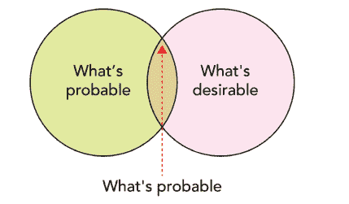

# 将产品演进为AI产品

在本章中，我们将探讨在现有产品中采用人工智能时，哪些领域会受益，哪些领域会产生负面影响。每个产品都会有所不同，每个产品负责人也会就自身产品应融入何种程度的人工智能做出自己的判断。对于某些产品来说，只需添加一个AI功能这样简单的事就足够了。对于其他产品，则可能需要从根本上改变驱动产品的底层逻辑。如何改造产品的决策，首先应取决于你的产品策略，并服务于公司的总体愿景。这些决策应通过协作做出，并获得高管的大力支持。

在本章的后续内容中，我们将探讨AI转型的多个方面，这些内容将作为构建产品策略的分步指南，以支持产品的演进。我们将研究如何就AI选项进行头脑风暴、在头脑风暴时哪些考虑因素最为重要、如何评估你的产品在竞争格局中的表现、如何制定能助你成功的产品策略，以及最终哪些标志和里程碑能帮助你建立信心，哪些则表明你需要重新开始。

我们将在第6章介绍的AI产品开发阶段背景下讨论这些内容：创意构思、数据管理、研发和部署。无论你是添加AI功能，还是升级产品的现有逻辑，制定一个支持产品策略的既定计划，都是成功、可持续地利用AI更新产品以获得商业成功的最佳途径。一旦你成功将产品转型为AI产品，可以随时回到本书第2部分，我们会在那里讲解构建和维护AI原生产品的各个方面。

在本章中，我们将介绍以下主题：

- 创意构思——什么可行，什么可期
- 数据管理——公司的血液
- 竞争——爱你的敌人
- 产品策略——构建对所有人都有效的蓝图
- 危险信号与积极信号——需要关注和警惕的事项

### 创意构思——什么可行、什么可取、什么可期

产品可以从AI应用中受益的方式有很多种。理解“可期、可取、可行”的维恩图是制定AI产品策略的重要一环。要厘清你希望实现的理想结果（可取）、这些结果的技术可行性（可行），以及基于当前约束、数据和优先级可以探索的可行选项（可期）之间的区别。

*图14.1：创意构思的维恩图*

作为AI产品经理，你必须对照你所面临的约束（可行），评估你的愿望清单（可取），以确定概率最高或最现实的选择，然后专注于这些选择。在继续这一练习时，你会经历一系列可能性。你将从一场极其开放、偏右脑的头脑风暴开始，围绕价值的抽象概念以及产品如何为客户创造价值展开探讨；随后，通过左脑的分析性拆解，对头脑风暴的成果进行提炼。这两者都是产品管理创意过程的重要组成部分。更具体地说，这一练习代表了AI产品开发周期中的创意构思阶段。

无论你是从客户面临的主要问题、*待办任务*，还是功能对等性的角度来看待产品，你都需要弄清楚：哪些AI增强功能对你的产品价值最高，哪些成本最低，哪些的数据就绪度或可用性最好，哪些能获得最高程度的高管或市场支持。由于本节讨论的是如何将现有产品演进为AI产品，所以请在这一步上花些时间，因为你将做出一个重要决策：确定哪些问题或机会是AI能够带来显著价值的。务必花时间真正熟悉你面前的模型、收益和可选方案，这一点非常重要。

在深入讨论之前，关于采用“AI”这个术语，需要提醒一句。我们讨论过在AI问题上从“为什么”出发的理念及其重要性。我们还讨论过AI带来的营销热度，以及它对投资者和客户同样具有吸引力。在当前的AI环境下，当AI和ML进入产品沟通的词汇表时，会产生大量噪音。你不想落入这样的陷阱：吸引大量关注，却没有支撑这种关注的实质内容。其中很大一部分在于明确对已识别的问题或机会使用AI的可行性。

我们最不希望看到的是，产品经理和技术人员费尽心力投资AI，却只为了利用AI带来的关注度，推出一些不能真正改善产品的表面功能。审视数据的可用性、所需的基础设施和潜在的技术限制，意味着你要诚实地面对所提议的AI功能究竟能为产品带来什么。因此，我们建议你把握AI和ML将为产品带来的真正机遇，评估技术能力与水平，然后创建一系列列表，按照三个关键类别——价值、范围、触达——对这些潜在机遇进行排序。

头脑风暴和创建这些列表的最终目标，是为你产品内部的AI成熟度定义一条潜在的路径。了解当前产品的不足之处、希望从哪些领域开始用AI加强，以及希望将哪些领域作为整体产品策略和路线图的一部分进行转型，将是这一过程的重要环节。AI转型不会一蹴而就。你总得从某处开始，而且考虑到投资AI的成本，在选择起点时做到有策略、有意图，从长远来看将产生天壤之别。

在接下来的小节中，我们将从不同视角来审视AI应用中的创意构思。这些视角涉及：AI应用将如何基于客户感知价值影响你的产品，AI应用将如何影响产品的范围，以及最终AI应用将如何触达最终用户。

### 列表1——价值

产品管理工作常常需要高度权衡。你总是在评估将一个功能推向市场所需的努力和技能，并将其与进行该建设投入的预期收益进行比较。不过，如果你确实从最高价值的AI增强功能入手，那么你的出发点将是直觉性的、以客户为中心的。首先理解是什么让你的产品对客户和市场有价值，然后找到AI的用例来扩展这种价值，这应该是首要任务。

你以后在决策变得更加困难时，以及在不可避免出现时，需要一份类似的事实来源清单来与公司领导和其他关键利益相关者进行政治讨论。你的价值清单之所以应该是首要的事实来源，是因为每个产品从根本上都需要一个价值主张：一个关于你的产品如何为其客户和用户带来价值的陈述。世界已经有足够的虚假广告、过度承诺和夸大宣传，尤其是在科技领域。2019 年的《人工智能现状》研究调查了声称拥有尖端人工智能产品的欧洲公司，发现其中高达 40% 并未实质性地使用人工智能。这一点在 2023 年的欧盟统计局委员会中也得到了进一步印证，该委员会仍反映出在欧洲只有 8% 的企业以有意义的方式使用人工智能。建立一份真实的人工智能增强功能清单，这些功能将为你的客户带来真正的价值。打造一款你引以为傲的人工智能产品。从真正重要的事情开始。

这份价值清单不应该只是你想添加到产品中的功能清单。它应该是对你的产品为其用户和客户提供的价值类型的总结。功能是描述性的、实事求是的。价值则与价值密切相关。如果你很难理解两者之间的区别，可以从功能本身开始，然后进一步思考每个功能，并写下该功能对你的客户实际上为什么重要。如果你能做到这一点，那么在评估你的产品将要竞争的产品时，你也能进行此项练习。尝试了解你的竞争格局中的产品是否能为你的市场提供同等水平的价值。另一种看待价值的方式，特别是对于那些已经推出自己的人工智能功能或升级的竞争对手，是了解这些决策可能如何影响市场中的价值感知。

将此视为发散性思维练习。我们在本书中花费了相当多的篇幅来介绍机器学习和深度学习中可以采用的各种用例和模型。我们还研究了多个垂直领域、行业和高层采用趋势。你如何将这些优势应用到自己的产品中？发挥创意，尽量不要让后勤考虑阻碍你的想法流动。任何感觉对你甚至只是很小一部分客户来说本质上是有价值的东西都可以而且应该列入此清单。如果有帮助，请考虑我们在前几章中介绍的各种模型类型，以及它们能为你目前的产品带来什么价值。盘点各种机器学习类型可能为你的产品带来的好处，并看看它们在何处能够改进与产品和客户相关的现有用例。当你思考价值以及如何在产品中增长价值时，使用此清单练习作为一种方式，将所有潜在的想法都列出来，无论它们看起来多么离奇或不切实际。请记住人工智能的各种优势：堆叠、排序、优化、预测、分组、比较、自动化、标准化，以及从持续趋势和分析中学习。在尽职调查的基础上，你应该在完成此练习后对产品基于其当前价值主张可能采取的潜在方向感到鼓舞。在这项尽职调查的基础上再加上一些运气，你还应该体验到人工智能带来的新好处。稍后会有充足的机会来精简这份清单并对其进行现实的完善。Marty Cagan 的著作《Inspired: How to Create Products Customers Love》概述了产品团队在开发产品时需要解决的“四大风险”。稍后精简你的想法清单的一种方式是根据价值风险对其进行评估。Cagan 将其定义为客户或用户可能根本不会足够重视所提出的特性或产品以至于购买它或定期使用它的风险。

减轻这种风险的最佳方式之一是让产品团队关注他们是否在解决一个真正的问题或满足一个真正的需要，所提出的解决方案是否做到了这一点。在没有先验证需求的情况下开发产品或功能将导致高成本和高能量输出，却几乎没有回报。你可以开展市场研究、原型测试和客户访谈来验证在此阶段产生的想法。

现在，让创造力自由流动，思考你如何能够在现有产品为其客户和用户提供的价值基础上进行构建。在此步骤中你会因不那么挑剔而得到回报，因为你永远不知道这个清单上的边缘想法中的哪一个可能会成为未来功能的宝贵种子。头脑风暴潜在的功能和用例也是人工智能产品经理可以做到的最有趣的事情之一——想办法让这成为你产品战略工作中的标准部分，并在每季度或每半年重新审视一次。

在此阶段结束时，你应该能够回答关于价值的一些问题：
- 我对当前客户在功能层面上如何使用产品了解得多好？
- 哪些功能对我的客户最有价值且使用频率最高？
- 这支产品团队希望用人工智能解决的客户痛点有哪些？
- 这个拟议的人工智能功能将解决什么真正的客户问题？
- 我拟议的人工智能功能的核心价值主张是什么？
- 人工智能的采用如何改善此功能的用户体验？
- 哪些类型的人工智能/机器学习模型或技术对此功能最有益？
- 客户不重视此功能的风险是什么？

## List 2 — scope

一旦你有了上一节中最高价值的人工智能增强功能清单，你就可以开始将它们按从大到小的范围进行优先级排序。范围不仅包括完成一项工作所需的时间和精力，还包括完成该工作所需的成本和技能水平。鉴于我们在这里谈论的是人工智能产品，可能并不那么简单就能理解什么需要最多的努力、时间、成本和技能。通常，我们直到在构建这些功能的过程中才知道这一点，但尽你所能为此清单创建一个从最费力到最不费力的排序。

这份清单不会是绝对的事实来源，也不必是。它也不一定意味着涉及最少努力的项目会先被构建，但重要的是要确定哪些类型的增强功能需要公司投入更多资源才能完成。从规划和资源管理角度来看，了解努力程度的多样性是最重要的。如果某些功能需要构建，并且它们需要你可能不方便拥有的大量努力、时间或技能，那么知道这一点将有助于预测并在未来做出必要的计划来获得它们。

这也将使你的领导团队有时间和专注力真正内化人工智能投资实际上需要他们付出什么，以及你是否目前拥有足够的技能和能力甚至踏上这条道路。花时间讨论范围并明确组织当前的水平是此步骤的重要组成部分。获取合适的技术资源以实现最高的人工智能梦想本身可能就是一段艰难的旅程。你的领导团队需要为此做好准备。

这不仅仅是获取人才的问题——了解内部流程需要做出什么改变也是如此。通常，对于人工智能来说，管理期望可能是使人工智能转型成功的最困难的部分，因此你在开始利用人工智能的过程中，尽早为领导层做好准备，应对可能影响你的种种考验和磨难，将会在不可避免出现障碍时大有裨益。

正如任何产品经理所知，范围是决定构建什么以及何时构建的重要因素，你需要确保自己在领导层关注人工智能功能时确立自己作为权威的地位，即使你身边有一支成熟的数据科学家和机器学习工程师团队，你可以信任他们，他们拥有丰富的经验和人工智能智慧，作为人工智能产品经理，你仍然拥有产品并负责与产品相关的最终战略。重要的是你保持对产品关键人工智能考量和影响产品的重大决策的高水平监督和掌控，因为你是那艘船的船长。恭喜！这是一份天赋，也是一份诅咒。

这种责任也与 Cagan 的“四大风险”中的另一个风险相关，即可行性风险，该风险关注产品或能力是否可以用现有资源实际构建。无论想法如何变为现实，总是会有时间、技能组合、技术能力或组织能力的某种组合需要你权衡。尽早诚实地解决可行性意味着技术利益相关者将致力于能够兑现其承诺的事情。

如果你无法为与产品相关的决策辩护，你就不是权威，这只会造成混乱并在以后削弱你的领导力。记住你的技术团队在那里支持产品，提供真诚的建议，并就范围以及如何构建由组织战略部门决定的功能给出最佳估计。他们在那里构建和实施你与领导层和利益相关者团队共同做出的决策。拥有清晰的所有权定义，并利用你的技术团队尽其所能准确反映范围，这正是此练习的全部内容。

在此阶段结束时，你应该能够回答关于范围的一些问题：
- 开发、实施和维护此人工智能功能需要多少时间/精力？
- 开发此功能的预期投资回报率是多少，技术领导层是否已认可？
- 是否缺少构建此人工智能功能所需的技能和资源？
- 你将如何计划填补构建此人工智能功能所需的技能/资源差距？
- 支持此人工智能功能需要改变哪些内部流程？
- 未交付此人工智能功能的主要风险是什么？

## List 3 — reach

到目前为止，你已经有了两种透镜来审视你提出的产品 AI 增强功能——终极价值的透镜和范围的透镜：工作量、时间、技能水平和成本。正如你可能注意到的那样，在我们的第二份清单中，我们从发散思维转向并增加了更多分析性的、收敛性的限制。通过这第三份清单，你将通过影响你现有客户的数量——即你的覆盖面——这一透镜增加另一层条件。

能够创建这份清单需要你对现有产品有足够的熟悉程度，细化到功能层面。了解你的客户子集如何使用你的产品以及哪些功能在他们体验你的产品时最具决定性是必要的。

如果你不了解客户如何体验你的产品，就无法准确预测这些来自原始清单的拟议价值项目的覆盖面。如果你不了解他们如何使用你的产品，也就无法向你的领导团队阐述为什么某些 AI 增强功能对你的客户有价值。

这似乎是一个非常显而易见的陈述，但你会惊讶地发现，有多少 PM 对客户实际如何使用自己的产品知之甚少。AI PM 可能会陷入把产品团队建设成功能农场的陷阱，很少有人会停下来确保产品是整体和可持续地构建的，但与客户和用户保持亲密关系是 PM 工作的重要组成部分。如果你没有使用产品分析或定期通过直接客户访谈或应用内/平台内调查与客户沟通，那么你实际上并不知道客户如何体验你的产品。

如果你对客户如何使用你的产品以及他们认为最有价值的部分没有强烈的把握，那么你就限制了你的覆盖面，并且在黑暗中构建。这种黑暗使你暴露于 Cagan 的“四大风险”中的另外两个：可用性风险和商业可行性风险。可用性风险涉及对你的功能或产品的有效使用。即使一些客户看到了你的功能或产品的价值，他们也可能难以实际使用它。如果它不够直观、难以导航，或从用户期望的角度来看不自明，你就会失去这些用户。这是一个失去覆盖面的实际原因。Cagan 的另一个风险更具哲学性。商业可行性风险基于公司的整体商业目标使某些用户疏远。如果产品无法支持公司的财务模式、法律限制、品牌声誉或长期战略，你也可能因此失去覆盖面。

如果你进行到练习的这一部分才刚刚意识到自己没有这些信息，那么你就需要开始做功课并重新开始这份清单创建练习。这再次与我们第一份清单上的原始价值项目联系起来。如果你发现自己处于这种情况，没有关系。保留你的原始清单。了解你的客户以及他们最喜欢你产品的哪些方面，然后重新开始练习。这就是产品管理的美妙之处之一。你总能发现更多！随着你构建更多产品并接纳更多客户，关于你的产品有更深层次的真相等待被发掘。永远不要气馁。如果有未解答的问题，这只是学习的机会。

在这个阶段结束时，你应该能够回答关于产品覆盖面的以下问题：

- 我的当前客户中有多少人会直接受到这个 AI 功能的影响？
- 哪些客户细分群体将从拟议的 AI 功能中受益最多？
- 我将如何确保这个功能直观且易于理解/采用？
- 这个 AI 功能如何与企业的长期产品战略和产品路线图保持一致？
- 什么证据（数据、研究、反馈）支持对这个 AI 功能的需求？
- 优先考虑这个 AI 功能的潜在挑战或风险是什么？
- 什么法律、伦理或监管限制可能限制这个 AI 功能的覆盖面？

## Case study

2024 年 1 月，Shopify 推出了系列 AI 驱动的商家和客户体验功能，以帮助他们支持的在线零售商简化运营。我们将使用刚刚讨论的框架来描述 Shopify 如何识别高价值 AI 增强功能、评估范围和可行性，以及了解客户覆盖面和可用性。以下是 Shopify 为其平台的 AI 转型所纳入的 AI 功能列表：

- **商品化功能**：能够存储更复杂的产品目录（以及更多颜色、尺码和 SKU 选项的多样性）、合并列表并创建网络。改进分类法以减少创建产品列表所需的时间/精力，并通过自动化标准化类别和产品属性减少手动重复工作。
- **店面性能功能**：推出新的网页性能仪表板，显示如何改善商店的页面排名以实现更多销售。他们还改进了基础设施速度并扩展了买家的全球足迹。
- **语义搜索**：提供更相关的搜索结果，即使不使用特定关键词，客户也更有可能从中购买。
- **数字广告**：推出 Shopify Audiences，它使用 ML 来改进数字广告、找到更多客户、降低 **客户获取成本 (CACs)**，并通过可用于 Meta、Google、Pinterest、Snapchat 和 TikTok 等广告平台的自定义定向列表提高 **广告支出回报率 (ROAS)**。更智能的再营销算法也已推出，再营销受众规模至少翻了一番。
- **Shop Campaigns**：他们将之前的 Shop Cash 优惠功能重新品牌化为 Shop Campaigns，作为一项无风险的客户获取计划，在商家无需构建新受众或创建新资产的情况下将新客户带入商店。
- **AI 行为准则**：商家对 AI 采用速度在他们行业中过快表示担忧，Shopify 为其商家提供了 AI 行为准则，据报道有 78% 的商家已采用它。
- **Shopify Magic**：一套免费的 AI 启用工具，包括：
  a. **Media Editor：** 一个生成式 AI 应用，可让你即时免费生成产品图像
  b. **Smart Sidekick：** 一个 AI 启用助手，可让你管理生产力、改进工作流程、改善决策并减少运营任务上的时间

现在让我们分解一下并通过价值、范围和覆盖面的视角讨论 Shopify 对 AI 的采用。

### Value

Shopify 希望专注于提供能够帮助商家（他们的客户）更好地了解他们自己的客户的功能，从而能够为他们在平台上销售的产品提供更好的转化。由于 Shopify 是一家 B2B 公司，团队通过进行广泛的市场研究和客户反馈会议来开展这项工作，以确保他们了解什么对客户的业务运营影响最大。通过这一过程，他们发现实时个性化产品推荐对改善客户参与度和扩大销售影响最大。这一方法最令人鼓舞的地方在于 AI 功能形成了一个双赢局面。Shopify 通过提供客户认为有价值的 AI 增强功能而获胜。他们的客户也通过使用有价值的功能而获胜，这些功能也为他们带来了更好的客户体验和更多销售。

### Scope

Shopify 希望评估实施他们确定的 AI 功能所需的资源，并盘点了开发和维护他们集成到产品中的 AI/ML 模型和能力所需的专业技能。他们的挑战是在不破坏平台上已有的用户体验的情况下集成这些新功能。Shopify 工程团队随后必须以一种使其易于扩展和集成同时保持当前平台性能的方式开展新功能。Shopify 还必须通过聘请额外的数据科学家和 ML 工程师来填补其技能能力方面的空白，以支持新的 AI 驱动功能。他们还投入时间和资源通过专注于 AI 能力和技术的培训计划提升现有团队的能力。

### Reach

由于 Shopify 已在使用高级分析来了解他们的商家（客户和用户）如何使用平台以及在运营业务或与客户合作时面临哪些挑战，因此他们能够依靠这一基线数据来了解这些新的 AI 功能和能力将为客户提供的潜在覆盖面。这也意味着他们能够及早共情客户最关心的问题，这意味着他们的拟议解决方案适用于尽可能多的客户。Shopify 还与一小部分精选商家进行了 Beta 测试，以确保他们满足可用性标准并在过程中获得真实商家的反馈。发布后，Shopify 还使用用户反馈和性能指标继续改进他们推出的 AI 功能。

这项工作的成果和影响提升了他们平台上的客户参与度。商家报告称，由于更有效的产品推荐，转化率有所提高，客户互动也通过自动化支持得到改善。除此之外，Shopify 通过在 AI 应用方面的创新，在电子商务领域赢得了领导力影响力和品牌支持，这使他们成为行业中的领导者。Shopify 能够整合 AI 功能（其中许多是免费的），同时以战略性的方式审视范围与触达，这提升了公司的声誉以及产品的价值。

对于许多想要产生影响力的 AI 产品经理来说，这个案例研究既是一个典范，也是一份激励。随着时间推移，他们可能会更深入地了解是什么让他们的平台对商家有价值，并开始更积极地通过追加销售和高级功能实现商业化。但通过以 AI 增强的平台进入市场，并慷慨地提供这些功能，他们正在帮助所有商家在整体上更适应 AI 的采用。这提醒我们，你并不总是需要如此专注于特定功能的投资回报率。当一次发布意味着为整个生态系统拓宽视野时，投资回报率可以退居其次。

现在我们已经根据价值、范围和触达，拥有了潜在 AI 应用来源的优先级列表，我们可以继续讨论将传统软件产品演变为 AI 产品的下一个重要考虑因素：数据就绪性。确保我们的数据处于易于处理的格式，以便能够应对新的 AI 能力，这将是希望跃入 AI 领域的产品经理的下一个重点关注方向。

## 数据管理——公司的血脉

在产品经理开始着手构建和开发产品、为测试做好准备并将其交付给客户之前，他们需要非常明确如何定位自己产品的策略。这就是我们在上一节中看到的维恩图练习背后的思考过程。既然我们已经讨论了 AI 产品经理如何处理潜在的 AI 增强功能，我们可以为这个列表再增加一层审视。这一额外层面聚焦于数据，数据将为这些列表中的每一项提供动力，它代表了 AI 产品开发周期的第 2 阶段。

一旦 AI 产品经理开始了解他们可以利用现有数据源做什么，以及需要哪些数据源才能使列表上的项目成为现实，我们就离真正制定计划不远了。这个阶段涉及收集正确的数据，这些数据将用于从内部系统、第三方提供商、客户互动或外部物联网设备（如传感器）训练和测试 AI/ML 模型，处理和提炼这些数据以使其达到 AI/ML 就绪状态，并安全地存储和保护这些数据。

在以下小节中，我们将讨论数据就绪性的关键领域：

-   准备和研究你可用的数据
-   评估你现有数据的质量并与你的数据团队合作
-   利用数据来衡量产品当前和未来的采用情况，并定义成功

-   是否正在满足数据安全和隐私基准？这些基准将如何随你的 AI 系统而改变？
-   你将为自己的 AI 系统实施哪些数据治理、数据管理、所有权和访问标准？
-   你的数据是否为下一阶段（研发）做好了准备？
-   你的数据中是否有足够的特征来训练你将在 AI 系统中使用的 AI/ML 模型？

AI 产品经理在这个阶段面临的关键挑战和常见问题围绕数据就绪性、可用性和覆盖率。将各种来源的数据合并为可供 AI/ML 系统消化的格式、数据不足以及规划未来的可扩展性，都是希望在复杂数据生态系统中游刃有余的 AI 产品经理所关心的问题。以下是 AI 产品经理在这个阶段可能面临的一组常见问题：

-   **数据和 AI 目标不一致：**确保你使用的数据具有 AI 系统优化运行所需的正确特征，在这个阶段至关重要。有时，你拥有的数据可能缺乏解决 AI 用例所必需的特征。盘点为 AI/ML 能力提供动力的数据需求，并确保这些需求反映在产品需求文档和其他文档来源中。
-   **数据集成中的兼容性问题：**产品的 AI/ML 能力通常需要各种内部和外部数据源，这可能会在数据管道中引发下游并发症。在与支持你 AI/ML 能力的数据工程师合作时，确保他们考虑到了所有将进入 AI 系统的数据，并且他们已经核实了所有相关数据源。
-   **预测数据需求：**AI 产品经理需要准确评估其 AI 系统需要多少数据量来支持其 AI/ML 产品能力。需要与 ML 工程师和数据科学家讨论多少数据才足以满足训练需求。预测未来数据需求也是如此。AI 产品经理需要确保提前与相关利益相关者讨论当前和未来数据属性及数据量的重要议题。
-   **维持支持：**AI 产品经理需要意识到未能有效管理数据预期所带来的风险。如果你的领导团队认为组织中的数据挑战解决起来成本过高或过于复杂，这可能会威胁到他们对产品 AI/ML 能力的支持。数据重组需求也是如此。如果需要重组数据以满足 AI 系统的新要求，这可能会影响路线图的预算和规划。

## 确保高质量的合作伙伴关系

如今这已成为一句陈词滥调，但在 AI、数据科学和 ML 圈子里，那句老话是 *垃圾进，垃圾出*。这是 AI 的先验真理。如果你没有充分准备和清理数据，你的模型就不会为你提供所寻求的洞察和价值。如果你发现自己处于这种境地却无视 AI/ML 团队的建议，你将不得不为一个内部 AI 项目辩护，而你的领导团队会认为这是在浪费时间和金钱。而且他们是对的，这确实是浪费时间和金钱。

在 AI 产品生命周期中，与其把数据管道策略视为产品的必要输入，不如将其视为与你的模型和开发者共同创造 AI 产品的合作伙伴。你的数据管道将构成 AI/ML 项目的很大一部分，如果实施不当，它会在你评估不同模型时使产品开发周期的第 3 阶段（研发）变得复杂。你需要把它看作一个项目。编排和协调你的数据源以及数据质量，将是你 AI 成功的重要组成部分。要承认采用 AI 将对你的组织构成一种范式转变，如果你过去能够依靠充满重复数据和被污染数据井的不兼容数据孤岛蒙混过关，那么在采用 AI 时就不会再这样了。

组织在数据质量方面面临的最大阻力来自内部：即保持流程一成不变的内部阻力。什么都不做很容易。维持现状是大多数人的自然本能。即使你的组织对成熟自身的数据实践充满热情，并且你在组织内的所有主要利益相关者团队中都有倡导者，这仍然不够。你需要积极宣传在数据质量方面转变思维模式的重要性，以及实现这一转变所需的成本和时间。口头承诺改善数据质量是一回事，真正看到它切实体现在团队的行为中又是另一回事。

要做好遇到内部阻力的准备，并尽最大努力传达空头承诺的风险。请记住，当你改变一个已经存在一段时间的产品的流程、工作流和部门习惯时，你会面对整个团队的人，他们已经习惯了以某种方式行事。做出这些改变需要集体的努力。这不仅仅是领导层说了就会发生的产品演进。这是一个需要所有接触现有产品的员工共同合作的产品演进。同时也要花时间管理好自己的期望。可能会有让你感到沮丧的日子，也可能会有几周看不到任何变化、让你重拾旧习的时候。这是一个过程，需要时间才能被完全内化。

建立并成熟一个数据团队也需要时间。具体需要多长时间取决于你和你的领导团队。你可能会想聘请数据战略顾问，或与你的技术利益相关者进行深入会谈，以真正理解如何组织数据管道，从而最好地赋能 AI 应用。你甚至可能想直接着手建立一支专门的跨职能数据团队，负责监督你的数据。让专门的人员来研究如何集中你拥有的各种数据孤岛，并决定集中这些数据、将其发送到开发中（最终是生产中）的模型的最佳方式，这将是解决数据中不可避免出现的各种不一致问题的绝佳途径。

在我最近负责管理数据产品的一个职位中，我们组织分配给管理数据质量的时间短得令人难以置信。尽管与领导层进行了广泛沟通，以管理未更充分投入解决数据质量问题的风险，我们仍被要求在时间限制下继续推进。但最终，仪表盘和数据表并不可靠，因为这项工作是不可持续的。在评估结果和制定规划后，我们提出了一个数据质量模型，让我们的团队与来自各部门的数据管理员更紧密地合作，使他们成为特定领域内数据的主题专家。

这个过程仍然花费了一些时间——至少六个月的工作才能触及每个部门数据的根本问题，但之后我们拥有了可供所有后续衍生产品依赖的数据管道和数据表。我们的工作带来的影响是，此后所有其他产品都将来自我们能够信任的、经过适当审查的数据。数据团队与几乎所有其他团队代表之间的合作意味着我们可以重塑围绕数据组织的文化。这段经历也告诉我们，有时我们必须坚持我们认为正确的事情，尤其是当领导层不愿意为那些非常值得投入时间和金钱的项目投入时。

将这视为对研发和产品设计阶段的投资，并给予它应得的时间，因为它是 AI 基础设施的基础部分。你如何存储数据、多久调用一次数据、多久需要训练一次模型，以及如何规划发布计划来支持新的 AI 基础设施，都将成为这次讨论的一部分。在这个阶段，这只是一次讨论。还没有做出任何决定，但你需要尽早开始讨论，因为当你准备开始考虑模型、训练和测试时，你会希望手头有干净、丰富的数据来喂养这些模型。

理解你的数据、探索它、试验它、整理它、为特征开发（针对机器学习模型）准备它、在建模中使用它、评估这些模型的性能，以及最终部署它，都将是常规的讨论要点。因此，在任何关于如何利用 AI 的真正决定最终确定之前，尽早开始关于数据策略的对话是一种战略举措。这也让技术声音能够比他们可能预期的更早成为对话的一部分，因为采用 AI 是一项高度技术性的投资，这些声音应该尽早出现。

正如我们在前几章中所看到的，特征工程是让你选择在产品中使用的模型取得成功的主要部分。这进一步强化了这样一种观点：你需要确保你的技术团队在关于训练集中包含哪些类型数据的重要决策上发表意见。

与你的数据和团队进行高质量协作将帮助你解决的一些关键方面包括：

- 保持强大的数据完整性实践，以确保你在 AI 产品开发周期的研发阶段开始时不必回溯步骤。
- 建立跨职能协调，使所有利益相关者共同创建流程、减少内部阻力，并提供支持 AI 能力的工作流。
- 在战略和可扩展性方面的长期稳定性意味着团队投资于可持续的 AI 基础设施，以便团队可以安全地提前规划。
- 将采用 AI 视为研发的一部分的重要性意味着企业将适当地投资于正确的数据基础设施、数据战略顾问和 AI 跨职能团队建设。
- 确保组织投资于跨部门建立数据和 AI/机器学习素养，以便团队能够有效协作。
- 数据管道是否足够干净、集中和可扩展以支持 AI 功能。

## 设定基准与定义成功

数据已经是公司的命脉，支撑着从内部决策到产品表现的方方面面：

- 你的客户和产品数据将帮助你了解产品的哪些部分已经具有价值，并帮助你推断哪些拟议功能将对你的客户产生最大影响。
- 你的历史内部数据将帮助你了解哪些功能传统上花费最长时间才能体现在你的产品中，以预测未来的范围。
- 你的产品分析将帮助你了解哪些 UI/UX 和设计变更可能影响最大。
- 你的训练和性能数据将帮助你了解哪些机器学习模型最适合你的客户。
- 你的运营数据将帮助你了解哪些部署最成功以及原因。

数据帮助你管理发布计划和产品路线图，并帮助你扩展产品。使用数据建立现有基准将是围绕你的 AI 采用计划创建叙事的重要一步。这是因为，在未来的季度和年份，你希望能够证明 AI 已经在一些最令人信服的内外部用例上发挥了作用。如果你从一开始就没有建立基线，以后你就无法知道你已经走了多远。

作为 AI 产品经理，在展示你的产品借助 AI 能够达到的里程碑时，你会希望从强势地位出发。业务会发展，指标会来来去去，但在你踏上 AI 采用之路之前，充分利用你已经拥有的数据，这样当时候到来时，你才能真正反思你的进展。

你还将使用你的内部数据来设定指标，我们在本书第 2 部分中已经讨论过这一点，以定义你的产品的成功是什么样子。定义成功将是一项协作行为，对于 AI 产品经理来说，重要的是让公司的所有主要利益相关者都参与进来，就定义这一成功达成一致。如果产品向 AI 的演进没有纳入你的市场推广、销售、市场、战略、工程和领导团队的声音，它将不会获得所需的适当程度的支持，无法真正有效、获得资金并在内外部得到推广。

也许最重要的是，如果没有适当程度的支持，你的产品的成功也不会在组织层面与你最重要的业务目标挂钩。与这些团队建立适当水平的数据流畅度，并使用数据来支持你关于产品方向的声明，这是不容商量的。对自己、你的组织以及你的技术人才在数据方面要有耐心。数据为我们讨论的整个努力提供动力。不要屈服于匆忙行事的压力。总是有尽快进入市场的业务要求。直接开始并边做边建的本能将永远是 AI 产品经理和领导者都必须抵制的东西，但不要急于求成。

以下是一些你可以问的问题，以确定你是否为成功做好了准备：

- 我们是否拥有清晰的现有数据基线，以便在引入 AI 功能后进行比较，例如客户行为、产品表现和内部流程？
- 我们是否定义了具体的可衡量结果和指标，以表明我们可能想要添加的 AI 功能的成功？
- 所有主要利益相关者（市场推广、销售、市场、工程、领导层）是否在这些指标上达成一致？
- 是否有足够的高管支持来支持潜在的 AI 功能？
- 领导层是否有足够的资金、承诺和倡导，以确保你的 AI 转型长期成功？
- AI 转型是否支持总体业务目标，如收入增长、运营效率或提升客户满意度？

## 竞争——热爱你的敌人

既然我们已经讨论了在产品内部构思 AI 采用潜在领域的内部流程，以及确保数据准备好采用 AI 的阶段，我们可以转向你的外部环境和内部发展。

你的竞争对手将提供一系列可能性，让你了解 AI 采用对你的产品而言会是什么样子。我们不建议模仿竞争对手的 AI 策略，而是在权衡选项时，将竞争对手的 AI 采用情况作为输入。模仿竞争对手的 AI 产品经理面临产品失败的风险，因为这样做会使他们失去对客户、投资者、合作伙伴和员工而言的特殊性。你的产品是独一无二的，这正是它吸引人的原因。拥有你独特的价值主张，并找到一种方法让它通过 AI 变得更加特别。使用你已经拥有的数据会让你走得很远，但总需要将外部世界的反馈循环附加到这些数据上。了解你的竞争对手将有助于你制定战略。它将为你提供来自同行已经实现你想要的跨越的例子。你从竞争对手那里看到的一些例子将成为灵感的来源，而另一些例子将帮助你避免某些错误。在研究竞争对手时尽职尽责，特别是那些也拥抱了 AI 的竞争对手，将对你选择构建什么产生一定影响，并且应该成为影响我们之前建立的列表的因素之一。

有些人会反驳这一点，并说你应该根据自己对市场和客户问题的理解来构建产品。那种认为你应该专注于要解决的问题，而不受竞争格局有时可能掩盖的影响的想法，是出于好意但非常有缺陷的。我们不是生活在真空中。产品会与同类产品进行比较，在许多情况下，一个产品定义了另一个产品。无论你是面向消费者还是其他企业销售，你的产品都将与类似的产品进行比较。了解你的竞争对手并不一定意味着你会像他们一样构建，但它确实为你提供了一个有价值且现实的视角。忽视竞争对手对你的产品的影响，就像忽略重力一样。无论你认为它会不会影响你，它都会影响你。

另一个重要的点，这里不提及就说不过去了，那就是要认识到，你的竞争对手很大一部分包括你自身产品的过去迭代。你与自己过去的做法在竞争。你与产品的旧版本在竞争。对这个旧版本进行批判性思考，特别是那个没有利用 AI 的版本，将会成为你设计流程中非常重要的一部分。思考一下它的局限性，以及旧版产品为你的客户提供了哪些机会、优势和挑战。你如何利用这些机会、局限性和挑战来打造这个新版本？将产品旧版或当前迭代视为对你当前产品的威胁。

当你思考竞争格局时，你可能会想深入到功能层面，并与主要竞争对手做一个对比矩阵。这通常是一个值得做的练习，特别是对于销售、营销和用户参与团队来说，在后续阶段，但在这个阶段来说，为时过早。尝试从我们最初开始的原始价值清单的角度来分析你的竞争对手。

了解你的竞争对手是很好的方式，不仅可以理解你自己的产品可以采取的可能方向，还可以窥见你所处的行业正在走向何方。了解你所处的竞争格局以及它如何变化，可以强烈影响你洞察行业趋势的能力，并决定你是否想要积极参与这些趋势，或成为这些趋势的推动者。进入市场本身就是一个完整的专业领域，而作为一名 AI 产品经理，你在很大程度上戴着这顶帽子。你对所服务的市场以及该市场如何随着 AI 而演变越熟悉，你在决定如何在自己的产品中利用 AI 时所处的地位就越强。

到目前为止，我们已经头脑风暴了 AI 可以在你现有产品中采用的潜在领域，掌握了数据就绪情况，并评估了 AI 采用在你的竞争格局中是什么样子。这些都是你在为产品进行 AI 改头换面时制定产品战略时会考虑的有价值的输入。在以下章节中，我们将介绍如何构建一个与我们所做的头脑风暴相一致的新产品战略。

## 产品战略 — 构建一个适合所有人的蓝图

到现在为止，我们已经头脑风暴了一些潜在想法。我们盘点了我们的数据，以及可以从竞争对手和更广阔市场中获得的洞察，我们终于能够来到绘图板前，构建一个将反映产品下一个主要时代的产品战略。从传统软件产品转向 AI 产品绝非易事，它应该被视为对产品的巨大改造，因为我们构建的方式、我们构建的内容，以及我们存储、收集和使用数据的方式都将大幅翻新。

构建产品战略将直接影响你的产品路线图，这将帮助你确定产品的哪些部分需要首先转变，才能在产品 AI 转型和商业成功方面取得成功。然而，在创建与产品新价值体系相契合的产品战略和创建反映该战略的产品路线图之间存在很大区别。

路线图是未来一年内将要构建的主要里程碑和功能的建议时间表。路线图不应在你的产品战略得到关键利益相关者的认可之前出现。路线图源于该战略，而不是相反。

我们不会先构建我们能构建的东西然后希望一切顺利。我们利用我们收集到的关于产品的集体知识和智慧，以及如何最好地利用 AI 能力进入市场，来达成共识。在以下小节中，我们将介绍产品战略流程，以及提出一份如何制定适合所有主要利益相关者的产品战略的建议清单。

在接下来的部分中，我们将介绍产品愿景、产品战略和产品目标，以及它们如何相互关联。然后我们将探讨如何最好地执行一个支持 AI 功能和能力增长的产品路线图。这不一定是操作指南，因为顺序和你所做的贡献将取决于你的具体产品。相反，这可以被视为一个检查清单，以确保你朝着正确的方向前进：

- Product vision
- Product strategy
- Product goals
- Product roadmap

### 产品愿景

我们不会深入讨论公司使命宣言或愿景的具体内容，但可以说它会存在。如果它不存在，这是一个很好的时机来生成一个简单的声明，概括你的组织存在的初衷。它试图实现什么以及愿景是什么？从这一点出发，你的产品愿景是与组织为其所服务的市场制定的更高层级目标保持一致。在你的产品愿景中，你试图简单地解释你如何看待你的产品为其目标市场服务。你的客户和市场面临哪些需求和问题，你的产品如何满足这些需求？在你思考 AI 如何塑造该愿景之前，先尝试确定这一点，然后花点时间反思引入 AI 后会发生什么变化。尽量将其提炼成一句话，如果绝对需要，可以是两句。

收集反馈和制定产品愿景都是协作工作，并非仅由产品经理单独完成。相反，产品经理将合适的人聚集在一起，确保利益相关者团队达成集体共识。你应该负责组织这些决定的会议，并且你的工作是确保你带着所有在场人员都能接受的东西离开会议。你将定期与利益相关者在我们已经讨论过的产品战略会议中会面，你将有许多机会重新评估这一愿景如何演变。如果你的产品愿景是产品背后的“为什么”，那么你的产品战略将是“如何”，而你的产品目标将是“什么”。产品愿景就是愿景：它代表了产品对用户或市场将产生的某种理想未来状态或最终影响。它是一份声明，将使每个人的努力与该理想未来状态保持一致。

以下是知名公司的产品愿景示例：

- **LinkedIn：**“为全球劳动力中的每个成员创造经济机会。”
- Slack: “让工作生活更简单、更愉快、更高效。”
- Ikea: “为大众创造更美好的日常生活。”

> 如需对产品愿景及其对与领导层和公司价值观保持一致的管理影响进行更细致的讨论，请随时参考第 11 章。

### 产品战略

知道并同意你的产品存在的意义，可以让你将你在早期进行头脑风暴和构思的所有活动置于上下文中，并将其形成计划。产品管理首先是一份创意工作，最困难的部分是知道从哪里开始。开始于一个已经存在的产品的美妙之处在于，你有一个起点。一旦你能够开始使用我们在本章中已经介绍过的一些清单和练习，你就可以开始构建你的产品战略了。

这将作为产品将如何随时间构建的高层计划，并融合了表达产品的诸多方面：营销、分销渠道，以及它将如何传达给你的客户。请记住，你的产品战略的许多要素都将源于产品开发过程的第一阶段：构思。在此阶段，将探索许多想法，每个想法都有其优先级。这些想法将说明你目前的产品状况以及你想要去的方向。

调和所有这些将是一个把所有这些碎片拼凑成粗略草案的行为，这将使你触及构建产品战略的核心：决定你的组织希望通过产品实现什么，并创建与整体公司愿景一致的产品战略。如果产品战略是产品愿景中“为什么”的“如何”，这意味着它将描述团队如何达到那个理想的未来状态。产品战略将把愿景分解为可操作的步骤和优先事项，最终指导路线图和既定的产品目标。它将包括诸如：

- 产品团队希望如何在市场上竞争并定位产品
- 客户是否会围绕产品进行定位和细分
- 市场上的关键差异化因素和需要构建的关键功能

### 产品目标

接下来，你为产品设定目标——没有设定高层目标就谈不上战略。这些目标将是一项批判性思考任务，将源于你的产品愿景，特别是现在这个愿景涵盖了 AI 在适合你产品的任何形式下的采用。这些将是从产品战略中得出的可操作检查点，它们将提供具体的指标或结果，表明已朝着产品愿景取得了成功。由于它们是目标，它们将是短期到中期目标，有助于表明正在朝着总体产品愿景和战略取得进展。

目标的存在是为了帮助你衡量和准备那些你希望通过产品达成的关键目标，这些目标涉及你的客户、用户、市场、开发者以及组织中的其他员工。可以将它们视为你产品的战略目标和关键结果（OKRs）。如果不把这些“大石头”放进去，不从最重要的事情出发来构建产品愿景和目标，你就会陷入细枝末节，无法进行战略性建设。你会无意间追逐各种机会，甚至可能被诱惑去模仿竞争对手的做法或满足客户的要求。考虑到向AI转型的重要性，请花时间从优势出发开始。如果在寻找愿景和确定产品目标时，你发现自己过度看重来自竞争分析、客户或内部团队的反馈，请批判性地思考这样做是否真的恰当。

你也可以让这个过程更具协作性，记下所有不同利益相关者想到的目标，以便你们一起确定优先级。同样，你之后随时可以重新审视这些目标并仔细检查它们，但先试着看看你们能共同提出什么，优化这个列表，并努力在这里坚持三到四个高层次的产品目标，这样你就能满怀信心地开始制定产品路线图。所有这些目标最终都会被分解成更小的部分，而这些部分可能需要数周、数月甚至数年才能完全实现。这没关系。你的产品目标不应是几天或几周内就能完成的事情。它们应该足够全面和具有战略性，从而能够长期存在，因为它们是为了指导你的整体产品路线图，并确保每个人都朝着一个统一的目标努力。

在设定目标时，请记住以下关键问题：

- 该目标是否与我们的产品愿景一致？
- 在这些目标中融入AI后，我们是否期望实现某些重要的里程碑或基准？
- 该目标是否解决了最关键的用户痛点？
- 这个目标如何帮助我们向长期愿景迈进？
- 我们将使用哪些指标来衡量成功？
- 实现这一目标将如何改善整体客户体验？
- 在现有资源和时间下，该目标是否现实且可实现？

## 产品路线图

最后，我们终于来到了产品路线图。这是我们建立产品战略的最后一步，也是最为详细的部分，因为它旨在捕捉所有战略目标设定和愿景演练中产生的举措。这就是打造和发布产品的魔力所在。将战略上模糊的目标转化为切实可行的现实，路线图正是我们应用那些之前未及考虑的条件、限制和依赖关系的地方。路线图会发生变化，它并非水晶球，不会让你的命运不可更改。它们旨在为产品团队的战略方向提供指引。它们应是你产品愿景和目标的一种鸟瞰式、日历视图化的表达。

几乎组织中的每个人都会看到你的产品路线图，它将成为所有团队在制定自身目标和规划会议时用来对齐的蓝图。它也是一种传达所有战略会议成果的方式，旨在为各类项目、举措和实施问题提供护栏。让我们来看看它的关键益处：

- **识别期限或范围的变化：** 如果期限、问题或瓶颈出现（这是不可避免的），你的内部团队就有了一个内部真相来源，可以指导他们有多大回旋余地，并且因为它以月份和季度为标记，路线图还能为他们提供何时升级问题的结构。对于AI产品来说尤其需要注意，因为在构建过程中，你会开始看到某些实验或项目花费的时间比预期的要长。你的定期产品战略会议将确保吸收期限或范围任何重大变化的冲击。

- **协调不同团队：** 制定产品路线图还可以确保你将产品设计、开发、用户体验、客户成功、市场营销和销售的精力与战略目标对齐。你在路线图中包含的每项重大举措都会有相应的文档，以用户故事或产品需求文档的形式呈现，而且所有重大举措都会附带某种验收标准。这样，你的路线图就能与具体结果的实现挂钩。路线图不仅仅是你计划在某个日期前交付的功能集合，它代表了你期望从开发工作中获得的结果。多个功能可能服务于这些结果。

- **将产品与愿景、目标和预期结果对齐：** 当你开始建立史诗和任务的待办事项积压时，你会开始将它们与产品目标和举措中的主题对齐，因为它们会进一步被分组到冲刺和发布中。产品团队与AI产品经理将共同负责产品路线图的创建和维护，并不断将路线图的元素分解为具有各自验收标准的单独任务。随着你的推进，主题会逐渐浮现。路线图将反映最引人注目的举措和结果，无论是因为它们对客户产生最大的影响，还是因为它们为业务带来最大的投资回报率（ROI）。

- **便于与利益相关者合作：** 关于建立路线图，最后要记住的是，作为AI产品经理，你会将产品路线图在那个足够确定的版本上，开始向更大的组织宣传该路线图。到目前为止，这一切都是协作性的努力，但如果你的合作者群体过于广泛，你就无法走得很远。建立一个具有足够代表性的利益相关者团队，涵盖领导层、开发、产品和市场推广团队，这本身就是一项战略任务。他们会帮助你在流程中走到这一步。现在你已经走到了这一步，你将传播这一信息，并从组织其他部分获取反馈，因为每个人都会将其作为指导方针。这为你提供了另一层审视，并让更多的声音提出核心利益相关者团队可能没有提出的担忧。

为了实现这一点，你可以与关键利益相关者保持定期的产品战略会议。如果你的组织相对较新，我们建议每两周或每月召开一次；如果你所在的组织较为成熟，节奏较慢，则建议每月或每季度召开一次。确保你在制定路线图时至少规划两个季度，以便在资源和时间上具有战略性。保持沟通渠道畅通，并为新想法和调整留出空间，使它们能够融入你的产品战略和路线图。这是一种负责任的做法，不仅能够捕捉通过当前计划构建时产生的所有新能量，还能定期欢迎新视角。当你一直在头脑风暴时，很容易产生很棒的想法。当你只处于执行状态时，头脑风暴就变成了一种时间上难以支撑的奢侈品，事情就会变得陈旧。要抵制将这些会议临时化、只在想法开始停滞时才召集大家的诱惑。这不是一个好习惯，因为当井已干涸时，它会给你的利益相关者带来很大的表现压力。定期安排这些会议可以确保你的利益相关者有所期待，并习惯带着自己的想法来参加会议。保持这些会议的进行，即使你真的没有想法或动力了，你也可以在它们重新出现时缩短会议，为自己争取更多时间。

现在，你已经拥有了一份可以引以为傲的产品战略和路线图（是的，这就是预期的最终状态），我们有一个好消息要告诉你：它永远不会完成！这只是当前事态的第一次迭代。这里的目标不是完成任何东西，而是就起点达成一致。随着时间的推移，你的战略和路线图都会演变，你需要定期重新审视它们。

坚持举行定期会议意味着你的利益相关者可以主动维护一份持续更新的议题和考量清单，以便在这些会议上提出。这也能让你保持诚实，避免陷入那种非常可以理解且常见的“执行模式”中。当我们在这种模式下停留过久，我们的愿景可能会被构建产品的惯性所模糊。维护产品战略是你的最终责任，它主要包含在构建产品愿景、目标和路线图时产生的战略要素。定期召开产品战略会议让你成为战略的好管家。

## 红旗与绿旗——需要注意和警惕的信号

向AI产品的广阔前沿迈进，既包括AI转型中的一些常见陷阱，也包括成功的标志。我们将它们称为红旗与绿旗，它们是你在为产品做好AI采用准备的过程中可以捕捉到的信号。其中一些是具体的行动或结果，另一些则更多是情感上的，但无论如何，你都可以将它们作为标志，判断自己是走在正确的道路上，还是可能遇到了潜在的困难。在接下来的小节中，我们将讨论一些红旗和绿旗。让我们开始吧。

## 危险信号

危险信号是我们能够尝试留意的行为模式，它们表明我们正在推进的流程存在问题。由于采用 AI 对任何公司来说都是一项革命性的事业，最好及早留意这些习惯性模式，以便你能开个好头：

- **我不知道：** 如果你经常与公司内不同团队的同事或员工交流，而他们对公司为何采用 AI、这对他们的客户或读者有什么价值，以及产品的高层目标是什么感到困惑，那就是一个危险信号。制定与拥抱 AI 的举措相一致的产品战略，其意义就在于确保组织中的任何人都不会对这件事的发生感到困惑。确保整个公司都知道你为何采用 AI，以及你试图用它解决哪些用例。

- **目标与策略频繁变动：** 制定产品战略或总体目标，就是要设定一个意图并坚持下去。船越大，启动越慢，所以如果你发现目标和策略经常自上而下地变化，这会导致处理日常任务的团队缺乏焦点、步调不一致。同样，如果日常任务偏离最初的目标和策略太远，就必须建立机制，让团队以更专注的方式强化更高层次的目标。

- **沟通停滞：** 如果你没有定期开会，或者定期的产品会议缺乏参与度，那么很可能存在一些你需要处理的内部阻力。尽最大努力传达拥抱 AI 所带来的激动人心的机遇，不仅是在你的产品方面，而且是在整个市场方面。不要把 AI 转型看作一项繁重的负担。当你能够从在其所在组织中担任领导职位的利益相关者身上感受到好奇心和开放态度时，你就会知道自己走在正确的道路上。高管参与度不足是一个关键的危险信号。AI 不是领导层可以外包的事情。他们需要在你 AI 采用的每个阶段都参与其中并保持投入。

- **你看不到进展：** 如果你已经开始创建 AI/ML 流水线，却看不到进展，或者至少从你正在开始的模型训练中看不到一些早期的积极信号，那么你可能没有足够的技能水平来真正应对 AI 转型这一事业。在起步阶段，确保拥有合适的人才团队、技术栈和专业知识是很难做到的，许多公司在起步时都在努力建立正确的因素组合。如果你在人才方面遇到困难，可以考虑与 AI 咨询公司合作，它们可以帮助你利用一个多元化的人才库，这些人才接触过与你类似的用例。

## 积极信号

在本节中，我们想介绍一些乍一看可能像是危险信号的积极信号。一方面，我们想让你为旅程中会遇到的一些障碍做好准备，以帮助管理你自己的期望；另一方面，我们也想传达，以下行为模式往往是事情进展顺利的迹象，即使你可能并不这么觉得：

- **你的试点项目失败了：** 反正它可能本来就会失败。我们已经谈了很多关于管理期望的内容，而这正是其中的关键。无论你是在平衡自己面对表现平平或毫无表现时的反应，还是他人的反应，你都必须成为自己和他人信心的来源。机器学习是有效的，世界各地的公司每天都在建设性地、高效地使用它。那些有耐心和决心坚持到底的人将获得回报，但进展可能很难看到，尤其是在一开始，以及当你从传统软件产品的视角出发时。给它时间，不要放弃。

- **反馈过多：** 无论是来自客户、潜在客户、用户还是内部团队，如果你发现自己被关于哪些内容应该进入路线图、哪些不应该的反馈所淹没，请将其视为你成功宣传了产品愿景、目标和路线图的标志。在 AI 转型方面，早期有更多声音参与可能会让人精疲力竭，但这也很好地表明人们是投入的。这是一个好问题。当裁判比当拉拉队长更容易，后者要在没有热情的地方鼓动起热情。

- **重新构想数据消费：** 如果你的内部团队正在改变他们使用和摄取数据的方式，那意味着文化正在朝着更加数据驱动的方向转变，这将进一步支持你 AI 平台的成功。如果你的组织意识到必须大规模改革其标注、存储、收集和使用数据的方式，那意味着 AI 转型已经进入了一个影响内部团队和主流氛围的阶段。

作为 AI 产品经理，你需要留意潜在的障碍，以及表明你的 AI 采用进展顺利的指标。随着这一旅程的展开，你的组织将期待你的领导。如果你能在事情出错时成为同事们的避风港，并在事情看似出错实则并非如此时成为鼓励之源，你在这一领域的信誉将得到巩固。

## 总结

本章的大部分内容都是关于如何预测和准备向 AI/ML 的跨越。在本书的*第 2 部分*中，我们深入讨论了与 AI 原生产品相关的概念：一种最初就用 AI 创建的产品。一旦你真的跨出这一步，在自己的产品中全面拥抱 AI，你可以参考*第 2 部分*，它更侧重于你在构建 AI 过程中遇到的各个方面。在本章中，我们想专注于拥抱 AI/ML 的准备阶段，因为 AI 转型带来了重大的影响。

头脑风暴想法、用实际考量来审查这些想法、处理好数据、评估你将参与的竞争格局，以及召集利益相关者制定转型计划，这些都是 AI 就绪的一部分。本章表达的所有想法也都是说起来容易做起来难，本章的每一节本身都是一个过程，但一旦你能够做到确定产品战略，并用整个组织都能支持的产品路线图来执行该战略，你就已经在用 AI 构建的路上了。

成为一名产品经理是一种荣幸，也是一项巨大的责任，尤其是负责监督产品 AI 转型的产品经理。这是你产品管理职业生涯中一个激动人心的时刻，你可能会深情地回顾它。我们正处于一个独特的历史关口，没有多少产品经理能说他们能够在组织及其各自产品的如此重大一步中发挥作用。当你在这一旅程中遇到困难时刻时，提醒自己，这是一场艰难转型，对你的组织中的其他人来说，管理和宣传也同样困难。

拥抱 AI 及其带来的所有挑战并非胆小者所能为之，如果你发现自己感到沮丧，这实际上是一个很好的迹象。这意味着你足够关心你的产品和组织在 AI 方面的成功，以至于产生了情绪反应。给自己和你的共同创造者一些宽容，并为你们共同拥抱 AI 浪潮所做的工作感到自豪。

在下一章中，我们将更深入地探讨设计的作用。如果本章为 AI 转型奠定了基础，那么下一章将向我们展示产品如何从实际设计角度演进以拥抱 AI。

## 附加资源

- Udacity 的*人工智能导论*课程（https://www.udacity.com/course/intro-to-artificial-intelligence--cs271）和*人工智能*纳米学位项目（https://www.udacity.com/course/ai-artificial-intelligence-nanodegree--nd898）
- 斯坦福大学的在线讲座，*人工智能：原理与技术*：https://stanford-cs221.github.io/spring2022/
- edX 的在线 AI 课程，由哥伦比亚大学提供：https://www.edx.org/course/artificial-intelligence-ai
- 微软的开源认知工具包（CNTK），帮助开发者掌握深度学习算法：https://learn.microsoft.com/en-us/cognitive-toolkit/
- 谷歌的开源机器学习软件库 TensorFlow：https://www.tensorflow.org/
- **人工智能促进协会（AAAI）**的资源页面：https://www.aaai.org/Resources/resources.php
- *机器学习可视化入门*：http://www.r2d3.us/visual-intro-to-machine-learning-part-1/
- *使用 PyTorch 和 Scikit-Learn 进行机器学习：用 Python 开发机器学习和深度学习模型*：https://www.packtpub.com/en-us/product/machine-learning-with-pytorch-and-scikit-learn-9781801819312

- *AI现状，第7章：* https://www.stateofai2019.com/chapter-7-europes-ai-startups/
- *2023年，8%的欧盟企业使用了AI技术：* https://ec.europa.eu/eurostat/web/products-eurostat-news/w/ddn-20240529-2
- *100多项更新让Shopify的基础更加牢固：* https://www.shopify.com/news/edition-winter-24/

## 加入我们的Discord

与其他用户、AI专家和作者本人一起阅读本书。

提出问题，为其他读者提供解决方案，通过“Ask Me Anything”活动与作者聊天，以及更多精彩内容。

扫描二维码或访问链接加入社区。

https://packt.link/aipm

