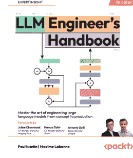
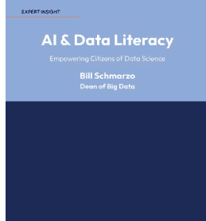

# 一个优秀的 AI 产品经理意味着什么？

在上一章中，我们初步了解了入门 AI 产品经理岗位所需的内容。我们讨论了人们如何进入 AI 产品经理角色、需要培养哪些技能才能被考虑担任该角色，以及在首次担任 AI 产品经理岗位时最终取得成功的原因。在本章中，我们将扩展这些概念，并进一步探讨构建 AI 产品经理职业长期发展的坚实基础所需的内容。

我们将用本章的大部分篇幅讨论 AI 产品经理如何才能有效。AI 产品经理是一个多样的职位族，我们将回顾其众多方面，帮助你更好地理解角色中哪些部分你可能最喜欢，以及哪些部分你可能需要努力发展。我们还将探讨不同的人基于其以往经验在该角色中会面临的不同挑战，以及所有 AI 产品经理如何为持续成长奠定职业基础。

由于 AI 产品经理角色的特殊性，除了我们在前几章讨论过的技术能力、舒适度和专业知识之外，还有更多细微之处需要深入探讨。如果您还记得，在上一章中，我们强调了 AI 产品经理需要证明其在五个方面的能力：技术熟练度、商业敏锐度、沟通能力、领导力和解决问题的能力。我们将在本章中在此基础上进一步发展，强化在中级职业阶段展示这些能力的表现。随着章节的推进，我们将涵盖以下内容：

- AI 产品经理需要扮演的各种角色相关的实际压力和期望
- 核心能力成熟的业绩记录是什么样的
- 从 AI 产品经理的角度来看，可访问性沟通意味着什么
- AI 产品经理在职业上升过程中常见的挑战和机遇
- AI 产品经理在不断扩展时如何照顾好自己

我们将以案例研究示例对上述内容进行情境化示例，并一如既往地对本章进行总结。AI 产品经理的职业道路充满挑战但也回报丰厚。任何人都可以建立成功的、长期的 AI 产品经理职业生涯，因为随着 AI 的普及，这一专业领域将迎来更多增长，只要他们愿意为自己的产品、市场和组织服务而努力。

正如我们在第 17 章所看到的，当前 AI 产品经理的整体情况倾向于符合某种特征。但我希望像这样一本书能激励你即使不符合这种刻板印象也能进入该领域，并以你独特的经验和价值观组合丰富这一角色。任何人只要足够渴望就能做到，这意味着你也可以做到。如果你读到这里感到犹豫，因为内心深处你觉得自己没有这个能力，我挑战你去反驳自己内心的那一面。我们都有权利围绕着让我们感到兴奋和启发的事情来建立职业生涯。如果作为 AI 产品经理工作让你感到兴奋和启发，或者它听起来只是谋生的好方法，这将推动你取得成功。对于那些不太确定的你们，本章的其余内容可能会让你打消念头。这也没关系，也很有价值！做出明智的决定总比因为冒名顶替综合征而从未尝试要好。

## 一个多面手的职位族

在本节中，我们将根据我们在第 17 章介绍的能力——技术熟练度、商业敏锐度、沟通能力、领导力和解决问题的能力——来探讨 AI 产品经理的诸多实际压力和期望。我将为这五项能力中的每一项使用一个总称，以便本节更易于消化，但你会注意到每个能力下都有一个长长的职责清单。我们可以将每个能力视为技能和责任的集中体现，而不仅仅是独立的技能。让我们开始吧！

请记住，列出这些能力并不是为了在每项能力上都追求卓越，而是为了展示你在成长和成熟为 AI 产品经理职业生涯的过程中可以探索的技能和能力的全范围。

## 技术熟练度

AI 产品经理的技术熟练度涵盖了在将 AI 能力与业务目标保持一致、确保负责任的数据使用以及在产品中保持高质量方面很重要的各种角色。AI 产品经理利用技术洞察力解决现实世界问题，并记录这些工作以追踪其对业务的影响。通过学术学位、认证和训练营进行持续学习可以帮助 AI 产品经理了解不断发展的技术和机器学习模型，并进而将复杂的 AI 概念翻译给非技术受众，并通过研讨会和沟通创造可访问性。技术熟练度不仅仅局限于机器学习模型，还扩展到数据管理、产品质量控制和数据分析等领域，因为 AI 产品经理需要确保其 AI 系统中使用的数据、产品的性能以及来自用户和客户的使用模式都支持其产品。

**推荐步骤：** 每当你有机会时，都为非技术受众撰写你所支持的 AI 解决方案的文章，并在适用时在内部以及与你的更广泛网络中分享这些内容。对于特别困难的团队，你可以考虑围绕 AI 功能、用例和战略影响设计 AI 研讨会环节，以便受众更好地理解 AI 在产品中的作用。这也可以作为利益相关者提问并增强他们对 AI 产品理解和信心的空间。

## 数据管家

在这一角色中，你负责建立数据治理标准，并确保用于训练模型的内部数据准确、相关、干净且无偏见。你的角色影响着产品输出的质量和可信度，以及模型的准确性、公平性和合规性。训练数据的完整性使你能够减轻与有偏见、不完整或不准确的数据集相关的风险。

**推荐步骤：** 撰写关于你的治理标准以及确保用于训练模型的内部数据准确、相关、干净且无偏见时所面临挑战的文章。定期向你的领导团队传达数据管理对实际业务成果和用户体验产生积极或消极影响的具体案例，有助于强化数据管家作为 AI 生命周期中至关重要组成部分的论点，并重申投资于适当数据管理的重要性。

## 数据策略师

虽然数据管家可能专注于数据日常挑战，数据策略师角色则鼓励对数据管理采取高层次的方法，通过制定长期的数据收集、管理、使用和部署策略在生产环境中实施。围绕有效数据实践构建策略不仅能增强产品 AI 能力和功能的性能，还能优化数据管道本身。数据策略师专注于数据获取和使用的战略、长期规划。

**推荐步骤：** 定期组织可见的数据策略会议，并确保关键利益相关者和领导者从一开始就参与其中。维护与组织数据收集、预处理、转换和质量保证相关的数据策略文档。确保其对所有相关利益相关者可访问，以便他们在一个中心位置了解数据处理协议和血缘关系，并在那里提问并提出问题，以建立更广泛的数据流利文化，特别是随着业务目标的演变。

## 质量控制员

当产品在发布前需要满足质量和性能标准时，你是最后一道防线。AI 产品经理确保所有 AI 功能和功能在发布前达到高质量和安全标准。这意味着要精通随持续质量保证而来的严格测试实践，如压力测试、负载测试和可用性测试。AI 产品经理必须通过评估技术标准和用户期望来确保产品已准备好发布，特别是对于 AI 产品而言，数据和用户输入可能存在显著差异。


**推荐步骤：** 与相关利益相关方和领导者分享持续的产品改进策略和 QA 最佳实践。让利益相关方了解测试结果和 QA 情况，可以展示改进如何为产品价值做出贡献。在你的 QA 最佳实践中纳入边界情况测试、偏见分析和公平性监控。

## 分析师

作为一名 AI 产品经理，你会定期使用产品分析数据和用户/客户行为画像来做出明智决策，了解什么真正引起了他们的共鸣。你会持续监控和解读使用模式、参与度指标和反馈趋势的变化，为你的产品中对所服务用户影响最大的功能或功能提供可操作的洞察。这有助于你根据用户和市场不断变化的需求调整产品。

**推荐步骤：** 定期向组织更新用于衡量 AI 产品成功情况的趋势、KPI 和指标。与跨职能团队和领导层分享这些方面的报告，以展示用户参与模式和改进领域，确保你在后续进行方向调整时获得支持。使用分析数据衡量 AI 功能的表现如何以及它们如何影响产品的战略目标和愿景。

## 商业敏锐度

AI 产品经理角色的这一方面关注的是将产品与所服务的商业环境和市场连接起来的职能。AI 产品经理负责定义产品愿景并将其与公司目标保持一致，强调产品的财务影响和市场表现。确保这种表现的重要部分是建立围绕产品的合作伙伴关系和协作，以确保其拥有成功的适当分销渠道。AI 产品经理角色的商业方面还要求对想要构建或维护的产品所在的市场条件和准备情况有深入的理解。这意味着 AI 产品经理需要精通他们所处的竞争格局，以便了解如何最好地定位产品并为未来的创新提供信息。

## 策略家

在这一角色中，AI 产品经理定义产品愿景和战略，并确保其与公司的整体目标保持一致。这是一个关键角色，因为它塑造了产品的发展方向，并为利益相关方阐明该方向。阐明清晰、有说服力的愿景并制定指导产品开发的可执行战略，为团队提供方向，并激励组织各地的利益相关方相信产品的独特价值主张以及它如何满足市场及其用户和客户的需求。

**推荐步骤：** 设立季度或半年一次的全体会议，在会上公开传达公司的产品愿景和战略，并明确将其与公司的整体目标联系起来。定期举行每两周或每月一次的产品战略会议，与领导层或你的 GTM 团队一起回顾进展、讨论市场趋势，并在适用时调整战略。将市场分析和反馈纳入战略讨论，以分析竞争对手、评估用户洞察并了解行业变化。

**推荐步骤：** 通过你可以内部和外部分享的报告记录你的市场研究活动，以确立你在该领域的专家地位。包括成功的市场定位策略和对产品产生积极作用的结果。在适用情况下，通过在线平台和社区或通过直接用户反馈和产品调查直接与目标受众互动。

## 竞争分析师

虽然市场研究人员分析市场的各个组成部分，但在这里你专注于竞争，通过分析竞争对手的战略来保持对产品竞争力的了解，以便了解如何超越他们。对竞争产品的优势和劣势进行持续评估，使你能够在快速变化的 AI 格局中保持竞争优势。这种分析不仅能让你完善产品供应，还能让你预测市场变化并主动应对。

**推荐步骤：** 记录你的竞争分析并突出产品相对于竞争对手的优势领域和弱势领域。在有重大更新时与你的领导团队分享。针对每个主要竞争对手进行 SWOT（优势、劣势、机会、威胁）分析，以了解产品如何保持竞争力。通过将产品的关键指标与行业标准和竞争产品进行比较，建立绩效基准。

## 沟通

有效沟通在大多数职能中都很重要，因此对于 AI 产品经理来说，这一角色方面至关重要。AI 产品经理必须与多个跨职能团队协作，以保持项目、路线图和冲刺按计划进行。在整个产品生命周期中传达所有主要 AI 功能和能力并培养透明度意味着利益相关方以有意义的方式参与其中。所有重大的产品变更和更新都必须通过 AI 产品经理进行沟通，而当这些更新未被充分理解或重视时，就由他们出面以最合适的方式解决差距。沟通不仅需要具有功能性；对 AI 产品经理来说，它还具有战略目的。传达风险并减轻潜在损失对于保持产品经理与领导团队之间的沟通渠道畅通至关重要。

## 项目经理

AI 产品经理需要具备强大的组织技能，以便与跨职能团队协调，确保项目、路线图和冲刺保持在正轨上。吸纳工程、设计、营销和销售的观点，并通过定期检查、状态更新和冲刺计划会议整合这些观点，可保持产品活动之间的强力一致。AI 产品经理不仅要确保在各个产品领域保持一致，还要以遵守之前制定的路线图和时间表的方式及时管理这些影响。这里的重点是以任务保持按计划进行的方式管理资源。在许多情况下，AI 产品经理在重大冲刺或史诗完成后也会进行事后分析，以改进未来的工作。

**推荐步骤：** 通过撰写关于你的 AI 产品如何以合乎道德的方式开发和部署以及在出现偏见、公平或透明度问题时如何缓解这些问题的文章来展示思想领导力。与你的网络和同行分享这些文章。鼓励更广泛地讨论 AI 伦理的重要性并参与这些对话，以将自己定位为一位博学的倡导者。

## 团队领导

你通过确保所有利益相关方都了解自己的角色及其对产品团队的重要性来担任团队领导。这涉及创造一个包容的环境，让团队成员无论你是否有直接的管理角色，都能感受到被赋予权力向你提出问题或疑虑。保持开放的沟通渠道培养信任并鼓励人们以富有成效、动态的方式协作。

**推荐步骤：** 向你的领导团队或直接经理传达你如何领导团队、促进协作或在出现时解决冲突。突出你如何促进团队合作并分享团队绩效、面临的挑战和实现的目标的更新。

## 讲故事者

作为讲故事者，你的角色是定期向利益相关方团队传达产品愿景、战略、价值主张以及这些事物将带来的益处。你还讲述你的产品故事以及它能为你的市场、客户和用户做什么。优秀的 AI 产品经理知道，有效的讲故事是关于清晰地阐述与受众产生情感共鸣的叙事，以保持他们的投入。通过以相关且引人入胜的方式连接产品的益处，讲故事可以激励内部团队和用户采取行动。当你将故事编织到各种产品资料或推广机会中时，你会完善自己自然而真实地传达信息的技巧。

**推荐步骤：** 在每次重大冲刺、产品更新或方向转变时，定期向利益相关方团队传达产品愿景、战略、价值主张以及这些事物将带来的益处。通过将你的故事线编织到各种沟通渠道中来提升你的讲故事技巧，如演示文稿、通讯、面向客户的更新日志、博客文章、会议、正式演讲、播客、文章、欢乐时光对话或任何其他适用方式。

## 激励者

当团队失去灵感，当他们忘记自己在做什么以及为什么要做时，你就是那个帮助他们记住辛勤工作是为了什么的人。繁琐和不堪重负的感觉会在你全职工作时出现。如果没有能够让团队重回工作核心目的影响力的影响力，停滞和幻灭感就会出现。通过保持大局观，你提醒每个人他们努力背后的影响和意义。鼓励和视角可以重新点燃动力，帮助他人以更新的目的和乐观态度克服障碍。这是工作更具情感的一方面，优秀的 AI 产品经理具有情商，能够识别团队中缺少这一重要要素的时刻。


**推荐步骤：** 当他人似乎迷失、沮丧、幻灭或困惑时，肯定产品愿景和目标。视情况公开或私下认可个人和团队的贡献，以增强士气并强化他们辛勤工作的价值。

## 知识分享者

你将通过营造持续学习和知识共享的文化来以身作则，内容涉及 AI、市场或与你的产品相关的领域。因为成功的 AI 产品经理已经在为自身卓越而获取和强化知识的过程中，这一角色在于分享和应用这些知识给他人。这里的目标是传播信息。通过积极寻找分享见解、资源和产品知识的时机，你确保团队和利益相关者保持充分知情并有能力做出自己的决策。这有助于组织整体的成长和专业知识，并赢得同事们的信任和信赖。

**推荐步骤：** 维护一个公开的知识分享会、培训和资源的公开日历，并在产品知识库有贡献时发布公开公告。

## 问题解决

AI 产品经理角色的这一方面涵盖了该角色的各种职责。解决问题是关于考虑各种潜在解决方案并承担选择一个将带来最大益处的方案的责任。AI 产品经理必须筛选各种问题，从客户反馈到监管和合规；必要的技术调整到可能出现的一般冲突。公司的问题从不缺少，但有效的解决问题者却很稀缺。许多组织面临与沟通中断、资源限制和不断变化的市场需求相关的挑战。培养你的解决问题能力以应对复杂性、识别根本原因并促进协作，将在许多情况下助益你。

## 客户倡导者

作为客户倡导者，你经常处于筛选各种客户反馈渠道并寻找优化产品开发机会的位置，以服务于用户和客户持续反馈给产品组织的重大趋势。你优先考虑用户需求和痛点，以确保你的产品对他们最有意义的事情产生真正的影响——确保它真正解决那些会积极影响他们生活的改进。你 empathize with 终端用户的旅程并打造 AI 产品体验，以满足他们的需求并通过持续、以价值为驱动的改进培养忠诚度。

**推荐步骤：** 制定引人注目的案例研究，展示你的产品如何为客户/用户创造价值。收集并向利益相关者展示主要的用户反馈、评论、推荐和调查结果，以强化产品与用户优先事项的一致性，并为未来的产品迭代建立基于证据的支持。

## 合规执行者

虽然你的组织可能有法律团队更关注监管监督和为审计目的而遵守框架，但随着你越来越多地将 AI 整合到产品体验中，你很可能需要与这些团队合作。这意味着要熟悉并及时了解法律标准和监管框架，以确保你的工作与之保持一致且不构成潜在风险。通过了解与你的产品相关的相关及时法律法规，你还可以识别出可以为产品增值的机会并使其获得竞争优势。

**推荐步骤：** 定期了解与你的产品相关的相关及时法律法规；率先标记合规这些法规对产品成功可能带来的潜在风险和机会。记录你预期未来可能影响产品决策或长期战略方向的见解和潜在监管或立法里程碑。

## 协调者

我们之前在这份清单中讨论过 *知识分享者、利益相关者管理者* 和 *项目经理*，但这些都未触及协调者真正做事的核心。协调者的主要重点是创造一个环境，让跨不同团队的协作能够蓬勃发展，并消除可能阻碍这一最终目标的任何障碍。你会定期与利益相关者团队保持一致，尽可能防止摩擦，并解决问题以防止其首先发生。协调者引导讨论以确保所有观点都被听取，并且当团队协作和开会时，不会在必要的对话流程中出现空白。协调者还帮助团队在误解变得严重威胁或阻碍之前解决它们。主动管理群体动态、识别错位领域并鼓励开放对话可能是其他角色的方面，但它们不是主要重点。

**推荐步骤：** 与所有主要利益相关者团队保持定期节奏，定期让他们了解产品目标、里程碑和变化。不要临时与他们会面。当会议确实发生时，确保议程代表该会议的目标，并且所有相关声音都有自由和安全公开发言。

## 数据驱动决策者

之前，我们讨论了 *分析师* 角色，其重点是在战术上发现集中在用户行为和参与度指标的数据趋势。虽然这本身就是一套技能，但对这些趋势和见解采取行动并权衡如何前进的选择，这就是这个角色的核心所在。你使用数据和指标为你的产品及其定位做出正确的决策，基于来自各利益相关者的相互竞争的优先事项。将决策与整体产品目标和优先事项保持一致意味着产品将基于全面的数据洞察而演进。在此角色中，AI 产品经理促进与领导层和利益相关者关于将塑造产品长期方向和定位的决策的讨论。

这就是很多角色。很可能还有更多未列入此清单。也许我们可以为第三版延长此清单，冒着吓跑更多好奇的潜在 AI 产品经理的风险。尽管此清单相当长，但它充分可视化了 AI 产品经理角色的影响和复杂性。它还强调了我们在上一章中提出的重要观点：技术专长并不构成角色的主要部分。我会认为它更像是一个先决条件。清单上的大部分项目在本质上是非技术的。AI 产品经理角色的核心在于批判性思维和人际关系。接下来，我们将探讨如何利用批判性思维和人际关系在 AI 产品经理角色中出类拔萃。

AI 产品经理在角色中挣扎最多的原因之一是，其他人往往并不了解他们为产品所做的服务。我们都希望生活在一个无需承担让他人明显看到的世界中就能因所做的工作而获得奖励和庆祝。

但我们并不生活在那个世界里。如果你无法明显地定位你所做的工作，你的上级、领导团队、利益相关者和专业网络的日常压力和挑战将使他们对你的有效性视而不见。我们尽量不要对此感到个人化。但如果我们不理解这一点，我们可能会觉得我们做了很多却没有必要的支持和认可来支撑我们走长远路。驾驭核心能力并通过它们为业务倡导你的贡献，将最大程度地促进你作为 AI 产品经理的真实和 perceived 成功。

这些行动乍一看可能令人不知所措。但这强化了结构在 AI 产品经理日常生活中重要性的认识。将对你作为 AI 产品经理的真实和 perceived 有效性做出最大贡献的活动组织成每周、每月、每季度和每年的类别。我已尽力在上面的要点中包含你应该多久与各个团队和利益相关者沟通，但最终决定权在你。你最了解你的领导、GTM 和利益相关者团队。只要记住，与其事后难以找到与人共处的时间，不如先预订时间然后决定不需要它。主动进行你在 AI 产品经理角色中建立的结构。让这些结构为你服务。你将建立的一个主要结构以实现角色成功是沟通渠道。我们接下来将探讨这些看起来是什么样的。

## AI 诠释者和沟通易懂性的作用

我无法足够强调让 AI 对你将合作的各种非技术利益相关者变得可及的重要性，因此这值得单独一个章节。作为 AI 产品经理，大部分产品沟通将直接落在你身上。你可能在组织中有庞大的产品团队，但这并不意味着这一角色不会落在你身上。无论你为大公司还是小公司工作，无论你所在的团队规模如何，如果你负责向组织传达你的产品愿景、战略和路线图，你将承担这一负担。


## 职业发展过程中的常见挑战与机遇

对于任何希望建立一段长久、可持续职业生涯的人来说，明确自己希望从AI产品经理的职业生涯中获得什么，以及希望走向何方，都至关重要。在沿着AI产品经理道路前进的过程中，你会受到启发去尝试不同的方向，但为职业方向设定一条清晰的路径（如果你愿意，也可以称之为路线图）将帮助你把握机遇，并为职业成长中即将面临的挑战做好准备。正如本书前几章所讨论的，以下是你随着职业发展可能遇到的一些挑战与机遇，以便你在AI产品经理职业生涯成长过程中更好地预判它们：

- **技术格局：** AI产品经理职业道路上最大的障碍之一，就是要跟上人工智能技术日新月异的步伐。这要求很高，许多人因此产生冒名顶替综合征，因为他们可能只对某些特定的方法论或模型较为熟悉。然后，因为他们是“AI产品经理”，他们可能觉得自己需要了解AI的所有领域，才能自信地接受这个头衔。但事实并非如此。是的，你需要尽可能跟上行业的最新进展，但你也只是在AI的某一个领域工作，掌握这个领域很可能就足以满足你的产品和公司需求。人们常常很难在深度技术知识的需求与其他AI模型和能力的广泛认知之间取得平衡。解决之道在于明确自己想要专攻AI的哪个领域，并在这个领域深耕下去。
- **对齐：** 如果不了解每个群体对产品的意图以及对AI的认知水平，就很难与利益相关者保持对齐。这对许多AI产品经理来说是一个障碍，因为它最容易导致沟通破裂。首先要与这些团队建立信任，这样你才能了解他们的目标是什么，以及他们对产品价值的理解是什么。一旦做到了这一点，你就可以利用这些反馈来制定你将呈交给公司的路线图。如果你把这一过程中的每一步都当作一个独立的步骤来对待，就能避免日后的沟通不畅。不先评估他人的基准期望，你就无法设定现实的期望。因为你是AI产品经理，你要评估他们对所支持产品以及AI能做什么的理解和期望。这两者都需要加以解决和澄清。
- **市场：** AI领域的竞争非常激烈，而且随着越来越多的玩家进入AI赛道，这种竞争还将持续。进入该领域的产品经理对AI也越来越熟悉，情况同样如此。你并不是在真空中存在——你身边有那些应该被激励来帮助你的人。试着通过消化研究中得到的发现来应对来自市场的压力，然后围绕这些发现组织战略研讨会议和专题工作坊。作为AI产品经理，你的工作是让所有相关的声音汇聚一堂，并从领导团队那里获得指导。他们才是承担了建设公司和参与市场竞争的责任与投入的人。让他们引领你。
- **资源：** 我们在本书前面已经谈过维护AI系统的成本；作为AI产品经理，你经常需要根据预算或时间限制做出某些决策。设定不切实际、过于宏大的AI产品目标，是让你作为AI产品经理的可信度迅速蒸发的好办法。就像你要与上述利益相关者建立信任并了解他们对AI的认知一样，你也需要与数据科学、机器学习和开发团队做同样的事情。尽早了解技术团队的能力基线，弄清他们的开发速度。在充分了解你的技术团队能做什么之前，不要做出任何承诺。
- **伦理：** 许多AI产品经理可能认为，评估产品是否存在偏见、漂移和公平性问题应由数据科学团队来标记，但这是不负责任的。诚然，你的数据科学和机器学习团队应当能安心地提出对训练数据偏见或模型在不同用户群体中的性能问题的担忧。但你不能把这些都留给他们。你应该是你产品的专家，如果你不主动制定计划来发现与偏见和伦理相关的潜在问题，这些问题可能会被遗漏。此外，透明度对客户和用户来说越来越重要。如果不对产品性能如何随各种因素变化进行全面评估，你就无法透明地说明是什么让你的产品有效。

我们已经介绍了AI产品经理随着时间推移在职业成熟过程中可以拓展的诸多领域。对于刚开始的人而言，要在一份工作中考虑这么多因素似乎令人望而生畏。确实如此！我们不会时时刻刻在角色的每个方面都表现出色。取决于你所在的公司或特定产品角色的期望，我们目前介绍的某些方面会比其他方面更受重视和赞赏。随着你作为AI产品经理逐渐成熟，你将建立一些策略，帮助自己找到公司、角色期望和个人偏好之间的最佳组合，从而让你绽放出最耀眼的光芒。以尽可能愉快、优雅的方式可持续地发展我们的职业生涯，是最重要的工作。下一节，我们将讨论可持续职业成长的最大功臣：自我关怀。

## 自我关怀的重要性

在面对AI产品经理职业（实际上任何产品经理角色都是如此）所带来的损耗时，拥有一个自我关怀的支持体系至关重要。正如本章前两节所述，从事这类工作身兼数职，要满足各种角色的需求，需要采取大量推荐行动。如果没有适当的支撑体系来维持能力、生产力和灵感，人们很快就会精疲力竭，因为这个角色通常具有很高的能见度、期望和压力。

这很大程度上是因为对AI产品经理的投入很高。业务面临的风险很大，他们需要找到真正能胜任这项工作的人。请记住，作为AI产品经理，你负责组织的AI引入与理解、AI项目本身、产品战略与愿景、该战略的执行，当然还有用户采用情况和满意度。即使每个项目只有一个人负责，这些也都是要求很高的项目，更不用说让一个人负责所有工作了。

采取措施不仅保持你的注意力和精力水平，还要维持你的情感投入，这样才能让你持续充电。很多时候，让我们更疲惫的不是工作的实际要求，而是情绪上的抵触。要想对抗这一点，尽量选择与直属经理、直接下属以及支持性强、鼓舞人心的领导团队紧密配合的职位。我明白这并不总是可能的，但你与他人合作的融洽程度将直接影响你作为AI产品经理的成功。你获得的情感支持越多，你的思路就越清晰，能力也就越强。

与那些削弱你能力或暗中破坏你的人共事，会让你逆着强大的阻力之流而行。仅仅以逻辑和理性为傲，也只能让你走到这一步。最终，工作的要求会压倒你冷漠的外表，你会发现自己很难找到继续做好工作的动力。尽早帮自己一个忙，在身边建立支持性的团队，帮助你保持强烈的情感归属感和目标感。当我们的理性和内心出于正确的理由投入时，我们的承诺会更加坚定。

保持强大的心理和身体健康对所有人来说都很重要，但对于AI产品经理的角色而言，这应被视为先决条件。AI产品经理的角色压力大、要求高，因此要确保自己能够有效管理压力，防止职业倦怠。心理健康和身体健康之间有着公认的联系。整天坐在屏幕后、一个接一个地开会、从来见不到太阳，这对你自己或你的产品组织都没有任何好处。你可以通过关注以下几点来主动保持健康：

- 养成规律锻炼的习惯，如散步、瑜伽，或去健身房/参加健身课程，以缓解压力并保持健康。
- 通过全天规律进食、保持均衡饮食来平衡情绪和注意力。
- 保证充足睡眠！不要熬夜，也不要在清晨加班。如果你能合理安排日程，每周工作40小时就足以高效完成工作。
- 冥想！与你的待办事项清单保持距离，每天从鸟瞰视角重新审视它。
- 白天要适时进行脑力休息。见见阳光。不要把会议连续排在一起。
- 在身边建立牢固的情感纽带。定期与朋友、家人或心理治疗师见面，让自己有发泄压力的渠道。没有哪份职业值得用孤立和过度劳累带来的不适来换取。
- 保持爱好、个人项目和第三空间活动的参与。我们不只是一份工作，我们远比那丰富得多。
- 对工作进行优先级排序，确保先处理最重要或最紧急的事项。
- 尽可能委派任务。
- 休假时不要工作。
- 设定明确的工作时间，并坚持执行。
- 通过线上或线下方式建立专业人脉。
- 找到一位AI产品经理导师，一个你信任的人，一个你觉得真正为你利益着想的人。


预测你将如何成长和改变，以便为自己的职业成熟度制定路线图，但也要记住是什么造就了你。思考一下你真正热爱并且最适合的角色方面。虽然不断努力成长和挑战自己是件好事，但我相信我们最深层的力量来自于了解自己和我们真正看重的东西。只有这样，我们才能吸引与我们是谁以及我们在世界上想要从事的工作类型产生深刻共鸣的机会。如果我要思考与我、我的兴趣和我的技能组合最契合的角色方面，我最喜欢的是 *有远见的、激励者的、客户倡导者、战略家和冲突解决者*。

当我通过不同的体现形式、渠道和讨论来传达产品愿景并将其与公司的使命保持一致时，我会感到自己有用且受人重视。对我来说，帮助他人重新回到核心目标并专注于对客户和用户产生最大影响的事情是很有意义的。当我能够成功解决可能阻碍产品团队发挥最佳水平的冲突时，我会感到一种深深的使命感。作为一名 AI 产品经理，对我来说很重要的一点是，我要建立一份让我感到有用、受人重视、有意义且目标驱动的职业。找到适合你的因素组合，并自己做练习，以了解你希望在职业轨迹中融入哪些价值观和考量。

## Summary

记住“好”因人而异。所有 AI 产品经理都将受到其所处环境的制约。你的直接主管、领导团队、企业文化以及同行关系都会影响你的工作被如何看待。我们在本章中讨论的一切都应被视为最佳实践的一种形式。我们不可能事事兼顾，如果一个人要照顾到本章讨论的每一个方面，他们可能会发现自己处于不可持续的工作状况。与其采取详尽的行动去戴上每一个“帽子”，不如最好以系统的方式思考。你可以建立哪些系统，以便你至少能以一定的规律性覆盖 AI 产品经理“帽子”的某些方面？记住，这是一种对冲，而不是保证。

围绕你的工作建立结构和系统并不是要制定教条式的规则，而是要创造健康的边界，以免我们做得太多而导致倦怠。从倦怠中恢复要比完全避免它困难得多，所以请尽可能善待自己。你同时在平衡许多人的意志、意图、挫折和冲突，这就是 AI 产品经理的角色。如果你不小心，你可能会发现问题来自四面八方。但你可以以一种具有支持性的方式设置护栏和边界。因此，你将多年享受这份职业带给你的所有馈赠。

在下一章中，我们将探讨 AI 产品经理职业路径中的成熟度和成长是什么样的。

## Leave a Review!

感谢你从 Packt Publishing 购买本书——我们希望你喜欢它！你的反馈对我们改进和成长非常宝贵。阅读完成后，请花一点时间在 Amazon 上留下评论；这只会花费一分钟，但对像你这样的读者来说意义重大。

扫描下面的二维码即可获得一本免费电子书。

```
https://packt.link/Nz0WQ
```


- 跟上 AI 世界的步伐并保持学生心态
- 扩大你的社区并回馈他人
- 深化你在专业网络中的足迹
- 预测 AI 产品经理职业路径中的未来趋势

我们将以一个案例研究示例结束，展示一位资深 AI 产品经理为保持其在该领域的地位可以采取的实际步骤。

## Projecting — what’s your ideal AI PM roadmap?

当你继续经历拥抱挑战、反思它们、从他人那里获得反馈并最终与他人分享你的经验教训时，你会开始在困难周围形成一种厚茧。经历足够多的挫折并在之后取得胜利后，它们不会再像以前那样影响你。你不会再对周围的经历那么有反应。然后你就能完全主动地拥抱未知。从完全拥抱成长心态中形成的厚茧将使你具有职业韧性和坚持不懈地朝着你真正想要的职业努力的决心。这就是乐趣开始的地方！根据你的雄心程度，你会开始感受到你想要移动的速度有多快以及方向如何。

挑战能教给我们很多东西，而那些能够拥抱挑战、对经历进行自我反思、寻求并整合反馈、并与他人分享知识的人将建立足够的韧性和对自己的理解，从而规划他们在 AI 产品经理职业中的方向。建立 AI 产品经理路线图是关于探索你专业思维和工作的演变。最初，你可能会对挑战感到抵触和反应，但随后你会成长为一个更具好奇心的自己。在更高级的阶段，你会更主动地掌控自己的职业并更具体地塑造自己的未来。

在以下各节中，我们使用了级别来确定职业里程碑，你可以用它们作为建议来开始构建自己的 AI 产品经理职业路线图。

## Level 1 — building a foundation

在这个级别，你正在为你的教育背景和技能建立基础。我们在第 17 章中涵盖了很多这些领域。请随意参考该章节以了解有关如何开始 AI 产品经理职业路径的更多背景。这个级别完全是关于选择你想要踏上的学习或教育路径，以及你将如何获得早期实践经验。它塑造了你对该领域的理解，并帮助你获得在其中发展的必备能力。在这个级别，这很可能看起来像是一次实习或你的第一个初级职位。你也将在此开始形成你的专业网络的早期阶段。

以下是一些入门建议：

- 选择你是否想要走正式或在线课程路线来获得技术技能。思考你的预算、时间限制和个人学习风格，以了解你在更结构化或更易获取的环境中是否更能茁壮成长。
- 寻找与你的价值观和职业抱负产生共鸣的公司的实习机会，以获得实践经验并了解在技术环境中工作的动态。
- 考虑像产品分析师或初级产品经理这样的初级职位，它们可以为你提供进入产品管理或数据分析的温暖介绍。
- 加入专注于数据、AI 或产品管理的专业团体，开始形成你的专业社区。
- 寻找在 AI 产品管理或相关领域有经验的导师，他们可以分享经验并指导你如何推进职业生涯。
- 建立你的专业品牌并在 LinkedIn 上与人建立联系。向他们询问他们的工作、日常职责、职业路径以及对行业及其发展方向的看法。
- 以好奇心和决心拥抱这个阶段！开始总是困难的，但如果你以正确的能量去做，你的努力会得到回报。

## Level 2 — strategic growth

到第 2 级时，你已经在 AI 产品经理职业路径中工作了好几年。此时，你已经积累了一些经验，并准备好承担更高级的课程或更复杂的 AI 产品。你还通过所承担的角色深化了你的产品经理技能。由于你拥有更多应用型产品管理经验，你在制定战略计划、路线图、市场分析和用户研究方面更加游刃有余。此时，你还拥有一个丰富的案例研究、贡献、项目和你支持过的产品的作品集。你对自己的能力更有信心，并且对更复杂的挑战感到兴奋。

以下是确保你继续成长的建议：

- 确定你的技术知识可以在哪些领域扩展或加深，无论是与 AI/ML 模型和算法、数据分析工具，还是与你正在从事的工作相关的 AI 框架有关。
- 如果你正在从事的工作在 NLP、计算机视觉或云计算等领域越来越专业化，请考虑更专注的认证或课程来扩展你的知识。
- 决定是否有任何项目你可以承担，以帮助你获得更深入的技术专业知识或给你更多与数据科学或机器学习工程团队合作的经验。
- 盘点你需要加强的产品管理技能。参考第 18 章中涵盖的工作帽，以帮助你评估你希望改进的 AI 产品经理角色的哪些方面。
- 当你积累经验时，重要的是要在作品集、LinkedIn 或其他公共网站上记录你所有的产品/项目/案例研究，以证明你作为 AI 产品经理的技能、成长和贡献。
- 保持与你建立的专业社区的积极联系，并寻求参与 AI 产品经理论坛、工作坊和聚会的機會，以更深入地与你的同行和导师建立联系。


## 第三级——专精与领导

在第三级，你可能已经在AI的某一领域或特定行业实现了专精。在这一级别，你对团队管理的意义有了更深的理解，工作的范围也更广。你的关注点已转向在组织内构建围绕AI和产品管理的文化。你可能接受过领导力培训，或培养了软技能，以应对潜在冲突和高层谈判。你还在战略举措中扮演更积极的角色，并通过在会议上的演讲或知识分享机会与专业社区公开互动。在这里，你工作的影响力和辐射范围显著扩大。

以下是一些扩大影响力的建议：

-   反思你对当前所处的行业/人工智能技术方向是否满意，以及你现在的道路是否符合长期的职业抱负。当然，你随时可以做出改变，所以请思考工作中哪些方面最让你快乐或最有意义。
-   盘点一下其他让你感兴趣的行业或AI专业方向。研究趋势，或是参加行业或专业方向的会议和活动，与他人建立联系。
-   寻找领导力培训机会，让自己成为更有效的沟通者、谈判者和冲突解决者。
-   寻找关于情商、团队动态和战略决策的领导力培训项目或工作坊，以打造有效领导团队的工具和技能。
-   从你尊重和信任的人那里寻求关于你在大型项目、范围和产品上有效性的建设性反馈。
-   根据反馈识别你在能力或技能上的差距，并以此为依据制定你的职业发展计划。
-   在职场中主导战略举措，让你的工作更可见，并展示你管理复杂项目和推动组织变革的能力。
-   想办法与你的职业网络分享你的工作，在会议上发言、参加小组讨论，或尽你所能为你尊敬的出版物撰写文章。

## 第四级——照亮他人的光

在这一级别，你已成为大师。你的专业能力得到了认可。你可能会经常与他人分享你的想法和最佳实践，并围绕你的AI产品经理工作建立了一个品牌。你甚至可能获得了更高的学位，或因工作成果而发表过文章。也许你甚至创办了自己的出版物。你的重心已转向扩大你在AI专业领域或行业的思想领导力和影响力。你还很可能经常在大型会议和活动上发言，并担任小型科技公司的董事会成员。你深度参与专业社区，并为下一代AI产品经理提供指导。

以下是一些保持精通的建议：

-   在发表的论文、博客、书籍或演讲活动中，找到可以纠正人们对AI产品本质、AI伦理考量或AI产品经理角色的假设或误解的地方。
-   寻找能激励初级AI产品经理的有效话题，并为他们提供真正反映其可能性的指导。
-   与你的职业社区和学员分享你的历程、遇到的挑战，以及助你成功的策略。
-   考虑创建你自己的导师计划、工作坊或网络研讨会，专注于为正在探索自己道路的他人提供实用建议。
-   运用你成熟的技能、知识和专长，为那些为世界带来真实且美好价值的初创企业做出贡献！
-   以慷慨的精神和提携他人的愿望拥抱这一阶段。你展现了奉献精神和干劲才走到这里。向他人展示如何享受自己的成就。成为他人的灯塔！

## 学习——保持信息灵通与灵感

我们在第17章中讨论了在初入职场时提升技能和建立技术知识的重要性。但一旦你在职业中成熟起来，你就不再是“提升技能”了。你是在保持知识，并让自己在领域中保持相关性。在本节中，我们将探讨如何在你AI产品经理职业生涯进入更成熟阶段时，以可持续且富有灵感的方式继续学习。这里的关键词是“可持续”。这个领域恰好总在快速变化，这意味着总有你可以做的事情来保持领先。我们将探讨各种方法，让你以可控且可持续的方式跟上AI和产品管理的最新进展，从而在工作中持续获得灵感。

随着你在AI产品经理职业生涯中不断成熟，你需要关注的关键领域包括技术技能、产品管理技能和软技能。所有这些都可以通过三个主要途径来拓展：通过思想领导力建立你的职业品牌，通过认证和学位增强知识，以及通过职业发展磨炼技能。在接下来的章节中，我们将审视各种方法，让你能够在所有这三个领域学习和保持信息灵通，以维持作为AI产品经理的全方位背景。

### 思想领导力

我们每个人都会将不同的兴趣、价值观和技能带入AI产品经理的角色。建立一小批你强烈认同的思想领袖，是一种基于他们的想法与领域内其他人建立联系的方式。这是人类体验中最美好的概念之一：我们仅仅通过他人思想的质量，就能跨越时空与之产生连接。当你作为AI产品经理逐渐成熟，你会对自己接受的信息更具辨别力。在刚刚起步时，很难判断谁值得追随。

在网上、大学或会议上，不乏AI、数据、机器学习、产品管理或领导力的影响者和思想领袖。他们中的许多人会重复许多相同的观点，希望借此获得关注和名声。但当你定期阅读AI、产品或科技行业的通讯、博客、文章和白皮书时，你会开始发现少数脱颖而出的人。记下那些启发你的人。确保他们是信誉良好的专业人士，你觉得他们确实有真知灼见。

一位激励我的AI产品经理思想领袖是米拉·穆拉蒂（Mira Murati）。穆拉蒂一直是AI伦理影响的积极倡导者，并强调开发者创建安全、透明、符合人类价值观的系统的重要性。她监督了ChatGPT和DALL-E等强大AI模型的开发，她围绕负责任AI使用、凸显AI风险和社会影响的公开讨论令人钦佩，尤其是考虑到她推向市场的产品已经取得巨大成功并被广泛使用。她曾在特斯拉和OpenAI担任多个重要职位，并在一个以男性为主的行业中展现出驾驭这些动态的力量，最终在萨姆·奥尔特曼短暂离职期间出任OpenAI的临时CEO。穆拉蒂作为AI领导者和实践者激励着我，她是科技领域可能性的光辉典范。

你允许进入内心世界的思想领袖，会对你自己的人生观和工作观产生影响。他们会影响你在工作经历中的决策方式，并最终在你职业生涯塑造中发挥作用。让好奇心引导你，并养成每周或每月关注他们的文章和最新作品的习惯。你永远不知道：随着职业发展，你最终可能与他们建立联系、会面，甚至共事。为了周全起见，在AI产品经理角色的各个层面——领导力、沟通、产品管理、数据和AI——都要拥有你认可的、乐于连接的思想领袖。

### 认证与学位

随着你不断成长和探索想从事的AI/ML领域，获取更多认证和课程可能是填补你技术背景或软技能理解方面空白的绝佳方式。如果你想在AI的新领域深化知识或专长，你甚至还可以参加更多训练营或攻读更高的学位。

我认识一位AI产品经理，他离开了企业职位，去攻读深度学习博士学位，在学术界待了几年，然后回到私营部门专注于深度科技初创企业。虽然这听起来有点曲折，但这位人士在从繁忙中抽身休息后重返职场，感觉焕然一新。学位和专业认证也可以在AI产品经理角色的转型中发挥作用。也许你想成为一名更专注于以用户为中心的设计或市场策略的AI产品经理。或者你确信自己想参与AI产品经理团队的高层管理。当你希望在职业轨迹中让某个重要领域或重点更加突出时，可以利用这些工具。


一提到深化知识，我想到的是课程和学位；但一提到精进技能、获取工具，我想到的是职业发展。你可以把它们看作目标各异的不同领域。职业发展主要围绕工作坊、研讨班和会议展开——这些都是深化专业能力、提升工作效能的方式。虽然认证和学位侧重于通过学术空间来深化应用性、技术性技能并建立公信力，但职业发展更偏向行业导向。

## 职业发展

你当然不必只靠集训营和学位来保持技能精进。还有很多更容易消化的方式，帮你填补职业背景中的技能或领域空白。或许你可以参加一次工作坊或研讨班，向专家学习；或许你只是去参加一场会议，了解AI产品经理领域中那些你之前从未想过的新方向；甚至你也可以加入一个读书会。此外，还有线上学习课程、讲座和网络研讨会，你可以报名参加，获取新技能和洞见。

随着职业发展越来越深入，你也可以开始自己组织这类活动。在我职业生涯早期，做的最有益的事情之一就是开始组织围绕“AI领域的女性”相关活动。有些活动是AI创业者的演讲；有些则是业内女性从业者的分享。偶尔，这些分享会变成完整的工作坊——演讲者会概述他们做过的项目，并分步骤讲解他们如何收集产品需求、数据和反馈，以部署和发布某个具体的AI应用场景。

投入一个工作日或偶尔一个周末来做这类事情，会产生更大的长期影响，因为你的视野会一次次被拓宽。它们也是检验你想强化哪些领域的好方法。有没有某些你一直好奇但尚未投入太多时间的技术技能？你是否对领导力感兴趣，却缺乏信心或沟通技巧去尝试？让职业发展体验保持适当频率，意味着你会有充足的时间把从这些小型活动中获得的信息和洞见，融入到你自己作为AI产品经理的工作中。小小的种子蕴含着巨大的潜力，所以不妨从小处着手，看看它们是否能激励你为职业发展采取更具体的行动。

下面是一些你可以采取的实际行动，以保持一条适合你自己的学习路径：

- 设定短期和长期目标。你想学习一套新技能、一门编程语言、一个工具或框架吗？你想在AI的某个特定领域获得专长吗？明确你想学什么，以及它为什么会对你的职业有帮助。
- 建立一个可持续的计划。你能按周或按月持续学习吗？
- 明确哪些学习路径适合你。你更喜欢慕课（MOOC）还是攻读高级学位？
- 寻找鼓舞人心的阅读材料。有没有什么书籍、博客、学术期刊或研究团队能够引起你的共鸣？

## 建立人脉——深化你与专业社区的互动

与你的专业社区保持联系有两个目的：

- 它能让你通过他人的工作和洞见不断学习和成长。
- 它也能让你与那些最懂你的人分享你自己的洞见、成功与失败。

多年来，“建立人脉”这个词已经背上了一些不好的名声。它让人想到闷热的房间里挤满了陌生人，在那里你必须强装勇敢和自信来“四处周旋”。也许你给自己定一个可量化的目标：“今天认识五位新的AI产品经理。”或许你确实和他们聊了天，交换了几句话，但并没有产生什么有意义或特别实质的内容。你做了该做的事：你出了门，见了五个陌生人，然后从待办清单上勾掉了“建立人脉”这一项。这些联系充其量只是温吞水，整个过程最终也毫无满足感可言。

但那不是真正的建立人脉。那只是打着建立人脉旗号的个人品牌传销。真正的建立人脉，是与那些能真正引起你共鸣的人建立联系，形成一张安全网。这张安全网应该建立在真实、真诚的基础上。这些人应该是当你感到困惑、沮丧、害怕、好奇或受到启发时可以求助的对象。你不必和他们成为挚友，但你应该能与他们分享一些脆弱之处。如果一个专业人脉网在你需要指引或安慰时无法支持你，那它还有什么意义呢？

当你开始与同行建立真诚的关系时，要制定那些让你感觉自然的策略，并超越纯交易式的人脉往来。先从给予开始。也许你可以在不求回报的情况下，为你认识的人提供背书或推荐。或者你可以主持一场分享会，在组织或人脉中组织一次关于成功与经验教训的交流活动。在这个人们常常被有所求的人接近的世界里，通过先付出价值再提出请求来展现情商，会让你脱颖而出，并为持久而有意义的专业关系奠定基础。

随着你越来越自信，并开始通过自己的渠道分享更多工作内容，你的专业人脉网会让你保持真诚。当你开始围绕自己的工作打造面向公众的品牌时，其中许多人会成为你最坚定的支持者。以下是关于如何逐步参与专业社区的一些建议：

- **线上社区：** LinkedIn、Slack和Discord是支持各类小众群体的强大平台。维持专业社区的一个简单方法，就是经常发帖和评论。除了发帖和评论，你还可以推广自己的文章、作品集，或你所参与的活动。你可以把这些看作漏斗中最大的部分。当然，随着时间推移，你可能会在这里建立一些更深层的联系，但如果你不设法让这些联系融入自己的生活，许多联系会越来越弱。
- **会议：** 行业活动和知名会议是在同一屋檐下同时见到很多人的绝佳方式。因为你是亲自到场，所以在会议上结识人并自然建立联系的机会更大。你去得越多，就越可能遇到以前见过的人。特别是如果你正在线上与人保持联系，你可以确保腾出时间与那些线上认识的人见面，把他们拉回当下。会议是聆听同行资深从业者演讲的好机会。而且会议通常还有官方日程之后的欢乐时光、余兴派对和音乐活动，所以你与人建立更深层私人联系的机会也更高。
- **线下聚会：** 定期的线下聚会，尤其是在大城市，非常普遍。通过线下聚会，你可以在不必面对人山人海的情况下获得会议的部分好处。你能获得许多面对面见人的社交收益，而且无需花费那么多钱。它们还提供了更深层联结的机会，因为你常常会一次次见到同样的面孔。在本地线下聚会中，归属感的机会最高，因为你知道自己是在与住在附近的人建立联系。
- **导师关系：** 随着你在整个职业生涯中通过上述各种途径不断扩大人脉网络，你最终会开始与一些人建立更紧密的关系。其中许多紧密关系会承担导师的角色。导师并不需要在职业上比你有显著成就。有时他们甚至可以和你处于同一层级。但他们是当你需要指引时可以求助的人。你不可能把自己的所有职业联系都变成真正的导师，但从本质上讲，那些你允许进入核心圈子的人有能力为你提供指导。把那些你信任和尊重的人留在身边，并在力所能及时回馈他们。

## 成长——学生成为老师

作为学生学习和成长是一回事，但将那些知识和指导转化为真正的智慧又是另一回事。在很大程度上，作为AI产品经理，你将一直在学习。但到了某个阶段，你将能够回馈。成长就是利用亲身经验来提升自己作为AI产品经理和作为人的能力。在本节中，我们将探讨成长心态，以及对其应用贡献最大的几个领域。

### 拥抱挑战

随着你在AI产品经理职业道路上不断成熟，你最终会遇到重大挑战。也许你一直在开发的产品就是无法达到满足客户和用户期望所需的性能目标。或者更糟，也许它达到了目标，但你仍然在努力实现产品市场契合度，或建立稳定的用户基础。也许你从市场或竞争研究中学到的主要教训之一，是关于为即将到来的功能整合一种你尚未使用过的新型机器学习方式。无论挑战是什么，保持好奇心并拥抱挑战，才是穿越困境的道路。


我明白这说起来容易做起来难，尤其是在你需要在种种纷扰中平衡领导者的期望来保住工作时。AI 产品经理的角色面临着来自各方的挑战和压力。平衡伦理考量、技术限制、监管合规、高用户期望、AI 系统的复杂性以及技术创新，给 AI 产品经理带来了巨大的负担。AI 系统的复杂性往往会带来不可预测的结果、数据偏差以及可解释性问题，这增加了开发和部署的难度。

但将这些挑战视为机遇会带来变革性的效果。把它们作为催化剂来培养新技能或提升你的问题解决能力。做的越多，当它们出现时你就越有韧性。拥抱成长型思维意味着你相信自己能够通过挑战变得出色并取得成功。坚持、学习和努力是变得更有能力的方式这一理念非常强大。这意味着你不会让失败定义你。我甚至要说，在挑战发生时保持乐观，是产品经理的基础技能之一。

想想看；当他们沮丧时，你经常需要成为激励和鼓舞你工作伙伴的人。但在你的组织里，谁能为你做到这一点？在许多情况下，企业环境可能很残酷；我们往往不得不成为自己的啦啦队长。但这不一定是坏事。如果我们从未经历过挑战，我们就会止步不前，我们的工作会始终出色但枯燥。追求只有在风险很高时才有意义。冠军都是在挣扎中锻造出来的。你主宰这种挣扎的能力，不让它吞噬你或强化你的无能，才会让你不断成长。

要想找到 AI 产品经理如何掌握拥抱挑战的艺术的强大范例，我们可以看看李飞飞，她是斯坦福大学人机交互人工智能研究所的联合主任，也是 Google Cloud 前 AI/ML 首席科学家。李飞飞是一位令人鼓舞的 AI 领导者，她拥抱并克服了 AI 开发中的重大挑战。她在医疗领域产生影响的有效方式之一是通过与湾区的医院和养老院合作。李飞飞找到了解决与手部卫生相关的行为监测问题的方法，手部卫生是医院感染的主要原因之一。

通过她在开发“环境智能”系统方面的工作，一系列能够追踪医务人员手部卫生的传感器和计算机视觉模型，她能够构建出实时响应人类需求同时最大限度减少因人类观察者带来的偏差的 AI 系统。得益于她在医院环境中的工作，李飞飞能够防止患者死亡和感染，使 AI 在医院环境中的使用民主化，并找到一种方法将自动驾驶汽车中使用的部分相同能力重新包装以拯救生命。

## 反思

反思是一个强大的过程，它始于拥抱挑战。我们不让挑战定义我们或让我们陷入下行螺旋；我们将其作为反思的机会。我们不能害怕直面我们经历的不足。这意味着回避问题，而这会阻止你做出那些将带来突破的改变和转向，无论是个人还是职业。让自己有勇气去分析和反思你所面临的挑战，以便汲取其中的智慧。了解出了什么问题以及如何防止其再次发生，这就是成长的方式。

无论结果如何，让它把你带向你的专业社区，以对你最有意义的形式。它可以是一篇博客文章、一条 LinkedIn 帖子、一个案例研究或文章、一次演讲，或在科技会议上的展示。与专业社区分享你在 AI 复杂环境中导航的挣扎和经验教训，是你为专业社区做出真实且切实贡献的一种方式。即使你认为你的挣扎很常见，或者其他 AI 产品经理也遇到过同样的挑战，请记住，没有人是你。你的独特视角具有价值。你永远不知道你遇到的障碍可能会帮助山路上走得没那么远的人。分享你的真实生活经历可以建立人与人之间强大的联系，这些联系可能在未来带来新的合作、工作项目或合作伙伴关系。

以下是在你构建 AI 产品经理职业反馈循环时可以牢记的一些策略和建议：

- 从广泛的利益相关者、导师和同行那里寻求反馈。确保包括数据科学家、机器学习工程师、客户/终端用户、团队负责人以及你尊重并重视其意见的领导团队成员。
- 记录你收到的反馈以及你为回应反馈而采取的行动。记录你观察到的见解和模式，并反思你如何随着时间的推移在工作或职业中应用它们。让这来指导你与他人分享的职业叙事，最重要的是，与你自己分享的职业叙事。
- 优先考虑具体且可操作的反馈。模糊或主观的反馈会让你产生更多疑问而不是答案，并可能模糊你作为 AI 产品经理的自我反思。
- 在对自己能力的自信与认识到成长空间的谦逊之间找到平衡。努力保持这种平衡将增强你的可信度，并激励他人在他们挣扎时与你坦诚交流。
- 将反馈视为你自身 AI 产品经理职业迭代的必要部分，并在他人与你分享坦诚时真诚地表示感激。
- 积极成为线上和线下的 AI 和产品经理社区成员，以扩大你的反馈循环影响范围，并寻找有意义地为讨论做出贡献的方式。
- 与同行或同事合作，共同撰写文章、白皮书或案例研究，解决 AI 产品经理领域的挑战和创新。

## 下一步？世界是我们的蚌

AI 产品经理职业道路的前景充满希望。正如我们在本章中所探讨的，我们讨论了很多关于作为 AI 产品经理成长和成熟的话题。虽然知道这些很有帮助，但最终，学习不如选择来得重要。我们每个人都拥有自己的一套价值观、兴趣和世界观。随着我们更深入地将 AI 整合到产品中，我们将开始看到 AI 方法论的许多重叠。产品将进入市场，采用多学科的方式运用各种 AI 模型。我们将体验到模拟现实与 AI 之间界限的模糊。

我的建议是，尽量不要偏离你认为*应该*存在于世界上的产品。构建无偏见、无害的合乎伦理的 AI 产品和系统，推出符合法规并有益于世界的产品，是集体的责任。创造以人为中心的产品和体验意味着强调用户需求，并以直观、可靠、可信且有益的方式构建 AI，如果我们要构建一个充满希望的未来，这必须是前进的方向。

随着 AI 转型的继续，我们迫切需要能够证明自己是 AI 负责任管理者的领导者。作为 AI 产品经理，我们希望为世界贡献的工作能让我们感到自豪，尤其是在这个关头，许多立法努力都在努力获得所需的立足点，以妥善遏制 AI 的非预期不良后果。归根结底，AI 产品经理的角色关乎战略、创新、领导力和激励。这代 AI 产品经理正处于将 AI 整合到重新定义我们生活和工作方式的产品的前沿。

我们应该利用我们的影响力，将增强人类体验而非削弱它们的 AI 产品推向市场。我们有幸通过我们的工作解决我们这个时代最紧迫的挑战之一。我们可以利用巨大的机遇来建立信任并为世界带来真正的价值。AI 不仅仅是被 relegated 到科技行业象牙塔的技术。AI 转型现在无处不在，遍及各行各业，AI 产品经理有独特的机会引领这场转型。世界真正是我们的蚌。

随着我进一步拓展自己的 AI 产品经理职业，我希望我的下一章专注于帮助构建解释性 AI 产品，创造个性化、公平的数字体验。我希望我的工作专注于有意义、以同理心为导向的产品设计，以增强人类创造力和生产力。想象一下可能性：在跨职能创新实验室中合作实验 AI 能力，参与 AI 伦理委员会或 AI 政策塑造。通过构建在高影响力功能与以用户为中心价值观之间取得平衡的 AI 原生框架，我们可以为真正改善人们生活的数字体验做出贡献。我致力于从事与我的价值观和热情一致的产品，我可以全身心投入的产品——你想致力于什么？

## 案例研究

Astrid 是一名拥有超过 20 年科技行业经验的 AI 产品经理，她已成功领导了医疗、金融和零售行业的多个 AI 产品。她通过项目管理和**用户体验（UX）**等前期角色进入 AI 产品经理领域，其学术背景是商业管理。她的优势包括对市场动态、用户需求、客户旅程、预算和商业战略的深刻理解，以及领导跨职能团队的能力。20 年的从业后，她对所承担的角色更加挑剔，她仍在作为 AI 产品经理学习和成长。目前，她是专注于各种工作优化工具的科技公司的产品高级副总裁。在本例中，我们将探讨 Astrid 在继续沿着 AI 产品经理的兔子洞前行时可能采取的行动，以及这些行动的影响。


## 投射

在职业生涯的投射阶段，Astrid 正在寻找在周围世界产生更有意义影响的方式。随着她作为 AI 产品经理的成熟，她逐渐明确了自己想要从事的工作类型，同时她也能够为下一代 AI 产品经理提供指导和智慧，例如以下途径：

- **跨职能团队建设：**
  - **行动：** 随着 Astrid 在现任组织中的晋升，她组建并领导了多个跨职能团队。她营造了一个协作环境，让数据科学家、工程师、设计师和领域专家能够以产品套件为重点，在小组团队中协同工作。
  - **影响：** 这使 Astrid 在组织内部确立了受人尊敬且胜任的产品领导者地位，因为它打破了开发、AI 团队和领域专家之间原有的壁垒。通过围绕产品套件聚焦角色，这些跨职能团队能够围绕其关注领域建立团队认同感。

- **发展指导计划：**
  - **行动：** 由于她的产品组织在她担任高级副总裁时已经变得非常庞大，Astrid 创建了一个指导计划，帮助初级产品经理提升技能，并让他们接触之前未曾涉足的新产品领域。
  - **影响：** 这增强了她产品组织整体能力和集体技能。它还为团队中刚刚进入产品领域的人提供了一种培养和成长自身职业路径的方式。

## 学习

在本章前面“学习 – 保持知情和受启发”部分，我们重点关注了 AI 产品经理可以探索的三个主要学习领域，以加深其专业知识。思想领导力、认证和学位以及职业发展都是你在 AI 产品经理职业生涯中不断进步时保持学习者心态的途径。让我们探索 Astrid 在其学习路径中采取的行动及其影响：

- **AI 技能提升：**
  - **行动：** Astrid 必须通过 Coursera 和 edX 等 MOOC 平台报名参加高级 AI 和机器学习课程来补充她的 AI 知识。课程包括深度学习、强化学习和 AI 伦理的认证。她每两年完成一门新课程。
  - **影响：** 随着 AI 的持续演进，Astrid 通过每两年一次的学习保持其技术知识的相关性和新鲜度。即使在 10 年后，她仍然觉得自己有更多东西需要学习，并将其作为职业生活的优先事项。

- **建立 AI 创新实验室：**
  - **行动：** 鉴于 Astrid 拥有 10 年的职业生涯，她已在组织内部晋升，并在过去几年里领导产品经理团队。作为产品经理主管，她鼓励团队尝试不熟悉的 AI 工具并学习新框架。她还创建了一个流程，让团队能够快速为其 AI 创新实验室的想法开发 MVP 进行测试。
  - **影响：** 这在 Astrid 的组织和团队内部催生了创新和实验的文化。它使他们保持敏捷，并对新的 AI 发展和趋势保持警觉，以便在实验室中进行测试。它还为她的产品组织创造了大量的心理安全感。他们信任她，感觉她是其职业发展和成功的共同创造者。这也鼓励了许多创新想法和解决方案，对公司的收入和用户留存目标产生了积极贡献。

## 网络

更舒适地进行网络拓展是确保你不断扩大同行、导师和潜在合作者生态系统的一种有效方式。职业生涯需要持续的社会机会供给，因为我们的热情在与他人的协作中得以激发。找到一种有意义且真实的网络方式是一种微妙的平衡，但做得正确时，付出是值得的。让我们探索 Astrid 如何找到网络机会并拓展其专业圈子：

- **积极参与 AI 会议圈：**
  - **行动：** Astrid 定期参加 AI 会议，并在会议上结识了行业专业人士社区。
  - **影响：** 这让她在职业道路上拥有强烈的社区归属感。它帮助她抵御冒名顶替综合征，并定期激励她，因为她与认识超过八年的人保持联系。在劳动力市场艰难时，这为 Astrid 提供了安全网。多年来，她通过自己选择的 AI 产品经理大家庭获得了多次工作机会，因为她与认识的人建立了信任，始终如一地与他人保持联系，随着时间的推移建立了自然的联系，甚至多次在这些会议上发表演讲。

- **通过学术合作建立富有启发的合作伙伴关系：**
  - **行动：** 有一天，Astrid 在当地大学参加了一场 AI 讲座，并结识了一位担任大学专业合作伙伴负责人的人。最初，他们谈论的是实习项目，但这促成了战略合作伙伴关系的建立，使她的 AI 创新实验室能够与大学的研究团队就特别联合项目进行合作。
  - **影响：** 这为她组织内的 AI 创新实验室提供了所需的动力，以发现将 AI 应用于各种产品用例的新颖独特方式。它创造了一个新兴初级人才的渠道，这些人才在文化上是合适的。该合作伙伴关系还在工程团队需要时为复杂项目提供了额外的 AI 资源。

## 成长

在职业成熟度的成长阶段，你更专注于扩展你的认知。你寻找机会加深对 AI 专业领域的理解，你希望如何专业成长，以及可能存在哪些盲点。拥抱挑战、反思和扩展反馈循环都是你更深入地探索自身职业的方式。Astrid 通过以下行动加深了她对创业世界的参与，并发现了 AI 伦理中的未开垦领域：

- **参与医疗保健初创公司 MVP 工作：**
  - **行动：** Astrid 帮助构思、开发并发布了一款用于医疗保健初创公司的预测分析工具，该工具利用 NLP 预测患者再入院情况。她在此产品之前从未在医疗保健领域工作过，并在参加一次 AI 创业欢乐时光时遇到了正在寻找具有她 AI 背景的人的初创公司创始人后承担了这一角色。
  - **影响：** 产品发布后，它已在她所在地区的三家医院实施。她能够积极影响当地社区，为真实的人改善患者结果，并展示她将知识和专业技能应用于新领域空间的能力。

- **设定伦理 AI 标准：**
  - **行动：** Astrid 主导制定了一项新的伦理 AI 最佳实践标准，供产品管理、数据科学、机器学习和开发团队在为其组织开发 AI 产品时遵循。推广还延伸到非技术团队，使他们即使在非技术层面也能标记 AI 伦理冲突。她制定的指南涉及公平、偏见、透明度和问责制等议题，适用于所有 AI 产品。
  - **影响：** Astrid 能够通过对伦理 AI 标准的投入来降低可能损害公司品牌的风险。她通过围绕伦理创建基础设施来支持团队，使没有人单独承担伦理 AI 监督的责任。她还能够使 AI 及其潜在危险对组织内的非技术人员更易于理解。已发布 AI 产品的模型性能和公平性略有改善，这也增强了客户和用户的信任。

## 下一步？

Astrid 的下一步重大举措是找到一种方法，将她在职业生涯各个领域涉及的许多元素结合起来，创办一个属于她自己的创业项目。由于她在 AI 创新实验室、AI 会议参与和学术合作方面的工作，Astrid 决定创办自己的 AI 咨询业务。她意识到自己已经通过多年来进行的各种演讲和会议积累了大量人脉。


她还与学术界以及参与实验室的团队进行了协作。Astrid 见识过大量项目多样性，并在自己公司构建道德 AI 标准的过程中学到了很多。

由于她对改善患者结果充满热情，Astrid 希望她的咨询业务专注于医疗保健领域。参与基于 NLP 的 MVP 工作让她对自己的工作更有信心，她意识到有很多初创公司她可以像这样帮助。有时一次经历就能点燃新生的目标感。与初创公司合作让 Astrid 拓宽了视野，了解到赋能团队的新方式。在 MVP 之前，她习惯于更僵化、更企业化的环境，并且没有考虑过当她多年经验应用于能够真正受益于她的初创公司时，她的工作会有多么宝贵。

总体而言，这些各种行动和影响促进了 Astrid 在其领域作为 AI PM 领导者的有效性。首先，它让她保持对学习和作为从业者成长的投入。但这些集体行动也为她下属的其他人学习和成长创造了途径。她能够定期保持团队的敏捷性和灵感。跨职能团队学会了相互信任，这导致了对业务问题的更有启发性的解决方案。这也让每个人，包括 Astrid，变得更有韧性。Astrid 对持续学习、创新领导力、道德 AI 实践、团队管理和战略的承诺使她成为 AI PM 的成功案例。因此，她能够在自己的领域保持相关性和竞争力。

## Summary

我们从本章开始介绍了随着你通过各个 AI PM 成熟阶段成长时，成长看起来是什么样子的，并看到了你在这些阶段中进步时学习的几个不同领域。我们介绍了有效 networking 的主题以及它在保持长期职业生涯充满活力的作用。我们以能够在高级阶段提供成长来源的做法和习惯作为结束。

当我们结束本书时，请记住，在 AI PM 职业路径中达到成熟不仅仅是成为 AI 产品技术方面的专家——从构思到部署；它还在于培养将定义你成为这一不断发展领域真正领导者的韧性、愿景和适应能力。不断磨练你的技术敏锐度与培养你需要支持成功和道德产品发布所需的技能之间将始终存在持续的舞蹈。你越是进步，挑战就越感觉不像障碍，而更像是通向对你的工作和你自己更深见解的途径。


packt.com

订阅我们的在线数字图书馆，即可完全访问超过 7,000 本书籍和视频，以及帮助你规划个人发展和推进职业生涯的行业领先工具。有关更多信息，请访问我们的网站。

## Why subscribe?

- 花更少时间学习，花更多时间用来自 4,000 多名行业专业人士的实用电子书和视频进行编码
- 使用专为你打造的技能计划改善学习
- 每月获得一本免费电子书或视频
- 完全可搜索，便于快速访问重要信息
- 复制、粘贴、打印和书签内容

在 www.packt.com，你还可以阅读大量免费技术文章，订阅一系列免费通讯，并获得 Packt 书籍和电子书的独家折扣和优惠。

## Other Books
You May Enjoy

如果你喜欢这本书，你可能对 Packt 的这些其他书籍感兴趣：



## LLM Engineer's Handbook

Paul Iusztin, Maxime Labonne

ISBN: 9781836200079

- 实施稳健的数据管道并管理 LLM 训练周期
- 在动手示例的帮助下创建你自己的 LLM 并对其进行改进
- 通过深入核心 MLOps 原则，如编排器和提示监控，开始使用 LLMOps
- 执行监督微调和 LLM 评估
- 使用 AWS 和其他工具部署端到端 LLM 解决方案
- 设计可扩展且模块化的 LLM 系统
- 通过构建功能和推理管道了解 RAG 应用



## AI Data Literacy

Bill Schmarzo

ISBN: 9781835083505

- 了解数据素养、隐私和分析的基础知识
- 了解 AI 的工作原理以及 AI 效用函数的角色
- 使用著名的决策制定框架做出明智决策
- 理解相关的统计和概率概念
- 通过利用和应用 AI 和数据创造新的价值来源
- 通过真实示例将伦理参数应用于 AI 开发
- 了解如何充分利用 ChatGPT 及其同行

## Packt is searching for authors like you

如果你有兴趣成为 Packt 的作者，请访问 authors.packtpub.com 并立即申请。我们已与数千名开发人员和技术专业人士合作，就像你一样，帮助他们与全球技术社区分享他们的见解。你可以进行一般申请，申请我们正在招聘作者的特定热门主题，或提交你自己的想法。

## AI integration, growth areas

- applied/embedded AI 299-301
- ethical AI 301-303
- GenAI 303, 304
- highest growth areas 298
- TuringBots 304, 305

## AI/ML product team 131

- approaches 131
- architects 132
- backend engineer 134
- case study 145-147
- customer success specialist 135
- data analyst 132
- data engineer 132
- data scientist 133
- data strategists 132
- frontend engineer 134
- full stack engineer 134
- go-to-market team 135
- marketing team 135
- ML engineer 133
- QA/testing engineer 134
- sales team 135
- UX designer/researcher 134, 135

## AI MVP

- critical roles 136
- non-critical roles 136, 137

## AI native product design process 207

- branding 216, 217
- call to action 220
- characters 219
- clarity, ensuring 212-214
- complexity, adding 214, 215
- explainability 209, 210
- knowledge base 220
- machine learning 208, 209
- overview 217-219
- progression 219
- stage setup 219
- user obsession 207, 208

## AI native product design process, prioritization

- communication 211
- leadership and teams 211
- purpose-driven priorities 211

## AI native product management 253

- alignment, managing 254
- case study 269-274
- communication 258-260
- empowerment 264, 265
- people and values, managing 260
- resilience and adaptability 266-269
- safety 261-264
- vision 254, 255
- vision statements 256-258

## AIOps/MLOps

- benefits 168, 169
- performance evaluation 169-171
- relationship building 171
- using 168

## AI PM career path

- future 433, 434

## AI PM community 391

## AI PM roadmap 422

- best practices 425
- foundation, building 422, 423
- specializing and leading level 424
- strategic growth 423

## AI PM role 381, 382

- accessibility 410
- case study 393, 394
- challenges and opportunities 412, 413
- communities, significance 389-391
- competencies 398
- current state 387-389
- learnings 425
- practice 384-387
- responsibility 411
- specialization, selecting 391-393
- theory 382-384
- versus traditional PM role 163, 164

## AI PM role competencies

- business acumen 401
- communication 403
- leadership 405
- problem solving 407
- technical proficiency 398

## AI products

- ideation 314, 315
- reach 319
- scope 317, 318
- value 315-317
- versus non-AI products 162

## AI PMs 286-289, 350

- accessibility and inclusivity 352
- accountability and explainability 353, 354
- bias 353
- competition 328, 329
- potential risks, anticipating 289-291
- security 354
- trust 350, 351
- trust and security, building 352, 353

## AI system, optimal flow

- data availability and centralization 24
- definition 24
- deployment 26
- feedback 25
- maintenance 26
- model selection 25
- model training 25
- setting up 23

## AI product design 339

- automation and adaptability 348
- data architecture 343
- data management 343
- decisions and insights 347, 348
- deployment 345
- evolution 339, 340
- expansion 346, 347
- ideation 341, 342
- personalization and learning 349
- R&D design considerations 344, 345
- UX journey, mapping 344

## AI trust, risk, and security management (AI TRiSM) 302

## AI product development cycle 124

- case study 144, 145
- data management phase 127, 128
- deployment phase 129, 130
- ideation phase 125, 126
- research and development (R&D) phase 128, 129

## B

## AI products, commercialization models

- blue ocean product examples 91, 92
- business-to-business (B2B) examples 86-88
- business-to-consumer (B2C) examples 89-91
- red ocean product examples 93, 94

## B2B business models

- versus B2C business models 164

## B2B products

- domain knowledge 164-166


B2C 商业模式
  与 B2B 商业模式对比 164
B2C 产品
  实验 166, 167
反向传播 8
黑盒模型 15
区块链 76
蓝海产品示例 91, 92
商业智能 (BI) 工具 241
  选择考虑因素 241, 242
企业对企业 (B2B) 53
  示例 86-88
企业对消费者 (B2C) 53
  示例 86-91
变化 282
首个 AI 团队 286
首个招聘 286
与第三方合作 285
计算资源 369
计算机视觉 300
冲突解决者 409, 410
面向消费者的 (B2C) AI 产品 393
持续部署 (CD) 170
持续集成 (CI) 170
持续维护 55
持续监控 (CM) 26
持续训练 (CT) 26
  持续测试 170
金丝雀部署策略 33
因果 AI 302
聊天机器人 184
ChatGPT 6, 20
分类指标 46
  准确率 46
  F1 分数 47
  精确率 46
  召回率 46
  特异性 46
聚类 17
  Bavies-Bouldin 指数 47
  完整性 47
  同质性 47
  Silhouette 分数 47
沟通策略，AI 原生产品管理
  节奏 259
  透明度 259
  更新 260
公司结构
  与 AI 顾问合作 284
卷积神经网络 (CNNs) 69
  卷积层 69
  全连接层 69
  池化层 69
  ReLU 层 69
AI 中的成本管理 243, 244
客户数据平台 (CDPs) 236
  选择考虑因素 236
客户参与平台 (CEPs) 237
  选择考虑因素 237
客户终身价值 (CLV) 236
客户关系管理 (CRM) 平台 347
网络安全 191, 192
数据 162
  管理 369
  需求 369, 370
数据漂移 31
数据治理 369
数据卫生 56
  预处理 369

## L

## M

## N
湖仓一体 29
大型基础模型 (LFMs) 145
大型语言模型 (LLMs) 21, 75
  能力 291-293
潜在变量模型 20
学习成果
  证书和学位 426
  职业发展 427
  思想领导力 425, 426
线性回归模型 7, 16, 43
逻辑回归模型 7, 16, 44
长短期记忆 (LSTM) 网络 9, 70
机器学习 (ML) 6, 208, 209, 297, 381
  无形影响 10, 11
  模型 13
  强化学习 19
  半监督学习 18
  子类别 13
  监督学习 15
  无监督学习 17, 18
  与深度学习 (DL) 对比 12
机器学习运维 (MLOps) 153
手动特征提取 65
大规模在线开放课程 (MOOCs) 383
最小可行产品 (MVP) 41
ML 模型/算法 43
  决策树 44
  K-means 聚类 44
  K 近邻 (KNNs) 44
  线性回归 43
  逻辑回归 44
  朴素贝叶斯分类器 43
  神经网络 44
  主成分分析 (PCA) 44
随机森林 44
支持向量机 (SVM) 43
模型
  部署 53, 54
  训练 49-53
模型性能 371
模型注册表 (MLflow) 138
月度心理健康改善指数 (MMHII) 245
多层感知器 (MLPs) 66
朴素贝叶斯分类器 7, 16, 43
自然语言处理 (NLP) 21, 73, 172, 184, 300
  自然语言生成 (NLG) 21
网络
  与专业社区的参与 428, 429
神经网络 66
  卷积神经网络 (CNNs) 69
  深度信念网络 (DBNs) 71
  长短期记忆网络 70
  多层感知器 (MLPs) 66
  径向基函数网络 (RBFNs) 68
  循环神经网络 (RNNs) 69, 70
  自组织映射 (SOMs) 68
新产品开发 (NPD) 流程 179
  贝塔测试 42
  定义阶段 41
  设计阶段 41
  发现 40
  发现阶段 40
  实施阶段 41, 42
  发布 43
  营销阶段 42
  阶段 39
NLP 指标
  BLEU 分数 47
困惑度 47
ROUGE 47
非 AI 产品
  与 AI 产品对比 162
非同质化代币 (NFTs) 77
北极星指标 225-229
  益处 228
目标与关键结果
  (OKRs) 45, 225-227, 232, 233
  示例 45
持续维护
  管理 369
  需求 371
普通最小二乘 (OLS)
  回归模型 50
过拟合 18, 52
同行小组 175, 192, 193
人员与价值观
  管理 366-369
个性化学习 190
PixelCNN 20
预测性管理 189, 190
主成分分析 (PCA) 7, 18
私人个人信息 (PPI) 87
产品对齐
  反馈循环 364
  管理 362
  战略对齐 362-364
产品分析工具 238
  选择考虑因素 238, 239
产品设计 199
产品设计要素 101 200
  美学 205, 206
文档 206
终端用户 201, 202
实验 203
迭代 204, 205
问题定义 202
验证 204
产品目标 331, 332
产品化 153
  基础 153, 154
  品牌与包装 155
  案例研究 172, 173
  反馈 155
  销售与交付 155
  范围定义 154
产品驱动增长 233-235
产品市场契合 234
产品性能指标 371
产品路线图 329-334
产品战略 233-331
产品愿景 330
项目管理 30, 31
概念验证 (PoC) 165, 226
质量控制员 400
径向基函数网络 (RBFNs) 68
随机森林 16, 44
房地产投资信托 (REITs) 54
循环神经网络 (RNNs) 69, 70
红海产品 93, 94
回归指标
  平均绝对误差 (MAE) 47
  均方误差 (MSE) 47
  均方根误差 (MSE) 47
  R 平方 47
强化学习 19
建议征求书 (RFPs) 165
研究与开发 (R&D) 阶段 128, 129
受限玻尔兹曼机 (RBMs) 71
投资回报率 (ROI) 162
R 平方指标 51
细分 188, 189
自我关怀 413-415
自组织映射 (SOMs) 68
半监督学习 18, 19
情感分析 184
序列模型 20
可服务可寻址市场 (SAM) 151
可服务可获得市场 (SOM) 151
服务等级协议 (SLAs) 155
影子部署策略 32
社交媒体参与 249
战略对齐 362-364
成功指南 80, 81
监督学习 15, 19
  决策树 16
  K 近邻 (KNNs) 17
  线性回归 16
  逻辑回归 16
  模型 187
  朴素贝叶斯分类器 16
  随机森林 16
  支持向量机 (SVM) 16
  XGBoost 16
支持向量机 (SVM) 16, 43
技术指标 48
  分类准确率 48
  平均绝对误差 (MAE) 48
  其他指标 48
  均方根误差 (RMSE) 48
技术人员 399
技术栈 137-139, 235
  A/B 测试工具 239
  商业智能 (BI) 工具 241, 242
  案例研究 147, 148
  客户数据平台 (CDPs) 236
  客户参与平台 (CEPs) 237
  数据仓库 240
  增长黑客工具 242, 243
  产品分析工具 238
测试 55, 56
总可得市场 (TAM) 151
传统 PM 角色
  与 AI PM 角色对比 163, 164
传统软件产品管理
  利润率 158, 159
  可扩展性 156, 157
  不确定性 159, 160
  与 AI 产品管理对比 156
Transformer 模型 75
故障排除 55, 56
AI 原生产品管理的信任与安全建设策略
  以人为本的方法 262
  包容性 262
  建模 263
  客观性 262, 263
  认可 263
可信赖性 302
TuringBots 304, 305

## U
无监督学习 17, 19
  聚类 17
  降维 18
  K-means 聚类 17
  模型 187
  主成分分析 (PCA) 18
用户和实体行为分析 (UEBA) 191
以用户为中心的设计 357
用户体验 (UX) 393, 434
用户痴迷 207, 208

## V
价值指标 225, 226
变分自编码器 (VAEs) 20, 74
垂直领域 175, 184
  网络安全 191, 192
  教育 190, 191
  金融科技 184
  医疗保健 187
  制造业 189
  营销 188
虚拟助手 184

## W
Weights & Biases (W&B) 138

## X
XGBoost 16

