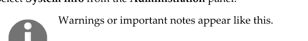

# Alexa Skills Projects：Amazon Alexa 令人兴奋的项目构建指南与物联网集成


mapt.io

Mapt 是一个在线数字图书馆，可让您完全访问超过 5,000 本书籍和视频，以及领先的行业工具，帮助您规划个人发展并推进您的职业生涯。如需更多信息，请访问我们的网站。

## 为什么订阅？

- 使用来自 4,000 多名行业专业人士的实用电子书和视频，花更少的时间学习，花更多的时间编码
- 使用专为你打造的技能计划改善学习
- 每月免费获得一本电子书或视频
- Mapt 完全可搜索
- 复制、粘贴、打印和书签内容

## PacktPub.com

您是否知道 Packt 为每本出版的书籍提供电子书版本，提供 PDF 和 ePub 文件？您可以在 www.PactPub.com 升级到电子书版本，作为印刷书籍客户，您有权享受电子书副本的折扣。有关更多详细信息，请联系 service@packtpub.com。

在 www.PacktPub.com，您还可以阅读大量免费技术文章，注册多种免费通讯，并获得 Packt 书籍和电子书的独家折扣和优惠。

## 关于审阅者

**Srini Janarthanam** 是聊天机器人、NLP 和人工智能技术方面的专家，拥有超过 10 年的经验。他获得了爱丁堡大学的博士学位。他曾在爱丁堡和赫里奥特-瓦特大学担任研究员，在那里他参与了多个研究项目并撰写了 50 多篇会议/期刊论文。他经营一家聊天机器人和人工智能解决方案机构 - Chatomate。他最近撰写了由 Packt 出版的书籍 *Hands On - Chatbots and Conversational UI Development*。

## Packt 正在寻找像您这样的作者

如果您有兴趣成为 Packt 的作者，请访问 `authors.packtpub.com` 并立即申请。我们已与数千名开发人员和技术专业人士合作，就像您一样，帮助他们与全球技术社区分享他们的见解。您可以提交通用申请，申请我们正在招聘作者的特定热门主题，或提交您自己的想法。

## Preface

近年来语音计算的兴起引发了地壳般的转变，其结果是交互式语音个人助理不再潜伏在阴影中，亚马逊 Alexa、Siri 和 Google Now 已成为家喻户晓的名字。除了传统的移动设备栖息地之外，这些助理也可以在客厅和餐厅的中心找到，形式为亚马逊 Echo、Google Home 和 Apple HomePod 设备。

本书重点介绍通过研究 Alexa 来利用语音计算的力量，Alexa 是用于亚马逊 Echo 的交互式语音个人助理。在本书的整个过程中，我们将踏上了解 Alexa 内部工作原理的旅程，同时创建五个独特的 Alexa Skills，每个技能都将设计用于解决特定目的和现实世界用例。

希望你喜欢这段旅程！

## Who this book is for

本书面向所有对亚马逊 Echo 和 Alexa 所基于的底层语音计算技术感兴趣的人，以及学习如何利用该技术为 Alexa 创建面向家庭自动化、物联网和各种其他领域的技能的人。

## What this book covers

第 1 章，What Is Alexa?，是一章入门章节，不需要任何编程技能。我们讨论智能语音激活个人助理如何从仅仅被动存在于手机中发展成为以专用硬件设备的形式永久存在于普通家庭中的固定装置。

第 2 章，Hello World, Alexa!，将向读者介绍为 Alexa 创建技能的过程，并将解释如何创建基本的 Hello World Alexa 技能。

第 3 章，Hands-Free Experience with Alexa，将介绍一种使用 Alexa 发送消息的新方式，即免提方式。

第 4 章，*Let’s Play Factly with Alexa*，将创建一个名为 Factly 的 Alexa 技能游戏。我们还将使用 DynamoDB 为其添加持久性。

第 5 章，*Making Alexa Talk about CryptoCurrencies*，将演示 Alexa 如何提供最新的加密货币更新。用户将创建一个 Alexa 技能，该技能可以获取最新加密货币（如比特币和以太坊）的当前价格。

第 6 章，*Home Automation with Alexa*，将演示 Alexa 如何与其他物联网设备集成并创建智能家居的基础。用户将创建一个 Weather Monitor Alexa 技能，该技能可以告知用户家庭内的气候（温度/湿度/光照）。

第 7 章，*Future of Voice-Based Personal Assistants*，将讨论智能语音个人助理的未来。

## To get the most out of this book

要充分利用本书，以下是先决条件：

- 熟悉现代编程语言，例如 JavaScript。我们为 Lambdas 编写的全部代码都基于 Node.js。
- 免费套餐 Amazon AWS 开发人员账户。
- 熟悉代码编辑器。
- 不是强制性的，但建议使用亚马逊 Alexa 启用的设备，例如亚马逊 Echo。
- 在本书的整个过程中，我们将通过亚马逊开发者门户进行许多配置更改。我们建议您按照所述步骤进行操作，因此强烈建议您拥有良好的互联网连接。

## Download the example code files

您可以从 www.packtpub.com 的账户下载本书的示例代码文件。如果您在其他地方购买了本书，您可以访问 www.packtpub.com/support 并注册以直接通过电子邮件接收文件。


你可以按照以下步骤下载代码文件：

- 1. 在 `www.packtpub.com` 登录或注册。
- 2. 选择 **SUPPORT**（支持）选项卡。
- 3. 点击 **Code Downloads & Errata**（代码下载与勘误）。
- 4. 在 **Search**（搜索）框中输入书名，然后按照屏幕上的说明操作。

文件下载后，请确保使用最新版本的解压软件解压或提取文件夹：

- Windows 使用 WinRAR/7-Zip
- Mac 使用 Zipeg/iZip/UnRarX
- Linux 使用 7-Zip/PeaZip

本书的代码包也托管在 GitHub 上，地址为 `https://github.com/PacktPublishing/Alexa-Skills-Projects`。如果代码有更新，将会在现有的 GitHub 仓库中更新。

我们还有来自丰富的图书和视频目录中的其他代码包，可在 `https://github.com/PacktPublishing/` 获取。快去看看吧！

## 下载彩色图片

我们还提供一份 PDF 文件，其中包含本书使用的截图/图表的彩色图片。你可以在这里下载：
`http://www.packtpub.com/sites/default/files/downloads/AlexaSkillsProjects_ColorImages.pdf`

## 本书使用的约定

本书通篇使用了多种文本约定。

`CodeInText`：表示文本中的代码词、数据库表名、文件夹名、文件名、文件扩展名、路径名、虚拟 URL、用户输入和 Twitter 句柄。例如：“在控制台搜索栏中，搜索 Lambda，当它出现在自动建议列表中时点击它。”

代码块如下所示：

```
buildSpeechletResponse = (outputText, shouldEndSession) => {
    return {
        outputSpeech: {
            type: "PlainText",
            text: outputText
        },
        shouldEndSession: shouldEndSession
    }
}
```

当我们希望您注意代码块的特定部分时，相关行或项目会以粗体显示：

```
generateResponse = (speechletResponse) => {
    return {
        version: "1.0",
        response: speechletResponse
    }
}
```

**粗体**：表示新术语、重要词语或您在屏幕上看到的词语。例如，菜单或对话框中的词语会以这样的形式出现在文本中。例如：“从 **Administration**（管理）面板中选择 **System info**（系统信息）。”




## 联系我们

我们始终欢迎读者的反馈。

**一般反馈**：发送邮件至 `feedback@packtpub.com`，并在邮件主题中注明书名。如果您对本书的任何方面有疑问，请发送邮件至 `questions@packtpub.com`。

**勘误**：尽管我们已竭尽全力确保内容的准确性，但错误仍在所难免。如果您在本书中发现了错误，我们将不胜感激，请您向我们报告。请访问 `www.packtpub.com/submit-errata`，选择您的图书，点击“Errata Submission Form”链接，然后输入详细信息。

**盗版**：如果您在互联网上以任何形式发现我们作品的非法副本，我们将不胜感激，请您提供位置地址或网站名称。请通过 `copyright@packtpub.com` 联系我们，并提供相关材料的链接。

**如果您有兴趣成为作者**：如果您有擅长的主题，并且对撰写或参与编写一本书感兴趣，请访问 `authors.packtpub.com`。

## 评论

请留下评论。当您阅读并使用过本书后，为什么不在您购买本书的网站上留下评论呢？潜在的读者可以借此看到并参考您的客观意见来做购买决定，我们 Packt 可以了解您对我们产品的看法，我们的作者也可以看到您对他们著作的反馈。谢谢！

有关 Packt 的更多信息，请访问 `packtpub.com`。
