## 什么是 Alexa？

> *“我确实看到了语音的力量。它是一种非常强大的叙事形式。”*  
> —— 阿基拉·博尔登-莫尼法

对于我们的人类祖先来说，随着大脑的进化，语言也随之发展，从符号和声音到更复杂的有声语言形式，这使他们能够进行复杂的对话，从而形成生存所需的社会联系。与书面交流不同，有声语言不会留下自身的痕迹，因此历史学家很难计算出语言起源的确切日期。然而，历史学家通过多种方法推测，语言发展于30万年前，符号于3万年前，文字于7000年前。自那时起，人类一直将语言和声音用于各种创造性的用途。

在本章中，我们将探讨语音的一种此类用途——能够随意命令基于语音的交互式个人助理执行特定任务的能力。在此之前，我们还将通过以下主题了解什么是基于语音的智能个人助理、它能满足哪些需求，以及当前市场上有哪些基于语音的个人助理（包括 Alexa）：

- 语音个人助理的需求
- 语音个人助理的应用
- 各种语音个人助理的比较

那么，让我们进入第一个主题。

## 语音个人助理的需求

要理解语音个人助理的演变，我们必须回到过去，看看促成其出现的一些重要事件。这些事件之一是计算机的演变。尽管与语音革命没有直接关系，但计算机的演变在语音个人助理的发展中发挥了关键作用，因为它标志着互联网的发明，而互联网是大多数语音个人助理的支柱。计算机革命还带来了有关硬件和集成电路的重大变革，我们将在下面讨论这些变革。

计算机革命始于19世纪，当时查尔斯·巴贝奇发明了第一台分析引擎，这为他赢得了“计算机之父”的称号。20世纪50年代和60年代是有趣的时代，集成电路这一开创性发明为计算机科学领域带来了巨大进步。集成电路取代了二极管和真空管，导致现有计算机的外观尺寸发生了巨大变化，进而使其变得更小、更紧凑。也是在那个时候，戈登·摩尔提出了他著名的观察：集成电路中的晶体管数量每两年翻一番；粗略地说，我们将能够在集成电路中封装越来越多的处理能力，而电路尺寸每两年就会缩小一次。摩尔的观察早已预见了我们技术和硬件的未来，遵循它，我们至少可以容易地预测一件事：我们会看到计算机变得越来越小，非常小，瞧，今天几乎每个人手中都有一台小型计算机——他们的智能手机。

60年代末和70年代初，高级研究计划局网络（ARPANET）也出现了，它最终演变成了我们在80年代所熟知的互联网。这一切起初听起来微不足道，但当你意识到这些都是关键因素时，如果没有它们被发明出来，我们永远不会看到语音个人助理的实际应用。

在语音个人助理出现之前，向计算机系统发送命令的传统方式要么是通过鼠标使用图形用户界面（GUI），要么是通过键盘使用终端。随着传统计算系统的外观尺寸缩小，输入方式也在演变，早期的手持设备/移动电话在传统键盘之外引入了手写笔，以利用设备的触摸屏功能：

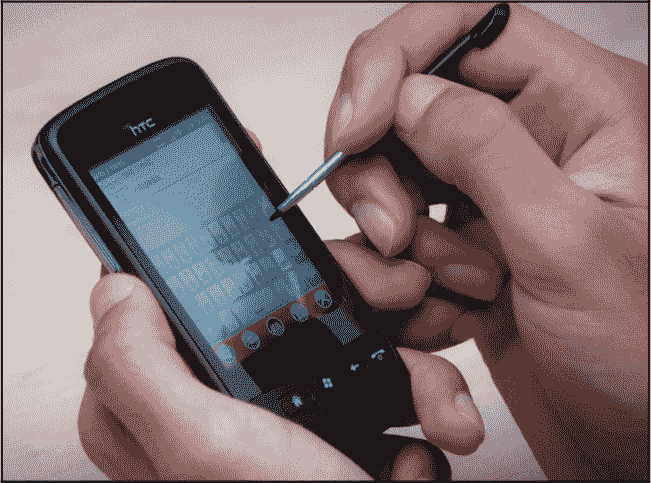

图 1.1：2010年拍摄的带手写笔的智能手机

演变仍在继续，正如史蒂夫·乔布斯所指出的，手写笔的位置被“世界上最好的指点设备”——我们的手指所取代。

2007年，史蒂夫·乔布斯在旧金山举行的MacWorld大会上，用“世界上最好的指点设备”来形容用户的手指，从而在iPhone上引入了触摸功能。这次大会的亮点可以在YouTube上观看：`https://www.youtube.com/watch?v=P-a_R6ewrmM`。

随着计算机与人类之间的界面变得越来越薄，语音自然地成为下一种能够作为计算设备输入工具的媒介，因此语音个人助理应运而生。

将语音作为计算设备输入媒介的想法并不新鲜；与计算机革命并行的是语音革命，其许多重要发现见链接：`https://voicebot.ai/2017/07/14/timeline-voice-assistants-short-history-voice-revolution/`

在语音革命的众多里程碑中，几乎每位读者都至少熟悉其中几个最新的里程碑，即 Siri、Google Now、Cortana 和亚马逊的 Alexa。其中最流行的是苹果的 Siri 和谷歌的 Google Now，它们最初分别与 iOS 和 Android 移动设备集成出现。

苹果的 Siri 最初是作为 App Store 上的一个应用出现的，但后来被苹果收购，并与 iOS 设备更加紧密地集成。Siri 使用自然语言界面来聆听用户的命令并执行必要的操作。此外，随着 macOS Sierra 的到来，它的能力不再局限于 iOS 设备：

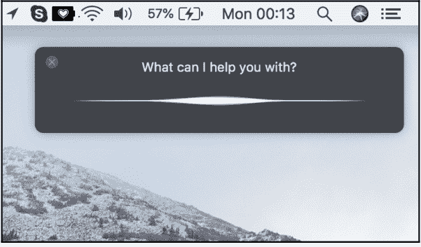

图 1.3：Siri 的功能不仅限于 iPhone，还扩展到桌面

谷歌紧随苹果之后，在 2011 年 Siri 推出后不久，于 2012 年推出了 Google Now。与 Siri 不同，Google Now 在 Android 上原生可用，同时也作为 iOS 设备的独立应用。Google Now 与 Gmail、Google 日历和强大的 Google 搜索本身等 Android/Google 功能无缝集成：

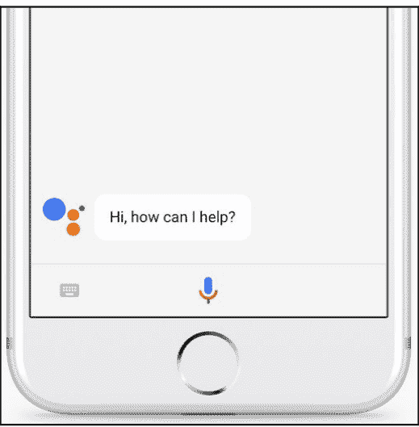

图 1.4：Google Now 作为原生应用的一部分在 iOS 上可用（Google 和 Google 徽标是 Google Inc. 的注册商标，经许可使用。）

紧随谷歌之后的是微软，它推出了自己的智能语音助手 Cortana，并于 2014 年面向桌面和移动设备推出：

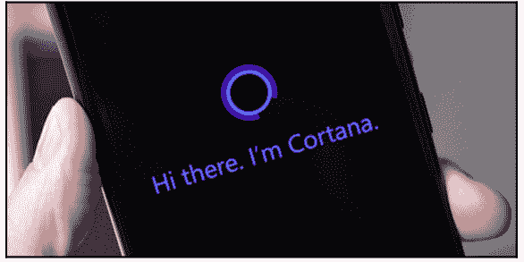

图 1.5：微软的 Cortana 最初是为微软的移动和桌面计算系统推出的

随着时间的推移，很明显，基于语音的个人助理已经站稳脚跟，并且需要专属的硬件和空间。亚马逊在这方面率先采取了行动，推出了其品牌 Amazon Echo，这是一个智能音箱设备系列，由亚马逊公司专门设计和开发，使用户能够使用名为 *Alexa* 的交互式语音个人助理服务（这也是本章标题的由来）：

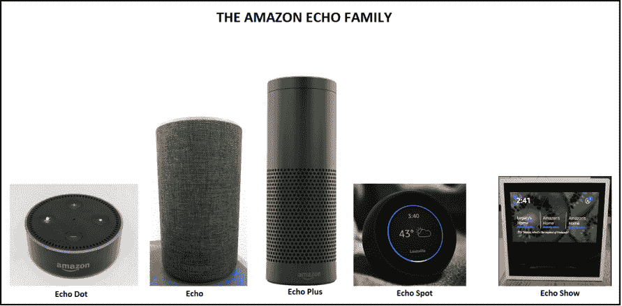

图 1.6：Amazon Echo 设备系列

完整的 Echo 系列及其功能如下表所示：

| 设备 | 用途 |
|---|---|
| Amazon Echo | 最初的旗舰智能音箱。 |
| Echo Dot | Echo 的更小、更便宜版本，没有放大扬声器，因此音质也不如 Echo。 |
| Echo Plus | 最新版 Echo，集成了 Zigbee。 |
| Echo Show | 支持 Alexa 的设备，配备大触摸屏，用户与 Alexa 的交互不仅是听觉的，还有视觉的。 |
| Echo Spot | *Show + Dot = Spot*。具备 Show 和 Dot 设备的全部基本功能，外形尺寸小得多。 |
| Amazon Tap | 支持 Alexa 的蓝牙音箱。 |

Echo 系列标志着亚马逊第二次进军硬件领域，第一次是推出广受欢迎的电子书阅读器 Kindle。谷歌也认识到，交互式语音助手可以通过充分利用智能家居概念做更多事情，因此在亚马逊之后紧跟其后，推出了 Google Home 智能音箱，其中内置了与 Alexa 对应的 Google Assistant：

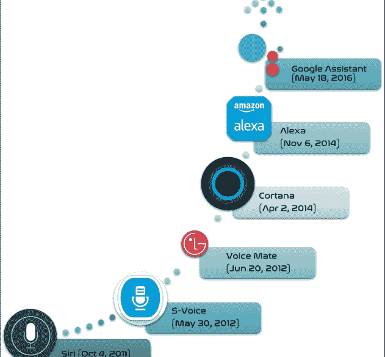

图 1.7：各种基于语音的个人助理的发布时间线（来源：www.citiusminds.com）

请注意，上图不包括 2012 年推出的 Google Now。

我们已经讨论了基于语音的交互式个人助理的演变，以及它们如何从用户智能手机上的另一个应用发展成为用户智能家居的一部分。

在下一节中，我们将讨论基于语音的交互式个人助理的一些常见用途。

## 基于语音的个人助理的应用

我们在上一节讨论了基于语音的个人助理的演变。在本节中，我们将把讨论扩展到每个交互式语音个人助理的一些常见用途，无论该助理是基于桌面、智能手机还是智能家居。我们将从最早且最著名的助手之一——苹果的 Siri 开始。

### Siri

如前所述，Siri 最初是 2011 年为 iOS 推出的一款独立智能手机应用，后来被苹果收购。最初，Siri 的能力仅限于智能手机和简单功能，例如：

- 查找联系人
- 消息（短信）
- 按用户需求获取天气更新，以及上一节提到的其他简单查询

然而，苹果的路线图还通过将 Siri 与第三方应用紧密集成来扩展其功能，并且正如承诺的那样，随着 iOS 10 的到来，苹果还发布了 SiriKit。

想了解更多关于 SiriKit 的信息，请访问 https://developer.apple.com/sirikit/。

如果用户安装了以下第三方应用，可以使用 Siri 叫车：

- Uber
- Lyft

如果用户安装了以下第三方应用，可以使用 Siri 设置这些应用发送消息（不仅仅是短信）：

- WhatsApp
- LinkedIn
- WeChat
- Slack

用户还可以通过 Siri 使用以下应用拨打 VoIP 电话：

- Skype
- Viber

请注意，以上列表并非详尽无遗。然而，第三方集成并不是苹果扩展 Siri 功能路线图中的唯一内容。macOS Sierra 的发布也将 Siri 的功能带到了桌面。要了解有关 Siri 桌面功能的更多信息，请访问 https://support.apple.com/en-us/HT206993。

Siri 还可以帮助用户：

- 在 Mac 上搜索文件
- 通知用户其存储空间
- 通过“通讯录”发起 FaceTime 请求，以及此处所示的许多其他功能：

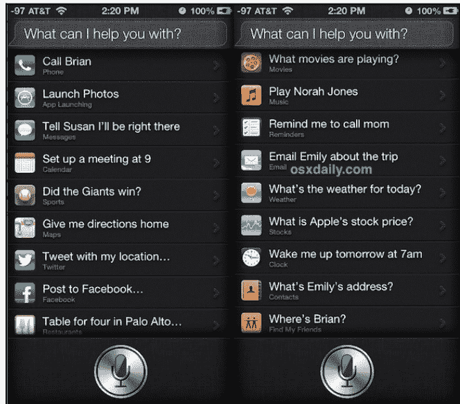

图 1.8：Siri 可以帮忙处理的事项列表（非详尽）（来源：www.osxdaily.com）

在了解了 Siri 的桌面和智能手机功能后，现在让我们继续介绍另一款流行的语音助手。

### Google Now

接下来我们将讨论 Android 和 Google Now。在撰写本文时，Android 是智能手机市场上最大的参与者，也是 Google Now 的故乡——Google Now 是谷歌于 2012 年为 Android 智能手机推出的语音助手。

2010 年初，智能手机市场由许多参与者主导。多年后，市场逐渐筛选，如今只剩下两个主要参与者，如下图所示：

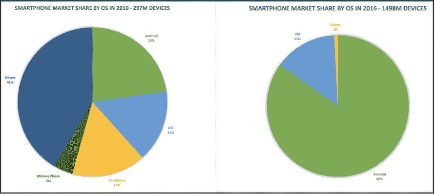

图 1.9：2010 年至 2016 年智能手机市场份额分布对比（数据来源：Gartner）

Google Now 几乎可以完成 Siri 所能完成的一切；然而，它与网络和基于网络的查询有更好的集成，因为网络是谷歌的强项。用户可以问 Google Now 的一些事情包括：

| 类别 | 命令 |
|---|---|
| 一般命令 | • “什么是[薛定谔的猫]？” • “谁发明了[互联网]？” • “发布到 Google+ [感觉很好]” |
| 笔记和提醒 | • “设置[晚上8点]的闹钟” • “自我提醒：[我把车停在D区]” |
| 时间和日期 | • “[柏林]的时区是什么？” • “家里的时间” • “创建日历事件：[在餐厅用餐] [周六晚上8点]” |
| 通信 | • “打电话给[Daniel]” • “[联系人姓名]” • “给 Daniel 发[电子邮件]，[主题：会议]，[消息：5分钟内到]” |
| 天气 | • “天气” • “[明天/周五]会下雨吗？” • “[波士顿] [周三]的天气怎么样？” |
| 地图和导航 | • “[弗拉格斯塔夫]的地图” • “开车导航到[柏林]” • “在地图上显示附近的[餐厅]” |

图 1.10：Google Now 可以做的部分事情（数据来源：www.cnet.com）

除了 Google Now，谷歌还推出了 Google Assistant，它是 Google Now 的更进化版本，因为用户可以与 Google Assistant 进行完整对话，而 Google Now 则无法做到这一点。

很可能 Google Now 将被逐步淘汰，取而代之的是 Google Assistant；然而，Google Assistant 目前仅可在 Google Home 上使用，Google Home 是 Google 的智能家居音箱；Android Pixel 2 智能手机；以及 Android Wear：

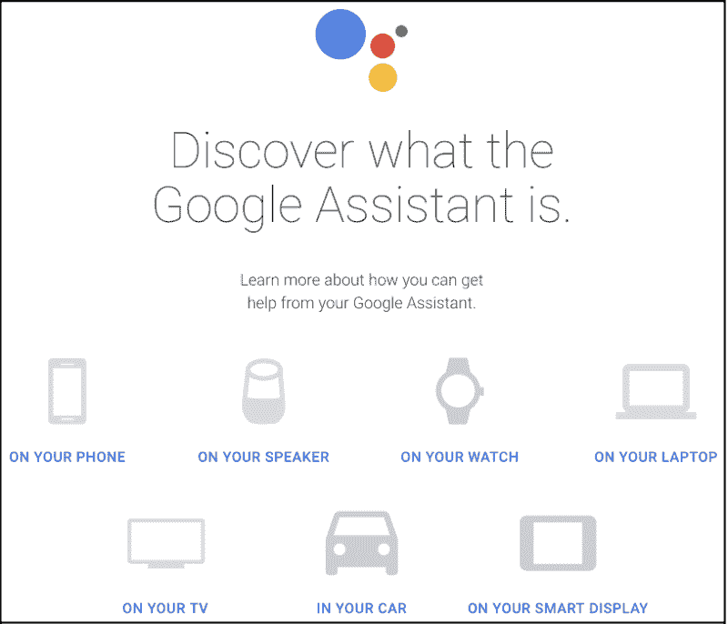

图 1.11：可使用 Google Assistant 的设备（Google 及 Google 标志是 Google Inc. 的注册商标，经许可使用。）

现在，从智能手机市场转向桌面市场：

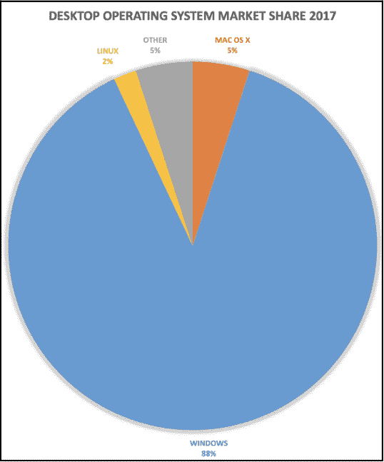

图 1.12：截至 2017 年 1 月的桌面市场份额（数据来源：www.windowscentral.com）

如前图所示，截至 2017 年 1 月，桌面市场的主要参与者有 Windows、Linux 和 Mac OS X，其中微软占据主导地位，这就引出了我们下一个个人助理。

## Cortana

由于微软在桌面市场的明显主导地位，我们不能忽视 Cortana，它是微软对 Siri 和 Google Assistant 的回应，但专注于桌面和 Windows Mobile：

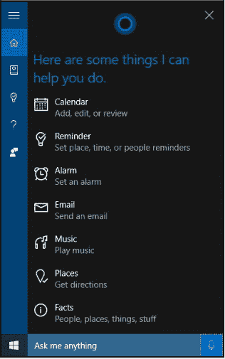

图 1.13：Cortana 可以提供帮助的一些事项列表

Cortana 不仅限于 Windows 10、Windows 10 Mobile 和 Windows Phone 8.1，还可用于：

- iOS（作为独立应用）
- Android（作为独立应用）
- Xbox One
- Harman Kardon 品牌的 Invoke 智能蓝牙音箱

Cortana 可以完成的一些众多事项包括：

- 使用 Bing Search 进行基于网络的查询（例如，“美国总统是谁？”）
- 启动应用并打开/关闭 Wi-Fi/蓝牙
- 询问天气
- 管理约会、提醒和事件

至此，我们来讨论本书的明星。

## Alexa

Alexa，本章和本书的核心，是亚马逊推出的基于交互式语音的个人助理，最初随其 Echo 设备系列推出。Alexa 作为助理以智能家居概念为导向，因此其大部分使用来自 Amazon Echo，一款专为放置在用户家中客厅而设计和开发的智能音箱，使用户可以向其询问日常天气、食谱和笑话等查询，或玩互动问答游戏、设置闹钟、购买日常用品等等。以下图表显示了用户可以向 Alexa 提出的一些事项：

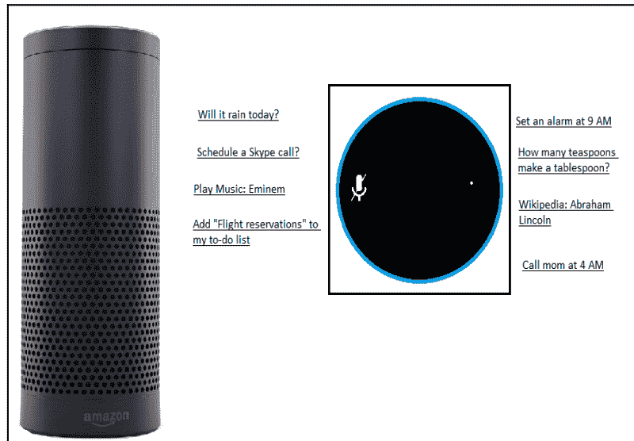

图 1.14：Alexa 可以提供帮助的一些事项列表

Alexa 的功能还可以通过安装第三方技能来扩展（类似于 Google Home 的第三方应用）。每个第三方技能都旨在服务于特定目的。例如，Uber 技能允许您订车，Domino's 技能允许您订披萨——所有这些都可以在您舒适的家中通过您的声音与 Alexa 协同完成。

截至撰写本文时，Alexa 可用的技能已超过 15,000 种，其中 Uber 和 Lyft 在出行类别中是最常用的，Pandora 和 Spotify 用于音乐流媒体，还有多个其他技能用于家庭自动化。

## 各种基于语音的个人助理的比较

由于之前的讨论，我们已经知道，无论是桌面、智能手机还是智能家居，每个市场都有稳定的交互式基于语音的个人助理供应。几乎每个助理都能完成其对应产品所能完成的功能，但这就引出了一个问题，实际差异在哪里？Alexa 能做得比 Google Assistant 更好，还是反之？

本书基于 Alexa，这是一款基于智能家居的个人助理，因此在本节中，我们将比较 Alexa 和 Google Assistant，以了解两者之间的细微差异：

| Alexa | Google Assistant |
|---|---|
| 使用唤醒词，“Alexa” | 使用唤醒词，“OK, Google” |
| 旗舰硬件——Amazon Echo 设备系列 | 旗舰硬件——Google Home、Pixel 2、Android Wear |
| 对电子商务/购物相关查询的响应略好，因为那是亚马逊的主要强项 | 对基于网络的查询响应略好，因为 Google 的主要强项是网络搜索 |
| 上下文感知能力略逊 | 上下文感知能力更好，因此对话显得更自然一些 |
| Alexa 的功能可以通过安装第三方“技能”来扩展 | Google Assistant 的功能可以通过安装第三方应用来扩展；然而，目前市场上为其提供的应用数量比 Alexa 的技能少 |
| 与智能家居设备的集成范围更广，如智能灯、智能锁、智能开关和智能恒温器 | 与智能家居设备的集成范围略窄 |

简而言之，Google 和 Alexa 都是非常出色的基于语音的助理，为用户提供了很多功能；然而，由于 Google Assistant 在市场上相对较新，其与第三方应用和硬件的集成和兼容性仍在不断发展，尽管速度非常快。然而，即使是两者中更新的，Google Home 在网络集成和上下文感知方面仍然表现更好。

在未来时代，人工智能和机器学习的演进将带来什么，以及这些助理如何利用它，将是非常有趣的。

## 总结

在本章中，我们介绍了交互式基于语音的个人助理的演进以及其从用户智能手机转移到智能家居所涉及的各种因素。我们还看到了智能手机、桌面和智能家居市场中的各种交互式基于语音的个人助理，以及各自的功能。

我们的目标是让读者熟悉交互式基于语音的个人助理的历史，以便在本书的后续内容中，我们可以将重点放在 Alexa 上，即随 Amazon Echo 捆绑的交互式个人助理。下一章将使读者能够了解 Alexa Skill 的结构，并动手编程 Amazon Echo，以便 Alexa 学会说出计算机编程中最古老的短语之一，“Hello, World。”
