# 2
Hello World, Alexa!

> “人声是灵魂的器官。”
> 
> — Henry Wadsworth Longfellow

在上一章中，我们讨论了各种基于语音的个人助理的演进，讨论了各自的功能，并最终比较了两个重要的基于智能家居的个人助理，即 Alexa 和 Google Home。

在本章中，我们将专注于 Alexa。我们首先将了解 Amazon Echo，这款来自亚马逊的智能音箱，使用户能够与 Alexa 及其各种变体进行交互。随后，我们将学习 Alexa 的结构以及使其如此交互性的要素。我们将通过涵盖以下主题来实现这一点：

- Amazon Echo 简介
- Alexa Skill 的结构
- 构建 Hello World Alexa Skill

我们将首先介绍 Amazon Echo，然后深入了解 Alexa 和 Alexa Skills 的细节。

## Amazon Echo 简介

通常，Amazon Echo 一词与 Alexa 同义使用。然而，虽然两者相互关联，但它们指向非常不同的事物——Amazon Echo 是实际的智能音箱（硬件），它是通往亚马逊 Alexa Skills 服务的网关，通过交互式基于语音的个人助理实现。

Amazon Echo 拥有完整的设备系列，因此有多种版本，所有这些都将在以下章节中讨论。

## Amazon Echo – 第一代

Amazon Echo 是亚马逊推出的原始第一代旗舰智能音箱。它需要无线互联网连接才能工作，因为其语音功能（Alexa）基于亚马逊的云计算服务：

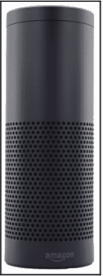

Amazon Echo 的初始设置可通过 Alexa 移动应用完成，该应用适用于两个主要移动平台（iOS 和 Android），也可以通过 Alexa 网页门户完成。

为了使其能够触及不同经济能力的用户，亚马逊推出了 Amazon Echo Dot，它是 Amazon Echo 的更小、更便宜的版本：

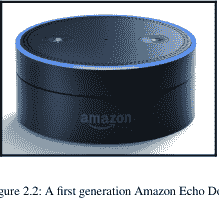


Echo Dot 旨在作为原始旗舰智能音箱 Echo 的一个更便宜、体积更小的替代品。与 Echo Dot 相比，原始 Echo 音箱之所以价格更高，是因为它确实拥有更清晰的声音和语音控制。

现在，让我们继续了解 Amazon Echo 家族的第二代产品。

## Amazon Echo —— 第二代

Amazon Echo 家族的第二代推出了更新的 Echo 设备，例如 Echo Plus、Echo Show 和 Echo Look。本章我们主要关注音箱产品：Amazon Echo 和 Amazon Echo Dot：


图 2.3：Amazon Echo 2，第二代 Amazon Echo 音箱

尽管第二代 Amazon Echo 的功能与第一代版本相同，但它拥有更清脆的音质、更小巧的尺寸（第二代 Echo 的尺寸几乎是第一代的三分之二），当然，还有织物外壳。

Echo 设备家族的第二代也对 Echo Dot 进行了全面改造，如下图所示：

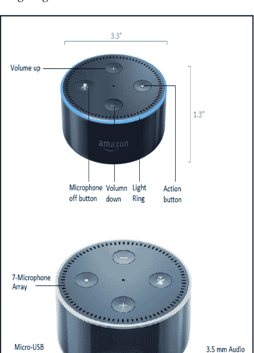

图 2.4：第二代 Echo Dot

正如你会注意到的，主要变化是增加了两个音量控制按钮，取代了旧型号上的环形控制。此外，麦克风阵列的孔位略微增大，以提供更好的音质，并配有电源指示灯。

在本书中，我们将主要使用 Amazon Echo Dot 来测试我们创建的技能。

如果您没有 Amazon Echo 设备，请不要担心。还有其他无需购买 Echo 硬件设备即可测试技能的方法。我们将在本书中逐步介绍这些方法。

如果你已经拥有 Amazon Echo，或者方便购买一台来测试我们将编写的示例技能（尽管如前所述，我们还有其他方法来测试技能），那么设置过程很简单，即将你的 Amazon Echo 连接到互联网，并开始向 Alexa 发出命令，如下图所示：

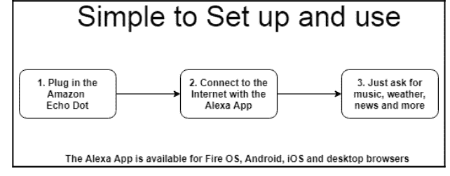

希望到现在，你已经清楚地了解了 Amazon Echo 到底是什么，以及 Amazon Echo 与 Alexa 之间的明显区别。在下一节中，我们将深入探究 Amazon Echo 的内部，剖析一个 Alexa 技能。

## 剖析 Alexa 技能

在本节中，我们将努力理解是什么让 Alexa（Amazon Echo 内置的个人助理）如此聪明。Alexa 能够遵循并理解用户的语音命令，唯一的原因就是它拥有技能——这不仅是在字面意义上，更是在实际意义上。

Alexa 技能是一段实际的软件代码，专为单一目的而设计；也就是说，让 Alexa 完成特定任务。以下是一些示例：

- 有一个 Alexa 技能可以从 Domino's Pizza 订购比萨
- 有一个 Alexa 技能可以召唤 Uber
- 有一个 Alexa 技能可以订购鲜花
- 有一个 Alexa 技能可以收听星座运势

自 2016 年以来，可用于 Alexa 的技能数量一直在稳步增长。截至 2018 年初，仅在美国，就有超过 30,000 个第三方技能可用于 Alexa：

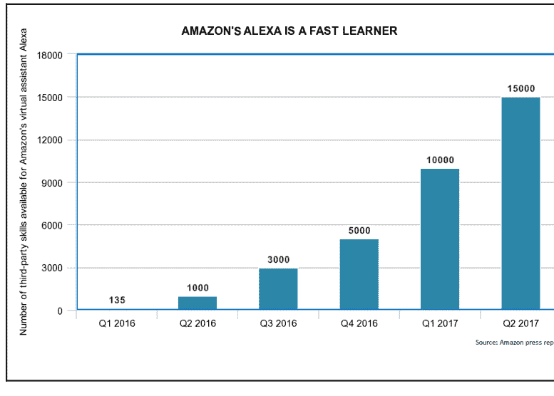

图 2.6：Alexa 第三方技能的增长统计

一旦用户按照上一节所示配置好 Amazon Echo 设备，安装/启用 Alexa 技能只需导航到 Alexa 应用或 Alexa 桌面门户，然后选择用户最喜欢的技能即可：

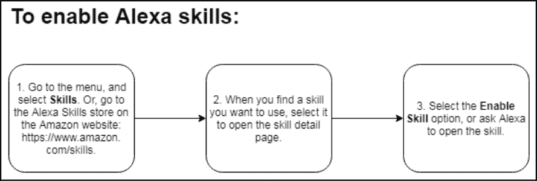

类似地，用户可以通过应用中的**技能**侧边菜单导航到**你的技能**部分，然后选择**禁用**，来停用已激活的 Alexa 技能。

简单来说，Alexa 技能可以比作教育专业方向。当用户在 Echo 上安装某个 Alexa 技能时，他/她正在让 Alexa 专门执行特定任务。在本章余下部分，我们将了解 Alexa 技能如何实现专业化。

每个 Alexa 技能的核心包含以下组件：

- 调用名称
- 意图与槽位
- Lambda

我们将分别讨论它们。

## 调用名称

调用名称是技能用户将说出的名称，Alexa 会使用它从已启用/可用技能列表中调用或识别你的技能。下面的屏幕截图显示了一个示例技能调用：


图 2.8：使用调用名称启动技能

请注意，在前面的示例中，我们使用了一个单词的调用名称，Alexa 通常不允许这样做，除非该调用名称对你的品牌/IP 是唯一的。就 Spotify 而言，情况确实如此。亚马逊已经针对调用名称定义了各种规则，这些规则可以在亚马逊开发者门户上找到。

请访问以下链接，了解亚马逊对 Alexa 调用名称的要求：https://developer.amazon.com/docs/custom-skills/choose-the-invocation-name-for-a-custom-skill.html

按照上述关于话语中调用名称的规则，另一个示例技能调用话语如下面的屏幕截图所示：

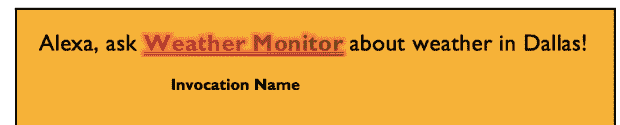

图 2.9：技能调用名称的剖析

因此，每个 Alexa 技能都必须有一个调用名称，在接下来的部分中，我们的 Hello World Alexa 技能也将有一个。

## 意图与槽位

单词 *意图*（Intent）源自 intention（意图），名副其实，它可以映射到 Alexa 技能的一项或多项功能。为了更好地理解意图，让我们将其映射到我们已知的事物，即常见的操作按钮。例如，电商应用或网页可能有一个**购买**按钮，点击该按钮将触发**购买动作**。在设计语音界面时，这种**购买动作**将转化为**购买意图**。稍后我们将讨论**购买意图**的常见用法。

有些意图/动作/功能几乎对每个技能都是通用的，因此它们已经为每个 Alexa 技能预先定义/预先配置好了。例如：

- 帮助意图（Help Intent）
- 取消意图（Cancel Intent）

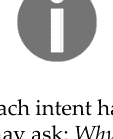

要了解有关内置意图的更多信息，请访问 https://developer.amazon.com/docs/custom-skills/standard-built-in-intents.html。

每个意图都有一个唯一名称和一组示例话语映射。作为开发者，你可能会问：*为什么需要示例话语？* 原因非常简单——语音设计有点棘手，因为用户可能会对同一个动作/意图说多种不同的话。例如，对于购买动作/意图，用户可能会说出以下话语：

- 购买 [item-name]
- 购入 [item-name]
- 获取 [item-name]
- 选择 [item-name]
- 持有 [item-name]

为了解决这个问题，我们为意图设置了话语。一个意图拥有的话语越多，就越容易被调用。

希望到现在你对意图已经有了相当的了解，接下来我们介绍**槽位（Slots）**：如果意图是一个动作，那么槽位就是该动作的参数。在前面提到的“购买动作/意图”示例中，*item-name* 将是购买意图的参数，因此 *item-name* 是一个槽位。在接下来的章节中，我们将看到槽位如何与意图协同工作。

## Lambda

Lambda 是**亚马逊云服务（AWS）**提供的无服务器计算服务。如果这听起来像是很多技术行话，请不要困惑，我们将在本节详细讨论 Lambda。

在 Alexa 的语音设计语境中，我们将使用 AWS 以 Lambda 函数的形式托管我们的*核心编程逻辑*。现在，显而易见的问题是：*Lambda 如何与 Alexa 技能协同工作？* 答案是，Alexa 技能上的每个意图/动作都会触发 Lambda 函数，Lambda 函数将处理这些意图，并针对该动作/意图返回适当的响应，如下图所示：

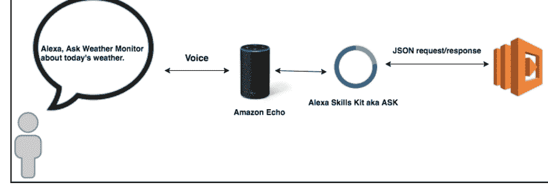

其工作原理如下：

1. 用户说出语音命令/查询：“Alexa，问一下天气监测器今天的天气。”
2. Alexa 从查询中识别要启动的技能，本例中是*天气监测器*。
3. Alexa 根据话语识别相关意图：“*询问* [技能名称] *今天的天气*。”
4. 该意图由技能工具包识别，并路由到 Lambda。
5. Lambda 处理该意图并返回适当的响应。

在基本层面上，几乎所有的 Alexa 技能都通过上述五个步骤来运作。在下一节中，我们将在编写第一个技能时实际看到这五个步骤的应用。


## Hello Alexa – Building a Hello World Alexa Skill

本节介绍本章的最终目标，即实际编写我们的第一个 Alexa Skill。然而，请注意，在我们踏上本章旅程的最后阶段之前，我们仍有一些先决条件。为了本练习的成功，每个用户都需要拥有一个 Amazon Developer 账户。注册 Amazon Developer 账户是一个简单直接的过程。用户可以在 https://developer.amazon.com 上注册账户。

注册是一个三步流程，包括提供个人信息、接受服务条款以及提供付款方式。

请注意，虽然注册要求您向 Amazon 提供付款方式，但 Amazon 仅在您最终使用任何付费服务时才会向您收费。然而，在本书的整个过程中，我们将把使用限制在免费层级，并且不会使用任何付费服务。

注册 Amazon Developer 账户不仅可以让您访问 Alexa Skills Kit，还可以访问 Amazon 的众多其他服务，例如 AWS 等。一旦成功登录，您就可以通过仪表板查看所有可用的服务：

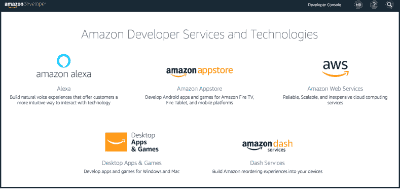

图 2.11：Amazon Developer 账户仪表板（来源：developer.amazon.com）

在完成注册流程后，我们现在可以踏上创建第一个 Alexa Skill 的旅程：

- 1. 请点击可用服务仪表板屏幕右上角的 Developer Console 选项按钮，如前所示。
- 2. 在导航到 Developer Console 后，请从顶部栏中列出的选项中选择 Alexa Skills Kit 选项，如以下屏幕截图所示：

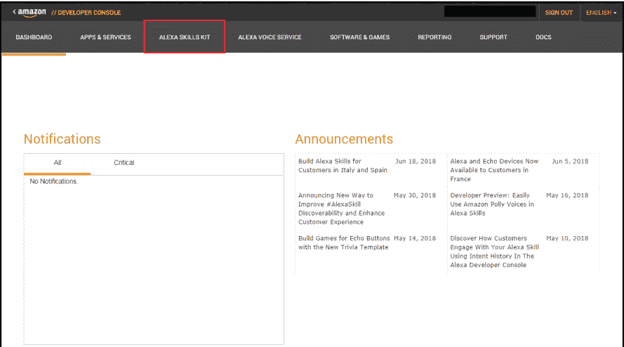

图 2.12：Alexa Skills Kit 仪表板（来源：developer.amazon.com）

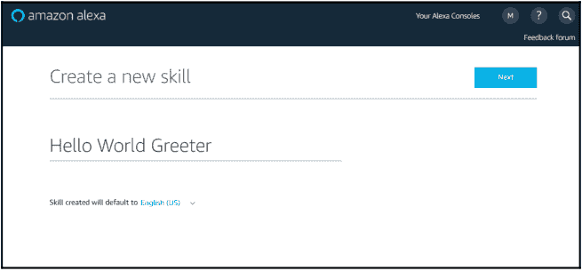

在我们的例子中，我们将使用名称 `Hello World Greeter`。这是用户在 Skills 商店浏览各种 Alexa Skills 时看到的名称。

请使用 Next 按钮进入下一屏幕，即模型选择屏幕：

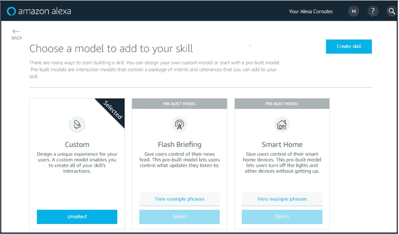

请选择技能的 **Custom** 模型并点击屏幕右上角的 **Create skill** 按钮：

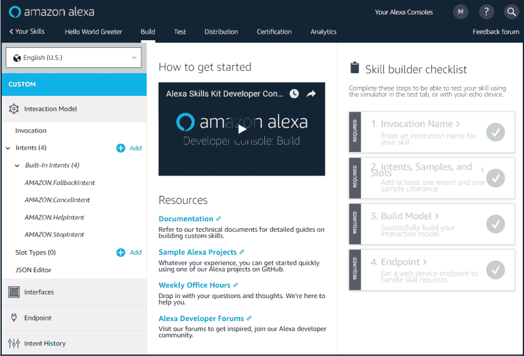

这应该会将我们带到前面屏幕截图所示的技能仪表板。如前所示，技能仪表板将帮助我们通过完成 **Skill builder checklist** 中显示的四个步骤来配置我们的技能。

6. 请点击 **Skill builder checklist** 下的 Invocation Name 部分以进入以下屏幕：

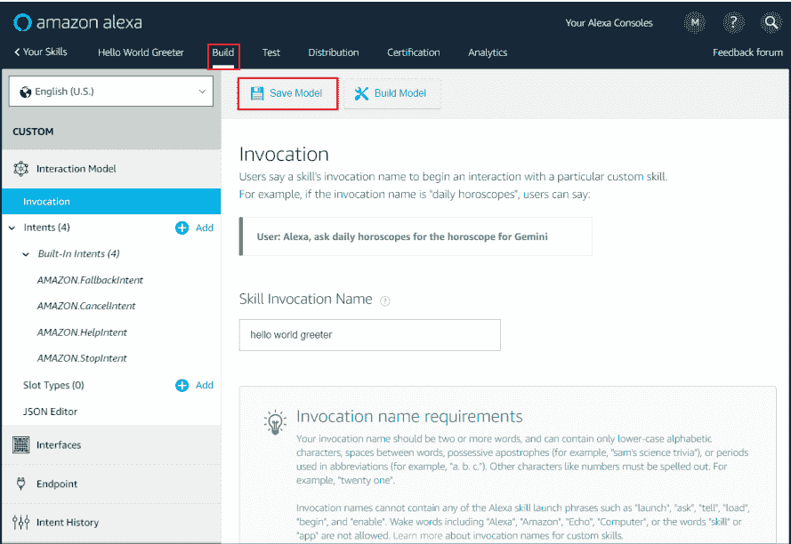

图 2.17：设置调用名称（来源：developer.amazon.com）

请按前所示添加调用名称为 hello world greeter，然后点击 Save Model 按钮保存更改。完成后，请点击 Build 按钮再次返回 Skill builder checklist：

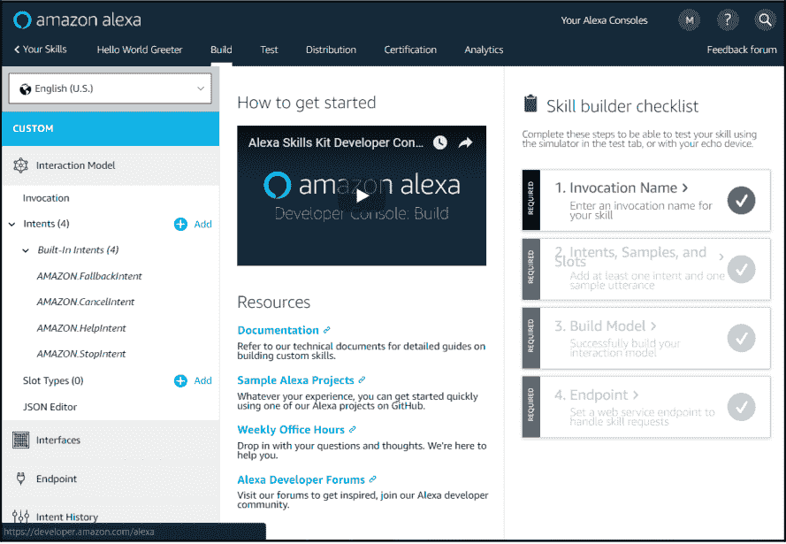

图 2.18：第一步完成（来源：developer.amazon.com）

第一步现在应该已完成并标记为绿色。现在我们将为我们的技能设置一个意图。

7. 请点击 **Skill builder checklist** 下的 **Intents, Samples and Slots** 按钮：

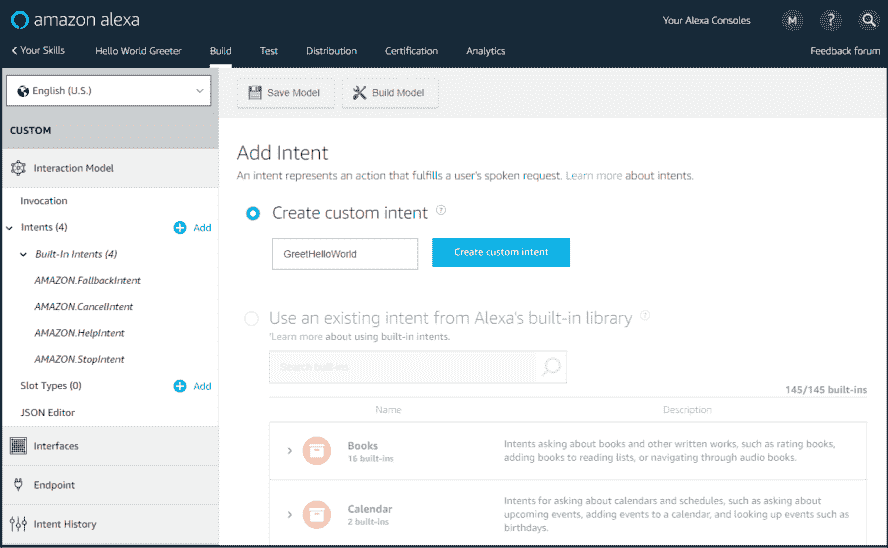

图 2.19：创建 GreetHelloWorld 意图（来源：developer.amazon.com）

请将意图名称添加为 `GreetHelloWorld` 并点击 **Create custom intent** 按钮。

虽然这并不明显，但意图是以 JSON 格式作为交互模型的一部分定义的。

> 要了解有关 JSON 格式的更多信息，请访问 `https://www.json.org/`。

8. 接下来，我们定义 `GreetHelloWorld` 意图的 **Sample Utterances**，如以下屏幕截图所示：

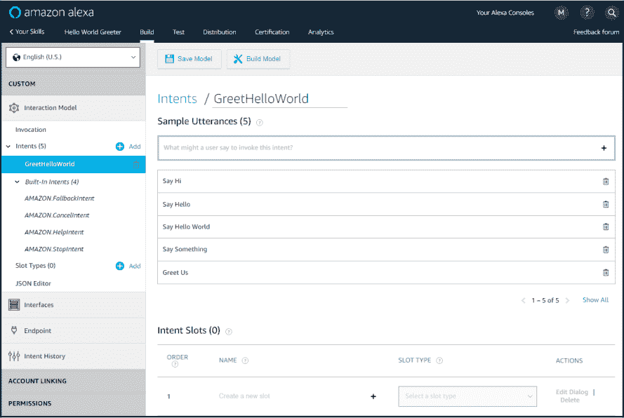

图 2.20：GreetHelloWorld 意图的示例话语（来源：developer.amazon.com）

请注意，我们没有定义任何槽位，因为此技能不需要。将在即将到来的章节中介绍槽位的使用。

请点击屏幕底部的 **Save Model** 按钮保存这些更改。最后，请点击 **Build** 选项卡再次返回 **Skill builder checklist**。在 **Skill builder checklist** 上，请点击 **Build Model** 按钮：

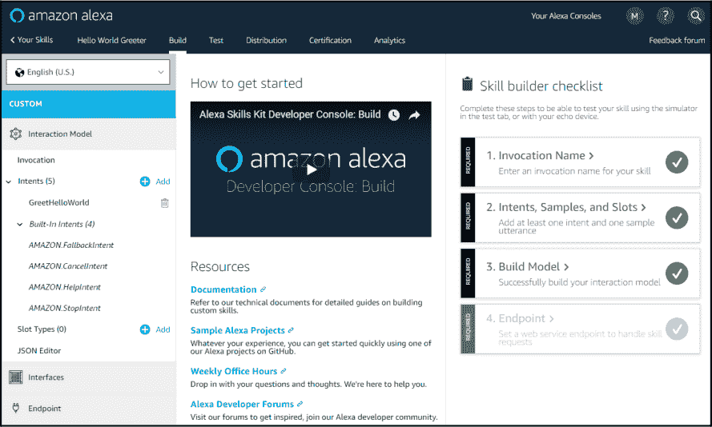

图 2.21：构建交互模型（来源：developer.amazon.com）

在更改保存并实际构建/创建交互模型之前需要几秒钟。我们还不会进入下一步，而是先配置我们的 Lambda。原因将在接下来的步骤中变得明显。

9. 一旦交互模型创建完成，我们将保持 **Skill builder checklist** 屏幕不变，并将重点放在创建 Lambda 上。然而，在此之前，请点击 **Skill builder checklist** 屏幕上的 **Endpoint** 按钮：

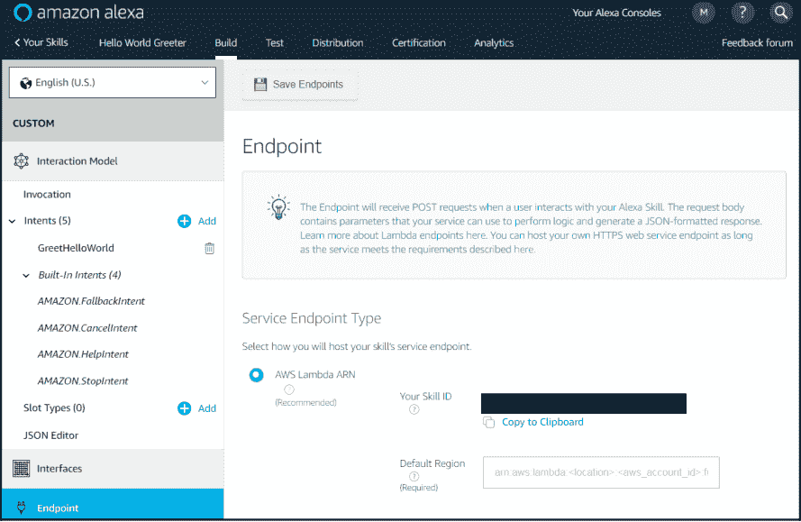

图 2.22：复制 AWS Lambda ARN（来源：developer.amazon.com）

请选择 AWS Lambda ARN 并复制技能 ID 并保存在某处。我们将在接下来的步骤中需要此技能 ID。

10. 现在，请打开一个新的浏览器标签页并导航到 AWS 控制台。

AWS 控制台可以在 `https://console.aws.amazon.com` 找到。请注意，如果您还没有账户，您需要创建一个新账户。

一旦您导航并成功登录 AWS 控制台，您应该会看到类似于以下屏幕截图的内容：

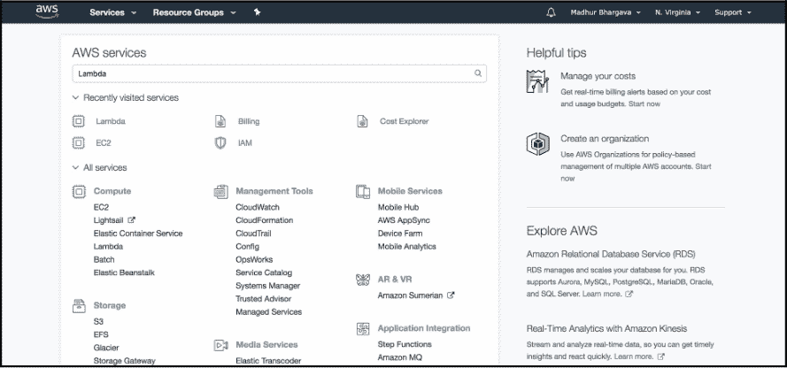

图 2.23：在 AWS 服务控制台搜索 Lambda（来源：console.aws.amazon.com）

在控制台搜索栏中，请搜索 `Lambda`，并在自动建议列表中出现时点击它。

- 11. 在下一个屏幕上选择 **Create a function**：

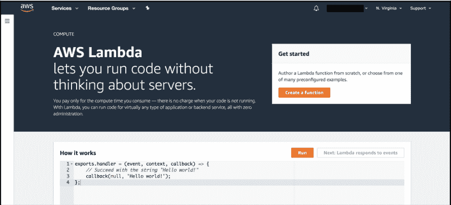

图 2.24：AWS Lambda 仪表板（来源：console.aws.amazon.com）

12. 在下一个屏幕上，您可以选择从头开始编写 Lambda 或从现有模板中选择。我们将选择 **Author from scratch**，因为这是我们的第一个技能，而且相对简单。此外，从头开始编写可以让我们对技能代码有稍大的了解：

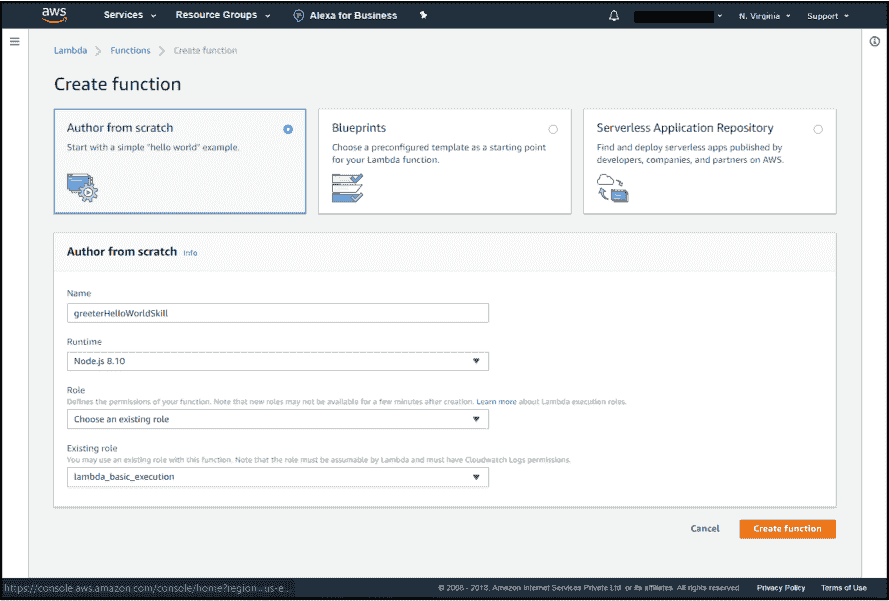

图 2.25：从头开始编写 Lambda 函数（来源：console.aws.amazon.com）

如前面的屏幕截图所示，我们的 Lambda 函数将命名为 `greeterHelloWorldSkill`，将使用 `Node.js (8.10)` 运行时，并具有现有的角色 **lambda_basic_execution**。请在填写必要详细信息后点击屏幕底部的 Create function。

13. 一旦函数创建完成，您将被带到下一个屏幕，您可以在其中添加触发器。触发器是会激活我们 Lambda 的源：

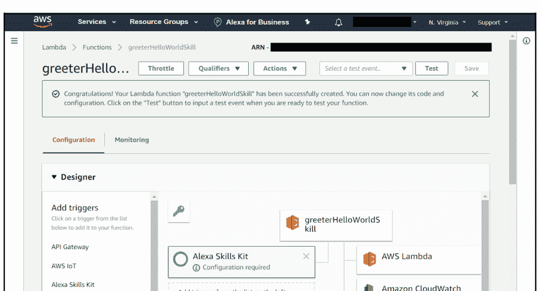

图 2.26：将 Alexa Skills Kit 触发器添加到 Lambda（来源：console.aws.amazon.com）

在我们的例子中，触发器是 Alexa Skills Kit。请从左侧的触发器列表中选择它。

请注意，如果您在左侧的触发器列表中找不到 Alexa Skills Kit，请确保您在屏幕左上角选择了区域为北弗吉尼亚 “(N. Virginia)” 。这是因为在撰写本文时，只有北弗吉尼亚区域托管 Alexa Skills Kit。


设置好触发器后，我们现在需要对其进行配置。请复制上一步保存的**技能 ID**，并将其添加到技能验证部分，如下面的截图所示：

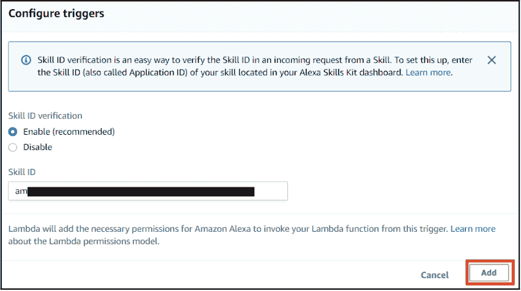

技能 ID 验证可确保我们的 Lambda 只处理那些由我们实际想要交互的技能发送的查询。

请点击屏幕右上角的**保存**按钮，并在设计器树中选择 **greeterHelloWorldSkill**：

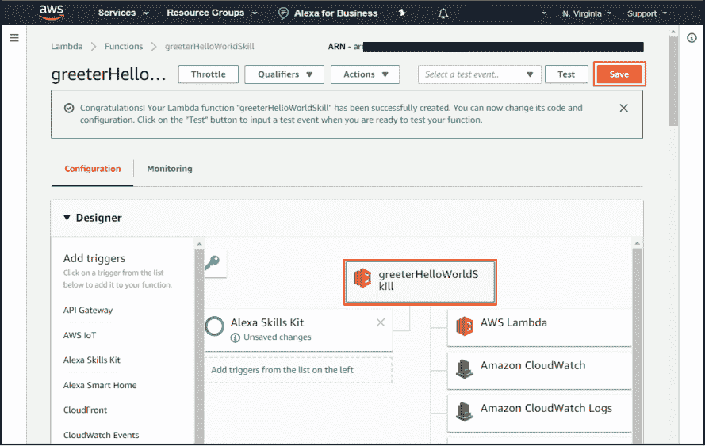

图 2.28：配置 Lambda（来源：console.aws.amazon.com）

现在，我们可以配置并开始编写 Lambda 了。

- 14. 由于我们的技能非常简单，我们的 Lambda 将处理两个基本请求：
    - LaunchRequest：处理技能的启动
    - IntentRequest：处理各种意图（在本例中只有一个 GreetHelloWorldIntent，用于问候 Hello World）

我们将直接在开发者门户上进行内联代码编辑。我们首先要对技能收到的每个请求进行区分：

```javascript
exports.handler = (event, context, callback) => {
    switch (event.request.type) {
        case "LaunchRequest":
            break;
        case "IntentRequest":
            break;
    }
}
```

如上面的代码所示，这就是我们对启动（launch）和意图（intent）事件请求进行区分的方法。

- 15. 接下来，我们将定义一些辅助函数，来帮助我们创建语音响应：

```javascript
buildSpeechletResponse = (outputText, shouldEndSession) => {
    return {
        outputSpeech: {
            type: "PlainText",
            text: outputText
        },
        shouldEndSession: shouldEndSession
    }
}

generateResponse = (speechletResponse) => {
    return {
        version: "1.0",
        response: speechletResponse
    }
}
```

`generateResponse` 函数将使用 `buildSpeechletResponse` 函数生成由 Lambda 函数返回的响应。`buildSpeechletResponse` 函数将以纯文本形式指定 Alexa 最终会输出的内容。它还需要一个变量 `shouldEndSession`，该变量指定 Alexa 是否应在响应后结束会话。

- 16. 配置好辅助函数后，我们就可以更新 `LaunchRequest` 和 `IntentRequest` 分支，让 Alexa 说出相应的响应，如下面的代码所示：

```javascript
exports.handler = (event, context, callback) => {
    switch (event.request.type) {
        case "LaunchRequest":
            context.succeed(generateResponse(buildSpeechletResponse("Welcome to Hello World Greeter.", false)))
            break;
        case "IntentRequest":
            switch (event.request.intent.name) {
                case "GreetHelloWorld":
                    context.succeed(generateResponse(buildSpeechletResponse("Hello World", true)))
                    break;
            }
            break;
    }
}
```

现在，当我们的 Lambda 收到 `LaunchRequest` 时，它可以返回一条欢迎消息，如前面的代码所示。此外，如果它收到 `IntentRequest`，它可以按意图名称进行筛选（虽然目前不需要筛选，因为我们只有一个自定义意图）。请点击屏幕右上角的**保存**按钮来保存进度。

- 17. 我们需要将 Lambda 与我们的技能关联，为此，我们需要 Lambda 的 ARN。

ARN 代表 Amazon Resource Name（亚马逊资源名称）。

ARN 位于 Lambda 函数页面的右上角，如下面的截图所示（为保护隐私和安全，图中的 ARN 已做模糊处理）：

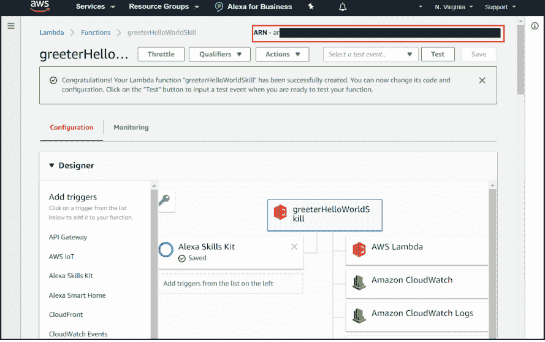

图 2.29：复制 ARN（来源：console.aws.amazon.com）

复制 ARN 后，请切换回之前的浏览器标签页，我们之前在那里配置技能的交互模型。请选择**端点**（Endpoints）选项卡，并在**默认区域**（Default Region）下输入 ARN，如下面的截图所示：

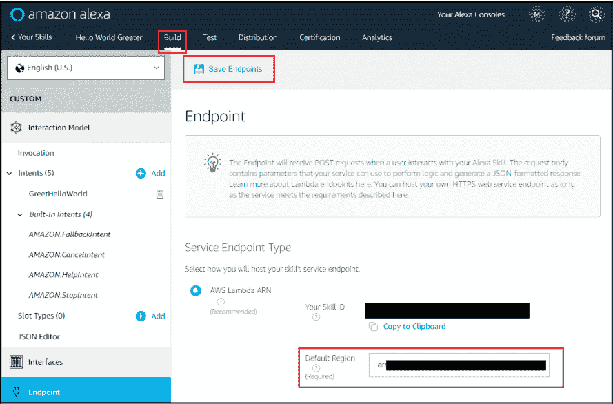

图 2.30：将 Lambda 的 ARN 与技能关联（来源：developer.amazon.com）

请点击**保存端点**（Save Endpoints），然后点击**构建**（Build）选项卡进入技能构建器检查清单。请重新构建模型。

- 18. 我们的设置已基本完成，可以测试 Hello World Greeter 技能了。该技能可以通过真实的 Amazon Echo 设备或 Amazon Service Simulator（亚马逊服务模拟器）进行测试。我们首先将通过 Amazon Service Simulator 测试我们的技能。请点击“测试”选项卡启动模拟器，并通过拨动“测试开关”为技能启用测试：

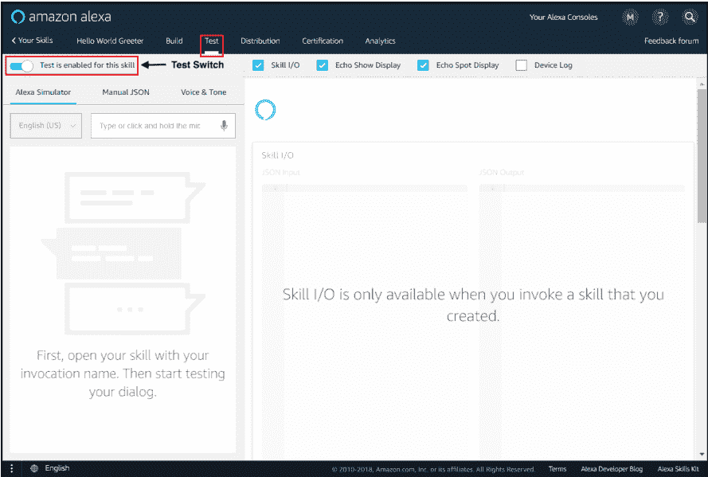

图 2.31：Alexa 测试模拟器（来源：developer.amazon.com）

请输入如下面截图所示的请求。Lambda 应为每个请求被调用，并返回以下响应：

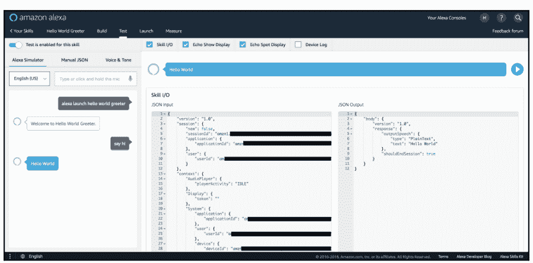

图 2.32：服务模拟器中的 Lambda 响应（来源：developer.amazon.com）

如果系统音量已打开，你甚至可以收听这些响应。

或者，你也可以使用 Amazon Echo 测试该技能。如果 Echo 已连接并设置好，当你说出：“Alexa, Launch Hello World Greeter,” 时，它应该回答：“Welcome to Hello World Greeter.”。如果你接着让它“Say hi”或“Say something,”，它应该回答“Hello World.”。

至此，本章已接近尾声。

请通过以下链接查看本章的 Lambda 代码：https://github.com/madhurbhargava/AlexaSkillsProjects/blob/master/Chapter2_HelloWorldGreeter_index.js

在下一节中，我们将总结已学内容，并展望后续章节。
