# 3 与 Alexa 的免提体验

> “舌头能描绘出眼睛看不见的东西。”
> 
> ——中国谚语

在学习完 Echo 和 Alexa 的细节之后，我们转而设计一个基本的 Alexa 技能。我们还对基本 Alexa 技能的构成以及技能中各个活动部件如何交互有了一些了解。

在本章中，我们将进一步提升设计技能，创建一个稍微高级一点的技能。这个技能名为 Handsfree Messenger，它允许用户仅使用 Alexa 和 Echo，无需与手机进行任何交互，就能以免提方式发送短信。除了用于托管 Lambda 的 AWS 之外，我们还将使用一个名为 Twilio 的定制服务，该服务允许用户/开发者通过 Web 服务 API 以编程方式拨打/接听电话以及发送/接收文本消息。

在本章中，我们将通过涵盖以下主题来实现这一目标：

- Handsfree Messenger 技能概述
- 配置 Twilio 消息后端
- 配置 Handsfree Messenger 技能

闲话少说，让我们从该技能设计的概述开始。

### Handsfree Messenger 技能概述

在继续设计 Handsfree Messenger 技能之前，我们需要了解几件事：

- 系统的核心功能是什么？
- 它有哪些活动部件？
- 这些部件如何交互？

Handsfree Messenger 技能的工作方式如下：

- 1. 用户将说出一个起始短语——“Alexa, Start Handsfree Messenger.”来启动 Alexa 技能。
- 2. Alexa 将启动该技能。
- 3. 用户将说出需要发送的实际消息：“Send message – Get milk!”
- 4. 现在，有趣的地方来了。当用户在前一步中说出实际消息时，将创建一个 `SendMessage` 意图，实际的消息文本将作为参数传递给该意图。


> 我们在前一章已经讨论过意图，因此我们假设读者已经熟悉意图及其功能。

- 5. 该意图由 Lambda 处理，Lambda 从意图中提取消息，并将消息连同预期收件人的信息一起传递给 Twilio 后端。


> 关于 Lambda 与 Twilio 后端之间的通信细节，我们不会深入讨论，因为将在后续章节中介绍。


6. Twilio 后端将接收到的消息传递给其预期接收者，并向 Lambda 传递确认响应。
7. Lambda 接收到确认后，通过语音告知发送者短语 `Message sent.`。

正如您从系统功能描述中已了解到的，这些是我们 Handsfree Messenger 技能的主要组成部分：

- 实际的 Alexa 技能：Handsfree Messenger
- 位于 AWS 后端的技能 Lambda
- Twilio 后端

如果您将此技能与我们在上一章中创建的技能进行比较，那么由于它拥有更多组成部分，此技能会稍微复杂一些。

Handsfree Messenger 的 VUI 流程如下：

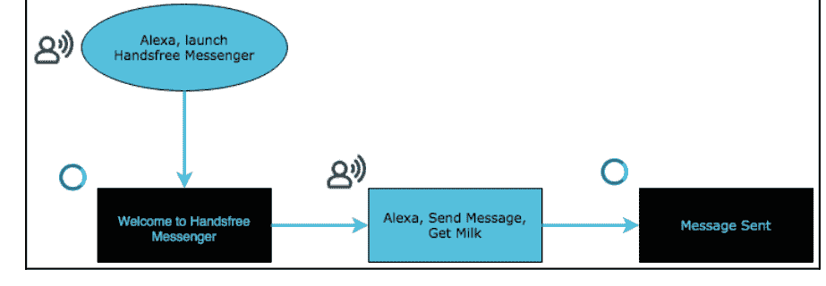

VUI 流程使用 Amazon 首选的模板来描述 Alexa 技能的 VUI 设计。然而，VUI 流程仅限于用户与 Alexa 的交互，因此，也许以图表形式概述功能步骤可以帮助您更好地理解 Handsfree Messenger 技能的工作原理：

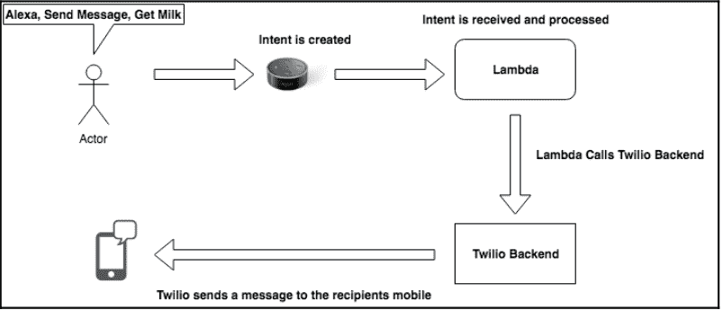

上图概述了技能的基本使用方式；我们还可以将步骤压缩成流程图，以明确系统中信息的流向：

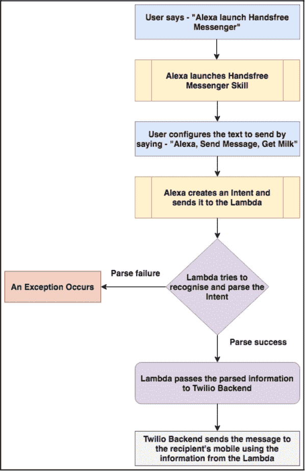

我们希望读者现在已经清楚我们的 HandsFree Messenger 技能的工作原理以及其所有组成部分如何交互。

在下一节中，我们将开始配置技能的组成部分之一，即我们的 Twilio 后端。

## 配置 Twilio 消息后端

Twilio 是一个云通信平台，成立于 2007 年，总部位于旧金山。它允许用户/开发者以编程方式拨打/接听电话，并使用网络服务 API 发送/接收短信。本章中，我们仅演示其消息功能；不过，我们要求并期望读者通过添加电话呼叫功能作为家庭作业练习来扩展此技能的功能。

要将 Twilio 配置为我们的消息后端，我们将遵循以下步骤：

- 1. 请在您的网络浏览器中导航到 `www.twilio.com`，如本截图所示：


2. 请点击 **Get a free API key** 或 **Sign up**（两者都会启动新用户的注册流程）以进入此处所示的 **Sign up for free** 页面：

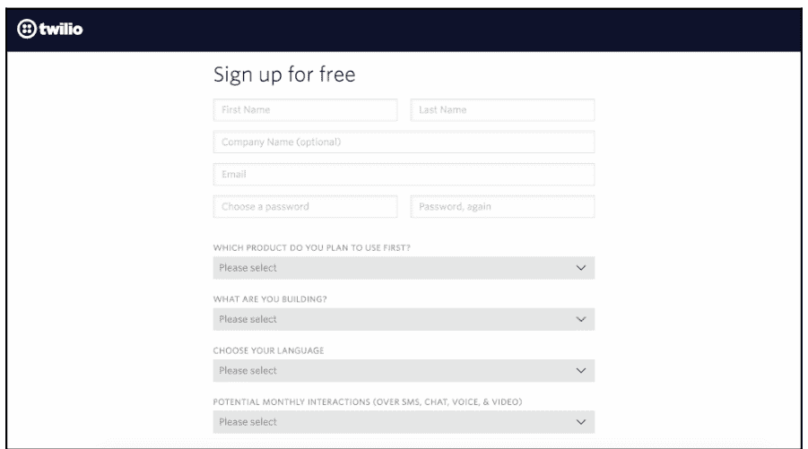

图 3.5：Twilio 注册页面

3. 请填写您的个人详细信息。如前一截图所示，页面底部有一个小问卷，围绕 Twilio 服务的使用构建。请为该问卷选择以下详细信息：

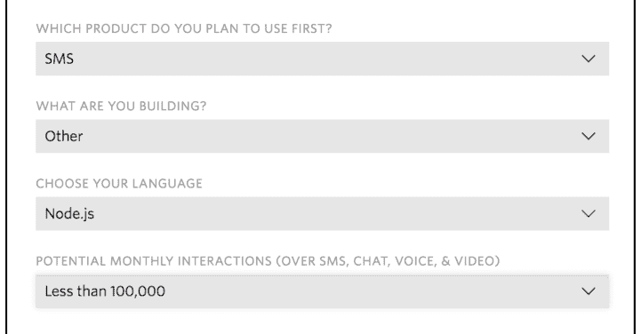

图 3.6：Twilio - 注册时填写个人详细信息

4. 填写完详细信息后，请选择页面底部的 Get Started 按钮。这应将您带到此验证页面：

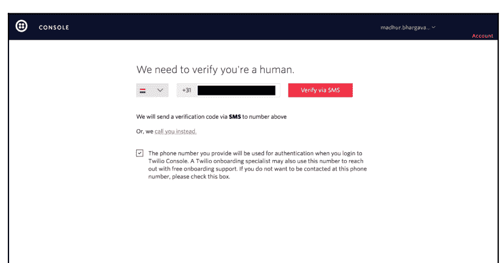

图 3.7：Twilio - 验证流程

请选择适当的国家/地区并在提供的空间中输入您的电话号码，然后点击 Verify via SMS，之后您应该会在您提供的电话号码上收到一条包含验证码的短信。

5. 点击 **Verify via SMS** 应将您带到下一个屏幕，您可以在其中输入验证码：

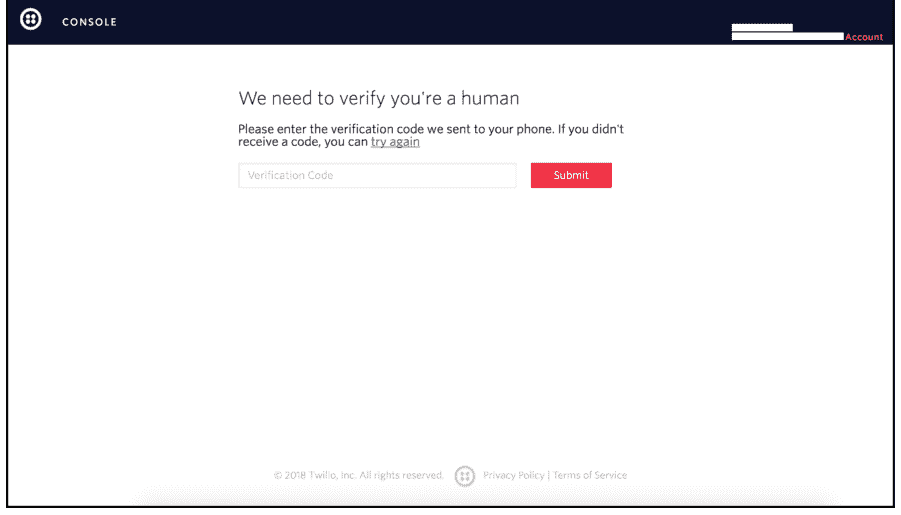

图 3.8：Twilio - 验证流程

请在此屏幕上输入验证码并点击 **Submit**。

6. 如果您成功验证了短信验证码，则应看到项目详细信息屏幕，我们将在此处为项目提供名称，如下所示：

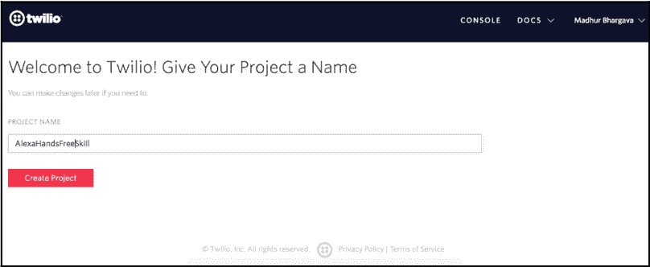

图 3.9：Twilio ~ 为您的项目命名

请将技能命名为 `AlexaHandsFreeSkill` 并点击 **Create Project**。

7. 点击 **Create Project** 按钮应将我们带到此仪表板：

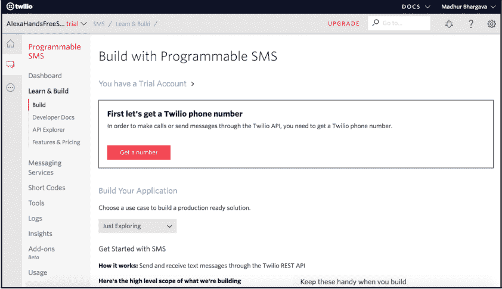

图 3.10：Twilio -- 仪表板

仪表板上有一些需要注意的地方：

- 我们正在使用试用账户，对于本技能而言这是可以的。
- 我们需要获取一个 Twilio 号码。

首先，让我们尝试理解为什么我们需要一个 Twilio 号码。

Twilio 的工作方式如下——开发者最初请求一个 Twilio 号码，当他们使用 Twilio API 发送短信或拨打电话时，这些短信和电话都是从此预先请求的号码生成的。每个生成的 Twilio 号码都与您在第 2 步提供的详细信息中提供的国家/地区及其通信法规相关联。

8. 请点击第 7 步所示的仪表板屏幕上的 Get a number 按钮。这应根据您在第 2 步提供的国家/地区详细信息生成一个电话号码：

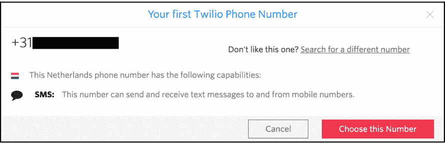

图 3.11：获取 Twilio 号码

我们的技能将使用生成的号码通过 Twilio API 调用发送短信。

9. 当您在上一步中向用户展示的 Twilio 电话号码对话框中选择 Choose this Number 时，根据国家/地区，用户可能会被要求提供额外详细信息，如以下截图所示：

### Address Required

由于当地法规，您或您的客户必须拥有任何国家的商业或个人地址才能购买 +31 [redacted]

### Enter an Address

FRIENDLY NAME
地址的名称
CUSTOMER NAME
企业或客户名称
ADDRESS 1
街道地址、邮政信箱、套房、单元等。
ADDRESS 2
附加街道地址、邮政信箱、套房、单元等。
CITY
STATE/PROVINCE/REGION
POSTAL CODE
COUNTRY
Netherlands

Go back to your preselected number

Cancel

Save and continue

图 3.12：Twilio：号码的地址要求

请注意，此处显示的对话框取决于用户在入职流程中选择的国家/地区，具体取决于国家/地区，您可能看到也可能看不到此对话框。如果您看到此对话框，请提供必要详细信息并点击对话框底部的 Save and continue 按钮。

10. 点击 Save and continue 按钮后，我们应看到此对话框：

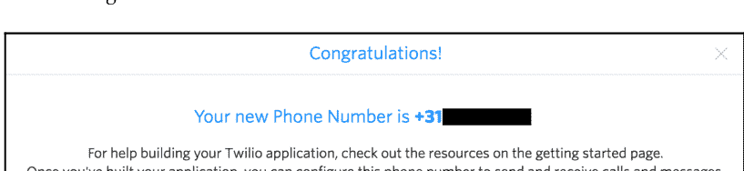

图 3.13：最终获取 Twilio 号码

号码选择过程已完成，我们现在已成功选择了一个用于通过 Twilio API 调用发送短信的电话号码。请点击此对话框中的 Done 按钮，您应再次返回仪表板。

11. 一旦您回到仪表板，底部应有 Get Started with SMS 部分，其中包含 Get Started 按钮：

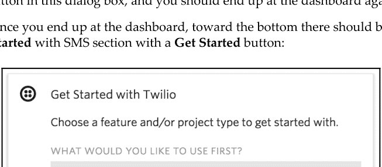

图 3.14：Twilio - 开始使用可编程短信

在此部分下，请从下拉菜单中选择 Programmable SMS 并点击 Get Started 按钮。

12. 点击 Get Started 按钮后，您应进入 Send a Message 页面：

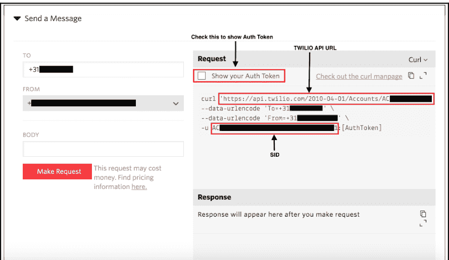

图 3.15：Twilio - 发送消息功能的测试设置

请注意，我们需要从此页面获取三项重要信息：

- SID：标记在前一截图中
- Auth Token：如果您勾选标记为 Show your Auth Token 的复选框，Auth Token 将变得可见
- Twilio API URL：这在 curl 命令之后提及

请记下 SID 和 Auth Token，因为我们在 Lambda 代码中需要它们。记下这些详细信息后，请关闭此页面。

我们已成功配置 Twilio 后端，这将帮助我们使用 Alexa 技能发送短信。在下一节中，我们将通过 Amazon Developer 控制台配置我们的 Handsfree Messenger 技能。


## 配置 Handsfree Messenger 技能

在准备好 Twilio 后端之后，我们现在需要配置 Alexa 技能。为此，我们将通过 Amazon 开发者门户进行配置。

我们假设读者已经了解并注册了 Amazon 开发者门户，并且已经掌握了 Amazon Alexa 技能开发者门户的基本入门信息。我们在上一章中已经介绍了 Amazon 开发者门户的账户创建和其他基本细节，因此这里不再重复。

我们将从技能创建开始：

+   1. 在**创建新技能**屏幕上，请为技能命名：

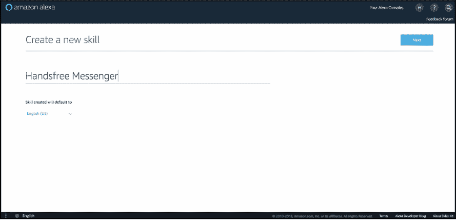

请保存这些更改，并使用屏幕右上角的**下一步**按钮进入下一个屏幕。

+   2. 在此步骤中，我们将为技能选择一个模型。

我们已经在第 2 章 *Hello World, Alexa!* 中介绍了选择模型的细节，因此这里不再赘述。请为技能选择**自定义**模型，并在创建技能后进入下一个屏幕，即技能构建器检查清单。

我们从第 2 章 *Hello World, Alexa!* 中已经知道，交互模型由意图、槽位和示例语句组成。Handsfree Messenger 技能的交互模型包含所有这些元素，我们将在接下来的步骤中通过完成**技能构建器检查清单**来定义它们。

+   3. 作为**技能构建器检查清单**的第一步，我们将为技能提供一个**调用名称**。我们的技能的**调用名称**将是 `handsfree messenger`。这是用户用来调用我们技能的名称。提供调用名称后，请保存模型。

+   4. 接下来，我们需要为技能配置一个意图。我们的技能只包含一个意图 `SendMessage`。我们定义该意图如下：

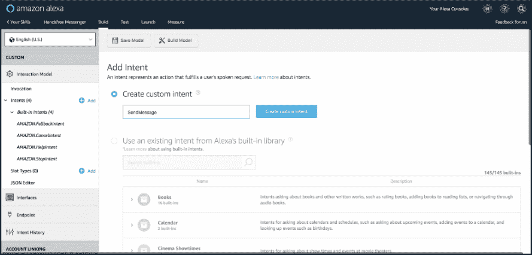

请点击**创建自定义意图**按钮来创建意图。

但这还不是全部；我们还需要在意图架构中包含一个槽位，以便将消息文本作为参数传递给 Lambda。

## 3.1 编写 Lambda 函数

### 5.1 树的逻辑结构

树是n（n≥0）个结点的有限集合，在任意一棵非空树中：

+   1. 有且仅有一个特定的称为根的结点；

+   2. 当n>1时，其余结点可分为m（m>0）个互不相交的有限集合，其中每一个集合本身又是一棵树，并且称为根结点的子树。

树的逻辑结构具有以下特点：

+   （1）树的根结点没有前驱结点，除根结点之外的所有结点有且只有一个前驱结点。

+   （2）树中所有结点可以有零个或多个后继结点。

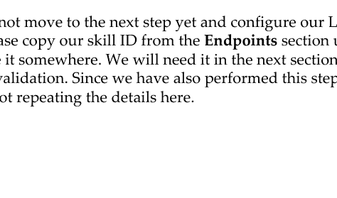

图5-1 树结构示意图

## 编写 Lambda 函数

一旦交互模型创建完成，我们将保持此屏幕不变，专注于创建 Lambda。

+   1. 请打开一个新的浏览器标签页，并导航到 AWS 控制台，其网址如下：

AWS 控制台位于 https://console.aws.amazon.com。请注意，如果尚未创建账户，您可能需要创建一个新账户。

我们已经在第 2 章 *Hello World, Alexa!* 的“Hello Alexa – 构建 Hello World Alexa 技能”标题下的步骤 8-12 中介绍了基本 Lambda 函数的创建，因此这里不再重复这些步骤。请按照这些步骤操作，将 Lambda 函数命名为 `handsFreeMessengerSkill`，并将技能 ID 与 Lambda 关联，如第 2 章 *Hello World, Alexa!* 的“Hello Alexa – 构建 Hello World Alexa 技能”标题下所述。

由于我们的技能非常简单，我们的 Lambda 将处理两个基本请求：

- **启动请求**：用于处理技能启动
- **意图请求**：用于处理各种意图（在我们的例子中，只有一个 `SendMessage`，用于发送实际的短信）

我们将直接在开发者门户中的 `index.js` 文件中内联编辑代码。我们首先将技能接收到的每个请求进行分离。为此，请声明以下处理程序：

```
exports.handler = function (event, context) {
    try {
        if (event.request.type === "LaunchRequest") {
        } else if (event.request.type === "IntentRequest") {
        }
    } catch (e) {
        context.fail("Exception: " + e);
    }
};
```

这就是我们分离启动和意图事件请求的方式。

2. 接下来，我们将定义一些辅助函数，帮助我们创建语音响应：

```
//------Helper Methods------//

function buildSpeechletResponse(output, shouldEndSession) {
    return {
        outputSpeech: {
            type: "PlainText",
            text: output
        },
        shouldEndSession: shouldEndSession
    };
}

function buildResponse(speechletResponse) {
    return {
        version: "1.0",
        response: speechletResponse
    };
}
```

这些函数帮助 Lambda 在收到特定意图/输入时返回 Alexa 要说的响应。

`buildResponse` 函数将生成最终由 Alexa 说出的简明响应。

`buildSpeechletResponse` 函数将以纯文本形式指定 Alexa 最终要说的输出。它还接受另一个变量 `shouldEndSession`，该变量指定 Alexa 在响应后是否应结束会话。

3. 配置好辅助函数后，我们可以更新 `LaunchRequest` 和 `IntentRequest` 情况的处理，让 Alexa 说出相应的响应，如下所示：

```
exports.handler = function (event, context) {
    try {
        if (event.request.type === "LaunchRequest") {
            onLaunch(function callback(speechletResponse) {
                context.succeed(buildResponse(speechletResponse));
            });
        } else if (event.request.type === "IntentRequest") {
            onIntent(event.request,
                function callback(speechletResponse) {
```

```javascript
context.succeed(buildResponse(speechletResponse));
});
}
} catch (e) {
    context.fail("Exception: " + e);
}
};
```

现在，当我们的 `Lambda` 收到 `LaunchRequest` 时，它将调用 `onLaunch` 方法发送欢迎消息，我们将在下一步中实现该方法。

此外，如果收到 `IntentRequest`，它可以调用 `onIntent` 方法，该方法会进一步根据意图名称进行筛选（尽管目前不需要筛选，因为我们只有一个自定义意图）。

点击屏幕右上角的**保存**来保存进度。

+   4. 我们现在将实现上一步讨论的 `onLaunch` 和 `onIntent` 方法：

```
```javascript
function onLaunch(callback) {
    var output = "Welcome to HandsFree Messenger.";
    var endSession = false;
    callback(buildSpeechletResponse(output, endSession));
}

function onIntent(intentRequest, callback) {
    var intent = intentRequest.intent,
        intentName = intentRequest.intent.name;
    if("SendMessage" === intentName){
        var text = intent.slots.Text.value;
        var recipient = '+31XXXXXXXXXX';
        SendMessage(recipient, text, callback);
    } else {
        throw "Intent not recognized";
    }
}
```
```

`onLaunch` 方法很简单——它创建一条欢迎消息，并使用我们之前定义的辅助方法从该消息创建语音响应后将其发送回去。

`onIntent` 方法相对复杂一些——它根据意图名称筛选意图，如果意图是 `SendMessage`，则从槽位值中提取短信文本，然后通过 `SendMessage` 函数将其转发到接收者的硬编码手机号码。

我们将在接下来的步骤中定义 `SendMessage` 函数。

+   5. `SendMessage` 函数是整个技能的核心。它负责将消息传递给 Twilio 后端。然而，在定义 `SendMessage` 函数之前，我们需要声明一些与 Twilio API 交互时所需的常量。

如果您还记得，我们在上一节的最后一步记下了 SID 和 Auth Token；现在是时候声明它们了。我们将在 `SendMessage` 函数中使用这些常量。请按如下所示声明这些变量：

```
var sid = 'ACXXXXXXXXXXXXXXXXXXXXXXXXXXXXXXX';
var token = '4bXXXXXXXXXXXXXXXXXXXXXXXXXXXXXXX';
var sender = '+31XXXXXXXXXX';

var https = require('https');
var queryString = require('querystring');
```

请在 AWS 开发者门户的 `index.js` 文件最顶部定义这些常量。定义完成后，开发者门户上的 `index.js` 文件应类似于下图所示：

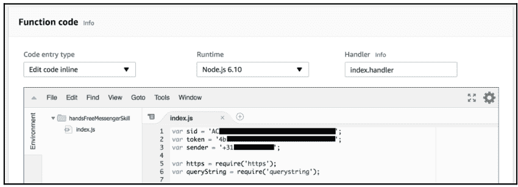

图 3.20：编写 Lambda 代码


请注意，我们已将我们在上一节第 11 步中生成的同一个 Twilio 号码声明为发件人。

- 6. 常量准备就绪后，我们现在终于可以定义 SendMessage 函数：

```
function SendMessage(to, body, callback) {
    var message = {
        To: to,
        From: sender,
        Body: body
    };
    var messageString = queryString.stringify(message);
    var options = {
        host: 'api.twilio.com',
        port: 443,
        path: '/2010-04-01/Accounts/' + sid + '/Messages.json',
        method: 'POST',
        headers: {
            'Content-Type': 'application/x-www-form-urlencoded',
            'Content-Length': Buffer.byteLength(messageString),
            'Authorization': 'Basic ' + new Buffer(sid + ':' + token).toString('base64')
        }
    };
    var req = https.request(options, function (res) {
        res.setEncoding('utf-8');
        var responseString = '';
        res.on('data', function (data) {
            responseString += data;
        });
        res.on('end', function () {
            var speechOutput = "Message sent.";
            var shouldEndSession = true;
            callback(buildSpeechletResponse(speechOutput, shouldEndSession));
        });
    });
    req.write(messageString);
    req.end();
}
```

这个函数做了很多事情。SendMessage 函数构造了一个消息对象，其中包含有关发件人、收件人和要发送的文本的信息。

然后它使用 SID、AuthToken 和消息字符串作为参数向 Twilio 后端发出请求。

消息成功发送的标志是 Alexa 通过说出短语“Message sent.”来确认它。

在添加此代码后，请通过单击屏幕右上角的 Save 来保存您的进度。

- 7. 现在，我们需要将 Lambda 链接到我们的技能，为此我们需要 Lambda 的 Amazon 资源名称（ARN）。ARN 位于 Lambda 函数/代码编辑器页面的右上角。请复制 ARN，并在复制后，请导航到之前的浏览器标签页，在那里我们使用 Skill builder checklist 配置了技能的交互模型。请从 Skill builder checklist 中选择 Endpoint 部分以进入 Endpoint 屏幕：

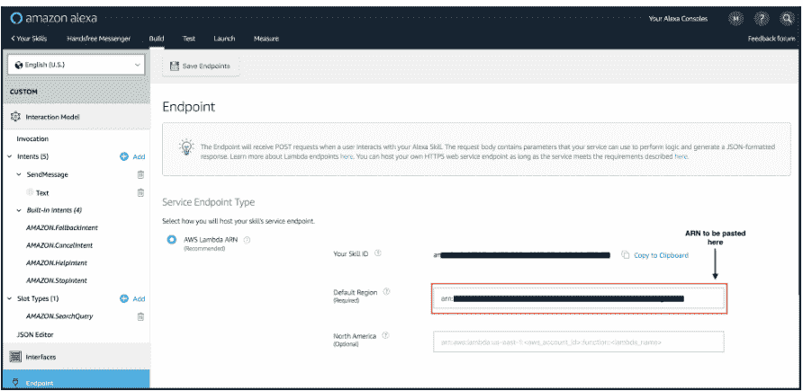

图 3.2.1：配置技能

请选择 **AWS Lambda ARN** 作为 **Service Endpoint Type** 并输入我们之前复制的 ARN（出于隐私和安全原因，前面的屏幕截图中已对其进行模糊处理），将此屏幕上的其他选项保持原样，然后单击 **Save Endpoints** 按钮。

请返回到 **Skill builder checklist** 并构建交互模型。

## 测试技能

我们的设置几乎已完成，我们准备好测试我们的 Handsfree Messenger 技能。技能可以通过实际的 Amazon Echo 设备或通过 Alexa Simulator 进行测试。

由于我们已在第 2 章《Hello World, Alexa!》中使用过 Alexa Simulator，这次您可以使用实际的 Amazon Echo 来测试技能，前提是您拥有它并且 Echo 已连接并设置好。然后，如果您说“Alexa, launch Handsfree Messenger”，它应该回复“Welcome to Handsfree Messenger。”如果您随后说，“Send message – Pick up groceries”，它应该回复“Message sent”并且一条短信“Pick up groceries”将被发送到收件人。

请注意，每个免费的 Twilio 账户都附带少量余额，因此发送几条消息（10-20 条）不会产生任何费用。

我们的技能现已测试完成，可以随意使用。您可以在信息框中提到的链接处找到本章 Lambda 的代码。

请在以下 URL 找到 Lambda 的代码 https://github.com/madhurbhargava/AlexaSkillsProjects/blob/master/Chapter3_HandsFreeMessenger_index.js。

至此，我们已到达本章的结尾。

## 总结

我们希望您喜欢创建 Handsfree Messenger 技能，它比我们之前的技能更进了一步，并且面向 Alexa/Echo 设备的实际使用。我们在本节中创建的技能仍有很大的改进空间。例如，目前我们的技能向预定义/硬编码的收件人发送消息，这可以通过将收件人详细信息通过 slot 传递给 Lambda 来改进，以便它不必在 Lambda 中预定义。我们故意没有涵盖这一点，并且希望将其作为扩展练习，我们强烈建议您如果真的想更早成为 Alexa Skills Jedi，就去尝试一下。

但是，我们又完成了一个有趣的 Alexa Skill。

在下一章中，我们将通过创建一个更偏向娱乐的 Alexa Skill、将使用稍微更复杂的语音界面并且会更有趣的 Alexa Skill，进一步扩展我们对 Alexa 知识的掌握。

迫不及待想开始吗？让我们开始吧！
