# 4 与 Alexa 一起玩 Factly

> “人声是所有乐器中最完美的。”
> 
> — Arvo Pärt

我们在成为 Alexa Skills Jedi 的征程中取得了长足的进步。我们首先设计了一个 Hello World Alexa Skill，这让我们了解了基本 Alexa Skill 的细节。掌握了这些知识后，我们继续通过开发一个稍微更高级的 Alexa Skill 扩展了我们的武器库，该技能还与第三方后端（Twilio）通信。

在本章中，我们将稍作偏离，创建一个名为 Factly 的自包含技能。Factly 将是一个以 trivia/quiz 为导向的 Alexa Skill，可以就各种事实对用户进行测验。它将是一个自包含的技能，不会与任何第三方 API/后端通信。

我们将通过在本章中涵盖以下主题来实现这一点：

- 设计 Factly 的动机
- 设计 Factly 技能
- 构建 Factly 技能

不用多说，让我们从技能设计的概述开始。

### 设计 Factly 的动机

在深入了解 Factly Alexa Skill 的细节之前，让我们先通过了解人们使用语音助手的原因来理解我们选择创建此技能的原因。

Statista 对英国智能手机用户进行的一项研究显示，使用语音助手的人主要将其用于 **Amusement**，仅次于 **Search for general information**，如下图所示：

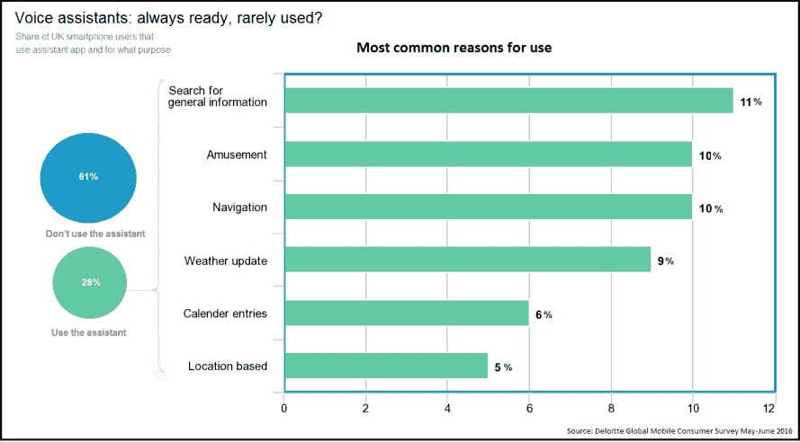

图 4.1：语音助手最常见的用途

有了这一见解，就不足为奇了，亚马逊 Alexa 应用商店中 Alexa Skills 的最大份额属于游戏和 trivia 应用：


令人惊讶或不令人惊讶的是，这与智能手机市场的应用分布非常相似：


发布的绝大多数应用都是游戏，适用于 Android 和 iOS 平台。

用户在 **Gaming and Entertainment** 类别的应用上花费的时间最多，如下图所示：


图 4.4：平均移动用户在各个应用上花费的时间（来源：Flurry）

典型的消费者将 32% 的手机时间花费在 **Entertainment/Gaming** 应用上。

由于 Skills 市场仍处于起步阶段，我们目前还没有 Skills 市场的类似深入统计数据。然而，我们可以根据智能手机市场应用的分布做出相当准确的决定，因为从 2015 年到 2017 年，Alexa Skills 的数量增长非常迅速，如下图所示：


图 4.5：Alexa Skills 市场的增长（来源：voicebot.ai）

如上所示，截至 2017 年 9 月，仅美国市场的 Alexa Skills 总数就约为 20,000，其中至少 25% 的技能是游戏、trivia 和娱乐导向的，即大约 6,000 个，与全球智能手机市场的应用数量相比微不足道：


Apple App Store 中的应用数量在 7 年内从 0 增长到 150 万，仍在增长。预计会有类似的轨迹并考虑即使是保守的增长率，我们可以清楚地期望语音技能市场会有类似的增长。

前面的分析得出以下结论：

- **Games/Entertainment** 技能无论为哪个平台开发，始终是最受欢迎和最常用的技能
- 与智能手机应用市场相比，技能市场仍处于起步阶段，仍有很大的增长空间


With the current count of **Games/Trivia**-oriented skills in the Alexa Skills store being around 6,000, there is a lot more room to accommodate other **Games/Trivia** skills, which is one of the major reasons that we decided to introduce our readers to the Factly Skill in this chapter.

## Designing the Factly Skill

We hope that the discussion in the last section should have given you a fair idea of the motivation behind the Factly Alexa Skill. Now, we shall level up and design the actual Factly Skill. It is always better to design before coding anything because it gives us a clarity about the end goals of the software and the finer details, which we may otherwise miss when we actually code the software.

The Factly Alexa Skill is a simple quiz skill. At the code level, the Factly Skill/Lambda will contain a bank of questions that will be presented to the user one by one. The skill will further perform depending on the user's reply.

Factly will work via the following steps:

- 1. The user will launch the Factly Skill via a standard Alexa Skill launch utterance.
- 2. Alexa will confirm the launch and provide a brief introduction to the skill and play method:


Figure 4.7: Step 1 – Factly, launch

The skill that we will design will consist of three trivia questions and each question will have four answer choices, with only a single choice being the correct one.

3. Alexa will begin the quiz by asking the first question:


Figure 4.8: Step 2 – Factly, questionnaire

4. The user can provide the answer by just saying the number of the correct answer, for example: "The answer is 3" or just "3":


Figure 4.9: Step 3 – Factly, answer acknowledgment

Depending on the user's answer, the skill will provide a response that the answer is correct or incorrect.

5. The user can also end the session:


Figure 4.10: Step 4 – Factly, conclusion

- 6. Steps 4, 5, and 6 will be repeated until all the quiz questions have been exhausted or the user decides to end the session.

The interaction flow can be expressed in terms of a VUI diagram:

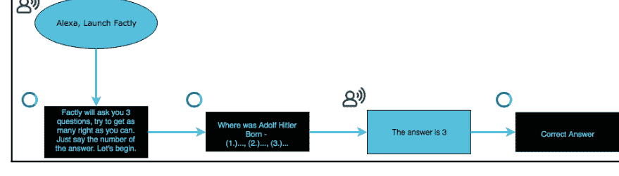

Figure 4.11: Factly, VUI flow

Also, the overall information flow of a typical quiz session can be mapped out as follows:

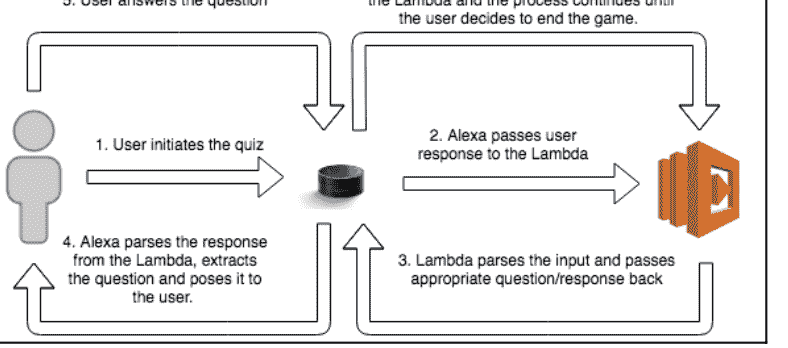

Figure 4.12: Factly, data flow

## Building the Factly Skill

Now, since we understand how data flows to and from our Factly Skill, it is time to actually build it. For this purpose, we will build the actual Lambda via the Amazon Developer portal.

We will assume that the reader knows about and has already signed up to the Amazon Developer portal, and is already aware of the basic starter information about the Amazon Alexa Skills Developer Portal, since this has also been already covered in detail in Chapter 2, *Hello World, Alexa!*. We already covered account creation and other basic details for the Amazon Developer Portal in Chapter 2, *Hello World, Alexa!*, so we will not be repeating those here.

We shall begin with the skill creation:

- 1. On the **Skill builder checklist**, select **Invocation Name** to navigate to the **Invocation name** screen and provide the skill with an invocation name, as shown in the following screenshot:

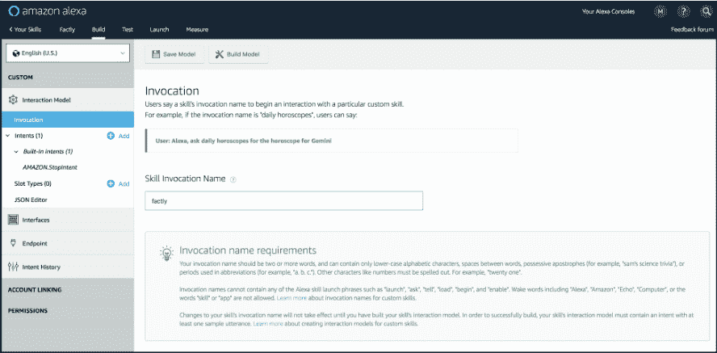

Save these changes by clicking on the **Save Model** button. Once you have successfully saved the changes, navigate back to the **Skill builder checklist**.

2. In this step, we shall define the **Intents, Samples, and Slots** for the **Interaction Model** for our skill. Our skill will be making use of two intents:

- - **Answer Intent:** This intent will hold the user's answers to the quiz questions posed by the Factly Skill. This intent will also include a slot so that we can pass the answer as an argument to the Lambda.
- - **AMAZON.StopIntent:** This is a standard intent pre-provided by ASK, through which the user can terminate the skill's execution at any point in time.

To know more about standard built-in intents, please visit https://developer.amazon.com/docs/custom-skills/standard-built-in-intents.html.

From the **Skill builder checklist**, click on **Intents, Samples, and Slots** to land on the **Add Intent** screen. Rather than directly defining an Intent, we will first define a custom slot that we can later include in our **Answer Intent:**


Figure 4.15: Adding a New Slot Type

As shown in the preceding screenshot, click on the **Add** button next to **Slot Types** to land on the **Add Slot Type** screen.

To know more about slots, types, and custom slot types, please visit https://developer.amazon.com/docs/custom-skills/custom-interaction-model-reference.html#custom-slot-syntax.

On the **Add Slot Type** screen, create a custom slot type by the name of `LIST_OF_CHOICES`, as shown in the following screenshot:

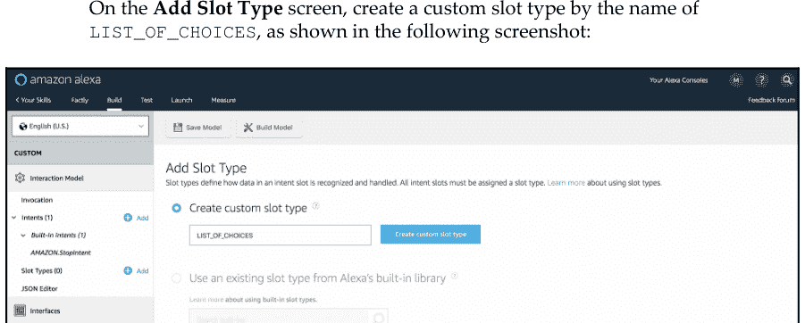

Figure 4.16: Naming the new custom Slot Type

On the next screen, provide it with a list of values, 1, 2, 3, 4, since each of the questions posed by the Factly Skill can have these four possible answers:


Figure 4.17: Adding Slot Values to the custom Slot Type

With our slot type set up, click on the **Add** button to add an intent, as shown in the following screenshot:


Figure 4.18: Adding an Intent

This should bring you to the **Add Intent** screen. Define an intent called `Answer` on this screen, which is going to contain the answer provided by the user for the questions posed by the Factly Skill, as shown in the following screenshot:

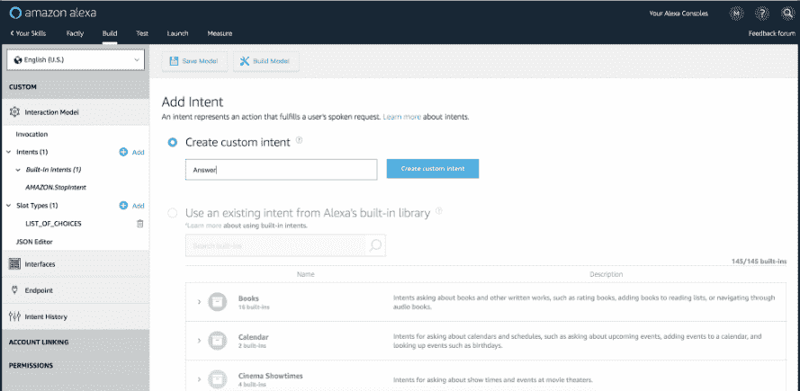

Once you have defined the intent, click on the **Create custom intent** button to land on the **Sample Utterances** screen. Before defining any sample utterances, scroll down on this screen and create a new slot type called `Choice`. Give this slot the type of `LIST_OF_CHOICES`, which we defined earlier from the drop-down menu:

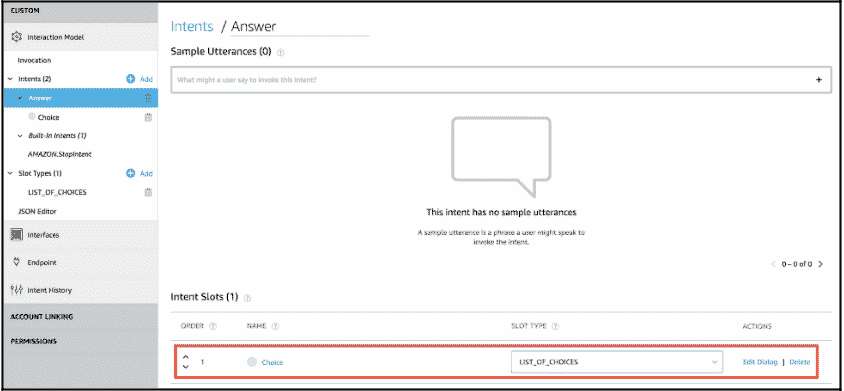

Figure 4.20: Adding slot to the Intent

Once we have defined the slot, we can now go ahead and define a couple of sample utterances for our intent.

- 3. Add a couple of **Sample Utterances** for the *Answer* intent which will, of course, include the **Choice** slot, since that is what will contain the actual answer to the questions posed by Factly:

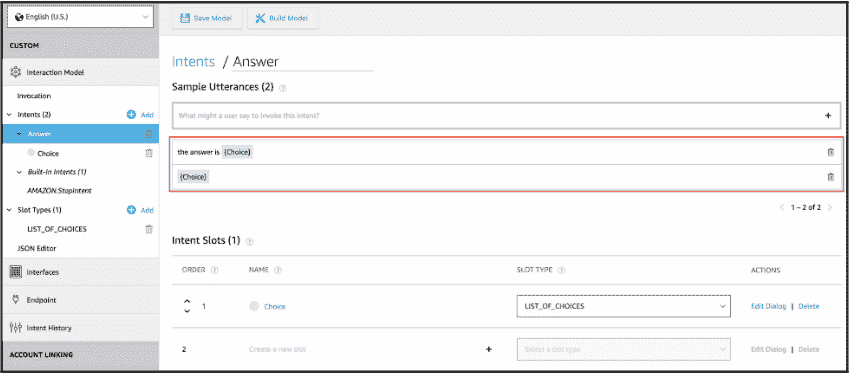

Figure 4.21: Adding Sample Utterances for the Intent

Once you have defined and saved the model, you can also click on the **JSON Editor** option in the left menu pane and verify that your JSON configuration matches this one:

```
```json
{
    "interactionModel": {
        "languageModel": {
            "invocationName": "factly",
            "intents": [
                {
                    "name": "Answer",
                    "slots": [
                        {
                            "name": "Choice",
                            "type": "LIST_OF_CHOICES"
                        }
                    ],
                    "samples": [
                        "the answer is {Choice}",
                        "{Choice}"
                    ]
                },
                {
                    "name": "AMAZON.StopIntent",
                    "samples": []
                }
            ],
            "types": [
                {
                    "name": "LIST_OF_CHOICES",
                    "values": [
                        {
                            "name": {
                                "value": "1"
                            }
                        },
                        {
                            "name": {
                                "value": "2"
                            }
                        },
                        {
                            "name": {
                                "value": "3"
                            }
                        }
                    ]
                }
            ]
        }
    }
}
```
```


```json
"name": {
    "value": "4"
}
```

确认 JSON 配置后，返回到 **技能构建者清单**。

- 4. 从 **技能构建者清单** 中导航到 **Endpoint** 屏幕，从 Endpoint 屏幕复制技能 ID，并将其保存到某个地方。我们稍后会用到它。

## 配置 Lambda 函数

一旦 **交互模型** 创建完成，我们暂时保持配置屏幕不变，并将重点放在创建 Lambda 上：

- 1. 打开一个新的浏览器标签页并导航到 AWS 控制台，其网页 URL 在以下信息框中提及：


AWS 控制台可在 https://console.aws.amazon.com 找到。请注意，如果尚未创建，您可能需要创建一个新账户。

为 Lambda 函数命名为 `factlySkill` 并按以下截图所示填写详细信息：

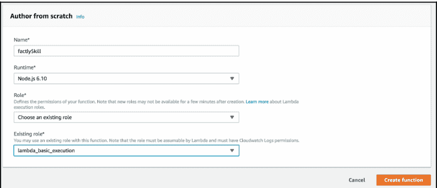

图 4.22：命名 Lambda

填写完详细信息后点击 Create function 按钮。

- 2. 在下一个屏幕中，在 **Designer** 部分下，您需要添加一个触发器来调用 Lambda 函数：

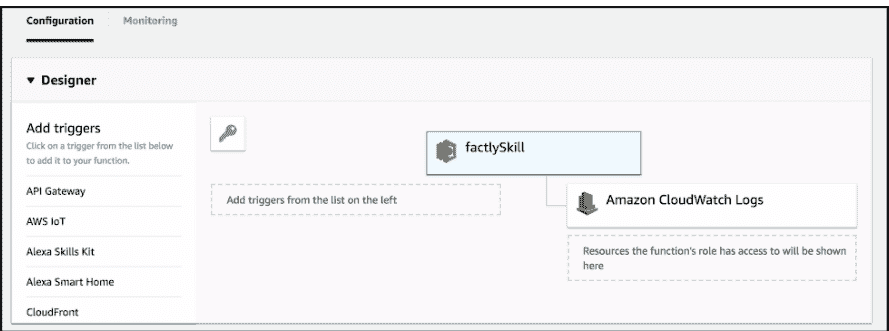

图 4.23：配置 Lambda

从左侧的触发器列表中，选择 **Alexa Skills Kit**，因为 Alexa 将调用我们的 Lambda 函数并向其提供输入：

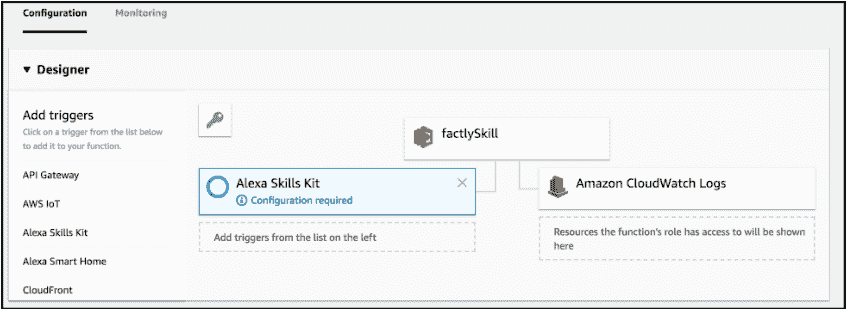

添加触发器后，下一步将是添加我们在上一节中复制的 Skill ID。在以下截图所示的部分中添加 Skill ID：

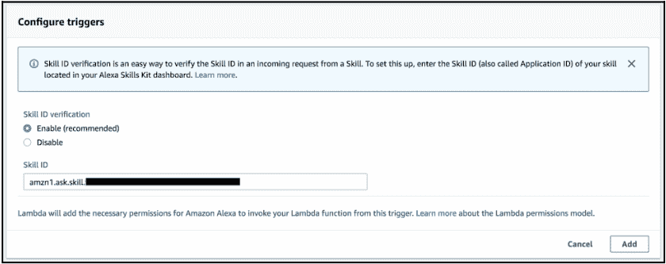

添加 **Skill ID** 可确保 Lambda 仅响应由已验证技能生成的请求。添加 **Skill ID** 后，点击屏幕底部的 **Add** 按钮，然后点击屏幕右上角的 **Save** 按钮。

- 3. 点击 **Save** 按钮后，选择 **Designer** 部分下的 `factlySkill` 框，如以下截图所示：

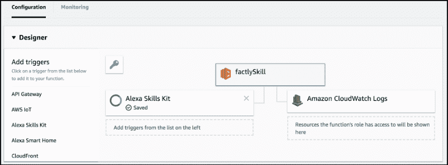

图 4.26：完成 Lambda 配置

这将在底部打开一个代码编辑器，我们将在其中添加 Lambda 的代码。

## 编写 Lambda 函数

我们将在开发者门户本身的 `index.js` 文件中内联编辑代码：

- 1. 首先，我们将定义一个 JSON 数组，其中将包含测验技能提出的问题。此数组可以定义在 `index.js` 文件的顶部，甚至在 `exports.handler` 之前：

```javascript
//questions is an array of json objects
var questions = [
    {
        "World War I began in which year?": [
            "1923",
            "1938",
            "1917",
            "1914"
        ]
    },
    {
        "Adolf Hitler was born in which country?": [
            "France",
            "Austria",
            "Hungary",
            "Germany"
        ]
    },
    {
        "The battle of Hastings was fought in which country?":
        [
            "France",
            "Russia",
            "England",
            "Norway"
        ]
    }
];

var correctAnswerSlots = [3, 1, 2];
```

如前面的代码所示，除了 questions 数组之外，我们还定义了另一个名为 `correctAnswerSlots` 的数组，其中包含 `questions` 数组中每个问题的正确答案的索引。

困惑吗？我们可以用一个例子来阐述。可以从 `correctAnswerSlots` 数组推断出第一个问题 World War I began in which year? 的答案是 1914，它位于索引 3（即第四个选项）。因此，我们在 `correctAnswerSlots` 数组的第一个位置放置了 3。

- 2. 现在，我们可以继续在 `exports.handler` 中实现事件的处理。我们的 Lambda 将处理两种基本请求：
    - `LaunchRequest`：处理技能的启动
    - `IntentRequest`：处理各种 Intent（在我们的例子中，我们只有两个 intent，第一个是 Answer intent，表示 Factly 提出的问题的答案，以及 `AMAZON.StopIntent`，表示退出技能）

我们将首先对技能收到的每个请求进行区分。为此，声明以下处理器：

```javascript
exports.handler = function (event, context) {
    try {

        if (event.request.type === "LaunchRequest") {
        } else if (event.request.type === "IntentRequest") {

        }
    } catch (e) {
        context.fail("Exception: " + e);
    }
};
```

这就是我们区分 Launch 和 Intent 事件请求的方式。

- 3. 接下来，我们将定义一些辅助函数，帮助我们创建语音响应：

```javascript
// ------ Helper functions ------

function buildSpeechletResponse(output, repromptText, shouldEndSession) {
    return {
        outputSpeech: {
            type: "PlainText",
            text: output
        },
        reprompt: {
            outputSpeech: {
                type: "PlainText",
                text: repromptText
            }
        },
        shouldEndSession: shouldEndSession
    };
}

function buildResponse(sessionAttributes, speechletResponse) {
    return {
        version: "1.0",
        sessionAttributes: sessionAttributes,
        response: speechletResponse
    };
}
```

这些函数帮助 Lambda 在接收到特定 intent/输入时返回供 Alexa 朗读的响应。

`buildResponse` 函数将生成供 Alexa 朗读的纯文本响应。

`buildSpeechletResponse` 函数将指定 Alexa 最终会以纯文本形式朗读的输出。它还接受另一个变量 `shouldEndSession`，该变量指定 Alexa 在响应后是否应结束会话。

- 4. 配置好辅助函数后，我们可以更新 `LaunchRequest` 和 `IntentRequest` 情况的处理，使 Alexa 朗读相关的响应，如以下代码所示：

```javascript
exports.handler = function (event, context) {
    try {

        if (event.request.type === "LaunchRequest") {
            onLaunch(event.request,
                event.session,
                function callback(sessionAttributes, speechletResponse) {
                    context.succeed(buildResponse(sessionAttributes,
                        speechletResponse));
                });
        } else if (event.request.type === "IntentRequest") {
            //TBD
        }
    } catch (e) {
        context.fail("Exception: " + e);
    }
};
```

当 Lambda 接收到 `LaunchRequest` 时，它将调用 `onLaunch` 方法以返回欢迎消息：

```javascript
function onLaunch(launchRequest, session, callback) {
    getWelcomeResponse(callback);
}
```

我们将在下一步实现 `getWelcomeResponse` 方法。

请通过点击屏幕右上角的 **Save** 按钮保存我们的进度。

- 5. `getWelcomeResponse` 方法负责制定启动响应并向用户提出第一个问题：

```javascript
var ANSWER_COUNT = 4;
var GAME_LENGTH = 3;

function getWelcomeResponse(callback) {
    var sessionAttributes = {},
        speechOutput = "Factly will ask you " +
            GAME_LENGTH.toString()
            + " questions, try to get as many right as you can. Just say the number of the answer. Let's begin. ",
        shouldEndSession = false,

        gameQuestions = populateGameQuestions(),
        currentQuestionIndex = 0,
        correctAnswerIndex =
            correctAnswerSlots[currentQuestionIndex],
        answers = populateAnswers(gameQuestions, 0),

        spokenQuestion =
            Object.keys(questions[gameQuestions[currentQuestionIndex]])[0],
        repromptText = "Question 1. " + spokenQuestion + " ",

        i;

    for (i = 0; i < ANSWER_COUNT; i++) {
        repromptText += (i + 1).toString() + ". " + answers[i] +
            ". "
    }
    speechOutput += repromptText;
    sessionAttributes = {
        "speechOutput": repromptText,
        "repromptText": repromptText,
        "currentQuestionIndex": currentQuestionIndex,
        "correctAnswerIndex": correctAnswerIndex + 1,
        "questions": gameQuestions,
        "score": 0
    };
    callback(sessionAttributes,
        buildSpeechletResponse(speechOutput, repromptText,
            shouldEndSession));
}
```


如前面的代码所示，在定义 getWelcomeResponse 函数之前，我们声明了两个变量，ANSWER_COUNT 和 GAME_LENGTH，它们分别表示每个问题的答案数量和游戏中测验问题的总数。这些变量将被 getWelcomeResponse 函数使用。

接下来，我们定义 getWelcomeResponse 函数，该函数首先使用 GAME_LENGTH 变量创建一个启动响应。然后它使用 populateGameQuestions 方法加载 gameQuestions 的所有索引：

```javascript
function populateGameQuestions() {
    var gameQuestions = [];
    var index = questions.length;

    if (GAME_LENGTH > index){
        throw "Invalid Game Length.";
    }

    for (var j = 0; j < GAME_LENGTH; j++){
        gameQuestions.push(j);
    }

    return gameQuestions;
}
```

它随后使用此方法通过 populateAnswers 方法为每个问题填充答案：

```javascript
function populateAnswers(gameQuestionIndexes,
correctAnswerIndex) {
    var answers =
    questions[gameQuestionIndexes[correctAnswerIndex]][Object.keys(
    questions[gameQuestionIndexes[correctAnswerIndex]])[0]];

    var index = answers.length;

    if (index < ANSWER_COUNT){
        throw "Not enough answers for question.";
    }

    return answers;
}
```

它还将 currentQuestionIndex 设置为 0（因为这是 Factly Skill 将提出的最早问题），然后在创建 sessionAttributes 之前，最后创建要传回 Alexa 的 speechletResponse。

- 6. 在 onLaunch 方法的处理就绪后，我们现在将重点关注 onIntent 方法，该方法在 Lambda 接收到 IntentRequest 时被调用：

```javascript
exports.handler = function (event, context) {
    try {
        if (event.request.type === "LaunchRequest") {
            onLaunch(event.request,
                event.session,
                function callback(sessionAttributes,
                speechletResponse) {
                context.succeed(buildResponse(sessionAttributes,
                speechletResponse));
            });
        } else if (event.request.type === "IntentRequest") {
            onIntent(event.request,
                event.session,
                function callback(sessionAttributes,
                speechletResponse) {
                context.succeed(buildResponse(sessionAttributes,
                speechletResponse));
            });
        }
    } catch (e) {
        context.fail("Exception: " + e);
    }
};
```

onIntent 方法处理 Factly Skill 引发的仅有的两个意图：

```javascript
function onIntent(intentRequest, session, callback) {
    var intent = intentRequest.intent,
        intentName = intentRequest.intent.name;

    if ("Answer" === intentName) {
        handleAnswerRequest(intent, session, callback);
    } else if ("AMAZON.StopIntent" === intentName) {
        handleFinishSessionRequest(intent, session, callback);
    } else {
        throw "Invalid intent";
    }
}
```

我们将首先查看其中更简单的一个，即 AMAZON.StopIntent，当用户决定通过说类似“Alexa, Stop Factly.”之类的短语提前结束技能执行时触发。这会导致调用 handleFinishSessionRequest：

```javascript
function handleFinishSessionRequest(intent, session, callback)
{
    callback(session.attributes,
        buildSpeechletResponse("Factly will Exit. Good bye!",
"", true));
}
```

这在 Factly Skill 退出之前向用户说再见。

Answer 意图请求要复杂得多，因为它有多条信息流路径，并由 handleAnswerRequest 方法处理：

```javascript
function handleAnswerRequest(intent, session, callback) {
    var speechOutput = "";
    var sessionAttributes = {};
    var gameInProgress = session.attributes && session.attributes.questions;
    var answerSlotValid = isAnswerSlotValid(intent);
    var userGaveUp = intent.name === "DontKnowIntent";

    {
        var gameQuestions = session.attributes.questions,
            correctAnswerIndex = parseInt(session.attributes.correctAnswerIndex),
            currentScore = parseInt(session.attributes.score),
            currentQuestionIndex = parseInt(session.attributes.currentQuestionIndex),
            correctAnswerText = session.attributes.correctAnswerText;

        var speechOutputAnalysis = "";

        if (answerSlotValid && parseInt(intent.slots.Choice.value) == correctAnswerIndex) {
            currentScore++;
            speechOutputAnalysis = "correct. ";
        } else {
            if (!userGaveUp) {
                speechOutputAnalysis = "wrong. ";
            }
            speechOutputAnalysis += "The correct answer is . .

repromptText, false));
        }
    }
}
```

前面方法首先使用 `isAnswerSlotValid` 方法检查用户提供的答案/选择是否确实有效：

```javascript
function isAnswerSlotValid(intent) {
    var answerSlotFilled = intent.slots && intent.slots.Choice
        && intent.slots.Choice.value;
    var answerSlotIsInt = answerSlotFilled &&
        !isNaN(parseInt(intent.slots.Choice.value));
    return answerSlotIsInt &&
        parseInt(intent.slots.Choice.value) < (ANSWER_COUNT + 1) &&
        parseInt(intent.slots.Choice.value) > 0;
}
```

这基本上检查用户提供的答案是否为有效整数并且在有效答案范围内。

然后，它继续使用我们在 *第 5 步* 中创建的与会话属性关联的 `correctAnswerIndex` 变量验证答案是否确实正确。它然后检查游戏是否已经结束或用户是否继续下一个问题，然后创建最终的 `speechletResponse`。

在我们向 `index.js` 文件中添加最终代码片段后，通过单击屏幕右上角的 **Save** 按钮保存进度。

- 7. 现在，我们需要将 Lambda 链接到我们的技能，为此我们需要 Lambda 的 ARN。ARN 位于 Lambda 函数/代码编辑器页面的右上角。复制 ARN，并在复制 ARN 后，导航到之前的浏览器标签页，在那里我们通过 **Skill builder checklist** 配置技能的交互模型。选择 **Endpoint** 部分以导航到 **Endpoint** 屏幕：

  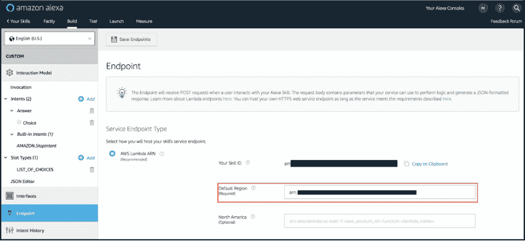

  如前面的屏幕截图所示，选择 **AWS Lambda ARN** 作为 **Service Endpoint Type**，并输入我们之前复制的 ARN（由于隐私和安全原因，前面的屏幕截图中显示为模糊）。

  选择 **Save Endpoints** 按钮，导航到 **Skill builder checklist** 并再次重建模型。

## 为 Factly 添加持久性

在游戏（以及生活中）中，持久性是关键。说真的，如果我们没有办法在不同关卡保存马里奥的进度，我们最终可能永远救不出公主。

> 要了解更多关于马里奥的信息，请访问 https://en.wikipedia.org/wiki/Mario。

我们也可以为任何 Alexa Skill 添加持久性，以保存当前状态或用户的进度。保存状态可以用作惊喜，也可以是必需的，特别是在 **Game/Entertainment** 导向的技能中，保存用户进度至关重要。

在本节中，我们将演示为 Factly 添加持久性；我们将告知用户他们迄今为止玩过 Factly 的次数，为此我们将使用 **DynamoDB** 存储启动次数，DynamoDB 是 AWS 提供的 NoSQL 数据库服务。


要了解有关 DynamoDB 的更多信息，请导航到 https://aws.amazon.com/dynamodb/。

我们将通过 Lambda 代码访问 DynamoDB 以持久化并检索启动计数器。然而，我们当前的 Lambda 无法连接到 DynamoDB。你可能会问：为什么？原因在于我们当前的 Lambda 以 **lambda_basic_execution** 模式执行，这是我们在创建它时选择的，该模式仅允许 Lambda 执行一些基本代码并记录一些数据。要连接到 DynamoDB，我们需要提升 **lambda_basic_execution** 模式，使其能够访问 DynamoDB，我们将通过 **IAM** 实现这一点，IAM 是用于 **Identity and Access Management** 的 Amazon Web 服务。


要了解有关 IAM 的更多信息，请访问 https://aws.amazon.com/iam/。

让我们开始：

- 1. 导航到 https://console.aws.amazon.com。从提供的服务列表中选择 **IAM**，如果找不到它，只需在提供的搜索框中搜索它，如以下屏幕截图所示：


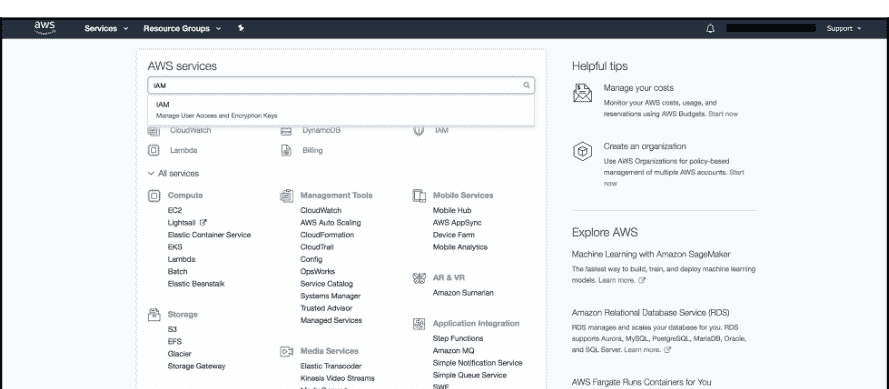

图 4.28：在 AWS 控制台中导航到 IAM

请选择 IAM 以导航到 IAM 仪表板。

- 2. 进入 IAM 仪表板后，请从左侧菜单中选择 Roles：

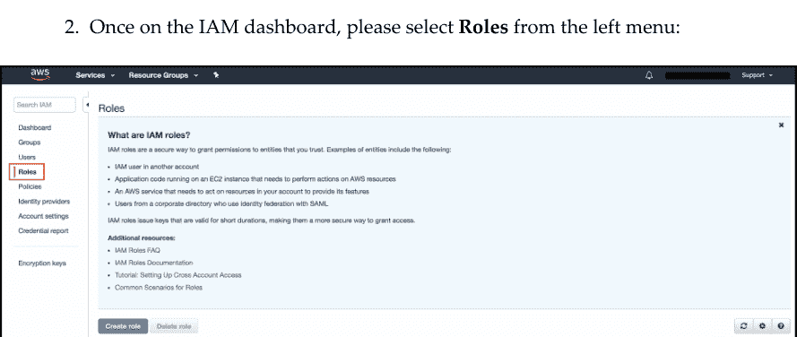

图 4.29：IAM 角色

在 **Roles** 屏幕上，你应该有一个预先存在的 **lambda_basic_execution** 角色，因为我们一直在使用它作为所有 Lambda 函数。点击它；我们将用一个策略对其进行增强，以便使用此角色访问 DynamoDB。这样，我们就不需要进行任何额外的配置更改（例如，从头创建新角色）。

- 3. 在下一个屏幕中，点击 **Attach policy** 按钮：

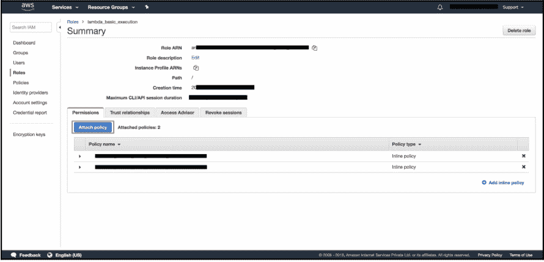

图 4.30：附加策略

你将进入策略列表。使用 DynamoDB 搜索以查找访问 DynamoDB 的可用策略列表：

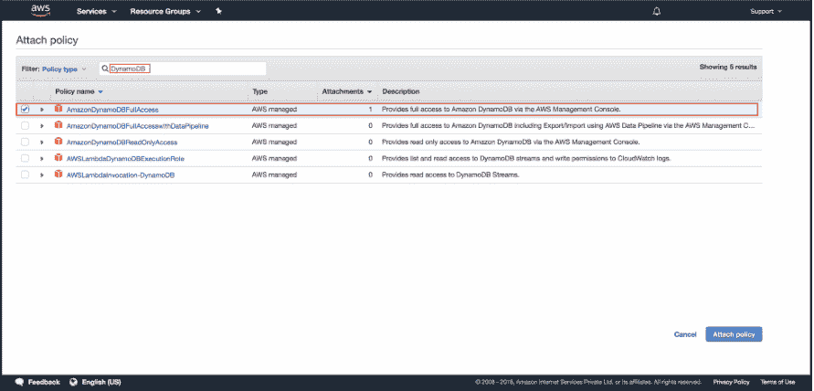

图 4.31：为 DynamoDB 访问选择正确的策略

选择 **AmazonDynamoDBFullAccess** 策略。最后，点击屏幕底部的 **Attach policy** 按钮。

现在，我们的 Lambda 函数应该能够访问 DynamoDB。接下来，我们将在 DynamoDB 中创建一个表来存储启动计数器值。

- 4. 现在，导航到 https://console.aws.amazon.com 再次，并从提供的服务列表中选择 DynamoDB。如果找不到它，只需在提供的搜索框中搜索即可：

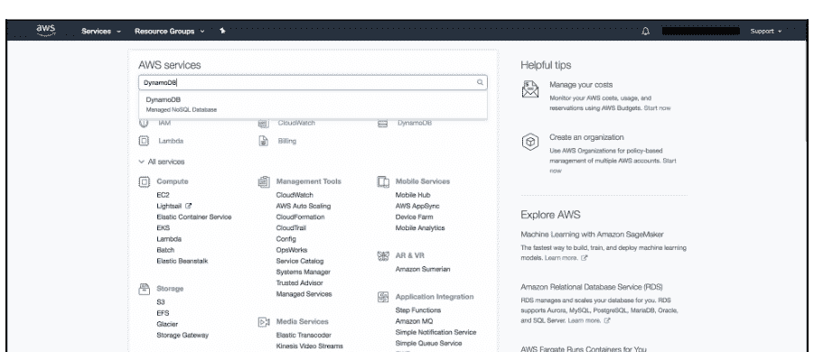

图 4.32：导航到 DynamoDB

选择 DynamoDB 以导航到 DynamoDB 仪表板。

- 5. 在 DynamoDB 仪表板上，点击 Create table 按钮以进入 Create DynamoDB table 屏幕：

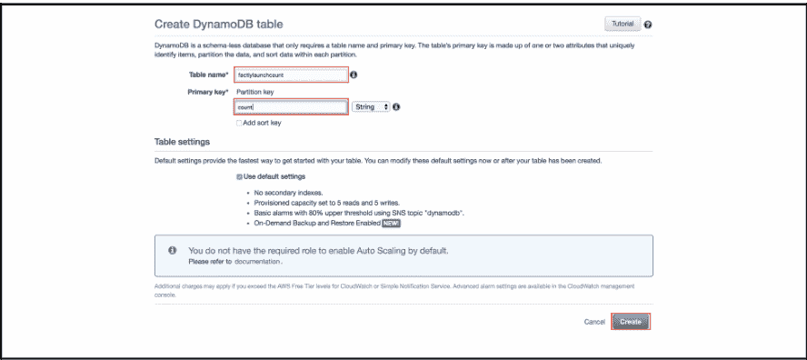

图 4.33：创建 DynamoDB 表

如前面的屏幕截图所示，提供表名 `factlylaunchcount` 和主键 `count`。完成后点击 Create 按钮。

- 6. 点击 Create 应该在短暂延迟后创建表，并应显示 `factlylaunchcount` 表的详细信息屏幕：

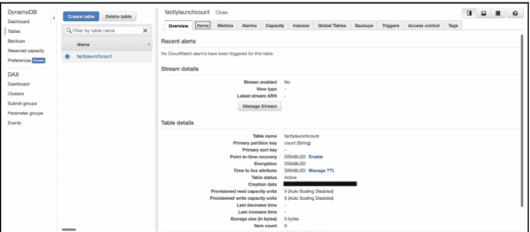

图 4.34：DynamoDB 表配置

表默认配置为每秒 5 次读写，这对于我们的开发目的来说是可以的，但在扩展技能时应进行更新。

我们现在需要添加实际的启动计数器变量，它将存储我们的启动计数。点击前一个屏幕截图所示的 Items 选项卡。

- 7. 在 Items 选项卡下，点击 Create item 按钮以调出 Create item 窗口：

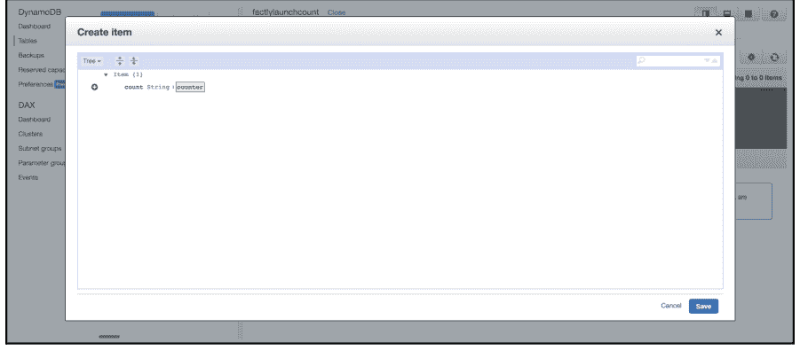

图 4.35：向 DynamoDB 表添加项目/键

在 Create item 窗口中，提供 `count` 主键，其值为 `counter`，如前一个屏幕截图所示。

- 8. 接下来，在同一窗口中，选择 **+** 按钮以插入一个新列到表中，其类型为 Number，如以下屏幕截图所示：

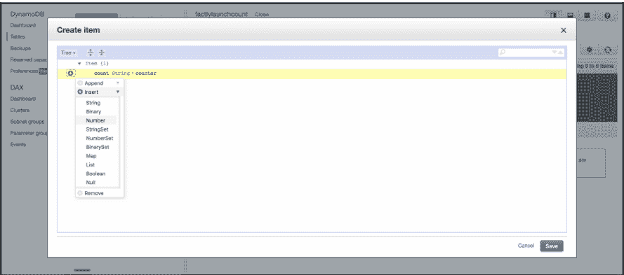

图 4.36：向 DynamoDB 表添加新列

请将此新列命名为 `launchcounter` 并将其初始值设为 0：

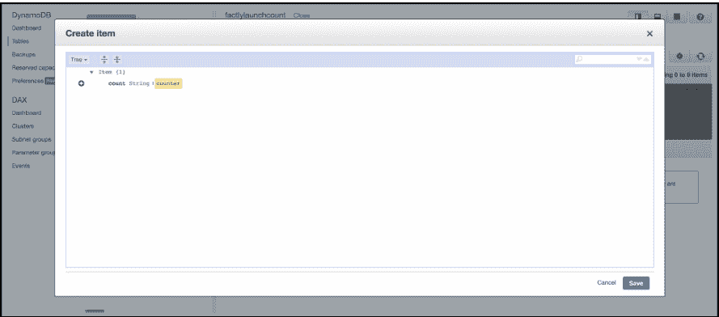

图 4.37：在 DynamoDB 表中命名新列

完成后点击 **Create item** 窗口底部的 **Save** 按钮。`factlylaunchcount` 表模式现在应自动更新以反映我们刚刚所做的更改：

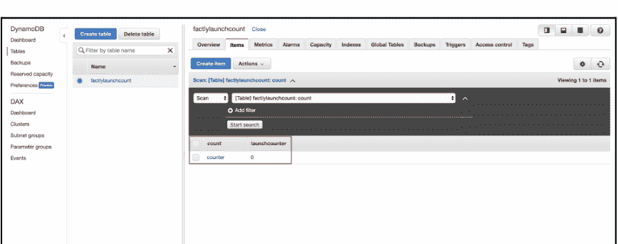

图 4.38：DynamoDB 表中反映的更改

我们现在可以开始更新我们的 Lambda 代码，以便它可以持久化启动计数器。导航回我们的 Lambda 代码，以便我们可以更新它以包含启动计数器的持久化。

## 更新 Factly Lambda 代码以引入持久化

我们将通过首先包含 AWS 依赖项来开始修改 Lambda 代码：

- 1. 在 Lambda 代码（`index.js` 文件）非常开头添加以下代码行：

```
var AWS = require('aws-sdk');
var docClient = new AWS.DynamoDB.DocumentClient();
```

这里，我们包含 AWS SDK，然后使用它来获取 `DynamoDB.DocumentClient` 的实例，这将帮助我们在 DynamoDB 中读写数据。

让我们分解前面的代码片段以了解我们在做什么。因此，更早的时候，当我们启动应用程序时，我们通过 getWelcomeResponse 方法向用户提供了一个硬编码的响应。但是，随着持久化的引入，情况有点不同了。我们首先定义一些参数，即 `paramsGet`，以从表中获取数据。这些参数包括以下内容：

- 从中获取数据的 `TableName`
- 基于 `Key` 要获取的特定项目；我们本质上是在说“请从 `factlylaunchcount` 表中获取主键为 `counter` 的项目”

一旦项目被获取，我们就从该项目中提取 `launchcounter` 的值，这发生在以下这一行：

```
var initialLaunchCount = data.Item.launchcounter;
```

接下来，我们将启动计数加 1 并通过以下代码中的调用将其更新到 `factlylaunchcount` 表中：

```
docClient.update(paramsUpdate, function(err, data)
```

在更新调用之后，我们将 `initialLaunchCount` 传递给 `getWelcomeResponse` 函数。

- 3. 接下来，剩下的就是将 `getWelcomeResponse` 函数的签名从此：

```
function getWelcomeResponse(callback)
```

更新为以下代码所示的内容：

```
function getWelcomeResponse(callback, count)
```

我们现在可以从以下代码所示的静态响应更新 `getWelcomeResponse` 函数中的静态响应：

```
speechOutput = "Factly will ask you " + GAME_LENGTH.toString()
            + " questions, try to get as many right as you can. Just say the number of the answer. Let's begin. "
```

我们将其更新为考虑 count 变量的动态响应：

```
speechOutput = "You have played Factly " + count.toString() +
    " times. Factly will ask you " + GAME_LENGTH.toString() +
    " questions, try to get as many right as you can. " +
    "Just say the number of the answer. Let's begin. ";
```

现在，Factly Skill 将能够记住用户玩过多少次，并能够通知用户此信息。

请在以下 URL 找到专门包含持久化的 Lambda 代码：https://github.com/madhurbhargava/AlexaSkillsProjects/blob/master/Chapter4_Factly_Persistence_index.js。

我们的 Lambda 代码现在已完成，现在是测试它的时候了。

## 测试技能

我们的技能现在已完成，我们准备好测试它。技能可以通过实际的 Amazon Echo 设备或通过 Amazon Service Simulator 进行测试。我们将首先通过 Amazon Service Simulator 测试我们的技能，然后通过实际的 Amazon Echo 设备进行测试。

在 Test 页面上，向下滚动到 Service Simulator 并输入 "Alexa, Launch Factly" 文本，如以下屏幕截图所示：

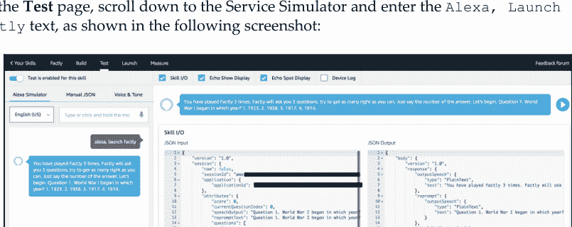

图 4.39：通过 Amazon Service Simulator 测试 Factly Skill，第 1 步

如果你仔细观察 Alexa 的响应，你会发现它已经包含了启动计数，它已从 DynamoDB 中获取，并附带了响应启动短语和第一个问题。

然后，你只需输入一个答案编号（例如，4），测试模拟器就会告诉你答案是否正确，以及下一个问题，如以下屏幕截图所示：

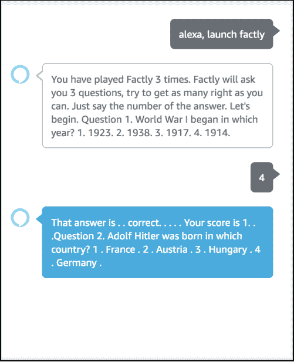

或者，你也可以使用 Amazon Echo 测试技能，前提是 Echo 已连接并设置好：

- 如果你说：“Alexa, launch Factly”，它应该回复：“You have played Factly *n* times. Factly will ask you three questions, try to get as many right as you can. Just say the number of the answer. Let's begin. Question 1. World War I began in which year? 1. 1923; 2. 1938; 3. 1917; 4. 1914.”


- 然后它将根据你的回复继续。
- 你可以在任何时候通过简单地说：“Alexa, stop Factly.” 来结束游戏。

我们的技能现在已经测试完成，可以随意体验了。你可以在以下信息框中提到的链接找到本章 Lambda 的代码。


> 请在以下 URL 找到 Lambda 的代码：`https://github.com/madhurbhargava/AlexaSkillsProjects/blob/master/Chapter4_Factly_index.js`

## Summary

我们希望你喜欢创建 Factly Skill。 与之前的技能一样，Factly Skill 仍有很大的改进空间。 例如，目前它只包含三个问题，可以扩展到 30 个甚至 300 个问题，仅此一项就能将此技能转变为一个严肃的问答游戏。

此外，我们只处理了两种意图。 我们可以扩展技能以处理更多意图，这些意图可以处理问题的重复以及用户其他类型的回复（例如，“我不知道”、“跳过”或“下一个问题”）。

DynamoDB 的持久性是我们在本章中引入并学习的全新内容，其本身的理念可以扩展为持久化多种内容，例如用户分数、用户进度和整体游戏状态。 我们将这些改进留给用户作为练习，以便进一步磨练他们的技能。

在下一章中，我们将进一步扩展我们的 Alexa 知识，通过创建一个更面向目前席卷全球的事物的 Alexa Skill。

你能猜出那是什么吗？ 翻到下一章去寻找答案。
