## Making Alexa Talk About
CryptoCurrencies

> > “The future is here. It’s just not widely distributed yet.”
> >
> > — William Gibson

我们在上一章使用 Alexa 设计了一个名为 Factly 的问答游戏。 在本章中，正如我们所承诺的，我们将着手处理在本书撰写时席卷全球的事物，正如你可能从本章标题中猜到的那样，它就是加密货币。

在本章中，我们将构建一个名为 `CryptoOracle` 的 Skill（是的，我们明白这在语法、语义和 Alexa Skill 命名规则方面都是一个糟糕的命名选择，但由于我们暂时不会发布它，我们将坚持使用这个名字），它可以让 Alexa 谈论各种加密货币的最新价格。 本章将涵盖以下主题：

- A Brief Introduction to Cryptocurrencies
- Designing the CryptoOracle skill
- Building the CryptoOracle skill

让我们开始吧。

## A Brief Introduction to Cryptocurrencies

对于那些来晚了错过了比特币和其他类似加密货币在 2017 年及以后产生的巨大炒作的人来说：加密货币是数字/虚拟货币，也就是说，与美元、欧元或卢比等实体货币不同，加密货币通常只作为分布式数据库中的条目存在。 各种加密技术被部署来记录加密货币交易及其生成，因此这些数字货币通常被称为加密货币。

由于加密技术超出了本书的范围，我们在此不予介绍。

截至撰写本章时，已有超过 1,500 种加密货币可用，而这 1,500 种加密货币中更好的加密货币各有其独特用途。

你可以通过导航到 CoinMarketCap https://coinmarketcap.com/ 来查看已知/交易的加密货币数量。

一些加密货币被用作价值交换媒介，例如比特币、莱特币、门罗币和达世币。 其他加密货币，例如以太坊，用于驱动分布式系统，例如以太坊虚拟机：

| Currency | Purpose |
|---|---|
| Bitcoin | Medium of value exchange |
| Monero | Medium of value exchange focused on privacy |
| Ethereum | Used to power the Ethereum Virtual Machine |
| Litecoin | Faster and improved version of Bitcoin |

加密货币之所以引起如此多的关注，一个主要原因是其价格的投机性。 加密货币价格像股票价格一样涨跌，这吸引了公众和投资者的大量关注，他们对价格进行投机。

请注意，本节中关于加密货币价格投机的信息仅用于向读者提供信息，并非投资建议。

由于上述原因，加密货币已成为热门话题，因此我们决定将本章重点放在设计一个技能上，该技能可以帮助 Alexa 用户即时查询加密货币价格。

## Designing the CryptoOracle skill

现在我们知道了加密货币是什么以及为什么它们最近备受关注，我们可以设计 `CryptoOracle` 技能。

`CryptoOracle` 将通过以下步骤工作：

- 1. 用户启动技能：

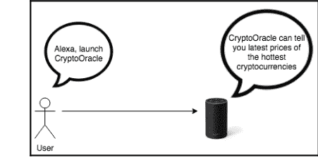

Figure 5.1: Launching the CryptoOracle skill

启动响应从 Lambda 获取并播放给用户，如上图所示。

- 2. 用户询问 Alexa 任何加密货币的价格：


Figure 5.2: Querying the cryptocurrency price via the CryptoOracle skill

此请求将执行以下操作：

- 启动一个意图以获取价格，并将加密货币名称作为参数
- Lambda 接收意图并提取加密货币名称
- Lambda 使用货币名称通过 coinmarketcap API 获取加密货币价格

要了解有关 coinmarketcap API 的更多信息，请导航至 https://coinmarketcap.com/。

最后，包含加密货币价格的 Lambda 响应将播放给用户。

3. 可选地，用户也可以在对话的任何时间点要求 CryptoOracle 停止/退出：

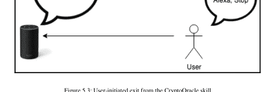

Figure 5.3: User-initiated exit from the CryptoOracle skill

在这种情况下，技能将中途停止响应并退出。

完整的交互可以通过 VUI 流程图映射出来：

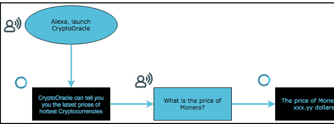

Figure 5.4: VUI-flow diagram for the CryptoOracle skill

典型会话的整体信息流可以按以下图所示映射出来：

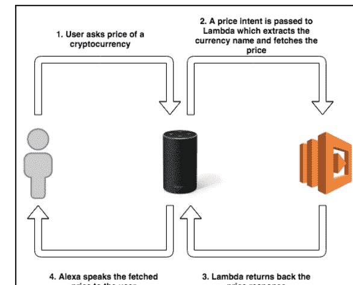

Figure 5.5: Information flow in the CryptoOracle skill

在数据流就绪后，现在是时候编写实际的 CryptoOracle 技能了。

## Building the CryptoOracle skill

截至撰写本章时，亚马逊最近更新了其 Alexa Skills Kit（ASK）开发者控制台。 我们将使用更新后的开发者控制台来开发我们的 CryptoOracle 技能：

- 1. 导航到 ASK 控制台 https://developer.amazon.com/alexa，登录门户，并进入技能创建页面（我们已在前几章中完成此练习，因此不会重复这些步骤）：


Figure 5.6: Alexa Skills Portal – ASK Console

点击屏幕底部的 Create Skill 按钮。

- 2. Create a new skill 屏幕需要 SkillName 才能继续，如以下屏幕截图所示：

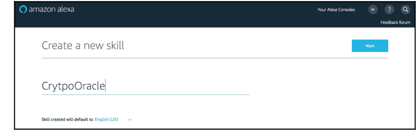

Figure 5.7: Naming the CryptoOracle skill

将我们的技能命名为 CryptoOracle 并点击 Next 按钮。
- 3. 下一页将显示可添加到技能的预构建交互模型类型。 点击 **Custom** 模型下的 **Select** 按钮进行选择，然后点击屏幕右上角的 **Create Skill** 按钮。
- 4. 创建技能后，我们需要通过以下屏幕截图所示的仪表板配置其 **Interaction Model**：

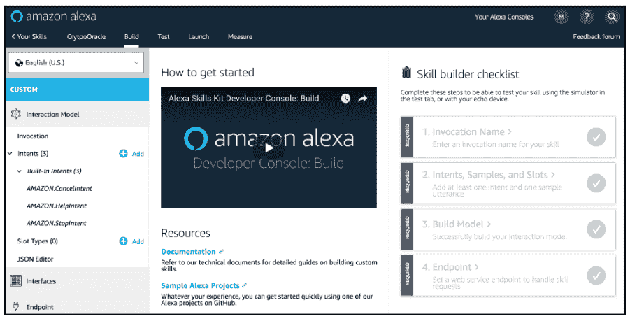

Figure 5.8: Interaction Model dashboard

我们将通过完成 **Skill builder checklist** 来配置 **Interaction Model**。


5. 选择技能构建器清单下的第一个选项，Invocation Name，以进入以下屏幕截图所示的屏幕：

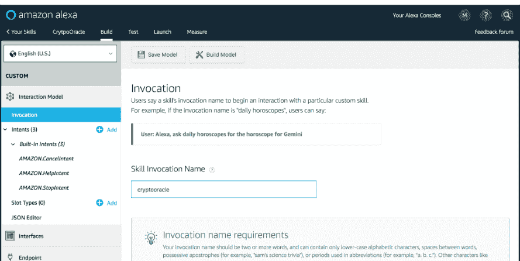

Figure 5.9: Adding the Invocation Name

输入技能调用名称为 cryptooracle 并点击左上角的 Save Model 按钮。

6. 点击 Build 选项卡项以返回到技能构建器清单，其中 Invocation Name 选项应已标记并被选中，因为我们刚刚完成了它的设置：

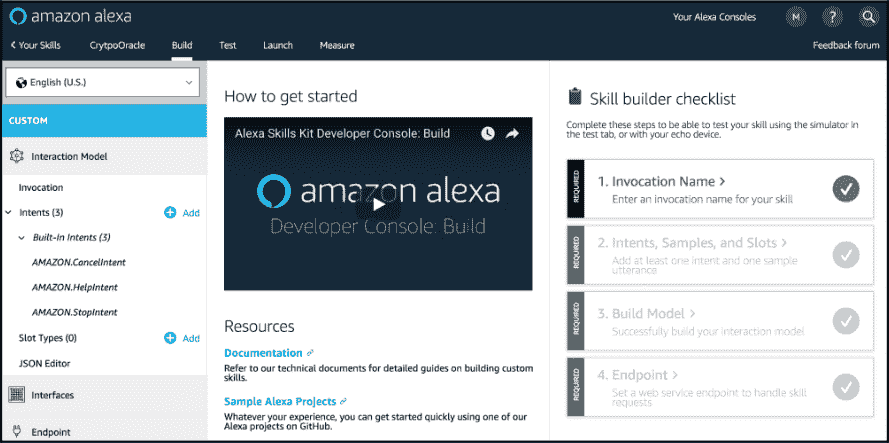

Figure 5.10: Successful Setup of the Invocation Name

现在，由于我们的 **Invocation Name** 已设置好，请从清单中选择 **Intents, Samples, and Slots** 项以进入以下屏幕截图：

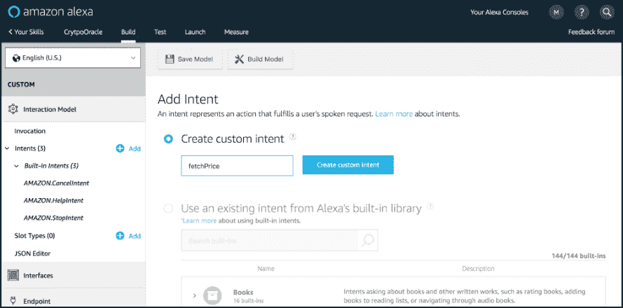

Figure 5.11: Setting up a custom intent

命名意图为 `fetchPrice` 并点击 **Create custom intent** 按钮。

+   7. 点击 **Create custom intent** 按钮应会带你进入 `fetchPrice` 意图的 **Sample Utterances** 页面，如以下屏幕截图所示：

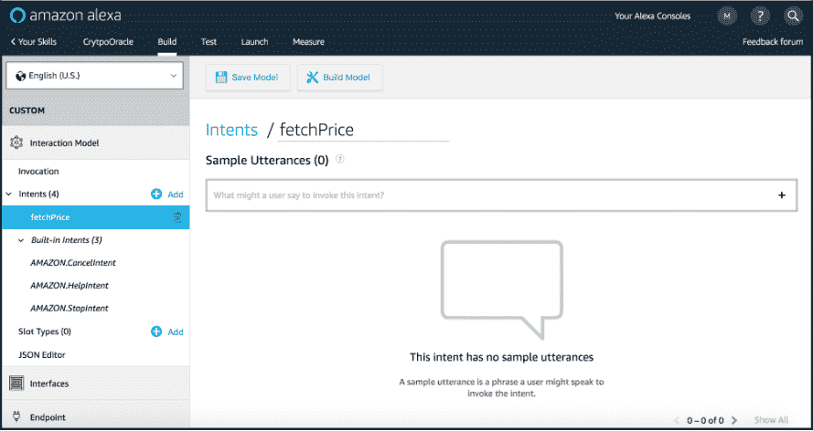

由于我们所有的 **Sample Utterances** 都需要一个槽，通过它我们可以将加密货币名称传递给 Lambda，因此在实现话语之前我们将添加一个槽。

选择 **Intents** 菜单下 **Slot Types** 旁边的 **Add** 按钮：

Figure 5.13: Adding a slot type to the custom intent

这应会带你进入 Add Slot Type 页面，如以下屏幕截图所示：

Figure 5.14: Naming the custom slot type for the intent

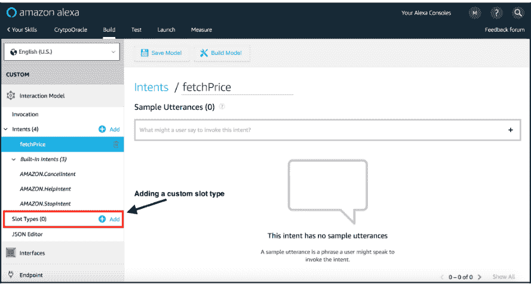

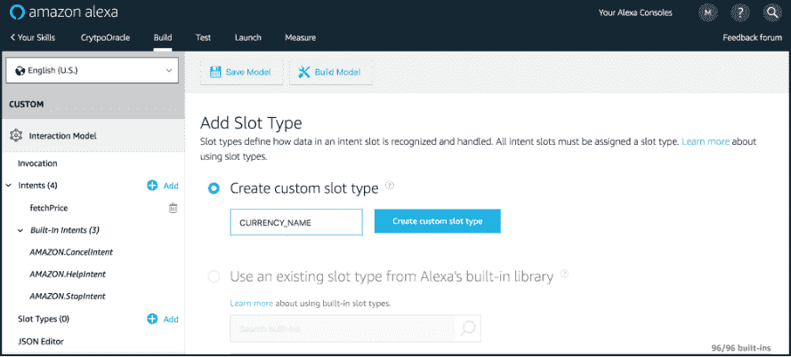

由于我们的 `CURRENCY_NAME` 槽将保存加密货币名称，用户需要检索其价格：

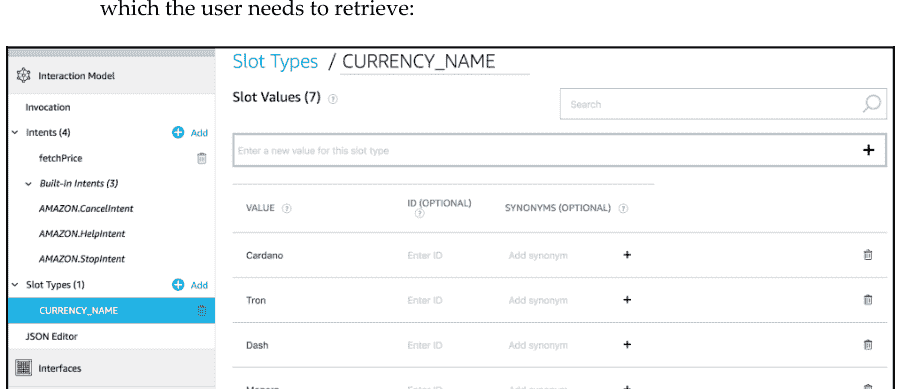

Figure 5.16: Adding slot values – step 2

如前述屏幕截图所示，在 **Slot Values** 选项下添加你所知道的所有加密货币名称。注意：添加槽值是可选的，因为我们的 Lambda 将能够提取任何槽值并获取其价格。

9. 在设置好我们的 Slot Types 后，我们现在可以使用槽类型来创建自定义槽。点击 Intents 下拉菜单下的 fetchPrice：

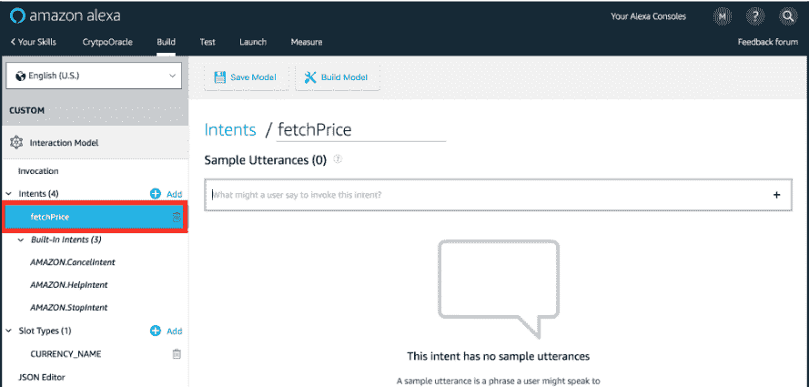

Figure 5.17: Configuring the custom intent with the slot – step 1

现在，向下滚动页面底部：

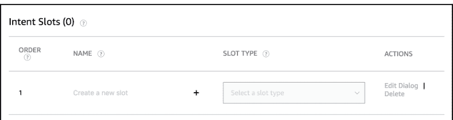

Figure 5.18: Configuring the custom intent with the slot – step 2

在 Intents Slots 选项下，创建一个名为 currencyName 的新槽，并为其指定我们之前创建的 CURRENCY_NAME 自定义类型：

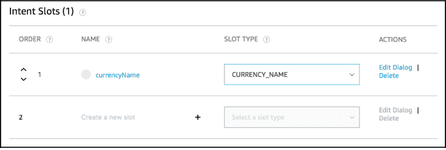

Figure 5.19: Configuring the custom intent with the slot – step 3

我们现在可以在 fetchPrice 意图模式中使用此槽。

+   10. 在设置好我们的 Intent Slots 后，我们现在可以为 fetchPrice 意图定义示例话语。向上滚动页面并在进行任何其他操作之前，通过点击 Save Model 按钮保存交互模型：

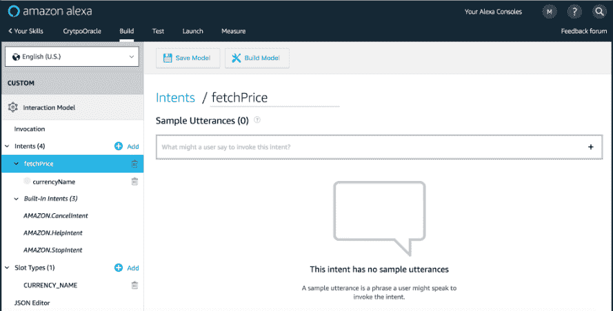

Figure 5.20: Configuring the sample utterances – step 1

保存模型后，我们可以为我们的模型添加几个话语，如以下屏幕截图所示：

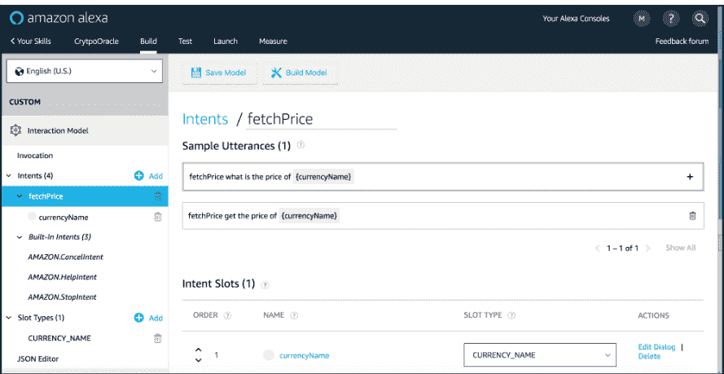

Figure 5.21: Configuring the sample utterances – step 2

所有这些话语都将使用我们之前定义的 currencyName 槽。

11. 完成话语设置后，继续选择 Build 选项卡以进入仪表板：

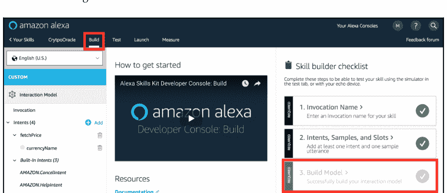

Figure 5.22: Building the interaction model

最后，选择 Build Model 选项以构建交互模型。该过程需要几分钟时间。构建成功完成后，仪表板上的 Build Model 按钮应变为绿色。

12. 在 **Interaction Model** 构建完成后，我们需要为其提供一个 Lambda Endpoint 以连接。 我们将在编码 Lambda 时推迟此步骤。但在开始配置 Lambda 之前，请点击前述屏幕截图中仪表板上的 **Endpoint** 按钮以导航到 **Endpoint** 屏幕：

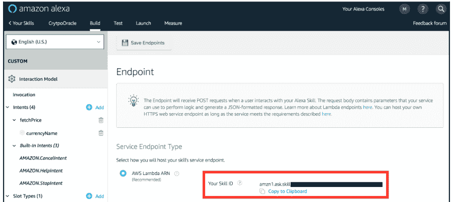

Figure 5.23: Copying the skill ID

从给定的选项中选择 **AWS Lambda ARN**，从此页面复制技能 ID 并保存到某处。我们稍后需要它。

## Configuring the Lambda function

一旦 **Interaction Model** 创建完成，我们将保持配置仪表板不变并专注于创建 Lambda：

+   1. 打开一个新的浏览器标签页并导航到 AWS 控制台。

AWS 控制台可在 https://console.aws.amazon.com 找到。如果你还没有账户，可能需要创建一个新账户。

在 Compute 选项下选择 Lambda。 在下一个屏幕上点击 Create function，命名该函数为 cryptoOracleSkill，并填写详细信息：

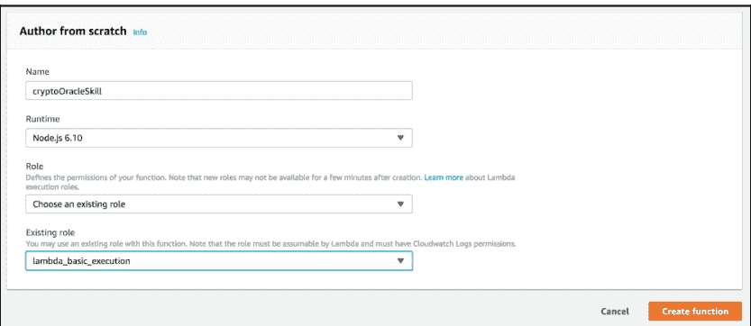

Figure 5.24: Naming the Lambda

填写详细信息后点击 Create function 按钮。

+   2. 在 Designer 部分下，你需要添加一个触发器来调用 Lambda 函数：

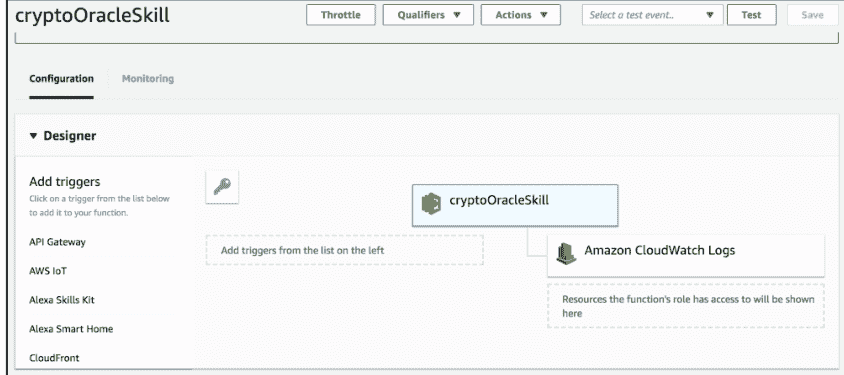

Figure 5.25: Configuring the Lambda

从左侧的触发器列表中选择 **Alexa Skills Kit**，因为 Alexa 将调用并向我们的 Lambda 函数提供输入：

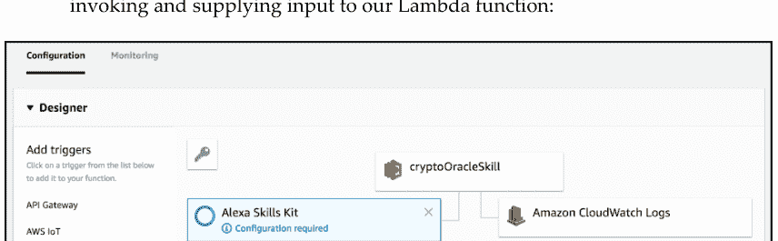

Figure 5.26: Adding a trigger for the Lambda

添加触发器后，下一步是添加我们在上一节中复制的技能 ID。滚动到屏幕底部并在以下屏幕截图所示的部分中添加 **Skill ID**：

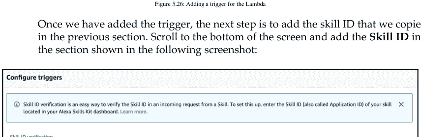

Fig 5.27: Adding the Skill ID to the Lambda

添加技能 ID 可确保 Lambda 仅响应由已验证技能生成的请求。添加 **Skill ID** 后，点击屏幕底部的 **Add** 按钮。我们的 Lambda 配置现在应有一些未保存的更改：

Figure 5.28: Saving changes to the Lambda

通过点击屏幕右上角的 Save 按钮保存最近的更改。

+   3. 点击 Save 按钮后，选择 Designer 部分下的 `cryptoOracleSkill` 框：

Figure 5.29: Concluding the Lambda configuration

这应会打开一个代码编辑器，我们将在其中添加 Lambda 的代码。

## Coding the Lambda function

我们将在开发者门户本身的 index.js 文件中内联编辑代码：

+   1. 实现 exports.handler 中的事件处理。我们的 Lambda 将处理两个基本请求：

- LaunchRequest：处理技能的启动
- IntentRequest：处理各种意图（在我们的例子中我们只有两个意图，第一个是 fetchPrice 意图，要求 Lambda 获取特定加密货币的价格，以及 AMAZON.StopIntent，表示退出技能）

我们将首先对技能收到的每个请求进行分离。为此，声明以下处理器：

```
exports.handler = function (event, context) {
    try {
        if (event.request.type === "LaunchRequest") {
        } else if (event.request.type === "IntentRequest") {
        }
    } catch (e) {
        context.fail("Exception: " + e);
    }
};
```

如前述代码所示，这是我们如何分离启动和意图事件请求的方式。

+   2. 定义一些帮助函数，以便帮助我们创建语音响应，如以下代码所示：

```
// ------ Helper functions ------

function buildSpeechletResponse(output, repromptText, shouldEndSession) {
    return {
        outputSpeech: {
            type: "PlainText",
            text: output
        },
        reprompt: {
            outputSpeech: {
```


```
type: "PlainText",
text: repromptText
},
},
shouldEndSession: shouldEndSession
};
}

function buildResponse(sessionAttributes, speechletResponse) {
return {
version: "1.0",
sessionAttributes: sessionAttributes,
response: speechletResponse
};
}
```

这些函数帮助 Lambda 在收到特定意图/输入时返回 Alexa 要说的响应。

`buildResponse` 函数将生成 Alexa 要发出的语音响应。

`buildSpeechletResponse` 函数将指定 Alexa 最终以纯文本形式说出的输出。它还需要一个 `shouldEndSession` 变量，该变量指定 Alexa 在响应后是否应该结束会话。

3. 一旦我们配置了辅助函数，就可以更新 `LaunchRequest` 和 `IntentRequest` 用例的处理，让 Alexa 说出相关的响应：

```
exports.handler = function (event, context) {
try {
if (event.request.type === "LaunchRequest") {
onLaunch(event.request,
event.session,
function callback(sessionAttributes,
speechletResponse) {
context.succeed(buildResponse(sessionAttributes,
speechletResponse));
});
} else if (event.request.type === "IntentRequest") {
//TBD
}
} catch (e) {
```

```
context.fail("Exception: " + e);
}
};
```

如前面的代码所示，当 Lambda 收到 `LaunchRequest` 时，它将调用 `onLaunch` 方法发送欢迎消息：

```
function onLaunch(launchRequest, session, callback) {
    getWelcomeResponse(callback);
}
```

我们将在下一步实现 `getWelcomeResponse` 方法。单击屏幕右上角的 **Save** 按钮保存进度。

+   4. `getWelcomeResponse` 方法负责制定启动响应：

```
function getWelcomeResponse(callback) {
    var sessionAttributes = {},
        speechOutput = " Crypto Oracle can tell you latest prices of the hottest cryptocurrencies",
        shouldEndSession = false,
        repromptText = "";
    callback(sessionAttributes,
        buildSpeechletResponse(speechOutput, repromptText, shouldEndSession));
}
```

如前面的代码所示，该方法为启动消息制定了一个简单的纯文本响应。

+   5. 在完成 `onLaunch` 方法的处理之后，我们现在将重点放在 `onIntent` 方法上，一旦 Lambda 收到 `IntentRequest`，就会调用该方法：

```
exports.handler = function (event, context) {
    try {
        if (event.request.type === "LaunchRequest") {
            onLaunch(event.request,
                event.session,
                function callback(sessionAttributes, speechletResponse) {
                context.succeed(buildResponse(sessionAttributes, speechletResponse));
            });
```

```
} else if (event.request.type === "IntentRequest") {
    onIntent(event.request,
        event.session,
        function callback(sessionAttributes,
        speechletResponse) {
        context.succeed(buildResponse(sessionAttributes,
        speechletResponse));
        });
    }
} catch (e) {
    context.fail("Exception: " + e);
}
};
```

`onIntent` 方法处理 CryptoOracle 技能引发的仅有的两个意图：

```
function onIntent(intentRequest, session, callback) {
    var intent = intentRequest.intent,
        intentName = intentRequest.intent.name;

    if ("fetchPrice" === intentName) {
        handleRequest(intent, session, callback);
    } else if ("AMAZON.StopIntent" === intentName) {
        handleFinishSessionRequest(intent, session, callback);
    } else {
        throw "Invalid intent";
    }
}
```

我们首先看看两者中较简单的 `AMAZON.StopIntent`，一旦用户决定提前结束技能执行，说出诸如“Alexa, stop CrypoOracle.”之类的短语时，就会引发该意图。这会导致调用 `handleFinishSessionRequest`：

```
function handleFinishSessionRequest(intent, session, callback)
{
    callback(session.attributes,
        buildSpeechletResponse("CryptoOracle will Exit. Good bye!", "", true));
}
```

这会在技能退出前向用户说出告别短语。

6. `fetchPrice` 意图请求稍微复杂一些，因为它有多条信息流路径，由 `handleRequest` 方法处理：

```
function handleRequest(intent, session, callback) {
    console.log("INSIDE Handle Request");
    var options = {
        host: 'api.coinmarketcap.com',
        port: 443,
        path: '/v1/ticker/' + intent.slots.currencyName.value +
        "/",
        method: 'GET',
        headers: {
            'Content-Type': 'application/json'
        }
    };

    var req = https.request(options, function (res) {
        res.setEncoding('utf-8');
        var responseString = '';
        res.on('data', function (data) {
            responseString += data;
        });

        res.on('end', function () {
            var resp = JSON.parse(responseString);
            console.log(resp);
            var sessionAttributes = {},
            speechOutput = "The price of " +
            intent.slots.currencyName.value + " is . . " +
            resp[0].price_usd + " dollars",
            shouldEndSession = false,
            repromptText = "";
            callback(sessionAttributes,
                buildSpeechletResponse(speechOutput, repromptText,
                shouldEndSession));
        });
    });

    req.end();
}
```

`handleRequest` 方法从意图中提取槽位，并向 CoinMarketCap API 发出请求，然后 API 返回所请求加密货币的信息。

如果你需要有关 CoinMarketCap API 的更多信息，请访问 `https://coinmarketcap.com/`。

最后，Lambda 将从 CoinMarketCap API 接收到的信息解析并整理为语音响应。

如你所见，前面的方法使用了 `https` 变量，该变量有助于从 CoinMarketCap API 检索信息；我们将在 `index.js` 文件的开头声明它，甚至在定义 `exports.handler` 之前：

```javascript
var https = require('https');
```

在 `index.js` 文件中添加了最后一段代码后，请单击屏幕右上角的 **Save** 按钮保存进度。

+   7. 我们需要将 Lambda 链接到我们的技能。为此，我们需要 Lambda 的 ARN。ARN 位于 Lambda 函数/代码编辑器页面的右上角：

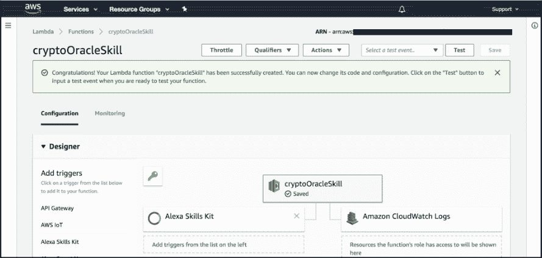

图 5.30：复制 ARN

复制 ARN，然后导航到之前的浏览器标签页，我们在那里配置技能的交互模型：

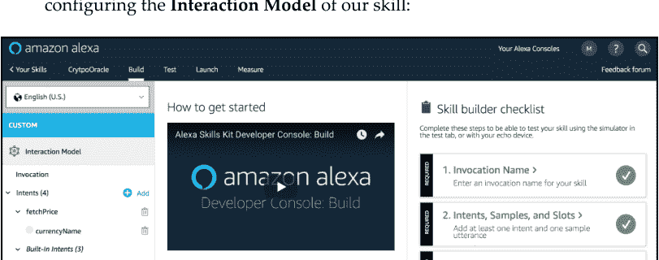

图 5.31：使用 ARN 更新端点 – 步骤 1

单击 Skill builder 清单下的 Endpoint 按钮，该按钮应将你导航到 Endpoint，如以下屏幕截图所示：

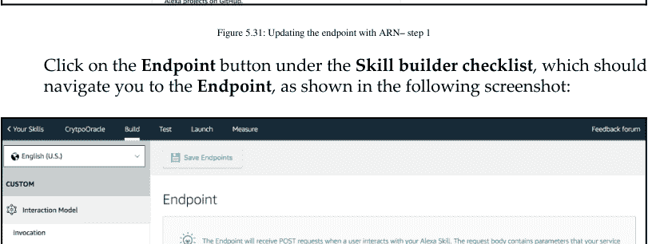

图 5.32：使用 ARN 更新端点 – 步骤 2

选择 **AWS Lambda ARN**；在 **Default Region** 选项下，添加我们从前一个屏幕复制的 ARN，并单击屏幕左上角的 **Save Endpoints** 按钮。

单击 **Save Endpoints** 按钮后，单击 **Build** 选项卡以导航到仪表板。

+   8. 在仪表板上，**Skill builder checklist** 中的所有项目现在都应该是绿色的：

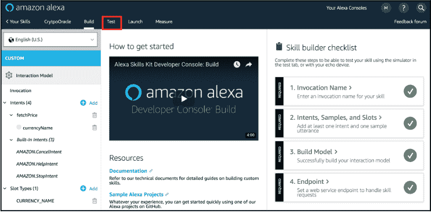

*图 5.33：所有步骤均为绿色 – 技能已就绪*

这表示我们的技能现在已准备好进行测试。单击 **Test** 选项卡，如前面的屏幕截图所示。

## 测试技能

Test 选项卡应弹出 Alexa 模拟器：


图 5.34：ASK 模拟器

Alexa 模拟器大大减少了对实际 Amazon Echo 的需求，因为你可以仅使用模拟器轻松测试 CryptoOracle 技能。

在文本框中输入 `Alexa launch CryptoOracle`，如以下屏幕截图所示，然后按 *Enter*：

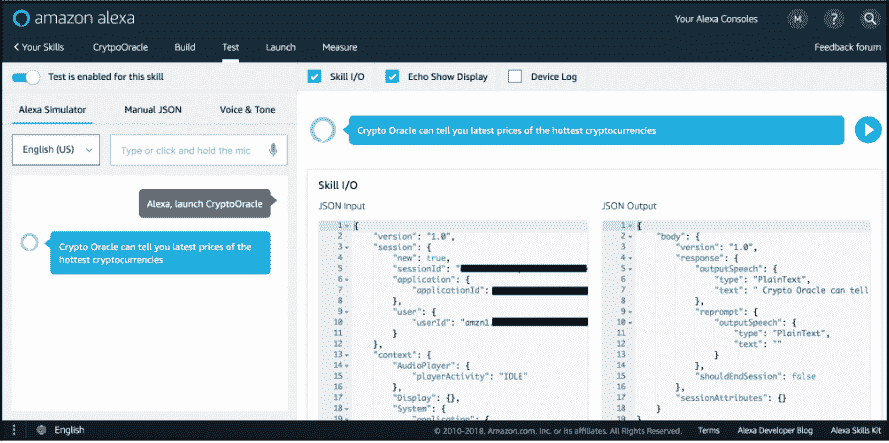

图 5.35：通过技能模拟器启动技能

Alexa 应该会回复正确的响应，并且如果计算机的音量已打开，你甚至可以听到 Alexa 说出该响应。


你现在可以向 CryptoOracle 询问你喜欢的加密货币的价格，它应该能够成功获取并作出回应：

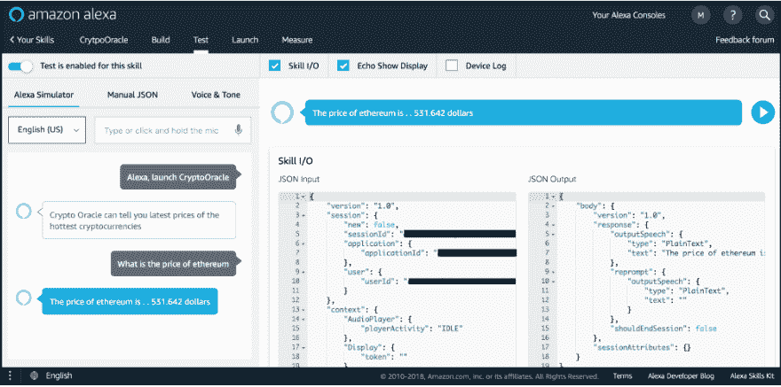

图 5.36：通过技能模拟器查询技能

我们的技能现已测试完成，可以随意尝试了。

你可以在 `https://github.com/madhurbhargava/AlexaSkillsProjects/blob/master/Chapter5_index.js` 找到 Lambda 的代码。
