# 6 使用 Alexa 进行家庭自动化

> “沟通必须是 HOT。也就是 Honest，Open，and Two-Way。”

– Dan Oswald

随着我们逐步阅读本书，我们创建的技能也在不断演进。我们从一个简单的 Hello World 技能开始，接着创建了短信发送器、问答游戏、一个谈论加密货币的技能，而在本章中，我们将致力于 **Ambience Manager**，它可以告诉我们家庭的氛围参数，例如温度和湿度。

我们将通过以下主题来设计此技能：

- 家庭自动化和环境传感器的介绍
- 设计 Ambience Manager 技能
- 开发移动应用
- 开发 Ambience Manager 技能

本章内容覆盖面很广，因为我们的 **Ambience Manager** 技能将与环境传感器通信，因此还将涉及环境传感器以及移动应用的细节，该应用将帮助我们把温度数据上传到云端。

### 家庭自动化和环境传感器的介绍

出于入门目的，家庭自动化是指用户可以通过一系列智能传感器而不是为每个单独设备翻动传统开关的方式来控制标准家庭设备，如灯光、音乐系统、电视，甚至气候。家庭自动化旨在尽可能减少用户与实际硬件的物理交互。在最近的现在和不那么遥远的过去，家庭自动化的概念建立在移动操作系统之上，主要是 Android 或 iOS，用户只需使用一部移动设备或平板电脑即可控制整栋房屋，而无需与房屋中每个单独设备的开关进行交互。

随着交互式语音助手的出现，家庭自动化的概念已经发展到用户只需用声音即可控制家庭的程度。家庭自动化的实际概念非常广泛，完整的解决方案将包括各种各样的传感器。在本章中，我们将演示家庭自动化与基于语音的个人助理相关的概念，使用几乎每个自动化家庭中都提供的关键功能，即收集有关气候/氛围的信息，例如温度、湿度等。我们将创建一个解决方案，其中包括环境传感器、移动应用和 Alexa，用户只需询问 Alexa 即可获取房屋的氛围详情。

氛围监测解决方案不仅用于家庭自动化，也用于各种仓库，因为产品必须保持在一定的温度/湿度下，它们可以通过 Wi-Fi 和/或蓝牙 BLE 在长距离上传输氛围数据。然而，这些解决方案也更昂贵且难以采购。因此，对于我们的需求，我们将使用一种流行的传感器原型解决方案 CC2650STK，俗称 SensorTag，由德州仪器制造，它体积小、易于获得、完全符合家庭自动化概念，并且可以从爱好/电子商店或德州仪器公司 TI 网站、亚马逊在线轻松购买，价格仅为 45-50 美元。


更多信息，请参考：http://www.ti.com/tool/CC2650STK

我们最终开发的整体系统还将包括一个移动应用，该应用将通过 BLE 与 CC2650STK SensorTag 交互，并将温度读数上传到 Firebase 后端。

在生产级别，我们根本不需要移动应用，因为大多数实用传感器完全有能力并配置为通过 Wi-Fi 将数据上传到后端。然而，由于我们正在进行原型设计，我们采用了这种解决方案。

然后，Lambda 可以从 Firebase 后端获取这些读数，并在用户提示 Alexa 时将其呈现给用户。

### 设计 Ambience Manager 技能

我们的 Ambience Manager 技能将至少有五个活动部分，包括与 Amazon Echo 交互的用户，Echo 反过来与 AWS Lambda 通信，Lambda 反过来从 Firebase 云获取温度信息。温度信息将通过移动设备推送到 Firebase 云，移动设备从环境传感器读取。信息流如下图所示：

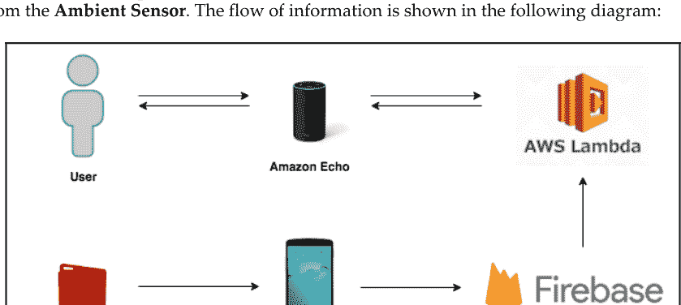

环境传感器将通过 BLE 将环境参数，即温度和湿度，传达给移动应用。

要了解有关 BLE 的更多信息，请访问 https://www.bluetooth.com/news/pressreleases/2009/12/17/sig-introduces-bluetooth-low-energy-wireless-technology-the-next-generation-of-bluetooth-wireless-technology。

这最终会将环境参数上传到 Firebase 后端。

Firebase 是 Google 的实时数据库。要了解有关 Firebase 的更多信息，请访问 https://firebase.google.com/。

一旦数据在 Firebase 后端可用，用户将按如下方式与技能进行通信：

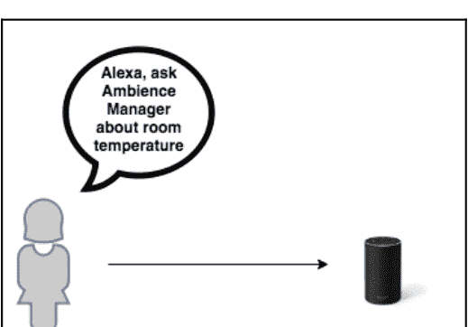

图 6.3：Ambience Manager 技能的一次性启动

你注意到有什么不同了吗？

如果你还没有注意到，我们并没有启动技能，正如我们为之前创建的所有 Alexa 技能所做的那样，却直接询问了房间温度。这就是所谓的 One-Shot Launch，即用户启动技能并请求其提供某些信息时。我们将在设计/编码实际技能时详细讲解 One-Shot Launch/Invocation。

如果 One-Shot Launch 成功，Ambience Manager 应该会回复正确的温度：

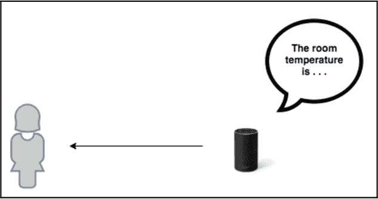

图 6.4：Ambience Manager 技能的对话流程

就用户交互而言，典型会话的整体信息流可以映射如下图所示：

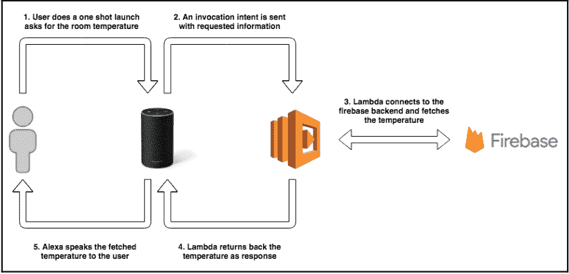

图 6.5：Ambience Manager 技能的操作

在数据流就绪后，我们进入下一步：创建一个 Android 应用，该应用将通过 BLE 从环境传感器读取数据，然后将数据推送到 Firebase 后端。

### 开发移动应用

我们将创建一个 Android 应用，该应用将通过 BLE 与环境传感器通信。

如果你对开发 Android 应用和 BLE 不太了解，不用担心，你可以简单地从本节末尾提供的链接下载源代码。或者，你可以查看 Android 开发者网站，了解 Android 应用开发的相关信息。

如果你有兴趣探索 Android，请导航到 https://developer.android.com/ 以获取有关 Android 应用开发的更多信息。

本节的先决条件如下：

- **Android:**
  - 最新版 Android Studio
  - 一台最新的 Android 设备，最好是三星 Galaxy S8，因为它支持蓝牙 5，否则任何 API 级别为 23 的设备 Android M 即可
  - 对 Java、Android、Android Studio 和 BLE 有基本熟悉程度
- **硬件:**
  - 德州仪器 CC2650 STK SensorTag

我们将从创建一个空项目开始。请为其选择一个名称。

为了保持一致性，并且由于该项目已在我的另一本书中介绍过，书名为 *IoT Projects with Bluetooth Low Energy* 由 Packt Publishing 出版，我将把它命名为 `AndroidWarehouseMonitor`。

由于我们即将为 Android 应用实现大量代码，为方便起见，我们已在以下流程图中分解了 Android 应用的功能：


Figure 6.6: Android application flow

请在实现/审查本节中实现的应用代码时，将前面的流程图作为指导工具。它将为您提供我们即将实现的代码的鸟瞰图。

让我们开始：

+   1. 定义用户界面以在屏幕上显示当前温度和湿度值。为此，我们通过更新 activity_main.xml 文件来定义我们的 UI。删除此文件中存在的任何代码，然后可以直接将以下代码添加到 activity_main.xml 文件中，也可以通过 UI 编辑器添加 UI：

```
<?xml version="1.0" encoding="utf-8"?>
<android.support.constraint.ConstraintLayout
    xmlns:android="http://schemas.android.com/apk/res/android"
    xmlns:app="http://schemas.android.com/apk/res-auto"
    xmlns:tools="http://schemas.android.com/tools"
    android:layout_width="match_parent"
    android:layout_height="match_parent"
    tools:context="android.packt.com.androidwarehousemonitor.MainActivity">
<TextView
    android:id="@+id/textView"
    android:layout_width="0dp"
    android:layout_height="217dp"
    android:layout_marginEnd="8dp"
    android:layout_marginLeft="8dp"
    android:layout_marginRight="8dp"
    android:layout_marginStart="8dp"
    android:layout_marginTop="8dp"
    android:text="Temperature:"
    android:textAppearance="@style/TextAppearance.AppCompat.Large"
    app:layout_constraintHorizontal_bias="0.526"
    app:layout_constraintLeft_toLeftOf="parent"
    app:layout_constraintRight_toRightOf="parent"
    app:layout_constraintTop_toTopOf="parent" />
<TextView
    android:id="@+id/textView2"
    android:layout_width="match_parent"
    android:layout_height="219dp"
    android:layout_marginBottom="8dp"
    android:layout_marginLeft="8dp"
    android:layout_marginRight="8dp"
    android:layout_marginTop="8dp"
    android:text="Humidity:"
    android:textAppearance="@style/TextAppearance.AppCompat.Large"
```

For this, add the `ensureLocationPermissionIsEnabled` method to the `MainActivity` class, as follows:

```
private void ensureLocationPermissionIsEnabled() {
    if (Build.VERSION.SDK_INT >= 23 &&
    ContextCompat.checkSelfPermission(this,
    android.Manifest.permission.ACCESS_COARSE_LOCATION) !=
    PackageManager.PERMISSION_GRANTED) {
    ActivityCompat.requestPermissions(this, new String[]{
    android.Manifest.permission.ACCESS_COARSE_LOCATION},
    REQUEST_LOCATION);
    return;
    }
}
```

After adding the preceding code and compiling the project, you will get an error regarding `REQUEST_LOCATION` not being found. For that error to go away, add the following member variable to the `MainActivity` class:

```
private static final int REQUEST_LOCATION = 1;
```

The `ensureLocationPermissionIsEnabled` method checks whether the location permission is granted, and if not, it requests the permission from the system.


Note that Android Marshmallow (API Level 23) introduced the runtime permission model, which allows the apps to request user permissions in Android at runtime, rather than at compile time, which is also the reason why we check for API Level in the preceding code before requesting runtime permissions. To read more about the runtime permission model, visit https://developer.android.com/training/permissions/requesting.html.

The preceding method uses the `ActivityCompat` class, which does all the hard work for us all in a single line of code.

3. The ActivityCompat class also provides the callback method, which gets called with the user's selection result (whether or not the user granted the permission). Depending on the result, we can take appropriate action. We will also implement this callback method, which is called onRequestPermissionResult, to listen for results of the permission request presented to the user. Add the following method to your MainActivity class:

```
@Override
public void onRequestPermissionsResult(int requestCode,
    String permissions[],
    int[] grantResults) {
    switch (requestCode) {
    case REQUEST_LOCATION: {
        // If request is cancelled, the result arrays are empty.
        if ((grantResults.length > 0
            && grantResults[0] ==
            PackageManager.PERMISSION_GRANTED) {
            Log.i(TAG, "Permission Granted");
        } else {
            Toast.makeText(getApplicationContext(),
                "Location Permission Not granted",
                Toast.LENGTH_LONG).show();
            finish();
        }
        break;
    }
    default:
    }
}
```

The preceding method simply logs it to the console if the permission has been granted; otherwise, it finishes the activity and exits the app. We have added the necessary methods, now we need to call them too.

4. For calling the methods that we added in Step 2 regarding enabling of location permissions, add a checkPermissions method to the MainActivity class:

```
private void checkPermissions(BluetoothAdapter bluetoothAdapter) {
    if (!bluetoothAdapter.isEnabled()) {
        Intent enableBtIntent = new
        Intent(BluetoothAdapter.ACTION_REQUEST_ENABLE);
        startActivityForResult(enableBtIntent, REQUEST_ENABLE_BT);
        return;
    }
}
```

```
ensureLocationPermissionIsEnabled();
}
```

For the code to compile successfully, define the following member variable in the `MainActivity` class:

```
private static final int REQUEST_ENABLE_BT = 0;
```

The preceding `checkPermissions` method will be responsible for enabling Bluetooth and location permissions.

+   5. In the previous step, we started the **System Default** setting activity for the user and let the user decide whether they wanted to switch the Bluetooth on. However, we are interested in knowing the user's decision, for which we override the `onActivityResult` method in the `MainActivity` class:

```
```java
@Override
protected void onActivityResult(int requestCode, int resultCode, Intent data) {
    if (requestCode == REQUEST_ENABLE_BT && resultCode == -1) {
        ensureLocationPermissionIsEnabled();
        return;
    }
    Toast.makeText(this, "Bluetooth not turned on",
        Toast.LENGTH_LONG).show();
    finish();
}
```
```

The result of the user's choice (whether the user decided to turn on the Bluetooth or not) will be returned in this method. We finish the activity directly if the user does not turn on the Bluetooth since there isn't much left to do.

+   6. Let's handle another case, where a device might not have Bluetooth support at all. For that, please update the `onResume` method to the one shown as follows:

```
```java
@Override
protected void onResume() {
    super.onResume();
    BluetoothManager btManager = (BluetoothManager)
        getSystemService(BLUETOOTH_SERVICE);
    BluetoothAdapter btAdapter = btManager != null ?
        btManager.getAdapter() : null;
    if (btAdapter == null) {
        Toast.makeText(getApplicationContext(),
            "No Bluetooth Support found",
            Toast.LENGTH_LONG).show();
```

8. We are making an assumption here, that is, the App will be operated in a scenario where the SensorTag (attached to warehouse shelves) is turned on and is always sending out advertisements over Bluetooth Low Energy, so as soon as the app begins its operation, it tries to filter out the SensorTag from the list of broadcasting devices, connect to it, and read temperature and humidity data continuously. For this, add the startScanning method to the MainActivity class:

```
protected void startScanning() {
    bluetoothManager =
    (BluetoothManager)getSystemService(Context.BLUETOOTH_SERVICE);
    bluetoothAdapter = bluetoothManager.getAdapter();
    bluetoothLeScanner =
    bluetoothAdapter.getBluetoothLeScanner();
    AsyncTask.execute(new Runnable() { @Override public
    void run() { bluetoothLeScanner.startScan(leScanCallback); } 
    });
}
```

The startScanning method makes use of quite a few variables, so declare those in the MainActivity class:

```
BluetoothManager bluetoothManager;
BluetoothAdapter bluetoothAdapter;
BluetoothLeScanner bluetoothLeScanner;
```

We now need to call the startScanning method from two places, first, immediately after the user grants the location permission. For this, add the method call to the startScanning method to the onRequestPermissionResult method (which we implemented in Step 3) as shown next:

```
if (grantResults.length > 0 && grantResults[0] ==
PackageManager.PERMISSION_GRANTED) {
    Log.i(TAG, "Permission Granted");
    startScanning();
}
```

Second, if you have already granted all the permissions during the initial run of the app, we also add the method call for the startScanning method to the ensureLocationPermissionIsEnabled method (which we implemented in Step 2):

```
private void ensureLocationPermissionIsEnabled() {
    if (Build.VERSION.SDK_INT >= 23 &&
```


ContextCompat.checkSelfPermission(this,
    android.Manifest.permission.ACCESS_COARSE_LOCATION)
!= PackageManager.PERMISSION_GRANTED) {
    ActivityCompat.requestPermissions(this, new String[]{
android.Manifest.permission.ACCESS_COARSE_LOCATION},
REQUEST_LOCATION);
    return;
}
startScanning();
}

我们已经实现了设备扫描代码。现在，我们需要定义一个回调来处理发现的设备。

9. 如果你成功完成了上一步，你的 startScanning 方法实现将使用 ScanCallback，扫描结果会通过它进行传递。请在 MainActivity 类中定义 ScanCallback：

```
// Device scan callback.
private ScanCallback leScanCallback = new ScanCallback() {
    @Override
    public void onScanResult(int callbackType, ScanResult
result) {
    if (result.getDevice() != null) {
        if (result.getDevice().getName() != null &&
result.getDevice().getName().contains(NAME_TAG)) {
            Log.i(TAG, result.getDevice().getName());
            if (connected == false) {
                connected = true;
                bluetoothLeScanner.stopScan(leScanCallback);
                result.getDevice().connectGatt(MainActivity.this, true,
                gattCallback);
            }
        }
    }
};
```

请仔细检查上面的代码，它根据所发现设备的名称来过滤可用设备。上述代码使用了一些变量，这些变量需要在 MainActivity 类中声明：

```
private static String NAME_TAG = "SensorTag";
private boolean connected = false;
```

我们需要将每个发现的设备名称与 SensorTag 的名称进行匹配，NAME_TAG 变量正好可以帮助我们做到这一点。一旦找到正确的匹配，我们就通过调用 connectGatt 方法来发起连接，并通过更新 connected 变量的状态来表示已发出连接请求。

10. 调用 connectGatt 方法需要三个参数。最后一个参数是一个回调方法，可用于：
- 监控连接状态变化
- 服务发现
- 特征值变化

我们将首先在 MainActivity 类中实现这个回调，用于监听连接状态变化：

```
protected BluetoothGattCallback gattCallback = new
BluetoothGattCallback() {
    @Override
    public void onConnectionStateChange(BluetoothGatt gatt, int status, int newState) {
        super.onConnectionStateChange(gatt, status, newState);
        if (newState == BluetoothGatt.STATE_CONNECTED) {
            Log.i(TAG, "onConnectionStateChange() - STATE_CONNECTED");
            gatt.discoverServices();
        }
    }
};
```

根据上述实现，如果连接成功，我们就会发起服务发现。

11. 我们关注两个服务：IR_TEMPERATURE_SERVICE 和 HUMIDITY_SERVICE。我们首先在 MainActivity 类中定义它们的 UUID：

```
private static final String UUID_IR_TEMPERATURE_SERVICE =
"f000aa00-0451-4000-b000-000000000000";
private static final String UUID_HUMIDITY_SERVICE =
"f000aa20-0451-4000-b000-000000000000";
```

请注意，虽然我们为 `TEMPERATURE_SERVICE` 和 `HUMIDITY_SERVICE` 都定义了 UUID，但在 Android 代码示例中，我们只演示了从 `TEMPERATURE_SERVICE` 读取数据。从 `HUMIDITY_SERVICE` 读取数据的方式与之类似，留作练习由你自己完成。接下来，我们将专门关注 `TEMPERATURE_SERVICE` 的细节。

SensorTag 上的 `TEMPERATURE_SERVICE` 包含两个重要的特征值：*数据特征值*和*配置特征值*。


访问以下链接可以了解 SensorTag 温度服务所暴露的特征值的详细信息：`http://processors.wiki.ti.com/images/a/a8/BLE_SensorTag_GATT_Server.pdf`。

顾名思义，数据特征值保存温度数据，并支持*读取*该数据，以及针对温度数据的*启用/禁用通知*。我们将与这两个特征值进行交互。在 `MainActivity` 类中定义它们：

```java
//Characteristic UUIDs
private static final UUID UUID_CHARACTERISTIC_TEMPERATURE_DATA
    = UUID.fromString("f000aa01-0451-4000-b000-000000000000");
private static final UUID
UUID_CHARACTERISTIC_TEMPERATURE_CONFIG =
    UUID.fromString("f000aa02-0451-4000-b000-000000000000");
```

我们在上一步发起的服务发现结果，将通过 `onServicesDiscovered` 方法传递。请重写 `BluetoothGattCallback` 中的 `onServicesDiscovered` 方法：

```java
@Override
public void onServicesDiscovered(final BluetoothGatt gatt, int status) {
  super.onServicesDiscovered(gatt, status);
  gatt.readCharacteristic(gatt.getService(UUID_IR_TEMPERATURE_SERVICE).getCharacteristic(UUID_CHARACTERISTIC_TEMPERATURE_DATA));
}
```

一旦服务发现完成，我们就通过上述代码指示 `BluetoothGatt` 读取温度数据特征值。

12. 如前所述，温度数据特征值支持通知，我们可以启用这些通知来定期更新温度数据。一旦我们成功读取了温度数据特征值，就可以在重写 `BluetoothGattCallback` 实现中的 `onCharacteristicRead` 方法时，为该特征值启用通知：

```java
@Override
public void onCharacteristicRead(BluetoothGatt gatt,
BluetoothGattCharacteristic characteristic, int status) {
    super.onCharacteristicRead(gatt, characteristic, status);
    if
    (characteristic.getUuid().equals(UUID_CHARACTERISTIC_TEMPERATURE_DATA)) {
        //Enable local notifications
        gatt.setCharacteristicNotification(characteristic, true);
        //Enabled remote notifications
        BluetoothGattDescriptor desc =
        characteristic.getDescriptor(CONFIG_DESCRIPTOR);
        desc.setValue(BluetoothGattDescriptor.ENABLE_NOTIFICATION_VALUE
        );
        gatt.writeDescriptor(desc);
    }
}
```

一旦启用了**通知**，每当 SensorTag 上的温度数据更新时，应用都会在 `onCharacteristicChanged` 方法中接收到更新后的值。

13. 正如上一步所述，我们将重写 `onCharacteristicChanged` 方法，以便接收更新后的温度值，并对其进行解析和打印到控制台：

```java
@Override
public void onCharacteristicChanged(BluetoothGatt gatt,
BluetoothGattCharacteristic characteristic) {
    super.onCharacteristicChanged(gatt, characteristic);
    if
    (characteristic.getUuid().equals(UUID_CHARACTERISTIC_TEMPERATURE_DATA)) {
        double ambient =
        Utilities.extractAmbientTemperature(characteristic);
    }
}
```

温度数据的格式如下：
ObjectLSB:ObjectMSB:AmbientLSB:AmbientMSB,。为了提取数据，我们创建了一个名为 Utilities 的独立类。在项目中添加一个独立的 Utilities 类，并在其中引入以下 extractAmbientTemperature 方法：

```
public static double
extractAmbientTemperature(BluetoothGattCharacteristic c) {
    int offset = 2;
    return shortUnsignedAtOffset(c, offset) / 128.0;
}
```

extractAmbientTemperature 方法使用了 shortSignedAtOffset 方法，因此我们也将该方法添加到 Utilities 类中：

```
/**
 * Gyroscope, Magnetometer, Barometer, IR temperature
 * all store 16 bit two's complement values in the awkward
format
 * LSB MSB, which cannot be directly parsed as
getIntValue(FORMAT_SINT16, offset)
 * because the bytes are stored in the "wrong" direction.
 *
 * This function extracts these 16 bit two's complement values.
 * */
private static Integer
shortSignedAtOffset(BluetoothGattCharacteristic c, int offset)
{
    Integer lowerByte = c.getIntValue(FORMAT_UINT8, offset);
    Integer upperByte =
    c.getIntValue(BluetoothGattCharacteristic.FORMAT_SINT8, offset
    + 1); // Note: interpret MSB as signed.
    return (upperByte << 8) + lowerByte;
}
```

上述代码片段来源于 http://processors.wiki.ti.com/。


我们已为数据特征启用了**通知**，理论上，我们现在可以高枕无忧，只需等待温度传感器通过 `onCharacteristicChanged` 方法读取、更新并通知我们最新的温度值。然而，事实并非如此，因为在成功获取温度更新之前，我们还缺少一个关键步骤。

- 14. 如果你仔细阅读过我们在*步骤 11* 中指出的文档链接，你会发现该文档中提到一个关键细节：

| 0x29 | 41 | 0xAA02 | IR 温度配置 | 00 | RW | 写入“01”启动传感器和测量，“00”进入睡眠 |

图 6.8：温度配置特征的详细信息

根据上述细节，请注意默认情况下温度传感器并未启用记录测量功能。因此，默认情况下我们的温度传感器处于睡眠模式；我们需要将其切换到活动模式，以便接收定期的通知。我们通过在 `MainActivity` 类中重写 `BluetoothGattCallback` 实现中的 `onDescriptorWrite` 方法来实现这一点：

```
@Override
public void onDescriptorWrite(BluetoothGatt gatt,
BluetoothGattDescriptor descriptor, int status) {
    super.onDescriptorWrite(gatt, descriptor, status);
    enableConfigurationForCharacteristic(gatt,
    descriptor.getCharacteristic());
}
```

根据 `onDescriptorWrite` 的实现，我们还需要在 `MainActivity` 类中实现 `enableConfigurationForCharacteristic` 方法：

```
private void enableConfigurationForCharacteristic(BluetoothGatt gatt, BluetoothGattCharacteristic characteristic) {
    if
    (characteristic.getUuid().equals(UUID_CHARACTERISTIC_TEMPERATURE_DATA)) {
        gatt.readCharacteristic(gatt.getService(UUID_IR_TEMPERATURE_SERVICE).getCharacteristic(UUID_CHARACTERISTIC_TEMPERATURE_CONFIG));
    }
}
```

这就是我们之前提到的第二个重要特征——配置特征——发挥作用的地方。

15. 接着上一步，我们将读取配置特征（并在下一步中更新它），以便最终将温度传感器从睡眠模式配置为活动模式。为了更新配置特征，将预先实现的 `onCharacteristicRead` 方法更新为以下内容：

```
@Override
public void onCharacteristicRead(BluetoothGatt gatt,
BluetoothGattCharacteristic characteristic, int status) {
super.onCharacteristicRead(gatt, characteristic, status);
if
(characteristic.getUuid().equals(UUID_CHARACTERISTIC_TEMPERATURE_DATA)) {
//Enable local notifications
gatt.setCharacteristicNotification(characteristic, true);
//Enabled remote notifications
BluetoothGattDescriptor desc =
characteristic.getDescriptor(CONFIG_DESCRIPTOR);
desc.setValue(BluetoothGattDescriptor.ENABLE_NOTIFICATION_VALUE);
);
gatt.writeDescriptor(desc);
} else if
(characteristic.getUuid().equals(UUID_CHARACTERISTIC_TEMPERATURE_CONFIG)) {
characteristic.setValue(new byte[] {0x01});
gatt.writeCharacteristic(characteristic);
}
}
```

读取成功后，我们向配置特征写入 `0x01`，以便将温度传感器设置为活动模式。

16. 我们已经完成了实现，现在 `onCharacteristicChanged` 方法应该在 SensorTag 每次更新温度值时被调用。作为最后一步，我们可以更新 `onCharacteristicChanged` 方法，向用户显示实时温度更新。同时，我们还可以设置并包含数据上传到 Firebase 后端，以便我们的应用能持续将定期数据更新上传到远程服务器。我们用于 UI 更新和后端上传的最终代码如下：

```
```java
@Override
public void onCharacteristicChanged(BluetoothGatt gatt,
BluetoothGattCharacteristic characteristic) {
    super.onCharacteristicChanged(gatt, characteristic);
    if
    (characteristic.getUuid().equals(UUID_CHARACTERISTIC_TEMPERATURE_DATA)) {
        final double ambient =
        Utilities.extractAmbientTemperature(characteristic);
        //Upload to Firebase Backend
        FirebaseDatabase database = FirebaseDatabase.getInstance();
        DatabaseReference myRef =
        database.getReference("Temperature");
        myRef.setValue(ambient);
        //Update the UI
        runOnUiThread(new Runnable() {
            @Override
            public void run() {
                ((TextView)
                findViewById(R.id.textView).setText("Temperature: " + ambient
                + "\\u00b0" + "C");
            }
        });
    }
}
```
```

请注意，我们仍需要在客户端和服务端两端设置 Firebase，因此上述代码可能无法编译，因为我们引用了 Firebase 但尚未进行设置。我们将在下一步中进行设置。

## 设置 Firebase

现在我们已经有数据了，剩下的事情就是将其上传到服务器，这样 Alexa 就可以远程读取/访问这些数据。为此，我们将 Firebase 集成到 Android 应用中，并将温度测量值上传到 Firebase 云。我们将按照以下步骤将 Firebase 集成到移动应用中：

- 1. 要集成 Firebase，请在 Android Studio 的顶部菜单栏中导航到 Tools | Firebase。这应该会打开 Firebase Assistant 窗口：

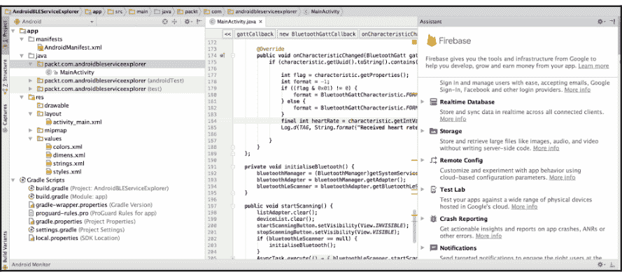

图 6.9：Firebase Assistant

- 2. 在 Firebase Assistant 窗口中，导航到 Realtime Database | Save and retrieve data。这应该会打开 Save and retrieve data 窗口。

- 3. 点击 Connect your app to Firebase。Firebase 连接应会要求你选择现有项目或创建新项目。

4. 选择创建新项目，为其提供相关名称，然后点击 Connect to Firebase：

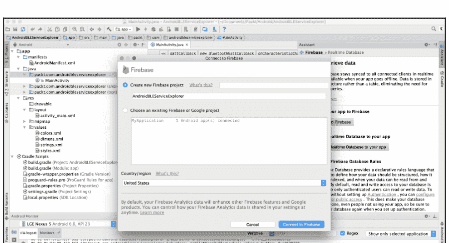

图 6.10：创建新的 Firebase 项目

5. 该过程需要几分钟时间，成功完成后，Assistant 窗口中的 Connect your app to Firebase 指示器将变为绿色：


图 6.11：Firebase 应用连接状态

6. 点击 Assistant 窗口中的第二项，即 Add the Realtime Database to your app。此时会弹出一个提示，询问是否可以对项目进行与包含 Firebase 相关的必要更改。点击此提示中的 Accept Changes：

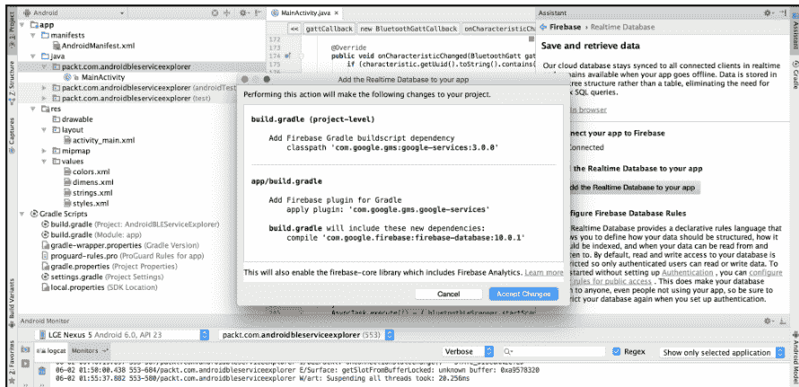

图 6.12：将 Firebase 添加到项目

7. 接受更改后，将开始 Gradle Sync。

8. Gradle Sync 之后，在 Assistant 窗口中的步骤 3 下点击 Configure your rules for public access。此步骤将在浏览器中打开一些 Firebase 文档。

9. 点击此屏幕右上角的 Go to Console。这应该会打开现有应用的仪表板/图库。

10. 选择相关的应用名称：

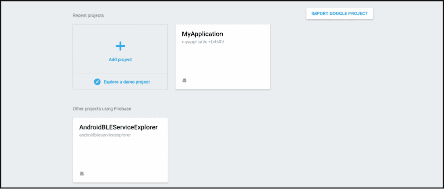

11. 你将进入一个详细的控制台。在此处，点击左侧窗格中的 **Database**，然后在水平选项卡列表中选择 **Rules** 选项卡。

- 12. 你面前看到的应该是一个 JSON 文件，表示规则为键值对：
- 1. 将 `.read` 键从 `auth != null` 改为 `true`。
- 2. 对 `.write` 键执行相同操作。
- 3. 点击顶部的 **Publish** 按钮。

> 此配置仅用于演示目的，这意味着任何人都可以读取或写入你的数据库。在真实场景中，你的规则将比这更高级、更复杂。

完成上述更改后，安全规则 JSON 应如下图所示：

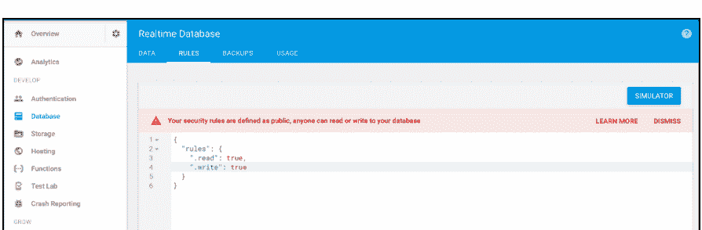

图 6.14：Firebase 详细控制台和规则

13. 完成这些更改后，我们的 Android 应用已经具备了将读数上传到 Firebase 后端的代码。如果你现在启动应用，打开 SensorTag，并让它在应用附近保持广播，你应该会看到动态温度更新的到来以及 UI 的更新：

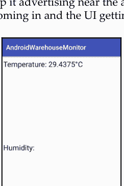

图 6.15：动态温度更新


呼，这可真不容易！我们的 Android 实现已经完成了。

请注意，如果你运行应用后无法（在日志中或调试时）看到设备被发现，请确保手机已开启定位服务。

你还应该能在 Firebase 后端看到实时更新，这些更新与应用上显示的数据一致：

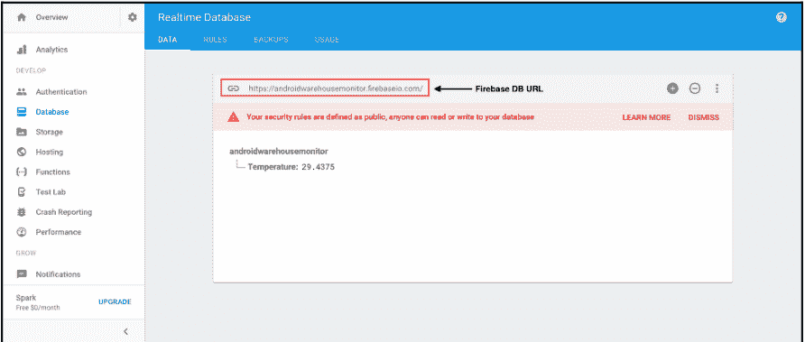

复制 Firebase 数据库 URL（根据你命名 Firebase 数据库的方式，此 URL 可能有所不同）并将其保存在某处。稍后我们将需要从 Lambda 代码中引用它。

你可以在 https://github.com/madhurbhargava/AndroidWarehouseMonitor 找到 AndroidWarehouseMonitor 的代码。

现在，我们继续实现实际的 Ambience Manager 技能。

## 技术中心业务问答题库

1. 如何查找电子发票？

答：登录税务系统（网址），进入【发票管理】-【电子发票】查询。

2. 如何申请增值税专用发票？

答：提交开票申请单至财务部，审核通过后由财务开出专票。

3. 如何打印报销单？

答：在OA系统填写报销单，提交审批后打印带有水印的报销单。

4. 如何查询报销进度？

答：进入OA系统【报销管理】-【进度查询】，输入单号即可查看。

## 报账须知

- 所有报销单据需在业务发生后30天内提交

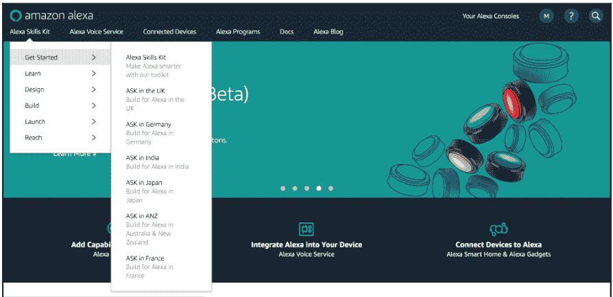

图 6.18：Alexa 技能门户 – 登录

3. 在接下来出现的屏幕上，点击位于屏幕中央的“Start a Skill（开始技能）”按钮：


图 6.19：Alexa 技能门户 – 启动技能

4. 这时你应该会进入 ASK 控制台：


图 6.20：Alexa 技能门户 – ASK 控制台

点击屏幕底部的“创建技能”按钮。

5. 下一个屏幕是“创建新技能”屏幕，需要提供技能名称（SkillName）才能继续：

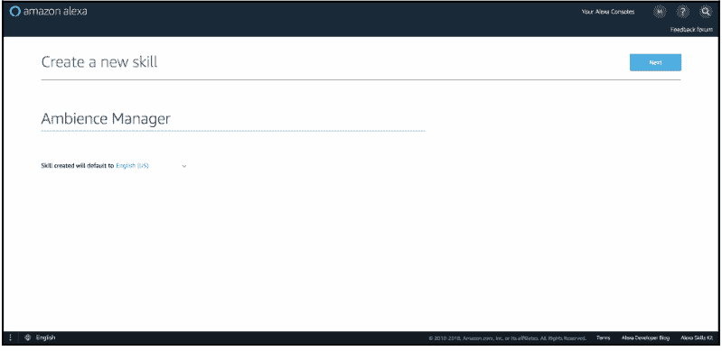

图 6.21：为技能命名

请将技能命名为 Ambience Manager，然后点击“下一步”按钮。

6. 下一页将显示可添加到该技能的预置交互模型类型：

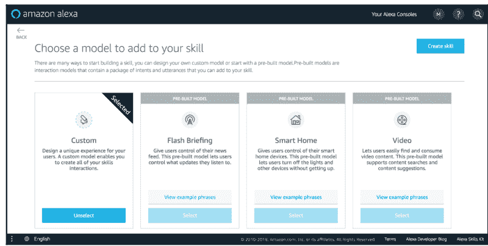

图 6.22：为技能选择自定义交互模型

点击“自定义模型”下方的“选择”按钮以选中它，然后点击屏幕右上角的“创建技能”按钮。

- 7. 创建技能后，我们需要通过仪表板配置其交互模型：

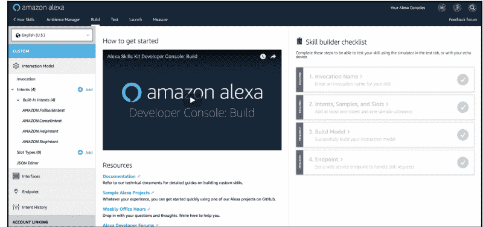

图 6.23：Ambience Manager 技能仪表板

我们将通过完成**技能构建器清单**来配置**交互模型**。

- 8. 在**技能构建器清单**下选择第一个选项**调用名称**，进入以下屏幕：

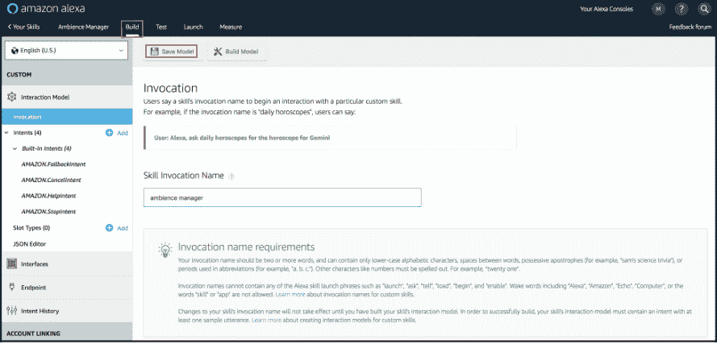

在**技能调用名称**中输入 `ambience manager`，然后点击左上角的**保存模型**按钮。

- 9. 点击**构建**标签项，即可返回**技能构建器清单**，该清单中的**调用名称**选项应已被标记并选中，因为我们刚刚完成了它的设置：

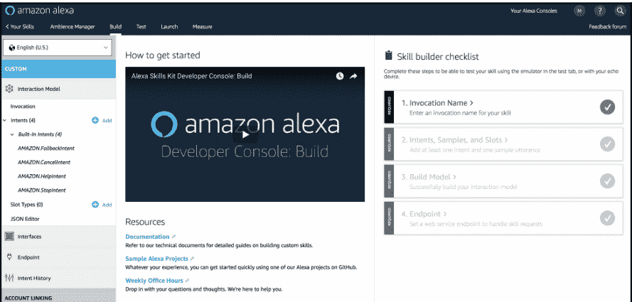

图 6.25：设置调用名称后，再设置意图、示例和槽位

现在，既然我们的调用名称已设置好，请从清单中选择“意图、示例和槽位”项，进入添加意图屏幕：

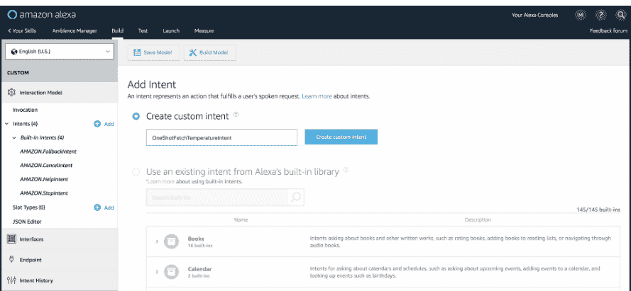

图 6.26：创建 One-Shot 意图

最后，选择**构建模型**选项以构建**交互模型**。该过程需要几分钟。构建成功完成后，仪表板上的**构建模型**按钮会变为绿色。

12. **交互模型**构建完成后，我们现在需要为其提供一个可连接的 Lambda 端点。我们会暂时推迟此步骤，先去编写 Lambda 代码。但在开始配置 Lambda 之前，请点击上方截图所示仪表板上的**端点**按钮，导航到**端点**屏幕：

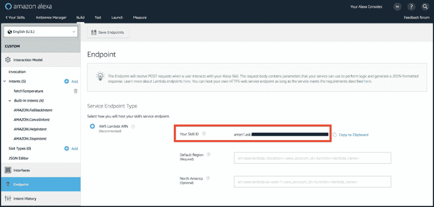

从给定选项中选择**AWS Lambda ARN**，复制此页面上的“技能 ID”并保存在某处。我们很快就会用到它。

## 配置 Lambda 函数

创建好**交互模型**后，我们将保持配置仪表板不变，专心创建 Lambda：

- 1. 打开一个新的浏览器标签页，并导航到 AWS 控制台。

AWS 控制台位于 https://console.aws.amazon.com。请注意，如果你还没有账户，可能需要新建一个。

在**服务 | 计算**选项下选择**Lambda**。在下一个屏幕上点击**创建函数**，将 Lambda 函数命名为 `ambienceManagerSkill`，并按下图所示填写详细信息：

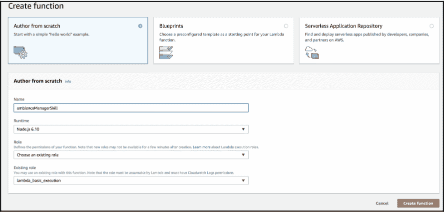

填写详细信息后，点击**创建函数**按钮。

2. 在下一个屏幕上，在“设计器”部分，你需要添加一个触发器来调用 Lambda 函数。从左侧的触发器列表中，请选择 Alexa Skills Kit，因为 Alexa 将调用我们的 Lambda 函数并为其提供输入：

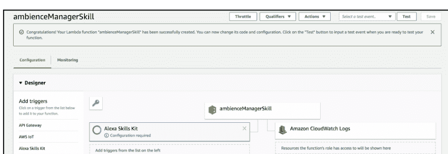

图 6.32：为 Lambda 函数添加触发器

添加触发器后，我们需要添加上一节中复制的“技能 ID”。滚动到屏幕底部，在如下截图所示的区域中添加“技能 ID”：

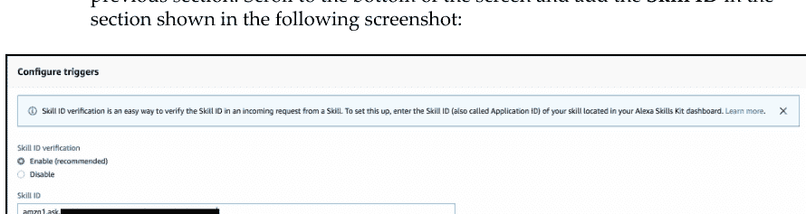

图 6.33：配置触发器

添加**技能 ID**可确保 Lambda 只响应经过验证的技能所生成的请求。添加**技能 ID**后，请点击屏幕底部的**添加**按钮。此时我们的 Lambda 配置应有一些未保存的更改。请点击屏幕右上角的**保存**按钮保存最近的更改。

- 3. 点击**保存**按钮后，在**设计器**部分选择 **ambienceManagerSkill** 框。这会在底部打开一个代码编辑器，我们将在其中添加 Lambda 的代码。

## 编写 Lambda 函数

完成 Lambda 设置后，接下来就该为实际的 Lambda 函数编写代码了。我们将按照以下步骤，在开发者门户网站的 `index.js` 文件中直接编辑代码：

- 1. 在 `exports.handler` 中实现事件处理。在本例中，我们的 Lambda 将只处理一个意图，即 `OneShotFetchTemperatureIntent`。由于我们实现的是 One-Shot 启动，这一个意图就能启动我们的技能并获取温度数据。

在继续编写功能逻辑之前，先声明以下变量，这些变量将被我们的功能逻辑使用：

```
var https = require('https');
var firebaseHost = "androidwarehousemonitor.firebaseio.com";
```

`firebaseHost` 就是我们之前在设置 Firebase 时复制的那个 URL（根据你为 Android 应用设置 Firebase 的方式，该 URL 可能有所不同）。由于我们将通过 REST 调用连接到 Firebase，因此需要它的 `firebaseHost` URL 和 `https`。

然后，更新 `exports.handler` 的代码，如下所示：

```
exports.handler = (event, context, callback) => {
    try {
        if (event.request.type === "IntentRequest") {
            if ("OneShotFetchTemperatureIntent" ===
            event.request.intent.name) {
            } else {
                throw "Invalid intent";
            }
        }
    }
```

```
}
catch(e) {
    context.fail("Exception: " + e);
}
};
```

如前所示和所述，我们丢弃了所有其他意图（包括到目前为止我们一直严格处理的 Launch Intent），只处理 `OneShotFetchTemperatureIntent`，以实现我们技能的 One-Shot 启动。

- 2. 我们将定义一些辅助函数来帮助我们创建语音响应，如下所示：

```
// ------ Helper functions ------

function buildSpeechletResponse(output, repromptText, shouldEndSession) {
    return {
        outputSpeech: {
            type: "PlainText",
            text: output
        },
        reprompt: {
            outputSpeech: {
                type: "PlainText",
                text: repromptText
            }
        },
        shouldEndSession: shouldEndSession
    };
}

function buildResponse(sessionAttributes, speechletResponse) {
    return {
        version: "1.0",
        sessionAttributes: sessionAttributes,
        response: speechletResponse
    };
}
```

这些函数帮助 Lambda 在收到特定意图/输入时返回 Alexa 要朗读的响应。


buildResponse 函数将生成要由 Alexa 朗读的直白响应。

buildSpeechletResponse 函数将以纯文本形式指定 Alexa 最终要朗读的输出。它还接受另一个变量 shouldEndSession，该变量指定 Alexa 在响应结束后是否应结束会话。

定义 fbGet 函数，它将接受一个 key 参数，并通过 REST 调用从给定的主机获取数据：

```
function fbGet(key){
    return new Promise((resolve, reject) => {
        var options = {
            hostname: firebaseHost,
            port: 443,
            path: key + ".json",
            method: 'GET'
        };
        var req = https.request(options, function (res) {
            res.setEncoding('utf8');
            var body = '';
            res.on('data', function(chunk) {
                body += chunk;
            });
            res.on('end', function() {
                resolve(JSON.parse(body))
            });
        });
        req.end();
        req.on('error', reject);
    });
}
```

前面的函数将接受保存温度数据的键参数（在我们的例子中，这个键是 Temperature），并从 Firebase 主机获取数据。接收到的数据是 JSON 格式，因此需要解析。

- 3. 添加此方法后，我们需要从 exports.handler 中调用它。请用对 fbGet 的调用更新 exports.handler，如下面的代码所示：

```
exports.handler = (event, context, callback) => {
    try {
        if (event.request.type === "IntentRequest") {
            if ("OneShotFetchTemperatureIntent" ===
                event.request.intent.name) {
                fbGet("/Temperature").then(res => {
                    context.succeed(buildResponse(buildSpeechletResponse("The temperature is " + res + " degrees", true)));
                })
            } else {
                throw "Invalid intent";
            }
        }
    }
    catch(e) {
        context.fail("Exception: " + e);
    }
};
```

获取成功后，我们会创建一个语音响应并将其传回，供 Alexa 朗读。这样就完成了我们的 Lambda 实现。

- 4. 我们需要将 Lambda 链接到我们的技能，为此，我们需要 Lambda 的 Amazon 资源名称（ARN）。ARN 位于 Lambda 函数/代码编辑器页面的右上角：

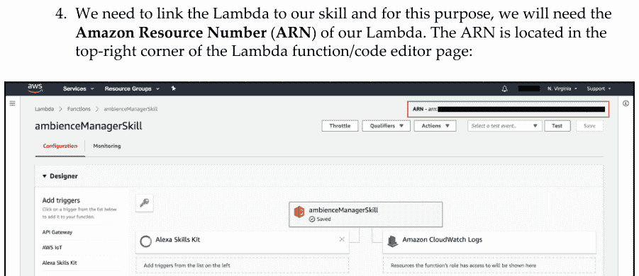

图 6.34：复制 ARN

复制 ARN。复制完成后，请切换到之前配置技能交互模型的浏览器标签页：

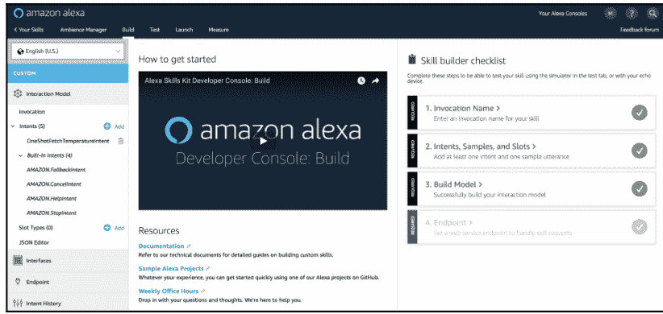

图 6.35：使用 ARN 更新端点 – 步骤 1

如上图所示，单击“技能构建器清单”下的“端点”按钮，这将导航到端点屏幕，如下面的屏幕截图所示：

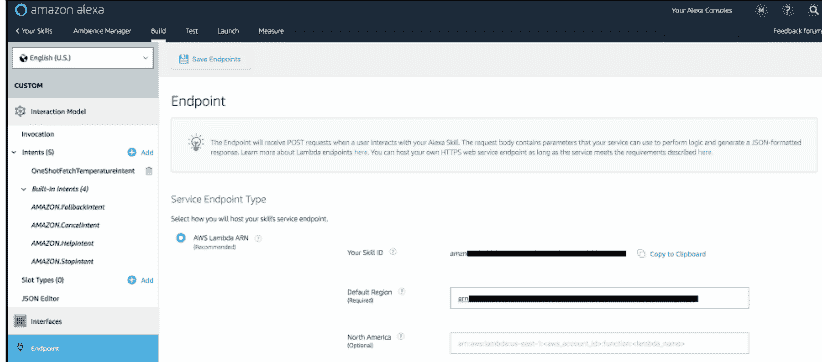

图 6.36：使用 ARN 更新端点 – 步骤 2

选择 **AWS Lambda ARN**，在 **默认区域** 选项下，添加我们从上一屏幕复制的 ARN，然后点击屏幕左上角的 **保存端点** 按钮。

点击 **保存端点** 按钮后，请再次点击 **构建** 标签页以返回到仪表板。

- 5. 在仪表板上，**技能构建器清单** 中的所有项目现在都应显示为绿色，如下面的屏幕截图所示：

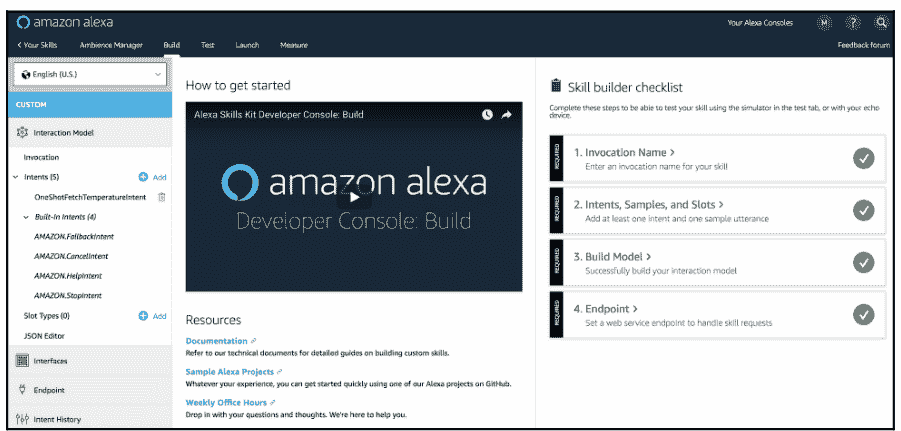

这表示我们的技能现在已准备好进行测试。请点击上方屏幕截图中显示的 **测试** 标签页。

## 测试与调试技能

**测试** 标签页应会打开 Alexa 模拟器：

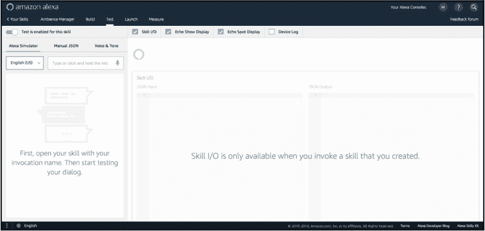

Alexa 模拟器大大减少了对实体 Amazon Echo 的需求，因为你只需使用模拟器就可以轻松测试 Ambience Manager 技能。

请在文本框中输入 `Alexa ask ambience manager to get temperature`，如下面的屏幕截图所示，然后按 *Enter* 键：

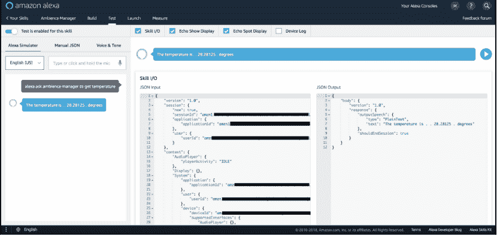

Alexa 应该会用正确的响应“The temperature is...”进行回复，如果你的电脑音量已打开，你甚至可以听到 Alexa 说出该响应。

我们的技能现在已测试完毕，可以随意把玩了。你可以在信息框中提到的链接处找到本章 Lambda 的代码。

请在此处找到 Lambda 的代码：https://github.com/madhurbhargava/AlexaSkillsProjects/blob/master/Chapter_6_Smart_Home_Index.js.

但是，如果发生错误，技能的行为不符合我们的预期，该怎么办？

对于 Alexa 技能而言，一个有效的调试工具是 Amazon CloudWatch。CloudWatch 可以显示启动技能时发生的完整日志详细信息，以及它如何处理各种意图。如果你的 Lambda 代码中包含日志语句（Log Statements），你还可以在 CloudWatch 中通过这些日志语句的输出来检查程序流程。

可以从 AWS 控制台访问 CloudWatch。

要访问 CloudWatch，可前往 https://console.aws.amazon.com.

要检查技能的执行状态，请在 AWS 控制台的 AWS 服务列表中选择 CloudWatch，如下面的屏幕截图所示：

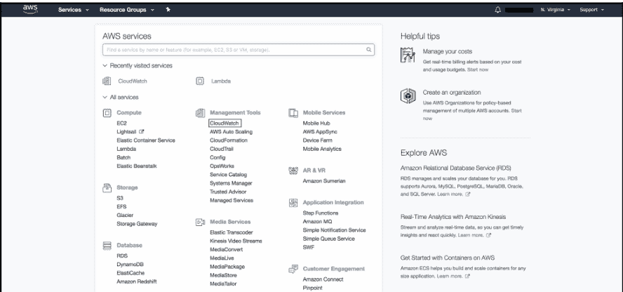

图 6.40：启动 CloudWatch

这应该会将你带到 CloudWatch 仪表板，如下面的屏幕截图所示，该仪表板除了日志之外还提供许多功能：

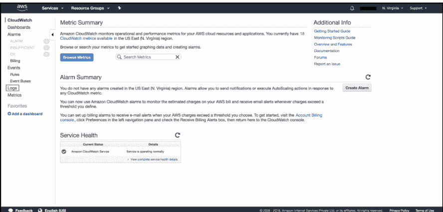

图 6.41：CloudWatch 仪表板

不过，我们感兴趣的是日志，因此请单击“日志”选项：

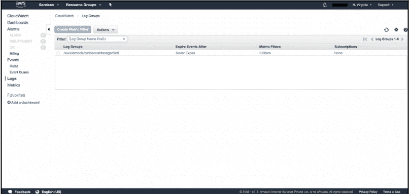

图 6.42：从 CloudWatch 仪表板启动日志

这里会显示你拥有的且有可用日志的技能列表。单击你选择的技能，会显示可用日志列表，并按时间顺序排序。你可以单击其中任意一个日志，查看详细的日志记录，其中包含你的技能已响应的完整事件列表：

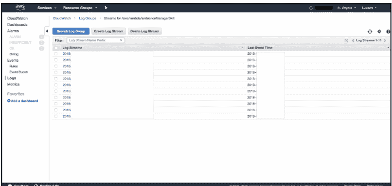

图 6.43：CloudWatch 中的日志列表

## 总结

我们希望你喜欢创建 Ambience Manager 技能的过程。这个技能包含许多并非 Alexa 专属的组成部分，例如 Firebase、环境传感器和移动应用。我们还介绍了 One-Shot 启动以及通过 CloudWatch 进行技能调试。

与之前的技能一样，Ambience Manager 技能仍有改进空间，例如处理湿度数据和引入额外的意图。

我们把改进留作练习，让用户可以进一步磨练技能。

我们也希望你现在对 Alexa 技能的知识更有信心，并且迫不及待地想看到你接下来会创建什么。

在最后一章中，我们将探索基于语音的助手的未来。
