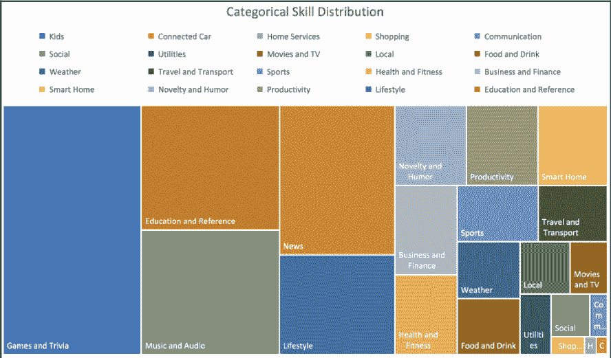
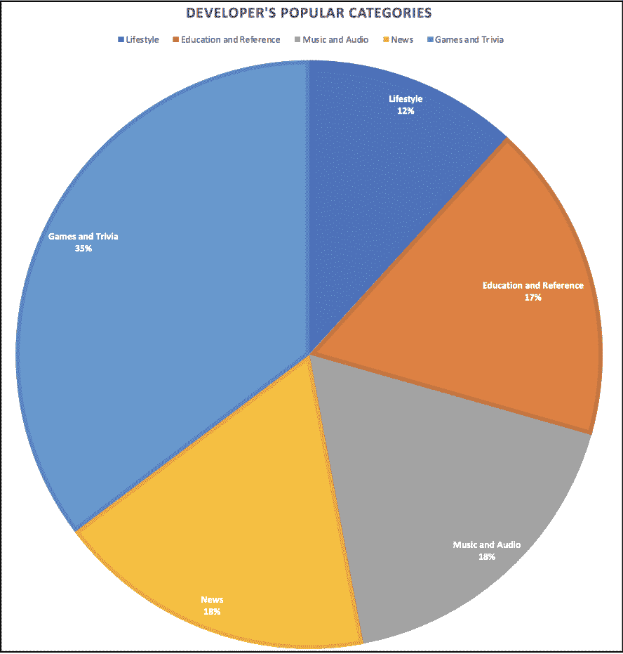
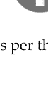
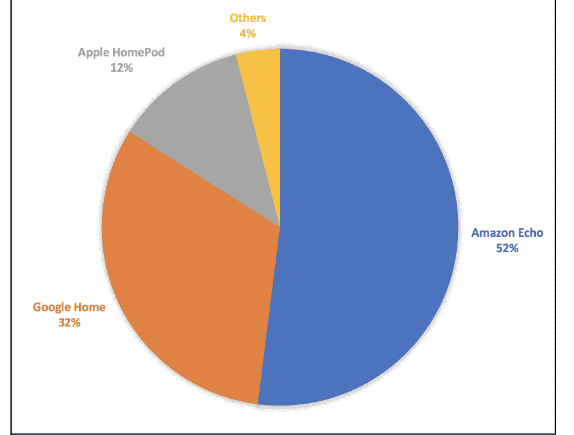
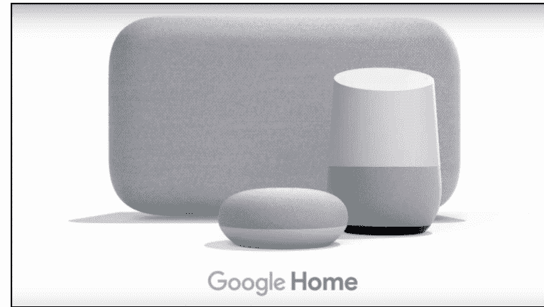
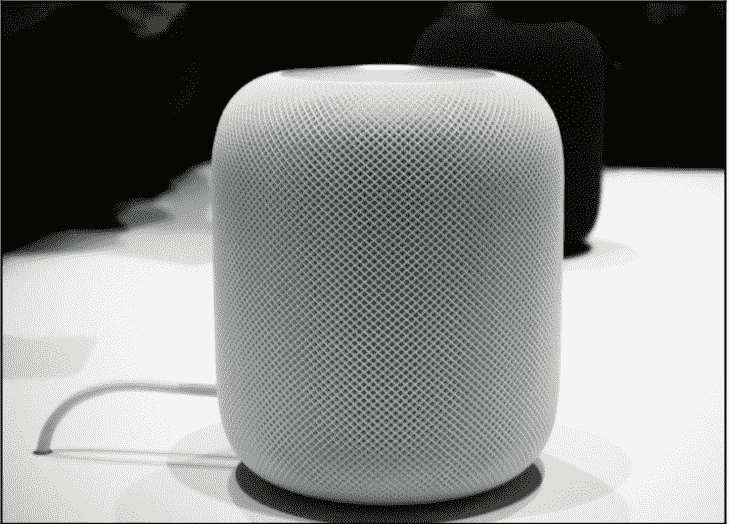
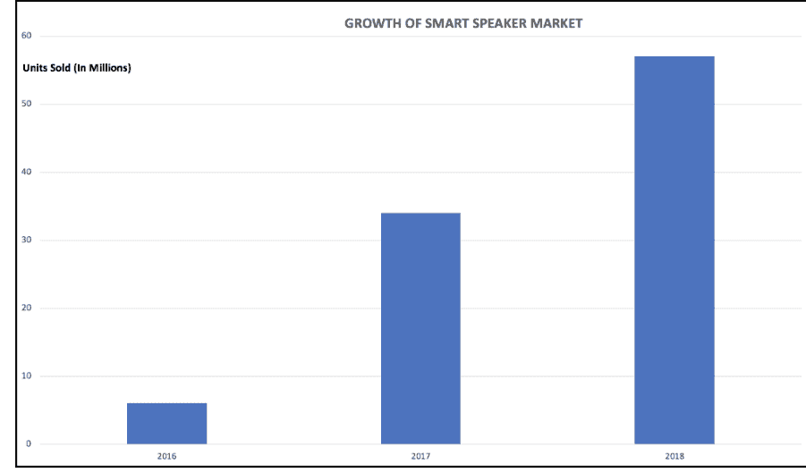

# 7. 基于语音的个人助手的未来

> “要么做，要么不做。没有尝试。”

> ——尤达大师

我们已经完成了六章，在这六章中，我们只专注于 Alexa。在本章，也是最后一章中，我们仍将关注 Alexa 及其一些最受欢迎的技能，但会与它的各种竞争对手进行比较。我们还将讨论包括 Alexa 在内的各种语音计算技术的未来。在本章中，我们将介绍以下主题：

- 流行的 Alexa 技能
- 比较各种基于语音的助手
- 基于语音的助手的未来

我们讨论这些主题是为了巩固目前所学到的信息，并集思广益，探讨语音计算的未来将会是什么样子。

### 流行的 Alexa 技能

在撰写本书时，美国市场上可用的 Alexa 技能总数已超过 30,000 个，而美国也是 Amazon Alexa 最大的市场，平均每天有 50 个新技能发布。每个技能都属于特定类别，Alexa 技能商店目前让开发者和用户可以从 23 个不同的大类中进行选择，如下面的屏幕截图所示：

图 7.1：Alexa 技能——类别分布

在撰写本书时（2018 年年中），开发者中最受欢迎的类别（拥有技能最多的类别）是：

- **游戏与问答：** 拥有超过 6,000 项技能
- **新闻：** 拥有超过 3,000 项技能
- **音乐与音频：** 拥有超过 3,000 项技能
- **教育与参考：** 拥有超过 3,000 项技能
- **生活方式：** 拥有超过 2,000 项技能

在前五名中，分布如下：

图 7.2：Alexa Skills – 最受欢迎的分类

令人惊讶的是，在撰写本文时，**Kids** 分类拥有最少的技能，这使得它成为开发者最不喜欢开发的分类，但好的一面是，它竞争最少，增长空间很大。

到目前为止，我们已经看到了 Alexa Skills Store 上的各个分类，并概述了所有可用分类中最受欢迎和最不受欢迎的分类。现在，深入研究这些分类，让我们找出其中的佼佼者，也就是在主要分类中下载/使用量最多的技能。

## Games and Trivia

**Games and Trivia** 分类下下载量最大的技能之一是 Would You Rather For Family，它拥有超过 3,000 条评分和用户评论。

要了解更多关于 Would You Rather For Family Alexa Skill 的信息，请访问 `https://www.amazon.com/Would-You-Rather-For-Family/dp/B06WGV16HR`。

它是热门游戏 Would You Rather 的语音计算版本，Alexa 会向玩家提出棘手/琐碎的问题，玩家会做出回复。为了保持游戏的趣味性，开发者会不断添加新问题。

该分类中的其他热门技能包括 Question of the Day、Jeopardy 和 Twenty Questions。我们建议你在 Alexa Skills Store 上查看它们。

## News

不出所料，一些顶级的新闻提供技能来自我们已经熟悉的频道和媒体机构：

- BBC
- CNN
- ESPN
- Fox News

一些频道甚至为其技能提供了不同的选项，具体取决于用户的需求。例如，CNN 开发并提供了两种不同的技能，一种用于提供快讯简报，另一种用于常规新闻。我们建议你在 Alexa Skills Store 上查看它们。

## Music and Audio

该分类下的顶级 *official* 技能是 **Ambient Sounds**，它为 Alexa 提供播放雨声、雷雨声和海洋声的能力，这可以帮助用户放松并睡得更好。然而，如果你有 Spotify 账户，Alexa 也可以链接到你的 Spotify 账户，并可作为出色的音乐播放器使用。

要了解更多关于 Spotify 和 Alexa 集成的信息，请导航至 https://www.spotify.com/us/amazonalexa/。

因此，Spotify with Alexa 是该分类的顶级竞争者之一。

## Education and Reference

该分类下下载量最大的技能之一是 Word of the Day，它拥有超过 900 条评分，并承诺每天教用户一个新词，以及如何在句子中使用它。

要了解更多关于 Word of the Day 技能的信息，请访问 https://www.amazon.com/Volley-Inc-Word-the-Day/dp/B06VTHH5MW/。

根据该技能的开发者说法，它每天都会更新新内容。

## Lifestyle

该分类下最受欢迎的技能是 **Meditation/Zen Sounds**，它为 Alexa 提供播放舒缓声音的能力，这可以帮助用户冥想。

该分类中的另一个热门技能是 **Fitbit**；使用此技能，用户可以通过 Alexa 跟踪通过 Fitbit 健身追踪器记录的详细信息和健身目标。

我们已经看到了 Alexa Skills Store 提供的五大分类下的最佳技能。现在，有一个问题问你：你是否注意到顶级畅销技能之间有任何共同特征？在继续阅读答案之前，花几分钟时间思考一下。

好吧，我们希望你现在已经思考过这个问题。答案如下：这些分类中的所有顶级技能都有一个共同特征——**dynamism**。这意味着它们会非常频繁地更新新功能，有些甚至每天更新。无论是 **Games/Trivia** 技能还是教育技能，只要是顶级位置，就会始终领先于用户，不断为他们提供新的发现内容，从而让用户对该 Skill 产生粘性，并不断回来发现更多内容。内容动态性是你的技能成为其分类领导者的关键。

我们已经查看了各个分类和 Alexa Skills；现在让我们继续分析和比较各种基于语音的个人助理。

## Comparing Various Voice-Based Assistants

虽然我们在 *Chapter 1, What is Alexa?* 中已经在一定程度上讨论并比较了各种基于语音的助理，但在本节中，我们将把讨论范围限制在托管这些助理的语音启用扬声器上。

截至 2018 年，语音启用扬声器市场只有少数几家主要参与者（来源：voicebot.ai），即 Amazon，持有 52% 的最大份额，其次是 Google Home，占 32%，Apple 的 HomePod 占 12%，其余市场由多家其他参与者瓜分，如下图所示的饼图中所示：

图 7.4：Alexa Skills – 智能扬声器市场分布

在本节中，我们将介绍三家主要参与者；Amazon Echo、Google Home 和 Apple HomePod。

### Amazon Echo

Echo 系列智能扬声器由 Amazon 于 2014 年 11 月推出，在语音计算市场拥有先发优势，这使其获得了 70% 的完整市场份额。但这并不是它唯一的优势；Amazon 提供了最广泛的语音启用扬声器系列，每个都有其独特的用途，其中一些如下所述：

- **Echo Dot**：最小且最实惠。
- **Echo**：中端产品，音质略优于 Echo Dot。
- **Echo Plus**：比 Echo 更大，音质最佳。内置 Zigbee 中枢，可实现更好的智能家居集成。
- **Echo Spot**：带屏幕的圆形 Echo。
- **Echo Show**：带更大屏幕的 Echo，非常适合视频聊天。

广泛的产品线确保了每种需求和口味都有对应的产品。此外，最便宜的 Echo 产品约为 50 美元，这使其成为三大品牌中最具性价比的选择之一。

基于屏幕的 Echo 已经为智能扬声器增加了视频播放功能，这是一个很大的补充。其他两大主要参与者（Google 和 Apple）都没有这样一种设备，它结合了智能扬声器和视频播放功能。

此外，Amazon 已经为 Echo 产品创建了一个基于技能的生态系统，这使得 Echo 能够与各种第三方服务（如 Uber 和 Domino's）无缝集成。

### Google Home

Google Home 于 2016 年底推出，直接与 Amazon Echo 竞争，Google Assistant 是 Alexa 的对应产品。Google Home 设备与 Echo 系列相比范围稍窄：

- **Google Home Mini**：最小、最实惠，价格与 Echo Dot 相似。
- **Google Home**：原版 Google 旗舰智能扬声器。音质优于 Google Home Mini。
- **Google Home Max**：最大、音质最佳、价格最贵的三个产品之一。

所有三款均由 Google Assistant 提供支持，因此 Home Mini、Home 和 Home Max 之间的差异点主要在于外形、语音质量和价格：

图 7.5：Google Home、Mini 和 Max（来源：speakerfanatic.com）

与 Amazon Echo 相比，由于 Google 的专长是网络搜索，Google Home 在对话性和处理基于网络的查询方面稍好一些。然而，Amazon Echo 很快试图缩小这一差距，通过支持比 Google Home 更多的智能家居品牌，这归因于 Amazon 作为市场先行者，已经将其基于 Skill 的生态系统扩展以吸引更多第三方开发者。然而，我们相当确信 Google Home 很快会赶上，或至少提供一些强有力的竞争。

### Apple HomePod

HomePod 由 Apple 于 2017 年底推出并于 2018 年初发布，是对 Amazon Echo 和 Google Home 的反击：

它是一款苹果出品的智能音箱，Siri 对应着 Google Assistant 和 Alexa。它的售价为 349 美元（撰写本文时），在价格上仅次于 Google Home Max（售价 399 美元）。

HomePod 的设计使其具备 360 度音效，清晰度和音质都非常出色。然而，它与苹果的生态系统紧密耦合。例如，Amazon Echo 和 Google Home 可以轻松集成第三方服务（如 Spotify），而这在 Apple HomePod 上则有点困难。

我们希望你现在已经清楚了解每个智能音箱能提供什么，以及它们之间如何比较。有了这些信息，我们将进入最后一节，讨论智能音箱的未来。

## 语音助手的未来

在 2016 年智能音箱市场起步阶段，智能音箱总销量不到 1000 万台。然而，到 2017 年下半年初，仅 Amazon Echo 就已售出超过 2000 万台设备（来源：voicebot.ai），并且预计（来源：voicebot.ai）在 2018 年将售出超过 5600 万台智能音箱设备：

图 7.7：智能音箱市场的增长

## 总结

至此，我们到了本章的结尾，也到了本书的结尾。

我们希望你真的享受了我们共度的时光，并且现在对自己作为 Alexa 技能绝地武士的能力有了坚实的信心。

此外，我们希望你对 Alexa 技能商店中有哪些类别和技能、为什么有些技能比其他技能更出色，以及设计下一个技能时可以关注哪些小众类别有了清晰的想法。

掌握了所有这些信息后，我们迫不及待想看到你发布下一个技能。如果你做出了酷炫的东西，给我们留言吧。

## 你可能还喜欢的其他书籍

如果你喜欢这本书，你可能也会对 Packt 的以下其他书籍感兴趣：

## 《动手实践聊天机器人与对话式 UI 开发》

Srini Janarthanam

ISBN: 978-1-78829-466-9

-   设计用户与聊天机器人之间的对话流程
-   创建任务模型聊天机器人，用于实现订餐等任务
-   获取聊天机器人生态中的新工具包和服务
-   集成第三方信息 API，构建有趣的聊天机器人
-   了解如何在消息平台上部署聊天机器人
-   使用 MS Bot Framework 构建聊天机器人
-   了解如何使用聊天机器人在 Twitter 上发布推文、监听推文并回复
-   在 Google Assistant 和 Amazon Alexa 上发布聊天机器人

## 发表评论——让其他读者知道你的想法

请在你购买本书的网站上留下评论，与其他人分享你对本书的看法。如果你从 Amazon 购买，请在本书的 Amazon 页面上给我们留下诚实的评论。这一点至关重要，因为其他潜在读者可以看到并利用你公正的意见做出购买决定，我们也能了解客户对我们产品的看法，我们的作者也能看到你对他们与 Packt 合作创作的这本书的反馈。这只需要你几分钟的时间，但对其他潜在客户、我们的作者和 Packt 来说都很有价值。谢谢！
