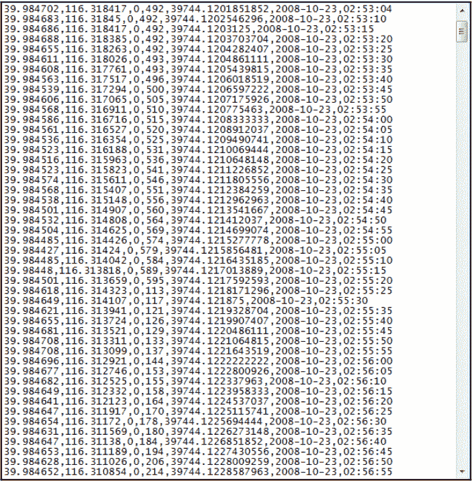
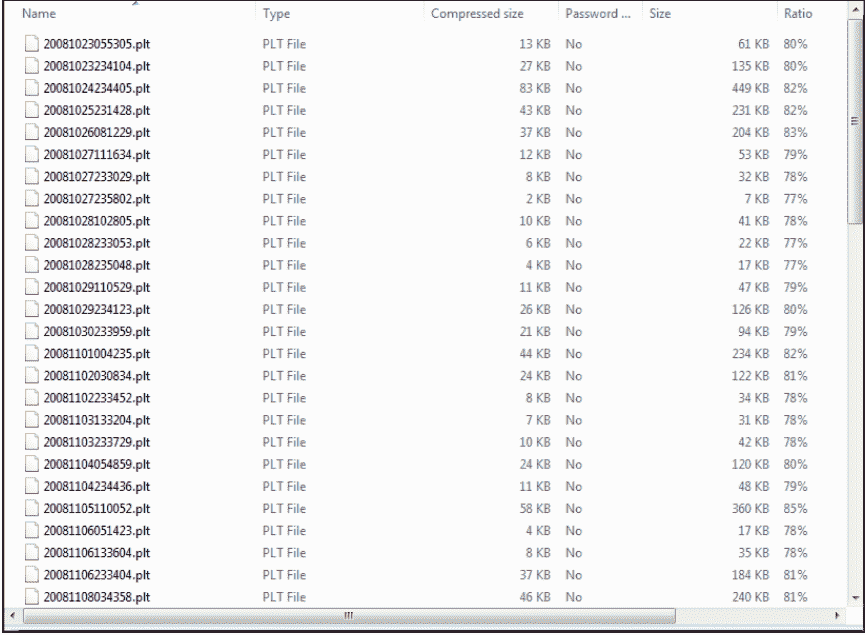
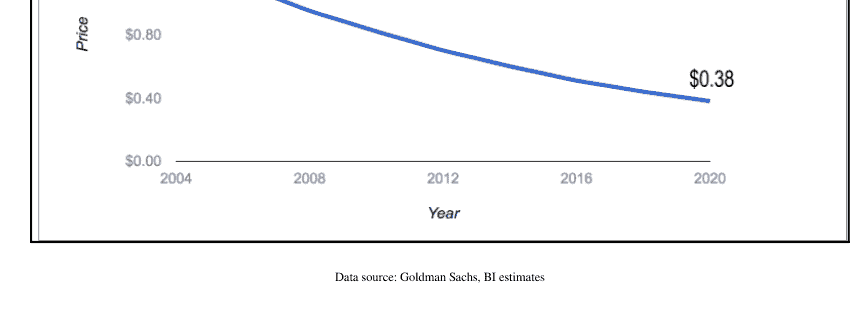
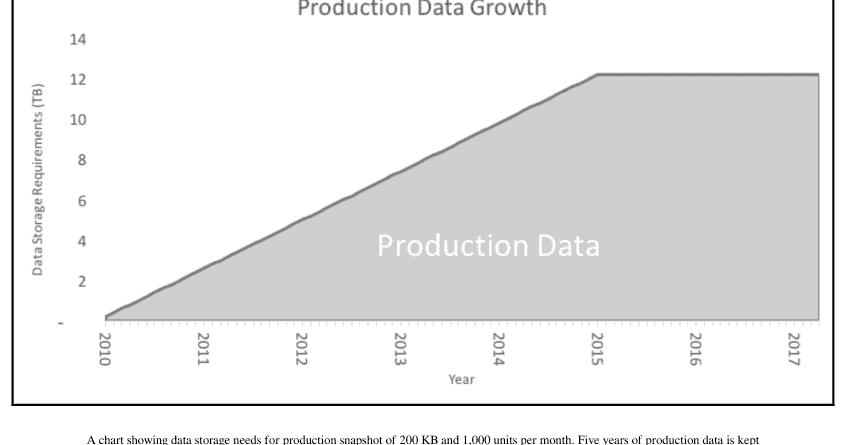
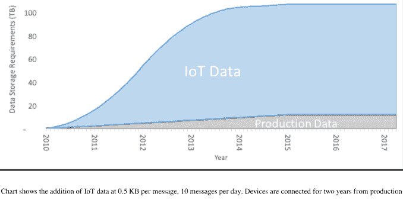
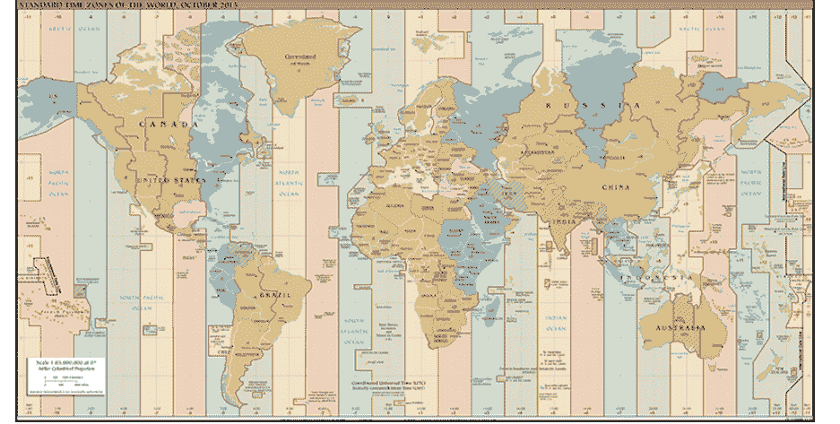
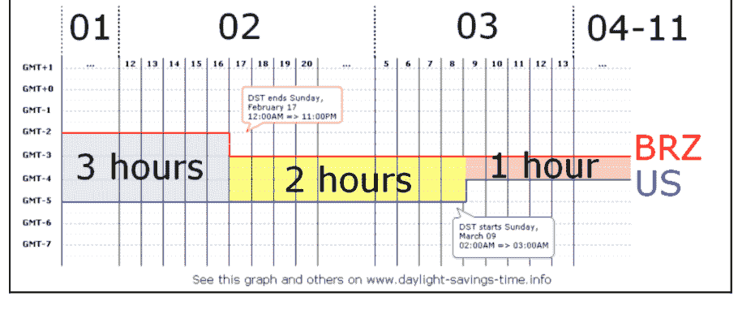
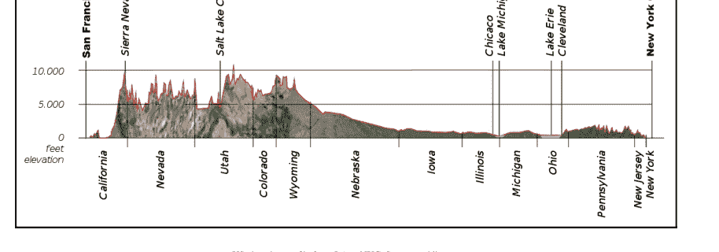

# 1

## Defining IoT Analytics and Challenges

在本章中，我们将讨论与物联网 IoT 数据分析相关的一些概念和挑战。我们将涵盖以下主题：

- The analytics maturity model
- Defining the IoT
- What is different about IoT data?
  - Data volume
  - Problems with time
  - Problems with space
  - Data quality
  - Analytics challenges
- Concerns with finding business value

### The situation

荧光顶灯的紧张白黄色光压在你身上，你坐在隔间里盯着桌上的显示器。你感觉外面已经是夜晚，但看不到布墙外面的情况。你盯着一个屏幕上的长文件名列表，另一个屏幕上则是晦涩的传感器数据纯文本行。

你的老板刚刚愤怒地去办公室某个地方生闷气，你不确定他在哪里。他一直在你身后怒视着。

“我们去年光是电信和咨询费用就花了 2000 万美元才拿到这些数据！硬件每个单元成本 20 美元。我们一直在获取数据，数据堆积起来每月花费我们 1 万美元。有 20 TB 的文件——这算是大数据，不是吗？而我们似乎什么也做不了？”他说。

“这太荒谬了！”他继续说，“本应产生 1 亿美元的新收入。我们的第一美元在哪里？为什么你什么也做不了？我每周有五位顾问打电话给我说他们能处理——甚至能自动化。也许我们应该随便挑一个，希望他们不是在卖蛇油。”

你知道他其实并不真正怪你。你是 Excel 的高手，懂得查询数据库。很多分析请求都找你。当 CEO 决定公司需要一个大数据专家时，他们从硅谷聘请了一位 VP。但这位新 VP 在本该入职的前一天就去了另一家硅谷公司。

你被匆忙调入新的分析团队。人数为一——就是你。这本应是临时调动，直到找到另一位 VP。那是六个月前的事了。公司正在冻结外部培训资金，收入也看起来紧张。所以，你没有培训。

虽然很多人都知道这些术语，但公司里没有人真正了解 Hadoop 是什么，或如何开始使用这种叫做机器学习的东西。但越来越多的人似乎期望你不仅要懂它，而且已经在做了。

高管们一直在阅读 HBR 和 Forbes 关于物联网结合人工智能或 AI 的巨大潜力的文章。他们觉得如果公司没有自己的融合 AI 的物联网大数据解决方案，很快就会被落下。你的老板感受到了压力。高管们给他提出了几个可以应用 AI 的想法。他们似乎认为想出想法是困难的部分，实现应该很容易。你的老板担心自己的工作，而压力层层传导到你身上。

你左边的屏幕看起来像这样：

列表一页又一页地继续下去。你已经能够合并多个文件，并在 Excel 中做一些数据透视表和图表。但这占用了你大量时间，你最多只能实际处理一两个月的数据。问题来的速度比你回答的速度快。你和你的老板一直在讨论请临时工来做这项工作——他们不需要真正理解它，只要按照你为他们概述的步骤执行即可。

你右边的屏幕看起来像这样：

你的 IT 部门一直在把许多小文件合并成几个非常大的文件。文件系统因文件数量过多而超载，所以解决方案是合并。遗憾的是，对你来说，许多文件现在太大而无法在 Excel 中打开，这限制了你能做的事情。你最终更多地对近期数据进行分析，仅仅因为它更容易（文件仍然很小）。

查看数据行，很明显你能做的似乎仅限于求和和平均值。文件太大，无法在 Excel 中对生产记录等内容执行 VLOOKUP——而生产记录通常存储在文件太大而无法在 Excel 中打开的文件中。

在这一点上，你甚至无法开始思考如何将机器学习应用于这些数据。你不太确定它到底意味着什么。你知道数据难以操纵，超出近期数据集之外几乎无法使用。显然，需要很长的时间才能从中提取价值。

你听到身后传来一声咳嗽。你的老板回来了。

他冷冷而僵硬地说：“对不起。我们不得不聘请顾问来接手这项工作。我知道你工作有多努力。考虑到限制，你做了一些惊人的事情，而没有人足够欣赏这一点。但我必须展示成果。完全让某人上手可能需要一两个月。在此期间，继续努力——也许我们可以在那之前取得突破。”

你的心沉了下去。你确信连接设备数据中蕴含着巨大的价值。你觉得如果你能弄清楚如何实现，就能以物联网分析为职业。但你不是一个轻易放弃的人。

你决定不会不战而败，你会找到办法。

## Defining IoT analytics

为了理解物联网分析，有助于将其拆分并分别定义分析和物联网。这将为本书其余部分的讨论奠定框架。

### Defining analytics

如果你问一百个人来定义分析，你很可能会得到一百种不同的答案。每个人倾向于心中有自己的定义，其范围从静态报告到高级深度学习专家系统。所有人都倾向于在广泛的领域中称之为分析，而没有进一步解释。

在本书中，我们将采用一个相当宽泛的定义，因为我们涵盖了相当多的领域。在畅销书 *Competing on Analytics* 中，Tom Davenport 和 Jeanne Harris 创建了一个量表，他们称之为 **Analytics Maturity**。公司随着分析使用的成熟而在该量表中逐步提升更高水平，并开始通过利用分析与其他公司竞争。

我们还将认为，分析成熟度关乎具备能力并知道如何实现全规模的启用。它并不是关于你在做什么。而是关于你能够做什么，以在全规模范围内最大化你的总投资回报率。每个层级都可以在发现机会时被利用。而我们希望在全规模范围内都有肥沃的机会土壤。关于这一点，整本书中都会进一步介绍。

## 定义物联网

传感器几十年来一直在制造工厂、零售商店和远程石油天然气设备上追踪数据。为什么突然媒体上到处都是 IoT 的炒作？

传感器成本、带宽成本的急剧下降、蜂窝覆盖的普及以及云计算的兴起共同创造了轻松通过互联网连接设备的肥沃条件。例如，如下图所示，高盛预测 2020 年的平均传感器成本将低于 0.40 美元，仅为 2004 年的 30%。这些设备是否都应该被连接还是一个激烈争论的话题：

数据来源：高盛，BI 估计

物联网的定义似乎差异很大；有些仅包括机器传感器，其他则包括 RFID 标签和智能手机。

我们将使用 Webopedia 上 Forrest Stroud 的这个定义：

> > 物联网指的是日益增长的物理对象网络，这些对象具有用于互联网连接的 IP 地址，以及这些对象与其他互联网启用设备和系统之间发生的通信。

或者更基础地说：通过互联网与其他事物对话而无需你做任何事情的东西。这就说清楚了，对吧？

即使到 2020 年预计连接的物数量也差异很大。一些来源预测 208 亿台设备，其他预测高达 500 亿——是两倍多。

就我们的目的而言，我们更关心如何分析生成的数据，而不是应该被视为物联网一部分的设备范围。如果某物通过互联网远程发送数据，对我们来说就是公平的游戏，尤其是当它在一端由机器生成、在另一端由机器消费时。

我们更关心如何从数据中提取价值并适应其固有的情况。物联网并不是真正的新事物，因为其元素已发展了数十年。20 世纪 70 年代就已经在进行石油井泄漏的远程检测。基于 GPS 的车辆远程信息处理已有 20 年历史。物联网也不是一个独立的市场；它融入了当前产品和流程。虽然媒体的许多报道都将其描述为不同的动物（也许甚至是本书的作者——罪名成立？），你不应该这样想。

## 受限的概念

术语 **受限** 是理解物联网设备、数据和分析影响的重要概念。它指的是在物联网设备设计中必须考虑的有限电池电量、带宽和硬件能力。对于许多物联网用例，其中一个或多个必须与记录有用数据的需求相平衡。

## 物联网分析挑战

物联网数据带来了一些特殊挑战。数据是由远程运行的设备创建的，有时在可能从一天到另一天变化的截然不同的环境条件下。设备通常在地理上广泛分布。

数据通过长距离通信，通常跨越不同的网络技术。数据首先通过无线网络传输，然后通过某种网关设备发送到公共互联网是很常见的——而公共互联网本身就包括多种不同类型的网络技术协同工作。

## 数据量

一家公司很容易拥有数千到数百万台物联网设备，每个单元上有多个传感器，每个传感器定期报告值。数据流入量可以非常迅速地变得相当大。由于物联网设备持续发送数据，总数据量可能比许多公司习惯的增长得更快。

为了演示这种情况如何发生，想象一家制造小型监控设备的公司。它每年生产 12,000 台设备，从 2010 年产品推出时开始。每一台在组装结束时都会进行测试，并且设备上传感器报告的值会被保留用于分析五年。数据增长看起来像以下图像：

显示生产快照 200 KB 和每月 1,000 台单位的数据存储需求的图表。保留五年的生产数据

现在，想象该设备还具有互联网连接以跟踪传感器值，并且每台设备保持连接两年。由于数据流入在设备制造后仍在继续，数据增长呈指数级增长，直到较旧设备停止报告值时才稳定下来。这更像是以下图表中的蓝色区域：

图表显示 IoT 数据增加，每条消息 0.5 KB，每天 10 条消息。设备从生产之日起连接两年

为了说明这可能有多大，请考虑以下示例。如果每天捕获 10 条消息且消息大小为完整生产快照的一半，到 2017 年，数据存储需求将比仅生产数据高出 1,500 多倍。

对于许多公司来说，这会带来一些问题。数据库软件、存储基础设施和可用的计算能力通常并不打算处理这种增长。软件供应商的许可协议往往与服务器数量和 CPU 内核数挂钩。存储由标准备份计划和保留策略处理。

数据量迅速导致计算和存储需求远超单台服务器所能容纳的范围。在传统架构下，将其分布到数百或数千台服务器上很快就会变得成本高昂。为了进行最佳分析，你需要大量历史数据，并且由于你不太可能提前知道哪些数据最具预测性，所以你必须尽可能多地保留在手边。

对于大规模数据，分析所需的计算能力需求并不十分可预测，并且会根据所问问题的不同而剧烈变化。分析需求非常弹性。传统的服务器规划会根据提前确定的满足峰值需求所需的预期服务器数量来提高本地资源。如果甚至可能的话，在短时间内将计算能力翻倍是非常昂贵的。

物联网数据量和计算资源需求可能迅速超过公司所有其他数据需求的总和。

## 时间问题

> 时间唯一的理由就是让一切不同时发生。
> 
> —— 阿尔伯特·爱因斯坦

时间与地理位置和日历日期紧密相连。跟踪通用时间的国际标准方法是使用协调世界时（UTC）。UTC 在地理上与 0° 经线相连，该经线穿过英国的格林威治。虽然它与位置相关，但它实际上与格林尼治标准时间（GMT）不同。GMT 是一个时区，而 UTC 是一个时间标准。UTC 不实行夏令时（DST）：

世界标准时区。来源：CIA 世界概况手册

在 2008 年初，巴西中部比美国东部快一小时、两小时或三小时，取决于日期

来源：维基共享资源

当为事件记录时间时，例如停车位被腾空，对于分析来说，时间越接近实际发生越重要。实际上，用于分析的时间可能是事件发生的时间、物联网设备发送数据的时间、数据接收的时间，或数据添加到你的数据仓库的时间。

## 空间问题

物联网设备位于多个地理位置。世界不同地区有不同的环境条件。温度变化会影响传感器精度。如果你设备受寒冷影响，那么在加拿大卡尔加里可能比在墨西哥坎昆的读数不那么准确。

海拔会影响柴油发动机等设备。如果未将地点和海拔考虑在内，你可能会根据物联网传感器读数错误地得出结论，认为丹佛的配送卡车车队相比印第安纳州的车队在燃油经济性方面管理不善。山路众多确实会消耗大量燃油！

偏远地区的网络接入可能较弱。更高的数据丢失率可能导致这些地点的数据值在最终分析中代表性不足。

许多物联网设备采用太阳能供电。可用的电池电量会影响数据上报的频率。位于俄勒冈州波特兰（经常多云多雨）的设备，相比位于亚利桑那州凤凰城（大多晴朗）的同类设备，受到的影响更大。

物联网设备的地点还涉及政治层面的考量。欧洲的隐私法律影响设备数据的存储方式以及可接受的分析类型。你可能需要对某些国家的数据进行匿名化处理，这会影响你能用分析做什么。

## 数据质量

受限设备意味着有损网络。对于分析而言，这通常会导致数据缺失或不一致。缺失数据通常不是随机的。如前所述，它可能受到地点的影响。设备运行一种名为固件的软件，不同地点的固件可能不一致。这可能意味着上报频率或值格式的差异，并可能导致数据丢失或损坏。

## 业务价值考量

许多公司都在努力从物联网数据中寻找价值。存储、处理和分析物联网数据的成本会迅速增长。由于未来财务回报不确定，一些公司开始质疑这项投资是否值得。

据咨询机构麦肯锡公司称，大多数物联网数据并未被使用。他们的研究显示，石油平台生成的数据中，只有不到1%被用于决策目的。

通过物联网分析寻找价值，往往就像在废墟堆里找钻石。我们可以接受1%的数据有价值，但究竟是哪1%呢？这取决于具体问题。一个人的无用花岗岩，可能是另一个人的无价钻石。

业务价值的挑战在于，如何在降低成本的同时，提升创造卓越财务回报的能力。分析是实现这一目标的好方法。

## 小结

在本章中，我们为本书定义了物联网的构成，也定义了在此使用的“分析”一词的含义。我们讨论了物联网数据带来的特殊挑战，从数据量到通常内部公司数据集不会关注的时间和空间问题。你应该对本书的范围以及后续章节中将要学习克服的挑战有了清晰的认识。
