# 2 物联网设备与网络协议

你开始了分析，发现你的物联网数据并不总是完整的。你还怀疑它并不总是准确的。但你不知道为什么会这样。每台设备平均每天你会收到几百条记录。

你公司制造的物联网设备附着在货运拖车上，跟踪位置，有时甚至跟踪温度。当拖车是冷藏单元时，温度会被监控，行业术语称为*冷藏集装箱*。冷藏集装箱的内部温度必须根据运输物品的不同保持在特定范围内。

你的设备位于拖车外部，通过一根引线进入拖车，如果启用该选项，可读取温度。拖车由大型卡车牵引，在全国各地的道路上行驶。

你一直专注于在数据中寻找价值，从未想过数据是如何被采集并传送到公司服务器的。现在你开始思考这个问题，对数据中看到的问题感到疑惑。你曾假设这些问题是随机发生的，但如果并非如此，一丝恐惧感会顺着脊背袭来。这会影响你已经完成的大量分析，而公司正利用这些分析来做出业务决策。

本章将概述各种物联网设备和网络协议，还将介绍它们试图解决的业务需求。到本章结束时，你将理解主要设备类别和网络协议策略的“是什么”和“为什么”。

本章涵盖以下主题：

- 物联网设备的范围及一些示例用例
- 常见的物联网网络协议
- 常见的物联网数据消息协议
- 不同设备和网络协议策略的优缺点
- 如何分析数据以推断协议和设备特征

### 物联网设备

当今使用的物联网设备种类繁多。设计范围和功能巧思正在以惊人的速度扩展。被测量、监控和跟踪的对象范围本身就足以写成一本书。事实上确实如此，你可以通过本书的出版商找到好几本。

### 物联网设备的广阔世界

出于分析目的，了解设备的多样性及其使用方式很有帮助。一个行业的想法可以跨界传播到另一个行业，创造意想不到的价值。设备与用例的组合也会带来截然不同的分析机会和挑战。

**医疗保健**

重症监护患者的生命体征正通过低功耗无线传感器进行监测，数据可以远程分析。有几家初创公司，如 Proteus Digital Health，正在开发药丸大小的可吞咽传感器。Proteus 制造了一种可消化的传感器药丸，与贴在皮肤上的传感器贴片配合使用，可以监测患者何时服药以及服药频率。

**制造业**

在制造工厂中跟踪和分析监测传感器的数据有着悠久的历史。有大量媒体专门关注这一领域，通常被称为工业物联网（IIoT）或工业4.0。各种制造行业都在部署物联网设备和传感器。

Ergon Refining 在密西西比州有一家工厂，将振动、声学、位置等多种传感器单元连接到监控和分析数据的中央系统。

Emerson Process Management 制造了可无线监控的 Enardo 2000 紧急泄压阀（EPRV）。许多工艺工厂中有数百个疏水阀监控和泄压阀。使用廉价的传感能力对其进行监控，可以通过避免因设备故障导致的意外停机来创造价值。

**运输与物流**

Geotab 制造 GPS 追踪设备，物流供应商可将其安装在车辆上，以监控和分析路线、燃油经济性并检测事故。这些设备在行业中被称作**远程信息处理**设备。客户可以在地图上创建地理围栏，当车辆进入或离开该区域时接收通知。

设备可以监控驾驶员行为，并将超速或急刹车的报告发送到总部。它们还会读取车辆报告的故障代码，并立即将信息传输给车队经理，从而在重大故障发生前解决问题。下图显示了一个远程信息处理设备 GO7 的示例：

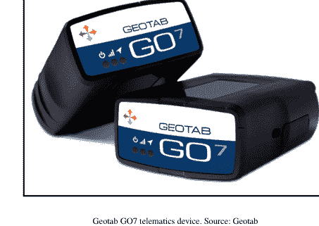

Geotab GO7 远程信息处理设备。来源：Geotab

**零售**

土耳其的 Turkcell 利用其蜂窝网络和特定商店中的信标，与合作伙伴一起，在忠诚度计划客户靠近某些零售商时，向他们提供店内促销。

许多零售连锁店使用射频识别（RFID）标签和传感器来优化库存并监控仓库内的移动。

Extreme Networks 正在与 New England Patriots 及其主场体育馆合作，监控访客流量模式。体育馆利用这些数据来了解客户聚集的位置，并根据物联网传感器数据生成的流量热力图，合理地为广告和产品放置定价。

**石油和天然气**

石油和天然气行业是如今所谓物联网最早期的先驱之一。随着物联网技术的进步，油井可以更轻松地连接分布于整个油井的传感器。数据读数也可以更频繁地采样，例如每30秒一次。

结合对传感器数据的边缘分析，公司可以执行诸如优化油井柱塞举升周期等操作。据 Intel 的一篇行业文章报道，这可以使产量提高多达 30%。边缘分析是指在设备本身或支持多单元集线器的附近设备上运行的应用分析。分析处理发生在网络边界（即边缘）的多个位置，而不是集中式位置。

公司还利用同样的信息来优化其资产组合管理。他们可以复用数据，按生产效率对油井进行排名。

**家庭自动化或监控**

Ecobee Smart Wi-Fi 恒温器可与放置在家中不同房间的电池供电无线传感器连接。它不仅跟踪供暖、通风和空调（HVAC）系统，还跟踪每个传感器报告的温度。它不仅能平衡各房间的温度，还能在炉子运行异常时通知你。

大多数这些问题都会被产品验证流程捕获并纠正。然而，了解产品在接近其工作范围边缘时是否存在任何限制或需要调整的情况是很重要的。

## 网络基础

以下是网络协议栈的过度简化视图。在本章中我们不会涵盖这里发生的大量内容，但为了帮助理解讨论，将其简化为一个简单的图表是有用的：

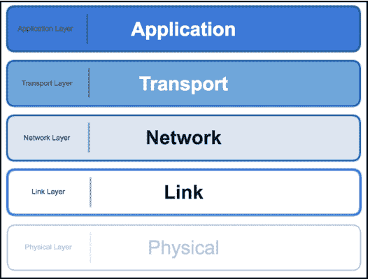

网络通信按层运行，底层不需要知道其上层的存在。谈论协议栈每一层可用的所有选项可能会让人感到困惑。该图表显示了我们对物联网分析关心的关键层，但请知晓故事远不止于此。

该图表基于简化的**OSI 模型**，它将通信划分为五个基本层。底部有一个物理层，与设备的电气工程关系更大。为了简化，我们将省略它，因为我们关注的是分析。

连接性将主要指协议栈链路层中的选项。数据通信或消息传递将主要指应用层。网络层通常是我们熟知且喜爱的互联网协议（IP）。它是一个很好的整合者，为互联网通信的网络栈提供了极大的灵活性。

传输通常是 TCP 或 UDP，用于在长距离传输数据的网络方案。TCP 具有更强的交付保证但开销更大；UDP 开销更小但对交付的保证较少。

用于从互联网到物联网设备连接以及设备生成的数据通信的网络协议种类繁多。它们解决了两个主要问题：

- **我如何建立通信，以便发送数据包？**
  - 让我们以蜗牛邮件为例作类比。如果你资金有限，你更喜欢发送简短的明信片，即使到达收件人需要更长时间。它成本更低，而且写起来也不费力。如果金钱不是问题，你会聘请专业作者并发送接近诗歌的散文。你会使用航空邮件以便快速到达。在这个类比中，电池电量就像金钱，CPU/内存就像写作精力。
- **数据包如何被交付以满足我的需求？**
  - 你和我是否同意互相获取地址并直接寄送信件？还是你总是把信交给隔壁隔间里的汤姆，由他发送给需要的人？你是否使用挂号信寄送，因为你必须确定它已被送达？还是你使用三等邮寄，因为它便宜得多，即使丢失也不是世界末日？

使用的网络协议取决于设备的类型以及其所在的環境。它也可能取决于数据用途的业务优先级。

例如，在飞行中监控飞机引擎的情况下，获取最新数据比获取所有数据更重要。你需要尽快识别问题，而不是需要完整的飞行数据记录，而飞行数据大多相同。因此，如果你必须在等待但获得全部数据与永不等待但偶尔丢失一些数据包之间做出选择，你会选择后者。

这与拥有传感器的物流提供商不同，该传感器检测拖挂式卡车进入和离开配送中心。在这种情况下，你希望拥有完整的交通记录，并且愿意等待一两分钟来获取它。

物联网中另一个需要理解的重要组件是网关。网关是连接使用不同协议的两个独立网络的网络节点。网关处理它们之间的转换。网关在许多受限设备的物联网网络中很常见。它将针对受限设备优化的协议转换为（通常）更广互联网使用的协议（IP）。

有多个标准分布在多个组织中，例如工业互联网联盟、IPSO 联盟和 IEEE P2413。随着许多公司和联盟沿着不同的连接协议结盟，它仍在不断演进。在选项凝聚成一小群一致使用的标准之前，可能还需要五到十年时间。

我们将回顾你最有可能遇到的顶级协议，并关注它们试图解决的问题。

## 物联网网络连接协议

连接性就是解决主要问题——建立通信方法。所采用的策略受网络设备约束的影响。可用电力通常是最重要的因素。

## 连接协议（可用电力受限时）

以下协议专门设计用于解决低功耗约束。它们通常与支持的物联网设备中较低的复杂度和比特传输速率相关联。

## Bluetooth Low Energy（也称为 Bluetooth Smart）

以十世纪统一了几个分裂部落的丹麦国王命名，蓝牙是大多数消费者熟悉的技术。该规范由一个名为**Bluetooth Special Interest Group (SIG)**的组织维护，该组织由 25,000 家公司组成。**Bluetooth Low Energy (BLE)**是较新的实现，与蓝牙经典（移动电话耳机之名）不直接兼容。它专为低功耗需求和较少频繁的数据交换速率而设计。以下图表表示 BLE 的网络协议栈：

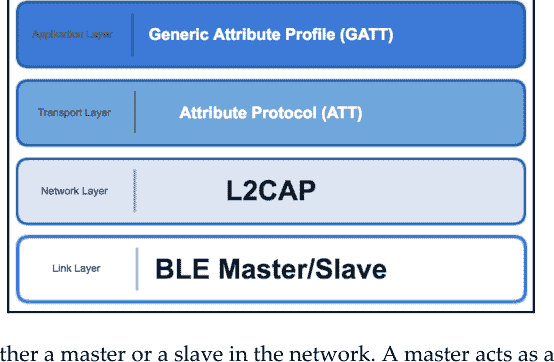

BLE 设备在网络中要么是主设备要么是从设备。主设备在连接中充当广告者，而从设备充当接收者。一个主设备可以连接多个从设备，而一个从设备只能链接到一个主设备。与连接到主设备的从设备组成的网络组称为微微网。

为了使数据可用于分析，主设备通过本章后面将讨论的数据消息协议将其传递到互联网。通常有一个网关设备同时是蓝牙网络的一部分并且也链接到互联网。它将从 BLE 节点报告的数据转换为通过互联网进行数据消息的适当格式。它通常是一个不受约束的设备，不必太担心电力问题。

2016 年中期发布的蓝牙 5.0 规范承诺将速度提高一倍、范围提高四倍，并将低功耗场景下数据广播能力提高八倍。

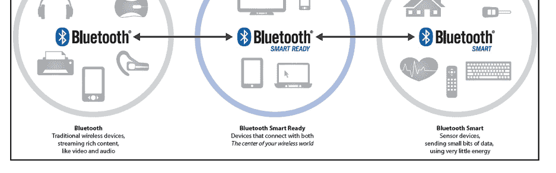

来源：Bluetooth SIG

## 6LoWPAN

IPv6 over Low-Power Wireless Personal Area Networks（6LoWPAN）作为协议栈数据链路部分中的适配层工作。它使无线标准 IEEE 802.15.4 设备能够使用 IPv6 进行通信。这使得通过互联网的通信变得容易得多，因为 IP 是通用语言。

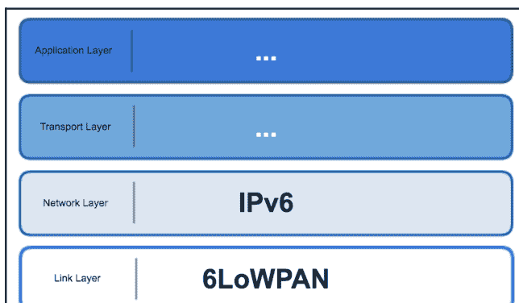

6LoWPAN 优化了 IPv6 数据报在低功耗和易受损网络上的传输。它实现此目的的一种方式是通过报头压缩。这将数据包中的寻址信息减少到几个字节。

安全性可以在链路层使用高级加密标准（AES）-128 加密实现。传输层安全性（TLS）加密也可以在传输层使用。

支持网状网络。网络内部的设备使用无状态自动配置，在其中生成自己的 IPv6 地址。

6LoWPAN 网状网络通过边缘路由器连接到 IPv6 互联网。边缘路由器有三项工作：

- 6LoWPAN 内设备之间的本地数据交换
- 互联网与 6LoWPAN 设备之间的数据交换
- 6LoWPAN 无线网络的创建和维护

6LoWPAN 网络通过常见的基于 IP 的路由器连接到其他网络。这种连接可以通过任何类型的链路实现，例如 Wi-Fi、以太网或蜂窝网络。这使得连接到更广的互联网比其他需要有状态网关设备才能与 IP 网络通信的连接选项更简单。有状态网关设备更复杂，因为它们需要记住每个物联网设备的通信状态和状态。

6LoWPAN 网络中有两类设备：**主机**和**路由器**。路由器可以将数据报转发给其他设备。主机只是端点，可以处于休眠状态，定期唤醒并与父设备（路由器）登记以获取新数据。

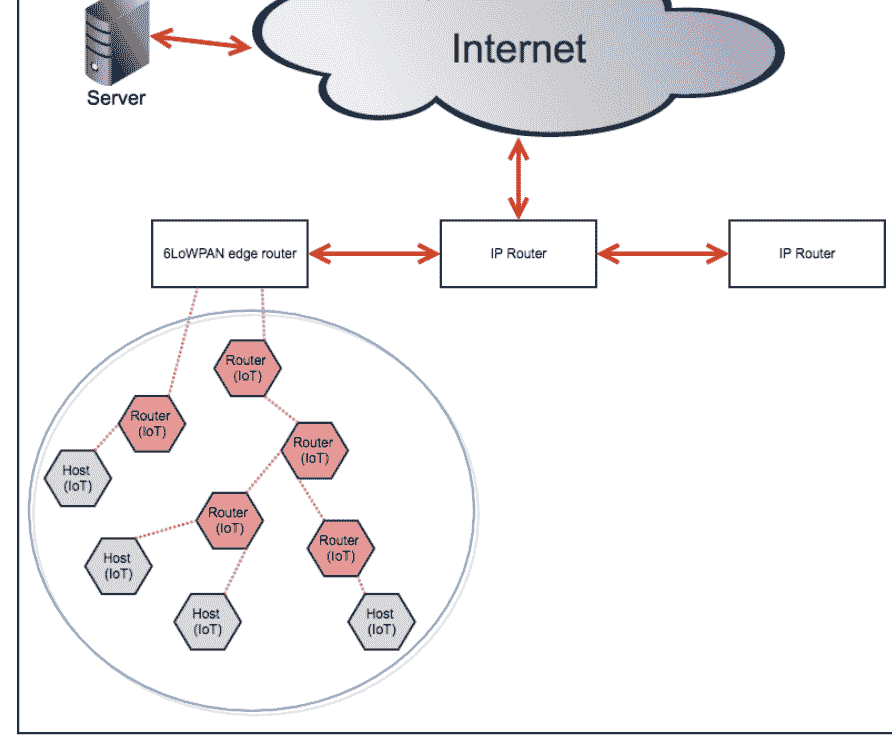

6LoWPAN 网络示例

## ZigBee

ZigBee 与我们目前讨论的有所不同。它覆盖协议栈的多个层，包括网络协议、传输层，以及作为客户开发应用层基础的应用框架。

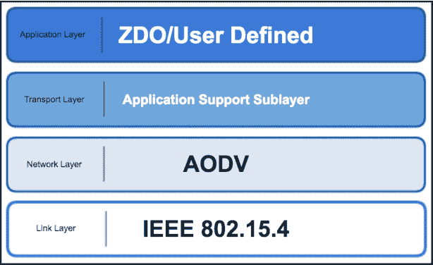

它内置安全要求，并使用小型、低功耗的数字无线电工作。它是一种自组织的无线网状网络。名称来源于蜜蜂回巢时常跳的摇摆舞。

传输距离较短，视线范围内可达 100 米，但可以通过其他 ZigBee 设备组成的网状网络传递数据，从而实现长距离传输。

ZigBee 联盟是维护和发布 ZigBee 标准的公司联合体。ZigBee 于 2003 年首次作为标准发布。它旨在比其他无线协议更简单、更便宜。开发代码可能仅为蓝牙等效代码的 2%。

数据速率较低，设备往往很简单。ZigBee 标准要求设备至少具备两年的电池寿命才能获得认证。数据传输是周期性和间歇性的。ZigBee 设备有不同的类别。全功能设备可以充当网络协调器，并支持星型和网状拓扑。精简功能设备只能与网络协调器通信，并工作在星型拓扑中。

这些设备形成一个**个人区域网（PAN）**。网络交互时间可以非常短。设备可在 30 ms 内加入网络，并在 15 ms 内从睡眠状态切换到活动状态。

网络中有三种 ZigBee 设备：

- **协调器设备**：负责发起网络形成。每个网络有且仅有一个协调器。网络形成后，它也可以充当路由器。它作为信任中心，并存储安全密钥。
- **路由器设备**：可选。它可以加入协调器或其他路由器设备，并作为消息路由中的多跳中继。
- **终端设备**：其功能仅足以与协调器通信。它是可选的，不能参与消息路由。

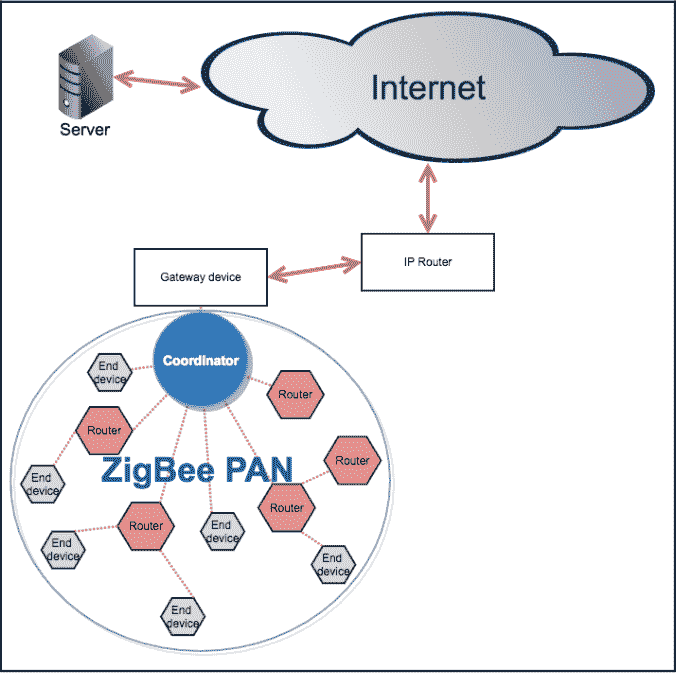

ZigBee 网络路由协议是反应式的。它按需建立路由路径，而不是像 IP 那样主动建立。所使用的网络协议是**自组网按需距离矢量路由协议（AODV）**，该协议通过向所有邻居广播来查找目的地，邻居再向其所有邻居发送请求，直到找到目的地。

网络在连接之间是静默的，并且具有自愈能力。ZigBee 网络通过 128 位 AES 加密进行保护。通常有一个网关设备既是 ZigBee 网络的一部分，又连接到互联网。它负责将数据转换为适合互联网消息传递的格式，也可以将 ZigBee 网络路由协议转换为 IP 路由协议。网关通常是资源不受限的设备，不需要过多担心功耗问题。

### ZigBee 的优势

ZigBee 网络有几个优点：

- **可靠且稳健**：网络自组织和自愈。
- **低功耗要求**：设备可运行数年而无需更换电池。太阳能供电可持续更长时间。
- **全球性**：其底层无线协议在全球范围内可用。
- **安全性**：加密是标准的一部分，而不是可选附加项。

### ZigBee 的劣势

也存在一些缺点：

- **非免费**：在撰写本文时，该标准的许可费为 3,500 美元。
- **低数据速率**：不适用于支持更高的数据速率。
- **星型网络受限**：协调器设备最多支持 65,000 台设备。

### 常见用例

ZigBee 常用于以下应用：

- 家庭自动化
- 公用事业监测与控制
- 智能照明
- 楼宇自动化
- 安全系统
- 医疗数据采集

## NFC

**近场通信（NFC）**允许两台设备在相距非常近（约 4 厘米）时进行通信。它是一组提供低速度和简单设置的通信协议。根据类型和用例的不同，有多种 NFC 协议栈。

NFC 标志

NFC 在设备交换信息时使用两个环形天线之间的电磁感应。数据速率约为 100-400 kbit/s。它工作在 13.56 MHz 射频段，该频段无需许可且全球可用。

通常有一个完整的 NFC 设备（如智能手机）和一个 NFC 标签（如芯片读取器）。所有完整的 NFC 设备都可以在三种模式下运行：

- **NFC 点对点**：设备随时交换信息。
- **NFC 卡模拟**：在此模式下，智能手机可以充当智能卡，实现移动支付或票务功能。
- **NFC 读写器**：完整的 NFC 设备可以读取存储在廉价 NFC 标签中的信息，例如海报或小册子上使用的类型。您可能在会议上用过此功能来扫描与会者胸牌。

NFC 标签通常是只读的，但也可能是可写的。NFC 通信中有发起设备和目标设备。发起设备产生一个射频场，可以为目标设备供电。这意味着在所谓的被动模式下，NFC 标签不需要电池。无源 NFC 标签设备非常便宜，只需几美分。

还有一种主动模式，每个设备通过交替生成自己的场来读取数据，然后关闭场以接收数据，从而相互通信。这种模式通常要求两个设备都有电源。

对于最终进入分析数据集的数据记录，完整的 NFC 设备将充当网关，转换消息，然后通过不同的网络协议栈进行通信。以智能手机为例，它会获取 NFC 标签数据，创建自己的数据消息，通过 4G/LTE 发送到互联网上的目的地。

### 常见用例

NFC 常用于以下应用：

- 智能手机支付：
  - Apple Pay
  - **主机卡模拟（HCE）** - 支持 Android
- 智能海报
- 识别卡
- 事件记录
- 触发可编程操作

## Sigfox

Sigfox 是一家总部位于法国的公司，开发了一种蜂窝式、超低功耗、远距离网络技术。它适用于不频繁发送的小型消息。数据速率非常低，仅为每秒 100 比特（bps）。所用信号可传输长达 25 英里，一个基站可处理多达一百万个节点。与蜂窝网络类似，它不适用于专用网络，因为使用它需要所在区域有网络覆盖。

Sigfox 设备由于低复杂性和低功耗要求，成本可能非常低。功耗要求可低至同等蜂窝通信的千分之一。它已被用于廉价但重要的产品中，例如烟雾探测器和狗用健身追踪项圈（认真的）。

目前的覆盖范围包括法国和西班牙全境、欧洲其他几个区域，以及北美的一些大都市地区。

## 连接协议（当功耗不是问题时）

这些协议更关注速度和高速率。功耗限制相对不那么重要。它们通常要求所支持的物联网设备具有更高的复杂度。

## Wi-Fi

Wi-Fi 是遵循 IEEE 802.11 规范的任何无线网络。它无处不在，全球通用。除非你过去十年一直躲在洞穴里，否则你对它非常熟悉。许多物联网设备使用它连接到互联网，因此有必要回顾一下它的工作原理。

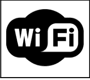

要连接到 **Wi-Fi 局域网（WLAN）**，设备需要网络接口控制器。这可以是单独的控制器卡，也可以简单地集成在设备内部的芯片组中。通信在预先确定的无线电通信频段上使用以太网风格的数据包。数据包投递不保证，采用尽力而为的投递机制。协议栈中较高的网络协议层（如 TCP 或 UDP）可以在 Wi-Fi 标准之上提供数据传输保证。

一个较新的类别——**LTE 类别 0（LTE Cat 0）**——专为物联网需求而设计。它的数据速率较低，最高上限为 1 Mbit/s。LTE Cat 0 还缩小了带宽范围，从而可以大幅降低复杂度。它仍然能够在所有现有 LTE 网络上运行，并支持功耗受限的物联网设备。

不过，蜂窝网络的覆盖并非在所有地区都可用。仍然有一些地方收不到信号。对于分析而言，这意味着如果你的物联网设备四处移动，它可能会进入没有信号的区域。在这种情况下，数据可能会丢失，除非将数据缓冲起来，直到信号恢复。

## 常见用例

蜂窝网络通常用于以下应用场景：

- 货运跟踪
- 车辆互联（远程信息处理）
- 智能手机（显然）
- 远程设备监控

## 物联网网络数据消息协议

物联网联网设备在传输数据消息时有许多策略。尽管连接性和数据消息有时会混在一起，但为了简单起见，我们将分开讨论。

请注意，事情并没有那么简单，但我们会介绍最常用的几种协议。对于更常用的协议，我们会多花些篇幅介绍。

## 消息队列遥测传输（MQTT）

MQTT 是与物联网关联的最常见的数据消息协议。所有主要的云基础设施提供商（AWS、Microsoft 和 Google）都支持它。而且它很可能就是正在用于传输你的数据的协议。它的设计目标是实现最小的功耗损失和最低的带宽需求。它最初是为了通过卫星通信网络支持远程油气场景而诞生的。随着近年来的发展，它很好地融入了更广泛的物联网领域。

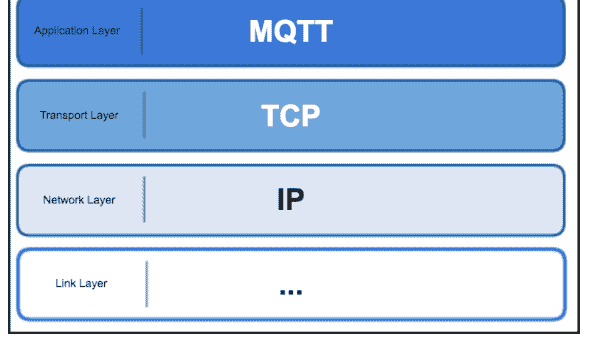

从本质上讲，它在概念上类似于消息队列架构，但尽管名称如此，它并不是传统意义上的队列。这意味着新数据会作为消息进入中间的代理（broker），然后被投递到终端服务器。物联网设备被称为发布者，终端服务器被称为订阅者。两者都连接到代理，但彼此之间从不直接连接。

MQTT 遵循发布/订阅架构模式（即 pub/sub），但它的实现方式与传统消息队列不同。它是一种只容纳一条消息的队列——主题的消息会被最新数据替换，而不是像传统消息队列那样被追加到不断增长的消息序列中。

代理上的消息始终存在，无论发布者或订阅者是否在线、是否愿意与之交互。这使得它在面对（有意或无意的）间歇性连接时依然稳健。订阅者不必等待发布者醒来并愿意通信。发布者可以发送消息，而无需关心谁愿意且能够接收它。

订阅者支持主题匹配的概念。这样，在订阅主题时可以使用通配符 + 或 #。发布者则不允许这样做。

+ 是单层级的通配符。它的工作原理类似于搜索模式：所有非 + 的层级都必须匹配。# 是多层级的通配符，必须放在字符串末尾。它将返回指定的整个层级结构。就像在文件系统中复制文件夹一样，它会订阅指定层级下的所有子目录和文件。

通配符让主题订阅管理变得更简单。你可以订阅 `vehicleID/engine/+/temperature` 来获取 engine 主题下的所有温度值。你也可以订阅 `+/engine/oil/temperature` 来获取所有向该代理发布数据的设备的机油温度值。你还可以订阅 `vehicleID/engine/#` 来获取该层级结构中的所有值，无论层级有多深。

重要的是，在设计主题树时要将灵活性纳入考量。它应该是可扩展的，这样无需重新设计主题树即可添加新的分支。从分析的角度看，这意味着如果设计得当，从设备添加更多信息的成本相对较低。如果设计不佳，就需要重新设计主题树，这会使成本更高，因此往往不太可能进行。在分析领域这个不断变化的世界中，你会不断学习新事物并加以利用，因此你希望在各个层面都拥有灵活性。

## MQTT 的优势

- **数据包无关性：** 数据包所携带的负载中可以传输任何类型的数据。数据可以是文本或二进制。只要接收方知道如何解析，就无所谓。
- **可靠性：** 可以使用一些**服务质量（QoS）**选项来确保消息投递。
- **可扩展性：** 发布/订阅模型可以以节能的方式良好扩展。
- **解耦设计：** 该设计中有多个元素将设备与订阅服务器解耦，从而带来更稳健的通信策略。
- **时间：** 无论订阅服务器处于何种状态，设备都可以发布其数据。订阅服务器随后可以在有能力时连接并接收数据。这在时间维度上对通信两端进行了解耦。可以将其想象成用手机给某人发短信。他可以在有空时回复。如果你给他打电话，他就必须与你在同一时间有空通话。如果你们俩整天都在开会，最终就只能互相留语音信箱，沟通就会变慢。这使设备能够保持在休眠状态，而不必担心当设备醒来通信时，订阅服务器是否能够接收数据。
- **空间（投递细节）：** 发布者需要知道代理的 IP 地址以及如何与它通信，但不需要知道订阅者的任何信息。订阅者也无需知道发布者的网络连接细节。这使设备端的通信开销保持在较低水平（设备端通常在可用电力方面受到更多限制）。它还允许两端独立运行。订阅者可以被更换或升级，也可以增加额外的订阅者，而发布设备端无需任何更改。
- **异步性：** 任何一方都不必暂停当前正在做的事情来通信或接收消息。该过程是异步的。无需中断正在进行的工作即可发布消息。
- **安全性：** 这一点同时出现在优势和劣势列表中。使用 MQTT 可以实现安全性，因此它被列在优势列表中。由于 MQTT 运行在 TCP 之上，你可以在通信中使用 TLS/SSL 加密，而且绝对应该这样做。但 MQTT 本身是未加密的，这也是它也出现在劣势列表中的原因——稍后将对此进行更多说明。
- **双向性：** 设备既可以充当发布者，也可以充当订阅者。这样，它就可以通过订阅代理上的某个主题来接收命令。它还可以接收来自其他设备的数据，这些数据可以作为其发布数据的输入。在实践中，通常是中心辐射（hub and spoke）模型。
- **成熟度：** MQTT 由 IBM 发明，协议初稿于 1999 年基于其 MQSeries 产品制定（这就是名称中“消息队列”部分的由来）。它于 2010 年免版税发布，此后作为开源项目捐赠给了 Eclipse 基金会。如今，数百万互联产品都在使用它。

## MQTT 的劣势

- **它运行在 TCP 之上：** TCP 是为内存和处理能力比许多轻量级、功率受限的物联网设备更强的设备而设计的。TCP 在交换任何消息之前，需要更多握手来建立通信链路。这会增加唤醒时间和通信时间，从而影响长期电池消耗。通过 TCP 连接的设备往往会以持久会话的方式为彼此保持套接字打开。这会增加功耗和内存需求。
- **集中式代理可能限制规模：** 代理会影响可扩展性，因为每连接一个设备都会产生额外开销。网络的增长规模只能达到本地代理中心所能支持的上限。这限制了每个中心辐射组的扩展。
- **代理成为单点故障：** 代理也可能是网络中的单点故障。一种常见的情况是，代理设备插在墙上插座中，而若干发布设备使用电池供电。一旦停电，发布设备会继续运行，但代理会离线。在恢复供电之前，该网络将毫无用处。
- **安全性：** MQTT 默认不加密。这使其天生不安全，需要你采取额外步骤并承担一些开销，以确保实现 TLS/SSL。否则，通过 MQTT 进行的任何通信（包括用户名和密码）都对黑客敞开。

### QoS 级别

QoS 级别本身存在一种权衡取舍。QoS 是 MQTT 中对消息投递可靠性要求的术语。这是网络领域中的一个常见术语，我们将回顾它在 MQTT 中具体是如何实现的。

这种权衡存在于所用带宽与消息投递可靠性之间。为确保更高的可靠性，需要更多的往返消息，这会增加同一消息数据包的带宽需求。MQTT 为你提供了一些可供选择的选项。

QoS 是针对通信两端分别设置的。发布者到代理的消息连接会设置一个 QoS，代理到订阅者的连接也会单独设置一个 QoS。通常两者的 QoS 相同，但也并非总是如此。

## QoS 0

**Fire and forget** - sir, yes, sir!

QoS 0 是最低的 QoS 级别，通常被称为 fire and forget。消息发送到代理时，不会确认代理是否已将其转发给订阅者。它仍然具有 TCP 协议的所有保证，就像所有标准 MQTT 形式一样。

如以下图所示，通信开销最小，这意味着功耗最小。一旦发送到代理，消息就会在设备（发布者）上被删除。代理会立即向具有开放连接的订阅者转发。 与其他 QoS 级别不同，当 QoS 设置为零时，消息不会为离线订阅者存储。

QoS 0 通常用于连接稳定且中断可能性不大时，例如有线连接的情况。它还用于功耗限制比消息传递更重要时。在这种情况下，要么即使丢失一些消息，结果数据也是可以接受的，要么消息频率足够高，以至于丢失一条也没关系，很快就会有另一条到来。

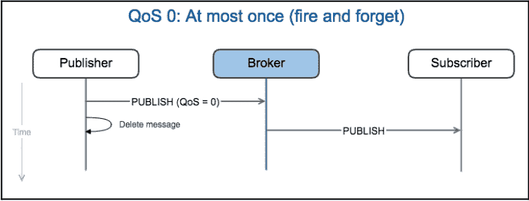

## QoS 1

**Deliver once** - I don't care if you send it 10 times, just make sure they get it.

QoS 1 是最常用的级别。它保证消息至少被传递一次。重复消息需要在订阅者端或后续处理中进行处理。通信开销高于 QoS 0，但只有 QoS 2 一半的来回次数。

QoS 1 用于需要保证传递且用例可以处理重复消息时。

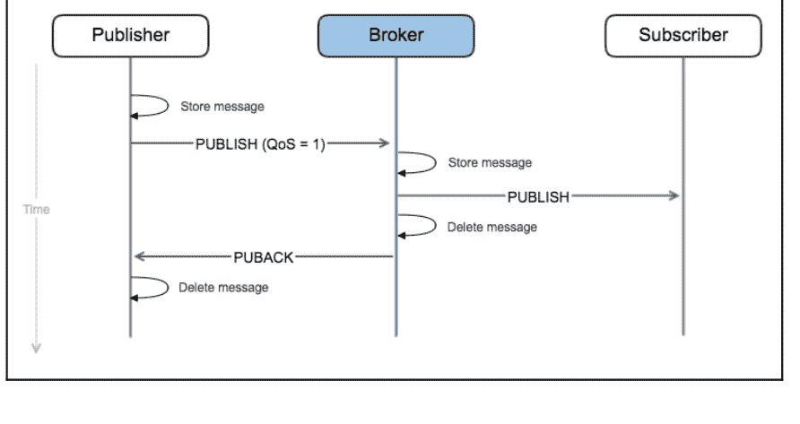

## QoS 2

**Deliver exactly once** - Make sure they get it, but make sure they only get it once - they get confused.

QoS 2 保证消息被传递并且只传递一次。如图所示，为了实现这一保证，需要多次来回通信。通信状态需要在双方之间存储，直到完整的传递确认传回发布者。这需要设备具有更高的功耗水平，以及更大的内存占用以存储更复杂的状态。完成 QoS 2 通信也需要稍长的时间。

QoS 2 用于需要保证传递且终端应用程序或订阅客户端无法处理重复消息时。

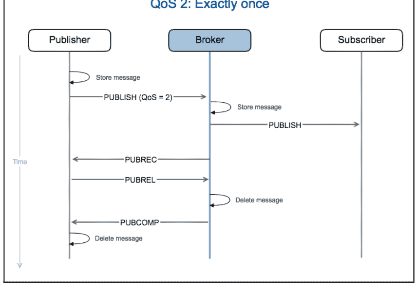

## Last Will and Testament (LWT)

这个创意命名的功能有助于 MQTT 处理有损网络并增强可扩展性。它是可以在代理上存储的消息，以防发布者意外掉线。

它存储状态和目的，包括其发布过的命令及其订阅。当它掉线时，代理会通知所有 LWT 订阅者。当它返回时，代理会将其恢复到先前的状态。

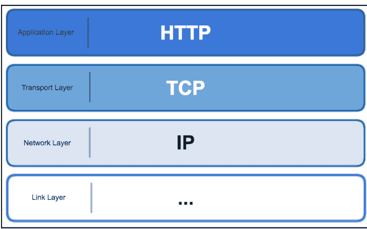

## Representational State Transfer (REST) principles

REST 允许联网设备使用统一的应用程序编程接口（API）相互互操作。符合此标准的设备或服务器称为 RESTful。它假设交互基于客户端/服务器并且是无状态的。下表显示了 HTTP REST API 接口支持的关键命令：

| HTTP REST API |
| --- |
| HTTP POST: Adds a new resource |
| HTTP PUT: Updates a specific resource by replacing it with an updated version |
| HTTP GET: Reads a specified resource |
| HTTP PATCH: Partially updates a resource in a collection |
| HTTP DELETE: Deletes a resource |

## HTTP and IoT

在许多情况下，HTTP 对于物联网应用来说并不理想。延迟不可预测，并且通常依赖轮询来检测状态变化。它是一种基于文本的协议，这意味着消息大小往往很大。这增加了功耗和复杂性开销，以便物联网设备使用它进行通信。

然而，它是一个成熟的标准并且被广泛使用。这使其成为一个成熟且得到良好支持的接口。

连接由客户端设备建立到服务器设备，并在通信完成前保持打开。传递有保证，数据消息在过程的每一步都被确认。它运行在 TCP 之上并且可靠。

## Advantages to HTTP

HTTP 作为物联网协议有几个优点：

- **Reliability**: Message delivery is guaranteed and acknowledged.
- **Ubiquity**: HTTP is used all over the place and is very easy to implement.
- **Ease of implementation**: If you can connect to the internet, you can use HTTP anywhere in the world. No special hardware or software is required.

## Disadvantages to HTTP

HTTP 作为物联网协议有一些缺点：

- **Higher power needs**: Communications have frequent back and forth interactions, connections need to be sustained, and plain text results in larger message sizes. All of this requires more power to support.
- **The IoT device complexity**: The device needs enough memory and CPU power to support the TCP protocol and high level HTTP RESTful APIs.

## Constrained Application Protocol (CoAP)

CoAP 是通过 **User Datagram Protocol (UDP)** 的点对点通信。它具有低开销要求，并专门为在互联网上运行的低功耗设备而开发。它被设计为可在 RAM 低至 10 KiB 的微控制器上运行，并且操作代码仅需要 100 KiB。

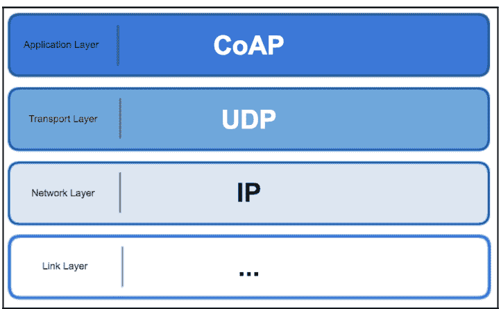

CoAP 由互联网工程任务组（IETF）创建，以满足功耗受限的物联网设备的需求。它也由 Eclipse 基金会作为开放标准支持。

CoAP 遵循客户端/服务器架构，并且是一种一对一的通信约定。它确实允许一些组播功能，这在本文撰写时仍处于早期开发阶段。

CoAP 与 HTTP 相似，因为它是一种文档传输协议并且与 RESTful 网络互操作。它与 HTTP 不同，因为它为网络功耗低且经常有损的应用而设计。

CoAP 运行在 UDP 协议上，其中数据包比使用较大 TCP 数据包的 HTTP 小得多。客户端和服务器在没有建立连接的情况下进行通信。信息通过自包含的数据报传输。数据报是 UDP 协议的核心，每个数据报都包含路由所需的所有必要信息，而无需依赖客户端和服务器之间的先前交换。

可以把数据报想象成通过邮件与某人通信（老式蜗牛邮件）。信封上有投递地址和回邮地址，负载就是信封内的信件，但邮递员看不到。 你定期给在波兰的表亲寄信。她也定期给你寄信。

你无法保证所有信件都会被送达或按你发送的顺序送达。收到信件后，打开它们、按正确顺序排列并找出是否有遗漏是你的责任。如果你发现缺少一封，你会处理给表亲寄信请求重发。

CoAP 的工作方式相同，其中发送和接收应用程序扮演你和你表亲的角色。应用程序需要适当编程以处理所需的传递可靠性级别。

## Advantages to CoAP

CoAP 有一些优点：

- **Reduced power requirements:** It operates over UDP, which requires minimal overhead for communications. It also allows faster wake up times and extended sleepy states. Taken together, this means batteries last longer for IoT devices.
- **Smaller packet size:** Another advantage of UDP is small packet sizes. This leads to faster communication cycles. Again, this allows batteries to last longer.
- **Security:** Like MQTT, this is on both the advantage and disadvantage lists. When **Datagram Transport Layer Security (DTLS)** is employed over UDP, communication is encrypted and secure. Even though there is some additional overhead required to implement this, you can and should use it.
- **Asynchronous communication option:** Clients can request to observe a device by setting a flag. The server (IoT device) can then stream state changes to the client as they happen. Either side can cancel the observe request.
- **IPv6 based:** It was designed from the beginning to support IPv6. This also allows for a multicasting option.
- **Resource discovery:** Servers can provide a list of resources and media types. The client can then review and discover what is available.

## CoAP 的不足之处

CoAP 也存在一些缺点：

- **消息不可靠**：UDP 不保证数据报的送达。CoAP 提供了一种请求确认应答（ACK）的方法，以确认消息已被接收。但这并不能验证消息是否被完整接收并被正确解码。
- **标准仍在完善中**:CoAP 仍在发展演进，尽管其背后有巨大的市场推动力。随着使用越来越广泛，它很可能会快速成熟。
- **NAT 问题**：网络地址转换（NAT）设备在企业网络和云环境中很常见。由于 IP 可能随时间动态变化，CoAP 在与 NAT 后面的设备通信时可能会出现问题。
- **安全性**：与 MQTT 一样，CoAP 默认不加密。这使得它在原生状态下不安全，你需要采取额外措施确保通信不会对黑客敞开。

## 消息可靠性

这相当于 MQTT 的服务质量（QoS）。对于 CoAP，可以选择将请求和响应数据报标记为可确认（confirmable）。在这种情况下，接收方会回复一条确认（ACK）消息。

如果未标记该标志，数据报就是“发完即忘”的。这相当于 MQTT 的 QoS 0。

## 常见用例

CoAP 协议通常用于以下应用：

-   ​​公用事业现场区域网络
-   远程气象站传感器
-   密封的电池供电传感器设备

## 数据分发服务（DDS）

DDS 是一种网络中间件。其标准由对象管理组织（OMG）管理。它是一种总线式架构；不要求有中心节点。通信是点对点的，并且不受集中控制。

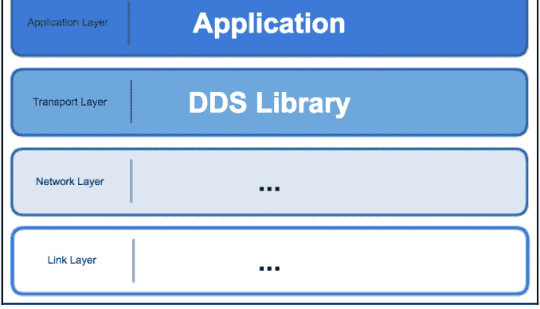

DDS 通过称为动态发现的流程自动发现通信端点。DDS 使用发布/订阅模型的一种变体，总线上的节点会公布它们正在发布什么数据，以及它们想要订阅什么数据。

DDS 参与者可以位于同一台机器、同一个工厂，甚至分布在很大的区域内。当各个 DDS 域链接在一起时，所有这些情况可能同时存在。这是一种高度可扩展的架构。

数据交换是实时的、可靠的，并且具有高传输速率。DDS 为你处理传输工作的细节，例如消息寻址、传递、流量控制、重试以及数据编组/解编组。任何节点都可以是发布者、订阅者，或者同时是两者。

## 分析数据以推断协议和设备特性

回到物联网分析的第一要则：*绝不要信任你不了解的数据。*

你需要去了解你的数据。就像你刚认识的新朋友一样，你会先用谷歌搜索他，打听他的情况，并做一次犯罪背景调查（我们知道你会这么做），然后才同意和他共进晚餐。

以下是一种逐步了解数据来源的策略：

1.  **画出设备的示意图**：把它勾画出来，如果有蓝图就用蓝图。这是你与设计工程师交朋友并提出一些问题的好时机。在传感器所在的位置画出关键传感器，并标注传感器类型和任何限制条件。询问任何影响精度的环境条件并标记下来。
2.  **查明设备如何连接到网络**：在你的示意图上标注连接类型。
3.  **确定设备使用哪种数据消息协议进行通信**：将此标注在你的示意图上。下面是一个简单示例：

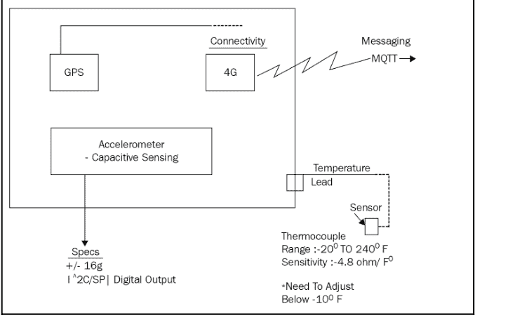

4.  **如果你能实地访问设备正在使用的现场，那就去现场**：拍照。如果不能，请让常在外奔波的人帮忙拍一些照片。尽量获取几个不同的地点。目的是捕捉真实世界的情况，以备日后参考。

5.  **将实地照片和示意图合并成一份参考文档**：把它钉在工位隔板上方便参考；你以后可能会用到它。

6.  **分析你的数据，推断一些关于它的信息：**

    1.  取几个月完整的 数据。数据量要足够小以便于处理，又要足够大以包含一些历史信息。
    2.  通过用同一设备当前记录的时间减去上一条记录的时间，计算记录之间的频率。这将得到每条消息的间隔数值。
    3.  随机选择至少 30 台设备，并将其所有记录单独放在一边。
    4.  对每台设备，目视检查记录。如果间隔数值在大多数情况下是一致的，那么你现在知道它有一个固定的上报频率，以及上报之间的时间长度。如果间隔数值不一致，很可能没有固定的间隔，数据是在设备进入网络覆盖范围（设备移动时）或不规则事件触发通信时才进行传输。无论哪种情况，都要在参考文档中记录下来。
    5.  注意间隔数值出现不规则增加的情况。如果这种情况频繁发生，设备很可能处于数据丢失严重的网络环境中。将这点记在参考文档中。
    6.  如果间隔很长（数小时或数天），并且消息大小（列数）较小，那么你的物联网设备可能资源受限，并且依赖长期使用的电池。它更有可能处于丢包严重的网络环境中。
    7.  如果间隔很短（每几秒或几分钟），那么它可能很容易获得电源。它不太可能处于丢包严重的网络环境中。
    8.  计算每台设备按日期统计的平均间隔。将它们绘制在同一个图表上，每台设备对应一条单独的线。如果所有设备的平均间隔变化恰好发生在完全相同的日期，那么你的集中式数据收集过程存在网络或数据处理问题。

## 总结

本章更深入地回顾了物联网设备的种类和网络协议。你了解了设备的范围以及一些示例用例。我们还讨论了各种网络协议以及它们试图解决的业务需求。

我们回顾了如何理解主要设备类别和网络协议策略的“是什么”和“为什么”。我们还讨论了一些通过分析数据来识别设备和网络协议特征的技术。
