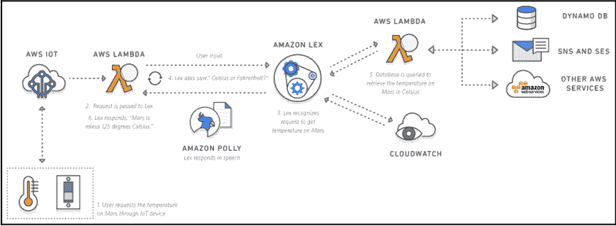
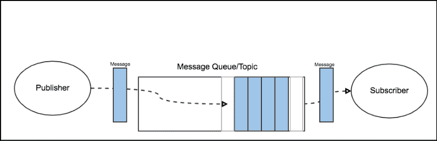
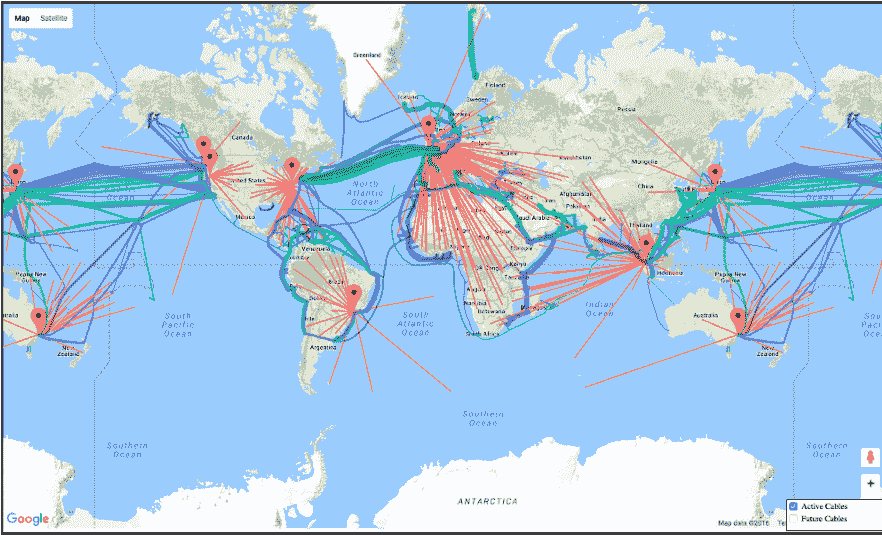
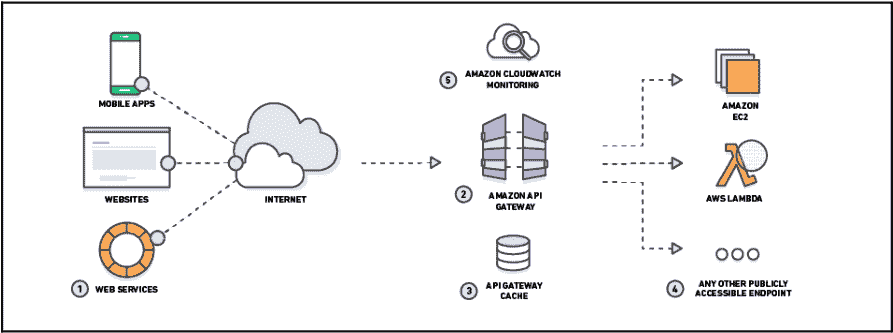
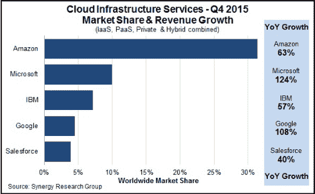
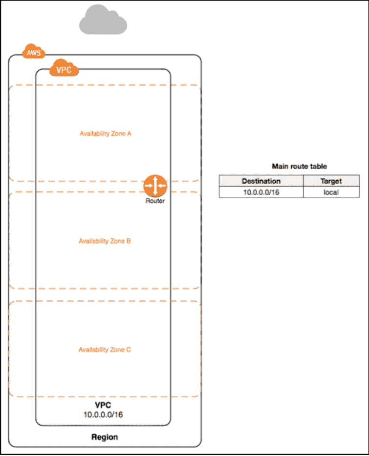
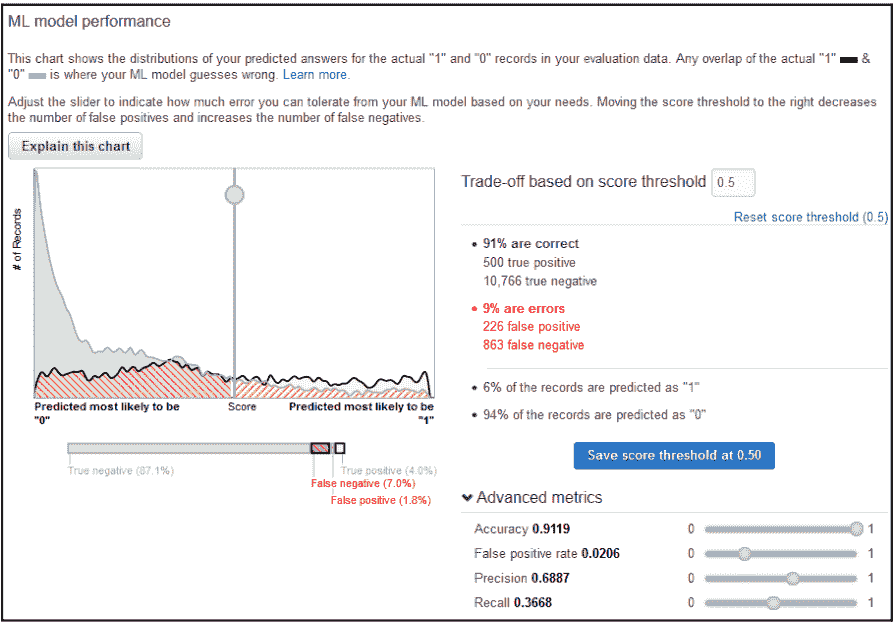
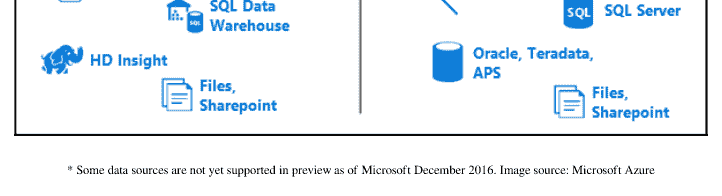
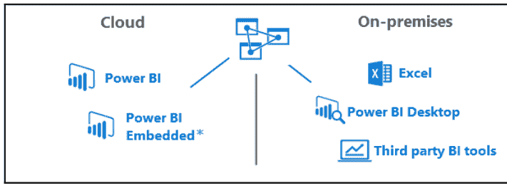
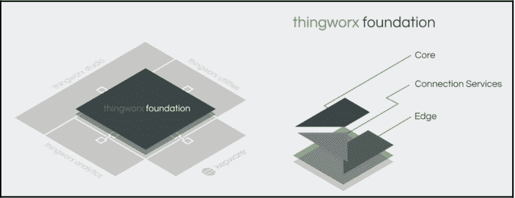

## 云上的物联网分析

既然你知道你的数据是如何被传回公司服务器的，你觉得自己对它有了更好的理解。你脑海中也有了一个关于它在现实世界中如何运作的参考框架。

你的老板又来了。

> “那个滚动平均作业跑完了吗？”他焦急地问。

三个月前它运行良好，一个小时内就能完成。后来它花费的时间越来越长，现在有时甚至无法完成。今天，它已经运行了六个小时，你正祈祷着它不要出问题。昨天，它两次崩溃，看起来像是内存不足的错误。

你与 IT 部门和财务部门讨论过，想获得一台更快、内存更大的服务器。这需要花费很大一笔钱，而且可能还需要几个月才能完成采购、下单和安装的流程。你在财务部门的朋友对此审批持犹豫态度。这笔钱不在本财年的预算之内。你感觉很不好，尤其是这是唯一一个给你带来麻烦的分析作业。它只是每月运行一次，但产生关键数据。

你不知道还能说什么，只能给你的老板一个充满希望但勉强的微笑，并向他展示你交叉的手指。

> “它还在运行……这是好事，对吧？”

本章将讨论基于云的基础设施在处理和分析物联网数据方面的优势。我们将讨论云服务，包括**Amazon Web Services** (AWS)、**Azure** 和 **ThingWorx**。你将学习如何弹性地实施分析，以实现各种各样的功能。

本章将涵盖以下内容：

- 构建弹性分析
- 为扩展而设计
- 云安全与分析
- 主要云服务提供商：
  - Amazon AWS
  - Microsoft Azure
- PTC ThingWorx

## 构建弹性分析

物联网数据量增长迅速。物联网分析在难以预测的时间点尤其计算密集。业务价值不确定，需要大量实验才能找到正确的实现方式。

将所有这些结合起来，你需要一种能够快速扩展、动态响应资源需求、并且在恰当的时间具有几乎无限容量的方案。而且所有这些都需要快速实现，成本低且维护需求低。

云登场了。物联网分析与云基础设施配合得天衣无缝。

## 什么是云基础设施？

美国国家标准与技术研究院定义了五个基本特征：

- **按需自助服务**：你可以在无需与他人交互的情况下按需配置服务器和存储等资源。
- **广泛的网络访问**：你的云资源可通过互联网（如果已启用）通过各种方式访问，例如网络浏览器或手机。
- **资源池化**：云提供商使用多租户模型在众多客户之间汇集其服务器和存储容量。资源，无论是物理还是虚拟，都根据需要动态分配和重新分配。资源的特定位置未知且通常不重要。
- **快速弹性：** 你的资源可以弹性地创建和销毁。这可以根据需求自动发生。你可以快速扩展。你也可以快速收缩。从你的角度来看，资源的供应几乎是无限的。
- **可计量服务：** 资源使用情况由云提供商监控、控制并报告。你可以访问相同的信息，从而对你的使用情况提供透明度。云系统会持续自动优化资源。

存在一种私有云的概念，它们部署在本地或由第三方为特定组织定制构建。就我们的关注点而言，我们只讨论公共云。总体而言，大多数分析将在公共云上完成，因此我们将集中精力于此。

公共云上触手可及的容量令人震惊。AWS 在 2016 年 6 月估计有 130 万台服务器在线。这些服务器被认为比企业系统高效三倍。

云提供商拥有硬件并维护网络和系统以提供可用服务。你只需通过通常的 Web 应用程序配置所需使用的资源即可。

提供商提供不同级别的抽象。他们提供低级别的服务器和存储，让你拥有精细的控制权。他们还提供托管服务，可为你处理服务器、网络和存储的配置。这些服务相互结合使用，两者之间几乎没有区别。

硬件故障会自动处理。资源会被转移到新硬件并重新上线。当你为云设计时，物理组件变得不重要，它被抽象掉了，你可以专注于资源需求。

使用云的优势有：

- **速度：** 你可以在几分钟内将云资源上线。
- **敏捷性：** 快速创建和销毁资源的能力带来了实验的便利性。这提高了分析组织的敏捷性。
- **服务多样性：** 云提供商提供许多可支持分析工作流的服务，可在几分钟内部署。这些服务为你管理硬件和存储需求。
- **全球覆盖：** 你只需点击几下即可将分析的覆盖范围扩展到世界另一端。
- **成本控制：** 你只需为所需时间所需的资源付费。你可以用更少的钱做更多。

为了了解你触手可及的强大功能，这里有一个 NASA 在 AWS 上构建的架构图，作为面向学童的推广项目的一部分：

来源：Amazon Web Services, https://aws.amazon.com/lex/

当给出语音命令时，它将与火星探测车复制品通信以检索物联网数据，例如温度读数。该过程包括语音识别、从文本生成自然语音、数据存储和处理、与物联网设备的交互、网络、安全以及发送短信的能力。这不是一年的开发工作量，它是通过将已有的基于云的服务连接起来构建的。

而且这不仅仅适用于像 NASA 这样资金充足的政府机构。所有这些服务以及更多服务今天都可供你使用，如果你的分析运行在云中。

## 弹性分析概念

我们所说的**弹性分析**是什么意思？让我们将其定义为设计你的分析流程，使扩展不再是问题。你希望专注于分析而不是底层技术。你希望避免限制你的分析能力以使其适应某些固定的硬件限制。相反，专注于分析的潜在价值与现有硬件所能实现的极限。

你还希望你的分析能够扩展。它应该能够从支持 100 台物联网设备扩展到 100 万台物联网设备，而无需任何根本性更改。唯一发生的事情是成本随着需求的增加而增加。

这降低了复杂性并提高了可维护性。这转化为更低的成本，使你能够进行更多分析。更多分析增加了发现价值的可能性。发现更多价值又能实现更多分析。良性循环！

一些核心弹性分析概念：

- **将计算与存储分离：** 我们习惯于像思考笔记本电脑规格一样思考资源。你购买一台具有 16 GB 内存和 500 GB 硬盘的设备，因为你认为这将满足你 90% 的需求，并且是你的预算上限。云基础设施将这一切抽象掉了。在云中进行分析就像租用一台神奇的笔记本电脑，你可以通过弹指一挥将 4 GB 内存变成 16 GB。你的租金账单仅在你使用 16 GB 的时间内增加。你再次弹指将其降回 4 GB 以节省一些钱。你的硬盘可以独立于内存规格增长和收缩。你不必被迫在两者之间选择一个良好的平衡。你可以将计算需求与要求相匹配。
- **从一开始就为扩展而构建：** 使用可以从 1 到 100 万扩展而无需更改的软件、服务和编程代码。你投入生产的每个分析流程都有持续的维护工作，随着你添加越来越多的流程而随时间累积。以后让自己轻松一些。你不希望不得不停止手头的工作来重新设计一年前构建的流程，因为它达到了扩展的极限。
- **让你的瓶颈是湿件而不是硬件：** 所谓湿件，我们指的是脑力。*我的笔记本电脑内存不足以运行该作业永远不应该是问题。它始终应该是我还没有想明白，但我正在测试几种可能性。*
- **按支出预算管理，而不是按可用硬件管理：** 只要符合你的支出预算，就使用你需要的云资源。当你在云中运行分析时，没有必要将分析限制在固定数量的服务器内。传统的企业架构会提前购买硬件，这会产生资本支出。你的财务人员通常不喜欢资本支出。你也不应该喜欢它，因为这意味着你能做的事情已经设定了一个上限（至少在短期内）。按支出管理意味着关注成本，而不是资源限制。需要时扩展，并确保快速收缩以保持成本低。

随着你的分析逐步发展，你将拥有一系列操作：要么转换数据，要么通过模型或算法运行数据，要么对结果作出反应。事情很快就会变得复杂。通过封装分析，当未来需要修改时，更容易知道该在何处下手。你还可以在不影响其他组件的情况下重新配置流程的某些部分。

封装过程遵循以下步骤：

- 1. 列出所有步骤。
- 2. 将它们分组。
- 3. 思考哪些组可能会一起变化。
- 4. 将独立的组拆分为各自的流程。

如果可能的话，最好将数据转换步骤与分析步骤分开。有时，分析与数据转换紧密耦合，分离没有意义，但在大多数情况下，它们是可以分离的。基于分析结果的操作步骤几乎总是应该单独分开。

每一组步骤也都有各自的资源需求。通过封装并将流程分开，你可以独立分配资源，并在需要的地方更高效地扩展。你可以用更少的资源做更多的事情。

## 使用消息队列进行解耦

使用消息队列解耦封装后的分析流程有几个优点。它允许任何流程发生变化，而无需其他流程进行调整。这是因为它们之间没有直接联系。

它还构建了一定的健壮性，以防某个流程发生故障。当宕机的流程重启时，队列可以继续扩展而不会丢失数据；一切恢复后，不会有任何数据丢失。

## 什么是消息队列？

新数据作为消息进入队列，排队等待投递，然后轮到时再被投递到最终服务器。添加消息的进程称为**发布者**，接收消息的进程称为**订阅者**。

无论发布者或订阅者是否连接在线，消息队列都会存在。这使得它能够抵御间歇性连接（无论是有意还是无意）。订阅者不必等待发布者愿意通信，反之亦然。

队列的大小也可以根据需要增长和收缩。如果订阅者落后了，队列就会增长以补偿，直到它能赶上。这在发布者突然爆发大量消息时会很有用。队列会充当缓冲区并扩展以捕获消息，同时订阅者正在处理突然涌入的数据。

当然，也存在限制。如果队列达到某个设定的阈值，它将拒绝（并且你很可能会丢失）任何传入的消息，直到队列重新受控。

下面是一个刻意设计但真实的例子，说明这种情况可能如何发生：

> Joe Cut-rate（开发者）：*嘿，你希望那个小玩意儿设备什么时候醒来并上报？*
> 
> Jim Unawares（工程师）：*每 4 小时*
> 
> Joe Cut-rate：*没问题。我会把它编程为从 UTC 午夜 12 点开始，然后之后每 4 小时报告一次。顺便问一下，这种东西你打算再卖多少？*

## 分布式计算

分布式计算，也称为集群计算，指的是使用框架将流程分散到多台服务器上，这些框架抽象了每台服务器的协调工作。这些框架让你感觉就像在使用一个统一的系统。在底层，可能只有几台服务器（称为节点），也可能有数千台。框架为你处理编排工作。

## 避免将分析局限于单台服务器

这对物联网分析的优势在于规模。你可以通过向集群添加节点来增加资源；无需更改分析代码。目前最常用的框架是 Hadoop，我们将在*第 4 章“创建 AWS 云分析环境”*中讨论它。

尽量避免将分析局限于单台服务器（少数例外除外）。这会给扩展带来上限。

## 何时使用分布式，何时使用单台服务器

不过，分布式计算也有复杂性成本。它不像单服务器分析那么简单。尽管框架为你处理了大量复杂性，你仍需要考虑并设计你的分析以便跨多个节点运行。

以下是一些关于何时保持简单并运行在单台服务器上的指导原则：

- **没有太大的扩展需求：** 即使物联网设备和数据数量爆炸式增长，你的分析流程也几乎不需要变化。例如，分析流程对已经按月份汇总的数据运行预测。在这种情况下，设备数量几乎不产生影响。
- **小数据而非大数据：** 分析在少量数据子集上运行，受数据规模的影响不大。对随机样本进行分析就是一个例子。
- **资源需求极低：** 即使数据量高出几个数量级，你也不太可能需要超出标准服务器所能提供的资源。在这种情况下，保持简单即可。

## 假设变化是常态

物联网分析的世界发展迅速。今天你创建的分析，随着你获得结果反馈并适应不断变化的业务条件，将多次更改。你的分析流程需要改变。请假设这种情况会持续发生，并为变化而设计。这引出了**持续交付**的概念。

持续交付是软件开发中的一个概念。它自动化了代码发布到生产环境的过程。其理念是让变化成为常规流程。将这个理念引入你的分析，可以通过保留一组同时存在的副本来推进三个阶段：

- 1. **开发：** 保留一份你的分析副本，用于改进和尝试新事物。
- 2. **测试：** 准备好后，将你的改进合并到这个副本中，功能保持不变，但要反复测试。测试确保它按预期工作。保留单独的测试副本可以让你在其他功能上继续开发。
- 3. **主版本：** 这是投入生产的副本。当你将内容从测试合并到主副本时，就等同于将其投入实际使用。云提供商通常提供持续交付服务，可以让这个过程变得更简单。

对于任何软件开发人员读者来说，这是**git flow**方法的一种简化，这有点超出本书范围。如果作者可以提出建议，那么值得做一些额外研究来学习 git flow，并将其应用于你在云中的分析开发。

## 利用托管服务

云基础设施提供商，如 AWS 和 Microsoft Azure，提供消息队列、大数据存储和机器学习处理等服务。这些服务处理底层资源需求，如服务器、存储配置以及网络需求。你不必担心这些在底层是如何发生的，而且它可以根据你的需要扩展到任意规模。

云提供商还管理服务的全球分布，以确保低延迟。下图显示了 AWS 的区域数据中心位置与海底互联网电缆的结合：

这减少了你在分析方面需要担心的事情数量。它让你可以更多地关注业务应用，而不是技术。这是一件好事，你应该加以利用。

托管服务的一个例子是亚马逊**简单队列服务（SQS）**。SQS 是一种消息队列，其底层服务器、存储和计算需求由 AWS 系统自动管理。你只需要设置和配置它，只需几分钟即可完成。

## 使用应用程序编程接口（API）

API 是其他进程、软件或服务访问你创建的分析代码的一种方式。它让你可以轻松地在其他应用程序中重用你的代码。你还可以让客户通过基于 Web 的 API 直接访问此功能。

API 建立在封装原则之上。它是一份定义好的受支持操作和信息列表，其他系统可以调用和检索。调用系统无需知道操作是如何执行的，也无需知道信息是如何创建和检索的。复杂性被隐藏了。

API 定义了如何与一组封装的分析流程进行交互。它抽象掉了细节。它还支持低摩擦变更，因为分析流程可以被改进，而无需其他系统改变它们正在做的事情。只要 API 定义保持不变，其他系统就不会察觉其中的差异。

API 是为更复杂的分析创建构建块的好方法。你可以在短时间内使用多个 API 构建丰富、功能完善的分析应用程序。通过重新配置组合好的应用程序以使用不同的 API 组合，也更容易适应不断变化的业务条件。

Web API 使用互联网来处理系统之间的通信。云提供商将其作为托管服务提供。它可以在处理安全和扩展方面提供很大帮助。使用此服务，你可以快速、安全地大规模实现新的分析功能。API 可以是公开的，也可以是私有的。私有的只有你的内部应用程序才能访问。公开的则向公司外部的系统开放。

使用 Web API 网关的示例架构。来源：Amazon Web Services

云服务提供商甚至可以处理使用情况跟踪和计费，如果你决定将API背后的功能作为付费服务提供给客户的话。

## 云安全与分析

你可以使用主流云基础设施提供商支持的多种方法，将安全构建到分析中。

### 公钥/私钥

云服务提供商在其所有服务中使用非对称加密。系统会生成公钥和私钥。你保留私钥，因此服务方没有副本。服务方持有公钥。使用公钥/私钥的通信是安全的，并且从未被攻破。

云服务提供商即使把公钥刊登在明天的报纸上也无妨；仅凭公钥无法破解加密。公钥用于加密数据却不能用于解密，这看起来有违直觉，但确实可行。

每次访问以HTTPS开头的网站时，都在使用公钥/私钥加密。这是SSL和TLS加密的基础，而HTTPS通信正是采用这种加密方式。

在构建安全流程时，你会经常为物联网分析使用公钥/私钥。可以把它想象成你的分析工具的“用户名+密码”，但更胜一筹。密码学是一个引人入胜的学科（至少对我们中的一些人来说是这样）；想了解更多细节，不妨阅读相关资料。否则，你可以完全相信它没有问题——事实也确实如此！

### 公有子网与私有子网

当为分析搭建云环境时，你实际上是在创建自己的网络环境。你需要（或者希望由一位熟练的网络专家来）定义网络结构。其中一项基本组件就是子网的概念。子网是云环境中整个网络的逻辑细分。你将资源部署到某个子网中，该资源将遵循为该子网定义的互联网寻址规则。公有子网中的资源可以从外部互联网被寻址。但这并不意味着子网内的所有资源都能从外部被发现；你需要先为其分配公网IP地址。

私有子网无法从外部互联网寻址。虽然可以通过网关设备（通常是网络地址转换（NAT）设备）实现互联网通信，但外部对象无法直接与私有子网中的资源发起通信。

出于安全原因，大多数分析处理应在私有子网中进行，这给资源连接增加了一些复杂性。这正是我们在这里讨论它的原因。然而，为了防范恶意破坏，这样做完全值得。请了解你的哪些子网是私有的，并确保在那里启动新的资源。

### 访问限制

将分析资源的访问权限仅限制为指定的用户。避免使用单一的用户ID和密码让所有人共用的陷阱。对于通过公钥/私钥访问的资源，务必将私钥存放在安全可靠的地方。

对于网络安全，只允许必要的网络流量访问你的资源，阻止所有其他流量。从一开始就锁定一切，只在需要时才开放。

在分布式计算环境中（例如用于物联网分析的环境），网络是安全和问题排查的关键要素。你会遇到分析任务无法正常运行的情况，并发现根源是网络或安全相关设置。最好从分析项目一开始就理解这一点并采用最佳实践。

### 保护客户数据

确保物联网数据的安全，使用访问控制，并对数据文件进行加密。物联网数据可用来推断客户的有关信息，因此要特别小心。你是客户信息的守护者。如果没有妥善保护客户数据，你可能会无意中使公司面临法律风险。

加密可以通过两种方式实现：传输中加密和静态加密。传输中加密指网络传输，如SSL或TLS。大多数云服务都要求使用它们。确保支持分析流程的所有网络通信在传输中均经过加密。

静态加密指数据存储，可以是服务器上的数据文件，也可以是数据库中的数据。如果你使用公钥/私钥对来保护数据，云服务提供商可以为你加密数据，并且对你透明。

当数据可能被大量用户（例如公司全体员工）访问时，请采用加密。如果由于严格的访问控制，数据仅能被少数人访问，并且位于私有子网中，你可以稍微宽松一些——数据不太可能泄露出去。一般来说，如果加密是无缝的，就使用它。如果你的数据可通过公共互联网访问，那么一定要使用加密。

云服务提供商从诞生之初就在公共互联网环境中运营。安全内建于每一个层级。充分利用这一点，使用公钥/私钥、私有子网、访问控制和加密来保护你的宝贵数据。

## AWS 概览

在云基础设施领域，AWS是王者。它是同类服务中最早的，于2005年推出，并且遥遥领先于其他服务。在Gartner云基础设施提供商魔力象限的每一个细分领域，它都排名第一。

据《计算机世界》2016年报道，其计算能力是紧随其后的14家竞争对手总和的十倍。Netflix和AirBnB等整个公司都在其上运营业务。如下图所示，AWS拥有超过30%的市场份额，而最接近的竞争对手只有9%。

AWS提供从网络、计算到物联网的广泛服务。以下是AWS管理控制台中的服务列表。管理控制台是你启动新服务、监控现有服务以及查看账单的地方：

| 计算 | 迁移 | 安全、身份与合规 | 应用程序服务 |
|---|---|---|---|
| Amazon EC2 | AWS Database Migration Service | AWS Identity and Access Management (IAM) | AWS Step Functions |
| Amazon EC2 Container Registry | AWS Server Migration Service | Amazon Inspector | Amazon API Gateway |
| Amazon EC2 Container Service | AWS Snowball | AWS Certificate Manager | Amazon Elastic Transcoder |
| Amazon Lightsail | AWS Snowball Edge | AWS CloudHSM | Amazon AppStream |
| Amazon VPC | AWS Snowmobile | AWS Directory Service |  |
| AWS Batch |  | AWS Key Management Service | 消息 |
| AWS Elastic Beanstalk | 网络与内容分发 | AWS Organizations | Amazon SQS |
| AWS Lambda | Amazon VPC | AWS Shield | Amazon Pinpoint |
| Auto Scaling | Amazon CloudFront | AWS WAF | Amazon SES |
| Elastic Load Balancing | Amazon Route 53 | AWS Artifact | Amazon SNS |
|  | AWS Direct Connect |  |  |
| 存储 | Elastic Load Balancing | 分析 | 企业生产力 |
| Amazon Simple Storage Service (S3) | 开发人员工具 | Amazon Athena | Amazon WorkDocs |
| Amazon Elastic Block Storage (EBS) | AWS CodeCommit | Amazon EMR | Amazon WorkMail |
| Amazon Elastic File System (EFS) | AWS CodeBuild | Amazon CloudSearch |  |
| Amazon Glacier | AWS CodeDeploy | Amazon Elasticsearch Service | 桌面与应用流 |
| AWS Storage Gateway | AWS CodePipeline | Amazon Kinesis | Amazon WorkSpaces |
| AWS Snowball | AWS X-Ray | Amazon Redshift | Amazon AppStream 2.0 |
| AWS Snowball Edge | AWS Command Line Interface | Amazon QuickSight |  |
| AWS Snowmobile |  | AWS Data Pipeline | 软件 |
|  |  | AWS Glue | AWS Marketplace |
| 数据库 | 管理工具 |  |  |
| Amazon Aurora | Amazon CloudWatch | 人工智能 | 物联网 |
| Amazon RDS | Amazon EC2 Systems Manager | Amazon Lex | AWS IoT Platform |
| Amazon DynamoDB | AWS CloudFormation | Amazon Polly | AWS Greengrass |
| Amazon ElastiCache | AWS CloudTrail | Amazon Rekognition | AWS IoT Button |
| Amazon Redshift | AWS Config | Amazon Machine Learning |  |
| AWS Database Migration Service | AWS OpsWorks |  | 游戏开发 |
|  | AWS Service Catalog | 移动服务 | Amazon Lumberyard |
|  | AWS Trusted Advisor | AWS Mobile Hub |  |
|  | AWS Personal Health Dashboard | Amazon API Gateway |  |
|  | AWS Command Line Interface | Amazon Cognito |  |
|  | AWS Management Console | Amazon Pinpoint |  |
|  | AWS Managed Services | AWS Device Farm |  |
|  |  | AWS Mobile SDK |  |

AWS服务列表。来源：AWS管理控制台

你可以将这些服务归为三大类，需要正确配置以支持你的分析：网络、计算和存储。

网络包括安全并处理通信路由。你的服务需要能够相互通信。

Compute 处理计算、运行应用程序以及执行计算任务。这是有趣的事情发生的地方——你的分析将在这里运行。

Storage 处理你存储物联网分析的输入数据和输出结果的位置。这需要与你的分析需求相匹配。

托管服务预先配置了三类服务的组合，因此大部分细节会为你自动处理。底层服务的启动和配置被抽象化并在幕后处理。这使你能够快速添加功能，同时降低整体复杂性。代价是你将自己锁定在 AWS 生态系统中。但好处通常超过成本。你指尖拥有巨大的分析能力。

## AWS 关键概念

现在，我们将讨论 AWS 云设计中的一些关键概念。这些包括区域、可用区、子网和安全组。

### Regions

区域是 AWS 中的主要划分，对应于一般的数据中心地理位置区域。新加坡、东京和美国东部是一些示例区域。你的环境存在于一个区域内。一个区域内的环境无法感知也无法与其它区域内的环境通信，除非设置特殊路径（超出本书范围）。你可以通过将环境复制到另一个区域来轻松扩展你的全球影响力。

### Availability Zones

在区域内部，有多个可用区（AZ）。数量取决于区域。这些是物理上分离的位置，但彼此紧密相连。可用区之间的通信配置起来很简单。出于可用性原因，你的环境很可能会跨越多个可用区。如果一个 AZ 宕机，另一个不太可能宕机，并且功能可以自动转移。

### Subnet

子网是你网络的划分，以 IP 范围表示。子网在可用区内创建。资源启动到子网中，可以与其他子网内的资源通信。子网外的通信需要定义。

### Security groups

这些定义了允许进入和离开的网络流量。它们围绕你启动的计算（以及其他一些）资源。 一个或多个资源可以属于一个组。服务器实例、数据库和集群节点都需要它们。它们默认阻止所有内容，因此你必须指定允许的流量。这是一个重要的安全网。例如，即使你启动了一个新的 Linux 服务器并使其完全开放且对世界脆弱（但不要这样做），只要安全组被锁定，就没有任何恶意流量可以到达它。云环境是非常不信任任何人的世界。

## AWS 关键核心服务

现在我们已经介绍了关键概念，我们可以进入对物联网分析感兴趣的服务。我们将从一些核心服务开始。

### Virtual Private Cloud (VPC)

VPC 是你在 AWS 云中的逻辑隔离部分。在这里你可以创建和配置你自己的网络，如你所定义的那样。把它想象成你的自包含环境，你的分析将在其中存在。你在这里拥有完全控制权，你可以创建并配置自己的 IP 地址范围、子网、网络网关和路由表。尽管最初并非如此，现在已经无法逃避 VPC。即使你不创建自定义 VPC，AWS 也会为你创建一个（称为默认 VPC）。你不限于一个 VPC；你可以拥有多个自己的小分析世界来掌控。

**主路由表**

| Destination | Target |
|---|---|
| 10.0.0.0/16 | local |

VPC 和可用区架构示例。来源：Amazon Web Services

### Identity and Access Management (IAM)

这里定义用户（IAM 用户）、创建访问密钥对并定义安全角色（IAM 角色）。IAM 角色是一个关键概念，因为它允许你的实例和其他 AWS 服务以简单且安全的方式通信。你将在创建资源时分配这些角色，它将原生拥有角色中定义的服务的权限。这是在服务器实例上不存储任何访问密钥的情况下发生的。这意味着即使服务器被入侵，恶徒也不会拥有通往王国的钥匙。

### Elastic Compute (EC2)

EC2 允许你创建虚拟服务器（称为实例）。你定义虚拟硬件配置（想想 CPU/RAM 组合）和存储量。然后，几分钟后，它就会启动并运行，准备供你使用。在撰写本文时，有 55 种不同的 EC2 虚拟硬件配置选项。支持多种操作系统，包括 Windows 和多个版本的 Linux。我们将在本节其余部分将虚拟服务器称为 EC2 实例。

M4

M4 实例是通用实例的最新一代。该系列提供计算、内存和网络资源的平衡，是许多应用的良好选择。

功能：
- 2.3 GHz Intel Xeon® E5-2686 v4（Broadwell）处理器或 2.4 GHz Intel Xeon® E5-2676 v3（Haswell）处理器
- 默认 EBS 优化，无额外费用
- 支持增强型网络
- 计算、内存和网络资源的平衡

| Model | vCPU | Mem (GiB) | SSD Storage (GB) | Dedicated EBS Bandwidth (Mbps) |
|---|---|---|---|---|
| m4.large | 2 | 8 | EBS-only | 450 |
| m4.xlarge | 4 | 16 | EBS-only | 750 |
| m4.2xlarge | 8 | 32 | EBS-only | 1,000 |
| m4.4xlarge | 16 | 64 | EBS-only | 2,000 |
| m4.10xlarge | 40 | 160 | EBS-only | 4,000 |
| m4.16xlarge | 64 | 256 | EBS-only | 10,000 |

AWS 内存优化 EC2 实例。来源：Amazon Web Services

EC2 实例是从 **Amazon Machine Image (AMI)** 创建的，如果包括社区 AMI，则有数千种不同类型。把 AMI 想象成你在安装了自己喜欢的软件和设置后硬盘的镜像。有了 EC2，你可以有效地暂停它，定义新的硬件配置，然后重新启动。它也可以根据需要动态添加存储。你还可以停止实例，仅为存储付费，然后在需要时稍后重新启动。这对于仅定期运行的分析作业可以节省不少钱。

### Simple Storage Service (S3)

S3 是一种基于对象的存储服务。它自动处理扩展和冗余。文件的多个副本会自动在多个设备和位置之间创建。耐久性极高，在一年内达到 99.999999999%。单个文件可以从 0 字节到 5 TB。超出存储大小仅受你的银行账户限制。

对象是 Amazon S3 中存储的基本实体，但你可以简单地将其视为可以是（几乎）任何大小或类型的<|message|>。所有内容都包含在称为 **bucket** 的容器中。存储桶是最高级别的 S3 命名空间，并与拥有它的 AWS 账户相关联。S3 存储桶就像互联网域名。对象具有唯一键值，并使用 HTTP URL 地址检索。

综合起来用于分析，这意味着你可以把大量数据存放在那里，而不必担心备份、硬盘故障或空间不足。它可以使用类似 URL 的格式轻松访问（假设你拥有正确的密钥/权限）。

## AWS 物联网分析的关键服务

AWS 服务实在太多，无法在一节中全部涵盖。我们将介绍对物联网分析感兴趣的服务，但请知晓还有许多更多服务，并且新服务不断添加（例如语音识别和深度学习图像识别服务）。

### Amazon Simple Queue Service (SQS)

这是 AWS 管理的消息队列服务。它处理底层计算和存储资源，你只需要创建它。你只需为消息处理的 API 调用付费。

### Amazon Elastic Map Reduce (EMR)

EMR 是一个完全托管的 Hadoop 框架，可以在几分钟内启动。它为你处理节点配置、集群设置、配置和集群调优的任务。它使用 EC2 实例运行，可以从一个节点扩展到数千个节点。

你可以手动增加或减少实例数量，或使用自动扩展在集群运行时动态执行。EMR 服务监控你的集群；它可以处理失败任务的重试，并会自动替换性能不佳的实例。

即使是托管的，你对集群拥有完全控制权，包括 root 访问权限。你可以安装额外的应用程序。EMR 可选择多种 Hadoop 发行版和应用程序，如 Apache Spark、Presto 和 HBase。

数据存储可以使用 **EMR File System (EMRFS)** 链接到 S3。你可以将数据存储在 Amazon S3 中并使用多个 EMR 集群处理同一数据集。这使你能够根据任务要求配置集群，而无需在所有任务之间做出最佳妥协。它符合分离计算和存储的目标。

你也可以以编程方式创建 EMR 集群，运行作业，然后在完成后自动关闭它。这使其非常适用于大规模批处理或分析作业。

## AWS 机器学习

该服务提供向导和可视化工具，指导您完成创建机器学习模型的过程。您可以将训练好的模型部署到新数据上进行预测，而无需设置单独的系统。按需付费，无需前期成本。它具有高度可扩展性，每天可处理数十亿次预测。

亚马逊机器学习评估屏幕截图示例。来源：亚马逊网络服务

## Amazon Relational Database Service (RDS)

RDS 是一套托管的关系型数据库，包括 Oracle、Microsoft SQL Server、PostgreSQL、MySQL 和 MariaDB 等数据库引擎。您可以完全控制数据库，但无法访问其托管的底层服务器。RDS 处理这一部分，并提供对数据库管理系统健康状况的监控。您可以使用与在非 RDS Oracle 或 SQL Server 数据库上相同的工具来连接和管理 RDS 上的数据库，例如。

这对于大多数标准关系型数据库需求来说非常理想，但在自定义或复杂实现方面可能有限。对于分析而言，这很少是个问题。

## Amazon Redshift

Redshift 是一款完全托管的、符合 SQL 的数据仓库服务。您可以在 Redshift 集群中存储多达一 PB 的数据。它拥有自己的 JDBC 和 ODBC 驱动程序，但也支持标准的 PostgreSQL 驱动程序。这意味着大多数商业智能 (BI) 工具可以直接连接。Redshift 适用于常用查询的数据，是将处理和汇总的物联网数据放置以供更广泛的企业使用的常见位置。

## Microsoft Azure 概览

微软提供了一项名为 Azure 的云基础设施服务，与 AWS 直接竞争。它在规模和能力方面通常被评为行业第二，虽然最近差距正在缩小。

服务范围与 AWS 相似，但带有微软特色。微软将这些服务宣传为更易于与企业本地网络集成。集成更偏向微软技术，例如 Windows 操作系统、.NET 编程语言和 SQL Server 数据库。

我们将回顾一些对物联网分析感兴趣的服务。

## Azure Data Lake Store

Azure Data Lake Store 与 Hadoop 分布式文件系统 (HDFS) 兼容，我们将在第 4 章《创建 AWS 云分析环境》中讨论它。它还为应用程序提供了一个 REST 接口，与 WebHDFS 兼容。

存储在 Data Lake Store 中的数据可以使用 Hadoop 生态系统中的分析框架进行分析，例如 MapReduce 和 Hive。Microsoft Azure HDInsight 集群可以配置为直接访问存储在 Data Lake Store 中的数据。

您可以存储各种类型的数据用于分析和存储，存储大小实际上是无限的。单个文件大小可以从千字节到拍字节不等。存储是持久的，因为多个副本会自动创建和管理。

## Azure Analysis Services

Azure Analysis Services 基于 Microsoft SQL Server Analysis Services (SSAS) 构建，与 SQL Server 2016 Analysis Services 企业版兼容。它支持表格模型。功能包括 DirectQuery、分区、行级安全性、双向关系和翻译。

您可以使用用于 SSAS 的相同工具为 Azure Analysis Services 创建数据模型。您可以使用 SQL Server 数据工具 (SSDT) 或使用 SQL Server Management Studio (SSMS) 中的某些 Azure 模板创建和部署表格数据模型。如果您是微软用户，这一切对您来说都很熟悉。

您可以连接到 Azure 云中的数据源，也可以连接到组织中的本地数据源。连接到云数据源相当无缝，因为从云服务器的角度来看，它本质上位于同一本地网络中。连接到本地数据源由本地数据网关支持，该网关可实现与云中 Analysis Services 服务器的安全连接。

*截至 2016 年 12 月微软，某些数据源在预览版中尚未受支持。图片来源：Microsoft Azure

您可以从 Microsoft 工具（如 Power BI Desktop 和 Excel）连接数据。您也可以使用连接器将自定义应用程序和一些基于浏览器的工具链接起来。

*截至 2016 年 12 月微软，Power BI Embedded 在预览版中尚未受支持。图片来源：Microsoft Azure

## HDInsight

Azure HDInsight 使用来自 Hortonworks Data Platform (HDP) 发行版的 Hadoop 组件。它在云中部署托管集群，重点关注高可靠性和可用性。Microsoft Active Directory 用于安全和治理。

HDInsight 包括 Hadoop 生态系统工具的实现，例如 Apache Spark、HBase、Kafka、Storm、Pig、Hive、Interactive Hive、Sqoop、Oozie 和 Ambari。它还与商业智能 (BI) 工具集成，例如 Power BI、Excel、SQL Server Analysis Services 和 SQL Server Reporting Services。

HDInsight 集群使用的 HDFS 默认存储可以是 Azure 存储账户或 Azure Data Lake 存储。

## R 服务器选项

2015 年，微软收购了一家名为 revolution analytics 的公司，该公司维护着开源 R 发行版的托管版本。此后，微软一直在将其产品和 Azure 中集成 R。

HDInsight 在创建集群时提供集成 R Server 到 HDInsight 集群的选项。这允许 R 脚本使用 Hadoop 运行分布式计算。微软包含一个名为 ScaleR 的大数据分析 R 包。

您可以连接到集群并在边缘节点上运行 R 脚本。您可以使用 ScaleR 在边缘节点服务器的核心上运行并行化分布式函数。您也可以使用 ScaleR Hadoop MapReduce 或 Spark 计算上下文在集群节点上运行它们。

## ThingWorx 概览

公司 PTC 拥有机器对机器世界软件开发的悠久历史，开发了 ThingWorx。它是用于构建物联网解决方案的应用程序开发环境。它是一个软件平台，将物联网设备和相关组件和服务抽象为基于模型的开发对象。您将软件安装在自己的硬件上（或使用云提供商的虚拟实例）。

该平台使建模设备和数据变得容易，并具有通过基于 Web 的应用程序快速创建仪表板的<|message|>。无需编码。ThingWorx 还可通过其市场扩展到第三方组件。这使得在无需特殊配置的情况下轻松添加第三方功能变得容易。它还可以与 AWS 和 Azure IoT 中心服务集成。

ThingWorx 有多个组件。ThingWorx Foundation 是平台的核心。它分为三个区域，如下图所示：

- ThingWorx Core
- ThingWorx Connection Services
- ThingWorx Edge

ThingWorx Foundation。来源：thingworx.com

## ThingWorx Core

ThingWorx Core 是一个软件平台环境，允许您设计、运行和实现用于控制和报告远程设备数据的物联网应用程序的分析。这些设备可能是传感器、消费电子产品或工业设备。

ThingWorx 使用基于代表性对象的设计。这意味着您创建软件对象来表示您的物联网设备和其他资产。表示包括相关属性和相关数据项。

然后您使用对象创建应用程序，可以监控和管理您的物联网设备。您可以创建仪表板、实现响应逻辑并集成第三方应用程序。

ThingWorx Core 是您 ThingWorx 环境的核心。您在环境中逻辑定义物联网设备或远程资产之间的行为和关系。一旦实际设备在软件中建模，它们就可以注册并与 Core 通信。然后您可以收集数据和管理物理设备。

ThingWorx Core 包含两个主要工具供您创建物联网解决方案：

- **ThingWorx Composer**：这是一个建模环境，您可以在其中设置远程资产、业务逻辑、数据存储和安全。
- **ThingWorx Mashup Builder**：这是一个拖放工具，您可以在其中快速创建仪表板和移动界面而无需编写代码。在这里您可以做诸如在地图上显示位置和绘制传感器值趋势之类的事情。

## ThingWorx Connection Services

ThingWorx Connection Services 处理 Core 与远程资产之间的通信和连接。组件可以处理不同协议和不同设备云的连接。它们处理到远程设备的消息路由以及在需要时进行消息转换。

WS EMS 是一个独立的应用程序，安装在远程设备上。它使用一种名为 AlwaysOn 的 ThingWorx 协议与 ThingWorx Core 通信。WS EMS 支持多种操作系统，且占用空间很小。它可以与大量设备配合使用，为边缘设备与 ThingWorx Core 之间的通信提供一种方式。

根据开发人员为 IoT 设备代码使用的语言，有多个版本的 **ThingWorx Edge SDKs** 可供选择，让你为设备添加连接性。有支持 C、.NET (C#) 和 Java 语言的 SDK，以及 Android 和 iOS 平台的 SDK。

SDK 嵌入在 IoT 设备中：每个设备一个实例。所有 SDK 都有通用接口，并为 Core 提供安全通信通道。

## ThingWorx 概念

我们将讨论在 ThingWorx core 上用于建模环境的主要对象和概念，以更好地了解其工作原理。

## Thing 模板

**thing template** 设置并定义了构建多个 things 的基础功能。这定义了一个通用类别，具有一组共同的属性、服务、事件和订阅。这些将包含在基于该模板的任何 thing 定义中。thing 将 *inherit* 自 thing template。

## Things

**thing** 用于表示一个对象。它基于 thing template，但通常会包含模板中定义的更通用基础 thing 特有的额外属性、服务或事件。

有几种类型的 thing：

- **Things:** 这代表现实世界中的资产、设备或系统。
- **Remote thing:** Remote thing 是一种特殊的 thing 类型，表示远程位置中的资产。使用 ThingWorx Edge SDK 时，运行应用程序的边缘设备需要在 ThingWorx Composer 中使用 RemoteThing 模板创建。
- **Custom things:** 扩展提供了自定义 thing 模板，你可以使用它来创建自定义 things 以表示你的设备。

## Properties

属性是一个表示 thing 行为的变量。

属性具有以下两种之一：

- **Remote bindings:** Remote bindings 支持 egress。当设备连接到 ThingWorx 时，可以写入边缘设备。边缘设备必须知道具有 Remote bindings 的任何属性。
- **Non-remote bindings:** 这些在写入时不会发送到边缘设备，也不会在请求值时从边缘设备读取。

## Services

服务代表 thing 可以执行的功能。它可以作为 thing、thing template 或 thing shape 的一部分定义。

## Events

事件是由属性的状态或值变化触发的。它向订阅它的对象发送数据。
