# 4

## 创建 AWS 云分析环境

本章是创建 AWS 云环境的逐步演练。环境专门针对分析和使用 AWS 最佳实践。除了屏幕截图和设置说明外，还将解释正在做什么以及原因。本演练会产生 AWS 使用费用。请确保在演练后删除所有资源，如果你不打算让环境持续运行，因为整个月的总成本可能超过 130 美元。视需要启动和停止 EC2 实例可以 somewhat 降低成本。

本章将涵盖以下主题：

- AWS CloudFormation
- 设置最佳实践虚拟私有云：
  - NAT 网关
  - Bastion 主机
- 如何终止和清理环境

## AWS CloudFormation 概述

AWS CloudFormation 换句话说就是基础设施即代码。它是一个 AWS 服务，你无需安装任何额外软件。这允许开发人员和系统管理员直接从代码模板文件设计和实现整个网络和服务器配置。当模板实施时，CloudFormation 会自动处理资源的排序和创建。当模板启动以创建资源时，它被称为 stack。

我们将使用其中一个 AWS 快速入门模板来创建一个安全环境，以便开始使用 IoT 分析。快速入门模板将 AWS 最佳实践纳入设计。你将在几分钟内拥有自己的迷你数据中心。 我们将使用的模板专为高可用性而设计，如果你决定扩展使用，它将有足够的空间增长。

如果你为公司设置用于标准操作的<|message|> 环境，作者建议你聘请一家专门创建云环境的咨询公司。这是为了确保底层安全性和架构设置正确。从一开始就正确配置要比以后尝试纠正容易得多。

然而，对于实验和一般分析使用，我们将在演练中创建的环境工作得很好。它已实施了若干安全和连接最佳实践。

## AWS 虚拟私有云 (VPC) 设置演练

演练假设你已设置了以下内容：

- **AWS account:** 如果你没有帐户，请访问 AWS 控制台页面并按照说明设置帐户。说明可在 https://aws.amazon.com/free/ 获取。
- **Root accounts with Multi-Factor Authorization (MFA) active:** 这对安全至关重要。如果你尚未启用 MFA，请立即启用。在手机上下载 Google Authenticator 等应用并在帐户上设置 MFA。说明可在 https://aws.amazon.com/iam/details/mfa/ 获取。
- **IAM users with administrative rights and MFA active:** 为自己设置一个具有管理员权限的 IAM 用户，用于日常操作。出于安全目的，避免使用 root 登录。还为 IAM 用户设置 MFA。

- **Follow all other recommended steps on the IAM welcome screen to secure your account:** 页面上的安全状态应全部为绿色勾选，并如下图所示：

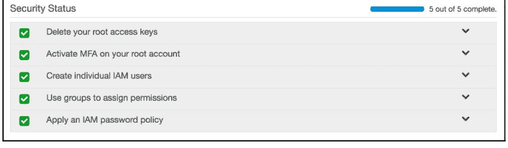

现在，我们将开始演练的初始步骤：

- 1. 开始演练，使用你的 IAM 用户 ID 登录 AWS 管理控制台。如果登录屏幕要求输入电子邮件地址，则你处于 root 用户登录而非 IAM 用户登录。你需要转到 IAM 用户登录屏幕。如果你难以到达该页面，诀窍是输入以下格式的 URL
  `https://[AccountName].signin.aws.amazon.com/console`，其中将 `[AccountName]` 替换为你自己的帐户名称。此链接也可以在登录后在 IAM 起始页上找到。
- 2. 确保 AWS 区域设置为你想要创建环境的区域。对于大多数用例，最好将其设置为地理位置最近的区域。你可以通过查看管理控制台右上角来检查区域。如有必要，你可以通过单击名称右侧的小箭头来更改它：

## 为 NAT 和 bastion 实例创建密钥对

你需要创建一个公钥/私钥对，以便稍后在快速入门设置中使用。密钥对将保存为文件，你应将其保存在安全的地方，只有需要的人才能访问：

- 1. 在屏幕顶部的 AWS 管理控制台中转到 **Services**：

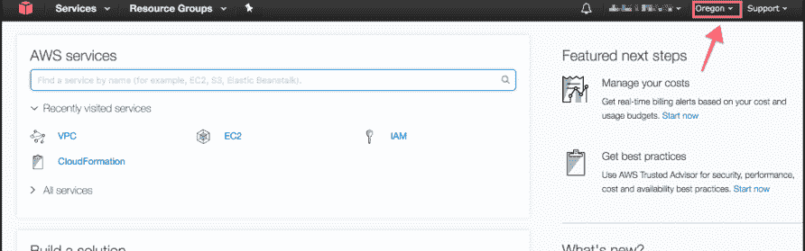

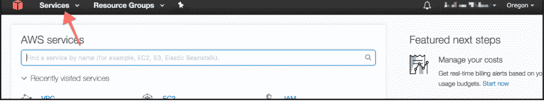

Services location on console

2. 然后，在 **Compute** 部分单击 **EC2**：

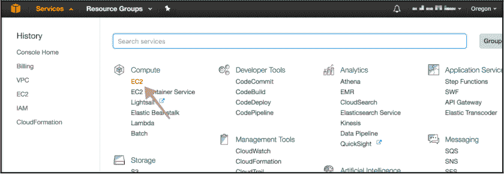

3. 从 EC2 **Dashboard**，单击 **Key Pairs**：

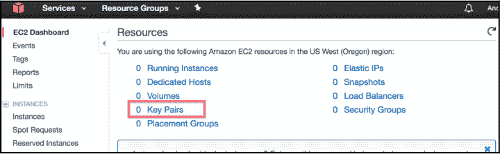

4. 单击 **Create Key Pair** 按钮：

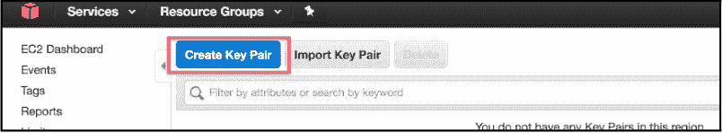

5. 为其命名，例如 `vpc_keypair` 并单击 **Create**。避免在名称中使用大写字母、空格或非标准字符。这将使其更易于在不同的操作系统和文件存储系统之间移植。


6. 单击创建按钮后，你将获得扩展名为 .pem 的密钥对文件（即 vpc_keypair.pem）。请确保你知道文件保存的位置。现在是将其移动到你想要保存的安全位置的好时机。控制台屏幕将会更新，你将看到列出你的新密钥对：

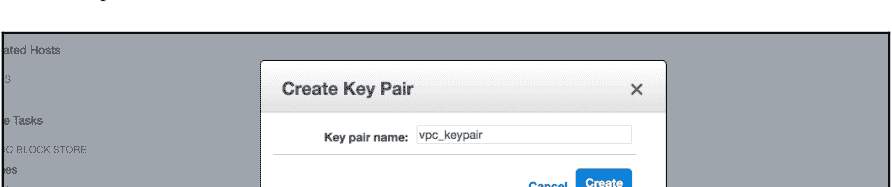

## 创建 S3 存储桶以存储数据

你需要创建一个 S3 存储桶来存储数据文件。S3 存储桶名称需要在全球范围内唯一；任何 AWS 用户都不能有同名的存储桶。你可能需要做一些试错来获得一个可接受的名称：

+   1. 通过单击 Services 然后 S3（在 Storage 部分）导航到 S3 控制台：

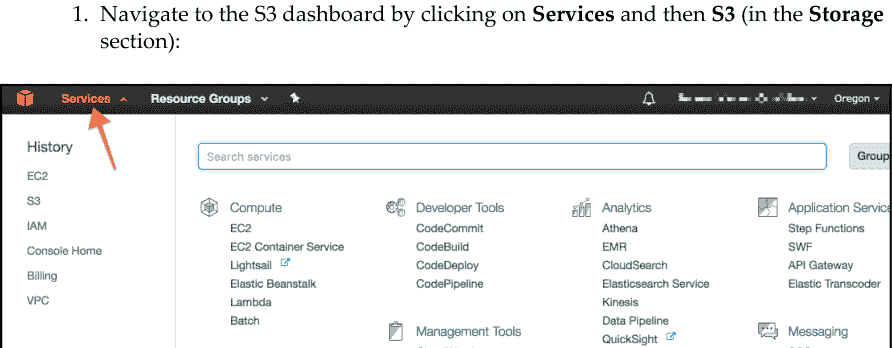

2. 单击屏幕左上角的 **Create Bucket** 按钮：


3. 为你的存储桶命名一个不太可能已存在的名称。避免使用大写字母或空格。你可以使用连字符 (-) 来分隔单词，但不能使用下划线 (_) 。选择你在本次演练中一直使用的相同区域。S3 存储桶是全球可访问的，但最佳实践是将数据保留在与分析工作相同的区域中。这样网络性能也会更好：

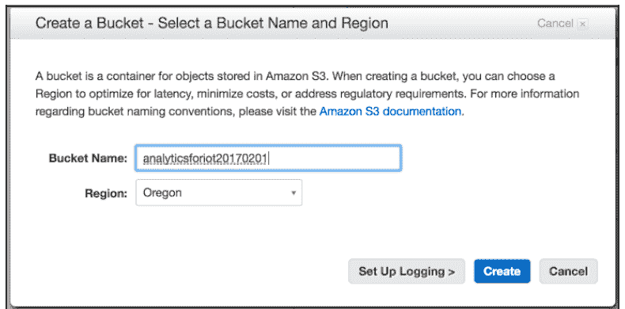

4. 你现在应该在 S3 控制台的列表中看到新的存储桶：

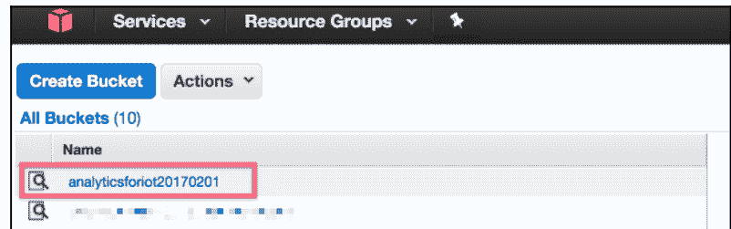

## 为 IoT Analytics 创建 VPC

现在，我们将通过创建一个功能完善、高可用的云环境进入有趣的部分。你将在大约 20 分钟内拥有一个安全运行的数据中心。我们将利用 CloudFormation 和一个快速入门模板来创建一个 VPC，其中包含一些关键元素：

+   - **Public subnets**：如果配置了公网 IP、附加的互联网网关和适当的路由表，则此子网中的资源可以通过公网互联网发现。你只想将诸如 Web 服务器或 NAT 实例之类的东西放在这里。
+   - **Private subnets**：这些子网中的资源对公众不可见。即使它具有公网 IP 地址，你的 VPC 外部的任何东西也找不到你放在这里的东西。出于安全原因；将诸如 Hadoop 集群、数据库和为分析处理目的创建的 EC2 实例之类的东西放在这里。
+   - **NAT gateways**：**Network Address Translation (NAT)** 网关充当私有子网中的资源与公网互联网之间的中介。
+   - **Bastion hosts**：这些是必要的，以便让你能够连接到私有子网中的 EC2 实例和 Hadoop 集群。

## 什么是 NAT 网关？

NAT 网关在仍允许与外部互联网通信的同时隐藏有关你的资源的信息。它们通过将私有 IP 地址翻译成不同的公网 IP 地址并在内部资源请求外部通信时记住翻译和连接状态来工作。公网互联网中的任何内容都无法反向操作，并且永远不知道私有子网中资源的真实 IP 地址。

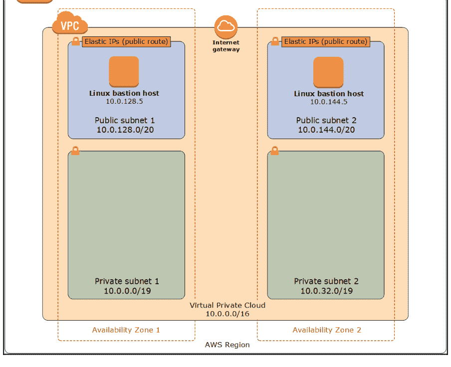

VPC 架构图。来源：AWS

每个公有子网中还将有一个 NAT 网关（尽管在前面的图中未显示）。为 VPC 定义的 IP 地址范围为你的未来分析项目提供了充足的增长空间。每个 EC2 实例、数据库或 Hadoop 集群中的节点都会占用一个 IP 地址编号。因此，可用 IP 地址的范围是你在 VPC 中可以拥有的资源数量的限制。我们将创建的 VPC 拥有超过 65,000 个可用 IP 地址。

## VPC 创建演练

以下演练向你展示如何创建上一节中讨论的 VPC：

+   1. 单击控制台页面左上角的 **Services**，然后在服务列表中单击 **CloudFormation**（在 **Management Tools** 部分）：

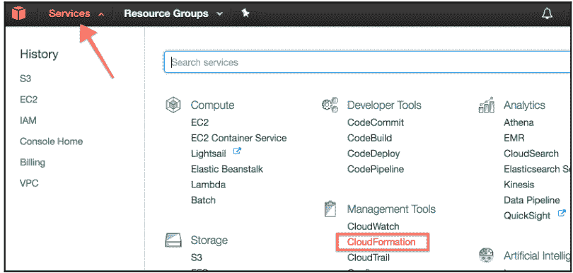

+   2. 单击 **Create Stack** 按钮：

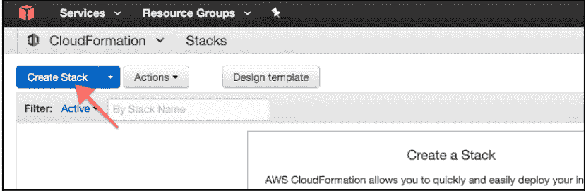

3. 在 Choose a template 部分，单击 Specify an Amazon S3 template URL 的单选按钮。然后输入或复制并粘贴以下内容：

```
https://s3.amazonaws.com/quickstart-reference/linux/bastion/latest/templates/linux-bastion-master.template:
```

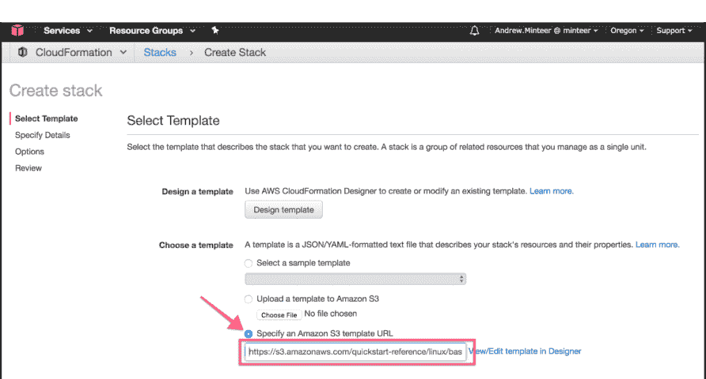

4. 单击 Next。

5. 将出现 Specify Details 部分。为你要创建的堆栈命名，但不要使用空格或特殊字符，只能使用连字符 (-) ：

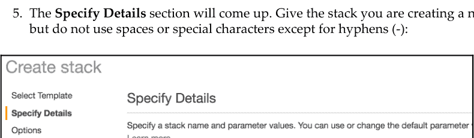

6. 在同一页面的 **Parameters** 部分，单击 **Availability Zones** 的文本框。会出现一个下拉框，列出你所在区域中的可用可用区：

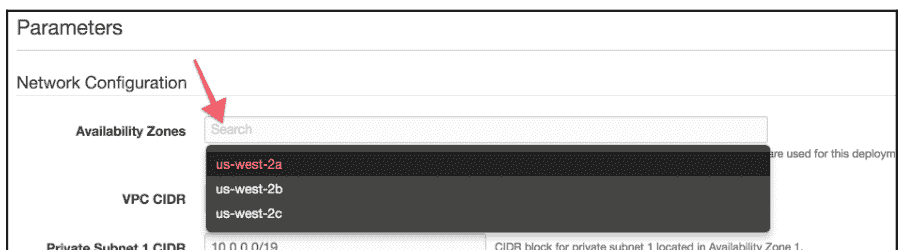

7. 在列表中单击一个可用区，然后再单击另一个可用区进行选择。你将在 AZ 文本框中看到两者，并且它应该如下所示，只是你选择的可用区位置不同：

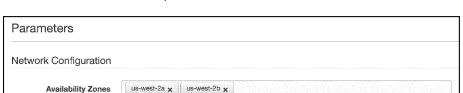

8. 继续向下滚动页面，对公有和私有子网的 CIDR 块使用默认设置；这里无需更改任何内容。

9. 在 **Allowed Bastion External Access CIDR** 文本框中，输入代表你公司网络或地理区域的 IP 范围的 CIDR 块。这定义了允许甚至尝试与堡垒主机通信的源位置。**Classless Inter-Domain Routing (CIDR)** 块是一种定义 IP 地址范围的表示法。如果你不确定该使用什么，请咨询你公司的网络专家。这应该只是用户可以接受地登录的范围。保持尽可能小和现实。CIDR 块 0.0.0.0/0 可以工作，但会将流量开放给所有人和任何地方。对于堡垒主机来说，绝对不推荐。

突出显示的 CIDR 块是一个示例；你将输入不同的一个：

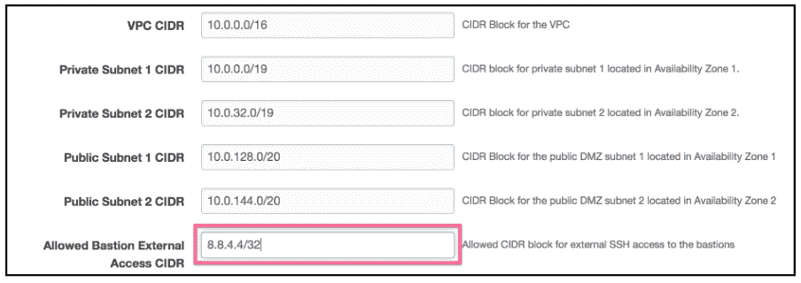

10. 在 Amazon EC2 Configuration 部分，单击 Key Pair Name 文本框。会出现一个下拉框。单击你之前创建的 Key Pair。对该部分中的其他选项使用已为你填写的默认值：

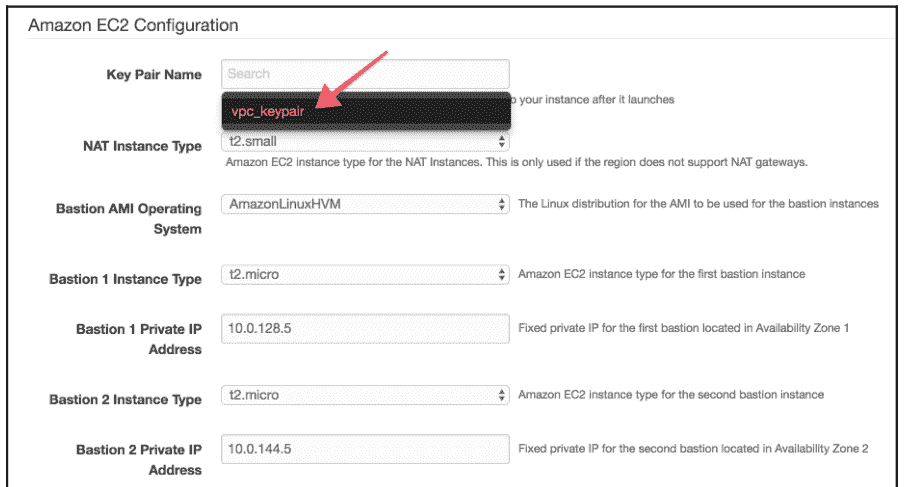

## 创建 AWS 云分析环境

11. 在同一页面的 **Linux Bastion Configuration** 部分，将 banner 选项更改为 true。这对于使你的堡垒登录屏幕看起来不同很有用，这样你就可以将其与其它 Linux SSH 会话区分开来：

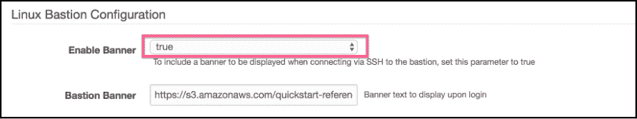

12. 使用 **AWS Quick Start Configuration** 部分中的默认值，然后单击 **Next** 按钮进入 **Options** 屏幕：

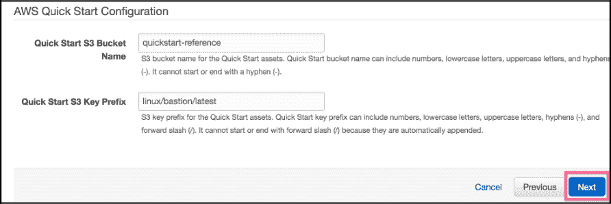

13. 在 **Options** 屏幕中，你可以为堆栈添加标签。标签是作为堆栈信息的一部分存储的键/值对。它们可以是你想要的任何内容，并且对于跟踪诸如谁创建了什么资源以及原因等信息很有用。建议你至少为名称和创建堆栈的个人创建一个键/值标签。要创建标签，你单击 **Key** 下的文本框。Key 文本字符串应跨资源保持一致（即，无论你是在创建 EC2 实例还是 Hadoop 集群，都始终使用完全相同的拼写的 Name）。单击 **Value** 下的文本框来完成标签。单击 + 按钮添加额外的标签。完成后，单击 **Next** 按钮查看你的选择：

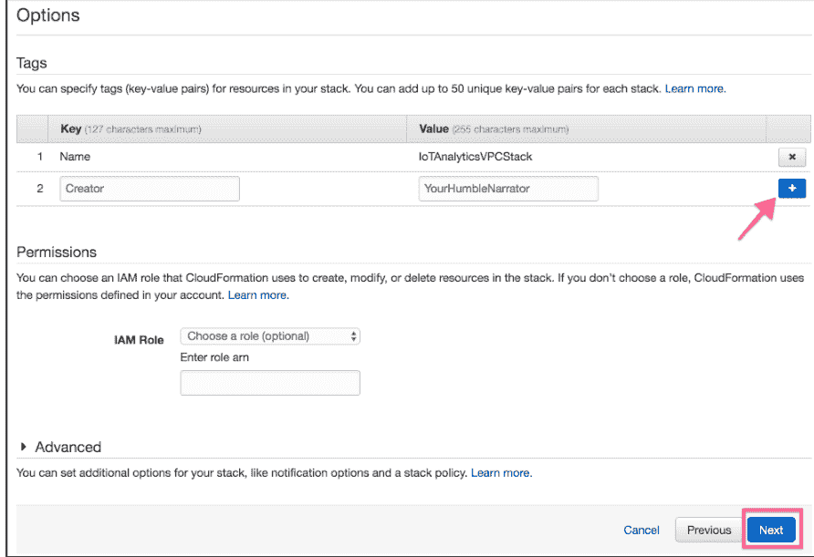

14. 在 **Review** 屏幕上，向下滚动以再次检查堆栈的设置。在 **Capabilities** 部分底部，选中确认框，然后单击 **Create** 按钮开始创建你的堆栈：

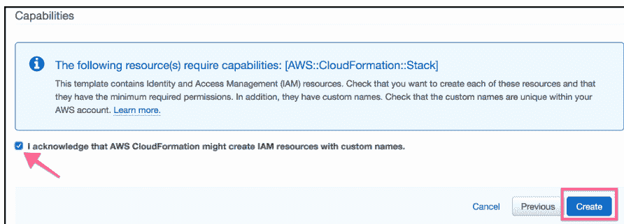

15. 你将被发送回 CloudFormation 堆栈列表屏幕。你会注意到你的堆栈现在已列出，状态为 **CREATE_IN_PROGRESS**。快速入门模板会调用其他堆栈来创建 VPC 的各个部分。随着创建过程的进行，你会看到列表中添加了额外的堆栈：

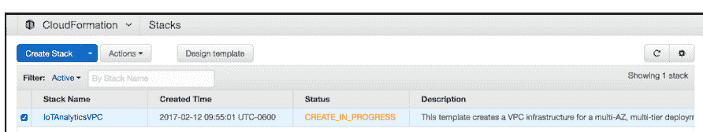

16. 当堆栈创建过程完成时，每个堆栈（总共三个）的状态将更改为 **CREATE_COMPLETE**。你可以转到 **Services** 和 VPC 来检查新环境中的网络资源：


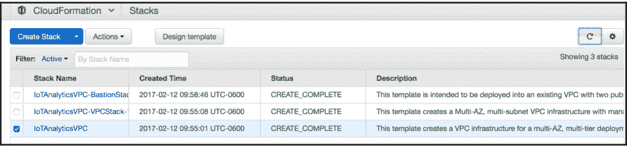

- 17. 前往 **服务** 并选择 EC2，进入 EC2 控制台检查您的 Linux 堡垒实例。它们需要完成启动并通过状态检查后，您才能连接到它们。
- 18. 要检查堡垒主机，请在 EC2 控制台中点击 **运行实例** 以查看 EC2 列表：

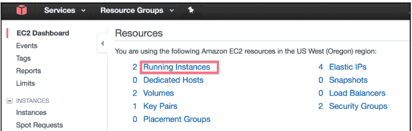

- 19. 当两个 Linux 堡垒主机的“实例状态”均为“运行中”且“状态检查”均为“已通过”时，它们就准备好了。这只需几分钟时间：

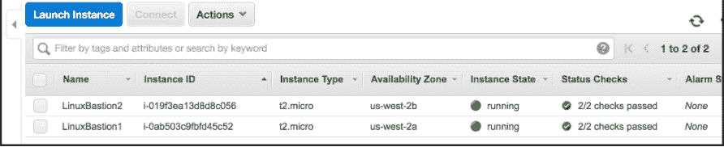

- 20. 连接到其中一个堡垒实例，以验证设置是否正确。您可以通过点击实例名称左侧的方框来选择该实例。然后，点击列表顶部的 **连接** 按钮。按照出现的说明建立连接。如果您使用的是 Windows 计算机，则需要下载并安装 PuTTY 或类似的终端软件才能进行 SSH 连接。说明窗口中的第 1 步中有一个链接，提供了相关操作指引：

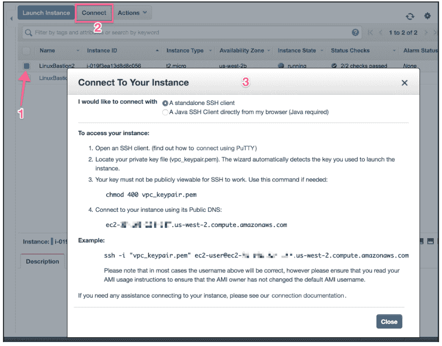

## 如何终止并清理环境

如果您不打算保留 VPC 环境，或者希望通过删除该环境来降低成本并在之后重新创建，请按照以下简单步骤操作：

- 1. 前往 **服务**，然后选择 CloudFormation，返回 CloudFormation 堆栈列表。
- 2. 逐个删除堆栈，从名称中包含 **BastionStack** 的堆栈开始。为此，请点击名称左侧的方框以选择该堆栈：
- 3. 点击 **Actions** 按钮，然后选择 **Delete Stack**：

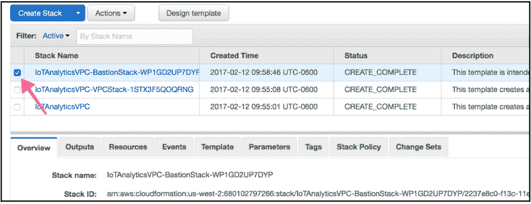

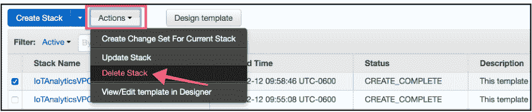

- 4. 点击 **Yes, Delete** 按钮确认删除。这将删除堡垒实例及相关的安全组：

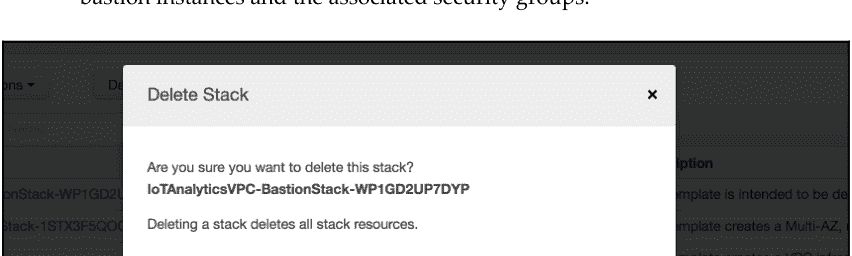

- 5. 堆栈的状态将变为 DELETE_IN_PROGRESS。删除完成后，该堆栈将从列表中移除。如果几分钟后未看到变化，可以点击右上角的刷新按钮（圆形箭头）：

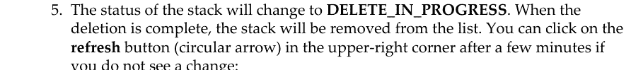

- 6. 对名称中包含 VPCStack 的堆栈重复步骤 2 到 5，最后对创建时指定的名称的剩余堆栈执行相同操作（在本演练中为 IOTAnalyticsVPC）。

- 7. NAT 网关和堡垒主机是环境中成本较高的项目。通过前往 **服务**，然后选择 VPC，验证 NAT 网关是否已被删除。控制台上的 NAT 网关计数可能不为零，并且在从列表中移除之前可能仍会显示为 2 达几个小时。点击控制台中的 NAT Gateways 以进入网关列表：

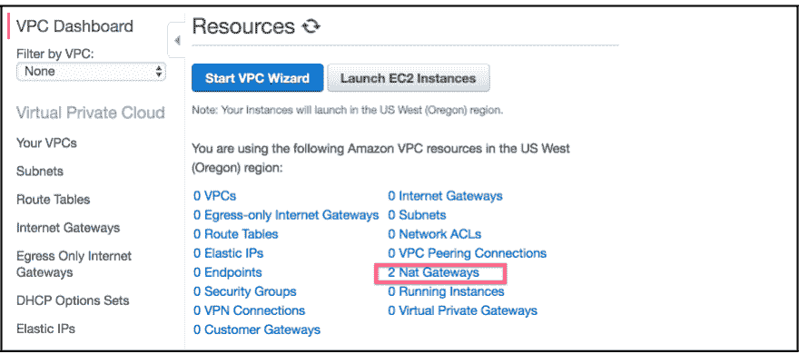

- 8. 您应该看到两个网关的状态均为“已删除”：

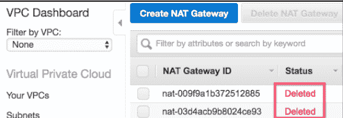

- 9. 通过前往 **服务**，然后选择 **EC2**，验证堡垒主机是否已被删除。**EC2 控制台** 的“运行实例”计数应为 **0**。您可以点击 **运行实例** 链接进入 EC2 列表。Linux 堡垒实例的状态应显示为“已终止”，或者根本不在列表中。如果您在删除堆栈后不久进行检查，实例很可能仍然在列表中可见。只要状态为“已终止”，您就不会被收费：

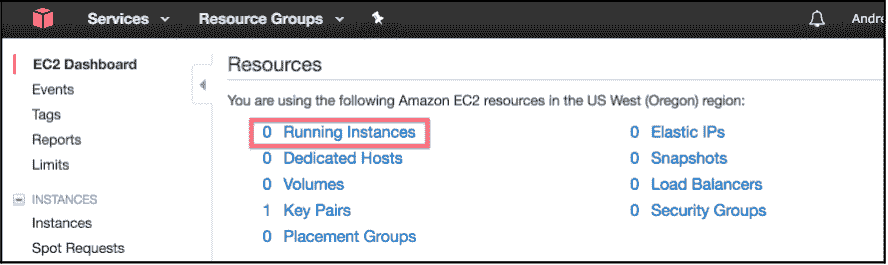

- 10. 重新创建环境时，您无需重新创建密钥对或 S3 存储桶。由于密钥对和 S3 存储桶不属于 CloudFormation 堆栈的一部分，因此即使所有堆栈都已删除，它们仍会保留在您的环境中。除非您在 S3 存储桶中存储了数据，否则这些服务不会产生费用；即使有数据，成本也非常低。

## 总结

在本章中，我们在不到半小时的时间内创建了一个安全的虚拟私有云，它已准备好支持 IoT 分析。我们还回顾了在不再需要时如何删除和清理环境。我们讨论了 AWS CloudFormation、NAT 网关和 Linux 堡垒主机。您现在拥有了一个安全且灵活的场所来启动大规模分析，我们将在本书后面部分进行此操作。
