# 第 5 章 收集所有数据 - 策略与技术

你盯着挂在工位墙上的 IoT 设备图纸，沉思着如何利用这些数据来挖掘颠覆性的见解。你几乎能听到同事们在你领取年度最佳项目执行奖和巨额奖金时为你欢呼的声音。

“咳咳！”有人在你身后咳嗽。你差点从椅子上跳起来。

你的老板悄悄走到你的工位旁。他看起来既高兴又觉得有趣。你对那个“有趣”的表情有点担心。

“你向客户推销使用云进行分析的工作做得非常出色，他们完全支持并希望立即开始，”他笑着说。你精神一振，因为这是个好消息。

“你做得太好了，”他得意地笑着说，“以至于他们希望下一代设备的数据采集率提高一倍。他们认为如果通过云基础设施路由，成本不会有太大变化。而且由于容量限制不再是问题，他们现在希望将月度报告改为每周报告。另外，其他部门的几位高管也非常兴奋，希望他们自己的团队也能使用这些数据。干得好！”

他暗自笑着走开了。你既对结果感到高兴，又对如何实现他们的期望感到困惑。如何以一种他人可以交互的方式存储数据？而且你确信现在需要回答的问题范围会更广，尤其是当其他部门的人员也在查看这些数据时。无论你做什么，都必须能够以高度的灵活性处理大规模数据。

本章介绍收集 IoT 数据以支持分析的策略。有许多选项可以存储 IoT 数据用于分析。我们将回顾该领域的一项常见技术 Hadoop，以及如何使用 Amazon S3 作为大数据存储。本章还描述了何时以及为何使用 Spark 进行数据处理。我们将讨论流处理和批处理之间的权衡。还将回顾如何在数据处理中构建灵活性，以便将来集成分析功能。

本章涵盖以下主题：

- 为分析设计数据处理
- 将大数据技术应用于存储
- 使用 Apache Spark 进行数据处理
- 处理变化

### 为分析设计数据处理

在您的 IoT 数据处理环境中，可能会使用一些关键的云服务。AWS 和 Microsoft Azure 都有 IoT 特定服务，我们将对其进行回顾。此外，还有一些支持数据处理和转换的服务值得回顾，以增加您对它们的了解。

### Amazon Kinesis

Amazon Kinesis 是一组用于加载和分析流式数据的服务。它为您处理所有底层计算、存储和消息传递服务。

Kinesis 系列中的服务如下：

- **Amazon Kinesis Firehose**：该服务支持将大量流式数据加载到 AWS 中。
- **Amazon Kinesis Streams**：该服务允许您创建自定义应用程序，以实时处理和分析流式数据。每条流都有两端；您使用 Amazon **Kinesis Producer Library (KPL)** 构建将数据发送到流中的应用程序。Amazon **Kinesis Client Library (KCL)** 用于从流中读取数据的应用程序中 —— 通常是实时仪表板或规则引擎类型的应用程序。流数据也可以定向到其他 AWS 服务，例如 S3 或 SQS。


- **Amazon Kinesis Analytics**：这使你能够使用标准 SQL 轻松分析流数据。查询可以持续运行，AWS 会自动处理运行所需扩展。

## AWS Lambda

Lambda 允许你在无需预置服务器的情况下运行代码。Python、Node.js、C# 和 Java 编程语言目前均受支持。扩展由系统自动处理。你只需在代码执行时付费。所有内容均并行运行，你的代码要么无状态，要么需要在外部数据库中管理状态。代码本质上是事件驱动的，因为你可以配置何时以及在什么条件下执行。

使用 Lambda 等服务通常被称为 **无服务器计算**，并开启了全新的可能性。你可以用 Lambda 创建一个完全功能且没有后端服务器的 Web 应用程序。你可以创建可扩展至数百万设备事件的分析代码，而无需担心管理服务器。以下图表概述了其在实践中的工作原理：

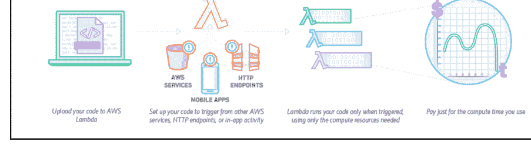

## AWS Athena

Athena 是在 2016 年底推出的一项新服务，并在 S3 中存储的数据上运行。它允许你使用 ANSI SQL 查询数据集。无需将数据加载到 Athena 中；它直接查询其中的原始文件。这使你能够在无需 **提取、转换和加载 (ETL)** 将数据加载到数据分析系统即可分析大量数据。无需管理集群或数据仓库。你按扫描的数据量付费，这意味着你可以压缩数据以降低成本。

将此与 Lambda 结合，你就可以拥有一个相当不错的低成本大数据解决方案。将原始物联网文件存储在 S3 中，并安排 Lambda 作业定期将新数据转换为分析就绪的数据集——同样存储在 S3 中。使用 Athena 中的 SQL 进行分析。你可以在无需担心服务器、集群、扩展或管理复杂 ETL 的情况下完成所有这些操作。

## The AWS IoT platform

AWS IoT 平台处理连接的物联网设备与你的 AWS 环境之间通信的数据消息和安全。它可以支持数十亿台设备和数万亿条消息。

还支持 MQTT、HTTP 和 WebSockets 协议。它为通信提供身份验证和加密服务。所有 AWS 服务都可用于处理、分析和对物联网数据做出决策。通信可以是双向的。

**设备影子** 用于存储每个物联网设备的最新状态信息。这使得应用程序看起来设备始终可用，因此可以在无需等待设备连接的情况下发出命令和读取值。设备影子会在设备连接时与物联网设备同步。

AWS IoT 设备 SDK 安装在远程物联网设备上以处理通信。注册和身份验证服务在 AWS IoT 平台中处理。规则引擎可以在满足某些条件时将消息定向到其他 AWS 服务，例如 Lambda（例如 `[device temperature < 0 degrees Celsius]`）。

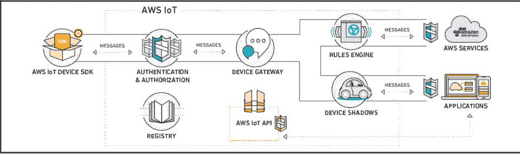

AWS IoT 平台的基本概述。来源：Amazon Web Services

**AWS Greengrass** 是物联网家族中的一个新产品，在撰写本文时处于预览阶段。它允许简化边缘分析。这使其对物联网分析的可能性令人兴奋。它是安装在设备或附近设备集线器上的本地软件。它可以在设备未连接时自动处理事件数据的缓冲。它还——而且这是令人兴奋的部分——支持与 AWS 云相同的 Lambda 函数。你可以在 AWS 环境中构建和测试函数，然后只需最小的工作量即可将其迁移到 Greengrass 以在边缘运行。

## Microsoft Azure IoT Hub

Azure IoT Hub 是 Azure 后端与物联网设备之间双向通信的管理服务。数百万台设备可以在 IoT Hub 上运行；服务可根据需要扩展。通信可以是单向消息传递、文件传输和请求-应答方法。它与其它 Azure 服务集成。

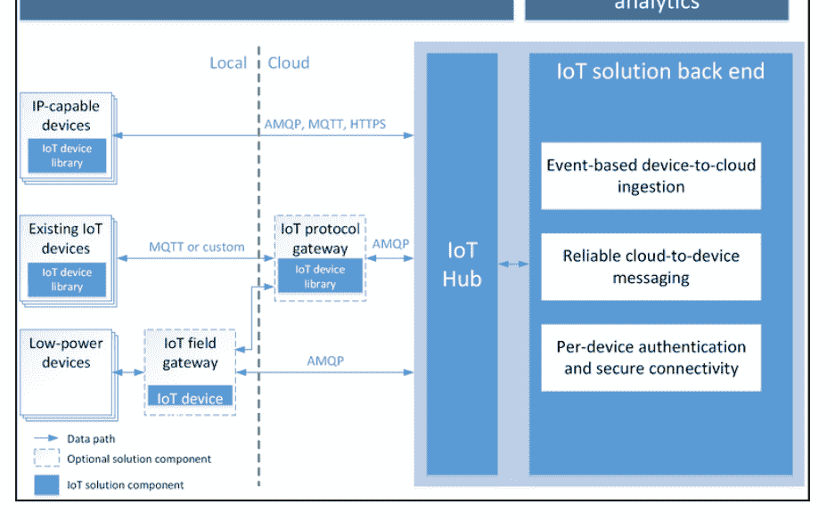

示例 Azure IoT Hub 解决方案架构。图片来源：Microsoft Azure

Azure IoT Hub 具有一些关键功能，可让你了解其工作原理：

- **身份验证和连接安全性：** 每个设备都预置了自己的安全密钥以连接到 IoT Hub。身份和密钥存储在 IoT Hub 身份注册表中。
- **设备双胞胎：** 这些是存储诸如配置和参数值等状态信息的 JSON 文档。它存储在云中并为连接到 IoT Hub 的每个设备持久保存。双胞胎允许你在设备离线时存储、同步和查询设备数据。
- **连接监控：** 在这里，你可以接收有关设备身份管理和连接事件的详细日志。
- **物联网协议支持：** MQTT、HTTP 和 AMQP 协议由你将安装在物联网设备上的 Azure IoT 设备 SDK 支持。即使你无法在设备上使用 SDK，它们也通过公开的公共协议支持。
- **物联网协议可扩展性：** 你可以通过以下任一方式支持自定义协议：
  - **创建现场网关：** 你可以使用 Azure IoT 网关 SDK 将你的自定义协议转换为 IoT Hub 理解的三种协议之一。
  - **自定义 Azure IoT 协议网关：** 它在 Azure 云中运行，是一个开源组件。
- **扩展：** 数百万台设备可以同时连接，数百万个事件每秒流经集线器。

## Applying big data technology to storage

物联网数据涌入你的云环境并在处理和转换之后，下一个需要解决的问题是如何存储它。解决方案应支持保存大型数据集，并且易于用于分析进行交互。

### Hadoop

Hadoop 是 Apache 软件基金会旗下的一项开源项目。如官方项目文档所述，*The Apache Hadoop project develops open source software for reliable, scalable, distributed computing.* Hadoop 在其纯开源形式下可免费使用。

除非你的团队中有一些 Hadoop 专家，否则你应选择托管的 Hadoop 发行版之一。这将为你提供故障排除支持和实施建议。Cloudera 和 Hortonworks 是托管发行版和支持的两大主要提供商。Amazon AWS 和 Microsoft Azure 均有自己的 Hadoop 托管服务，分别为 EMR 和 HDInsights。

Hadoop 最初有点难以描述。在大多数媒体文章中，它通常被提及为一种新的数据仓库程序，你只需安装即可投入大量数据。这是一种过于简化的看法，因为它更像是一个相关项目的生态系统，而非单一事物。

一些组件依赖于其他组件，而一些可以独立运行。一些承担数据存储角色，一些承担数据处理，一些承担资源管理。甚至有些是否属于 Hadoop 类别存在争议，或者是否应拥有自己的类别。

在单一章节中回顾所有内容会让你头晕目眩，因此我们将重点关注物联网分析的关键组件。以下图片显示了生态系统中项目的数量。它显示了 Hortonworks 托管发行版（版本 2.5）中包含的所有 Hadoop 组件。我们将省略大部分资源管理、安全和面向开发者的组件，例如 Zookeeper、Knox 和 Pig：

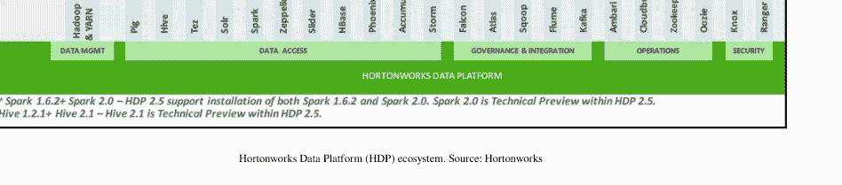

Hortonworks 数据平台（HDP）生态系统。来源：Hortonworks

Hadoop 组件设计为跨多台服务器分布式运行。一个集群可能包含数千台独立服务器。它具有容错能力，服务器故障是设计中预期的一部分，并且可以在集群正常运行和操作时添加或移除服务器。

从分析的角度来看，将 Hadoop 生态系统视为四个相互连接但松散耦合的服务是有帮助的。这些服务相互通信，但在很大程度上完全独立地处理各自的角色。这种高层视图在以下图表中显示：

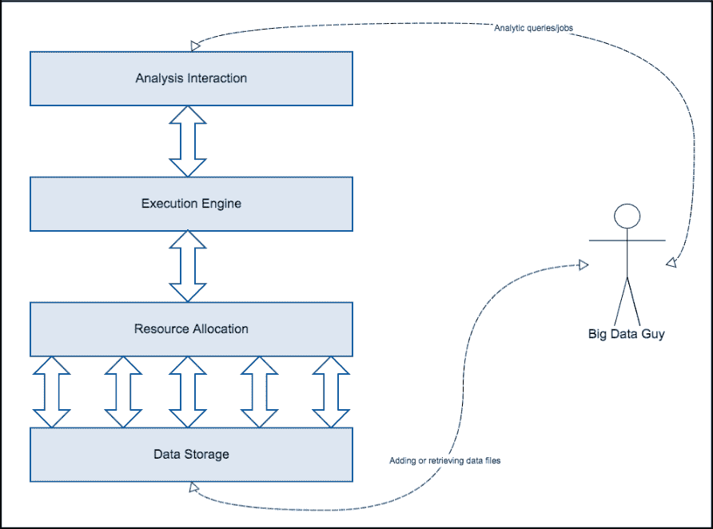

Analysis Interaction

Execution Engine

Resource Allocation

Data Storage

Big Data Guy

Analytic queries/jobs

Adding or retrieving data files


在我们概念性的视角中，这四个服务如下：

- **分析交互**：这里将占用你大部分时间。在这里编写并提交代码、SQL，或者连接可视化工具。该区域的组件接收较高级别的指令，并将其分解为较低级别的处理步骤以供执行。它们为你抽象掉了许多繁复的细节。Hive 和 SparkContext 就是例子。
- **执行引擎**：你应该了解该区域中的组件如何工作，但不太可能直接与它们交互。Apache MapReduce 和 Tez 就是例子。这些服务负责处理步骤将以何种方式、按何种顺序执行。
- **资源分配**：这一点对于优化目的而言很重要。这里会监控每个节点并分配工作。YARN 是关键角色。
- **数据存储**：该区域负责数据文件的组织与存储。你将在这里直接交互，因此理解这些服务中发生的事情及其运作方式非常重要。HDFS 和 S3 就是例子。文件格式和类型也同样重要，因为它们直接影响分析交互服务的灵活性和效率。

## Hadoop 集群架构

接下来，我们将回顾构成 Hadoop 集群的节点类型、它们所扮演的角色，以及它们如何整合在一起，确保集群作为一个正常运转的整体。同一集群中的服务器之间会频繁通信；它们非常「健谈」。

大多数集群配置都将物理单元（就网络而言）放在彼此靠近的位置，以最大限度减少带宽瓶颈。托管式的云 Hadoop 发行版会在设置时为你处理这一事宜。但如果决定自己手动创建集群，则需要在设计架构时把网络方面的考量放在心上。

## 认识 Linux


Linux 在大数据计算集群中无处不在。由于它是开源的，许可成本极低甚至为零。它的系统开销低于 **操作系统（OS）** 如 Windows。这使它成为集群计算的理想选择，此类集群中节点数量可达数千个，每个节点都有自己的操作系统。想象一下为上千台服务器支付 Windows 许可费用……真是令人头疼。

简而言之，对于 IoT 分析，你*确实*需要知道如何与 Linux 操作系统交互。这是不可避免的，而且一旦习惯了也没那么糟糕。你不必成为专家，但需要知道如何四处查找、运行程序以及做一些基本的脚本编写。好好补习 Bash！你会了解到什么是 shebang（谷歌一下）。

## 什么是节点？

节点是集群中的一个单元，拥有对自身一定数量 CPU 和内存资源的控制权。它也有自己的操作系统。在大多数 Hadoop 实现中，这是一个单独的服务器；不过，如果每个节点能够控制分配给它的计算和内存资源（通常通过虚拟化实现），一台物理服务器上也可以有多个节点。

## 节点类型

一个 Hadoop 集群有一个 **MasterNode** 和一个到多个 **slave** 节点。MasterNode 运行所谓的 **NameNode**。NameNode 的职责是跟踪哪些其他节点健康以及有关集群的一些其他关键信息，例如文件位置。还有一个角色是 **ResourceManager**，每个集群一个，它可能与 NameNode 在同一台服务器上，也可能不在。你将在 HDFS 部分了解更多关于 NameNode 的信息，在 YARN 部分了解更多关于 ResourceManager 的信息。

集群中的其余机器同时充当 **DataNode** 和 **NodeManager**。这些是工作者。你猜对了，这里就是数据被分布存储以及分布式计算发生的地方。有几种类型的从节点为集群扮演不同角色。它们大多数被称为数据节点。也有主要用于与外部网络交互的从节点，这些被称为**边缘节点**。

集群上的一些其他服务，例如 Web 应用代理服务器和 MapReduce Job History 服务器，通常运行在专用节点或共享节点上——通常是边缘节点。将它们放在何处的决定取决于共享节点资源的服务的负载要求。

## Hadoop 分布式文件系统

**Hadoop 分布式文件系统（HDFS）** 是一种分布在多台服务器上的文件系统，设计用于在低成本商用硬件上运行。HDFS 支持一次写入、多次读取的理念。它专为在大到巨大的文件上进行的规模化批处理工作而设计。

文件被分成**块**。典型的块大小为 128 MB。HDFS 上的文件会被切成 128 MB 的块，并分布到不同的数据节点上。HDFS 中的文件通常从几千兆字节到数太字节不等。

HDFS 是为批处理而设计的，而不是为用户的低延迟交互式查询。HDFS 不适合那些频繁通过数据更新而改变的文件。新数据通常被追加到文件中，或添加到新文件中。许多小文件对 HDFS 的操作不利，因此出于性能原因，文件通常被合并成一个较大的文件。

下图展示了 HDFS 的一般架构。NameNode 控制文件命名空间，并充当跨节点文件操作的门卫。它跟踪文件块的位置，并处理客户端的读写文件请求：

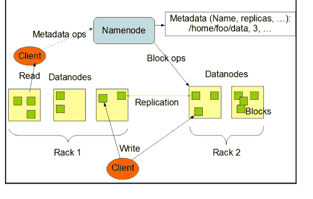

HDFS 架构。来源：Apache 软件基金会

HDFS 假定硬件会故障、文件会丢失或损坏。它解决此问题的方法之一是在节点间保留文件的多个副本。没有哪个节点会拥有一个文件的全部副本。副本数量是可配置的，默认设置为三。HDFS 会利用一些智能策略来决定文件块的放置和分布，以平衡容错与性能。

如果某个节点发生故障并导致文件块丢失，HDFS 会自动根据其他节点上剩余的副本生成新的块来替换它们。这些新副本会分布到其他正常运行的节点上。NameNode 会跟踪所有这些操作。文件块也会为了性能优化的目的而移动。文件块的实际复制由数据节点相互通信完成。

为了了解其工作原理，我们将描述写入文件的高级过程。客户端（可以是 MasterNode 上的命令行提示符，或其他连接到集群的软件）请求写入或读取某个文件。该请求发送到 NameNode，NameNode 返回可以读取或写入文件块的节点标识符列表。当写入文件时，文件块由客户端请求一次性写入列表中的节点。然后，数据节点之间相互通信，将副本复制到设定的份数。

HDFS 文件命令与 Linux 文件系统命令非常相似。下面的示例指示 HDFS 将本地文件 lots_o_data.csv 分发到 HDFS 集群命名空间中的 /user/hadoop/datafolder：

```
hdfs dfs -put lots_o_data.csv /user/hadoop/datafolder/lots_o_data.csv
```

下面的示例会将同一文件从 HDFS 中的分布式形式复制到本地（非 HDFS 单服务器）文件目录：

```
hdfs dfs -get /user/hadoop/datafolder/lots_o_data.csv lots_o_data.csv
```

NameNode 抽象了文件各部分的真实分布式位置。这使得客户端可以使用熟悉的文件夹命名方式来访问它，就像文件存储在一个驱动器上的单个文件中一样。命名空间会自动扩展以纳入新节点，从而增加更多存储空间。

文件可以是任何类型，不必是标准格式。你可以有无结构文件，例如 Word 文档，也可以有非常结构化的文件，例如关系数据库表导出文件。HDFS 不关心文件中所含数据的结构化程度。

许多用于分析目的而与 HDFS 交互的工具确实依赖结构。结构可以在读取文件前按需应用，这称为读时模式（schema-on-read）。也可以在文件写入时在文件内部定义结构。第二种方式称为写时模式（schema-on-write）。


Schema-on-write 是关系型数据库（如 Oracle 或 Microsoft SQL Server）的运作方式。这是 HDFS 与传统数据库系统的主要区别之一：HDFS 可以对同一数据集应用多种结构（schema-on-read）。缺点是读取数据集的应用程序必须知道并应用该结构才能用于分析。有一些开源项目旨在解决数据集需要明确结构时的这一缺点。我们接下来将讨论其中两个主要项目。

## Parquet

Apache Parquet 是一种用于数据的列式存储格式，其中数据的结构被纳入文件中。它可供 Hadoop 生态系统中的任何项目使用，是分析的关键格式。它旨在满足互操作性、空间效率和查询效率的目标。Parquet 文件可以存储在 HDFS 以及非 HDFS 文件系统中。


Parquet logo

列式存储非常适合分析，因为数据按表列而不是行存储和排列。分析用例通常选择多个列并对值执行聚合函数，例如 sum、average 或 standard deviation。当数据以列存储时，读取请求数据既更快也需要更少的磁盘 **Input/Output (I/O)**。

数据通常以有序形式存储，使得抓取所需部分变得容易，并且仅读取所选列的数据。与之相比，行式格式通常需要读取整行才能获取到必要的列值。列式对于分析来说很棒，但并非全是优点和玫瑰；它不适合事务性用例。

Parquet 旨在支持非常高效的压缩和编码方案。它允许为数据集中的每个列使用不同的压缩方案。它还通过允许随着发明而添加更多编码来设计为可扩展的。

Parquet 文件组织为嵌套组件。**row group** 包含数据集的一个分区的数据；列数据值保证存储在一起以最大限度地减少磁盘 I/O 需求。

每个列值的集合称为 **column chunk**。column chunk 进一步分为页面。文件的尾部和页脚存储有关文件和 column chunks 的整体元数据。它位于末尾，以便创建文件的写入操作可以一次性完成。这是必要的，因为在所有数据处理到文件中之前，完整的元数据是未知的。以下图表表示 Parquet 文件内的划分：

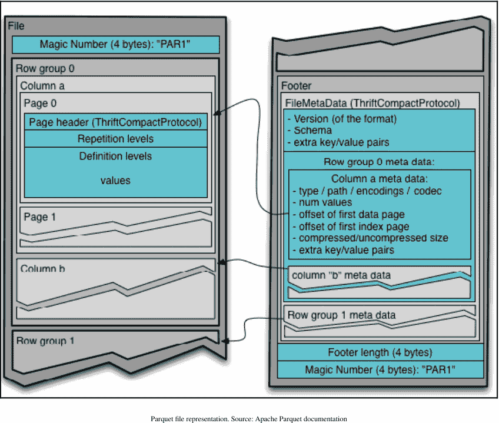

文件元数据保存了正确定位和解释数据所需的信息。有三种类型的元数据，与关键的嵌套组件相对应：文件元数据、列（chunk）元数据和页面头元数据。以下图表显示了元数据各部分的逻辑关系：

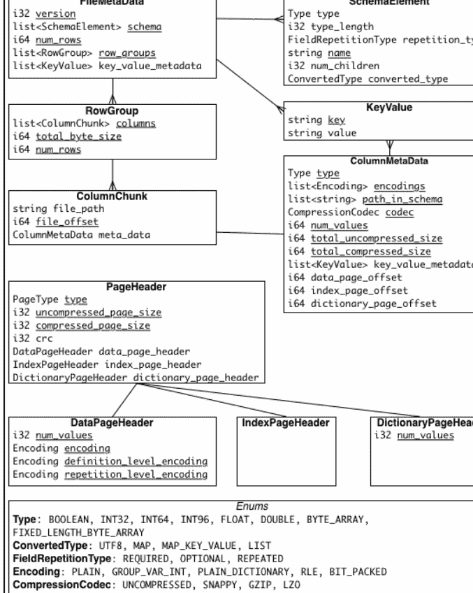

Parquet file metadata detail. Source: Apache Parquet documentation

数据类型有意保持简单，以促进使用它的框架提供更多选项；请参阅上一个图表中的 enums 框以获取支持的类型（Type）。字符串以二进制形式存储，并将 ConvertedType 设置为 UTF8。

推荐的 row group 大小为 512 MB 到 1 GB，对应的 HDFS 文件块大小为相同设置。这允许通过一次文件块检索读取整个 row group。Parquet 文件扩展名为 .parq。

## Avro

Avro 是一个 Apache 开源数据序列化系统项目。该系统将数据处理为具有一些有用属性的结果容器文件。它使用二进制数据格式以保持文件大小小且紧凑。这也导致读取速度更快。


数据的结构存储在文件容器中。支持丰富的复杂数据结构。Avro 文件结构或 schemas 使用 JSON 定义。这就文件创建而言是一个 schema-on-write 过程。这带来的好处是客户端应用程序无需生成代码来定义数据结构。这使得使用 Avro 文件进行分析目的变得更简单，因为你无需在分析代码中发现和定义文件 schema。

有 Python 和 Java 库可用于创建和读取 Avro 文件。最有可能的是，你将使用诸如 Hive（将在后面的章节中讨论）之类的东西将数据存储到 Avro 文件中。Avro 支持 null、boolean、int、long、float、double、bytes 和 string 的原始数据类型。它还支持数组、record 和 enums 等复杂数据类型。以下是示例 JSON schema 定义：

```
```json
{
  "namespace": "iotexample.avro",
  "type": "record",
  "name": "Sensor",
  "fields": [
    {"name": "sensor_id", "type": "string"},
    {"name": "temperature", "type": ["double", "null"]},
    {"name": "recorded_time", "type": ["string", "null"]}
  ]
}
```
```

数据记录在序列化期间转换为二进制，并且也可以被压缩以进一步减小大小。Avro 文件的扩展名为 .avsc。

## Hive

我们现在从文件存储格式转向数据处理和检索组件。Apache Hive 是 Hadoop 生态系统中的一个项目，位于分析交互区域。它允许你用一种类似 SQL 的语言编写查询，称为 Hive Query Language（HiveQL），它将其解释为在 HDFS 上执行的处理命令。HiveQL 与 SQL 非常相似，任何 SQL 开发人员都可以立即使用。

Hive 架构由用户界面（UI）、元存储数据库、驱动程序、编译器和执行引擎组成。这些组件协同工作，将用户查询转换为执行编排并利用 Hadoop MapReduce（通常）和 HDFS 返回结果的 Directed Acyclic Graph（DAG）操作。

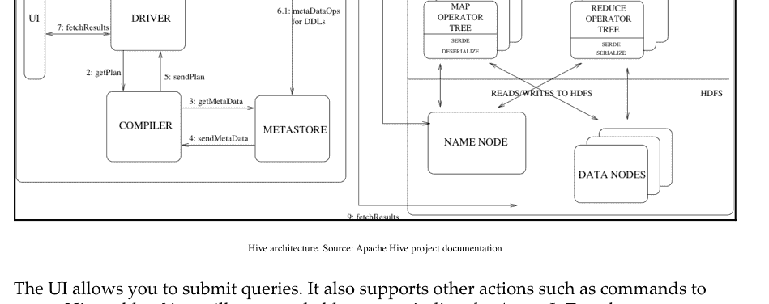

Hive architecture. Source: Apache Hive project documentation

UI 允许你提交查询。它还支持其他操作，例如创建 Hive 表的命令。你很可能不会直接使用它。作为物联网分析师，你更可能通过基于 Web 的界面（如 Hue）或通过使用 Hive ODBC 驱动程序的另一个应用程序（如编程 IDE 或 Tableau 等可视化软件）与之交互。

**metastore** 数据库保存有关 Hive 表的信息。Hive 表与关系型数据库表非常相似，其中结构是预先定义的。Hive 表可以由 Hive 在 HDFS 中管理，也可以定义为指向未由 Hive 管理的数据文件（称为 **external tables**）。在 HDFS 中外部表不是必需的。Amazon S3 是一个常见示例，其中结构化文件可以存储并仍可通过 Hive 查询，只要为其创建了 Hive 表定义即可。

元存储数据库可以托管在集群内部或远程。如果你在为临时使用创建临时 Hadoop 集群，例如通过 Microsoft HDInsights，远程数据库可能很有用，因为元数据可以在集群生命周期之外持久存在。这允许它被集群的未来实例使用。这在 Hadoop 用于批处理作业或临时用例（如实验性分析作业）时更为常见。Hive 元存储也可以被其他 Hadoop 生态系统项目使用，例如 Spark 和 Impala。

**driver** 充当协调器。它为查询创建唯一的会话 ID，将其发送给编译器进行查询计划，然后发送给执行引擎进行处理。最后，它协调结果记录的获取。

**compiler** 与元存储通信以获取查询中表的相关信息。它检查类型并制定执行计划。计划采用 DAG 步骤的形式，可以是 map 或 reduce 作业、元数据操作或 HDFS 操作。执行计划传回驱动程序。

**execution engine** 根据执行计划向适当的 Hadoop 组件提交操作。在执行步骤期间，数据存储在临时 HDFS 文件中以供计划中的后续步骤使用。当驱动程序发送获取请求时，最终结果由执行引擎检索。

下面是一个示例表创建语句：

```
CREATE TABLE iotsensor (
        sensorid BIGINT,
        temperature DOUBLE,
        timeoutc STRING
)
STORED AS PARQUET;
```


Hive 表可以支持分区和其他提升性能的选项。查询语句与 SQL 非常相似，对于大多数简单查询通常无法区分。这是一个示例查询语句：

```
SELECT stdev_samp (temperature) FROM iotsensor WHERE TO_DATE(timeread) > '2016-01-01'
```

以下是使用 Hive 进行物联网分析的一些提示：

- 1. **避免过多的表连接**：单个查询中连接的表应少于五个。如果无法做到这一点，请将查询拆分为多个连续的查询，将中间结果构建到临时表中。
- 2. **尝试使用除 Hadoop MapReduce 之外的执行引擎使用 Hive**：Hive on Tez 和 Hive on Spark 是两个较新的实现项目，它们通过最小化磁盘 I/O 并利用更多内存处理来提供更快、更高效的查询处理。
- 3. **将数据存储在 Parquet 文件中**：列式存储更好地支持分析中常见的查询类型。文件压缩可以减少物联网数据的磁盘空间需求。


## 序列化/反序列化 SerDe

你会在 Hadoop 相关文档中经常看到 **SerDe**。SerDe 是 Serialization/Deserialization 的缩写。序列化和反序列化指的是文件如何从保存状态转换到标准化的可读格式。序列化是写入时创建文件的一部分，而反序列化发生在文件被读取时。这使得文件可以被压缩和结构化。有关文件内容和数据结构的元数据也可以作为文件的一部分保存。

它是一种将解码文件格式的细节从客户端应用程序中*抽象*出来的方式。它还允许多种不同的格式在同一环境中无缝工作。甚至其中一些格式以后也可以被发明出来，一切仍然可以正常工作。

Hadoop 中的 SerDe 会指向处理文件编码和解码的应用程序。这通常是 hive 表创建脚本中的一个设置，它将被存储在元存储中，后续客户端在读取模式时引用它。

## Hadoop MapReduce

Hadoop MapReduce 是 Hadoop 框架的核心组件。它是一个软件框架，使并行处理能够在集群中的节点间分布式执行。该主题可能会让人感到困惑，因为人们倾向于将 MapReduce 概念和 Hadoop 组件互换使用，好像它们完全一样。

Map 和 Reduce 的概念将在本章后面的 Spark 部分中介绍。它与任何特定的框架或项目无关。你可能会读到一些文章暗示 MapReduce 即将消失，被其他东西取代。它可能没有明确说明（而且通常没有），但它们指的是 Hadoop 组件而不是概念。

Map 和 Reduce 的概念不会消失；它已经存在一段时间了，甚至是许多较新的分布式处理框架的关键部分。在本书中，我们将始终将该组件称为 Hadoop MapReduce，以避免任何混淆。

在 Hadoop 组件中，MapReduce 作业通常将输入数据集划分为独立的块。块由 map 任务在节点间并行处理。map 任务的输出随后会被排序并作为输入提供给 reduce 任务。Hadoop MapReduce 处理任务调度、监控，并在任务失败时重新执行任务。

除非你是一名大数据领域的专业 Java 程序员，否则你不太可能直接与 Hadoop MapReduce 交互。在分析中，你更有可能使用其他更高级别的工具，这些工具在底层使用 Hadoop MapReduce。因此，尽管它是 Hadoop 生态系统中的核心部分，但我们不会花费太多时间在此组件上。

## 另一种资源协商器 YARN

尽管名字有些 whimsical，YARN 是大多数 Hadoop 组件依赖的资源分配组件。YARN 背后的想法是将资源管理与作业调度和监控分离。在 YARN 中，它们是独立的处理单元。

如以下图所示，集群有一个 ResourceManager，每个作业或由 DAG 表示的作业集有一个 ApplicationMaster，在节点上运行。作业或作业的 DAG 被称为应用程序。集群中的每个节点也有一个 NodeManager。NodeManager 的工作是监控容器上运行的应用程序所执行的节点的 CPU、磁盘、内存和网络使用情况。

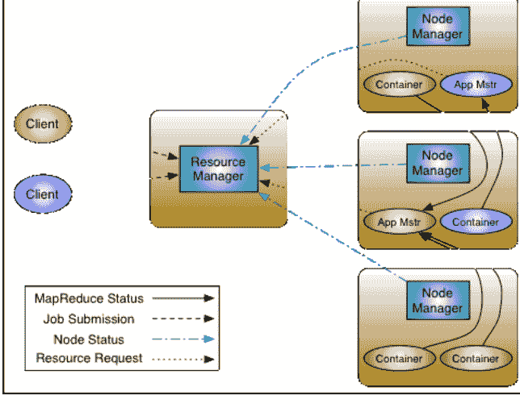

YARN 架构。来源：Apache 软件基金会

容器是在底层操作系统之上运行的自包含环境；可以把它想象成系统中的系统。它们允许在容器内运行的应用程序即使底层操作系统配置和软件在节点之间不同也能一致运行。NodeManager 还会将使用信息报告回 ResourceManager。

ApplicationMaster 的工作是与 ResourceManager 协商资源，并与 NodeManagers 协作执行和监控应用程序任务。ApplicationMaster 可以与不同节点的容器交互以执行其应用程序。

ResourceManager 根据各个节点的资源限制处理对运行应用程序的资源调度和分配。ResourceManager 还可以在出现故障时重新启动单个应用程序主程序。

## HBase

Apache HBase 是一个分布式、非关系型数据库，构建用于处理具有快速响应时间的非常大的表。它是一种 NoSQL 类型数据库，这意味着它是非关系型的，并且不支持完整的 SQL 语言进行查询处理。它构建在 Hadoop 环境之上并使用 HDFS 进行数据存储。

然而，与 HDFS 不同，它具有非常快的响应时间，并且构建用于随机、实时读写访问。它通过将数据放入索引文件然后存储在 HDFS 中来实现这一技巧。

如果您拥有大型数据集（在数亿条记录或更高范围内）并且需要快速的单条记录查找，HBase 很有用。

## Amazon DynamoDB

DynamoDB 在操作和用例上与 HBase 非常相似。它为您管理底层资源和存储，您只需为所使用的资源付费。在与 HBase 相同的许多条件下，它都很有用。

## Amazon S3

Amazon S3 不仅仅是一个存放文件的场所。您可以像数据仓库一样使用它，因为它具有高可用性和极强的容错性。文件耐用性在一年内为 99.999999999%。S3 也是一个 Hadoop 兼容的文件系统。而且您不必保留数据的三份副本，因为它已经内置了数据复制。

S3 不适合频繁更新的数据，但非常适合频繁追加的数据。物联网数据通常完全属于后者，因此 S3 效果很好。许多在分析方面处于领先地位的公司将大型数据集保存在 S3 中，并为处理和分析创建临时 Hadoop 集群。然后将结果存储起来，并终止临时 Hadoop 集群以节省成本。

## 用于数据处理的 Apache Spark

Apache Spark 是一个新-ish 项目（至少在大数据世界中，大数据以超光速发展），它与 Hadoop 集成良好，但不一定需要 Hadoop 组件才能运行。它是*用于大规模数据处理的快速通用引擎*，正如 Spark 项目团队欢迎页面所述。*闪电般快速的集群计算* 这个[content]

Hive 表可以支持分区和其他提升性能的选项。查询语句与 SQL 非常相似，对于大多数简单查询通常无法区分。这是一个示例查询语句：

```
SELECT stdev_samp (temperature) FROM iotsensor WHERE TO_DATE(timeread) > '2016-01-01'
```

以下是使用 Hive 进行物联网分析的一些提示：

- 1. **避免过多的表连接**：单个查询中连接的表应少于五个。如果无法做到这一点，请将查询拆分为多个连续的查询，将中间结果构建到临时表中。
- 2. **尝试使用除 Hadoop MapReduce 之外的执行引擎使用 Hive**：Hive on Tez 和 Hive on Spark 是两个较新的实现项目，它们通过最小化磁盘 I/O 并利用更多内存处理来提供更快、更高效的查询处理。
- 3. **将数据存储在 Parquet 文件中**：列式存储更好地支持分析中常见的查询类型。文件压缩可以减少物联网数据的磁盘空间需求。


## 序列化/反序列化 SerDe

你会在 Hadoop 相关文档中经常看到 **SerDe**。SerDe 是 Serialization/Deserialization 的缩写。序列化和反序列化指的是文件如何从保存状态转换到标准化的可读格式。序列化是写入时创建文件的一部分，而反序列化发生在文件被读取时。这使得文件可以被压缩和结构化。有关文件内容和数据结构的元数据也可以作为文件的一部分保存。

它是一种将解码文件格式的细节从客户端应用程序中*抽象*出来的方式。它还允许多种不同的格式在同一环境中无缝工作。甚至其中一些格式以后也可以被发明出来，一切仍然可以正常工作。

Hadoop 中的 SerDe 会指向处理文件编码和解码的应用程序。这通常是 hive 表创建脚本中的一个设置，它将被存储在元存储中，后续客户端在读取模式时引用它。

## Hadoop MapReduce

Hadoop MapReduce 是 Hadoop 框架的核心组件。它是一个软件框架，使并行处理能够在集群中的节点间分布式执行。该主题可能会让人感到困惑，因为人们倾向于将 MapReduce 概念和 Hadoop 组件互换使用，好像它们完全一样。

Map 和 Reduce 的概念将在本章后面的 Spark 部分中介绍。它与任何特定的框架或项目无关。你可能会读到一些文章暗示 MapReduce 即将消失，被其他东西取代。它可能没有明确说明（而且通常没有），但它们指的是 Hadoop 组件而不是概念。

Map 和 Reduce 的概念不会消失；它已经存在一段时间了，甚至是许多较新的分布式处理框架的关键部分。在本书中，我们将始终将该组件称为 Hadoop MapReduce，以避免任何混淆。

在 Hadoop 组件中，MapReduce 作业通常将输入数据集划分为独立的块。块由 map 任务在节点间并行处理。map 任务的输出随后会被排序并作为输入提供给 reduce 任务。Hadoop MapReduce 处理任务调度、监控，并在任务失败时重新执行任务。

除非你是一名大数据领域的专业 Java 程序员，否则你不太可能直接与 Hadoop MapReduce 交互。在分析中，你更有可能使用其他更高级别的工具，这些工具在底层使用 Hadoop MapReduce。因此，尽管它是 Hadoop 生态系统中的核心部分，但我们不会花费太多时间在此组件上。

## 另一种资源协商器 YARN

尽管名字有些 whimsical，YARN 是大多数 Hadoop 组件依赖的资源分配组件。YARN 背后的想法是将资源管理与作业调度和监控分离。在 YARN 中，它们是独立的处理单元。

如以下图所示，集群有一个 ResourceManager，每个作业或由 DAG 表示的作业集有一个 ApplicationMaster，在节点上运行。作业或作业的 DAG 被称为应用程序。集群中的每个节点也有一个 NodeManager。NodeManager 的工作是监控容器上运行的应用程序所执行的节点的 CPU、磁盘、内存和网络使用情况。


YARN 架构。来源：Apache 软件基金会

容器是在底层操作系统之上运行的自包含环境；可以把它想象成系统中的系统。它们允许在容器内运行的应用程序即使底层操作系统配置和软件在节点之间不同也能一致运行。NodeManager 还会将使用信息报告回 ResourceManager。

ApplicationMaster 的工作是与 ResourceManager 协商资源，并与 NodeManagers 协作执行和监控应用程序任务。ApplicationMaster 可以与不同节点的容器交互以执行其应用程序。

ResourceManager 根据各个节点的资源限制处理对运行应用程序的资源调度和分配。ResourceManager 还可以在出现故障时重新启动单个应用程序主程序。

## HBase

Apache HBase 是一个分布式、非关系型数据库，构建用于处理具有快速响应时间的非常大的表。它是一种 NoSQL 类型数据库，这意味着它是非关系型的，并且不支持完整的 SQL 语言进行查询处理。它构建在 Hadoop 环境之上并使用 HDFS 进行数据存储。

然而，与 HDFS 不同，它具有非常快的响应时间，并且构建用于随机、实时读写访问。它通过将数据放入索引文件然后存储在 HDFS 中来实现这一技巧。

如果您拥有大型数据集（在数亿条记录或更高范围内）并且需要快速的单条记录查找，HBase 很有用。

## Amazon DynamoDB

DynamoDB 在操作和用例上与 HBase 非常相似。它为您管理底层资源和存储，您只需为所使用的资源付费。在与 HBase 相同的许多条件下，它都很有用。

## Amazon S3

Amazon S3 不仅仅是一个存放文件的场所。您可以像数据仓库一样使用它，因为它具有高可用性和极强的容错性。文件耐用性在一年内为 99.999999999%。S3 也是一个 Hadoop 兼容的文件系统。而且您不必保留数据的三份副本，因为它已经内置了数据复制。

S3 不适合频繁更新的数据，但非常适合频繁追加的数据。物联网数据通常完全属于后者，因此 S3 效果很好。许多在分析方面处于领先地位的公司将大型数据集保存在 S3 中，并为处理和分析创建临时 Hadoop 集群。然后将结果存储起来，并终止临时 Hadoop 集群以节省成本。

## 用于数据处理的 Apache Spark

Apache Spark 是一个新-ish 项目（至少在大数据世界中，大数据以超光速发展），它与 Hadoop 集成良好，但不一定需要 Hadoop 组件才能运行。它是*用于大规模数据处理的快速通用引擎*，正如 Spark 项目团队欢迎页面所述。*闪电般快速的集群计算* 这个口号更有吸引力：我们更喜欢这个。


Apache Spark logo

## 什么是 Apache Spark？

好问题，很高兴你问了。Spark 是为分布式集群计算而构建的，因此一切都可以很好地扩展而无需任何代码更改。*通用* 这个词在通用引擎描述中非常合适。它指的是你可以用它做很多不同的方式。

你可以用它进行 ETL 数据处理、机器学习建模、图处理、流数据处理以及 SQL 和结构化数据处理。它是分布式计算世界中分析的福音。

它为多种编程语言提供 API，例如 Java、Scala、Python 和 R。它主要在内存中运行，这就是它相对于 Hadoop MapReduce 的主要速度提升来源。对于分析，Python 和 R 是流行的编程语言。当与 Spark 交互时，你很可能会使用 Python，因为它支持更好。Spark 的 Python API 称为 Pyspark。

本章中讨论的描述和架构是针对 Spark 2.1.0 的，这是撰写本文时的最新版本。


Driver 程序必须能够监听并接受来自其执行器的传入通信。执行器必须能够相互通信。所有组件在集群中应彼此“接近”。因此，将 Driver 程序（Spark 实例）运行在直接连接到集群的笔记本电脑上并不是一个好主意。

在 HDFS 相同的集群节点上安装 Spark 是常见且推荐的做法。这使得处理靠近数据，从而提高性能。

非常重要的是要理解应用程序的哪一部分在 Driver 上运行，哪一部分在工作节点上运行。Driver 位于单个节点上，其资源受限于该节点可用的 CPU 和内存。因此，操作所需的数据、内存和计算资源必须在这些限制内，否则应用程序将失败。什么在集群上运行良好，集群具有更高级别的分布式资源，如果无意中被拉回 driver 节点，将会崩溃。

## 思考单机与机器集群

设计分布式计算分析需要你思考什么可以并行运行，什么必须一步接一步运行。并行运行计算是 Spark 等集群计算系统速度优势的来源。但它确实需要一种略有不同的思考方式。响应以自由格式文本字段的形式存储在每一行数据中。你想要做一个词频统计，看看受访者使用最多的词是什么。希望像 **fantastic** 和 **educational** 这样的词排在前面，而像 **fraud** 和 **time wasting-junk-pile** 这样的词排在列表更下方。

第一步是将每一行的文本字符串拆分为单词列表。这可以在许多不同的节点上同时完成。你会编写 Python 代码来执行此操作，然后将其提供给 Spark 以发送到每个执行器以使用。这将是第一个 Map 步骤。下一步是为每个单词加上一个数字，以便以后可以求和。形式为 (fantastic, 1)。此时，数字始终为 1，因为同一个词在数据集中出现的次数与它出现的次数一样多。这是第二个 map 步骤，你将使用我们之前讨论过的相同程序。

接下来，结果应按集群中的单词排序，以便更容易计数。这是 shuffle 步骤。然后，每个执行器可以将附加到每个单词的数字加在一起，以获得其处理的单词的总计。这将行减少为每个执行器的单个单词小计。因此，这被称为 Reduce 步骤。最后，所有小计都加在一起，按每个单词得出集群的总体总计，这是最终的 reduce 步骤。

综合起来，这个概念称为 Map/Reduce。这是一个非常简单的例子，实际上，Spark 等系统会为你处理大部分细节。但总体概念即使在更高级别的应用中仍然成立，在这些应用中 map 和 reduce 并未直接调用。你应该思考如何拆分工作以便进行分发，然后将其汇总为更小的结果集以进行进一步分析。

## 使用 Spark 进行 IoT 数据处理

使用本章前面的概念图，Spark 适用于分析交互和执行引擎区域。你可以直接在核心 Spark 对象上编写代码，并使用随附的编程模块。以下图像有助于可视化 Spark 模块堆栈：

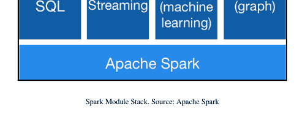

Spark Module Stack. Source: Apache Spark

- **Spark SQL** 在创建 SparkSession 时包含在内，允许你编写标准 SQL，将其解释为 Spark 操作并执行（当然使用 DAG）。你可以在其他 Spark 代码中混合使用它。这使你能够在适当时利用 SQL 的强大功能和知识，并在适当时使用代码，而无需切换语言。

- **Spark Streaming** 是一组允许处理流数据的库。流数据是从一个到多个源的高吞吐量、持续的数据馈送。Spark Streaming 提供了更高级别的抽象，使分析此类数据变得更容易。流输入被分解为较小的数据批，以便使用 Spark 引擎进行分析操作。然后结果可以存储以供进一步的长期分析。

- **MLlib** 是一组机器学习库和命令，针对并行运行进行了优化。这使你可以使用非常大的数据集进行训练，并比其他基于 Hadoop 的项目运行得更快。机器学习算法具有高度迭代性，这需要 Hadoop MapReduce 组件进行大量磁盘 I/O。Spark 大多在内存中运行，这大大加快了迭代速度，而无需磁盘 I/O。

- **GraphX** 是一组专为图处理设计的库。此上下文中使用的 *graph* 一词不是指图表，而是分析的一个分支，专门从事网络分析。这就是用于识别社交网络中有影响力的人的一个例子。图由 **nodes** 和 **edges** 组成，边表示节点之间的连接。

所有这些模块可以一起使用，并且在单个应用程序中使用。这允许在同一工具和编程结构内实现各种各样的应用程序和灵活性。而且一切都随着集群规模的扩大而扩展。

由于其可扩展性、速度和灵活性，Spark 作为 ETL 工具效果很好。IoT 数据需要这三者，因此是很好的匹配。传入的 IoT 数据可以使用 Spark 进行清理、处理和增强。它还可以创建机器学习管道，在同一过程中训练算法。

一个常见的用例是让一个 Spark 作业，最有可能用 PySpark 编写，处理长期存储的初始 ETL。然后，一组单独的作业按每日或其他定期计划运行，以增强和进一步分析数据。最后，像 Tableau 这样的可视化分析工具以及 R 或 Python 中的统计分析库链接到结果数据以进行更高级的分析。

Spark SQL 模块也完全兼容 HiveQL，并且可以使用 Hive metastore、Hive 用户定义函数 (UDF) 和 SerDes。有一个 HiveContext 对象，原生支持集成，当 Spark 与 Hive 一起安装在集群上时。Spark 还原生读取和写入 Parquet 格式。Parquet 文件可能在 HDFS、S3 或 Spark 可以访问的其他文件系统上。由于 Parquet 包含文件的模式信息，因此加载和设置用于分析的分布式数据集非常简单。

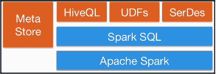

*Spark Hive compatibility architecture. Source: Apache Spark*

## 要不要流式处理

流是随着每个新数据消息到达而持续更新的数据集，延迟极小或为零。流式分析以比批处理短得多的间隔在该持续更新的数据集上运行。实时分析在应用于流式分析时有点名不副实，因为它通常是基于间隔的，而不是持续进行的。频率会影响处理和技术要求，因此应尽可能将间隔设置为更长的时间段以节省成本。

流数据集通常保留一段时间的窗口数据，然后丢弃它。处理流有专门的技术和处理选项，这些选项在很大程度上是针对我们本章重点关注的长期大数据存储技术要求的补充。Amazon Kinesis 就是专门的数据流技术服务的例子。

支持分析所需的技术和编程代码库对于流式处理通常与长期历史分析所需的代码库不同。这意味着大多数用例需要两个系统和代码库。正在进行多项努力将此整合为一个；Spark 2.1 是一个值得注意的例子，其中包含 Spark Streaming 模块，但该领域仍在成熟中。


对于物联网分析，在决定实时流式分析是否真的是你所需要的之前，重要的是要考虑用例以及你需要支持哪些数据集。当你寻找洞察和新的商业机会时，你几乎总是会使用具有长期历史的数据集。对于这些用例而言，最近一小时或一分钟的数据几乎没有增量价值。

尽管实时分析的诱惑很诱人，但你必须考虑流式技术的额外成本和维护是否值得。在大多数物联网分析场景中，情况并非如此，并且可以通过提高批处理频率来更好地满足需求。当整合额外数据集时，流式分析与批处理分析相比在可做的事情上也有局限性。除非这些数据集也是实时的，否则它们只能用于较不频繁的批处理。

虽然对于*探索性分析*以寻找洞察而言情况如此，但对于将这些分析的洞察*产品化*而言可能并非如此。在某些情况下，你可能希望接近实时的分析处理，例如将预测模型应用于流式传感器数据以预测设备故障。你可能希望为由快速反应客户支持团队监控的报告仪表板提供实时流式分析。

然而这些是独立的决策。建议是避免增加流式分析的开销，除非有强有力的商业案例。*实时*听起来不错，但你需要确保增量收益值得在时间和资源上的额外支出。

## Lambda 架构

Lambda 架构由一系列数据和处理技术组成，旨在同时服务常规批处理活动和接近实时的流式活动，并以一种允许将两者的结果合并为单一视图的方式进行。以下描述和图表突出了构成该架构三层的概念组件：

- **批处理：** 该层保存主数据集并对数据进行常规批处理，以创建视图来支持与服务层链接的分析、仪表板和报告。主数据集是不可变的，这意味着数据一旦纳入就不会改变，并且会随着时间的推移不断追加新数据。长期运行的 Hadoop 集群就是一个例子。
- **速度：** 该层仅关注最近的数据（流式数据）。它处理对数据时效性有低延迟要求的请求。算法需要在速度层中快速且增量地运行。Amazon Kinesis 就是一个在速度层中运行的示例技术。
- **服务：** 该层对批处理视图进行索引，以便以低延迟提供服务。这包括来自批处理层和流式层的批处理视图。

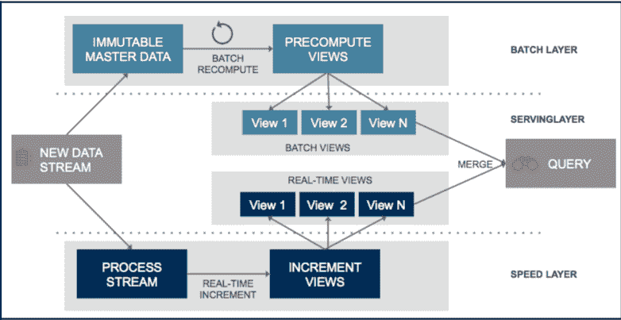

Lambda 架构。来源：MapR technologies

### 处理变化

变化是恒定的，尽管听起来自相矛盾。架构、数据模型和技术会随着时间的推移不断演变。你需要决定如何处理变化，以便在数据存储和处理架构中保持灵活性。你希望使用彼此解耦的工具，以便未来的分析能够轻松集成到数据处理流中。

幸运的是，Hadoop 生态系统中的组件是专门设计为彼此解耦的。它们允许混合搭配组件，并且为尚未发明的新框架构建了可扩展性。云基础设施允许轻松测试和整合新技术和软件。

你需要设计一个流程，将你的分析和数据处理代码从实验、开发到生产。这同样适用于你的整体基础设施。常见做法是保留三个独立的环境：一个用于开发，一个用于测试，一个用于生产。

为了节省成本，你可能会决定将其减少到两个：一个混合的开发和测试环境，以及一个生产环境。无论如何，你都需要一个结构化流程，将你的洞察从初始想法转移到你标准运营的成熟部分。

## 总结

在本章中，我们讨论了针对物联网和处理来自现场设备的传入数据的特定云基础设施技术。我们还回顾了一些收集和存储物联网数据以实现分析的策略。Hadoop 生态系统和架构已介绍，并详细介绍了物联网分析的关键组件。

你还学习了何时以及为何使用 Spark 进行数据处理。我们讨论了流式处理与批处理之间的权衡。介绍了 Lambda 架构。讨论了如何处理变化以建立灵活性，从而允许未来的分析与数据处理集成。
