# 6 了解你的数据 - 探索物联网数据

“是的，我知道三个月的平均值是 45.2，但这意味着什么？我们现在有超过 2 太字节的数据。但它告诉我们什么？”

你的老板又在发脾气了。他不断向你提问，而你不确定如何回答。你本能的第一反应是回吐每周报告中的数字，但显然这不起作用。

“数据甚至好吗？”他继续说，“我们在积累价值还是只是在地下室堆满垃圾？”

你开始耸肩，但明智地阻止了自己。你认为数据非常有价值，但你实际上对数据集的了解仅限于报告中包含的数字。你意识到你甚至不确定单个数据记录是什么样子。你知道平均值可以隐藏很多东西，但从未有人要求你深入研究。

你挺直肩膀自信地说：“数据是有价值的。我们只是没有查看它的所有方面。我会向你展示它还有更多内容。”

你一点也不自信。你不确定如何展示商业价值被埋藏着等待被发现。但你隐藏得很好。

你的老板发出一声哼哼声，显然并不真正相信你在推销的东西。他转身走下走廊，边走边自言自语。

> 数据是二十一世纪的剑，善用它的人，就是武士。
> 
> -Eric Schmidt and Jonathan Rosenberg in How Google Works

本章重点介绍物联网数据的探索性数据分析。你将学习如何提问并回答数据的问题。本章的第一部分将介绍理解数据质量。然后，我们将继续更好地了解数据及其代表的内容。我们将使用 Tableau 和 R 作为示例。你将学习快速评估数据并开始寻找价值的策略。

本章涵盖以下主题：

- 探索和可视化数据
- Tableau 快速概述：
  - 了解数据质量的技术
  - 基本时间序列分析
  - 了解数据中的类别
  - 使用地理进行分析
- 寻找具有预测价值的属性
- 使用 R 增强可视化工具
- 行业特定示例：
  - 制造业
  - 医疗保健
  - 零售

### 探索和可视化数据

任何分析的第一步，*尤其是*物联网分析，就是了解你的数据。就像未来的配偶一样，你需要尽可能多地了解它。了解它的缺陷和优点。了解哪些属性会令人烦恼，并确保你能够接受它们。了解其未来的盈利潜力。并且在为时已晚、你被束缚于它之前弄清楚所有这些。

在本章中，我们将使用几个工具来快速了解一个样本数据集。示例将遵循深入数据以找到其优势和劣势的方法。对于探索和可视化，我们将使用 Tableau。对于更深入的统计评估，我们将使用统计编程语言 R。

#### Tableau 概述

**Tableau** 是一款商业智能和分析软件工具，允许你连接到数十种不同的数据库和文件类型，通过拖放构建可视化，并轻松与他人共享。主要有两个版本，桌面版和服务器版。桌面版是你安装在笔记本电脑上的功能强大的工具，用于连接和操作数据集。服务器是一个基于 Web 的组件，你可以在其中发布桌面可视化，以便他人轻松与其交互。

在本章中，我们将只关注 Tableau 桌面版，因为我们的任务是探索数据而不是传达分析结果。它可以免费试用一段时间。你可以从公司网站下载（https://www.tableau.com/products/desktop/download）。

使用 Tableau 处理数据的第一步是连接到你的数据集。Tableau 有许多不同的连接器，能够链接到各种各样的数据库和文件格式。将 Tableau 视为你数据的窗口，一种链接到它并探索它的方法。它与你的数据是分开的，请在你的脑海中将它们区分开来。


## 了解你的数据 - 探索IoT数据

连接到数据后，工作区中有四个主要区域。它们在以下截图中突出显示：

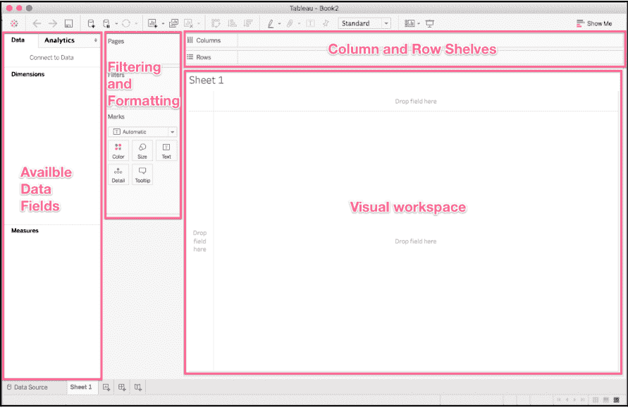

Tableau桌面主视图

接下来，我们将详细描述每个区域。

- **可用数据字段**（Tableau术语中的数据窗格）：此部分显示已连接数据集中的字段。您还可以根据其他数据字段创建额外的计算字段。您可以在此处创建自己的类别分组和层次结构。数据字段分为两类。
  - **维度：** 维度是包含类别或标签的字段。判断字段是否应为维度的方法是，想想对其值求和或求平均是否有意义。如果答案是否定的，则最好将其用作维度。例如客户名称、细分、ID字段、电话号码、州名和日期。
  - **度量：** 度量是不代表类别且来自连续值范围的数字。这些是可以求和或求平均的数字。例如销售数量、温度和时间长度。
- **筛选和格式设置**（**筛选器**架、**页面**架和**标记**卡）：在这里可以筛选数据记录，并决定可视化工作区中图表和表格的格式。
- **列和行架**（**列**架和**行**架）：在这里拖放字段，以在可视化空间中构建视图。列出的字段在交互视图中已就绪。
- **可视化工作区：** 这里显示您在其他区域操作的结果。您还可以直接深入查看此区域中显示的点或数字背后的数据记录。

### 了解数据质量的技巧

本章示例使用的数据集来自美国**国家海洋和大气管理局（NOAA）**。它是美国15分钟降水数据的一个子集，可在NOAA网站上获取（直接链接：`https://www.ncdc.noaa.gov/cdo-web/search?datasetid=PRECIP_15`）。

我们使用的是美国科罗拉多州从2013年1月1日到2014年1月1日的数据集。您可以从NOAA或本书的Packt网站下载。从NOAA下载数据时，务必勾选所有可用字段。同时下载数据集的文档，其中包含字段描述（`https://www1.ncdc.noaa.gov/pub/data/cdo/documentation/PRECIP_15_documentation.pdf`）。

对于本练习，你可以将阅读文档留到本章末尾，看看它与我们观察到的结果如何对应。在其他任何情况下，你都应该先仔细研读文档，并像为了在课堂上争取最高分而备战期末考试一样做笔记。

### 查看数据——原始形态

面对不熟悉的数据时，你应该做的第一件事始终是查看其原始形式的一个良好样本。这是非常重要且常被忽视的一步，即便是经验丰富的分析师也是如此。你的第一反应可能是计算平均值和标准差来寻找趋势，但要抵制这种冲动。

你希望先查看没有任何格式或解释的文件，因此需要使用不会对其应用任何格式的软件工具。如果你有Windows笔记本电脑，只要文件不是太大，记事本就是一个不错的选择。Excel不适合用来做这件事，因为它会对文本文件（如 `.csv`）应用自己的格式和解释。

在Mac或Linux机器上，使用命令行文本查看工具。在Mac上，你可以打开“终端”，导航到文件所在目录，然后输入命令 `cat filename.csv | less`。按空格键可前进屏幕；输入 `q` 退出。在Linux命令行中也可以这样做。下图显示了Mac或Linux机器上原始数据的样子。Windows会显示非常相似的格式：

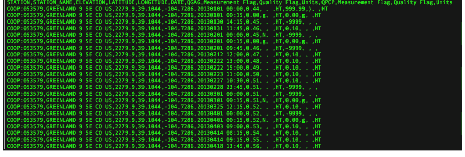

通过这最初的查看，你可以了解到数据构成的一些情况以及需要调查的方面。下面列举一些例子：

- **第一行包含字段名称：** 这很好，因为你不必自己弄清楚并输入名称。但是，你需要确保当文件加载到如HDFS这样的数据存储中时，第一行不会被当作数据行。
- **Measurement Flag、Quality Flag 和 Units 各有两个同名字段：** 这可能是重复数据，也可能是字段顺序与另一个字段相关而有意义。当你准备分析数据集时，需要知道每个字段的含义以及哪一个是哪个。在分析工具中，字段顺序可能与文本文件中的不同。为应对这一点，请找出一些在这些字段中具有不同值的行，并记录下能唯一标识这些行的字段（如**STATION**和**DATE**）。你可以在分析工具中使用这些字段来验证哪个是哪个。
- **QPCP字段中的值要么是非常小的正数，要么是-9999：** -9999似乎表示测量值以外的其他含义。幸好你没有用它来计算平均值。
- **Measurement Flag和Quality Flag字段中有相当多的缺失值：** 你肯定需要查看文档来理解其含义。
- **日期时间值不是常见的标准格式：** 你可能需要进行一些解析，才能让分析工具将该值识别为日期。注意其结构（`yyyymmdd hh:mm`）。
- **并非每个15分钟间隔都有记录：** 行看起来按日期和时间排序，但一天中似乎不是每个15分钟间隔都有一条记录。当整个文件排序后可能并非如此，但你应该将其作为待调查事项记下来。

浏览几屏数据，寻找任何模式。如果数据集看起来已排序，请至少扫描一次到另一个源设备的过渡，以查看值如何变化。在了解数据的这个阶段，我们并不试图做到非常科学。目标是寻找任何明显的模式和数据质量问题。

### 数据完整性

由于低功耗传感器和不可靠连接的特性，IoT数据经常存在缺失和不完整的值。你希望了解这种情况发生的频率以及是否有任何模式。对于初步查看，我们将使用Tableau连接到示例数据集。建议先在软件官网完成入门培训，以熟悉它。

第一步是连接到包含天气数据的 `.csv` 文件。在起始界面中，单击**文本文件**作为数据源类型。然后，浏览并选择要链接的文件。

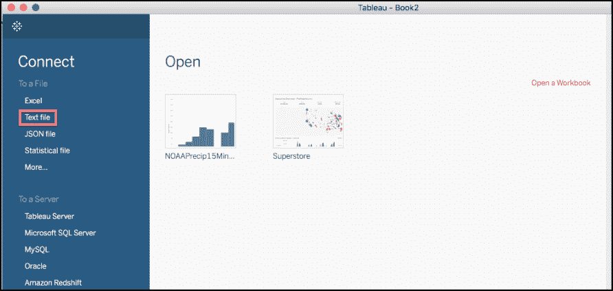

检查文件列所分配到的字段类型。注意，**Date**字段被假定为字符串格式，而不是日期时间格式。如果你尝试更改它，由于其不常见的格式，将无法被识别。你需要解析日期（正如在原始文件检查中所怀疑的那样）：

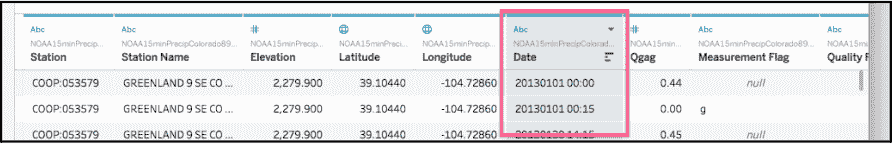

单击**Sheet1**选项卡，开始构建数据视图。我们需要对数据字段稍作修改，以便更轻松地探索它们。右键单击**Date**维度，在弹出菜单中选择**计算字段**。将其命名为 `Measurement Date` 并输入计算 `DATEPARSE("yyyyMMdd hh:mm", [Date])`。这将接受上述格式的字符串，并将其解释为日期：

5. 将**记录数**值从**标记**卡移动到**行**架。
6. 从**筛选器**架中移除所有内容。

现在我们将稍微快进，假设你已经完成了在线培训，并熟悉Tableau的基本操作。我们将要回顾的任何方法也可以用其他可视化软件来完成。

完整性不仅关乎缺失值，还关乎数据记录的连续性。即使所有值都完整，整个记录仍可能缺失。可以通过按日期和时间对齐记录数来检查这一点。按站点细分，查找没有记录数据的时间段。如果每15分钟捕获一条数据记录，那么每天应有96行（(60 min/15 min) * 24 = 96）：

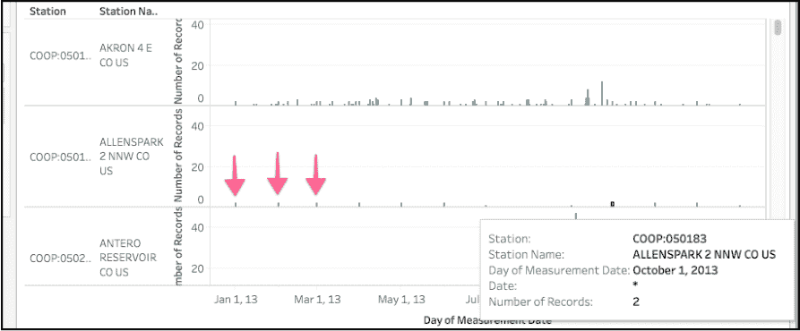

从前面的可视化可以看出，并非每个站点每天都有96条记录。每天记录数各不相同，有些日子甚至没有任何记录。一些气象站每月只在第一天报告一次。当你查看这些记录时，似乎是测试记录，没有可用的降水值。

这时应该联系你的工程和现场服务团队，了解站点是否按预期报告数据。如果是，你将需要知道如何识别只报告测试数据的站点，以便在分析时区别处理。如果不是，你可能无意中发现了你可以提供的一项服务。你的分析团队可以创建一个算法来识别这种模式，并自动通知客户该站点未报告数据。


选择其中一个正在频繁发送记录的气象站对应的条形图，例如 Akron 4 E CO US。查看各个记录，并检查 Qgag 和 Qpcp 测量字段中的值。Qgag 是记录捕获时测量容器中降水量的度量。Qpcp 是 15 分钟时间段内所发生的降水量的度量。查看这些时间，确认它们是否确实是 15 分钟间隔。数据记录有可能只在有情况需要报告时才会发送（换句话说，当时正在下雨）。

同样，请与开发设备和软件的人员核实这一结论。如果情况确实如此，你可能需要为没有下雨的时间间隔创建人工记录。这将取决于你所探索的分析内容。如果你要预测降雨概率，你就需要同时包含未下雨时段和下雨时段的数据。

这正是理解数据集完整性的重要之处。如果设备运行正常且没有网络问题，那么可以有把握地认为没有记录就意味着没有下雨。但如果设备因某种原因离线，就不能这样假设。否则，准确预测将变得非常困难。

查看其他几个站点，并记录任何异常情况。例如，你可能会注意到，有些气象站的记录计数在某个日期之后会显著改变频率水平。这种情况可能发生在设备此前未能正确报告、后来问题被修复的时候。你也需要对此进行调整；在设备修复之前的记录，在分析时可能需要被忽略：

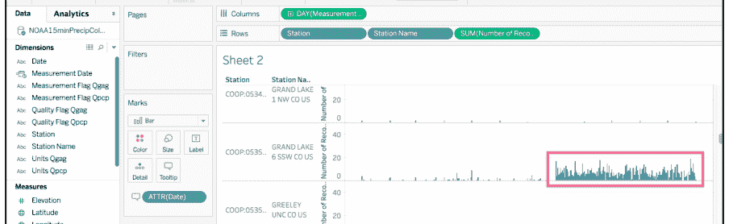

一个记录计数增加的气象站示例

注意记录计数中任何异常的激增。如果多个气象站在同一时间都出现这种情况，则可能表明存在数据问题，例如记录重复。但也有可能是真实情况，所以你需要以某种方式核实。即使看起来很奇怪，也不要断定它一定是数据问题。在示例数据集中，请注意 Boulder 2 CO US 站点在 2013 年 9 月出现的显著增长：

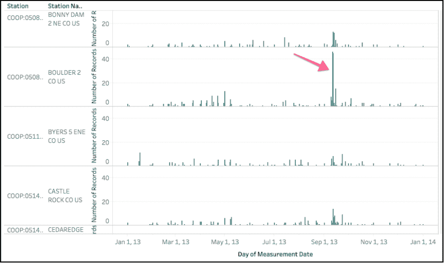

Boulder 2 CO US 气象站的记录计数在 2013 年 9 月出现激增

该记录计数远远超出该站点任何其他时期的范围。你还会注意到，其他站点也在完全相同的时间出现增长。请记下这一点，以便进一步探索。我们将在本章后面再回到这个问题。

## 数据有效性

完成完整性检查后，检查你所拥有记录中数据的有效性非常重要。对于度量架中的每个字段，查找远超任何其他数据点的离群值。同时检查以高频率出现的特定值。前者可能是错误值，也可能是某个非测量事件的指示值；后者可能是本应被实际测量值覆盖的默认值。异常值可能有多种解释；目标是识别这些值以及它们的大致出现频率。

在标度上查看 Qgag 值，可以明显看到负侧有一个常见离群值（-9999），正侧也有一个（999.990，在视图中可能四舍五入为 1,000）。在每个离群值区域中选择一些点，查看单独记录。看看实际值是始终一致，还是存在一些变化。一致的值很可能是刻意设置的指示值；变化则可能是由于计算错误或转换错误导致小数点位置不对：

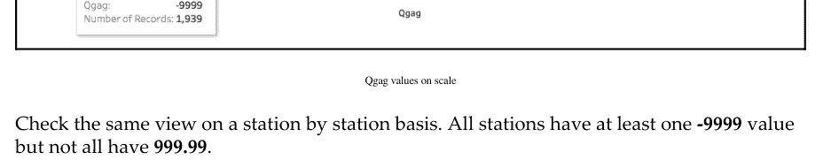

按标度显示的 Qgag 值

按站点逐一检查同一视图。所有站点都至少有一个 -9999 值，但并非所有站点都有 999.99。

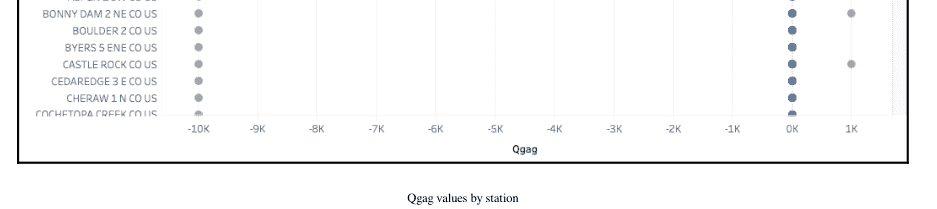

按站点显示的 Qgag 值

由于这些极值看起来不是实际读数，请过滤掉高值和低值，将过滤范围设为 0 到 900。然后查看结果，以了解各气象站的典型值范围。这些值介于 0 到 2.4 之间：

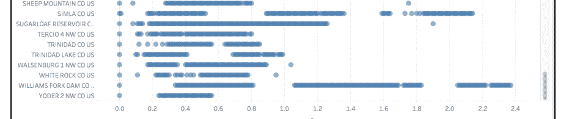

按站点显示的已过滤 Qgag 值

对数据集中的另一个度量 Qpcp 重复相同过程。你会看到它也有相同的极值（-9999 和 999.990），只是某些站点没有 -9999 记录。另一个区别是，Qgag 值沿连续标度分布，而 Qpcp 似乎以 0.1 为增量上报：

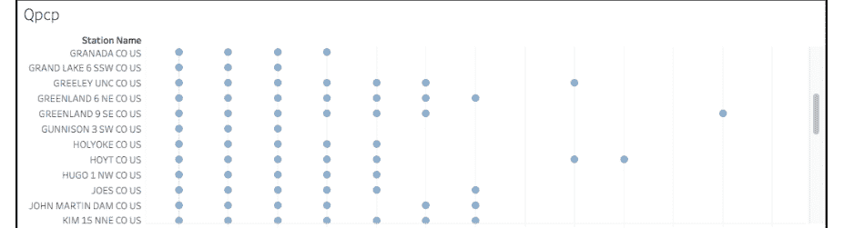

按站点显示的已过滤 Qpcp 值

选择一些点并查看单独的数据记录，看看 Qpcp 值是否精确到十分位，或者是否存在图表上看不到的变化。在本例中，所有值都精确到十分位。

我们已经展示了一些检查数据有效性的方法，但不要局限于这些演示过的方法。继续以你能想到的尽可能多的方式对数据进行切片和切块，不断探索。与你的设计工程师沟通，了解测量值预期应在什么范围内，并将观测结果与该范围进行比较。回顾第 1 章“定义 IoT 分析与挑战”中的 IoT 设备图，并利用它来查找数据中的不一致或失真之处。

## 评估信息延迟

来自 IoT 设备的数据并不总是以相同的时间间隔到达你的数据集。有些记录可能会很快被纳入，因为设备所在位置更近，或位于人口更密集、连接更好的地区。偏远位置在设备捕获观测值到数据记录成为数据集一部分之间，可能有更长的延迟。不同 IoT 设备组之间在数据传输路径上，或在将数据加工成分析用数据集的 ETL 作业中，也可能存在差异。

在将更高级的分析应用于数据之前，理解延迟时间的变化（我们称之为信息延迟）非常重要。较快到达的数据记录中可能存在显著偏差，而一旦该时段的所有记录都被纳入，这种偏差就可能不存在。下图显示了发生在同一时间的事件在信息延迟时间上的差异。如果今天分析数据集，则只会包含底部的事件：

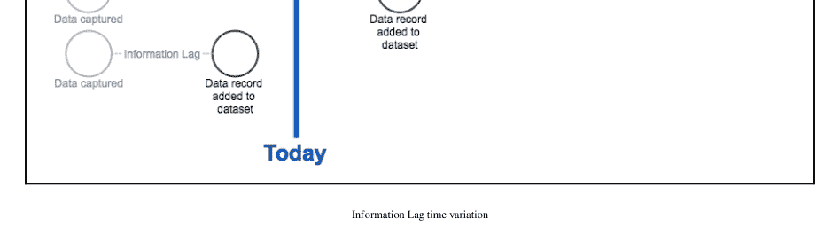

## 时间序列是什么？

时间序列分析非常常见；从股票市场价格趋势到 GDP 图表，你每天都会遇到。它直观而普遍，以至于给它命名都显得有些别扭。时间序列其实就是按时间顺序排列数据值，并分析结果以寻找模式。即使某个间隔没有数据，序列也应按等间距的时间间隔排列。

可以通过一年中的时间（季节性）、商业周期、数值随时间的增减（趋势），甚至一天中的时段来发现模式。识别出的模式随后可用于预测未来的数值。我们将在本书后面介绍时间序列预测技术。

## 应用时间序列分析

时间序列分析的第一步是决定在探索数据时使用哪个时间间隔。你可以选择多个间隔，在熟悉 IoT 数据时这样做是一个好习惯。你可以从月度趋势开始，然后是周度、日度，甚至精确到分钟。

对于我们的分析，我们将继续使用日间隔。从 **Qpcp** 度量开始，按站点查看，并绘制每日汇总的 **Qpcp** 值图。过滤掉那些几乎可以确定不是实际测量的极值（你可以在过滤器中使用 0 到 900 的范围）。我们已经发现 **Boulder 2 CO US** 站点在 2013 年 9 月出现了异常高的记录计数。


你还了解到，并非每个 15 分钟时间段都有数据记录，并且你已推断出数据主要是在有降水量需要报告时发送的。如果这一假设成立，那么一天内 Qpcp 值的总和就应该能表示当天的降水量：

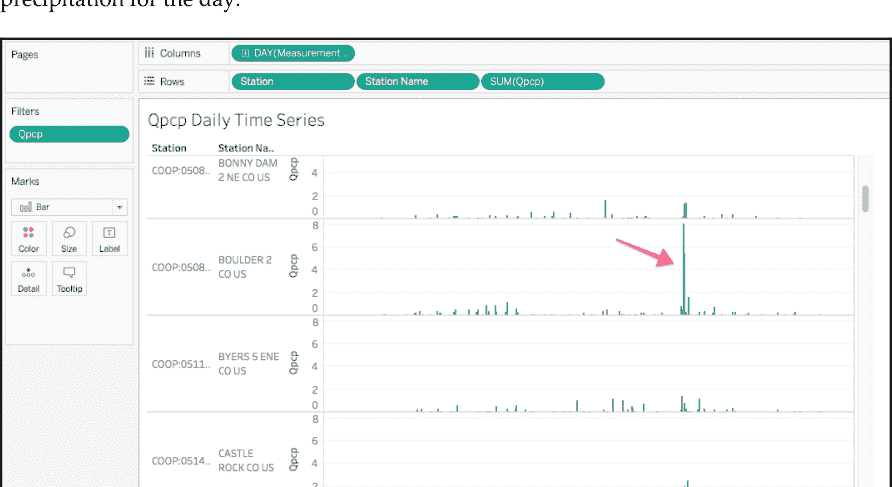

2013 年 9 月，美国科罗拉多州博尔德 2 号（Boulder 2 CO）气象站的 Qpcp 总和出现峰值

上图显示，在 2013 年 9 月的几天里，当日降水总量也达到了前所未有的高位。选择该时间段并查看柱状图背后的数据记录。检查数值和记录的日期时间后，似乎并不存在重复记录：

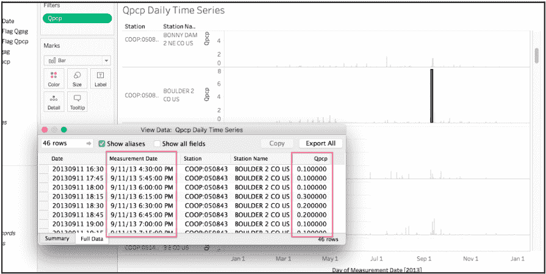

美国科罗拉多州博尔德 2 号（Boulder 2 CO）气象站 2013 年 9 月 11 日至 12 日期间的数据记录样本

到目前为止，尽管记录数量和降水总量都非常反常，但还没有任何迹象表明数据存在缺陷。幸运的是，天气状况受到多家新闻媒体和环境机构的监测。如果物联网数据中的数值是真实的，那么借助外部来源应该很容易得到确认。

我们将借助物联网分析专家最强大的工具之一——谷歌搜索，看看能找到什么。不开玩笑地说，网页搜索技能对物联网分析非常重要，无论是研究机器学习模型还是理解传感器功能。

通过外部来源确认物联网数据中的异常模式也是一种必不可少的数据验证实践。我们在这里把它当作一个有趣的例子，但这是你应该定期进行的工作：

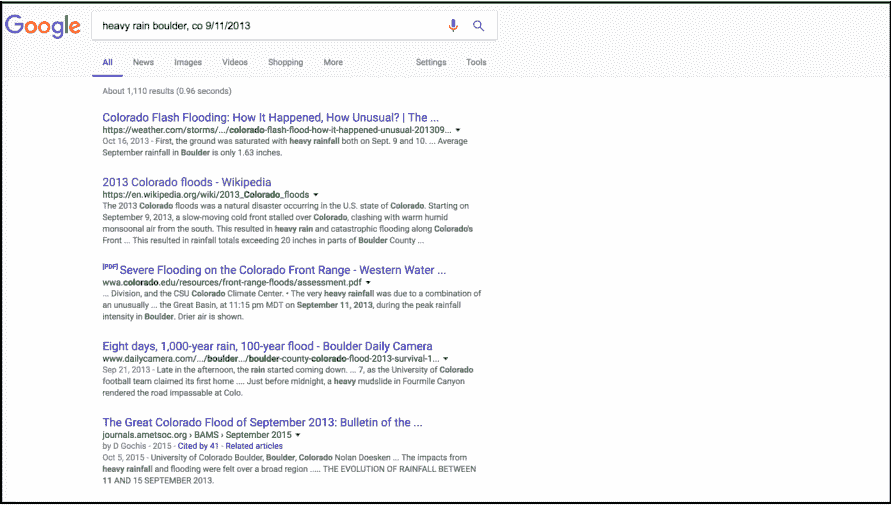

谷歌搜索“2013 年 9 月 11 日科罗拉多州博尔德暴雨”的结果

从搜索结果可以看出，当时科罗拉多州博尔德地区确实发生了一次极端天气事件，降雨量之大甚至被称为“千年一遇”的暴雨。这大大增强了我们对报告结果真实性的信心。

现在，我们可以将 **Qgag** 值作为时间序列来探索。回想一下，**Qgag** 是测量设备中累积降水量的度量。下面是按站点绘制的 **Qgag** 随时间变化图（已过滤掉极值）：

## Qgag 随时间变化的趋势

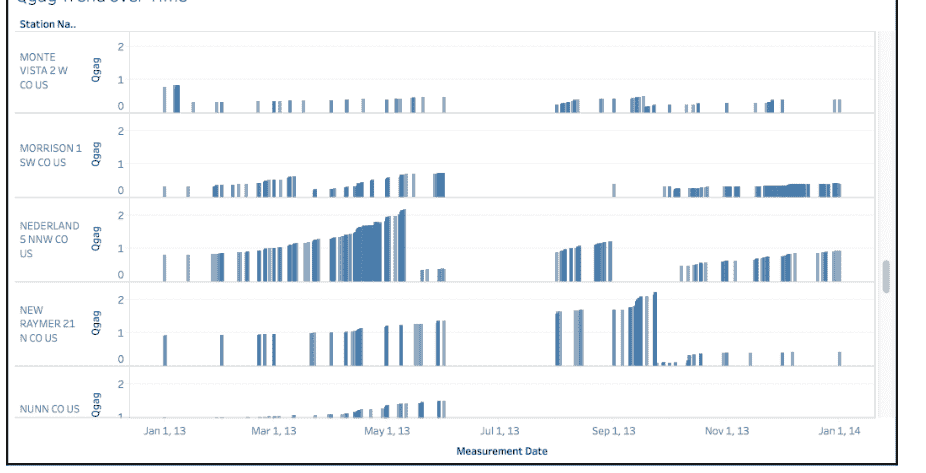

随时间变化的 Qgag 值

我们可以注意到几个有趣的模式。首先，在 2013 年 7 月前后的一段时间内，所有站点的 Qgag 值都缺失了。这种情况值得打几个电话去查明原因。在那段时间里确实有数据记录，但所有记录中的 Qgag 值都是 -9999，因此在此视图中被过滤掉了。

其次，某个站点的 Qgag 值会随时间增加，并且在不规则的间隔后突然下降到显著较低的值。考虑到这些值表示累积降水量，这种下降可能表明设备上容纳降水的容器已被清空。

识别此类模式可以为你公司带来宝贵的商业机会。你可以开发一套分析流程，既能识别何时需要清空容器，又能验证该任务是否已完成。这对于那些不得不派遣技术人员到偏远地点执行工作的客户来说非常有价值。他们会非常乐意并高兴地为这项服务向你公司付费。这意味着你公司可以以很少的额外成本实现收入增长。

## 了解数据中的类别

现在，通过识别类别和缺失值来探索数据。将各种“维度”拖到“行”和“列”功能区上，以查看类别、记录计数和缺失值（Null）。将一些维度相互比较，以了解它们之间如何交互。它们是同时为 Null，还是看起来互不相关？

Tableau 让你能够快速地进行这种交互，所以要充分利用它。下面的截图展示了一个示例，比较了 Qgag 和 Qpcp 的“测量标志”字段。你可以看到，它们经常同时为 Null：

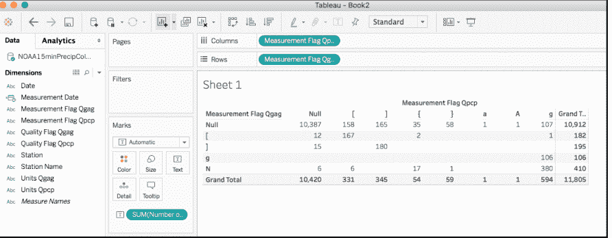

使用记录计数比较 Qgag 与 Qpcp 的测量标志

## 引入地理信息

当设备分布在不同地点时，地理信息是理解物联网数据的非常强大的辅助工具。一千台集中在科罗拉多州丹佛市的设备，与一千台均匀分布在全州的设备，很可能提供不同的数据值。通过对数据进行统计分析并不明显的模式，一旦显示在地图上就可能变得非常明显。

还要查看地图上的数值和记录计数如何随时间变化。在 Tableau 中，可以将日期值 Measurement date（测量日期）拖到“页面（Pages）”功能区。将聚合级别改为“年+月”（Month with Year），然后逐月移动，观察数据如何变化。

同时也要查找无效的位置数据。如果你已将数据过滤为墨西哥的国家代码，却仍看到加拿大境内的点，那可能就需要进行一些数据清理。

## 寻找可能具有预测价值的属性

属性（Attributes）是数据字段的另一种叫法。在讨论预测分析和机器学习时通常使用这个词（Features 是另一个同义词）。在初次探索数据集时，最好寻找一下那些在应用机器学习技术后可能具有预测价值的属性。

这些是指看似会影响测量值的字段或类别。请留意这些字段或类别，并记下你的发现。

## R（海盗的语言……如果他是统计学家的话）

R 是一种开源的统计编程语言。它拥有各种强大的库，下载后即可轻松集成到你的分析代码中。这些软件包由庞大的统计学家和数据科学家社区开发并维护。它非常强大，并且不断通过频繁发布的新包得到增强。

### 安装 R 和 RStudio

如果你还没有安装 R，请从 https://cran.rstudio.com/ 安装最新版本。然后，从 https://www.rstudio.com/products/rstudio/download/ 安装 RStudio（R 的集成开发环境，IDE）。两者都是开源且免费下载使用的。RStudio 由总部位于波士顿的 RStudio 公司管理，该公司还提供付费支持和企业版软件。

### 使用 R 进行统计分析

在这个示例中，我们将使用 *datasets* 包，它包含各种示例数据集。在 RStudio 中，使用**软件包**选项卡来确认 *datasets* 包在列表中且旁边有勾选标记。**软件包**选项卡位于界面的右下象限。

点击**导入数据集**按钮并选择**从 CSV...**，导入我们一直在使用的 NOAA 科罗拉多州 15 分钟降水数据集。导航到该文件，查看数据列预览和代码预览，然后点击**导入**按钮。

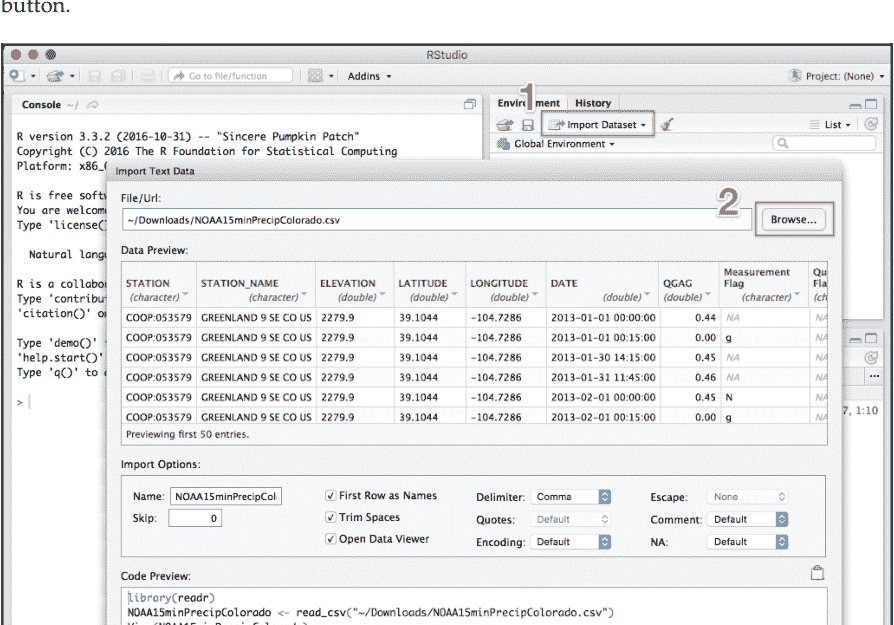

注意系统为你生成的加载数据的代码。你也可以将其作为模板来加载数据文件，而无需通过图形界面菜单操作：

```r
#Bring in the code library for reading in text files
library(readr)

#Load the 15 minute precipitation dataset
NOAA15minPrecipColorado <- read_csv("~/Downloads/NOAA15minPrecipColorado.csv")

#Show the dataset in an RStudio window
View(NOAA15minPrecipColorado)
```

这段代码加载数据文件，然后执行 View() 函数在表格窗口中显示数据。你会在左上方面板中看到数据。在左下方面板（控制台）中，查看数据加载和解析过程中出现的任何错误。这里也会提供关于 R 如何解释数据列的有用信息。你需要判断这些数据错误对于你正在进行的分析来说是否可以接受。如果不能接受，则需要额外进行一些格式整理和解析。

运行以下代码，对数据集中的每一列生成汇总统计信息：

```r
#Run summary statistics on the data frame the file was loaded into

summary(NOAA15minPrecipColorado)
```


最终生成的汇总信息将如下所示：

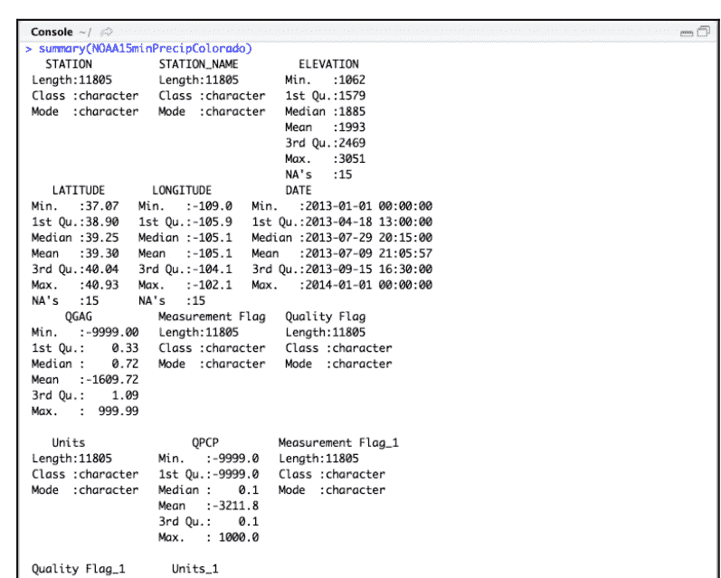

请注意我们在Qgag和Qpcp中已经发现的Min.和Max.的极端值。我们判定这些值很可能是指示标志，而非实际测量值。我们可以通过一些数据操作将这些值移除。如果你尚未安装R的dplyr包，可以通过运行以下代码或使用RStudio图形界面来安装它。dplyr包在数据操作方面非常实用，经常用于R语言分析：

```
#在您的电脑上安装dplyr包
install.packages("dplyr")
```

dplyr安装完成后，运行以下代码过滤掉Qgag或Qpcp中具有极端值的数据行。该代码还会重新运行汇总统计：

```
```r
#加载dplyr代码库
library(dplyr)

#从数据集中过滤掉具有极端值的记录
NOAAfiltered <- filter(NOAA15minPrecipColorado, QPCP > 0, QPCP <900, QGAG >0, QGAG<900)

#对过滤后的数据副本运行汇总统计
summary(NOAAfiltered)
```
```

现在的汇总信息应如下所示。请注意，平均值、中位数和四分位数现在更能代表真实世界的降水值：

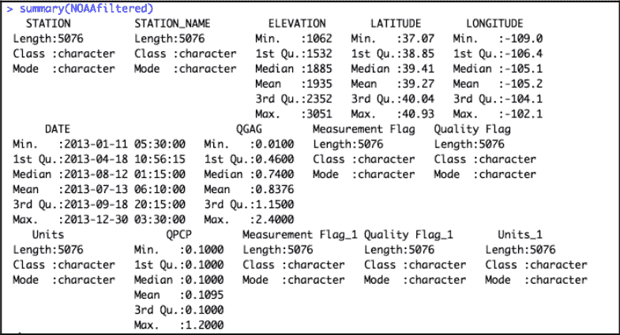

在实践中，当存在缺失或无效值时，需要仔细审查数据集，并判断是删除整个数据记录更好，还是用其他值替换该值更合适。当你过滤掉某一行时，会丢失其他字段，而这些字段可能包含有效值。你的决定将取决于所进行的分析类型。请仔细权衡。

## 总结汇总

那么，通过刚才对数据的快速剖析，你学到了什么？你了解到该数据集并未涵盖每个气象站在该时间段内的完整历史记录。我们发现记录可能是在有需要报告的事件时才发送的，并非每天每15分钟都有一条记录。我们还发现有些站点每月只在第1天报告一次。

我们检测到了一个可能具有实用价值的模式，即降水随时间累积的水平。数据中识别出了一个极端事件，并经过外部验证确认其确实发生过。你学会了使用R来了解数据中每个字段的统计分布。

我们还探索了站点的地理分布。你了解到各站点在科罗拉多州并非均匀分布（但考虑到覆盖面积，情况尚可）。我们还识别出一些数据值似乎是指示符而非测量值（-9999、999.990）。总而言之，你对这个未知数据集有了相当多的了解。

现在，我们将查阅数据集文档，以确认我们对极端值的判断是否正确。这通常是应该首先进行的步骤，但将其放到最后会让本章更有趣一些。

通读文档后，我们发现有一个值表示降水累积的开始和结束。根据文档，这个值为99999，并伴有a或A的测量标志。

然而，通过查看数据，我们知道整个数据集中不存在99999这个值。也没有a或A的测量标志，尽管文档中列出的其他类别似乎都存在。我们观察到的值似乎确实在表达文档所述的含义，因为文档中没有提到其他特殊值。

这是物联网数据的重要一课：文档也可能是错误的。始终要核查数据本身告诉你的信息，信任但要验证。逻辑在不同设备上的实现也可能不一致，导致数值混杂，这里的情况可能正是如此。

## 解决特定行业的分析问题

我们将涉及几个行业，讨论物联网数据探索和分析的特别注意事项。

### 制造业

对于制造过程中生成的物联网数据，记录值的准确性尤为重要。探索数据中的异常值并仔细分析分布情况。与制造过程专家核实你看到的所有数据范围和分布。

确保测量值尽可能干净的好处有两方面。首先，任何用于检测问题的机器学习模型都会显著更加准确。其次，因无效数据导致的误报可能带来高昂代价。在问题调查期间，生产线和产品交付可能会被暂停。在制造业中，这很快就会产生高昂费用。更严重的是，误报的长期影响往往是企业管理层完全不再信任这些数据，从而彻底放弃分析。从长远来看，这会给你所在的公司带来更多开支。

对于产品交付并投入使用后生成的物联网数据，产品的使用年限是关键。许多问题都与产品已使用多长时间有关，无论是使用初期（早期失效）还是使用后期（磨损）的问题。在探索性分析中，需要仔细跟踪并深入研究使用年限。

还有一点需要注意：许多缺乏经验的分析师通过按生产周期对产品数量分组，将故障数除以生产数量来比较故障率。故障通常由物联网设备上报的故障代码或测量值异常来确定。但这存在一个问题，而且是个大问题。

由于早期生产的产品运行时间更长，它们有更多机会经历故障。较新生产的产品机会较少。产品会不断老化，一个生产周期的平均运行时间只会随着时间推移而增长。由于数据集并不完整，各产品在其运行寿命中处于不同的时间点。

### 零售业

零售业中的分析问题将重点关注地理位置、人口统计特征和时间等因素。在Tableau等软件中使用地理信息（地点的纬度和经度）探索数据，可以增加发现有商业价值模式的可能性。

当你可以按地理区域进行探索时，还可以将数据与该地区的经济指标相结合。可以将该地区的人口数据集与物联网数据结合进行探索。零售数据的日期和时间值需要特别准确。白天的人流量会影响销售额。物联网时间值需要额外分析以确保准确性。

将地点与准确的时间值相结合，你可以计算出正确的当地时间以及室外是白天还是黑夜。将当地交通模式和日照时长纳入考量，最终可能成为预测模型的关键预测特征。该模型可能带来销售额的增长。

季节性影响也是零售分析的关键因素。有了准确的时间和地点，你可以分析物联网数据，找出与获取数据时天气相关的模式。

## 本章小结

在本章中，你学习了探索物联网数据的步骤，以便深入了解和掌握数据。我们讨论了查看原始数据的重要性。介绍了Tableau，以及如何使用它来探索和可视化数据的演练。

我们引入了R和RStudio，作为对数据集进行统计分析的强大工具。本章还讨论了一些物联网分析的行业特定注意事项。
