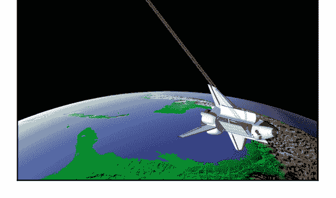
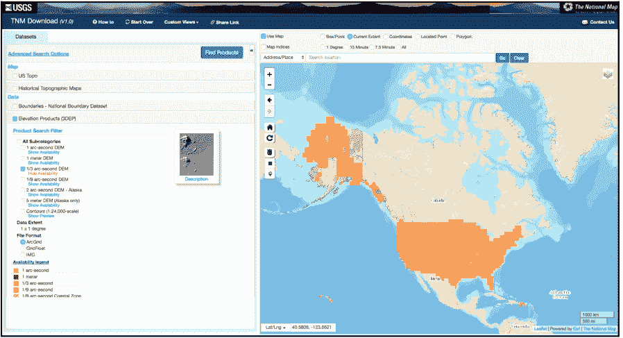
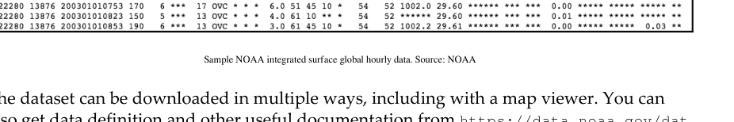
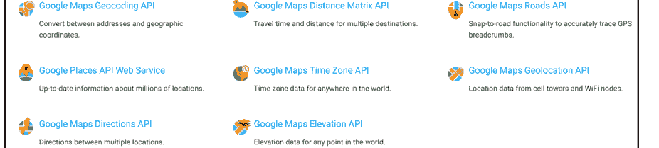
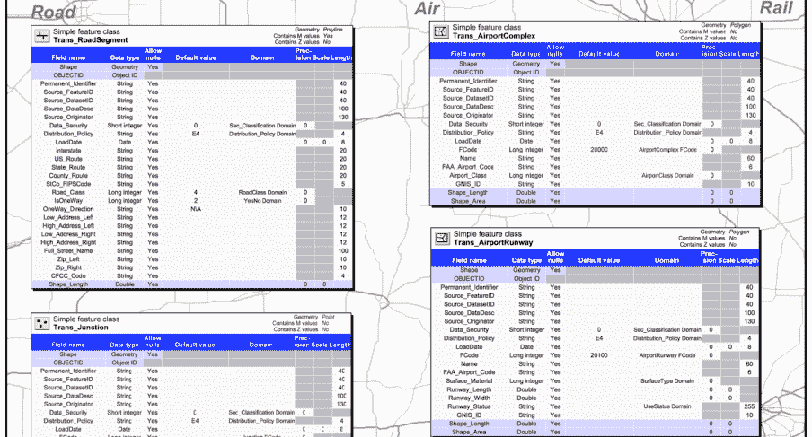
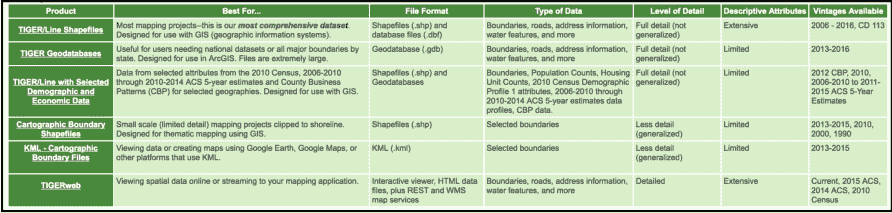
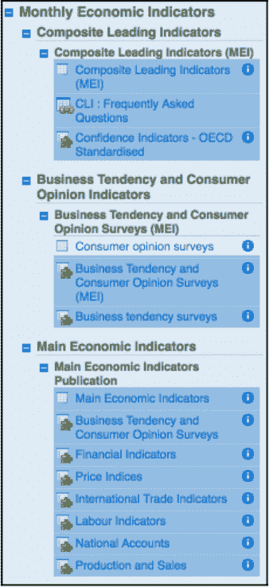
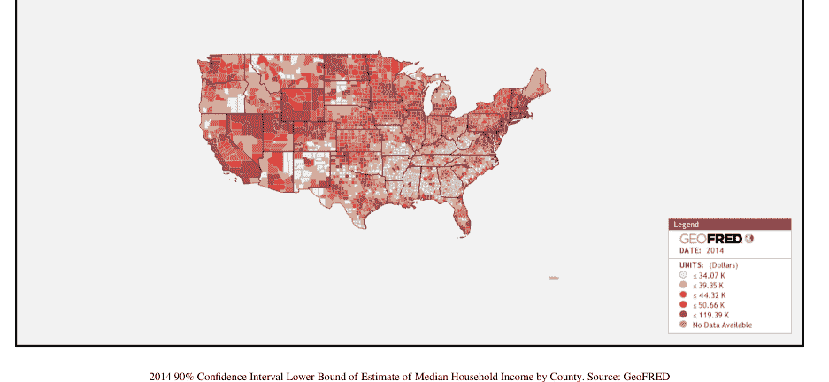

# 7

## 装饰你的数据——添加外部数据集进行创新

“如果富裕女性比贫穷女性更喜欢把房子弄得冷一些呢？”

哦不，你心想。老板刚刚问了一个奇怪的问题，这通常意味着一件事。他被分配了一个SEWOTI，也就是说你被分配了一个SEWOTI（愚蠢的主管浪费时间想法）。你会怎么回答这样的问题呢？这不是需要大量的市场营销调查吗？

“有意思的问题，怎么会想到这个？”你问道。

“销售高级副总裁约翰聊到他妻子夏天喜欢把家里温度调得多低，”他回答道，“所以我们就想，也许富裕女性就是喜欢更冷一些。如果是这样的话，也许我们应该把新款高端恒温器推销给女性，而不是男性。”

你点头表示这是个好主意。但你并不觉得这是个好主意，尤其是在没有市场数据支持的情况下。

“我们甚至还在讨论改变面板的配色方案，让它更女性化。安娜正在核算定价。”他继续说道，“而且考虑到你在分析和绘制现场数据方面做的出色工作，我觉得这个问题对你来说应该很容易回答。所以我告诉约翰，我们接下来就干这个！”

你打算如何回答这个问题？你手上只有设备的数据，而没有按键操作者的收入水平数据。


本章介绍通过向存储的物联网数据中添加额外的数据集来大幅提升价值。宝贵的补充数据既来自内部来源，例如制造或**客户关系管理 (CRM)** 数据，也来自外部数据源，例如经济或人口统计数据集。你将学习如何寻找有价值的数据集并将它们组合起来，以在寻找未开发的商业价值时增强未来的分析。

本章涵盖以下主题：

- 结合数据集提取价值的通用策略
- 内部数据集：
  - 哪些以及为什么？
- 外部数据集 - 地理：
  - 海拔
  - 天气
  - 地图 API
  - 交通运输
- 外部数据集 - 人口统计：
  - 人口普查统计
  - 世界概况手册
- 外部数据集 - 经济：
  - 全球经济数据
  - 联邦储备美国时间序列
  - 使用代码和 API 添加数据

## 添加内部数据集

物联网数据本身只是故事的一部分。已经有大量有用的数据可供你使用，这些数据可能是隐藏价值的宝库。内部数据集常被忽视作为快速增强物联网数据的一种方式。它们是很好的起点。物联网数据不应孤立地查看；应将其视为公司产品、客户和流程已存储数据的延续。

数据应整合为对业务的 360 度视图，以最大化在其中发现新价值的机会。最快、最容易开始的地方通常（但并非总是）是你已有的内部数据集。原因可能并非总是如此最快、最容易的是由于内部数据安全和遗留系统障碍；有时这会使提取内部数据以与物联网数据结合变得困难。这可能是内部数据集的绊脚石，而这与外部数据集形成鲜明对比，外部数据集通常更容易获得且安全问题较少，因为它们是公开可用的。无论如何，潜在价值仍然值得付出克服这些障碍的努力。

### 哪些以及为什么？

在决定将哪些内部数据集与物联网数据集成时，请考虑哪些数据集可以帮助解释传感器值的异常变化或与数据中的模式相关。这些数据集更有可能帮助发现商业价值。有许多内部公司数据集可以帮助你释放价值；我们接下来将讨论四个需要考虑的领域。

#### 客户信息

尽管显而易见，但仍有必要指出，将客户信息纳入物联网数据以发现价值的重要性。诸如客户地址等信息可以被地理编码以获取经纬度坐标。这可用于建立设备位置，从而允许你构建另一层分析。

了解性别、年龄或收入水平等信息可以帮助识别否则不可见的模式。对于工业客户而言，了解设备所在位置的设备行业和应用可能是解锁数据中隐藏模式的关键。出于这些和其他许多原因，客户信息应列在与物联网数据结合的内部数据集的首位。

#### 生产数据

有关物联网数据来源的设备生产信息也很有价值。故障通常与设备组装的制造日期、工厂和生产线相关。子组件和第三方零件与设备标识符相关联。

生产数据还可用于估算现场时间，如果该数据不可直接获得。可以通过使用制造日期作为起点并估算销售时间和现场运行时间来实现。不同的设备配置也可能成为关键属性，你可以用它来对可能没有的其他数据做出假设。例如，如果一家公司生产车辆，并且红色闪烁灯仅包含在作为消防车建造的车辆上，你就可以将这些车辆的客户归类为消防部门，即使你没有直接在客户数据中拥有此信息。

#### 现场服务

引入技术人员维修访问、维护记录和呼叫中心日志的数据集是另一个从数据中挖掘价值的良好起点。将会有关键事件，例如维修工作或投诉电话，可以与物联网数据中的异常模式相关联。

维护记录在开发预测性维护模型时很有用。它也可能与设备故障预测模型相关联。呼叫中心日志可以被挖掘以开发物联网数据事件的属性，而不仅仅是报告的数值或分类值。**自然语言处理 (NLP)** 可用于从文本数据中提取属性。

例如，对于提供天然气的水务公司，呼叫日志文本中出现的 *臭鸡蛋* 短语，对应于物联网数据中低气压的模式，可能表明正在发生天然气泄漏。然后可以开发分析来识别未来物联网数据记录中的模式以进行主动调查。

#### 财务

收入与成本之间的差额是利润。利润的预期是大多数物联网系统投资的驱动力。将客户付款（收入）和公司支出（成本）与物联网数据集关联起来，可以揭示潜在的价值机会。

你可能会发现客户在物联网数据中可识别的某些事件后会购买你的产品。这可能是延长保修购买或服务零件。你也可能会发现他们在你期望他们花费时并未花费。例如，物联网数据表明零件故障，但客户并未相应购买零件。这意味着服务零件是从其他人那里购买的。你需要识别这两种情况。

## 添加外部数据集

有大量有用的外部数据集可供下载并集成到你的物联网分析中，通常是免费的。这些数据集太多，无法进行详尽的介绍，但我们将介绍一些有用的示例。使用这些数据集是增强物联网数据价值的一种低成本方式。

### 外部数据集 - 地理

你有分布在许多位置的物联网设备。位置现在是一个属性，可以让你在数据中找到模式，然后将其货币化。环境、该地区的 demographics、当地经济状况和天气都可以与设备的地理位置联系起来。使用地理数据集来增强物联网数据的潜在价值。

#### 海拔

海拔在许多情况下是一个重要属性，因为它与设备的运行条件和周围环境相关。即使你的设备不动，了解其海拔也可能很有价值。例如，智能烤箱制造商肯定会希望知道海拔，因为它会影响烘焙时间和特性。

##### SRTM 海拔

2000 年 2 月，美国航天飞机 Endeavour 特别配备了两个雷达天线发射升空，任务是绘制全球大部分地区的地形。如以下图像所示，其中一个雷达天线位于航天飞机舱内，另一个位于 200 英尺（60 米）桅杆末端。桅杆在航天飞机进入轨道后展开。组合雷达在航天飞机绕地球轨道飞行时以全球模式扫描地球。



SRTM 运行的艺术渲染图。Courtesy NASA/JPL-Caltech

该任务被称为**航天飞机雷达地形任务 (SRTM)**，在 10 天的运行中，它收集了迄今为止最完整的高分辨率海拔测绘近全球数据集。这是一项由国家地理空间情报局（NGA）和美国国家航空航天局（NASA）领导的国际任务。

数据使用两套雷达设备捕获：一套称为 C 波段，另一套称为 X 波段。C 波段数据由加州喷气推进实验室处理了两年。分辨率略高的 X 波段数据由德国航空航天中心（DLR）处理。全球数据于 2015 年完全发布。

数据的分辨率为全球 90 米，美国境内 30 米。该数据集可从**美国地质调查局 (USGS)** 网站 (`https://lta.cr.usgs.gov/SRTM`) 下载。还有 R 和 Python 包（GitHub 上的 *SRTM.py* 是一个例子）构建用于处理 SRTM 数据集的下载和操作。作者建议使用其中之一，而不是完整数据集，除非你有一组非常大的位置想要一次性为所有位置添加海拔数据。

##### 国家高程数据集 (NED)

NED 是一个覆盖美国、包括阿拉斯加、夏威夷和领土岛屿的高分辨率高程数据集。它由 USGS 管理，约每 2 个月更新一次，以包含新的和改进的数据。数据汇集自多样化的来源，并转换到统一的坐标系统和海拔尺度（米）。

分辨率范围从 90 米到某些区域的 3 米（1/9 弧秒）。使用处理和插值技术生成无缝数据集以实现全面覆盖。整个数据集文件的大小相当大；USGS 提供地图查看器以帮助识别要下载的数据子集区域。

NED 包括以下产品集：

- **NED 3**：该数据具有最高分辨率（1/9 弧秒，约为 3 米），但覆盖范围有限。
- **NED 10**：该数据具有高分辨率（1/3 弧秒，约为 10 米），并由多个**数字高程模型 (DEM)** 创建。来源可包括 LIDAR 和航空摄影。
- **NED 30**：该数据集具有广泛覆盖范围和中等分辨率（1 弧秒，约为 30 米）。它由多个重采样为 1 弧秒的 DEM 汇编而成。
- **NED 60**：这是最低分辨率数据（2 弧秒，约为 60 米）。它为阿拉斯加的一些地区增加了覆盖范围。


NED 对于更高精度的高程数据需求很有用。缺点是其覆盖范围仅限于美国。作者建议在分辨率可接受的情况下尽可能使用 SRTM。高程值在各数据集之间会有所不同，但总体而言，作者发现它们相当可比。

NED 数据可通过地图查看工具 `https://viewer.nationalmap.gov/basic/` 下载。以下屏幕截图显示了 NED 10 数据的覆盖范围。数据文件采用 GIS 格式，我们将在后面的章节中进一步讨论。文件也可从 FTP 站点 (`ftp://rockyftp.cr.usgs.gov/vdelivery/Datasets/Staged/Elevation/`) 直接下载。以下图像显示了地图和下载界面：



National map viewer data download tool. NED 10 coverage shown in orange.

## Weather

天气相关数据的来源很多，既有付费也有免费。**国家海洋和大气管理局 (NOAA)** 提供了多个可免费下载的数据集。从气候数据到日平均值，有很多有用的信息可供选择。

综合地表全球逐时数据集可用于许多物联网分析项目。该数据集包含来自全球 20,000 多个站点的空气质量、大气压、温度、露点、风速和风向、云量和降水等天气属性。数字观测数据由各运营中心转发，或直接在美国北卡罗来纳州阿什维尔的联邦气候中心解码。

所有数据都存储在符合 **联邦信息处理标准 (FIPS)** 的单一 ASCII 格式中。数据文件按气象站、年份、月份、日期、小时然后分钟排序。以下屏幕截图显示了数据集的示例：



该数据集可以通过多种方式下载，包括使用地图查看器。您也可以从 https://data.noaa.gov/dataset/integrated-surface-global-hourly-data 获取数据定义和其他有用的文档。

如果您知道物联网设备的经纬度，您可以从网页下载气象站的位置信息。此信息编译在 KMZ 文件中。利用它可以链接到最近的气象站，以便在物联网数据记录的时间和地点添加天气属性。

## Geographical features

地理特征

当您知道设备的所在地时，添加高程和天气条件是有价值的数据集，但将地理特征与设备相关联也是通过分析释放隐藏价值的一种方式。当设备移动时，例如附着在集装箱上时，这变得尤为重要。

您需要 GIS 工具来打开和处理数据。这些将在后面的章节中讨论。拥有包含道路（例如道路名称和类型）和兴趣点（例如餐馆或加油站）详细信息的完整数据集对于与交通相关的物联网数据尤其有用。例如，将全规模数据集纳入您的 Hadoop 环境中，可以让您大规模进行地理空间分析。

## Google Maps API

物联网设备的定位数据也可以根据需要进行装饰，而无需将完整数据集集成到您的环境中。第三方 API 是一种很好的方式，可以在利用专门从事地理空间分析的其他公司的专业知识的同时实现这一点。有很多优秀的选择，包括来自 Google、Bing（微软）、Esri 和 OpenStreetMaps 的 API。

尽管主要面向网页和移动应用程序开发人员，但 Google Maps 的网络服务 API 可用于快速添加位置标识符、将地址转换为经纬度坐标，或计算地点之间的驾驶时间。API 可以为数据集添加许多有用的属性。当您的数据记录流量每天在数万条而不是数百万条时，使用它们很有意义。

以下屏幕截图显示了目前可用的各种 Google Map API。每个 API 都有其自己的功能和选项，为您提供了强大的功能：



Google Maps web service APIs. Source: Google

利用网络服务 API 为物联网数据添加属性，可以很容易地在 R 或 Python 中完成。Google 提供了 Python 客户端库来简化编程语言的使用。CRAN 上有可用的软件包，例如 googleway，可简化 R 的 Google Maps API 调用。

要开始使用 Google Maps API，您需要获得一个开发人员密钥，用于在 API 调用中使用以验证代码并设置计费。Maps API 网站上有链接可以帮助您设置此项。

以下是使用 *googleway* 软件包的示例 R 代码。您需要先使用 RStudio GUI 或代码 `install.packages("googleway")` 安装它。插入您的 Google Maps API 密钥并运行代码以获取经纬度坐标的时区偏移：

```
```r
#Load googleway package (assuming it is already installed)
library(googleway)

#Get the timezone offset information for a pair of latitude and longitude coordinates
tz <- google_timezone(location = c(41.882702,-87.619392),timestamp = as.POSIXct("2017-03-05"),key = "< Replace everything between these quotes with your API Key >")

#View results
View (tz)
```
```

这是一个非常简单的示例，但显示了它可以很容易地用于完成单独开发起来会相当复杂的事情。

## USGS national transportation datasets

**美国地质调查局 (USGS)** 国家交通数据集是一组包含铁路、步道、机场、道路、水道和其他交通相关地理特征的数据集。数据通过美国人口普查局来源提供，并辅以专业制图公司 HERE 的道路数据。

数据不仅包括道路和铁路的形状，还包括有关它们的表格信息。覆盖范围仅限于美国，但具有标准化的分类代码和描述符。该数据集是为了支持与交通安全、拥堵、灾难规划和应急响应相关的地理空间分析而编制的。

## Decorating Your Data - Adding External Datasets to Innovate

装饰您的数据 - 添加外部数据集以创新

该数据集可免费下载，格式为 Esri File Geodatabase 或 Shapefile。以下屏幕截图是数据集中可用数据表的子集：



Partial view of USGS Best Practices data table definitions. Source: USGS

## External datasets - demographic

外部数据集 - 人口统计

增强物联网数据价值的另一种方法是根据时间和位置添加人口统计信息。诸如医疗保健覆盖率、该地区平均收入和人口年龄等属性在与您的物联网数据结合时可能具有预测价值。

## The U.S. Census Bureau

美国人口普查局

对于美国，人口普查局维护到州和县级的人口统计数据集。许多其他国家也有类似的政府机构，承担相同的使命。有多个数据集可用，但一个很好的起点是 QuickFacts 数据集。

QuickFacts 维护所有美国州和县的统计数据，以及人口在 5,000 人或以上的城市和城镇。它包括人口规模和密度、年龄和性别、种族、住房、教育、经济、收入、商业和健康方面的统计数据。该数据集使用 **联邦信息处理标准 (FIPS)** 代码作为标识符。FIPS 代码通常是您用来链接到物联网数据的内容。

FIPS 代码是一个五位标识符，用于标识美国的县（或县级等价物）。前两位数字表示州，后三位标识县。FIPS 代码列表可以从 `https://www.census.gov/geo/reference/codes/cou.html` 下载。

美国人口普查局还维护了一些有用的地理空间数据集，其中已集成人口统计信息。有关 **拓扑集成地理编码和参考 (TIGER)** 数据集的信息可在 `https://www.census.gov/geo/maps-data/data/tiger.html` 获取。

| Product | Best For... | File Format | Type of Data | Level of Detail | Descriptive Attributes | Vintages Available |
|---|---|---|---|---|---|---|
| TIGER/Line Shapefiles | Most mapping projects—this is our most comprehensive dataset. Designed for use with GIS (geographic information systems). | Shapefiles (.shp) and database files (.dbf) | Boundaries, roads, address information, water features, and more | Full detail (not generalized) | Extensive | 2006–2016, 2013 |
| TIGER Geodatabases | Useful for users needing national datasets or all major boundary files. Designed for use in ArcGIS. Files are extremely large. | Geodatabase (.gdb) | Boundaries, roads, address information, water features, and more | Full detail (not generalized) | Limited | 2013–2016 |
| TIGER/Line with Demographic and Economic Data | Data from selected attributes from the 2010 Census, 2006–2010 through 2010–2014 ACS 5-year estimates and County Business Patterns (CBP) for selected geographies. Designed for use with GIS. | Shapefiles (.shp) and Geodatabases | Boundaries, Population Counts, Housing Unit Counts, 2010 Census Demographic Profile 1 attributes, 2006–2010 through 2010–2014 ACS 5-year estimates data profiles, CBP data | Full detail (not generalized) | Limited | 2012 CBP, 2010, 2006–2010 to 2010–2014 ACS 5-Year Estimates |
| Cartographic Boundary Shapefiles | Small scale (limited detail) mapping projects clipped to shoreline. Designed for thematic mapping using GIS. | Shapefiles (.shp) | Selected boundaries | Less detail (generalized) | Limited | 2013–2015, 2010, 2000, 1990 |
| KML – Cartographic Boundary Files | KML — creating maps using Google Earth, Google Maps, or other platforms that use KML. | KML (.kml) | Selected boundaries | Less detail (generalized) | Limited | 2013–2015 |
| TIGERweb | Viewing spatial data online or streaming to your mapping application. | Interactive viewer, HTML data files, plus REST and WMS map services | Boundaries, roads, address information, water features, and more | Detailed | Extensive | Current, 2015 ACS, 2014 ACS, 2010 Census |



## CIA World Factbook

中央情报局世界概况

美国中央情报局 (CIA) 维护了一个免费、有用的、无附加条件（据我们所知）的关于世界各国信息的数据库。尽管以大胆的间谍工作而闻名，CIA 还承担着收集世界各地有用信息的相对枯燥的角色。

该机构将其中一些信息提供给任何可以使用网络浏览器的人。如果中央情报局的任何人正在阅读本书（希望是通过购买而不是直接从作者的笔记本电脑上 - 但我们开玩笑，我们开玩笑），作者想感谢您免费提供这个全球信息的重要来源。它作为公共领域提供，这意味着无需担心版权或保留出版权问题。


《世界概况》包含关于260多个世界实体（他们称之为实体，但可视为国家）的信息。这些信息涵盖每个国家的历史、人民、政府、经济、地理、通信、交通和军事等方面。

然而，《世界概况》并未以机器可读的格式在网站上提供；你可以在 GitHub 上找到 JSON 版本。如果你的物联网设备分布在全球各地，它是一个了解世界各国情况的有用参考。可访问 https://www.cia.gov/library/publications/the-world-factbook/ 获取。

## 外部数据集——经济类

经济数据和趋势变化与物联网数据结合时，也能成为预测价值的来源。这些信息有助于解释零售场景中的购买模式、公用事业监控中的能源消耗，以及制造业中的设备利用率。

## 经济合作与发展组织（OECD）

OECD 是一个论坛，34 个民主市场经济国家与超过 70 个非成员国共同致力于促进经济增长、繁荣和可持续发展。作为其使命的一部分，该组织汇编了一个经济及相关统计数据库，并向所有人开放。

> 该组织提供一个环境，让各国政府可以比较政策经验、寻求共同问题的解决方案、识别良好实践，并协调国内与国际政策。

该数据库可在 OECD.Stat（http://stats.oecd.org/）上获取。其数据集范围从农业和渔业到工业和服务业。数据涵盖 OECD 成员国及部分选定的非成员国经济体。由于所有国家的信息都遵循 OECD 统计准则，因此与通过不同来源（可能采用不同统计方法）收集的数据相比，这些数据的可比性要高得多。

每个主题都有子类别，每个子类别中包含多种衡量指标。有多种方法可以将数据集导出为机器可读形式（如 .csv），并且有一个 API 可用于通过代码获取数据。该网站具有创建模板 API 查询的功能，从而简化了使用过程。以下截图是**月度经济指标**主题下可用统计信息的示例：



## 美国联邦储备经济数据（FRED）

在美国，圣路易斯联邦储备银行维护着大量与经济相关的时间序列数据，大部分覆盖美国，但也有一些国际数据。这些数据被统称为 FRED。FRED 是你的朋友，他知道很多。

他知道按月份统计的所有城市消费者的消费者价格指数。FRED 知道平民失业率和实际家庭收入中位数。他知道美国所有年龄段贫困人口的估算数，以及世界互联网用户数量。

FRED 中包含了来自 80 多个不同来源的超过 47 万个美国和国际时间序列。FRED 有实用的工具，如 Microsoft Excel 插件和一些智能手机移动应用。FRED 甚至还有一个名为 FREDcast 的预测游戏。FRED 的网址是 https://fred.stlouisfed.org/。

FRED 还有一个地理空间组件，称为 GeoFRED。你可以用它创建时间序列数据的地图版本，或下载 shapefile 文件。以下截图是2014年按县划分的家庭收入中位数估算的90%置信区间下界的示例：



2014 年按县划分的家庭收入中位数估算的 90% 置信区间下界。来源：GeoFRED

FRED 有三个开发者 API：

- **FRED API**：可用于通过编程方式从 FRED 数据集中检索时间序列数据。
- **FRASER API**：此 API 可用于从**联邦储备经济研究档案系统（FRASER）**检索元数据。FRASER 保存着历史文件和档案。
- **GeoFRED API**：允许以编程方式访问 GeoFRED 数据和 shapefile 文件。

你需要从 FRED 网站获取一个 API 密钥才能使用它们。获取 FRED 数据的另一种方式是使用 R 包，如 *Quandl*。你可以从 RStudio 图形界面或使用 `install.packages` 函数安装该包。然后，你可以用它从包括 FRED 在内的多个金融数据源获取数据。以下是一些示例 R 代码，用于获取美国 GDP 时间序列数据：

```
```r
#load Quandl library
library(Quandl)

#Grab US GDP time series data from FRED
gdp_ts = Quandl("FRED/GDP")

#Display
View(gdp_ts)
```
```

在 R 中使用代码库，你可以自动化处理过程，定期将数据整合到你的分析环境中。

## 总结

在本章中，我们讨论了如何通过内部和外部数据集增强你的物联网数据。这可以极大地增加发现价值的机会。通过添加这些额外数据，你可以开发属性，从而建立和验证关于数据的理论。

所有理论都应该用数据进行测试。物联网数据为你提供了一个巨大的实验室，你可以通过细分和比较已有的数据来进行虚拟实验。通过加入外部数据集，你可以增强通过物联网分析发现有价值模式的能力。
