## 与他人沟通——可视化与仪表板

自从你的分析阻止了亮粉色恒温器盖板的危机以来，已经过去几个月了。你的老板因为他在开发利用物联网现场数据回答业务问题方面的领导力，已被晋升为物联网分析总监。而你，职位没变，只是责任更重了。

你的分析成果正在整个公司使用。你对此感到兴奋，但现在花费大量时间整理标准报告，每周发送给各个团队。

“财务部的克莱恩曼想看你的活跃设备趋势图，但他想要表格形式。我不知道为什么，但你能为他做一个那样的版本吗？”你的老板以轻快的语气问道。他似乎对人们想要的图表越多就越高兴。而你却越来越忙。

“好吧，够了！”你忍不住发火，“他们得自己想办法弄图表。我没法应付所有这些版本和后续问题。我做这份工作不是要把时间都花在基本报告和回答基本问题上。他们应该自己解决这些问题。”

你的老板被你的反应吓了一跳；他可能以为你和他一样高兴。“好吧，好吧。我们会解决的。你只需要创建一些仪表板，让他们自己回答问题。看，多简单！我会支持你，让他们照着做，不用担心。”

你不确定该怎么做，但绝对希望腾出时间来做更高级的分析。

在与财务部的吉姆·克莱恩曼交谈后，你发现他之所以想要表格，是因为他想计算财政年度的平均值。他将其用于财务规划目的。而销售技术人员则希望看到图表，因为他们每天都要用图表快速检查增长和下降情况。

你必须仔细思考这个问题。你不想为每个人创建不同的仪表板，但你又希望他们都能有效使用你所创建的内容，并且不要用后续问题来打扰你。

本章讨论如何为物联网数据设计有效的可视化和仪表板。一旦你在数据中发现了有价值的模式，就需要与他人沟通。可视化是快速传达复杂数据的有效方式。

随着你的分析发展，其他人将监控数据以识别模式并跟踪长期趋势。设计有用的仪表板可以让他们快速识别需要调查的模式，并回答自己的后续问题。可以将其视为另一种形式的沟通。

我们将使用 Tableau 来构建可视化和仪表板。你将学习如何利用你对数据的理解，并以易于理解的方式传达出来。本章涵盖内部仪表板和面向客户的仪表板。

本章涵盖以下主题：

- 设计可视化时的常见错误：
  - 避免这些错误的技巧
- 问题层级方法：
  - 描绘最终用户的思维过程
  - 开发问题树
  - 将可视化与用户问题层级对齐
- 为物联网数据设计可视化分析：
  - 使用位置传达重要性
  - 有效使用颜色
  - 创建有效图表的技巧
- 使用 Tableau 创建仪表板：
  - 使用气象站数据的分步示例
- 快速创建和可视化警报：
  - 警报原则
  - 为 Tableau 仪表板组织警报


- **隐藏复杂性：** 如果它不能增加有助于得出结论的信息，就隐藏它。
- **从终点开始：** 先展示你的结论，然后再解释你如何得出这一结论。仪表板也是如此；让最显眼的视觉元素是能促使用户采取行动的那个，然后用支持信息加以补充。

- **不考虑分析的使用方式：** 分析和可视化将用于每月向高管团队汇报一次？还是供技术支持人员每天使用？即使是相同的信息，这两种情况所需的视觉效果也会截然不同。以下是一些需要考虑的事项：
  - **为管理层报告简化：** 高管们每天从各种来源接收到大量信息。让你的信息易于理解，使用清晰的趋势线和红、黄、绿三色符号来表示状态。
  - **为日常操作用户添加更多细节：** 他们需要你能在单个视图中显示的尽可能多的相关信息，同时又不能过于繁杂而难以解读。找到适当的平衡，但应倾向于展示更多有用的数据。

为了说明如何将糟糕的可视化转变为优秀的可视化，我们先从一个糟糕透顶的例子开始，这个例子会让爱德华·塔夫特（Edward Tufte）心跳加速（谷歌一下他，然后读读他的书）：

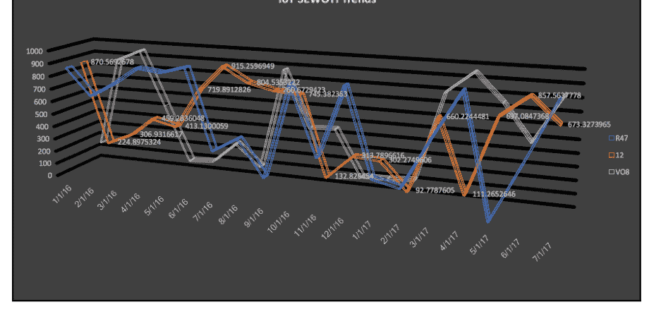

一个糟糕图表的例子。请勿这样做。

这个可视化存在多个问题。除非演示文稿或仪表板的整个主题是深色的，否则深色背景会分散注意力。两个坐标轴都没有标注。也不清楚哪条线更重要，因此图表给观众的印象是所有线都同等重要。

图例中使用的是字符代码，而不是更具描述性的名称。如果某人不是非常熟悉这些代码，就必须查找它们的描述。3D 的使用方式没有提供任何信息价值，反而分散了对关键数据的注意力。

标签直接标注在未取整的数值上。这使图表显得杂乱，并暗示了一种可能不准确的精度。如果这是一张每月审阅的图表，历史趋势很重要，但精确值并不重要——除了当前月份。

该图表既难以解读，又视觉上令人困惑。现在，让我们看看同一图表的改进版本：

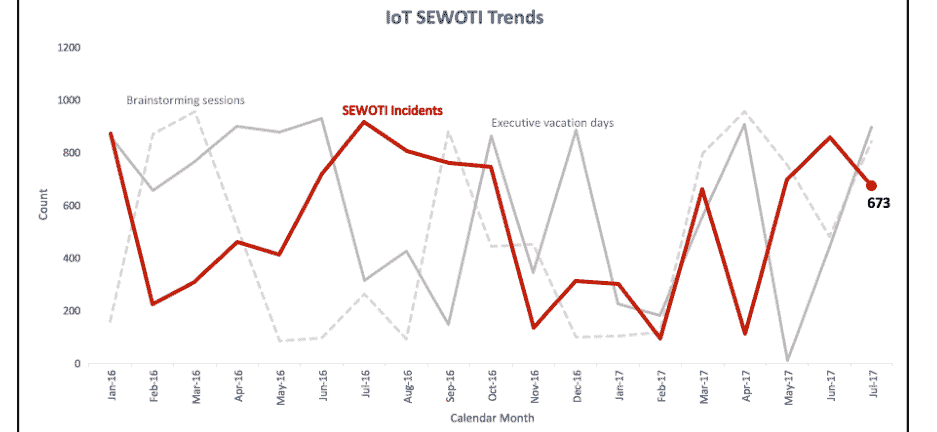

好得多的可视化，关键趋势显而易见，当前月份数值也清晰标注。

这个可视化在表明哪条趋势线最重要方面要清晰得多。线条也标注清楚，观众无需参考图例。当前月份数值（即每月报告的数值）清晰可见，且没有暗示过度的精度。

两个坐标轴都进行了标注，因此观众无需猜测测量的是什么。月份的坐标轴标签是垂直的，这与该月的数值在视觉上对齐。以这种方式格式化可视化需要多花一点功夫，但观众会更快、更清楚地理解信息。这使它值得付出努力。

## 问题层级法

在设计可视化和仪表板时，不要只是复制你探索数据时为自己创建的那些图表和表格，而应花点时间从观众的角度思考问题。想想他们的视角和需求与你有什么不同。

作为分析师，你对数据和环境已经非常熟悉；你的图表不需要标签和描述。你想要的是在一个地方容纳尽可能多的信息，以便轻松找到模式。而将要与仪表板交互或观看你演示的人们则有不同的需求。

他们希望无需费太多力气就能在视觉上定位自己。他们希望关键结论显而易见。他们不想花大量时间试图弄明白，也不想为了理解所展示的内容而问很多问题。他们希望简单熟悉，但又要足够的细节，让他们确信数据在支持他们的解读。

在为他人设计分析交互时，遵循一个框架会很有帮助。这将有助于你组织思路，并规划出支持他人分析所需的可视化和仪表板。

## 问题层级法概述

在这里，我们将介绍一种规划可视化的流程，称之为问题层级法。你不是从需求和原型开始，而是从梳理观众的思维过程开始。

之后，你汇总回答所映射思维过程中识别出的问题所需的数据。数据的形式应能够被高效地以多种不同方式查询。我们将在后面的章节中讨论如何做到这一点。

最后，创建与所映射思维过程一致的可视化。相同的数据很可能会以不同方式被多次使用。遵循这一流程的好处是，它将观众的需求放在首位，而不会锚定于起始可视化——它很可能就是最初最容易创建的内容。在这种情况下，倾向是去做对开发者（你）来说最易于创建和维护的事情，而非对观众最有利的事情。将自己从可视化的固定起点中解放出来，能够让你对与分析数据进行交互的创新方式保持开放态度。

请记住，你是一个人，而观众是很多人；并且，对于仪表板来说，每个人都需要多次使用它。把它做对的总体收益可能很大，尤其是对于可能有数千用户的面向前台客户的仪表板。

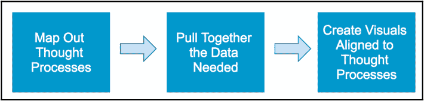

## 构建问题树

流程的第一步是集思广益，列出演示或仪表板中的可视化应该回答的问题清单。如果可能的话，与一小群最终用户一起进行。如果不可能，或者你正在准备一个小型演示，那就从设身处地开始。试着忘记你对数据的了解。想想如果你是他们，你希望哪些问题得到解答。把它们列出来。

下一步是将问题清单概括为每个问题真正在询问的底层概念。例如，问题*夏季温度传感器读数是否低于 21 度？*可以转化为*温度传感器读数是否与一年中该时期的平均值存在显著差异？*有些问题可能会合并在一起。其目的是得到一个可适用于多种情境而非特定情境的概念。

然后，审阅清单并识别作为起点的问题。起点是促使人们一开始就去查看仪表板或坐下来观看演示的动机。接着，识别哪些问题实际上是起点问题的后续问题。示例问题*温度传感器读数是否与一年中该时期的平均值存在显著差异？*可能不是一个起点问题。更可能的是*某个地区的平均温度读数趋势是什么？*，随后是*是否存在任何异常读数？*，然后才是*温度传感器读数是否与一年中该时期的平均值存在显著差异？*。


以层级结构排列问题，将起点问题放在左侧，与其向右延伸的后续问题相连。如果同一个后续问题与多个起点问题相关，则为每个起点问题复制该后续问题。每种场景中，该问题可能略有不同。我们将由此得到的图表称为**问题树**。在构建数据集和可视化时，可以将其作为参考。

为了说明这一过程是如何运作的，我们将以电影场次信息为例进行逐步讲解。大多数人都能轻松理解这个例子。第一步是列出那些会让你想要了解电影场次信息的问题：

- 《*变形金刚12*》什么时候上映？
- 哪些影院在放映《*洛基恐怖秀*》？
- 今晚8：10《*复仇者联盟 vs. 正义联盟*》的场次是否已售罄？
- 还剩多少个座位？
- 那家影院的票价是多少？
- Cineblast 128距离多远？
- 到Cinema Cheap-o需要多长时间？
- 今晚豪华影院（Luxury Cinema）上映什么电影？
- 明晚9点左右有哪些电影在上映？

下一步是归纳并合并这些问题：

- 我想看的电影在什么时间有场次？
- 我想看的电影在哪些影院上映？
- 在特定的影院和时间，我能买到好座位吗？
- 在特定的影院和时间，我能买到好座位吗？（合并）
- 在特定的影院和时间，票价是多少？
- 在特定的时间前往特定的影院，需要花多少时间在路上？
- 在特定的时间前往特定的影院，需要花多少时间在路上？（合并）
- 我想去的影院上映哪些电影？
- 在特定的时间我能看哪些电影？

然后，确定主要的起点问题。建议从记录选择问题的理由开始。在这个例子中，有三个变量：电影、地点和时间。通常你已经确定了其中一个变量，需要信息来帮助你决定另外两个：

- 我想看的电影在什么时间有场次？
    - *我知道我想看什么电影。我特别想看《变形金刚12》；我只需要知道什么时间能看。然后，我想知道在哪里上映，以及我和朋友是否还能买到好座位。票价和去影院需要多长时间也会很有帮助。*
- 我想去的影院上映哪些电影？
    - *我知道我想去什么地方。我喜欢去豪华影院（Luxury Cinema）；那里的体验非常棒。我只是想知道那里有没有我想看的电影。然后，我想知道场次时间以及能否买到好座位；我可不想花了大价钱，结果连坐在女朋友旁边都做不到。*
- 在特定的时间我能看哪些电影？
    - *我知道我想看什么时间。我们订了晚上7点的餐厅去吃晚饭，我想看看之后附近有没有什么电影可以看。我想知道票价、能否买到好座位，以及从餐厅到那里需要多长时间。*

最后一步是将问题组织成问题树。下图展示了电影场次示例的问题树：

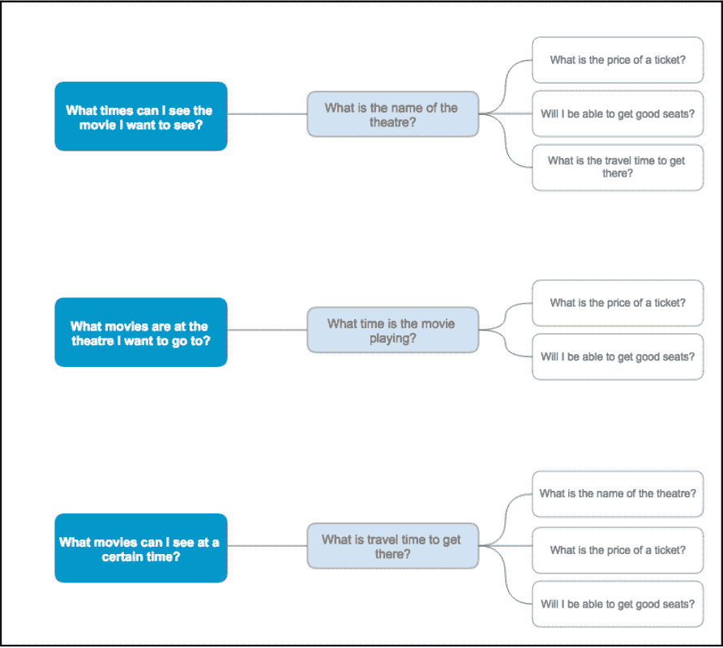

以下是创建问题树层级结构的步骤摘要：

- 1. 列出受众想要向分析提出的问题。
- 2. 归纳并合并问题。
- 3. 确定起点问题。
- 4. 将问题组织成问题树图。

## 整合数据

IoT数据通常使用Hadoop（具体来说是HDFS）等大数据技术进行存储。在仪表板的SQL语句中连接多张表通常会降低性能，在这些系统中有时性能会显著下降。

尽量将数据整合到尽可能少的表中，这样表连接只在批处理时执行，而不是每次有人使用仪表板时都执行。在考虑数据集中应包含哪些信息时，请参考问题树，并纳入回答问题所需的信息。

## 将视图与问题流对齐

设计可视化时，要使其与问题树的层级结构对齐。第一个、也是最显眼的可视化应该回答起点问题。后续问题应尽可能在同一个可视化中呈现，但可以放在较不显眼的位置。如果这样做过于笨拙，那么用户只需再点击一下就能回答他的问题。第一个后续问题之后的后续问题也是如此，以此类推。

如果在同一个仪表板中回答所有问题过于繁琐，你可能需要为每个层级树制作一个单独的仪表板。这里的衡量标准是思考什么对用户来说最容易、最自然。目标是让仪表板或演示的顺序遵循受众的思维过程。

在本章后面，我们将使用一个IoT数据集来完整演示一个示例。

## 为IoT数据设计可视化分析

我们将回顾一些在设计可视化分析时的重要考虑因素，特别是针对IoT数据。

### 利用布局位置传达重要性

布局位置暗示了什么是重要和首要的；你应该利用这一点来更有效地与受众沟通。在西方文化中，视线从视图的左上角开始。这是由于多年来从左到右、从上到下阅读的习惯。这是人眼习惯性最先看的地方。把关键信息放在这里：也就是起点问题的答案。

当你在视图中向右下方移动时，按照可视化（包括表格和文本）在问题树中的位置顺序来放置它们。这样将顺应视线的移动和受众的思维过程：

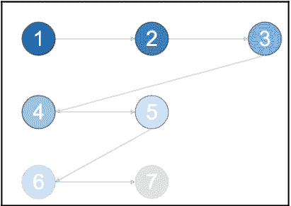

在同一视图中展示多个可视化时的推荐布局顺序

在其他文化中，应用相同的概念，但要遵循与阅读顺序一致的位置顺序。例如，在巴基斯坦，乌尔都语是从右到左书写的——因此最重要的信息应该放在右上角。

### 使用颜色突出重要数据

颜色也是一种强有力的方式，可以向受众传达哪些内容应该被理解为重要信息。不过要谨慎使用，因为同一视图中颜色过多会让人困惑，并削弱其影响力。

### 使用单一颜色传达重要性的效果

为了重申颜色（如果只有灰度，则是灰色阴影）可以有多么强大，我们来看一个示例。在下图中，浏览这些数字并数一数你看到了多少个6。你数出了几个？花了多长时间？

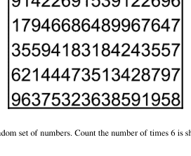

一组随机数字。数一数6出现了多少次。

现在，我们取同一张图片，用颜色将重要信息（数字6）放在前景，将较不重要的信息（其他数字）放在背景，并通过淡化为一层灰色来处理。

再看修改后的图片，你数出了多少个6？花了多长时间？你会发现，当关键数据用颜色突出显示时，做这件事要容易得多、快得多。对你的受众也这样做，你就能让他们更容易理解关键信息：

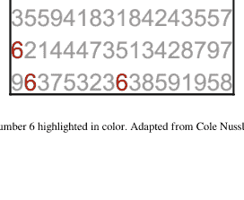

同一组随机数字，其中数字6用颜色突出显示。改编自Cole Nussbaum Knaflic的著作《用数据讲故事》（Storytelling with Data）。

### 在多个可视化之间保持一致

在演示或一系列仪表板中，务必保持颜色和格式的一致性。如果平均温度在第一个图表中用蓝色实线显示，那么在所有后续图表中也应该用蓝色实线显示。即使图表类型改变，也要保持颜色一致。如果折线图中压力传感器的趋势线是蓝色的，那么在后续的散点图中，数据点也应该是蓝色的。

这种一致性可以避免受众在不同视图之间需要重新适应。它还有助于防止误解，因为人们很容易默认相同的颜色具有相同的含义。

### 让图表易于解读

对于IoT数据，时间序列分析非常常见。分析IoT传感器值随时间变化的趋势，对技术支持、市场营销、质量和工程等岗位的人员都很有用。时间序列图比帕累托图或饼图能更有效地传达趋势数据。由于你会经常使用它们，因此尽可能让它们高效就显得很重要。创建图表时，要记住一些要点，以帮助你的受众轻松得出你预期的结论。

在大多数情况下，你审视数据的方式远比提供给受众的方式多得多。你选择了最能传达你从数据分析中所获见解的图表。要让受众容易理解。

以下是一些可以有所帮助的方法：

- **突出关键数据**：让图表中的关键趋势线明亮醒目。在表格中，将你认为最重要的那一行加粗。让它一目了然。这并不是在侮辱他们的智商，而是在为他们节省时间并尽量减少误解。
- **清晰地标注图表元素**：为图表设定清晰的标题，并让字体足够大、易于阅读。确保坐标轴有标注，并避免使用缩写。
- **指出关键信息**：在图表上圈出你希望确保受众注意到的区域。画一个箭头指向该区域，并添加文字说明应如何解读。如果12月份平均温度出现尖峰，是因为该地区创纪录的高温，而不是系统问题，那么就把它圈出来并加上注释。这样受众就不必再提出疑问或自己去调查了。


## 使用 Tableau 创建仪表板

Tableau 使从您已创建的可视化分析选项卡中组装仪表板变得轻松。我们将使用它来基于第 6 章 *了解您的数据 - 探索物联网数据* 中的天气站数据示例进行构建。在构建仪表板的过程中，我们还将逐步介绍问题层次结构流程。

### 仪表板演练

Tableau 还有一个名为 **Tableau Server** 的 Web 服务器软件，可让您轻松地从桌面软件发布仪表板，以便通过浏览器查看。其他用户然后可以轻松与其交互。虽然 Tableau Server 超出了本书的范围，但您很可能希望将创建的仪表板发布到它上面。

### 问题层次结构示例

对于这个简单示例，我们假设受众是科罗拉多州政府用水规划小组。该小组希望了解有多少气象站报告降水信息，以及信息被捕获的程度如何。以下步骤展示了如何将其制成问题树：

- **步骤 1：列出受众希望对分析提出的问题：**
  - 与上个月相比，报告降水的站点数量是否发生了变化？
  - 总共有多少个站点发送了降水数据？
  - 站点位于何处？
  - 有多少个站点报告了显著降雨？
  - 每个站点的日汇总中是否有任何奇怪之处可能表明存在问题？
  - 上个月州内的哪些地区下了一些好雨？
- **步骤 2：概括问题并合并：**
  - 报告可用降水数据的站点数量趋势如何？
  - 有多少个站点报告数据？
  - 在该期间报告了可用数据的站点位于何处？
  - 在该期间是否有站点报告了显著降雨？
- 是否存在特定站点的异常降水值？
- 在该期间报告了可用数据的站点位于何处？（与列表中前面类似的问题合并）
- 步骤 3：确定起始问题：
  - 根据与用水规划小组的对话，您确定他们的第一个想法只是简单地检查报告 15 分钟降水数据的站点数量。
  - 起始问题：有多少个站点报告数据？
- 步骤 4：将问题组织成问题树图：

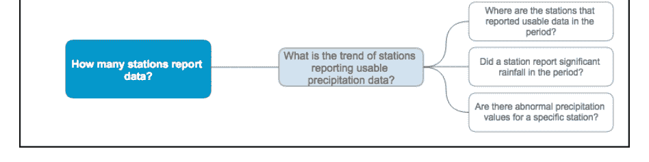

气象站问题层次结构

## 将可视化与思维过程对齐

在 Tableau 中创建之前，先思考需要哪些可视化以及如何排列它们。最重要的东西，即起点，应该是最先让受众看到的东西。如果仪表板中要包含多个可视化，它应位于屏幕的左上部分。

由于只需一个简单的计数即可回答该问题，这可以只是一个数字。无需图表。您应该将其做得很大，以便立即注意到。使其大到可能令人不舒服的程度，受众就会显而易见地知道它是视图中最重要的信息，而无需指出这一点。

需要报告站点数量的趋势，以便受众能够了解随着时间的推移是否有更多或更少的站点报告可用数据与总站点数量相比。这与第一个后续问题一致。按月趋势应该有效。

然后，对于任何给定时期，用水规划小组希望知道报告站点的地理位置以及该时期站点是否有显著降水。他们还希望对州内有显著报告降水的地点有一个大致了解。地图是容纳大量空间信息并易于理解的一种好方法。这与次要后续问题一致。

对于任何站点或区域内的站点组，规划小组希望能够查看每日趋势，以便快速检测任何异常情况以进行进一步调查。这与最后一个后续问题一致。现在，我们可以一次构建一个视图，然后将它们组装成仪表板。

## 创建单个视图

对于第一个视图，使用 Tableau 连接到第 6 章 *了解您的数据 - 探索物联网数据* 中的 15 分钟降水数据集。起始问题可以通过计算数据集中唯一站点的数量来回答，而不管值的有效性如何。设置一个名为 Number of Stations 的计算字段，使用公式 COUNTD([Station])，它将基于唯一站点的不同计数进行聚合。将 Number of Stations 聚合拖到 Marks 架中的文本框。使数字变大且加粗，以便首先看到。

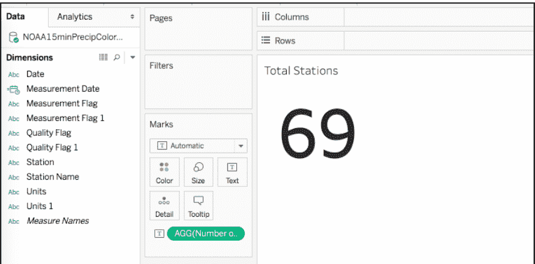

下一个视图应与关于报告有效值的 **Number of Stations** 趋势的后续问题一致。由于受众对长期趋势感兴趣，因此按月分组是合适的。此时，让我们将 **Qpcp** 重命名为更好的描述。根据数据集文档，该值代表以英寸为单位测量的降水量。我们将 **Qpcp** 重命名为 **Amount of Precipitation (inches)**。同时过滤掉 **Qgag** 或 **Qpcp**（现称为 **Amount of Precipitation (inches)**）中具有极端值的记录。

设置测量日期以显示月份和年份。将 **Number of Stations** 字段拖到 **Rows** 架以显示趋势。与总 **Number of Stations** 的隐式比较，因此通过将 **Number of Stations** 拖到 **Marks** 架中的标签框使值可见。

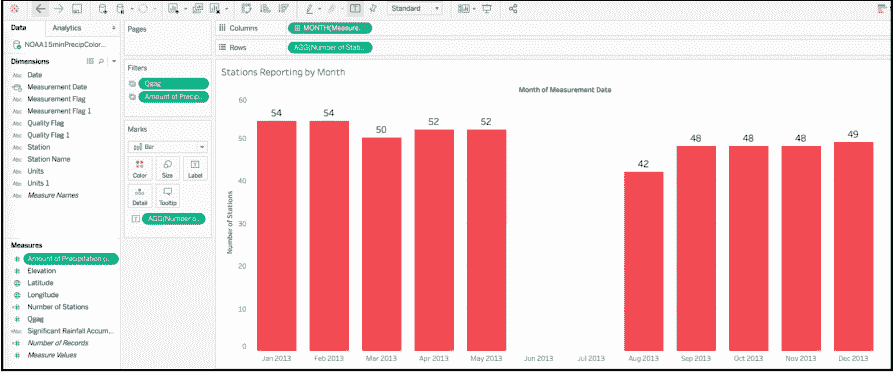

按月趋势视图

最后，通过显示每个站点的每日汇总值来回答层次结构中的最后一个问题，即异常降水值。您在第 6 章 *了解您的数据 - 探索物联网数据* 中的数据调查中了解到，异常值可以通过按站点的每日条形图轻松找到。 resulting visual 应类似于以下屏幕截图：

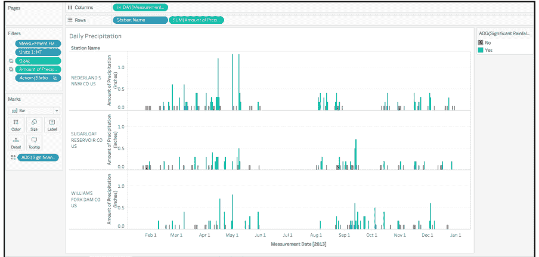

按站点查看的每日趋势

## 将视图组装成仪表板

下一步是创建一个新的仪表板选项卡。将大小设置为 **Generic Desktop (1366 x 768)**。
按本章前面讨论的优先级顺序添加四个视图。初始
仪表板应如下所示屏幕截图：

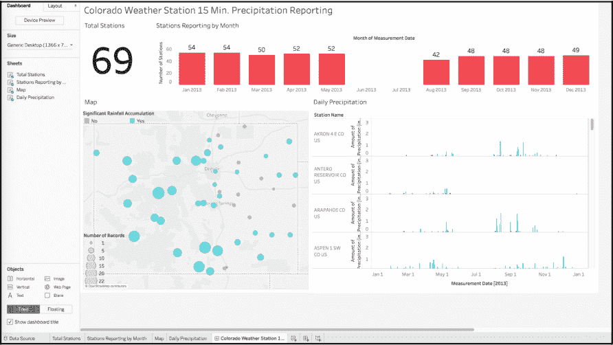

使用 Tableau，您可以添加仪表板操作，允许用户根据在源视图中单击的内容过滤其他视图。遵循问题层次结构，在按月趋势视图中单击每月站点计数条应过滤地图视图。对地图视图中站点的选择应过滤每日趋势视图。

转到菜单栏中的 dashboards 并选择 Actions... 以向仪表板视图添加几个操作。从按月趋势视图向地图视图添加一个过滤器，链接字段为 MONTH([Measurement date])，当选择条时生效。对地图视图执行相同操作，目标为每日趋势视图，链接字段为 Station：

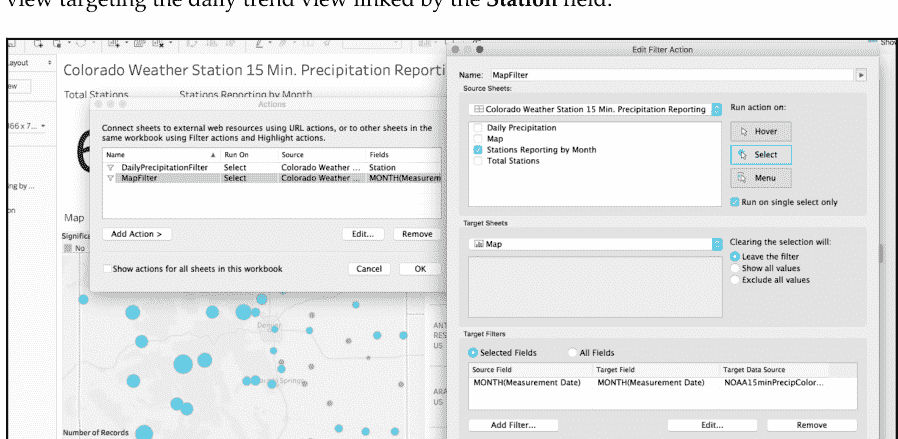

添加仪表板操作

现在，仪表板用户可以调查测量月份，以快速了解哪些气象站正在报告数据。他们还可以按每日汇总降水值查看一个站点或一组站点，以识别异常结果。以下屏幕截图示例显示了 2013 年 11 月报告站点的地图位置以及丹佛地区几个站点的每日趋势：

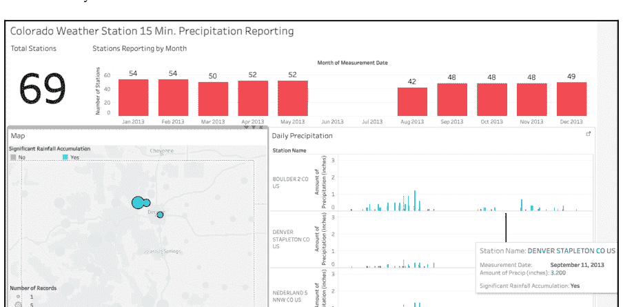

仪表板交互示例

## 创建和可视化警报

物联网数据本质上是有噪声的。经常会出现无效和缺失值的情况。这需要持续的警惕以在发生时识别和纠正数据问题。更正然后可以在原始数据的转换中处理，也可以在设备软件和设计中处理。

无论哪种方式，问题检测得越快，就能越快解决。对于物联网数据，请将坏数据视为很少能收回的损失的资金。通过快速识别和纠正问题来最大限度地减少损失。


Dashboards can also be created for this purpose by following the same process we introduced in this chapter. Think about what you want to watch out for and set up an alert view to identify it for you.

## Alert principles

There are some principles to follow when designing an alert system, even a simple one that will be part of a dashboard:

- **Balance alert sensitivity to minimize false positives**: People will learn quickly to ignore alerts if they rarely identify an actual problem. This has to be balanced against missing too many real issues though. A cost benefit calculation can be used to help in this decision.
- [*cost of investigating a problem*] * [*number of alerts*] < [*cost of actual problem*] * [*probability of true positive*]
- The left side of that equation should be noticeably less than the right side.
- **Be wary of alert fatigue**: A long list of continuous alerts is daunting, and human brains tend to become conditioned over time to recognize it as a normal situation. Alerts will start to become background noise and will not get a response. Anyone with an Android smartphone knows how this feels - too many alerts are exhausting. There does not need to be an alert for every problem. Keep it to a manageable amount for the big ones.
- **Make alerts like a to-do list**: A user should not have to search for where the problem is; it should be listed out for them if there are any. If there are no issues discovered, a blank list can be comforting - like leaving work an hour early!
- **Incorporate a tracking system for alert responses**: Nothing is more frustrating than spending a couple of hours investigating a problem someone else has already discovered and corrected.

## Organizing alerts using a Tableau dashboard

A simple example can highlight how to use a dashboard for alerting purposes. Tableau server has an email functionality that a user can subscribe to that will email an image of the dashboard at a regular interval with an embedded link back to the interactive dashboard. This can then be read and digested like a morning newspaper.

You learned while investigating the 15 minute precipitation dataset that there were measurement values that represented a state instead of an actual reading. In these cases, the value was either -9999 or 999.99. What we would want to see, if we were relying on this data on a daily basis, is that a station reports valid precipitation measurements and little to no non-measurement values. We can organize a simple question hierarchy to represent our thinking process:

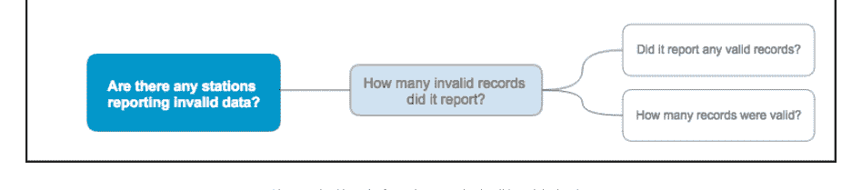

Alert question hierarchy for stations reporting invalid precipitation data

We can create an alert dashboard to monitor this on a daily basis. This will allow quick identification of a problem. We will start by creating four additional calculated fields in the following order:

### Name: Precip Accumul Value Validity

### Calculation:

```
CASE [Qgag]
    WHEN -9999 THEN
        "Invalid"
    WHEN 999.990 THEN
        "Invalid"
    ELSE
        IF [Qgag] >= 0 AND [Qgag] <20 THEN
            "Valid"
        ELSE
            "Invalid"
        END
END
```

### Name: Precip Value Validity

### Calculation:

```
CASE [Amount of Precipitation (inches)]
    WHEN -9999 THEN
        "Invalid"
    WHEN 999.99 THEN
        "Invalid"
    ELSE
        IF [Amount of Precipitation (inches)] >= 0 AND [Amount of Precipitation (inches)] <20 THEN
            "Valid"
        ELSE
            "Invalid"
        END
END
```

### Name: Invalid Count

### Calculation:

```
IF [Precip Accumul Value Validity] = "Invalid" AND [Precip Value Validity] = "Invalid" THEN
    1
ELSE
    0
END
```

### Name: Valid Count

### Calculation:

```
If [Invalid Count] = 0 THEN
    1
ELSE
    0
END
```

## Summary

In this chapter, we discussed common mistakes when creating visuals for IoT data. Some tips were given to avoid making them. We introduced a method to develop dashboards and visualizations to communicate analytics to an audience. The method has the goal of aligning the visuals to the thought process of the person interacting with them.

We reviewed the use of position on a dashboard to convey importance. The most important piece of information should be in in the upper-left part for cultures that read left to right. Color can also be used effectively to highlight key information to the audience.

Tableau was used to demonstrate how to quickly create a dashboard to communicate your analytics in an interactive way. We walked through an example with the IoT weather data continued from a previous chapter. Some principles of alerting were reviewed along with an example using Tableau.

For further exploration, not discussed here but worthwhile for you to learn, there are also some great visualization packages in R and Python. The author recommends *ggplot* for R and *Seaborn* for Python.
