## Applying Geospatial Analytics to IoT Data

"I know it has been tough since Willard left, but I have some good news; we will be getting you some help." These words are coming to you accompanied by a concerned, paternal look from the Vice President of Connected Product Development, who is standing in your cubicle.

Willard was your boss, now your former boss. He left recently to join another company as Head of their IoT division. They were highly impressed with his accomplishments building up a cloud-based IoT analytics capability, which was all your idea, of course, but *c’est la vie*.

Now, with your boss gone, the VP and other executives are worried about the momentum stalling. You are a little bit miffed at this since you had to twist your boss's arm to get him to go along with everything in the first place. *Look on the bright side*, you tell yourself, *at least you are getting some help*.

He continues, "We want to up the ante, none of the competition is aggregating their thermostat data and selling it to power companies. Maybe the new guy can figure out how to do that."

*Ha*, the new guy. "I got this, I developed what we have so far. I can certainly handle this," you state confidently, holding his gaze. "I've been looking for an excuse to do a little geospatial anyway."

You feel capable now; it is time they started giving you some credit. But you are not quite sure how to do it, as it seems a little daunting. The power companies are going to have service areas that do not stick to state boundaries or zip codes. You will need to somehow draw the service areas on a map and then find the devices in the area. This sounds like a lot of manual work.

"Well, we will see. I have lots of ideas if you can pull this one off," he replies. With this, he turns around and strolls assuredly down the hallway on his way to the next meeting. You hesitate for a second wondering if he knew all along that you were the brains behind the IoT analytics and just manipulated you into putting all your energy into his project. Then you shake your head thinking surely not, and get back to work.

This chapter is about leveraging the field of geospatial analysis to enhance IoT analytics. IoT devices are sometimes attached to equipment that moves around geographically. Even if this is not the case, devices will probably have diverse geographic locations when deployed. This creates an opportunity to find patterns and develop valuable services by using location based analysis. We will introduce some key concepts and technology for geospatial analytics.

This chapter covers the following topics:

- The benefit of geospatial analytics for IoT
- Geospatial analytics basics:
  - Welcome to Null Island
  - Coordinate Reference Systems
  - Python for geospatial analysis
- Vector-based methods:
  - A bounding box
  - Contains
  - Buffers
  - Simplify
  - The vector summary
- Raster-based methods
- Storing geospatial data:
  - File formats
  - Spatial extensions for relational databases
  - Geospatial data in HDFS
  - Spatial indexing


- 处理地理空间数据：
  - 地理空间分析软件：
    - ArcGIS
    - QGIS
    - ogr2ogr
  - PostGIS 空间函数
  - 地理空间与大数据
- 解决污染报告问题

## 为什么物联网需要地理空间分析？

设想你的公司销售一种测量空气污染物的设备。它支持联网，并使用 MQTT 协议定期将数据传回公司。该产品的目标市场是具有环保意识的消费者，他们既希望测量自家附近的污染物，也希望为环境的集体监测做出贡献。

其价值主张是：消费者可以免费获得本地空气质量分析，代价是捐出他们的数据，以支持一项他们很可能本来就认同的事业。你的公司计划将高质量空气污染数据的分析结果进行汇总和打包，出售给政府和私人组织。

由于该设备通过多种零售渠道间接销售给消费者，公司最初并不知道设备的位置。消费者购买后会将设备连接到互联网，然后输入自己的地址。此时便可以确定设备位置。

该设备配备多个传感器，用于测量空气中不同污染物的浓度。其中一个传感器测量二氧化氮（NO2）的浓度。NO2 本身不仅是一种有毒气体，还会产生更具破坏性的副作用。它会促进酸雨和光化学烟雾的形成，并且是臭氧等其他有害二次空气污染物的前体。

下图展示了 Aeroqual 公司制造的二氧化氮传感器和二氧化氮分析模块的一个示例：

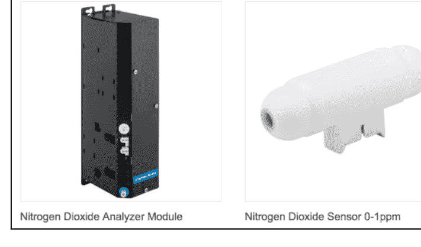

二氧化氮传感器和分析仪。来源：Aeroqual

NO2 是由化石燃料燃烧产生的。在城市地区，主要来源通常是机动车尾气，但该气体也可能来自发电厂、制造设施和焊接作业。

你的公司希望构建并销售一个数据包，根据距州际公路的距离汇总 NO2 水平；同时希望将结果数据按美国 115 个国会选区进行聚合。公司认为，国会游说者会愿意为这些信息支付高价。

这项任务起初可能看似令人生畏，因为你所知道的设备位置仅仅是客户注册的地址。最先想到的可能是人工流程：在地图上逐一查看每个设备的位置，并根据其与最近州际公路的距离进行分类。当你有 50 万台设备时，这将耗费大量人力且成本高昂。

幸运的是，地理空间分析可以高效地完成这类分析。我们将介绍几个概念，然后回到这个示例，展示如何解决它。

所有位置都是相对于某个其他起点来确定的。要精确表示一个位置，你需要知道起点在哪里，以及从该起点确定位置的框架。实现这一点有多种表示方法。这就是 **坐标参考系（CRS）** 发挥作用的地方。

## 坐标参考系

坐标参考系，也称为 **空间参考系（SRS）** 或 **地图投影**，用于标识将类似球体的三维地球转换为平面 X、Y 坐标面时所使用的方法。换句话说，它解释了用何种方法将三维投影到二维表面。

这样的定义方式有成千上万种，每种都有自己的优缺点。每种定义的方法都是一个独立的 CRS，其中最常见的是 **1984 年世界大地测量系统** 或 **WGS 84**，它被 **全球定位系统（GPS）** 所使用。

为了正确确定位置并准确计算诸如两点之间表面距离之类的数据，必须知道一组空间数据的 CRS。它通常会被标识并作为文件或地理空间数据库的一部分进行存储。只要两个 CRS 都已知，就可以相互转换。

## 地球并不是一个球体

世界不是一个完美的球体。它是一个椭球体，而且像中年男人一样，中部隆起。这意味着，对地理空间数据使用简单的球体几何计算不会完全准确。

随着两点间距离的增加，使用计算球面距离的方法（例如用于大圆距离计算的 haversine 公式）会变得越来越不准确。你仍然可以使用 haversine 方法计算短距离，精度损失不大，但应避免用于较长距离。

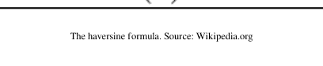

haversine 公式。来源：Wikipedia.org

以下 R 代码可用于计算地球上两点的 haversine 距离。请记住，它在长距离上并不完全准确。相反，应利用了解 CRS 的代码包和数据库系统，它们能够使用 CRS 精确计算空间数据。这段 R 代码使用了相距很远的两个点，让你了解该方法的相对不准确性。两点之间的实际距离为 12,935 千米：

```
#code adapted from RosettaCode.

#Coordinates for the two points
#Chicago, USA O'Hare airport (ORD)
Point1Lat = 41.978194
Point1Long = -87.907739

#Coordinates for Chhatrapati Shivaji International Airport near Mumbai,
India airport (BOM)
Point2Lat = 19.0895595
Point2Long = 72.8656144

#convert decimal degrees to radians
degrees_to_rad <- function(deg) (deg * pi / 180)

# Volumetric mean radius is 6371 km for the Earth, see
http://nssdc.gsfc.nasa.gov/planetary/factsheet/earthfact.html
# The diameter is thus 12742 km

#function to calculate great circle distance using haversine method
great_circle_distance <- function(lat1, long1, lat2, long2) {
a <- sin(0.5 * (lat2 - lat1))
b <- sin(0.5 * (long2 - long1))
12742 * asin(sqrt(a * a + cos(lat1) * cos(lat2) * b * b))
}

#calculate distance for the two points
haversine_distance <- great_circle_distance(
degrees_to_rad(Point1Lat), degrees_to_rad(Point1Long),   # Nashville
International Airport (BNA)
degrees_to_rad(Point2Lat), degrees_to_rad(Point2Long))  # Los Angeles
International Airport (LAX)

#result shown in kilometers
haversine_distance
# 12,942.77km
```

有多种方法可以针对地球的实际形状进行调整。WGS 84 CRS 使用了一些参数来提高投影的精度。下表总结了这些参数：

| 参数 | 符号 | 值 |
|---|---|---|
| 地球扁率因子 | 1/f | 298.257223563 |
| 地心引力常数 | GM | 3986004.418 10^8 m³/s² |
| 标称平均角速度 | ω | 7292115 10^-11 rad/s |
| 半长轴 | a | 6378137.0 m |

WGS 84 定义参数。来源：联合国外层空间事务厅

尽管你接触到的 WGS 84 CRS 坐标大多是二维的，但它实际上是地球的三维表示。起点基于地球质心。下图来自国防测绘局（Defense Mapping Agency），展示了其表示方式：

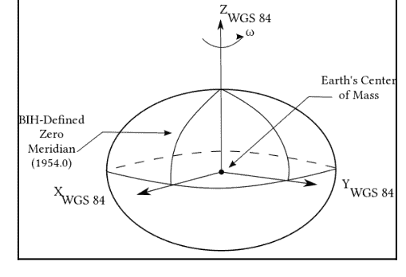

WGS 参考框架，来自国防测绘局的 DMA 技术报告 TR8350.2-b（1987 年 12 月 1 日第二次印刷）第 1-5 节 PDF，作为 DoD WGS 84 技术报告第 2 部分（参数、公式和图形）的补充。http://earth-info.nga.mil/GandG/publications/tr8350.2/TR8350.2-b/Sections%201-201-5.pdf. 公共领域，https://commons.wikimedia.org/w/index.php?curid=41796676

强调这一细节不仅是为了让你了解地图投影背后的复杂性，更是为了说服你利用该领域数百年来已经完成的工作。不要试图重复这一工作；要利用已有的成果。

利用地理空间分析领域已有成果的一个好方法是使用 Python 地理空间库。R 语言也有很多优秀的包可以使用，但 Python 的选择更多。由于 Python 在地理空间界长期使用，这些库往往更加成熟。

Python 通常也比 R 具有更好的扩展性，因此更适合大规模、计算密集型的处理。地理空间计算可能变得相当密集，而物联网数据——正如我们在本书中已经熟知的那样——会在短时间内变成大规模任务。

基于这些考虑，Python 非常适合地理空间分析。在本章中，我们将把重点从 R 代码转向 Python 代码。对于大数据分析，你应该对两者都熟练掌握。开始使用 Python 的一个简单方法是从 https://www.continuum.io/downloads 下载 Anaconda 包。Anaconda 包含 Python、R 以及超过 720 个包，其中包括 100 多个最流行的数据科学包。

它还包含一个名为 Spyder 的 Python IDE 和基于浏览器的笔记本 Jupyter。Jupyter 对物联网分析很重要，因为它可以在 Hadoop 集群上运行，让你能够在分布式环境中开发 Python 代码，而无需通过控制台运行代码。它还可以用于以 Python、Scala 或 R 开发 Spark 应用程序。Spark 与跨集群安装的 Python 地理空间库相结合，提供了扩展地理空间分析的能力。

## 基于矢量的方法

地理空间分析和文件类型主要有两大类：矢量和栅格。矢量主要处理形状，而栅格则更侧重于网格。由于灵活性和高效存储，矢量更为常见。矢量可以简单地用一组点来定义。矢量几何有三种主要类型：

- **点：** 可以用二维或三维来定义。这就是你可能非常熟悉的常用经纬度坐标对。前面 R 代码中使用的机场位置就是点的示例。


- **线（Line）或线串（LineString）：** 线串由一组点定义，点的顺序很重要。多条线串可以存储在一起；在这种情况下，它理所当然地被称为**多线串（MultiLineString）**。河流系统或道路网络就是多线串的示例。包含美国州际公路网络多线串的文件可以从爱荷华大学地理信息科学图书馆下载（`ftp://ftp.igsb.uiowa.edu/gis_library/USA/us_interstates.htm`）。下图是该文件的可视化效果：

  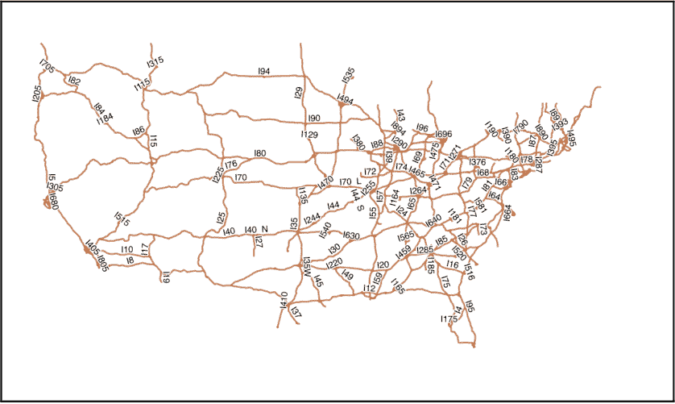

  美国州际公路系统。来源：美国环境系统研究所公司（ESRI）

- **面（Polygon）：** 面被定义为一个闭合的点网络。点的顺序很重要，起点也会在终点处重复出现，从而闭合形状。多个面可以存储在一起，这被称为——你猜对了——**多面（MultiPolygon）**。一个示例是表示印度尼西亚国家的多面。根据《CIA世界概况》，印度尼西亚由13，466个岛屿组成：

  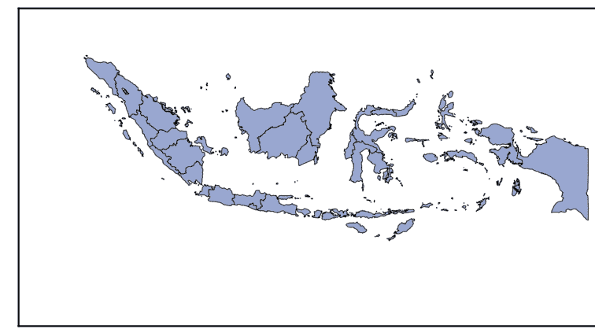

  印度尼西亚的多面图像

有多个为地理空间分析开发的Python包。其中与矢量相关的两个最流行的包是*shapely*和*fiona*。*Shapely*拥有几种计算地理算法，而*fiona*则用于与矢量文件交互。你可以从命令行使用`conda`或`pip install`安装这两个包，如下面的代码所示。如果你安装了Anaconda发行版，请使用`conda install`：

```
conda install shapely
```

或者你可以使用以下命令：

```
pip install shapely
```

我们将回顾一些关键的矢量概念以及实现这些概念的*shapely*代码。这里涉及的内容远比我们介绍的要多，但这应该能为你提供一个良好的起点。使用*fiona*将结果保存到文件中。

## 边界框（Bounding Box）

基于矢量的分析中一个重要的概念是**边界框**。它在地理空间处理的许多方面都发挥作用，包括空间索引。相比于不规则的线串或面，盒状形状在计算上更容易搜索和操作。先将对象放入一个盒中，再根据其具体形状进行精细调整，是高效搜索的常见模式。

边界框就是能够包含所讨论的矢量对象的最小矩形。这通常被称为**最小外接矩形（MBR）**，是许多地理空间搜索算法的基础。下图展示了多边形集合的MBR：

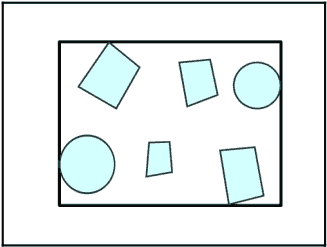

一组多边形的最小外接矩形。来源：维基共享资源

可以使用*shapely*通过`bounds`方法确定MBR：

```python
#导入线串类
from shapely.geometry import LineString

#从一系列点创建线串
MBRline = LineString([(1, 0),(1, 1),(3,5),(2,2)])

#确定MBR边界框
MBRboundingBox = MBRline.bounds

#输出结果
MBRboundingBox

#(1.0, 0.0, 3.0, 5.0)
```

## 包含（Contains）

你还可以使用`contains`函数测试一个空间对象是否包含另一个对象，例如一个点是否在一个面内，或一个城市是否在一个州内。这可以用来确定某个位置是否位于某个邮政编码、省份或国会选区中。`within`函数则相反，它确定对象是否在另一个对象内部：

```python
#导入面类
from shapely.geometry import Polygon

#创建一个正方形面
polysquare = Polygon([(0,0),(0,2),(2,2),(2,0),(0,0)])

#测试面是否包含该点
print(polysquare.contains(Point(1,1)))

#测试点是否在该面内
print(Point(1,1).within(polysquare))

#测试其他点是否在该面内
print(Point(5,7).within(polysquare))
```

## 缓冲区（Buffer）

缓冲区会按指定量扩展几何对象。如果是线串，缓冲区将创建一个多边形，其形状为线串两侧按缓冲区量扩展后的形态。为了说明这一点，下面的截图展示了芝加哥附近美国州际公路系统1公里缓冲区的特写：

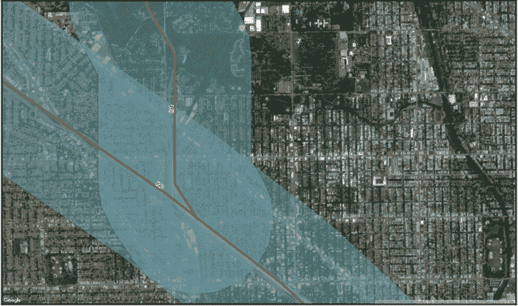

芝加哥附近美国州际公路1公里缓冲区特写

## 膨胀与侵蚀（Dilation and erosion）

在shapely中，正的缓冲区是膨胀，负的量则是侵蚀。膨胀如上文所述，而侵蚀则按缓冲区量缩小多边形。Shapely还提供了一些关于端帽形状（线端部的缓冲区区域）以及缓冲区自连接处的选项。下面展示了端帽和连接样式选项：

### shapely.geometry.CAP_STYLE

| 属性 | 值 |
|-----------|-------|
| round     | 1     |
| flat      | 2     |
| square    | 3     |

### shapely.geometry.JOIN_STYLE

| 属性 | 值 |
|-----------|-------|
| round     | 1     |
| mitre     | 2     |
| bevel     | 3     |

下面的代码展示了一个简单的缓冲区工作原理示例：

```python
#import linestring class, cap and join styles
from shapely.geometry import LineString, CAP_STYLE, JOIN_STYLE

unbufferedLine = LineString([(0, 0), (1, 1), (0, 2), (2, 2), (3, 1), (1, 0)])
dilatedBufferedLine = unbufferedLine.buffer(0.5, cap_style = CAP_STYLE.square)
erodedBufferedLine = dilatedBufferedLine.buffer(-0.3, join_style = JOIN_STYLE.round)

#Show the polygon detail. This gets more complicated than a line!
print(erodedBufferedLine)
```

下图有助于直观理解结果：

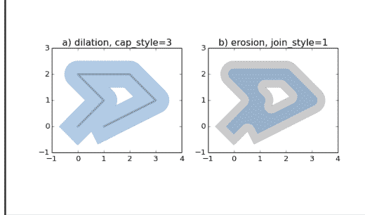

缓冲区示例。来源：Shapely文档

## 简化（Simplify）

有时，精确细节并非必要，使用更简化的几何对象可以加快计算速度。以我们的州际公路示例为例，一条完全贴合道路的线可能对特定用途来说没有必要。只要线大致接近，在应用1公里缓冲区时就能正常工作。降低对象的复杂性和大小可以带来巨大回报，尤其是在并行化的大数据环境中。在这种环境中，空间对象可能被保存在数百个节点的内存中，因此效率提升会产生很大影响。

Shapely提供了`simplify`方法，在保留大部分原始形状的同时减少几何对象的大小和复杂性。`tolerance`变量控制简化程度，数值越大表示简化越多。下面的Python代码演示了其工作原理（此示例是之前缓冲区代码的扩展）：

```python
#print area of polygon
print(erodedBufferedLine.area)
#show number of coordinates needed to define exterior of the polygon
print(len(erodedBufferedLine.exterior.coords))

#simplify
erodedSimplified = erodedBufferedLine.simplify(0.05,
preserve_topology=False)

print(erodedSimplified.area) #note minimal change in area
print(len(erodedSimplified.exterior.coords)) #big reduction in coordinates

print(erodedSimplified)
```

## 矢量总结

我们仅仅触及了可用于处理、操纵和分析基于矢量的几何对象的功能的皮毛。关于这个主题有整本整本的书籍，它们非常值得你花时间阅读，以深入了解如何增强你的物联网分析能力。

## 基于栅格的方法

**栅格（Raster）**由排列成行和列的网格单元组成。可以把栅格想象成屏幕上的像素，只不过每个像素都由一个设定的地面距离来定义。栅格文件和图像文件之间有很多共同之处。栅格文件有时使用与图像文件相同的格式保存。图像通常直接从栅格文件生成；从天气预报到地形图，你随处可见这样的例子。

网格中单元的大小在概念上类似于图像的分辨率。与矢量数据不同，栅格包含其覆盖整个区域的信息。它适用于那些在整个区域都有值的现象，例如高程和温度。缺点则是会生成较大的文件大小。

每个单元的多个值可以作为数据集中的不同**波段（bands）**存储。这在概念上类似于彩色图像的RGB值。第7章“装饰你的数据——添加外部数据集以创新”中讨论的SRTM和数字高程模型（DEM）数据集就是栅格数据模型的示例。

处理栅格数据的主要Python包是*GDAL*。它可以与80多种不同的栅格文件类型交互，并包含读取和转换栅格数据的函数。操作栅格数据可能很复杂，超出了本书的范围。通过快速Google搜索可以找到一些很棒的教程。在大多数情况下，物联网分析会使用基于矢量的方法。


# 将地理空间分析应用于物联网数据

栅格和矢量数据层可以组合使用。以下图片由 NOAA 提供，展示了它们如何共同用于现实世界的表示：

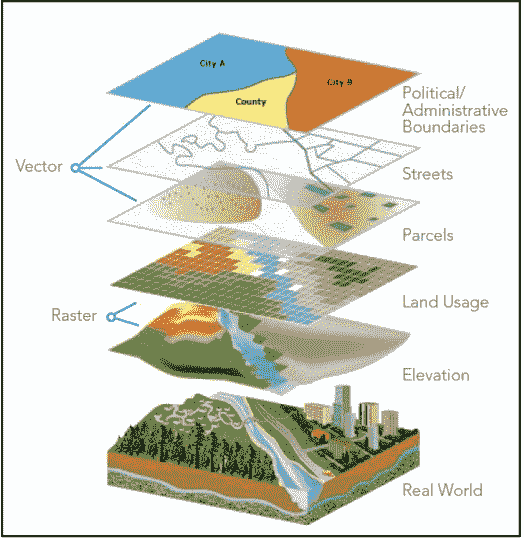

## 存储地理空间数据

存储地理空间数据的方式有很多种。根据你的预期用途，文件系统格式或关系数据库可能是最合适的。我们将对两者进行介绍。

## 文件格式

存储地理空间数据的格式有数百种。矢量数据最常见的是 ESRI shapefiles。shapefile 实际上由多个不同文件组成，主文件扩展名为 .shp。当提供 .shp 文件的位置时，大多数支持地理空间的软件和 Python 包都知道去查找其他所需文件。

**GeoJSON** 是另一种可读的人类存储格式。它使用定义的 JSON 格式将矢量数据定义存储为文本。它易于阅读，但大小可能会变得很大。

另一种表示矢量数据的方式，无论是在文件中还是在代码中，都是使用 **Well-known text (WKT)** 和 **Well-known binary (WKB)** 格式。WKT 可读，而 WKB 不可读。WKB 在大小上提供了显著的压缩，因此通常是数据库存储的良好选择。它可以在读取时转换为 WKT。下面的表格总结了每种几何类型的 WKT 格式：

| Geometry primitives (2D) |
|---|---| 
| Type | Examples |
| Point | POINT (30 10) |
| LineString | LINESTRING (30 10, 10 30, 40 40) |
| Polygon | POLYGON ((30 10, 40 40, 20 40, 10 20, 30 10)) |
| Polygon | POLYGON ((35 10, 45 45, 15 40, 10 20, 35 10), (20 30, 35 35, 30 20, 20 30)) |

| Multipart geometries (2D) |
|---|---| 
| Type | Examples |
| MultiPoint | MULTIPOINT ((10 40), (40 30), (20 20), (30 10)) |
| MultiPoint | MULTIPOINT (10 40, 40 30, 20 20, 30 10) |
| MultiLineString | MULTILINESTRING ((10 10, 20 20, 10 40), (40 40, 30 30, 40 20, 30 10)) |
| MultiPolygon | MULTIPOLYGON (((30 20, 45 40, 10 40, 30 20)), ((15 5, 40 10, 10 20, 5 10, 15 5))) |
| MultiPolygon | MULTIPOLYGON (((40 40, 20 45, 45 30, 40 40)), ((20 35, 10 30, 10 10, 30 5, 45 20, 20 35), (30 20, 20 15, 20 25, 30 20))) |

Well-known Text format examples. Source: Wikipedia

栅格数据最常见存储在 **Tagged Image File Format (TIFF)** (.tiff) 文件中。它也可以存储为 ASCII 网格文件，但文件大小是个问题。还有一些压缩格式，例如扩展名为 .sid 的 **Multi-resolution Seamless Image Database (MrSID)** 和扩展名为 .ecw 的 **Enhanced Compression Wavelet (ECW)**。

## 关系数据库的空间扩展

借助空间扩展，关系数据库可以支持在数据库表中存储几何数据并执行一些地理空间函数。这些通常不是标准安装的一部分，但可以通过管理设置启用或通过安装软件扩展来启用。

对于开源关系数据库管理系统 RDBMS，PostgreSQL 和 MySQL 都支持空间功能。PostgreSQL 是迄今为止最受欢迎的，也是功能最全面的。当为 PostgreSQL 启用空间组件时，通常被称为 PostGIS。你会看到这些术语可以互换使用。PostgreSQL 是 AWS 上受支持的 RDS 选项。空间扩展可以启用，将其转变为 PostGIS。

对于闭源 RDBMS，Oracle (Spatial and Graph) 和 SQL Server 很受欢迎。Oracle 通常被认为是最有能力的。这些并不是唯一的选择，因为越来越多的数据库支持空间数据。Amazon Aurora，一种在 AWS 上的 MySQL 兼容托管 RDS 数据库，最近已添加了空间支持。

## 在 HDFS 中存储地理空间数据

HDFS 和 Hive 本身并不原生支持空间数据类型。不过一切都还没完，因为 HDFS 可以存储任何类型的文件，包括地理空间文件。几何图形可以以字符串 WKT 和二进制 WKB 形式存储。它们可以在检索时使用代码转换。Hive 表是模式即读，并支持用户定义函数 UDF。可以创建 UDF 来解释地理空间数据。

事实上，有一些开源项目正是这样做的。其中一个名为 SpatialHadoop，可以在 http://spatialhadoop.cs.umn.edu/index.html 找到。另一个名为 spatial-framework-for-hadoop，可以在 GitHub 上找到 (https://github.com/Esri/spatial-framework-for-hadoop)。缺点是这些项目没有完全支持，并且不是 Cloudera 和 Hortonworks Hadoop 发行版的一部分。

更稳健的方法是以 WKT 或 WKB 存储空间数据，并使用地理空间 Python 包来操作它。

## 空间索引

世界很大。想象一下，如果你不知道某人的家庭住址、邮政编码，甚至他们居住的国家，要找到他们住在哪里。你必须拜访每一户人家，直到找到你要找的人，这将花费你剩余的时间，而且也不会很有趣。

幸运的是，地址允许快速识别某人居住地，通过识别国家、该国内的州或省、邮政编码以及可以开车前往的街道名称，直到找到他们的门牌号，门牌号通常沿街道按既定顺序排列。

空间数据库可能非常庞大，因此需要一种高效的几何搜索方法来提高响应时间。这就是空间索引发挥作用的地方。有多种方法可用于此。我们将介绍其中一种更流行的方法。

## R-tree

R-tree 是一种空间索引方法，用于 PostGIS 和 Oracle 数据库。它利用边界框概念创建分层索引树。树是平衡的，因为所有分支都有相同级别的节点。为了理解基本 R-tree 索引是如何构建的，我们将通过一个简单示例进行说明。

对于给定的几何集合，每个几何的 MBR 都会被定义。索引中保留的是每个的 MBR。以下图片显示了这些第一步的示例：

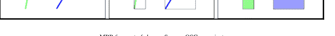

MBR for a set of shapes. Source: OSGeo project

R-tree 索引由 MBR 构建，使得较大的边界框包含一组较小的边界框，目标是优化最低层 MBR 的搜索时间。由此产生的边界框集合形成树层次结构，作为索引存储。然后使用索引树通过沿层次结构向下工作来快速找到匹配的几何。以下图片有助于可视化示例 R-tree 索引：

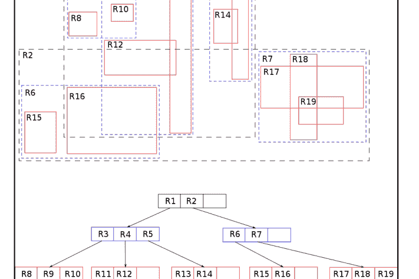

R-tree index, Source: Wikipedia

像 PostGIS 这样的空间数据库可以轻松地对几何字段创建索引。以下 PostGIS 的简单 SQL 语句将构建 R-tree 索引。PostGIS 在 **Generalized Search Tree (GiST)** 层之上构建它以实现稳健性。GiST 是一种通用算法，可与多种索引方法一起使用。GiST 的示例显示在以下代码中：

```
```sql
CREATE INDEX [indexname] ON [tablename] USING GIST ( [geometryfield] );
```
```

还有一个名为 *rtree* 的 Python 包，可用于在代码模块的一部分中构建索引。这对于一些需要反复扫描一组几何图形的重型地理空间处理可能很有用。

## 处理地理空间数据

专用软件可以帮助处理和可视化地理空间数据。这对于小数据和一次性分析很有用。即使你有大数据解决方案，使用这些工具也可以更有效地向他人传达你的发现。

## 地理空间分析软件

我们将回顾最受欢迎的 **Geographic Information System (GIS)** 工具，以便你熟悉它们。它们是地理空间分析的有用支持工具。

## ArcGIS

ArcGIS 是付费 GIS 软件的事实标准。它由 ESRI 公司开发和维护。它具有令人惊叹的功能量，被大多数专业地理空间分析师使用。它由 ESRI 提供世界级支持，并且有许多培训选择。它链接到有用的数据集和地理空间分析能力，这些也由 ESRI 维护。


ArcGIS 可作为桌面应用程序或云服务使用。你可以注册 60 天免费试用 (https://www.arcgis.com/features/free-trial.html)。你可以使用 ArcGIS 进行许多不同类型的分析，包括对你自己的自定义 shapefile 进行地理处理。以下示例展示了 ArcGIS 如何在典型的星期五下午 5 点，用于定义一组位置点 4 分钟车程范围内的多边形区域：

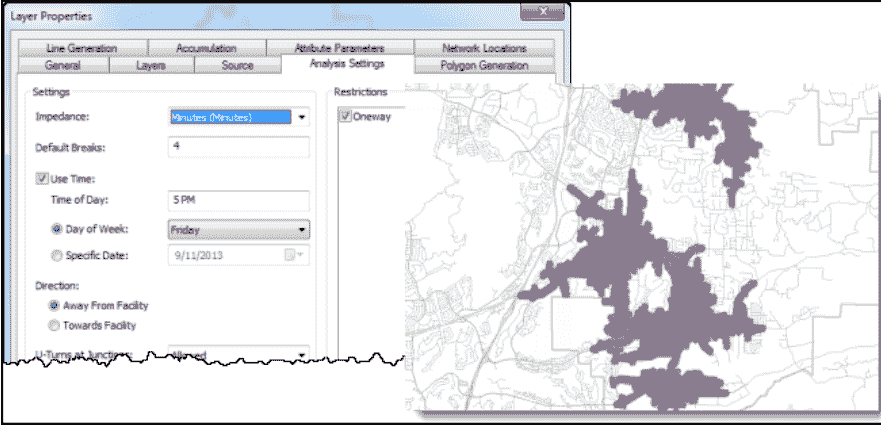

车程时间区域分析示例。来源：ArcGIS

## QGIS

QGIS 是开源且功能强大的桌面 GIS 软件。它与 ArcGIS 类似，但功能范围不及付费的 ESRI 软件。但价格合适，并且仍具有多种功能。它也可以用 Python 代码进行操作。关于它的文档非常丰富，并且有很多有用的书籍介绍如何使用它。

你可以从项目网站下载并安装 QGIS (http://www.qgis.org/en/site/forusers/download.html)。如果你无法获得 ArcGIS，请务必保留 QGIS。QGIS 用于创建本书中的许多图像。你可以使用 QGIS 和 ArcGIS 直接连接到地理空间数据库，例如 PostGIS 和 Oracle。以下图像展示了 QGIS 可以创建的示例：

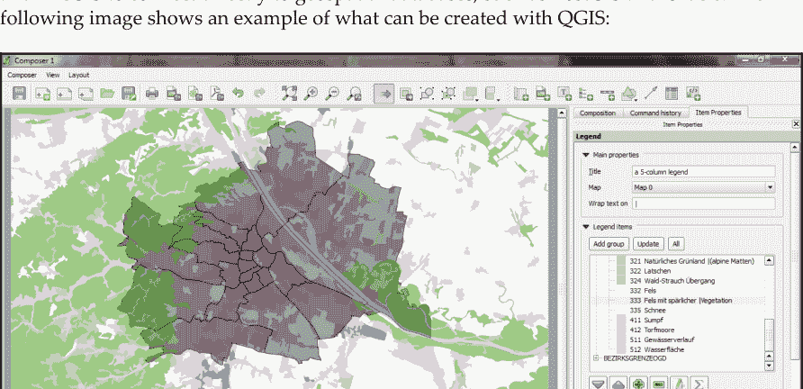

QGIS 示例截图。来源：anitagraser.com

## ogr2ogr

ogr2ogr 是 GDAL 库的一部分。它是一个命令行工具，用于将文件从一种 OpenGIS 简单要素参考实现 (OGR) 空间格式转换为另一种。它是一个功能简洁的工具，但被地理空间分析师广泛使用。命令行转换的通用格式如下例所示：

```
ogr2ogr -f "file_format" destination_data source_data
```

你可以用它将 PostGIS 数据转换为 shapefile，或将 shapefile 加载到 PostGIS 中，例如。它支持将矢量数据单独转换为 90 多种文件格式。

## PostGIS 空间函数

PostGIS 包含数十个可在标准 SQL 查询中引用的空间函数。以下表格提供了一些常用函数的概述：

| Function | Description |
| --- | --- |
| `ST_GeomFromText` | This returns a specified ST_Geometry value from WKT representation. |
| `ST_GeomFromWKB` | This creates a geometry instance from a WKB geometry representation and optional SRID. |
| `ST_Buffer` | This returns a geometry covering all points within a given distance from the input geometry. |
| `ST_ConvexHull` | The convex hull of a geometry represents the minimum convex geometry that encloses all geometries within the set. |
| `ST_Intersection` | This returns a geometry that represents the shared portion of geomA and geomB. |
| `ST_Simplify` | This returns a simplified version of the given geometry using the **Douglas-Peucker** algorithm. |
| `ST_Boundary` | This returns the closure of the combinatorial boundary of this geometry. |
| `ST_Transform` | This returns a new geometry with its coordinates transformed to a different spatial reference. |
| `ST_Centroid` | This returns the geometric center of a geometry. |
| `ST_ClosestPoint` | This returns the 2-dimensional point on g1 that is closest to g2. This is the first point of the shortest line. |
| `ST_Contains` | This returns true if and only if no points of B lie in the exterior of A, and at least one point of the interior of B lies in the interior of A. |
| `ST_Covers` | This returns 1 (TRUE) if no point in geometry B is outside geometry A. |
| `ST_Crosses` | This returns TRUE if the supplied geometries have some, but not all, interior points in common. |

AWS 还提供了一个名为 **Redshift** 的托管 PB 级数据仓库服务。该服务在 `Chapter 3, IoT Analytics for the Cloud` 中介绍。Redshift 不直接支持几何字段，但支持 Python UDF。你可以使用 Python 代码和 *shapely* 包创建 UDF，然后从 Redshift SQL 语句中调用它们。对于 Hive 和 Spark 也可以使用类似的策略。

ESRI 支持一个名为 **GP tools for AWS** 的开源项目，该项目允许 ArcGIS 用户连接到 Amazon EMR 和 S3 数据源。该项目托管在 GitHub (`https://github.com/Esri/gptools-for-aws`)。

## 解决污染报告问题

通过本章所学内容，你现在可以解决前面介绍的按国会选区划分的物联网污染传感器数据问题。使用 Python 代码或数据库中的空间查询函数（如 PostGIS）按照以下一般步骤操作：

- 下载美国州际公路的 shapefile，例如爱荷华大学提供的美国国家交通图集州际公路 shapefile (`ftp://ftp.igsb.uiowa.edu/gis_library/USA/us_interstates.htm`)。
- 下载美国国会选区的 shapefile，例如美国人口普查局提供的 TIGER/Line Shapefile (`https://www.census.gov/cgi-bin/geo/shapefiles/index.php?year=2016&layergroup=Congressional+Districts+%282815%29`)。
- 使用 `ogr2ogr` 将 shapefile 加载到地理空间数据库，或使用 *fiona* 包在 Python 中加载。
- 使用 *shapely* 包或 PostGIS 中的 `ST_Buffer` 为州际公路 MultiLineString 添加 1 km 缓冲区。
- 使用 Google Maps 等地图 API 对每个设备地址进行地理编码以获取经纬度点对。这在 `Chapter 7, Decorating Your Data - Adding External Datasets to Innovate.` 中有讨论。
- 将物联网设备位置加载为 Point 几何。
- 可选地，对点和国会选区多边形应用 R 树索引以加快计算速度。
- 查找位于缓冲州际公路多边形内的点。`contains` 函数就是一种方法。将这些点标记为在范围内。将剩余点标记为在范围外，以便用作比较。
- 对于每个点，搜索包含它的国会选区多边形并跟踪结果。这将是利用之前创建的空间索引的好地方。
- 计算每个设备的污染值并与国会选区和州际公路缓冲区内外标签合并。
- 透视并比较数据以编制报告。
- 去要求加薪，你应得的！
- 你还可以使用 `buffer` 函数中的侵蚀选项创建识别多个距离范围的州际公路多边形。从最大的范围作为缓冲区开始，然后逐步侵蚀以获得每个范围级别。为每个范围创建缓冲多边形。先搜索最小的缓冲多边形，然后是下一个更大的，再下一个，依此类推。那些不在任何这些范围内的点就在范围之外。
- 去要求再加一次薪水！

## Summary

在本章中，你学习了如何使用地理空间分析来发现洞察并回答关于物联网数据的复杂问题。地理上分布的物联网设备进行地理空间分析的重要性得到了讨论。介绍了 CRS 概念以及 haversine 距离及其局限性。

世界不是一个完美的球体。介绍了调整方法以便准确测量距离。讨论了用于地理空间分析的 Python 函数，例如 `buffer` 和 `contains`，并提供了一些示例。

存储和处理地理空间数据需要一些专门的处理。回顾了一些地理空间数据库和 GIS 软件工具。还回顾了 PostGIS 空间函数。我们讨论了一些在大数据世界中利用地理空间分析的技巧。

地理空间分析为以新颖创新的方式分析物联网数据提供了巨大机会。它可以帮助在嘈杂数据中发现模式。然后可以创建新服务，作为从数据中提取价值的另一种方式。
