## Data Science for IoT Analytics

“由于你的小地理空间搜索技巧，收入上涨了 5%”，Connected Services 副总裁说，“你知道你前老板的职位仍然空缺。也许我们应该从内部填补……”

你的脉搏加快，你希望他能得出这个结论。在你的分析为公司带来的成果之后，你理应得到晋升。你现在有一名员工专注于地理空间分析。你可以想象，如果有一个完整的团队会怎样。

“不过我们一直在琢磨一件事，”他继续说，“有了我们收集的所有这些数据，我们应该能够利用机器学习模型来预测设备故障。有些人认为我们应该聘请外部咨询公司来处理所有事情。听起来很贵。我真希望我们能自己协调，使用我们自己选择的数据科学家……你认识可能胜任的人吗？”

他眨了眨眼，背着手，哼着布拉姆斯的曲调走开了。

在本章中，我们介绍数据科学技术，如机器学习、深度学习和 ARIMA 预测。特别关注如何将这些方法与物联网数据一起使用。每个方法的核心概念都将回顾，并附有 R 中的示例。深度学习将被描述，并说明如何创建具有 TensorFlow 的 Amazon EC2 实例。

本章涵盖了大量内容，所以系好安全带。


本章涵盖以下主题：

- 机器学习（ML）：
  - 核心概念
  - 特征工程
  - 验证方法
  - 偏差-方差权衡
  - 比较模型以找到最佳拟合
  - 随机森林
  - 梯度提升机
  - 异常检测
- 使用 ARIMA 进行预测
- 深度学习：
  - 使用物联网数据的用例
  - 使用 TensorFlow 设置并运行一个简单的深度学习模型

# 机器学习（ML）

正如一位人类-蜘蛛混合体的睿智叔叔曾经说过，能力越大，责任越大。这对 ML 来说非常正确。出错的方式有很多。当在熟练从业者手中时，它确实是一种艺术形式。它可以大规模地做一些令人难以置信的事情，但它应该附带一个大大的警告标志。谨慎使用。保持偏执并验证，验证，再验证。

虽然我们将介绍一些核心概念并提供你可以自行运行的代码，但这是一个庞大的领域，有很多东西需要学习。要熟练且胜任地应用它需要数年时间。本章中的每个部分本身就是一本书。不，是一堆书。如果你计划在物联网数据上自行使用它，请阅读，阅读，再阅读，然后再读一些。本章旨在为你提供一个良好的基础，以便就该主题与数据科学家进行有意义的对话。

# 什么是机器学习？

向一百位专家询问 ML 的定义，你很可能会得到一百个略有不同的答案。有些人会采取宽泛的观点，完全包含深度学习、人工智能，以及一些传统统计技术，例如最小二乘线性回归。其他人会很狭隘，将其定义限制在几种建模技术上，认为它与一个名为统计学习的相关领域是分开的。

有些人会说它在现实世界中根本不存在，只存在于过度炒作的媒体报道中。他们认为这不过是几十年来一直在做的传统统计分析。有些人会认为术语 ML 与术语人工智能完全可以互换，而其他人则认为它们是完全不同的东西。

ML 是统计技术在有序步骤集中的应用（也称为算法）。统计技术很少是新的，许多已经存在几十年，有些超过一个世纪。许多 ML 方法也已经存在数十年了。发生变化的是计算能力的成本急剧下降以及计算能力的急剧增加。1980 年需要数月才能计算的东西现在只需几秒或更短时间。

随着一些强大的开源统计软件库的可用性，例如 R 和 Python，再加上现代计算硬件的低成本和可用速度，ML 已变得在各种应用中切实可行。随着 ML 使用的增加，现有方法的改进和新算法的开发也随之而来。这导致预测能力显著提高，并迎来 ML 的黄金时代。

我们将使用一个（希望不过度夸张）的类比来帮助你思考这个问题。使用传统统计技术时，你就像一名机械工程师，运用你对事物工作原理的专业知识和理解来定义一组相互配合的组件。你使用这些方法来显式构建你的统计模型。你根据对数据的测试和分析来定义每个组件的细节。

使用 ML 时，你更像一名农业工程师。数据模型的农夫。在本章中，我们将定义 ML 为一种方法，它具有三个一般组件，当结合在一起时，*grow* 从提供的土壤数据中生长出一个程序。这组统计技术 *learn* 决定目标值或类别的底层函数的表示。在这种情况下，学习是适应而不是认知，就像我们人类一样。你的计算机在任何时候都不会对这一切意味着什么有一点点概念——对它来说全是零和一。


你作为一名 ML 从业者。

插图：Jim Campbell；Inlander；https://www.inlander.com/spokane/farming-data/Content?oid=2136658

真正的底层函数永远无法真正知道。因此，该方法的准确性只能从新数据示例上的错误率推断出来。许多 ML 算法（实际上是一组算法）的目标是迭代地找到正确的杠杆组合以最小化这些错误率。如果 resulting ML 模型在这方面做得很好，则称其泛化良好。稍后会对此进行更多解释。

任何 ML 模型都可以被视为具有三个相互关联的组件：

- 表示
- 评估
- 优化

我们将在下一节中分别介绍每个组件。

# 表示

表示是模型以计算机可解释的方式正式构建的方式。示例有决策树、支持向量机和神经网络。ML 模型通常以表示的名称命名。分类器是表示生成的可能模型集合中的一个实例。当你选择使用哪种表示时，你就决定了你的模型能够学习到的分类器的可能性范围。这种可能性范围被称为 **假设空间**。

如果真正的（记住，*未知*）分类器模型不在假设空间中，就无法学习。大多数你将使用的表示模型都有一个很大的假设空间，所以这可能不会成为问题。但你应该意识到这一点，因为你可能需要扩展你的表示模型选择以扩展集体假设空间。如果你的常规 *首选* ML 模型集的预测性能不佳，则可能需要这样做。

# 评估

随着 ML 模型 *自我调整*，需要一种方法来评估它做得如何。需要一个函数来衡量性能，以了解哪些分类器是好的，哪些是坏的。这就是评估函数发挥作用的地方。一些示例有准确率、错误率、精确率、召回率、F 分数、平方误差和信息增益。这些函数也被称为 **目标函数** 或 **评分函数**。

# 优化

大多数 ML 模型表示都有很大的假设空间。对所有可能性的顺序搜索将花费比你愿意等待答案的时间更长；几个月、几年或一生，取决于模型表示的复杂性。优化方法的选择决定了学习过程的效率。有几种通用方法可以搜索最佳分类器。一些示例有梯度下降、贪婪搜索和线性规划。

| 表示 | 评估 | 优化 |
|---|---|---|
| 实例<br>　*K*-最近邻<br>　支持向量机<br>超平面<br>　朴素贝叶斯<br>　逻辑回归<br>决策树<br>规则集<br>　命题规则<br>　逻辑程序<br>神经网络<br>图形模型<br>　贝叶斯网络<br>　条件随机场 | 准确率/错误率<br>精确率和召回率<br>平方误差<br>似然<br>后验概率<br>信息增益<br>K-L 散度<br>成本/效用<br>边际 | 组合优化<br>　贪婪搜索<br>　束搜索<br>　分支定界<br>连续优化<br>　无约束<br>　　梯度下降<br>　　共轭梯度<br>　　拟牛顿方法<br>　有约束<br>　　线性规划<br>　　二次规划 |

ML 算法的三个组件。来源：A Few Useful Things to Know about Machine Learning by Pedro Domingos, University of Washington

# 泛化

任何 ML 项目的根本目标都是产生一个模型，该模型在超出你当前可用的数据集之外也能良好运行。你希望它对未来数据进行预测、分类或估计时错误最小。不是对你已有的数据，而是对模型实现时你将拥有的新数据。

你用来开发 ML 模型的已有数据称为 **训练集**。训练集应代表你期望在未来应用该模型的数据集中找到的内容。即使你拥有非常大的训练集，未来数据集也不太可能完全相同。这个庞大而复杂的世界产生了大量的变化。


ML 模型能够对各种未来示例按预期工作的能力称为 **泛化**。它是在 ML、深度学习以及大多数其他预测建模技术中的一个关键概念。你希望你的 ML 模型对今天的数据和未来数据都能准确预测。你希望模型能够 *泛化* 超出其所生长的数据集。你应该愿意在训练集上的准确性做出牺牲，以提高在未来、尚不为人知的 数据集上准确的概率。毕竟，这正是开发 ML 模型初衷的全部意义。

然而，由于今天你唯一拥有的数据是训练集，而你试图用模型逼近的底层函数是未知的，因此别无选择，只能使用训练数据本身的误差作为明天数据集误差的代理，随着 ML 模型自我优化。但这黑暗而充满恐怖——非常危险！

幸运的是，有一些方法可以保护你免受虚假乐观的 ML 模型的侵害。这些将在后面介绍。目前，请知晓实践中的 ML 建立在不信任的基础之上。这正是它如此强大的原因之一。如果操作得当，通过验证严苛考验的 ML 模型将在狂野而毛糙的现实世界中取得非常成功的应用。

## 使用物联网数据的特征工程

要当心自动化 ML 软件工具的海妖呼唤，它获取你所有的数据并确定什么是重要的，并自动从中构建最佳模型——只需点击一下按钮即可。经常，你拥有的原始数据并不是 ML 模型能够成功的形式。按原样使用数据可能是一个冒险的提议。许多不知情的船只已被那些岩石击毁，被自动化的美妙声音所诱惑。

显著提高你的 ML 模型的预测能力最好的方法之一，不在于算法本身，而在于数据如何被呈现给它们。数据的转换、构造新字段的添加以及分散注意力的字段的移除，都是在了解表示模型如何运作的知识下完成的。这个过程称为 **特征工程**。数据字段在 ML 中通常被称为 **特征**。我们将在本章剩余部分采用该术语。

特征工程的目标是尽可能让你的 ML 模型获得良好的性能。不同的表示有不同的工作要求，因此你会发现自己为特定的 ML 表示创建同一原始数据集的不同版本。熟悉你正在使用的每个 ML 表示，以确保你给予它最佳的性能机会。

特征工程是一门艺术，很难。但它可以增加很多价值并大大提高你成功的概率。我们将介绍一些关键概念，但还有很多很多东西需要学习。

### 处理缺失值

物联网数据 notoriously 混乱（以防信息尚未传达到位）而缺失值是常见现象。有一些选项可以处理这个问题以增强你的 ML 模型的质量。这就是艺术发挥作用、判断力变得重要的地方。

以下是处理缺失值的一些方法：

- **删除含有缺失值的行：** 这很粗糙，但如果丢失的比例很小，并且这种比例看起来是随机的，那么对结果的影响将很小。使用 Tableau 等工具分析含有缺失值的数据并将其与不含缺失值的数据进行比较，以判断删除行的影响。R 和 Python 也适用于此任务。
- **不要使用缺失值数量高的特征：** 直接将其剔除。用缺失值比例高的特征构建的模型，其效果与用泡泡糖和牙签粘起来的自行车一样好。结果将值得怀疑。
- **你可以使用该特征有效值的均值、中位数或众数来插补值：** 这有些粗糙，但在某些情况下可以很好地工作。始终使用 *第 6 章《认识你的数据 - 探索物联网数据* 中介绍的技术等分析数据，以确定什么是有意义的。
- **创建一个 ML 模型基于其他特征来插补值，然后在预测目标变量的 ML 模型中使用结果：** （你想要预测的内容，这是构建模型的用途）。嵌套建模。现在，我们开始用力了！

R 中的 *mice* 包可用于识别和处理缺失值。名称 *mice* 是多元链式方程插补 Multivariate Imputation by Chained Equations 的缩写。它有多个函数可执行一些高级插补以填补缺失值。它可以使用随机森林和逻辑回归等 ML 技术来插补值。

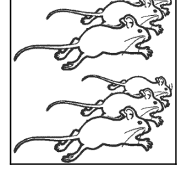

R mice 包。这些家伙插补缺失值并靠残余键盘奶酪为生

以下代码演示了使用 *mice* 插补值的非常简单的示例。我们将首先加载一个示例数据集 *airquality*，它随 R 安装提供。它代表了可能通过物联网设备获得的数据：

```
#make sure all needed packages are installed
if(!require(mice)){
    install.packages("mice")
}
if(!require(VIM)){
    install.packages("VIM")
}
if(!require(lattice)){
    install.packages("lattice")
}

library(mice)
library(VIM)
library(lattice)

#load the airquality dataset (comes with R)
mice_example_data <- airquality
```

接下来，我们将汇总数据以查看统计信息并了解缺失值所在的位置：

```
#summarize original data. Note NAs in Temp
summary(airquality)
```

摘要显示以下结果。请注意缺失值（NAs）的模式：

| Ozone | Solar.R | Wind | Temp | Month | Day |
| --- | --- | --- | --- | --- | --- |
| Min. : 1.00 | Min. : 7.0 | Min. : 1.700 | Min. : 56.00 | Min. : 5.000 | Min. : 1.0 |
| 1st Qu.: 18.00 | 1st Qu.: 115.8 | 1st Qu.: 7.400 | 1st Qu.: 72.00 | 1st Qu.: 6.000 | 1st Qu.: 8.0 |
| Median : 31.50 | Median : 205.0 | Median : 9.700 | Median : 79.00 | Median : 7.000 | Median : 16.0 |
| Mean : 42.13 | Mean : 185.9 | Mean : 9.958 | Mean : 77.88 | Mean : 6.993 | Mean : 15.8 |
| 3rd Qu.: 63.25 | 3rd Qu.: 258.8 | 3rd Qu.: 11.500 | 3rd Qu.: 85.00 | 3rd Qu.: 8.000 | 3rd Qu.: 23.0 |
| Max. : 168.00 | Max. : 334.0 | Max. : 20.700 | Max. : 97.00 | Max. : 9.000 | Max. : 31.0 |
| NA's : 37 | NA's : 7 |  |  |  |  |

我们将删除更多值以演示 mice 如何插补缺失数据：

```
#remove some data from the Temp field
mice_example_data[1:5,4] <- NA
#removed some data from the Wind field
mice_example_data[6:10,3] <-NA

#show summary, note the NA count for Temp
summary(mice_example_data)
```

摘要现在如下所示：

| Ozone | Solar.R | Wind | Temp | Month | Day |
| --- | --- | --- | --- | --- | --- |
| Min. : 1.00 | Min. : 7.0 | Min. : 1.700 | Min. : 57.00 | Min. : 5.000 | Min. : 1.0 |
| 1st Qu.: 18.00 | 1st Qu.: 115.8 | 1st Qu.: 7.400 | 1st Qu.: 73.00 | 1st Qu.: 6.000 | 1st Qu.: 8.0 |
| Median : 31.50 | Median : 205.0 | Median : 9.700 | Median : 79.00 | Median : 7.000 | Median : 16.0 |
| Mean : 42.13 | Mean : 185.9 | Mean : 9.848 | Mean : 78.28 | Mean : 6.993 | Mean : 15.8 |
| 3rd Qu.: 63.25 | 3rd Qu.: 258.8 | 3rd Qu.: 11.500 | 3rd Qu.: 85.00 | 3rd Qu.: 8.000 | 3rd Qu.: 23.0 |
| Max. : 168.00 | Max. : 334.0 | Max. : 20.700 | Max. : 97.00 | Max. : 9.000 | Max. : 31.0 |
| NA's : 37 | NA's : 7 | NA's : 5 | NA's : 5 |  |  |

我们可以使用 mice 对缺失数据的模式进行更复杂的查看。md.pattern() 函数将按特征组合显示缺失值的频率：

```
#use mice to look at pattern of missing data. The first unnamed column
#shows the count of rows
#with the complete or missing pattern as indicated by a 1 or 0 (missing) in
#the named columns
#The result shows 107 rows with complete data in all columns. 35 rows with
#only Ozone missing, 4 rows with only Solar.R missing, etc.
md.pattern(mice_example_data)
```


输出窗口将显示缺失值模式：

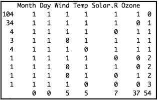

使用 VIM 包的聚合图是一种更直观地查看模式的方法。代码和下面的图表显示了值缺失的位置（红色）。右侧的百分比数字也显示了该特征缺失值的多少。请注意任何缺失超过 5% 的特征。适当插补会变得棘手，在构建 ML 模型时可能最好将其从数据集中剔除。用你的最佳判断来决定。**Ozone** 将是该数据集中唯一超过 5% 的特征：

```
```r
#Let's view it visually using the VIM package
aggr_plot <- aggr(mice_example_data, col=c('gray','red'), numbers=TRUE,
sortVars=TRUE, labels=names(data), cex.axis=.7, gap=3, ylab=c("Histogram -
missing data","Pattern"))
```
```

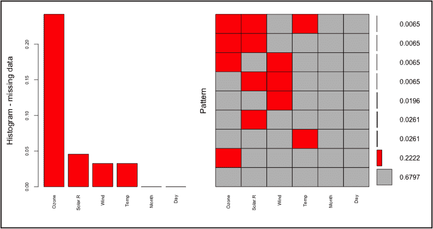

现在，我们可以使用 *mice* 来插补这些值。我们将使用默认的五组插补：

```
```r
#Remove the categorical variables for Month and Day before imputing.
#The mice() function is a Markov Chain Monte Carlo (MCMC) method that uses
#correlation of the data and
#imputes missing values for each feature m times (default is 5) by using
#regression of incomplete variables
#on the other variables iteratively with the maximum iterations set by
#maxit.
imputed_example_data = mice(mice_example_data[-c(5,6)], m=5,
printFlag=FALSE, maxit = 50, seed=250)
```
```

我们可以使用密度图查看插补值与实际已知值相比如何。已知值以蓝色显示，插补值以浅红色显示。请记住我们将其设置为插补五次迭代的值，因此有五条浅红色线：

```
```r
#view density plot of results. Blue line is the observed actual data, the
red lines are from the imputed data
densityplot(imputed_example_data)
```
```

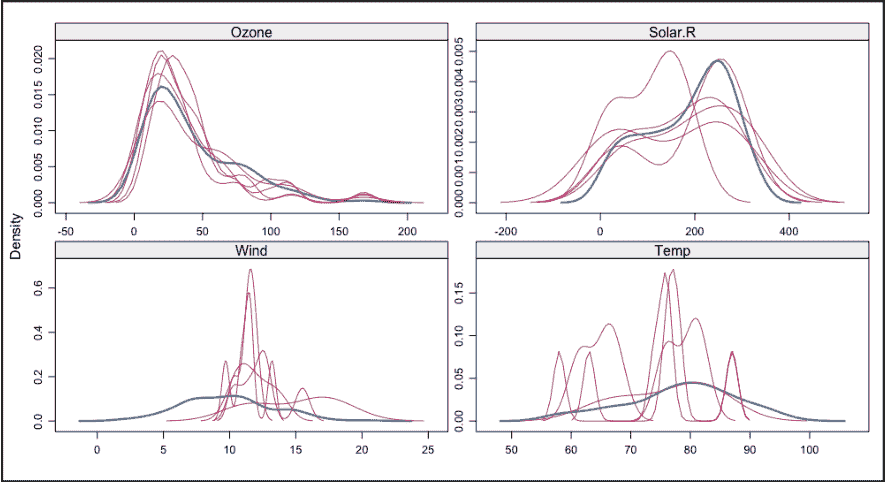

密度图显示实际值与插补数据集的对比

最后，我们可以查看包含插补值后的完整数据集的摘要：

```
#use the complete function to get the dataset with imputed values filled in
completed_example_data <- complete(imputed_example_data,1)
#now let's look at the summary
summary(completed_example_data)
```

| Ozone | Solar.R | Wind | Temp |
|---|---|---|---|
| Min. : 1.0 | Min. : 7.0 | Min. : 1.70 | Min. :57.00 |
| 1st Qu.: 18.0 | 1st Qu.:115.0 | 1st Qu.: 7.40 | 1st Qu.:72.00 |
| Median : 31.0 | Median :212.0 | Median : 9.70 | Median :79.00 |
| Mean : 42.6 | Mean :186.2 | Mean :10.01 | Mean :77.83 |
| 3rd Qu.: 63.0 | 3rd Qu.:259.0 | 3rd Qu.:11.50 | 3rd Qu.:85.00 |
| Max. :168.0 | Max. :334.0 | Max. :20.70 | Max. :97.00 |

mice 中有许多插补方法；使用以下代码，你可以获取菜单上的完整选项列表：

```
methods(mice)
```

[1] mice.impute.2l.norm    mice.impute.2l.pan     mice.impute.2lonly.mean mice.impute.2lonly.norm
[5] mice.impute.2lonly.pmm mice.impute.cart       mice.impute.fastpmm    mice.impute.lda
[9] mice.impute.logreg     mice.impute.logreg.boot mice.impute.mean       mice.impute.midastouch
[13] mice.impute.norm       mice.impute.norm.boot  mice.impute.norm.nob   mice.impute.norm.predict
[17] mice.impute.passive    mice.impute.pmm        mice.impute.polr       mice.impute.polyreg
[21] mice.impute.quadratic  mice.impute.rf         mice.impute.ri         mice.impute.sample
[25] mice.mids              mice.theme
see '?methods' for accessing help and source code

## 中心化和缩放

测量值可能来自截然不同的范围。气压通常以毫巴为单位测量，海平面平均值为 1013 毫巴，而大气温度通常范围为 -30 到 40 摄氏度。调整这些差异的一种方法称为中心化。你可以通过计算特征中所有值的平均值，然后从每个单独的值中减去它来对特征进行中心化。 resulting 转换后的特征均值为零。

想象一下绘制一个直角三角形，其中第一条边长 100 m，第二条边长 1 m，第三条边长 100.03 m。它几乎无法与一条长 100 m 的直线区分开。现在，想象第一条边增长到 10,000 m 长，第二条边保持不变。你甚至无法判断它是否是一个三角形。对于许多 ML 模型来说，当特征值处于截然不同的尺度上时，这是一个类似的问题。

一些可能出现问题的例子：降水量与海拔，或房屋价格与卧室数量。解决这个问题的方法称为 **缩放**。缩放将特征的每个值除以其标准差（在特征的所有值上计算）。这会使值的标准差变为一。

将中心化和缩放结合起来，现在所有（连续值）特征都彼此可比较。你刚刚使 ML 模型更容易从噪声中提取信号。

以下示例代码显示了如何在 R 中应用它。这是上一节中 *mice* 示例代码的延续：

```
#center and scale the completed example data
if(!require(caret)){
  install.packages("caret")
}
library(caret)
#create the object defining the pre-processing
cs_example_prepocessObj <- preProcess(completed_example_data, method =
  c("center","scale"))
#apply the transformation
cs_example_data <- predict(cs_example_prepocessObj, completed_example_data)

#view summary of centered and scaled data
summary(cs_example_data)
```

 resulting 数据集将被中心化和缩放。摘要统计数据现在将如下所示：

| Ozone | Solar.R | Wind | Temp |
|---|---|---|---|
| Min. : -1.2217 | Min. : -1.9818 | Min. : -2.34863 | Min. : -2.1993 |
| 1st Qu.: -0.7225 | 1st Qu.: -0.7877 | 1st Qu.: -0.73838 | 1st Qu.: -0.6155 |
| Median : -0.3407 | Median : 0.2847 | Median : -0.08863 | Median : 0.1235 |
| Mean : 0.0000 | Mean : 0.0000 | Mean : 0.00000 | Mean : 0.0000 |
| 3rd Qu.: 0.5990 | 3rd Qu.: 0.8044 | 3rd Qu.: 0.41987 | 3rd Qu.: 0.7570 |
| Max. : 3.6825 | Max. : 1.6336 | Max. : 3.01888 | Max. : 2.0240 |

## 时间序列处理

物联网数据通常以固定间隔捕获，序列中值的位置可能具有意义。以固定间隔捕获的数据集称为 **时间序列**。时间序列为 ML 带来了自己的复杂性。

然后在除一个子集之外的所有子集上训练另一个模型，但这次不同。被保留的子集用于检查在其他折上训练的模型的预测误差。这会继续进行，以便每个折恰好被保留一次，并且所有数据都用于训练和验证。 resulting 模型集将各自运行其预测，结果的平均值将作为输出给出。

10 折是最常用的数量，但该数字更多是由惯例设定的，而不是因为 10 这个确切数字有什么特别之处。10 折交叉验证是描述此操作的典型术语。使用交叉验证的优点是，你可以使用同一组训练数据模拟多种数据集。这增加了 resulting 模型泛化良好的机会。它还允许你在训练数据有限的情况下进行稳健的验证过程：

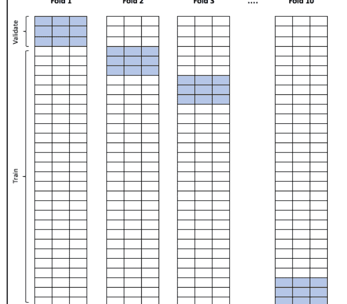

10 折交叉验证。每个折的验证集以蓝色显示，训练集以白色显示

R 中的 *caret* 包使将交叉验证纳入你的 ML 过程变得容易。ML 过程通常被称为 **pipeline**。

以下代码示例设置了稍后在代码中实际训练模型时将使用的训练过程。我们将在本章后面再次使用它：

```
```r
#Create train control object that defines how training will be done.
#This example uses 10 fold cross validation which is repeated 5 time.
library(caret)
ctrl <- trainControl(method = "repeatedcv", number = 10, repeats = 5)
```
```

### 测试集

在你找到认为是最优性能的模型或一组优化模型（来自不同技术）之前，最好将训练数据的一部分保留下来。

这个被保留的数据百分比，通常称为 **测试集**，将作为通过验证过程优化的模型的最终测试。如果你聘请咨询公司进行建模，请自己保留一个测试集，不要提供给他们。用它来确认他们 resulting 优化模型的准确性。你应该得到与他们报告相似的结果。如果不是，你在支付费用之前就有东西可以与他们讨论。

### 精确率、召回率和特异性

测试 ML 模型相对于测试数据的有效性结果可以总结为四个类别（假设模型在两个类别之间进行预测，例如 **是/否** 或 **损坏/未损坏**）。我们将使用可穿戴物联网传感器的例子，其中传感器数据用于预测某人是否 **正在行走** 或 **未行走**：

- 1. ML 模型说这个人正在 *行走*，但他实际上坐在沙发上看 *与星共舞* 喝着超大号雪碧。这是一个 **假阳性 (FP)**，也称为 I 型错误。
- 2. ML 模型说他 **未行走**，而事实上他 **正在** 快速走向洗手间，因为他刚刚喝了超大号雪碧。这是一个 **假阴性 (FN)** 或 II 型错误。
- 3. ML 模型说他正在 **行走**，而他实际上 **正在行走**。这称为 **真阳性 (TP)**。
- 4. ML 模型说他 **未行走**，而事实上他当时正躺在床上呼呼大睡——所以 **未行走**。这称为 **真阴性 (TN)**。


## Bias

偏差是指 ML 模型持续学习相同事物的倾向。一致性指的是对同一数据集的变体进行重复迭代的结果。偏差越高，结果学习到的模型就越容易偏离目标。如果偏差较低，结果训练的模型将更一致地接近目标。

高偏差模型在训练数据和测试数据上都会有较大的误差率。这被称为 **欠拟合**。换句话说，更复杂的模型可以在这两种情况下更好地拟合数据（训练和测试）。

以下示例比较了相对于数据集而言偏差较低的线性模型，以及相对于不同数据集而言偏差较高的线性模型。我们使用相同的简单模型来说明偏差水平不一定与 ML 模型的选择有关。虽然某些模型更容易产生偏差，但重要的是模型与数据的组合：

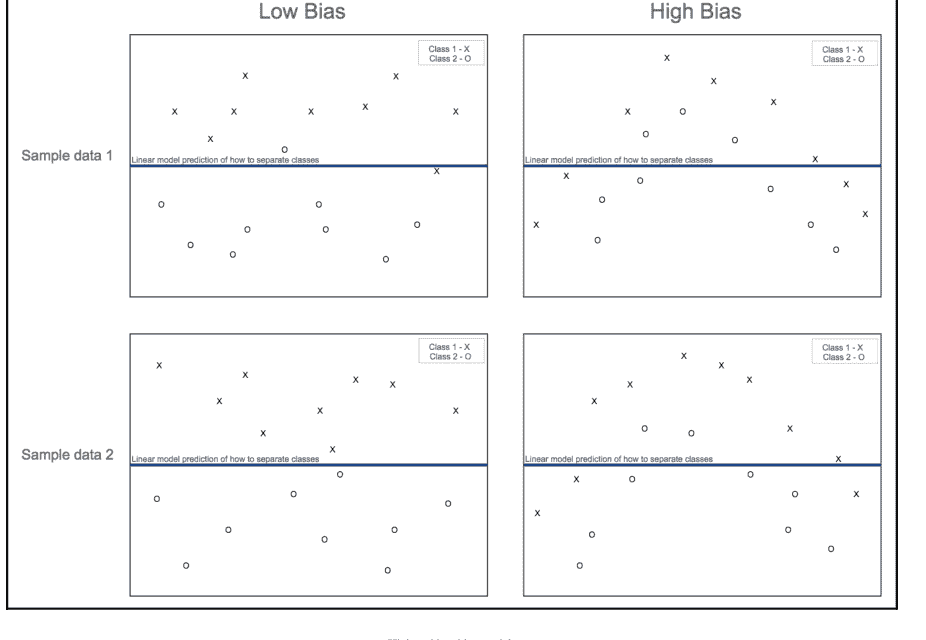

## Variance

**方差** 与更复杂的模型相关，指 ML 模型过度拟合训练数据的能力。结果学习到的模型会因训练所用数据集的变体不同而大相径庭。高方差模型存在 **过拟合** 的问题。

高方差模型在训练数据上的误差率低，而在测试数据上的误差率高。高方差模型对训练数据的精确构成拟合得过于完美。它学习了数据中的随机噪声以及底层信号。

如果在学习过程中不加以控制，方差对于更先进的 ML 模型来说是一个大问题。这是因为方法具有难以置信的灵活性，可以有效地 *记忆* 训练集中几乎任何数据组合。

## Trade-off and complexity

在理想世界中，你希望 ML 模型在学习过程后同时具有低偏差和低方差。然而，正如你可能知道的，我们生活在一个远非完美的世界。所以，就像大多数事情一样，需要权衡才能获得最佳结果。

ML 研究工作的目标不仅是找到最佳的权衡组合，而且是开发新的 ML 技术，在一方上做出少量牺牲以换取另一方的显著降低。对于任何给定的 ML 模型，都需要在偏差和方差之间进行权衡，以找到能够最好泛化的最佳 *配置*。不幸的是，这个最佳位置是未知的，必须根据训练和验证过程中的误差计算来推断。

更复杂的模型可以更好地拟合数据并降低训练过程中的误差。然而，它们容易过拟合，这会增加测试数据上的误差，并在之后的新真实世界数据上增加误差。以下图像表示模型复杂度 *设置* 的范围。目标是找到训练误差和测试误差都最小化的最佳位置。这代表了最佳折中，你可以期望它在训练模型投入生产时能很好地泛化到未来数据集：

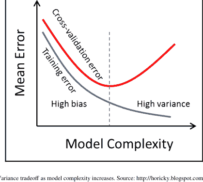

随着模型复杂度增加的偏差-方差权衡。来源：http://horicky.blogspot.com/2012/06/

幸运的是，有方法，例如 **正则化**，旨在帮助防止过拟合，以增加结果训练模型处于最佳权衡区域的可能性。这些方法已纳入你将用于构建 ML 模型的 R 包中。

## Comparing different models to find the best fit using R

最佳实践不仅是找到训练 ML 模型的最佳版本，还要比较多个训练优化的 ML 算法。每个 ML 算法都有其优势和劣势。只选择一个就是限制自己。选择几种在特定问题下可能成长为良好训练模型的算法。然后，将它们相互比较，让最好的模型获胜。

有几种方法可以比较 ML 模型。ROC 图和 AUC 指标是其中两种更流行的方法。我们将在下面介绍它们。

## ROC curves

源自二战雷达工程，**接收器操作特性** (**ROC**) 曲线是比较 ML 模型有效性的常用方法。它沿阈值度量衡量召回率与 **误报率**（计算为 [*1-特异性*]）之间的关系。误报率也称为 **假阳性率 (FPR)** 或 **误报概率**。

你可能已经注意到，很多指标都有几个不同的名称。这可能会让人困惑，但了解指标的别名很重要，因为不同的文章、博客和研究论文会使用不同的名称。

在大多数情况下，ROC 曲线将用于二元分类问题。二元分类问题的一些示例包括 **故障/无故障**、**运行/未运行**、**下雨/不下雨** 和 **购买/未购买**。ROC 曲线显示了在阈值参数的区间内，正确分类的好处（真阳性）与错误分类的成本（假阳性）之间的权衡变化。

可以这样思考真阳性率：

*真阳性率 = 正确分类的阳性 / 训练集中所有阳性*

可以这样思考假阳性率：

*假阳性率 = 错误分类的阴性 / 训练集中所有阴性*

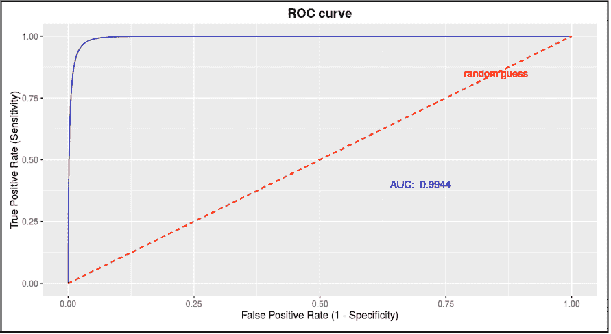

近乎完美的 ML 模型。不要相信它，这在现实世界中与独角兽骑马打曲棍球的妖精一样罕见

ROC 曲线是通过将训练数据通过训练模型运行来生成每个实例为阳性分类的预测分数（或概率）而生成的。结果按最可能者优先的顺序排序。每个预测与实例的实际分类进行比较，并在向下移动列表时保持真阳性率和假阳性率的运行分数。

每个真阳性率和假阳性率组合在图表上绘制，并用线连接各点。实际上，ROC 曲线是一个阶梯函数，随着训练集规模的增长而接近真实曲线。

随着你向下移动列表进入越来越不可能的阳性（基于模型的预测），这有效地通过了一系列阈值，从最保守（你的最高分实例）到最宽松（你的最低分实例）。生成的曲线显示了你的 ML 模型在广泛阈值场景下的性能。当你使用 ROC 曲线比较 ML 模型时，你是在比较它们在许多不同阈值条件下的性能。这为你提供了更全面的性能图景。

ROC 曲线图可以在 R 中轻松生成。使用 pROC 包，你只需使用 roc 和 plot 函数即可生成图表图像。以下是一个简单示例：

```
#load pROC library
library(pROC)
#create ROC object based on the model and its class lables
rocCurve <- roc(response = classFactors,
    predictor = testPredictionsProb,
    levels = rev(levels(classFactors))) #roc function assumes the second class
is the target, so we will reverse labels

#plot curve
plot(rocCurve, legacy.axes = TRUE, identity = TRUE, col = "blue", add =
FALSE)
#you can also add another model curve to the chart by calling this function
again with the 'add = TRUE' option
```

代码将生成与以下示例类似的 ROC 曲线图：

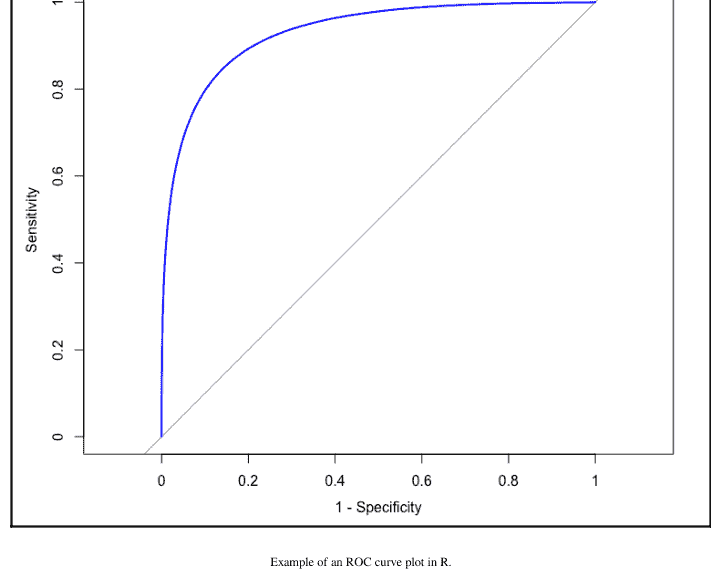

R 中 ROC 曲线图的示例。


以下是使用 ROC 曲线的一些好处：

- **对类别分布变化不敏感**：正例和负例数量的变化不会影响 ML 模型的 ROC 曲线，前提是模型在区分它们方面的有效性保持不变。
- **即使分类错误成本不相等时也很有用**：当假阳性的成本或正确分类正例的好处发生变化时，ROC 曲线不受影响。只有曲线上感兴趣的区域会发生变化。换句话说，最优阈值设置会移动，但曲线的形状不会。
- **允许在各种阈值设置下比较不同 ML 模型的性能**：有些模型在保守设置下表现最佳，而其他模型可能在更宽松的设置下表现最佳。因此，最佳模型取决于底层业务案例。

使用 ROC 曲线分析时需要注意以下事项：

- **难以直观地用于多类模型**：在二维空间之外可视化很困难，并且随着多类预测模型的增多，维度会迅速增长。确实有方法可以做到这一点，但它们仍然不容易解释。
- **难以向非分析受众解释**：ROC 曲线存在学习曲线（使用单词 curve 很有趣）。然而，非专业人士完全可以通过反复接触学会如何理解它。作者建议如果可能的话对他们进行教育。理解这些图表的组织可以在做出成本/收益业务决策时使用它们。一旦他们克服了学习解释图表的障碍，就会发现它们非常有用。

## 曲线下面积（AUC）

AUC 只是 ROC 图表“正方形”中位于 ML 的 ROC 曲线下方的部分。由于它是一个比例，因此始终介于 0 到 1 之间。AUC 为 1 表示曲线覆盖整个图表，因此它完全与左上角对齐。这就是前面提到的很少观察到的、类似雪人的 *完美模型*。

ROC 图表中虚线表示的随机模型 AUC 为 0.5。因此，在现实世界情况下，您将看到 AUC 数值从 0.5 到 1.0。如何解释 AUC 数值在很大程度上取决于行业和业务情况。AUC 为 0.6，表示优于随机，可能对金融行业的股票选择来说是一个很棒的模型；而同样的 AUC 衡量标准对于医疗行业的癌症检测来说将是彻底的失败。

AUC 数值是使用单个数字而不是图表比较模型的有用方法。这种比较可以在不同模型之间进行，也可以在模型在调整或重新训练后与自身进行比较。然而，仅查看 AUC 值存在危险，因为您会丢失一些有价值的信息。

AUC 数值可以让您大致了解性能，但几乎没有关于曲线实际形状的信息。您将失去确定模型在不同阈值设置下的性能的能力。在更保守的设置下，AUC 值较低的 ML 模型实际上可能比 AUC 较高的模型表现更好。

AUC 值是进行快速比较和将 ROC 曲线简化为一个数字的有用简写。但在做出任何业务决策之前，您应始终查看完整的 ROC 曲线，特别是当 AUC 值接近时。

AUC 值也可以使用 R 中的 pROC 包快速生成。基于之前的 ROC 代码示例，可以通过使用 auc 函数获得 AUC 值：

```
auc(rocCurve)
```

## 使用 R 的随机森林模型

大多数 ML 教科书从像感知器这样简单的模型开始。但如果你已经读到本书的这一部分，你就是摇滚明星，值得被介绍给大炮。因为它们通常提供更好的结果，你会比感知器更频繁地遇到这些模式。

我们将从随机森林模型开始。除了名字听起来很酷之外，它们还很灵活，并且往往泛化能力很强。它们还具有使用称为变量重要性的方法来解释输入特征有用性的价值。

## 随机森林关键概念

随机森林是一种基于决策树的 ML 建模过程。决策树通过根据每个分割的信息增益在输入特征上生长一系列连续分割的层次结构来预测目标变量。如果这听起来令人困惑，只需将其视为一系列决策规则，最终得出预测。下面的图表可能有助于解释这个想法：

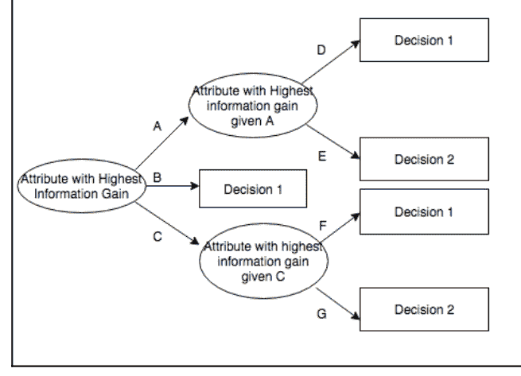

决策树 ID3 算法简单图示。来源：Wikimedia commons

随机森林通过引入随机性和重复来进一步发展这一概念。从原始训练集开始，通过随机分割并自助采样一个数据集来训练一棵树，从而创建训练集的随机变体。自助采样使用从数据集中随机抽取来创建（通常）更大的数据集，以模拟来自同一数据记录总体的数据集。

生成的混淆矩阵如下所示。这是一个比我们希望的样本量小得多的样本，模型性能也不算太好。但它确实具有一定的预测价值。对于一个简单的例子来说，它并不算太差：

```
Confusion Matrix and Statistics

          Reference
Prediction  cold hot
       cold   14   5
         hot    6  20

                 Accuracy : 0.7556
                     95% CI : (0.6046, 0.8712)
        No Information Rate : 0.5556
        P-Value [Acc > NIR] : 0.004499

                  Kappa : 0.5025
 Mcnemar's Test P-Value : 1.000000

             Sensitivity : 0.8000
             Specificity : 0.7000
          Pos Pred Value : 0.7692
          Neg Pred Value : 0.7368
              Prevalence : 0.5556
          Detection Rate : 0.4444
    Detection Prevalence : 0.5778
       Balanced Accuracy : 0.7500

       'Positive' Class : hot
```

随机森林建模的混淆矩阵摘要结果。

## 使用 R 的梯度提升机（GBM）

与随机森林类似，GBM 是一种基于决策树的模型，它将多个树的预测组合起来得出聚合响应。然而，与成千上万棵独立生长的树投票决定答案不同，GBM 是一系列浅层树按顺序链接在一起。

梯度提升机是一种流行且强大的 ML 技术。GBM 的一种变体，称为 XGBoost，已赢得最近的多个 Kaggle 竞赛。

## GBM 关键概念

决策树的深度或浅度是指其具有的层次级别的数量。层次数量越少，树越浅。GBM 使用连续的弱学习器，这些学习器根据前一个模型的误差度量进行训练。弱学习器意味着它具有一定的预测能力，但不多。浅层树通常是弱的，因为它只使用一个或少数几个特征来分割训练数据。

生成的预测结果被加在一起得出最终预测。有几种变体使用不同的误差估计方法和确定每个树的浅度的方法。

GBM 通过连续地在更高误差区域进行微调，使用前一个模型的误差来拟合下一个模型，依此类推，从而工作。这解决了使用单棵决策树时出现的问题。单棵树在每个分支处将数据分割成越来越小的组。这导致过拟合，因为它开始拟合噪声，尤其是在分支末端样本量很小时。GBM 通过在每个连续学习树中重用整个数据集来避免这种情况：

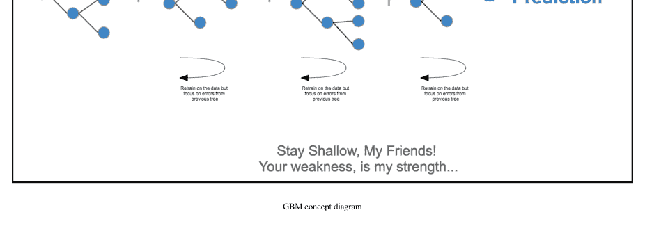

GBM 概念图

## 梯度提升机 R 示例

在 R 中，可以使用 gbm 包来训练 GBM。GBM 具有树深度和收缩的调优参数。像往常一样，R 的美妙之处和危险之处在于它可以为您调优这些参数。以下代码使用 caret 包拟合 GBM 模型并优化调优参数：

```
#make sure needed packages are installed, then load them
if (!require(gbm)) {
  install.packages("gbm")
}

library(gbm)

#reuse train control and training data from random forest example

#train the random forest model and specify the number of trees. Use caret
#to control cross-validation
gbmModel <- train (trainData[,predictors],
 trainData[,target],
 method = "gbm",
 trControl = ctrlCV,
 verbose = FALSE)

#run prediction on test data to get class probabilities
testPredGBMProb <- predict(gbmModel, testData, type = "prob")
#run prediction again to get predicted class
testData$GBMclass <- predict(gbmModel, testData)

#grab the positive class probability (hot) and the predicted classes
testData$GBMProb <- testPredGBMProb[,"hot"]

#Show confusion matrix for results
confusionMatrix(data = testData$GBMclass, reference = testData$tempClass,
 positive = "hot")
```

混淆矩阵将看起来类似于以下表格。在我们的小样本中，GBM 的表现并不算太差：


混淆矩阵与统计信息

实际
预测 | cold | hot
cold | 16 | 5
hot | 4 | 20

准确率：0.8
95% 置信区间：(0.654, 0.9042)
无信息比率：0.5556
P值 [准确率 > 无信息比率]：0.0005445

卡帕系数：0.597
麦克尼马尔检验 P值：1.0000000

灵敏度：0.8000
特异度：0.8000
阳性预测值：0.8333
阴性预测值：0.7619
流行率：0.5556
检出率：0.4444
检出流行率：0.5333
平衡准确率：0.8000

'阳性' 类别：hot

上述混淆矩阵摘要由梯度提升机生成。

## 集成

集成方法是一种将多个机器学习模型组合起来生成预测的方式。可以将它想象成一个机器学习模型委员会，每个模型都投出自己的一票，汇总后的结果就是预测。

有多种不同的投票汇总方式，你可能需要尝试不同方法，看看能否提升集成模型的性能。不过，这超出了本书的范围。

研究和实际应用表明，集成方法往往比其中任何一个单独模型的表现都更好。集成方法通过减少单个模型的预测波动来提升实际性能。在物联网分析的数据科学工具包中，应当包含集成方法。

## 使用 R 进行异常检测

异常检测是一种利用历史数据来识别异常观测的方法，无需带标签的训练集。现代异常检测方法在判断哪些观测需要标记为异常时，会考虑数据中的长期趋势和周期性变化。

Twitter 最近发布了一个先进的 R 开源异常检测包，名为 *AnomalyDetection*。它专门用于检测单值高频（小于一天）时间序列数据中的异常；不过，也可以通过设置选项来处理按月的更长数据集。它也可以用于非时间序列数据的向量。

它擅长处理趋势和季节性的影响——不过这里的季节性通常维持在分钟到天级别，而不是年度级别。GitHub 页面位于这里（https://github.com/twitter/AnomalyDetection），你可以使用以下 R 代码轻松将其作为 R 包安装。注意 *Anomaly* 的首字母要大写。*anomalyDetection* 是另一个不同的包（欢迎来到 R 的世界）：

```
install.packages("devtools")
devtools::install_github("twitter/AnomalyDetection")
```

下面的例子展示了如何对传感器数据使用异常检测。异常检测本身很有用，但在一个时间窗口（小时或天）内检测到的异常频率，如果作为其他模型的输入，也会具有很好的预测价值。例如，过去一小时内压力传感器异常出现的频率，再加上平均温度传感器的读数，可能对未来发电机故障有很强的预测性。

以下示例代码从插补后的数据集中取 **Wind** 值，并查找异常。搜索方向可以是向前、向后，或两者兼有：

```
#load library
library(AnomalyDetection)

#This uses the vector method since no timestamp is present. If timestamp is
present, use AnomalyDetectionTs
res = AnomalyDetectionVec(cs_example_data$Wind, max_anoms=0.05, period=60,
direction='both', only_last=FALSE, plot=TRUE)
res$plot
```

该代码会创建一个图，如下图所示。其中被判定为可能异常的点用蓝色圆圈标出：

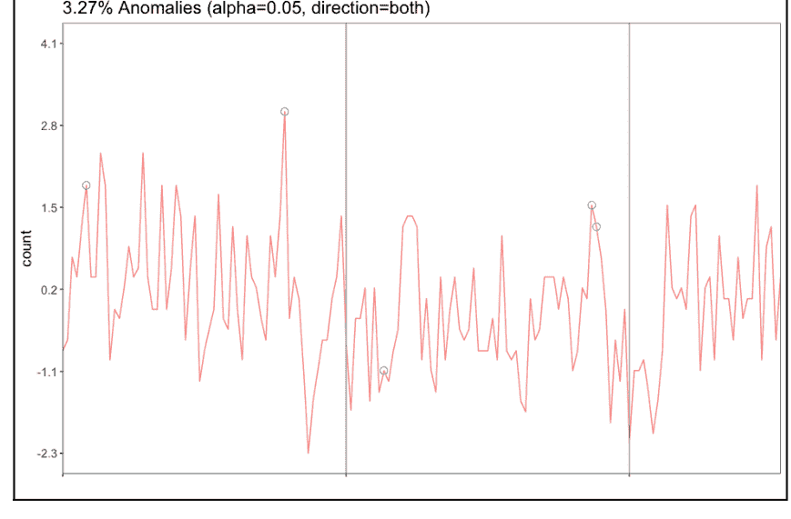

示例数据集中 Wind 值的异常检测

## 使用 ARIMA 进行预测

有时候，你需要对时间序列的未来值进行预测。例如，可能需要估算未来几个月的活跃物联网设备数量；或者，需要预测远程油井泵的使用时长。最流行的时序预测方法之一就是自回归积分滑动平均（ARIMA）。

ARIMA 并非单一模型，而是一系列相关方法的集合，这些方法试图描述数据中的自相关性，从而预测未来值。ARIMA 结合了滑动平均和自回归技术。自回归意味着对变量未来值的预测基于该变量过去值的线性组合。

ARIMA 将趋势和季节性效应都纳入了未来预测中。它可以利用多种方法对季节性数据和非季节性数据进行建模。

### 使用 R 预测物联网时间序列数据

R 的 forecast 包中包含 ARIMA 函数。你可以用以下代码进行安装：

```
install.packages("forecast")
```

Arima 函数对预测的非季节性部分和季节性部分（如果需要）都有相应设置。每个部分由三个数字组成，分别代表自回归部分的阶数、使用的差分次数以及滑动平均部分的阶数。在 R 文档中，通常记为 (p,d,q)。与数据科学中的所有事情一样，正确的起点是先查看数据，注意任何异常趋势，并进行一些诊断性统计分析，以了解非季节性和季节性部分应使用何种 (p,d,q) 数值。

幸运的是，同样也是危险的是（前面是不是提到过？），R 可以帮你处理很多这种情况，并通过一系列检验自动确定合适的值。这可以通过 auto.arima() 函数完成。你还应该分析结果和残差值，以判断你的预测模型是否可行。

以下示例代码使用本章一直在用的纽约空气质量数据集中的 Wind 值，并拟合了一个 ARIMA 模型：

```
#load forecast library
library(forecast)

#create a time series on the Solar radiation data. The air quality data was captured from May 1, 1973 to September 30, 1973
windTS <- ts(completed_example_data$Wind,start = c(1973,5,1), frequency = 365.25)

#show values over time
plot.ts(windTS)

#fit an arima model
```

```
fit <- auto.arima(windTS)

#plot forecast for the next month
plot(forecast(fit, h=30))
```

得到的预测图显示出所预测的 **Wind** 值存在较大波动。基于这个简单的 R 代码 ARIMA 示例，你可不要辞职去当天气预报员：

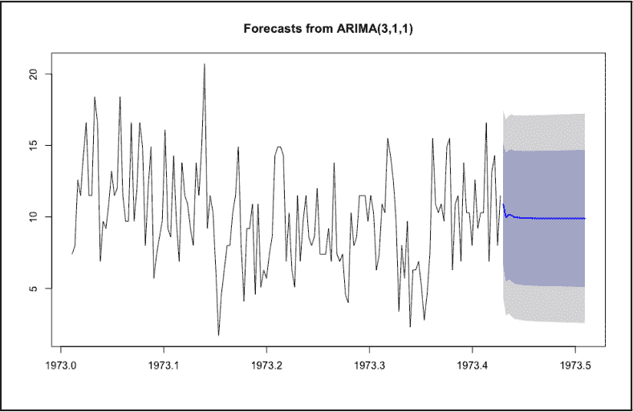

Wind 值的 ARIMA 预测。注意 auto.arima 函数选择了 3,1,1 模型（即 p,d,q 记号）。

## 深度学习

**深度学习**是数据科学中一个快速进展且令人兴奋的领域。某些深度学习模型在特定类型的图像识别上甚至比人类表现更好。当媒体提到人工智能时，通常指的就是深度学习模型。

深度学习模型非常复杂，尽管其中一些概念与本章到目前为止讨论的机器学习概念（如偏差-方差权衡）相似。深度学习模型可能拥有数百万个特征，并且训练可能需要数天甚至数周。

### 深度学习在物联网数据中的应用场景

对于具有成千上百万个特征和大量带标签历史样本作为训练集的复杂数据，深度学习可以产生惊人的效果。图像识别的快速进展，既得益于深度学习算法的进步，也与谷歌等公司多年来收集的海量已识别图像密不可分。

对于物联网数据，这可能会限制深度学习技术的实用性。大多数物联网数据相对较新，缺乏长期带标签的样本历史。许多物联网设备只有少数几个传感器，因此特征集并不复杂。在这些情况下，前面讨论的许多机器学习技术在预测效果上可能与深度学习一样好，甚至更好。深度学习在时间和计算能力方面也更加昂贵（即成本更高）。

然而，如果物联网数据流包含大量特征，并且有数十万到数百万个带标签的训练数据可用，那么深度学习技术可能会显著提升预测能力。这在自动驾驶汽车开发中尤其明显。如果在设备功能中捕获了图像（静态或视频），它同样可以大显身手。

深度学习包通常更适合用 Python 而非 R 来交互。它们也相对较新，因此文档和教程可能有限。这使得它们比本章之前的示例更难使用一些。你需要投入更多时间和专业知识来开发深度学习模型，而不是像随机森林那样成熟的机器学习模型。

选择对特定用例和可用训练数据最有意义的方法。考虑有效性要求，并判断使用深度学习建模技术是否可能提供足够的准确率提升，以证明其成本是合理的。

### 深度学习速览

深度学习是一个大保护伞，覆盖了许多项目和多种方法的神经网络配置。下面的图表可以让你对可用架构的多样性有所了解。通常需要在可获得的准确率与训练模型所需计算时间之间进行权衡。正确的权衡取决于具体用例。y 轴表示准确率，x 轴表示计算需求：


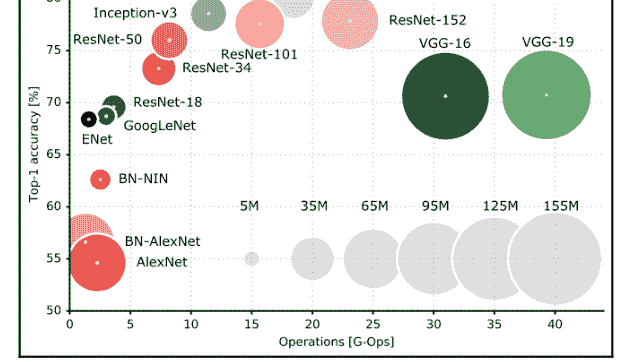

深度学习网络架构的比较。来源：medium.com

这是一个广阔的领域，有许多方面值得探索。有的方法专门从图像、声音和文本中提取特征。有的方法用于对数以千计乃至数百万计的图像进行分类。有的方法用于词语翻译，会记住句子中已经翻译过的一些先前词语，以提高当前所译词语的准确性。

有些用例会结合多种网络架构类型。下面是一个用例示例：先从图像中提取特征，然后使用卷积神经网络（CNN）对图像中的元素进行分类，再使用循环神经网络（RNN）将提取的特征与词语选择进行匹配，从而为原始图像生成文字描述：

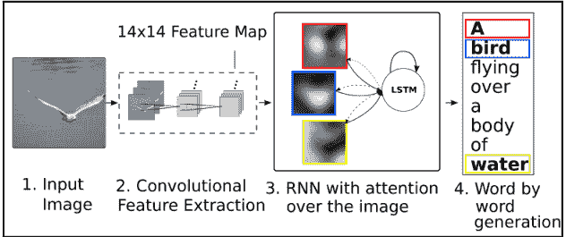

深度学习用例。来源：medium.com
