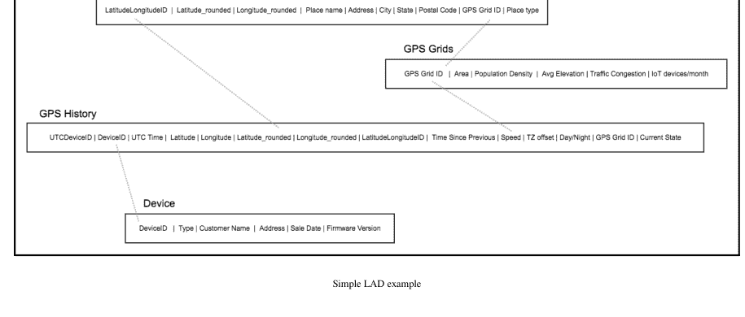
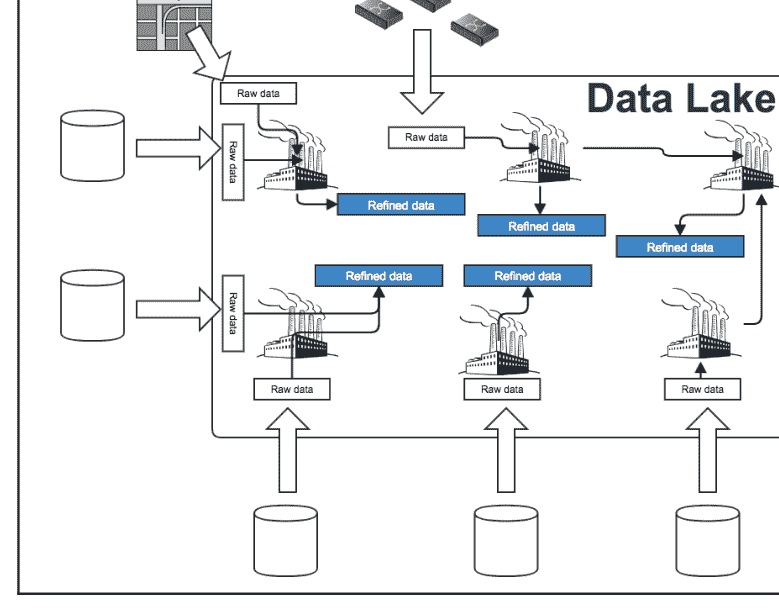

## 组织数据以进行分析的11种策略

你环顾团队，他们正在格子间四周的 MacBook 上认真敲击键盘。你已晋升到前任老板的职位，现在手下有一支小型数据科学家团队。有些人使用站立式办公桌，有些人在迷你隔间里，有些人则围坐在你所在区域中央的一张小型会议桌旁。

你的老板——互联服务副总裁——带着愉快的微笑从走廊走来。你一看到他，他便与你目光相接。

“团队适应得怎么样？”他问道。你给出了积极的状态更新，他点点头，低声表示赞许。

“我有个想法，”他说，“你的团队做得很出色。但他们在分析交付速度上和几个月前一样。我们能不能做些什么，帮助他们更快地迭代？”

你带着*多么有趣的想法*的表情微笑。这个问题你已经思考了好几个星期。

“我们做的任何分析，大部分时间都花在收集、清理和处理数据上，”你说，“可能占到80%甚至更高。我会让团队和我们的数据库专家一起集思广益，想办法减少这部分时间。我认为那会带来最大的影响。”

他微笑着点了点头。然后，他走向下一个会议。你知道这意味着你最好真的节省出时间，以满足他的期望。只是你还不确定该怎么做。

本章聚焦于如何以一种让数据科学家更容易提取价值的方式来组织数据。我们将引入**链接分析数据集（LAD）**的概念，以此显著提升**机器学习（ML）**建模开发的速度。你将学习如何在可维护性与数据科学家生产力之间取得平衡。

我们还将讨论如何防止数据湖变成数据沼泽。如果物联网数据难以使用，就不会产生太多价值；而如果没人被允许访问数据，它产生的价值就更少了。

本章还将讨论为物联网数据制定数据保留策略。重点是在保留分析价值的同时，降低维护大量历史数据的成本。

本章涵盖以下主题：

- LAD 概念简介
- 构建 LAD 的流程
- 管理数据湖
- 数据保留策略

### 链接分析数据集

LAD 的概念将已成熟的分析数据集和关系数据库思想联系在一起。将两者结合，能加速数据科学家到达他们和你最关心的部分——分析。

LAD 一词是本书中引入的，尽管其总体概念并不新鲜。然而，这种安排似乎没有统一的名称，因此本书意图赋予它一个名称。那么，既然我们现在有了 LAD，就看看它是否能流行起来。

### 分析数据集

创建分析数据集的过程在概念上很简单，但执行起来很难。你可能已经创建过一个，无论你是否意识到。分析数据集将大量有用的特征组合到每条记录实例中。

这样做既是为了数据理解的目的（想一想第6章：了解你的数据——探索物联网数据），也是为了机器学习的用途（想一想第10章：物联网分析的数据科学）。目标是至少将物联网分析师针对特定主题回答问题所需特征的80%组合到一个表中。该表还会持续自动为他们生成。就是这么简单。

### 构建分析数据集

分析数据集是半反规范化表。所谓半反规范化，是指不仅包含字段的ID代码，还包含其描述信息。你也可以决定基于值范围创建类别，并将这些类别作为单独的特征包含进来。

目标更多是让分析师的生活更轻松，而不是像纯关系数据库设计那样专注于高效存储值。本质上，你是在预构建分析师本来会使用SQL预处理数据集、以便训练ML模型时所需的转换后数据集。

由于数据整理通常占用分析师80-95%的时间，如果其中大部分已经构建好、测试过，并融入了业务逻辑，就能节省大量时间。而且这不仅是对一个人一次性的帮助，而是对许多人多次的帮助。这种复利效应大大增加了预构建分析数据集的价值。

任务应该是将可用于多个不同项目和主题的特征包含在表中。这需要一些有依据的权衡来挑选最佳特征。你永远不可能把分析师需要的100%都放进一个表里，但80%的目标可以带来巨大好处。

以下流程有助于决定如何为特定主题构建分析数据集。我们使用来自物联网设备的GPS位置数据作为示例。数据集中的每条实例将是时间和位置的组合：

1. **确定数据的分辨率**：需要什么级别的聚合？单个记录是设备级、上报实例级，还是时间段级？这应该根据传入数据的分辨率以及业务上可能的用途来决定哪种最有意义。在我们的示例中，分辨率是GPS位置上报频率，即每10秒一次。

2. **列出从数据中添加或转换而来的所有变体、类别、计算和描述**：这应该是你的团队认为对建模有用的内容。也可能源自与业务专家讨论什么对他们有用。在我们的GPS位置示例中，如下所示：

    - 纬度
    - 经度
    - 星期几
    - 距上一条GPS位置记录的时间
    - 速度（根据之前一组滚动记录计算）
    - 当前时区偏移
    - 白天或夜晚
    - GPS网格标识符（参考第9章，*将地理空间分析应用于物联网数据*）
    - UTC精确时间
    - 本地精确时间
    - 设备当前状态（行驶中、怠速中或已停放）

3. **审查每一项，评估其在分析、ML建模或报告中被使用的频率**：判断创建和存储这些信息的成本相对于其使用频率是否值得。在我们的示例中，本地精确时间和星期几被去掉了。这是基于预期使用频率与保留这些信息的存储和计算成本之间的权衡。这是一种平衡行为，随着不同字段对业务的价值变化，你的决定也可能随时间而改变。

4. **创建数据转换代码，自动在一个表中创建并维护这些信息**：目标是以自动化方式进行，这样数据科学家就不必在每次需要时重新创建。

5. **为每条记录创建唯一标识符（如果尚不存在）**：在本例中，它将是精确的UTC时间与唯一设备标识符的组合，因此需要为该组合创建一个单独的ID字段。这样做是为了让数据科学家轻松，他们不必担心通过两个不同字段连接数据集而使分析复杂化。将其合并为一个字段，为他们简化事情：

| UTC设备ID | 设备ID | UTC时间 | 纬度 | 经度 | 距上一条的时间（秒） | 速度（公里/小时） | 当前时区偏移 | 白天/夜晚 | GPS网格标识符 | 当前状态 |
| --- | --- | --- | --- | --- | --- | --- | --- | --- | --- | --- |
| 20170619031504G0678991B1 | 0678991B1 | 6/19/2017 3:15:04 | 41.881832 | -87.623177 | 15 | 0 | -8 | N | U2345 | 已停放 |
| 20170619031524G0678991B1 | 0678991B1 | 6/19/2017 3:15:24 | 41.881834 | -87.623181 | 20 | 5 | -8 | N | U2345 | 行驶中 |
| 20170619031544G0678991B1 | 0678991B1 | 6/19/2017 3:15:44 | 41.881828 | -87.623182 | 20 | 20 | -8 | N | U2345 | 行驶中 |
| 20170619031604G0678991B1 | 0678991B1 | 6/19/2017 3:16:04 | 41.881841 | -87.623181 | 20 | 25 | -8 | N | U2344 | 行驶中 |

表格形式的分析数据集示例

## 连接数据集

在构建每个分析数据集时，你应该问自己：*如何将它们与其他分析数据集关联起来？* 哪些字段是通往相关关键数据集的天然桥梁？然后，有意识地以一种易于与其他数据集连接的方式构建分析数据集。这通常通过创建一个新的标识键或使用现有的标识键来完成。该标识键在两个数据集中应该是相同的。

如果这听起来耳熟，它与关系数据库设计的概念完全相同。它也与在线分析处理（OLAP）数据仓库中的星型模式设计密切相关。然而，目标却有所不同。

在关系数据库设计中，目标是通过将数据规范化到多个关联表中，来最小化甚至消除数据重复。规范化将标识符与其描述拆分到不同的表中，这样描述只需存储一次。

在星型模式设计中，目标是让下钻、穿透以及预定义指标计算变得简单快速。数据集沿着时间、类别、财政年度和公司部门等维度进行存储和关联。

然而，在 LAD 设计中，目标是尽量减少连接，同时仍然允许轻松创建此前未曾设想的混合数据集。目的是尽量减少物联网分析师在构建机器学习建模训练集时的数据转换工作。这种权衡体现在数据大小、开发分析数据集时的初始 ETL 复杂度以及数据重复上。

- 2. **如有必要，可合并多个字段，创建一个标识链接关系的单一字段**：大数据系统处理单字段连接远比多字段连接要好。这也让数据科学家使用起来更加简单，从而在合并数据集时更不容易出错。沿用我们的示例，你可以将略微取整后的经纬度值合并为一个标识字段，并存储在数据集中的一个单独字段中。取整是为了调整那些定位到该位置但位于停车场不同区域的极其精确的 GPS 值。
- 3. **对数据集中所有可链接字段重复该过程**：GPS 网格标识符就是另一个候选字段。
- 4. **将数据集及其链接添加到主图中，以供参考。**

下图展示了我们的简单 GPS 示例如何链接到其他分析数据集：

## 管理数据湖

数据湖是用来存放来自多个来源的大量潜在有价值数据的地方。有些来源是物联网设备，有些则是公司内部数据，如生产、采购或客服记录。其概念是将所有这些各式各样的数据放在一个地方，以便通过统一的接口访问。就 Hadoop 而言，数据湖将存储在 HDFS 中，并可能通过 Hive 或 Spark 访问。

### 当数据湖变成数据沼泽

当水流进某个区域并聚积、滞留时，就会形成沼泽。藻类覆盖水面。当一个数据湖有大量原始数据涌入，却缺乏组织，也很少被使用来搅动“湖水”，它就会变成人们戏称为数据沼泽的东西。

当人们决定将许多系统中的数据复制到一个区域（如 HDFS）而不做任何更改时，这种情况经常发生。由于安全限制，分析师可能难以访问这些数据。即使他们确实拥有访问权限，也会发现很难理解大量的（通常是）关系型表，因为没有任何关键说明来指示 ID 字段代码的含义，或处理数据时应使用什么业务逻辑。

他们常常沮丧地放弃。在这种情况下，大量潜在有价值的数据腐烂闲置，白白消耗存储空间和资金。

### 数据精炼厂

运作良好的数据湖实际上并不是统一的数据水池。它们更像是一个石油精炼系统。在石油精炼系统中，西德克萨斯中质原油通过管道或超级油轮流入多个不同的精炼厂。然后精炼厂将其加工成多种不同的精炼石油产品，从汽油到凡士林，甚至还有动物饲料。

有时，一个精炼厂的产品会成为另一个精炼厂的输入，后者会进一步加工并将其与其他精炼产品混合。不过，别把这个类比推得太远——没有人会把从地下开采出来的原油直接倒进自己的汽车油箱。

数据精炼厂也发生着非常相似的过程。没有人使用那种原始的“原油”数据；他们使用的是高价值的加工成品。下图演示了这一概念：

数据湖内部运行的数据精炼厂

### 制定递进流程

数据科学就是关于实验。物联网分析潜力巨大。然而，没有人确定它将如何发展。将这两者放在一起，可以预期会有大量实验。为了避免这变成一团无法管理的混乱，需要有一种方法，将临时数据集从早期开发推进到可重复且稳定的数据产品。

建立递进流程将有助于管理这一点。数据科学是高度迭代的，这使得很难像普通数据库开发项目那样找到一个清晰的信号点来表明状态变化。

一种处理方式是设定定期的评审周期，由团队确定哪些数据集可以进入下一开发阶段。根据你的具体情况，决定评审发生的频率，定义各个阶段以及每个阶段的相应要求。

我们将介绍一个建议的递进路径，你可以根据自己独特的物联网分析环境需求进行调整。

将你的数据湖划分为三个常规区域：

- **沙盒：** 数据科学家在此区域具有完全的读写访问权限。除了团队共用的沙盒外，他们可能还有自己的沙盒。此区域用于初始实验和模型开发。
- **成熟：** 数据科学家对此区域具有完全访问权限，但没有自己的成熟环境，由团队共享。用于生成此区域中数据集的全部代码和脚本都应处于源代码控制之下。
- **生产：** 数据科学家具有完全读取权限，但没有写入能力。此区域中的数据集已经过全面测试，用于生成数据集的代码和脚本处于源代码控制之下，并且已建立变更控制流程。

以下是在区域之间移动数据集的建议递进流程：

- **定期对数据集进行周期性评审：** 可以是每月、每季度或每半年一次。根据你的物联网分析发展速度选择最有意义的方式。但评审应定期进行并强制执行。由于分析中的小规模迭代，很容易推迟评审。要避免这个陷阱，并强制你的团队执行。
- **评审所有三个区域中应删除的数据集：** 这些可能是未能取得进展的开发数据集，或是已进入生产环境的数据集的旧版本。借鉴 Java 的做法，定期执行一次垃圾回收事件，以保持数据湖处于优化状态。
- **评审沙盒中准备好进入成熟区的数据集：** 这些数据集要么是项目专属且已准备好接受团队测试，要么对团队日常工作有用。后者应设置为定期重复运行的计划任务来构建数据集。这类数据集将有助于在未来加速许多项目。
- **评审成熟区中准备好进入生产区的数据集：** 这些通常更具项目特定性，并且已通过所有测试。一旦进入生产环境，未来的更改应尽可能少。此时，应将数据集的控制权移交给一个独立小组，由其进行维护并提供服务级支持。

### 数据保留策略

即使是大数据，最终也会变得过于庞大且维护成本过高。记住在最大化价值的同时最小化成本的目标，确保为物联网数据制定保留策略。数据可以在保留一定时间后被简单删除。然而，这样做可能会让你错失构建一个未来盈利分析服务的机会，而该服务在数据被丢弃之前从未被想到。

还有其他选项可以让你在保留数据价值的同时最小化成本。我们接下来将讨论其中一些。

#### 目标

物联网分析的保留策略有两个目标：

- **保持价值**：高级建模技术（如深度学习）需要大量历史数据来最大化预测效果。而且很难提前知道哪些字段对未来的未知项目有价值。传统的数据保留策略是在固定时间段内存储记录，然后删除整个数据集，这可能导致错失盈利机会。需要一种不同的思维方式。
- **最小化成本**：物联网数据可能会迅速膨胀。即使采用基于云的 HDFS 存储，成本也可能变得很高。永远保留所有数据很容易使其成本超过其提供的价值。数据越易于访问，其成本就越高。应该做出一些妥协来控制成本。

#### 物联网数据的保留策略

我们将介绍三种减少数据存储量的策略。这些策略可以单独使用，也可以组合使用。我们将讨论每种策略的优缺点，并逐步讲解一个利用所有这三种策略的保留计划示例。

## 降低可访问性

你可以在不删除任何数据的情况下，通过降低数据的相对可访问性来大幅降低成本。接下来我们将介绍一些实现方法：

-   **压缩**：压缩是你的得力助手。压缩数据能在保留全部信息的同时，通常只需付出访问时间略微增加的微小代价。使用如 Avro 和 Parquet 等压缩格式，可以显著减少 Hadoop 集群和 S3 文件夹中的存储占用（从而降低成本），并且往往还能提升性能。性能的提升需要精心设计文件格式，但这本身就是一种最佳实践。HDFS 也支持 GZIP 和 Snappy 等其他压缩格式。这应该是你缩减文件大小的首要举措。更好的做法是，在最初的存储设计阶段就将其纳入规划。
-   **改用成本更低的存储技术**：保留数据，但迁移到成本更低的方法上。这通常会带来性能损失，但如果被迁移的数据访问频率不高，这点代价是值得的。例如，可以从 SSD 存储迁移到硬盘存储，最终甚至可以迁移到磁带存储。
-   **更改可访问性服务级别**：此方法更适用于云存储服务，与更换存储技术类似（当然，在云环境中也可以更换存储技术）。对于 Amazon S3，这可以指切换到“标准-低频访问”服务级别，或者对于极不常访问的数据，使用 Amazon Glacier。S3 支持基于规则（例如文件年龄）自动调度文件迁移到更低服务级别。
-   **更改冗余级别**：HDFS 为保障持久性会保存数据的多个副本。标准设置是三个副本，但这是可配置的。你可以为价值较低的文件调整冗余级别，从而节省部分成本。Amazon S3 也提供了“减少冗余”选项。

## 减少字段数量

随着你对物联网数据的了解加深，会发现某些字段比其他字段更有价值。通过运用第6章“了解您的数据 - 探索物联网数据”和第10章“物联网分析的数据科学”中的技巧，你会识别出哪些字段（特征）在统计上始终显著，而哪些似乎从未产生影响。

对于较旧的文件，你可以采取一些方法保留有用的字段，同时舍弃那些似乎无关紧要的字段：

-   **转换旧数据，只保留有用字段**：将较旧的数据移动到新文件或新表，但仅保留那些有用的字段。然后，删除旧记录。
-   **将有用字段拆分并区别对待**：对于旧记录，你可以将有用字段保留在易于访问的“热”区域，同时将不太有用的字段转移到“冷”存储中。
-   **汇总并移除大型数据字段，如文本或二进制文件（例如图像或声音）**：例如，你可以将一个冗长的自由格式文本字段缩减为关键词出现次数的计数。

## 减少记录数量

最后，你也可以选择直接删除旧记录。但等等，还有一些其他选项可以让你至少保留一些可能有用的信息。一旦删除历史数据，就永远无法挽回了。值得担心的是，你可能会在事后发现，如果当初保留了那些数据，本可以用于构建更有价值的机器学习模型并带来额外收入。下面列出了其他一些选项：

-   **删除原始数据，但保留其精炼版本**：经过一段时间后，同时保留原始数据和精炼版本可能不会增加太多价值。删除较旧的原始数据文件不会损失太多价值。
-   **汇总旧数据**：与其完全删除数据，不如将单条记录汇总为每周或每月的摘要值。合适的汇总统计量可以是平均值、总和，或者最好是一整套汇总统计量。例如，你可能希望保存平均值、标准差、最大值、最小值和记录数。这样可以将数千行数据缩减为一行，因此即使生成的数据集字段更宽也完全没问题。你会丢失部分数据价值，因为无法再看到完整分辨率的信息。但你仍在汇总统计量中保留了一些信息价值。如果将来需要，你甚至可以使用这些统计量来模拟原始记录。
-   **删除旧数据**：这应该是最后的选择。请记住，分析是构建于数据之上的，一旦数据消失，你本可以进行的分析也随之而去。

## 保留策略示例

我们回到 GPS 位置数据示例来制定保留策略。原始数据加载到 HDFS 表中，并保持未压缩状态。一系列数据精炼流程将数据转换为干净且有用的分析数据集。所有分析数据集都使用 Parquet 格式压缩，并且仍在 HDFS 中。

对原始数据的审查表明，初始转换中的任何问题通常都会在一周内被发现。超过一个月后才发现的未解问题为零。因此，原始数据被保留最近一个月，之后迁移到 S3 Standard。在 S3 中，创建了一套规则，在一个月后将数据迁移到“标准-低频访问”，再一个月后迁移到 Amazon Glacier。再过三个月，数据计划从 Amazon Glacier 中删除。

经过数月的统计分析和建模，在每个分析数据集中都识别出了几个关键字段。同时发现，两年多以前的数据记录很少被访问。三年多以前的记录从未被访问。

来自两年前的数据被移出 HDFS，进入 S3 Standard。对于介于两到三年之间的数据，进行了转换，只保留关键字段。更旧的数据被迁移到 Amazon Glacier。四年后，数据按日聚合进行汇总，包含每台设备的记录数、起始位置、结束位置、平均位置，以及行驶距离和行驶时间等指标。由于该数据集的体积比以前小了一万倍，因此保留在 S3 Standard 中。完整数据随后被删除。

## 总结

在本章中，我们探讨了如何通过减少数据处理耗时来提高数据科学家的生产力。介绍了湖敏捷数据（LAD）的概念，以及构建它们的流程。

我们讨论了如何防止数据湖演变成“数据沼泽”的概念。将视角从“数据湖”转变为一系列活跃的精炼流程和生产链，有助于规划出有用的数据存储区域。

我们还回顾了数据保留策略。在设计保留策略时，请考虑在最大化价值的同时最小化成本这双重目标。在下一章中，我们将讨论物联网分析的经济性。该章节将涵盖如何在数据中寻找商业价值，并提供一个详细的预测性维护案例。
