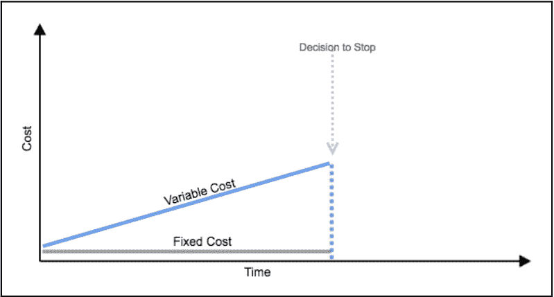
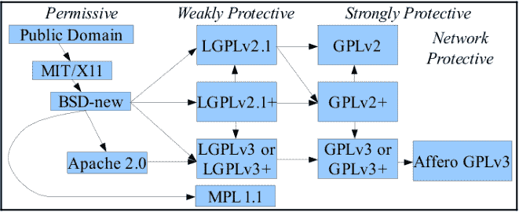
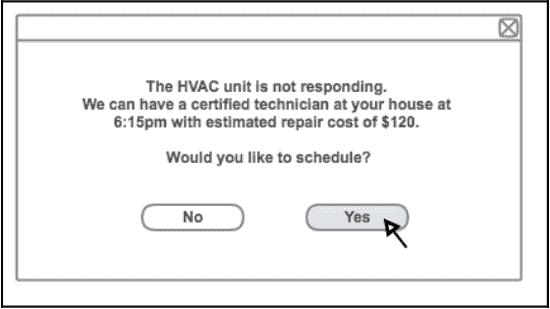
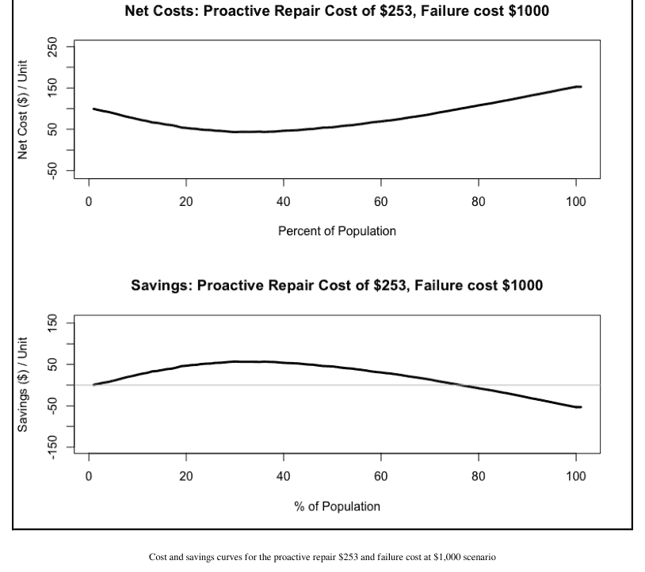
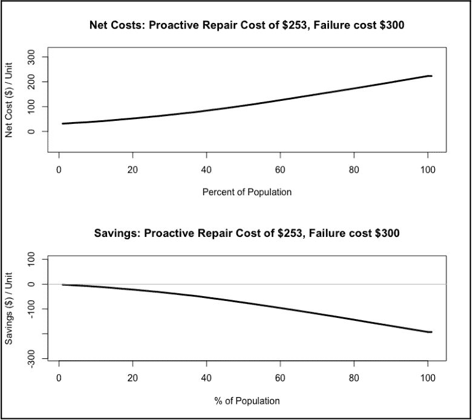
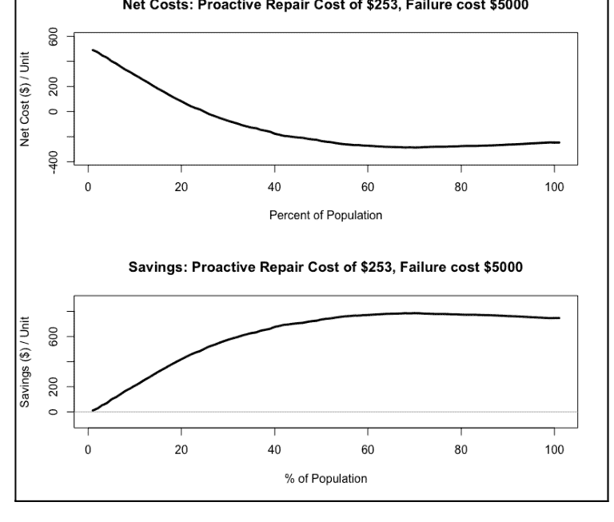

## 物联网分析的经济性

你坐在办公室里，凝视着窗外街对面的建筑。你一边沉思，一边无意识地用笔敲着额头，感到笔尖一下一下地触碰着皮肤。老板二十分钟前刚离开你的办公室。

“我们需要一个预测性维护计划，”他曾说，“但不能亏钱！我们需要更多收入。但我不想让你把时间浪费在无法为我们创造收益的分析上。”

你表示同意并点了点头，脸上带着若有所思的微笑。你知道如何思考分析本身，但未必清楚如何从收益和成本的角度来看待它。

“而且我希望你继续尝试新事物！我们要保持实验性。你做得很好！只是别亏钱，”他继续说道。

*好吧，当然，*你想。*那我该怎么做呢？*

本章将解释如何为物联网分析项目构思商业案例。它讨论了如何通过最小化成本和增加收入流机会来优化投资回报。

商业案例的成本和收益可以而且应该直接融入到物联网分析流程中。通过这样做，这些方法不仅能具有良好的预测价值，还可以针对生成盈利服务进行优化。

我们还将通过一个预测性维护的案例，回顾如何应用分析来最大化价值。预测性维护是物联网分析的一个常见应用，如果应用得当，使节省的成本超过投入的成本，就能降低总体费用。


在本章中，我们将涵盖以下主题：

- 云计算和开源的经济学：
  - 可变成本与固定成本
  - 退出选项
  - 云成本可能 escalate
  - 开源软件考虑因素
- 思考收入机会：
  - 现有业务实践的延伸
  - 新服务
- 预测性维护的经济学：
  - 估值公式
  - 计算 **机器学习 (ML)** 模型实施成本曲线的 R 代码

## 云计算和开源的经济学

乍一看，云计算似乎应该与本地系统以相同的方式进行估值。看起来开源解决方案总是更有意义，因为没有许可费用。它是免费的，对吧？

我们将介绍一些思考物联网分析中云计算和开源软件估值的方法。就像大多数事情一样，乍一看比实际复杂得多。

## 可变与固定成本

可变成本会随着使用量的多少而扩张和收缩。示例包括组装车辆的汽车生产零件、运输中的燃料和云服务。固定成本无论需要多少使用量都是恒定的。示例是数据中心、机架式服务器和设备（或云环境）管理。

退出选项具有价值，应在为物联网分析制定商业案例时纳入其中。在确定物联网分析项目不可行时，所有成本都可以立即终止。以下图表说明了这种情况：



具有退出选项的云物联网分析可变成本

## 云成本可能迅速 escalate

不过，这并不是全是阳光和玫瑰，因为如果设计不当且监控不严，云服务成本可能会迅速 escalate。如果物联网分析项目设计为云服务比所需更频繁地调用其他云服务，其影响可能非常显著。

例如，考虑一个 AWS Lambda 函数，它使用消息队列服务检查 Amazon IoT Hub 上所有物联网设备的存储状态。网页开发人员创建一个用户界面，每次页面加载或刷新时都会调用此函数。每次调用函数时，这三项服务都会产生费用。成本可能比预期更快地 escalate。更好的设计是设置 AWS Lambda 函数每隔几分钟运行一次，并将结果存储在缓存引用中，供 Web 界面使用。

如果创建的物联网分析应用程序不能同时向上和向下扩展，这也可能变得昂贵。如果计算需求的设计是为了满足最大预期需求而不是根据需要进行扩展，您将为不需要的容量付费。

## 密切监控云账单

大多数云基础设施服务，包括 AWS，都提供设置规则的方式，如果成本超过某个阈值则提醒您。规则可以按每小时、每天或每月为基础设置。这些应该立即设置，以便您立即知道成本是否超过预期。

## 开源经济学

开源软件，例如 R 或 Python，成本低，但实际上并不完全免费。任何使用开源软件组件的物联网分析商业案例都需要考虑的费用。

## 知识产权考虑

并非所有开源代码都获得商业和盈利用途的许可。在将开源代码纳入产生收入的商业项目之前，您需要检查开源代码是在何种类型的 **知识产权 (IP)** 许可下提供的。这至少需要一些法律费用，以确保您遵守 IP 要求。以下图表显示了开源许可类型的子集：



## 规模

在开源软件上扩展物联网分析可能会产生一些挑战。您可能会使用 R 或 Python 来探索和生产化您的 ML 模型以及许多其他分析。两者都可以扩展到单个计算实例的大小。例如，R 将所有内容保存在内存中，因此限制是该实例的内存大小。

两种编程语言都不是原生分布式（很少有），因此要扩展到单个计算实例之外，您需要采用额外的框架和设计复杂性。这就是使用 Apache Spark 的好处之一。如果您能够以并行方式进行分析，您可以使用 Spark 来管理分布式计算。这就是第 5 章《收集所有这些数据 - 策略和技术》中介绍的相同 map 和 reduce 概念。

使用 Spark，Python 代码可以作为分布式作业传递，结果收集到数据帧中。但是，代码所需的所有库包必须存在于集群中的每个节点上。为了高效地做到这一点，您需要一个包管理器。例如，Continuum 公司提供了一个名为 Anaconda Scale 的包管理器（https://docs.continuum.io/anaconda-scale/）。包管理软件会增加一些成本，应纳入您的商业案例。

使用 SparkR 包可以用 R 实现相同的概念。同样，应使用包管理器在集群中安装和管理库。

## 支持

开源软件是免费的……并且没有保修或支持。如果出现问题，您需要自行修复。最有可能的是，您的团队没有技能来纠正复杂的问题。有几家公司提供开源软件的技术支持。有些甚至提供受支持的开源软件版本，但当然要收费。

例如 Revolution Analytics，现由 Microsoft 所有。它提供受支持的 R 开源软件版本。与其相关的是支持和许可费用。

总体而言，如果您依赖开源代码来运行产生收入的业务，您将需要支持以防出现问题。您要么需要雇用该技能，要么应与专门从事此支持的公司签订合同。这些成本应考虑在任何商业案例中。

以下是一些需要考虑的收入可能性：

- **对您当前业务流程的扩展：** 这些想法与您正在做的事情密切相关，可以为客户增加额外价值。始终有益的是从最终客户的角度思考服务。设身处地为他们着想，想想什么可以为您节省成本并帮助您更好地经营业务。更好的是，征求他们的意见。一些需要考虑的领域如下：
  - **现场运营监控：** 即时获取现场设备状态的数据通常是首先添加物联网设备的原因。但您可以通过为客户提供监控和警报服务来为他们增加价值，这样他们就不必自己创建。您处于可以实现更大规模经济的位置，因为您的成本可以在众多客户之间分摊。
  - **现场设备位置和状态跟踪：** 同样，您可以将成本分摊到众多客户，因此您可以以低成本将其作为服务添加到他们。比他们自己创建要便宜。
  - **改进的现场维修服务：** 如果您的公司还提供与物联网设备连接的设备的服务，您就有机会提供更快更好的现场服务水平。如果您也在监控设备并跟踪位置和状态，这就是自然的下一步。您不仅立即知道是否存在问题，还确切知道其位置以及需要带去纠正的零件。即使您不提供设备的现场服务，您也可以作为中介为提供该服务的公司服务。由于您使整个流程更高效，这对最终客户和现场服务公司都有价值。来自双方的收入流都可能进入您的口袋。
- **新的收入机会：** 这些想法是与当前业务流程没有直接关系的附加服务。想想看；您有关于物联网设备位置和操作的新信息流入集中位置。这是您以前没有的信息。花一点时间以不同的方式看待它，想想如果信息一直可用，您的业务将如何从中产生收入。尝试摆脱事情一直如此的思维定势。需要考虑的一些事情如下：


- **来自物联网数据池本身的价值：** 想想哪些其他企业和行业会觉得你手上的数据有价值。以一种保护客户的方式将其打包，并提供这些其他公司所需的信息。然后，向他们收取费用。我们在本书前面讨论过一个关于物联网恒温器数据的例子，该数据被汇总并出售给发电公司。蜂窝网络公司以一种指示高速公路沿线当前交通拥堵的方式打包手机位置数据。一些手机应用公司收集 GPS 位置并将其打包出售给零售商，作为其商店客流量指标的参考。金融和保险公司肯定会从比官方统计数据更早获得的业务细分活动指标中获得价值。
- **新的业务服务：** 想想拥有物联网数据和你所创建的分析能力，能让你的公司比任何人都更有利地提供服务。它甚至可能是在目前无关的业务中。回到物联网恒温器示例。由于公司既能检测 HVAC 问题，又能知道设备的位置，因此它能够高效地安排正确的维修程序。这一概念在本书本章的 *当前业务流程的扩展* 部分中已提及。然而，在这种情况下，物联网恒温器公司目前没有服务职能。他们可能想要启动一项服务，因为他们处于有利地位。想象一下，如果恒温器向客户发送电子邮件，告知它检测到问题，并且可以在两小时内派维修人员以预先确定的合理价格修复。客户所要做的就是点击确定，如下图所示：



- **对客户非常有价值而你以前无法提供的服务：** 想想客户如何利用你现在拥有的数据来改善其业务。他们可能已经在做其中一些事情，因此再次强调，与他们联系并询问他们非常重要。将该服务打包并出售给所有客户。例如，如果你为物流公司提供用于公路拖车单元的 GPS 跟踪设备，想想客户如何会觉得这些数据对他们有价值。你可以为客户提供基准服务，将其单元行驶里程与类似公司进行比较。你可以将他们的位置数据随时间聚合，为他们展示路线集中图。你可以将他们的地图与行业进行比较，这在考虑扩张计划时对他们可能非常有价值。

## 预测性维护示例的经济性

预测性维护是物联网分析中常被引用的价值主张。我们将通过一个示例来说明如何从财务角度思考何时有意义、何时没有意义。

## 情况

预测性维护的经济性可能并不完全明显。信不信由你，即使你能准确预测早期故障，它也并不总是合算。在许多情况下，你实际上会通过这样做而亏钱。即使它能为你省钱，也有一个最佳使用点。最佳点取决于成本和预测模型的准确性。

## 价值公式

指导决策的公式比较了允许故障发生的成本与在考虑预测故障的概率的同时主动维修组件的成本：

*净节省 = (故障成本 * (预期故障数 - 预期真正阳性预测数)) - (主动维修成本 * (预期真正阳性 + 预期假阳性))*

如果故障成本与主动维修成本相同，即使是完美的预测模型，我们从第 10 章《物联网分析的数据科学》中知道这种情况极不可能发生，也不会有任何节省。务必将无形成本计入故障成本。无形成本的示例包括法律费用、品牌资产损失，甚至客户的费用。

当故障成本与主动更换成本之间存在较大差距，并且预测模型表现良好时，预测性维修才有意义。例如，如果故障成本是 $1 百万 USD 的机车发动机更换，而主动维修成本是 $200 USD，那么在进行主动更换计划在财务上合理之前，模型的准确性甚至不必太高。

另一方面，如果故障是 $400 USD 的汽车涡轮增压器更换，而主动维修成本是 $350 USD 的涡轮增压器执行器子部件更换，则预测模型需要高度准确，这才在财务上合理。

## 一个价值决策的例子

为了说明示例，我们将介绍一个业务情况，然后是一些 R 代码，该代码模拟该决策的成本效益曲线。代码将使用拟合的预测模型来计算净节省（或缺乏节省）以生成成本曲线。然后成本曲线可用于业务决策，确定应主动更换多少比例的预测故障单元。

想象你在一家制造柴油发电机的公司工作。有一个冷却控制阀，正常使用 4,000 小时运行后才会计划更换。通过分析，你的公司意识到两年前制造的发电机出现了阀门比预期更早的故障。

当阀门故障时，发动机过热并损坏其他几个部件。故障成本，包括维修人员的劳动费率和客户停机成本，平均为 $1,000 USD。阀门的主动更换成本为 $253 USD。

你是否应该更换整个群体中的所有冷却阀？这取决于预期故障率有多高。在这种情况下，预计约 10% 的当前未故障单元会在计划更换前故障。此外，重要的是，你预测故障的能力如何。

以下 R 代码模拟了这种情况，并使用一个简单的预测模型（逻辑回归）来估计成本曲线。模型的 AUC 约为 0.75。由于数据集是随机模拟的，因此每次运行代码时都会有所不同：

```
```r
#make sure all needed packages are installed
if(!require(caret)){
  install.packages("caret")
}
if(!require(pROC)){
  install.packages("pROC")
}
if(!require(dplyr)){
  install.packages("dplyr")
}
if(!require(data.table)){
  install.packages("data.table")
}

#Load required libraries
library(caret)
library(pROC)
library(dplyr)
library(data.table)

#Generate sample data
simdata = function(N=1000) {

#simulate 4 features
X = data.frame(replicate(4,rnorm(N)))
#create a hidden data structure to learn
hidden = X[,1]^2+sin(X[,2]) + rnorm(N)*1
#10% TRUE, 90% FALSE
rare.class.probability = 0.1
#simulate the true classification values
y.class = factor(hidden>quantile(hidden,c(rare.class.probability)))
return(data.frame(X,Class=y.class))
}
```
```

```
```r
#make some data structure
model_data = simdata(N=50000)

#train a logistic regression model on the simulated data
training <- createDataPartition(model_data$Class, p = 0.6, list=FALSE)
trainData <- model_data[training,]
testData <- model_data[-training,]
glmModel <- glm(Class ~ ., data=trainData, family=binomial)
testData$predicted <- predict(glmModel, newdata=testData, type="response")

#calculate AUC
roc.glmModel <- pROC::roc(testData$Class, testData$predicted)
auc.glmModel <- pROC::auc(roc.glmModel)
print(auc.glmModel)

#Pull together test data and predictions
simModel <- data.frame(trueClass = testData$Class,
                       predictedClass = testData$predicted)

# Reorder rows and columns
simModel <- simModel[order(simModel$predictedClass, decreasing = TRUE), ]
simModel <- select(simModel, trueClass, predictedClass)
simModel$rank <- 1:nrow(simModel)

#Assign costs for failures and proactive repairs
proactive_repair_cost <- 253   # Cost of proactively repairing a part
failure_repair_cost  <- 1000   # Cost of a failure of the part (include all
                                # costs such as lost production, etc not just the repair cost)

# Define each predicted/actual combination
fp.cost <- proactive_repair_cost # The part was predicted to fail but did
                                 # not (False Positive)
fn.cost <- failure_repair_cost   # The part was not predicted to fail and it
                                 # did (False Negative)
tp.cost <- (proactive_repair_cost - failure_repair_cost) # The part was
                                                         # predicted to fail and it did (True Positive). This will be negative for a
                                                         # savings.
tn.cost <- 0.0                       # The part was not predicted to fail and
                                      # it did not (True Negative)

#incorporate probability of future failure
simModel$future_failure_prob <- prob_failure

#Function to assign costs for each instance
assignCost <- function(pred, outcome, tn.cost, fn.cost, fp.cost, tp.cost,
prob) {
  cost <- ifelse(pred == 0 & outcome == FALSE, tn.cost, # No cost since no
                 action was taken and no failure
```


```r
cost <- ifelse(pred == 0 & outcome == TRUE, fn.cost, # The cost of no action and a repair resulted
    ifelse(pred == 1 & outcome == FALSE, fp.cost, # The cost of proactive repair which was not needed
        ifelse(pred == 1 & outcome == TRUE, tp.cost, 999999999)))  # The cost of proactive repair which avoided a failure
    return(cost)
}

# Initialize list to hold final output
master <- vector(mode = "list", length = 100)

# use the simulated model. In practice, this code can be adapted to compare multiple models
test_model <- simModel

# Create a loop to increment through dynamic threshold (starting at 1.0 [no proactive repairs] to 0.0 [all proactive repairs])
threshold <- 1.00
for (i in 1:101) {
# Add predicted class with percentile ranking
test_model$prob_ntile <- ntile(test_model$predictedClass, 100) / 100
# Dynamically determine if proactive repair would apply based on increment threshold
test_model$glm_failure <- ifelse(test_model$prob_ntile >= threshold, 1, 0)
test_model$threshold <- threshold

# Compare to actual outcome to assign costs
test_model$glm_impact <- assignCost(test_model$glm_failure,
test_model$trueClass, tn.cost, fn.cost, fp.cost, tp.cost,
test_model$future_failure_prob)

# Compute cost for not doing any proactive repairs
test_model$nochange_impact <- ifelse(test_model$trueClass == TRUE,
fn.cost, tn.cost) # *test_model$future_failure_prob)

# Running sum to produce the overall impact
test_model$glm_cumul_impact <- cumsum(test_model$glm_impact) /
nrow(test_model)
test_model$nochange_cumul_impact <- cumsum(test_model$nochange_impact) /
nrow(test_model)

# Count the # of classified failures
test_model$glm_failure_ct <- cumsum(test_model$glm_failure)

# Create new object to house the one row per iteration output for the final plot
master[[i]] <- test_model[nrow(test_model),]

# Reduce the threshold by 1% and repeat to calculate new value
threshold <- threshold - 0.01
}

finalOutput <- rbindlist(master)
finalOutput <- subset(finalOutput,
                    select = c(threshold,
                               glm_cumul_impact,
                               glm_failure_ct,
                               nochange_cumul_impact)
)

# Set baseline to costs of not doing any proactive repairs
baseline <- finalOutput$nochange_cumul_impact

# Plot the cost curve
par(mfrow = c(2,1))
plot(row(finalOutput)[,1],
     finalOutput$glm_cumul_impact,
     type = "l",
     lwd = 3,
     main = paste("Net Costs: Proactive Repair Cost of $",
proactive_repair_cost, ", Failure cost $", failure_repair_cost, sep = ""),
     ylim = c(min(finalOutput$glm_cumul_impact) - 100,
              max(finalOutput$glm_cumul_impact) + 100),
     xlab = "Percent of Population",
     ylab = "Net Cost ($) / Unit")

# Plot the cost difference of proactive repair program and a 'do nothing' approach
plot(row(finalOutput)[,1],
     baseline - finalOutput$glm_cumul_impact,
     type = "l",
     lwd = 3,
     col = "black",
     main = paste("Savings: Proactive Repair Cost of $",
proactive_repair_cost, ", Failure cost $", failure_repair_cost,sep = ""),
     ylim = c(min(baseline - finalOutput$glm_cumul_impact) - 100,
              max(baseline - finalOutput$glm_cumul_impact) + 100),
     xlab = "% of Population",
     ylab = "Savings ($) / Unit")
abline(h=0,col="gray")
```

从生成的净成本和节约曲线可以看出，基于模型的预测，最优节约来自于对前 30% 百分位单元进行主动维修。超过这一点后，节约额会下降，不过即使更换多达 75% 的单元，你仍然可以省钱。超过这个点后，你应该预期支出会超过节约。下面这组图表就是上述代码的输出结果：



主动维修成本为 253 美元且故障成本为 1,000 美元场景下的成本与节约曲线

请注意，当故障成本降至 300 美元时，下图中的曲线发生了怎样的变化。在任何情况下你都无法省钱，因为主动维修成本总是会超过降低后的故障成本。这并不意味着你不应该进行主动维修；为了满足客户，你可能仍然希望这样做。即使在这种情况下，这种成本曲线方法也可以帮助决定你愿意为解决该问题花费多少。你可以将 **proactive_repair_cost** 设置为 **253**，将 **failure_repair_cost** 设置为 **300**，重新运行代码，以生成以下图表：



主动维修成本为 253 美元且故障成本为 300 美元场景下的成本与节约曲线

最后，请注意当故障成本变为 5,000 美元时，节约曲线会发生怎样的变化。你会注意到，主动维修成本与故障成本之间的差值，在很大程度上决定了何时进行主动维修才具有商业意义。你可以将 **proactive_repair_cost** 设置为 **253**，将 **failure_repair_cost** 设置为 **5000**，重新运行代码，以生成以下图表：



主动维修成本为 253 美元且故障成本为 5,000 美元场景下的成本与节约曲线

最终，这是一个基于预期成本和收益的商业论证。在合适的条件下，机器学习建模可以帮助优化节约。利用成本曲线有助于确定主动更换的预期成本与节约。

### 总结

在本章中，我们讨论了云计算和开源软件的经济性。我们回顾了物联网分析的成本考量，以及如何思考收入机会。我们还探讨了如何思考物联网分析商业论证。

我们以预测性维护的经济性为例，讨论如何审视已应用的物联网分析机器学习模型的成本与收益。我们展示了一个计算成本收益的示例框架，并附带了部分 R 代码，演示了如何基于机器学习模型生成成本曲线。
