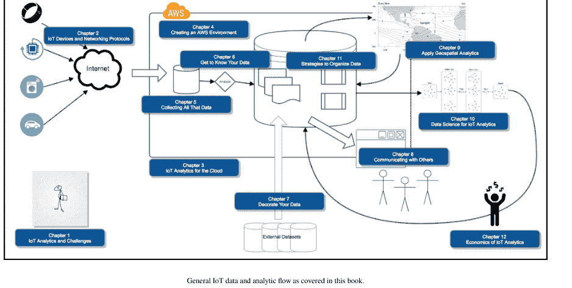
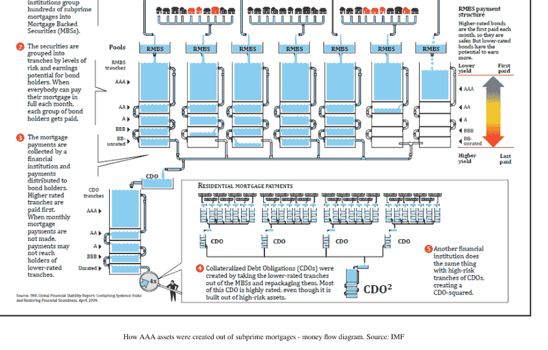
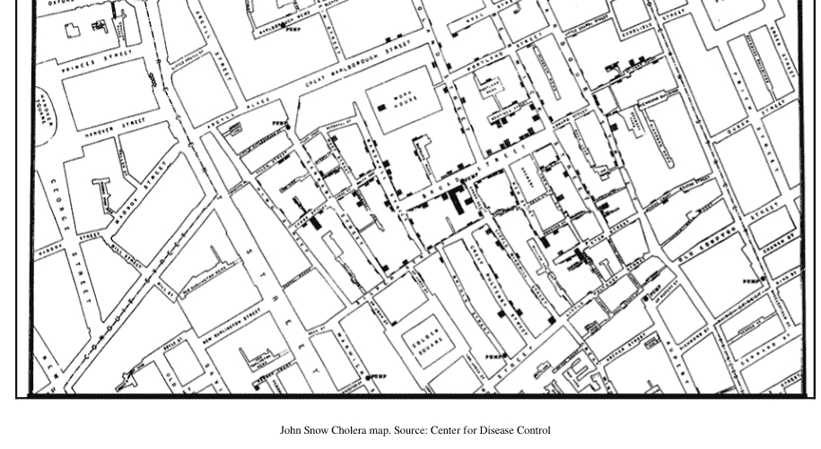

# 13 融会贯通

你所在公司的运营总裁——之前担任互联服务副总裁，也是你的上司——微笑着用力握住你的手。

“收入增长了 10%，这显然归功于你团队的付出。”他说，“CEO 和我决定创建一个新职位——互联分析副总裁。我希望你来领导它。”

“谢谢您，我希望不辜负您的信任。”你说，努力掩饰着自己的笑容。

“哦，你已经赢得了这份信任。”他眨眨眼，“你可以告诉你的团队。他们继续跟随你，而且我们还会在你的团队中增加一个数据管理团队和一个前端原型设计团队。我有没有告诉过你，下一个财年我们要将物联网产品数量翻倍？”

他点点头，转身走开，仍然面带微笑。

“你立刻上任。”他头也不回地说道。

你暗自想，*我终于成功了。经历了所有的努力和压力，我成功了。* 你享受了一会儿这个念头。直到你意识到：*等等，我该如何管理双倍的产品和更大的团队，同时还要满足 C...E...O 的营收预期？*

但这将是另一本书的故事了……

这最后一章为本书画上句号，并回顾你所学到的内容。其中包含一些临别建议，关于如何从物联网分析中获得最大价值。书中还包含一个示例项目，供你挑战自我并亲自尝试。

本章涵盖以下主题：

-   回顾本书的关键主题：
    -   IoT 数据流
    -   IoT 探索性分析
    -   IoT 数据科学
    -   从 IoT 分析中创收
-   示例挑战项目
-   再见，别了，Auf Wiedersehen，再见：
    -   祝一切顺利，收获满满！

### 回顾

本书涵盖了从设备到分析结果呈现的整个物联网数据流中的一系列步骤。这些主题范围广泛，但它们确实相互关联，构成一个整体。下图展示了这一整体架构，并说明了书中各章之间的关联：

本书所涵盖的通用物联网数据与分析流程。

## 物联网数据流

为了理解复杂系统，例如物联网设备的数据流，或国际货币基金组织在下图中描绘的债务抵押债券（CDO）中的风险与资金流，你需要绘制出整个过程。然后，你需要了解流程中每个环节如何对最终结果做出贡献。这有助于避免不盈利的项目——以及全球性衰退。

如何从次贷中创造出AAA级资产——资金流向图。来源：国际货币基金组织

我们讨论了物联网数据面临的诸多挑战。众所周知，物联网数据非常杂乱，常常包含缺失值和错误值。在第1章“定义物联网分析与挑战”中，我们回顾了数据质量问题、与时间相关的问题、与空间位置相关的问题，以及物联网数据中更为突出的分析挑战。

了解物联网设备的局限性及其相关的各种通信协议，将极大帮助你在使用所产生的数据进行数据分析时的表现。在第2章“物联网设备与网络协议”中，我们简要介绍了每种通信架构的优缺点。

由于物联网数据的规模和使用方式的不确定性，收集和处理物联网数据具有挑战性。甚至预测通过分析数据会发现哪些商业机会也很困难。在第3章“面向云的物联网分析”中，我们介绍了使用云架构的好处，以及一些面向物联网相关分析的关键云服务提供商。

第4章“创建AWS云分析环境”中介绍了如何为分析创建安全云环境的详细指南。第5章“收集所有数据——策略与技术”中回顾了用于存储和处理海量物联网数据的大数据技术。

简而言之，我们涵盖了以下建议：

- 物联网数据庞大且杂乱，请做好心理准备。
- 了解你的设备，了解数据是如何传输的。
- 在可按需伸缩的环境中存储和处理物联网数据。云服务正符合这一要求。
- 使用大数据技术，这样你的解决方案从小规模扩展到大规模时只需很少的更改。

## 物联网探索性分析

探索你的数据，将其与外部数据（如地图）相结合，并使用可视化来传达你的发现，可以产生巨大的影响。下图由约翰·斯诺在19世纪末创建，用于展示他对霍乱疾病数据的分析，该分析发现1854年霍乱疫情与水源有关。这使人们更好地了解了疾病的成因，挽救了数十万人的生命。

约翰·斯诺霍乱地图。来源：疾病控制中心

一旦物联网数据被集中收集到一个地方，你需要对其进行探索以理解数据并了解其模式。在第6章“了解你的数据——探索物联网数据”中，你学习了如何使用Tableau快速理解数据、发现问题，并在地图上查看数据。这也开启了寻找具有预测价值的特征的征程，以便用于数据科学技术。

添加外部数据可以显著提高分析的潜在价值。在第7章“装饰你的数据——添加外部数据集以创新”中，我们讨论了几个增强价值的数据来源，包括地理、经济和人口统计数据集。

将商业案例的成本和收益直接纳入机器学习建模中，将使你能够优化模型的输出。我们介绍了一种创建成本曲线的方法，以可视化机器学习模型的影响。我们还通过一个假设示例深入探讨了预测性维护的经济性。

简而言之，我们涵盖了以下建议：

- 为数据科学家而非数据库管理员组织数据
- 规划初始概念如何发展为生产服务
- 制定保留潜在数据价值的数据保留计划
- 合理使用云以保持低成本
- 将成本和收益纳入机器学习流程
- 预测性维护并非总是合理的；纳入成本和收益以确定何时合理

## 一个示例项目

如果你准备好挑战自己，下面是一个你可以自行完成的项目。没有什么比亲自实践更好的教育方式，尤其是在你不确定正确答案的时候：

项目步骤如下：

- 1. **设置AWS环境：** 遵循第4章_创建AWS云分析环境_，为数据存储和物联网分析准备一个安全区域。
- 2. **构建NOAA每小时天气数据的数据源：** 你可以使用AWS Lambda函数中的Python代码或诸如Amazon Kinesis之类的服务来处理该数据源。
- 3. **将数据集导入Hadoop环境**（存储在HDFS中）：练习使用Hive查询数据。可以使用Amazon EMR或Cloudera/Hortonworks发行版来完成此操作。
- 4. **与另一个数据集合并：** 由你选择；尽情享受吧。
- 5. **使用Tableau分析并理解数据：** 连接到Hive并探索合并后的数据。创建一个仪表板来传达一些指标和警报。
- 6. **使用R创建机器学习预测模型：** 使用随机森林和梯度提升机来拟合模型。使用ROC曲线图判断哪个模型最佳。预测天气；做自己的天气预报员！

## 总结

本章回顾了本书的主旨。我们还添加了一些简短而精炼的建议。最后，我们展示了一个挑战项目——玩得开心。

祝你好运，并通过分析愉快地挖掘物联网价值！
