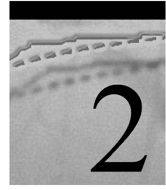

# 单个二元预测器



+   2.1 引言 ......................................................... 5
+   2.2 霜冻预报示例 ............................................... 5
+   2.3 误分类率 ............................................... 6
+   2.4 灵敏度和特异性 .......................................... 7
+   2.5 使用 PROC FREQ 进行计算 ....................................... 8

## 2.1 引言

预测的最简单场景之一是二元预测器的情况。它不仅因为它包含了 ROC 曲线的最关键构建块而重要，而且因为它在实践中经常遇到。本章使用天气预报中的一个例子来说明这些概念。处理类似数据的难题也很丰富，从诊断医学到信用评分。

## 2.2 霜冻预报示例

Thornes 和 Stephenson（2001）从天气预报产品的角度回顾了预测准确性的评估。他们的开篇示例非常简单且易于理解，对所有数据分析人员而言，无论其气象学训练如何。该示例讨论了 1995 年冬季在英国利兹和赫尔之间的 M62 公路提供的霜冻预报。霜冻发生在道路温度低于 0 °C 时。首先，为每晚制作预报为二元指标（霜冻或无霜冻）。然后在整晚监测道路的实际表面温度，并将结果记录为霜冻，如果温度降至 0 °C 以下，则记录为无霜冻，如果温度未降至 0 °C 以下。公路局提供的指南规定，结果（预报和实际）仅对实际温度低于 5 °C 的日子以汇总方式报告（参见表 2.1 中的霜冻和无霜冻列和行）。该示例指的是 1995 年冬季，当时实际道路表面温度在 77 个夜晚低于 5 °C。结果见表 2.1。这种表格描述是报告准确性的标准方式，当预测和结果都是二元时。它视觉上吸引人且易于导航，并且包含所有必要信息。

有 29 个夜晚预报霜冻且观察到霜冻，有 38 个夜晚预报无霜冻且未观察到霜冻。这两个单元格（表 2.1 的阴影部分）代表两种正确的预报类型。这些两个单元格的通用术语为 *真阳性 (TP)* 和 *真阴性 (TN)*。这种术语的根源可追溯到医学诊断研究，当测试显示疾病时称为阳性，未显示时称为阴性。类比而言，您可以将霜冻视为阳性，无霜冻视为阴性，在这种情况下，表 2.1 中有 29 个真阳性和 38 个真阴性。

### 表 2.1 道路表面温度的预报准确性

| Forecast | Observed |  |  |
| | Frost | No Frost | Total |
| Frost | 29 | 6 | 35 |
| No Frost | 4 | 38 | 42 |
| Total | 33 | 44 | 77 |

预报错误呢？有 6 个夜晚预报霜冻但未观察到。有 4 个夜晚预报无霜冻，但观察到霜冻。可以很容易地将术语扩展为将这两个单元格称为 *假阳性 (FP)* 和 *假阴性 (FN)*。表 2.2 使用此处引入的术语对表 2.1 进行了通用表示。

### 表 2.2 二元预测的准确性报告

| Forecast | Observed |  |  |
| | Positive | Negative | Total |
| Positive | True Positive (TP) | False Positive (FP) | TP+FP |
| Negative | False Negative (FN) | True Negative (TN) | FN+TN |
| Total | TP+FN | FP+TN | TP+FP+FN+TN |

## 2.3 误分类率

总结预报准确性有多种方法。显而易见的一种是 *误分类率 (MR)*，它是所有被误分类夜晚的比例，即假阴性和假阳性的总和除以所有夜晚：

$$MR = \frac{FN + FP}{TP + FN + FP + TN}$$

误分类率的 1 倍有时称为 *正确百分比* 或简单地称为 *准确性*。表 2.1 中数据的 MR 为 10/77=13%。

虽然误分类率易于计算和理解，但有时对于理解误分类背后的机制来说过于粗糙。如果信息没有仔细组装，它也容易产生偏差。假设不是遵循公路局的指南，预报提供者决定包含日历年的所有夜晚。表 2.1 中报告了 77 个夜晚，并且根据定义，所有这些夜晚的实际温度都降至 5 °C 以下。因此，其余 288 个夜晚全部高于 5 °C（无霜冻），将列边际总数增加到 33 个霜冻夜晚（不变）和 332 个无霜冻夜晚。可能 温度高于 5 °C 的 288 个夜晚的 MR 远低于温度低于 5 °C 的夜晚的 MR。假设这些 288 个夜晚的误分类率为 5%，导致 15 个误分类夜晚（四舍五入）。那么 365 个夜晚中总共有 25 个误分类夜晚，MR 为 25/265=7%。表 2.3 显示了几种可能性。

### 表 2.3 温度高于 5 °C 的 288 个夜晚的误分类百分比以及所有 365 个夜晚的相应 MR

| Percent misclassified for the 288 nights when the temperature was above 5 °C | 0 | 1 | 2 | 4 | 6 | 8 | 10 | 12 | 13 |
| Percent misclassified for all 365 nights | 2.7 | 3.5 | 4.3 | 5.9 | 7.5 | 9.1 | 10.6 | 12.2 | 13.0 |

很明显，MR 对样本中包含哪些夜晚很敏感，因为预报的性能对于一年中的所有夜晚来说并不均匀。也很明显，随着您在样本中包含更多易于预报的夜晚，MR 会变小。您可以安全地假设，对于春季和夏季的温暖日子，M62 的夜间霜冻预报是不必要的，因为大多数人可以在不求助于科学获得的预报的情况下相当准确地做出相同的预测（无霜冻！）。这就是为什么公路局将准确性报告限制在实际温度为 5 °C 或更低的夜晚的原因。这也强调了 MR 的解释取决于样本中霜冻夜晚的比例（本例中为 30%）。该比例有时称为患病率。

在信用评分等不受监管的领域，评分算法大多是专有的，没有关于如何评估准确性的此类规则，甚至没有指导方针。此外，预测的消费者在解释准确性的细节或复杂性方面并不总是勤勉或有知识。因此，您需要更稳健的度量。

## 2.4 灵敏度和特异性

报告二元预测准确性的最常见方法是分别使用真（或假）阳性和真（或假）阴性。这承认了假阴性预测可能与假阳性预测有不同的后果。它还使这些度量独立于患病率。因此，这些两个度量被认为衡量预测器的固有能力。在这个天气预报示例中，假阳性可能成本较低，因为其主要后果可能是更谨慎、准备更好的驾驶员。另一方面，假阴性可能导致准备不足和事故。这表明应分别报告假阳性和假阴性率。

```
FPR = FP / (TN + FP),   FNR = FN / (TP + FN)
```


更常见的做法是使用真阳性率和真阴性率，定义为

$$TPR = \frac{TP}{TP + FN}, \quad TNR = \frac{TN}{TN + FP}$$

真阳性率（TPR）有时被称为*sensitivity*，真阴性率（TNR）有时被称为*specificity*。虽然这些是常规出现在统计文献中的通用术语，但每个领域都有自己的术语。例如，天气预报员使用 FNR 的失误率和 FPR 的误报率。

天气预报数据的 FNR 和 FPR 分别为 4/33=12% 和 6/44 = 14%。敏感性和特异性分别为 29/33=88% 和 38/44=86%。在这种情况下，FPR 和 FNR 彼此非常接近。当这种情况发生时，它们也将非常接近 MR。事实上，MR 是 FPR 和 FNR 的加权平均值：$MR = w*FPR + (1-w)*FNR$，其中权重（$w$）是观测到霜冻的夜晚所占的比例。这有时被称为霜冻的*prevalence*。

请注意，TPR 和 TNR 的分母是总观测阳性和阴性。可以定义类似的量，使用预测阳性和阴性作为分母。在这种情况下，对应于敏感性和特异性的比率称为*positive predictive value (PPV)* 和 *negative predictive value (NPV)*：

$$PPV = \frac{TP}{TP + FP}, \quad NPV = \frac{TN}{TN + FN}$$

熟悉 PROC LOGISTIC 的 SAS 用户会认识到 PPV 和 NPV 实际上被称为 TPR 和 TNR。这可能是混淆的来源。本书不使用已建立的 PROC LOGISTIC 术语，因为它定义 TPR 和 TNR 与其在医学诊断文献中的使用方式一致。尽管如此，为了尽量减少混淆，敏感性和特异性比 TPR 和 TNR 使用得更频繁。

## 2.5 使用 PROC FREQ 进行计算

在 SAS 中计算所有这些度量相对容易。以下 DATA 步为 PROC FREQ 的后续使用准备数据：

```
data m62;
    input forecast $ observed $ weight;
    datalines;
Frost Frost 29
Frost No_Frost 6
No_Frost Frost 4
No_Frost No_Frost 38
;
run;
```

以下 PROC FREQ 的执行提供了必要的计算：

```
proc freq data=m62;
    table forecast*observed;
    weight weight;
run;
```

输出 2.1 包含许多有用的信息。作为对 PROC FREQ 输出的快速复习，每个单元格中四个数字的含义可在表格左上角找到。第一个数字是频数（即 TP、FP、FN 和 TN）。第二个数字（Percent）使用表格总和（列总和之和或行总和之和，本例中为 77）作为分母。第三个数字（Row Pct）是行百分比（即使用行总和作为分母的比例）。最后，第四个数字（Col Pct）是使用列总和作为分母的列百分比。

## Output 2.1

| forecast | observed |  |
|---|---|---|
| Frequency |  |  |
| Percent |  |  |
| Row Pct |  |  |
| Col Pct | Frost | No_Frost | Total |
| Frost | 29 | 6 | 35 |
|  | 37.66 | 7.79 | 45.45 |
|  | 82.86 | 17.14 |  |
|  | 87.88 | 13.64 |  |
| No_Frost | 4 | 38 | 42 |
|  | 5.19 | 49.35 | 54.55 |
|  | 9.52 | 90.48 |  |
|  | 12.12 | 86.36 |  |
| Total | 33 | 44 | 77 |
|  | 42.86 | 57.14 | 100.00 |

这些数字中的每一个在计算迄今讨论的度量时都有作用。例如，MR 是表格中非对角线元素的表格百分比（第二组数字）的总和：7.79+5.19=12.98%。PPV 和 NPV 可以在行百分比中找到，因为行总和与预测相关。这里，PPV 为 82.86%，NPV 为 90.48%。最后，敏感性和特异性可从列百分比获得（本例中为 87.88% 和 86.36%），意味着敏感性为 87.88%，特异性为 86.36%。

必须非常清楚地理解敏感性、特异性、PPV 和 NPV 的正确解释。让我们先从预测值开始。它们的分母是阳性和阴性预测的数量。在天气预报示例中，PPV 可以解释为预报霜冻时实际发生霜冻的概率，而 NPV 是预报无霜冻时观测到无霜冻的概率。因此，如果 M62 高速公路预报有霜冻，则实际发生霜冻的概率估计为 82.86%。同样，如果预报没有霜冻，则不会出现霜冻的概率估计为 90.48%。

相比之下，敏感性和特异性的分母是观测到的阳性和阴性。因此，敏感性是在所有霜冻夜晚中，预报正确识别出霜冻夜晚的概率；同样，特异性是在所有无霜冻（且低于 5 °C）的夜晚中，预报正确识别出无霜冻夜晚的概率。在我们的示例中，霜冻被正确预报的概率估计为 87.88%，无霜冻被正确预报的概率估计为 86.36%。

很容易想象这些概率作为偶尔的天气预报消费者时的实用性。如果你只在冬季的几个夜晚从利兹开车到赫尔走 M62，你只关心预报在那几个夜晚是否准确。另一方面，负责保持高速公路无霜的机构在决定是否支付这些预报费用时可能更感兴趣于敏感性和特异性，因为这关系到即将到来的冬季整个“队列”的夜晚，而该机构的决策应基于预报的长期表现。

很容易认识到，如果相应的分母被视为固定，则敏感性、特异性以及阳性和阴性预测值都是二项比例。技术术语是条件于分母。这很容易导致在 PROC FREQ 中使用二项式功能来计算区间估计。

以下代码使用两次单独的 PROC FREQ 调用来获得敏感性和特异性的估计值以及置信区间和关于特定零值的假设检验。请注意使用 WHERE 语句为每次计算选择适当的分母：

```
title "Sensitivity";
proc freq data=m62(where=(observed='Frost'));
  table forecast / binomial(p=0.8);
  weight weight;
  exact binomial;
run;
```

BINOMIAL 关键字后括号中指定的值是假设检验的零值。指定了 80% 的零值。该值仅为演示 BINOMIAL 选项的假设检验功能而选择。它与示例中实际感兴趣的值无关。

输出 2.2 显示了敏感性，估计为 87.88% 或 33 个中的 29 个。这 33 个霜冻夜晚中的每一个都可以被视为独立的伯努利变量：其中 29 个为阳性（1），4 个为阴性（0）。它们的和（29）是二项变量，其样本量（分母）为 33，敏感性为该变量的二项比例。

## Output 2.2

Sensitivity

The FREQ Procedure

forecast    Frequency    Percent    Cumulative Frequency    Cumulative Percent
Frost       29           87.88      29                       87.88
No_Frost    4            12.12      33                       100.00

    Binomial Proportion
    for forecast = Frost

Proportion                 0.8788
ASE                        0.0568
95% Lower Conf Limit       0.7674
95% Upper Conf Limit       0.9901

Exact Conf Limits
95% Lower Conf Limit       0.7180
95% Upper Conf Limit       0.9660

    Test of HO: Proportion = 0.8

ASE under HO               0.0696
Z                          1.1315
One-sided Pr >  Z          0.1289
Two-sided Pr > |Z|         0.2578

Exact Test
One-sided Pr >=  P         0.1821
Two-sided = 2 * One-sided  0.3643

Sample Size = 33


第一组置信限基于众所周知的二项分布的正态近似。这些置信区间的关键量是渐近标准误（ASE），其计算公式为

ASE = sqrt( p(1 - p) / n )

其中 n 为二项比例的分母（在本例中为灵敏度），p 为数据中比例的估计值。灵敏度的 ASE 为 5.68%。

ASE 下出现的置信限基于渐近理论。如果 n 较大，则 95% 置信区间可使用

p ± 1.96 × ASE

计算。输出报告灵敏度的渐近 95% 置信区间为 (76.74%, 99.01%)。

与之相比，精确置信限基于二项分布，在小样本和/或罕见事件时覆盖率更好。因为在指定了 BINOMIAL 选项时默认会计算精确置信限，因此无需使用渐近置信限。灵敏度的精确 95% 置信区间为 (71.80%, 96.60%)。渐近区间与精确区间之间的差异突出了中等样本量的典型效应。

最后，输出的最后一部分提供了灵敏度是否等于 80% 的检验。PROC FREQ 输出中报告的 z 统计量通过 z = p / ASE(null) 计算，其中 ASE(null) 表示在原假设下的 ASE。这是一种常见的计算检验统计量的方法，有时称为 Wald 检验。我们假设下的 ASE(null) 为 6.96%，对应的 z 值为 1.13。在大样本中，在原假设下 z 服从正态分布，因此可以通过查标准正态表获得 p 值。这得到双侧 p 值为 0.26，提示霜冻预报的灵敏度与 80% 无差异。

一般而言，置信区间和假设检验在渐近标准误的计算上存在重要差异。5.68% 的 ASE 使用观察到的 p 值 87.88%，而 H₀ 下的 ASE（此处为 6.96%）使用原假设中的 p 值 80%。

## Output 2.3

### Specificity

The FREQ Procedure

| forecast | Frequency | Percent | Cumulative Frequency | Cumulative Percent |
|---|---|---|---|---|
| No_Frost | 38 | 86.36 | 38 | 86.36 |
| Frost | 6 | 13.64 | 44 | 100.00 |

Binomial Proportion for forecast = No_Frost

Proportion (P)  0.8636
ASE  0.0517
95% Lower Conf Limit  0.7622
95% Upper Conf Limit  0.9650

Exact Conf Limits
95% Lower Conf Limit  0.7265
95% Upper Conf Limit  0.9483

Test of H0: Proportion = 0.75

ASE under H0  0.0653
Z  1.7408
One-sided Pr > Z  0.0409
Two-sided Pr > |Z|  0.0817

Exact Test
One-sided Pr >= P  0.0523
Two-sided = 2 * One-sided  0.1046

Sample Size = 44

以下代码创建 Output 2.3：

```
title "Specificity";
proc freq data=m62(where=(observed='No_Frost')) order=freq;
    table forecast / binomial(p=0.75);
    weight weight;
    exact binomial;
run;
```

对特异性的输出解释与灵敏度类似。特异性估计为 86.36%，ASE 为 5.17%。基于 ASE 的 95% 置信区间为 (76.22%, 96.50%)，95% 精确置信区间为 (72.65%, 94.83%)。检验特异性是否超过预先设定的 75% 目标值得到渐近 p 值为 0.0817，精确 p 值为 0.1046。在此分析下，你会保留原假设。

PROC FREQ 中的 ORDER= 选项在 SAS 默认选择与你想要的二项事件不同时可能很有帮助。这会导致以期望类别的补集方式计算二项比例。你始终可以从输出中减去 1 的值并以类似方式调整假设值以获得正确的分析。但也可以通过使用 PROC FREQ 语句的 ORDER 选项来获得完全期望的输出。为了更好地理解 ORDER 语句的正确用法，重要的是要理解，默认情况下（即没有 ORDER 选项时）PROC FREQ 使用 TABLE 变量的未格式化值的按字母顺序排列列表中的第一个值作为事件。这导致霜冻被视为事件，报告的分析是 FPR 而不是特异性。ORDER=FREQ 告诉 PROC FREQ 使用最常见的类别作为事件，从而得到期望的分析。当特异性大于 50% 时此方法有效，这应涵盖大多数情况。当特异性小于 50% 时，ORDER=FREQ 也会使用错误的类别作为事件。万无一失的系统需要先按预测变量以降序对数据进行排序，然后再使用不带 ORDER= 指定 的 PROC FREQ。
