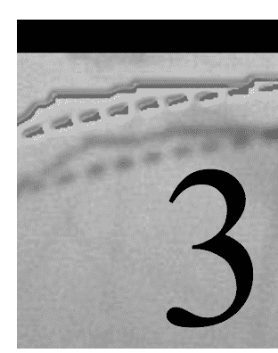
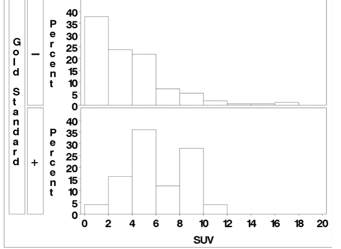
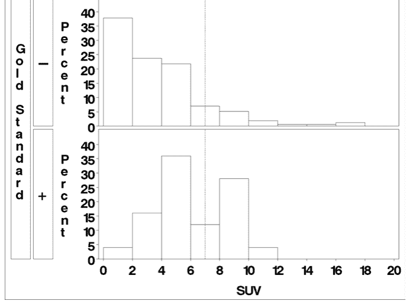
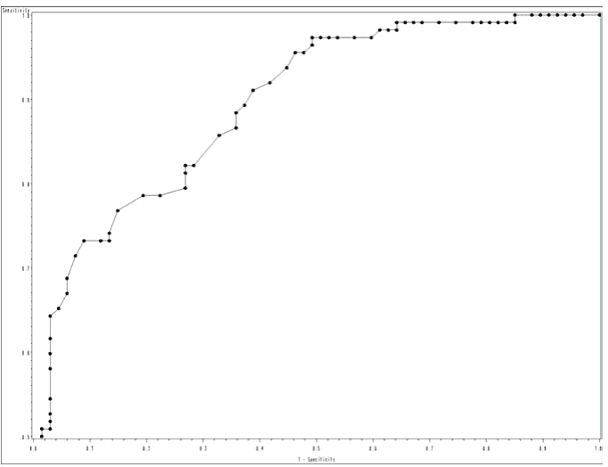
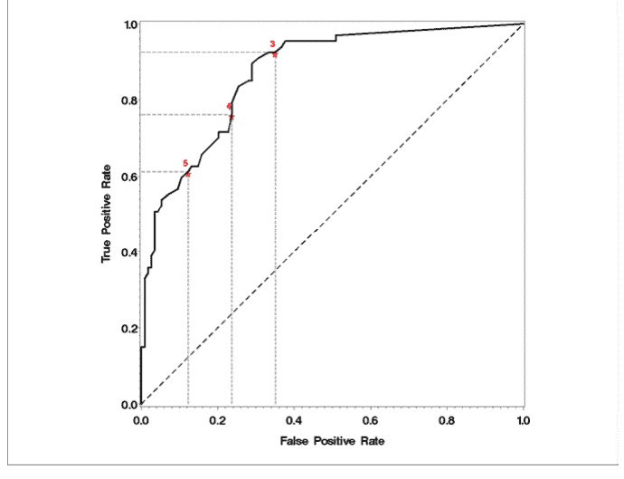
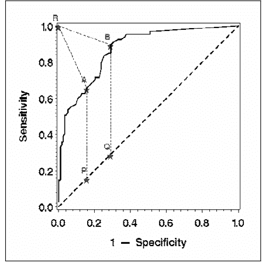
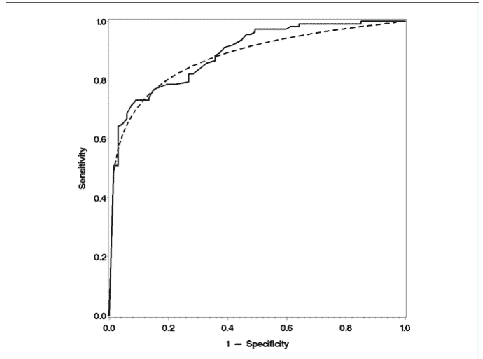
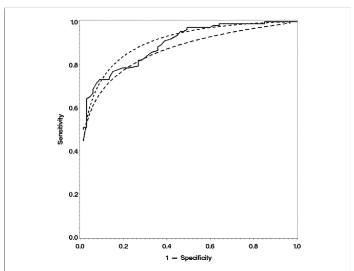
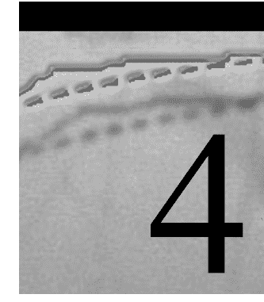

## Single Continuous Predictor



- 3.1 Dichotomizing a Continuous Predictor........................................................... 15
- 3.2 The ROC Curve ....................................................................... 18
- 3.3 Empirical ROC Curve and the Conditional Distributions of the Marker.. 20
- 3.4 Area under the ROC Curve ............................................................... 21
- 3.5 Selecting an Optimal Threshold........................................................... 25
- 3.6 The Binormal ROC Curve............................................................... 26
- 3.7 Transformations to Binormality ........................................................... 30
- 3.8 Direct Estimation of the Binormal ROC Curve ....................................... 32
- 3.9 Bootstrap Confidence Intervals for the Area under the Curve............. 33

## 3.1 Dichotomizing a Continuous Predictor

现在让我们考虑自然导致使用 ROC 曲线的问题。假设你试图预测一个二元结果，比如天气预报，但你拥有的不是二元预测因子而是一个连续预测因子。大多数天气预报是由统计模型产生的，它们为结果生成一个概率水平。例如，大多数天气预报在摘要中提到降雨，但如果你查看细节，它们还会报告降雨的几率。你将如何评估这些概率（或更恰当地说是产生这些预测概率的模型）的预测准确性？

由于你已经知道如何对二元预测因子进行预测准确性分析（使用灵敏度和特异性等指标），你可能会考虑通过使用阈值将预测概率转化为二分变量。然而，结果显然会取决于阈值的选择。那如果使用多个阈值并报告每个阈值的结果呢？ROC 曲线提供了一种方法。通过仅关注灵敏度和（1 减去）特异性，ROC 曲线提供了一种方法。

让我们用医学诊断领域的例子。诊断癌症的一种方法是使用一种特殊的扫描，称为 *正电子发射断层扫描 (PET)*。PET 产生一个称为 *标准化摄取值 (SUV)* 的指标，它是一个正数，表示所考虑的身体部位患癌的可能性。测量 SUV 后，患者会接受活检，其中从疑似区域取出一小块组织并在显微镜下检查以评估其是否癌变。此过程称为 *病理验证*，被认为是金标准。使用第 1 章引入的术语，我们将 SUV 称为标记，病理验证称为金标准。

数据由 Wong et al. (2002) 报道。有 181 名患者，其中 67 名被金标准发现患有癌症。由于我们处理的是连续预测因子，因此不再可能以表格形式报告数据。相反，你可以使用以下来自 PROC UNIVARIATE 的并排直方图，该图可通过同时使用 CLASS 和 HISTOGRAM 语句获得。例如，以下代码用于生成图 3.1：

```
proc univariate data=HeadNeck noprint;
class gold_standard / keylevel='-';
var suv;
histogram suv / turnvlabels cfill=ligr cframe=white
    cframeside=white endpoints=0 to 20 by 2 cbarline=black
    font=swissb height=4;
run;
```

## Figure 3.1 Side-By-Side Histograms for SUV



当在 PROC UNIVARIATE 中使用 CLASS 语句调用 HISTOGRAM 语句时，会为类别变量的每个值生成单独的直方图。KEYLEVEL= 选项确保所选级别始终出现在顶部（在本例中，代码首先显示金标准阴性患者的直方图）。HISTOGRAM 语句中使用的选项在视觉上增强了图形。它们的使用在 *Base SAS Procedures Guide: Statistical Procedures* 中有详细说明，该指南可在 support.sas.com/documentation/onlinedoc/sas9doc.html 获取。


图的上面面板是金标准阴性患者（无癌症）的 SUV 直方图，下面面板是金标准阳性患者（有癌症）的 SUV 直方图，如纵轴所示。癌症患者往往具有较高的 SUV 值；只有少数人的 SUV 非常低。非常高的 SUV（例如，10 或更高）几乎肯定意味着癌症。然而，SUV 在中间范围（大约 4–10）的分布之间存在一定的重叠。因此，SUV 的极端值强烈暗示癌症或无癌症，但在中间存在一个灰色区域。这实际上是许多连续预测变量的非常常见的图景。那么，SUV 用于诊断癌症的准确性如何？

一种粗略的处理问题的方法是计算各种阈值的敏感性和特异性。图 3.2 使用 7 作为阈值。左侧（SUV≤7）被认为是癌症阴性，右侧（SUV>7）被认为是癌症阳性。HREF=7 选项在 HISTOGRAM 语句中使用来绘制参考线，并且使用 FRONTREF 选项确保参考线位于直方图条的前面。

更大比例的金标准阴性患者具有 SUV≤7 并被分类为无癌症。同样，更大比例的金标准阳性患者具有 SUV>7 并被分类为有癌症。

## 图 3.2 在 SUV=7 处二分



SUV 的二分化可以使用以下 DATA 步命令完成：

```
suv7=(suv>7);
```

如果 SUV 变量包含缺失值，这可能会产生不良行为，因为缺失值将满足 suv≤7，在这种情况下将被重新编码为 0。如果要重新编码的变量包含缺失值，应使用 IF-THEN 语句。

使用变量 SUV7，你可以很容易地获得上一章天气预测示例中考虑的那种 2x2 表。对于本数据集，它看起来像表 3.1 中的单元格：

## 表 3.1 SUV>7 在癌症诊断中的准确性

| SUV>7 分类 | 金标准诊断 |  |  |
| | 癌症 | 无癌症 | 总计 |
| 癌症 | 25 | 3 | 28 |
| 无癌症 | 42 | 111 | 153 |
| 总计 | 67 | 114 | 181 |

行是 SUV>7 规则的分类，列是金标准的分类。利用第 2 章介绍的技术，你可以使用 PROC FREQ 来估计敏感性和特异性分别为 25/67=37% 和 111/114=97%。因此，使用 7 作为 SUV 阈值将患者分类为有癌症或无癌症具有高度特异性，但敏感性值得怀疑。这不一定是对整个标准化摄取值谱诊断癌症能力的裁决。事实上，图 3.2 表明将阈值向左移动（即使用较低的阈值）将提高敏感性，同时降低特异性。由于使用 7 作为阈值的敏感性如此之差而特异性如此之高，这可能是一种值得的策略。这可能有助于你找到更好的阈值，但仍不足以确定 SUV 是否是癌症的良好预测因子。下一节将解释如何使用 ROC 曲线来完成此操作。

## 3.2 ROC 曲线

之前的分析可以针对各种阈值重复，每个阈值可能产生不同的敏感性和特异性值。报告此类分析结果的一种方法是表格形式。表 3.2 是一个示例，报告了几个选定阈值的结果。

## 表 3.2 SUV 在诊断癌症中的准确性，针对各种阈值

| 阈值 | 1 | 3 | 5 | 7 |
| 敏感性 | 97% | 93% | 61% | 37% |
| 特异性 | 48% | 65% | 88% | 97% |

表 3.2 清楚地显示了通过改变阈值可以获得的敏感性和特异性的广泛范围。它还确定了两者之间的反向关系：一个增加，另一个减少，反之亦然。这可以从直方图中看出。如果你将虚线向左移动（例如，从 7 改为 5），将有更多患者被分类为阳性：其中一些是金标准阳性，即真阳性，这将提高敏感性。然而，其他人将是金标准阴性，即假阳性，这将降低特异性。因此，表 3.2 中观察到的关系是普遍的：不可能改变阈值使得特异性和敏感性同时增加。

表格形式在可容纳的阈值数量上有限制。你可以绘制敏感性与特异性，使其能够容纳所有可能的阈值。表 3.2 显示由于两者呈反向关系，敏感性与特异性的图将显示下降趋势。可以获得视觉上更具吸引力的显示方法是绘制

敏感性与一减去特异性。这称为 *接收者操作特征 (ROC)* 曲线。图 3.3 表示对应于 PET 数据集的 ROC 曲线。

## 图 3.3 PET 数据集的 ROC 曲线



点被称为 *观察到的操作点*，因为你可以生成一个在任意点的敏感性和特异性水平上执行（或 *操作*）的二元标记。在此图中，操作点被连接起来，形成所谓的 *经验* ROC 曲线。其含义是 ROC 曲线上的任何点都是可行的操作点，尽管你可能需要在观察到的标记值之间进行插值以找到正确的阈值。

图 3.3 中的 ROC 曲线使用以下代码生成：

```
proc logistic data=HeadNeck noprint;
    model gold_standard=suv / outroc=ROCData;
run;

symbol1 v=dot i=join;
proc gplot data=ROCData;
    plot _sensit_*_1mspec_;

run;
quit;
```

PROC LOGISTIC 中 OUTROC= 选项产生的数据集会自动为每个可能的阈值计算敏感性和一减去特异性，并将这些变量命名为 _SENSIT_ 和 _1MSPEC_，然后可以使用标准的 SAS/GRAPH 过程进行绘图。

ROC 曲线上的每个点对应于一个阈值，尽管阈值的值从图中并不明显。这被认为是对 ROC 曲线的优势，因为它使标记强度评估摆脱了测量尺度。SUV 在不同尺度上测量的 ROC 曲线将与此处产生的一致。尽管如此，为了更好地理解 ROC 曲线，在少数选定点上标明阈值可能是有帮助的。为了突出这些阈值提供的敏感性和特异性，还可以在选定点包含水平和垂直参考线。

包含可能的阈值并不是你可以做的唯一视觉增强。最常见的增强是包含 45 度线。该线代表无信息测试的 ROC 曲线，并且是感兴趣 ROC 曲线应超过的视觉下限。最后，通常使水平和垂直轴长度相同，从而产生正方形图，而不是 SAS/GRAPH 默认的矩形图。这些功能在 %PLOTROC 宏中可用。有关更多信息，请参阅本书的配套网站 support.sas.com/gonen。

图 3.4 显示了 SUV 的 ROC 曲线，具有这些增强功能。它由 %PLOTROC 宏生成，调用如下：

```
%plotroc(data=HeadNeck,marker=suv,gold=gold_standard,anno=4,tlist=3 4 5);
```

%ROCPLOT 宏也可用于此目的，可从 SAS 获得。

## 图 3.4 具有增强功能的 PET 数据集的 ROC 曲线



## 3.3 经验 ROC 曲线和标记的条件分布

经验 ROC 曲线的便捷数学表示为其许多属性提供了进一步的见解。如图 3.1 所示，应根据金标准值检查标记的分布。设 f(t|D=0) 和 f(t|D=1) 为金标准阴性和阳性患者的标记条件密度。上直方图是 f(t|D=0) 的近似，下直方图是 f(t|D=1) 的近似。现在定义 F 和 G 为对应于 f(t|D=0) 和 f(t|D=1) 的生存函数（即一减去累积分布），即


$$F(t)=\int_{t}^{\infty} f(s\mid D=0)\,ds$$ $$G(t)=\int_{t}^{\infty} f(s\mid D=1)\,ds$$

因为 $G(t)$ 中的所有患者按定义都是金标准阳性，$G(t)$ 描述的是所有阳性患者中 SUV 超过 $t$ 的阳性患者所占比例。这不过是当 $t$ 用作阈值时的灵敏度。类似地，$1-F(t)$ 就是特异性；因此，$F(t)$ 表示一减去特异性。因此，ROC 曲线是 $F(t)$ 与 $G(t)$ 随每个 $t$ 的作图。

尽管在数学上是正确的，但这并不能完全描述 ROC 曲线，因为它依赖于 $t$。然而，我们知道 $F(t)$ 是 ROC 曲线的 x 坐标。令 $x=F(t)$ 并求解 $t$，得到 $t=F^{-1}(x)$。对应于 $t$ 的灵敏度是 $G(t)$。因此，对应于 $x$ 的灵敏度由下式给出

$$y=G(F^{-1}(x))$$

这种表示有几个重要特征。首先，它是通用的。对标记物或金标准没有任何假设。它还明确了 ROC 曲线对整个分布函数的依赖性。这种表示也解释了为什么 ROC 曲线关注灵敏度和特异性而不是 NPV 和 PPV。阳性预测值和阴性预测值的分母会随阈值变化，并且不适合用预测变量的累积分布函数进行记号和分析。

这种关系也可以用来突出经验 ROC 曲线的一个基本性质，即它在标记物的单调变换下是不变的。为了理解这一概念，想象使用 $h(t)$ 而不是 $t$ 作为标记物，其中 $h(.)$ 是一个单调函数（单调函数保持数据的秩；统计学中使用的几乎所有变换，如对数或幂，都是单调的）。$F$ 和 $G$ 对 $h(t)$ 的形状与对 $t$ 的形状相同；唯一的区别在于它们的水平轴。这只会改变阈值，而不会改变由此产生的 ROC 曲线。

## 3.4 ROC 曲线下面积

ROC 曲线是对连续预测因子准确性的概括。然而，有时你可能想要对 ROC 曲线本身进行概括。ROC 曲线最常用的汇总统计量是 ROC 曲线下面积（AUC）。

在经验 ROC 曲线中，你可以通过所谓的梯形法则来估计 AUC：

- 1. 使用观察点作为角点形成梯形。
- 2. 用角点的坐标计算这些梯形的面积。
- 3. 将这些面积相加。

对于像图 3.3 中那样具有许多可能阈值的曲线，这可能是一项相当大的工作。幸运的是，AUC 与一些众所周知的统计量有关，例如一致性、Somers’ D 和 Mann-Whitney 检验统计量。这种联系与第 3.3 节中讨论的不变性属性有关。对单调变换的不变性意味着 ROC 曲线是一个基于秩的度量。从观察到的标记值中使用的唯一信息是它们相对的秩。

我们将利用这些关系不仅便于计算，而且有助于深入了解曲线下面积的含义并改善解释。特别是，我们将看到如何使用 PROC LOGISTIC 估计一致性以及使用 PROC FREQ 估计 Somers’ D。AUC 与 Mann-Whitney 统计量之间的关系在概念化方面与其他关系一样有用，但在 SAS 角度来看并不那么有用。这里未探讨它。

### 3.4.1 一致性及使用 PROC LOGISTIC 计算 AUC

一致性概率衡量预测和结果一致的频率。以 PET 示例继续，如果在随机选择的患者对中，SUV 较高的那位患有癌症，而 SUV 较低的那位没有癌症，则该对被称为一致对。SUV 较高的患者没有癌症但 SUV 较低的患者有癌症的对被称为不一致对。一些对的 SUV 相同，它们被称为结对。最后，一些对是非信息性的；例如，两位患者都可能患有癌症或都可能没有患癌症。这些对无法归类为一致或不一致。

一致性概率定义为一致对数加上结对数的一半除以所有信息对数（即排除非信息对）。本质上，每个结对被计为一半不一致和一半一致。这是在许多秩程序中一个基本概念，有时被称为随机打破结。

表达一致性的等价方式是 P(SUV₊>SUV₋)，其中 SUV₋ 表示金标准阴性患者的 SUV，SUV₊ 表示金标准阳性患者的 SUV。图 3.1 有助于可视化这一过程。如果从上部直方图中随机选择一个 SUV，从下部直方图中选择一个，选自下部的那个高于选自上部的那个的几率是多少？

对我们而言最重要的结果是，ROC 曲线下面积等于各种 SAS 过程报告的一致性概率。例如，PROC LOGISTIC 在其标准输出的“Association of Predicted Probabilities and Observed Responses”标题下报告一致性。使用生成 ROC 曲线绘图数据集的同一 PROC LOGISTIC 调用，你可以从标记为“c”的输出中获得 AUC。在 PET 示例中，这为 0.871（或 87.1%），如输出 3.1 所示。输出还包含计算的元素（即一致对、不一致对和结对的数量）。

### Output 3.1

| Association of Predicted Probabilities and Observed Responses |
| Percent Concordant 86.1 Somers' D 0.743 |
| Percent Discordant 11.8 Gamma 0.758 |
| Percent Tied 2.1 Tau-a 0.348 |
| Pairs 7638 c 0.871 |

AUC 是从数据估计的，因此此估计必须有一个标准误差。使用 PROC LOGISTIC 估计 AUC 的主要缺点是相关的标准误差不可用。幸运的是，PROC FREQ 为此提供了间接替代方案。

### 3.4.2 Somers’ D 和使用 PROC FREQ 的 AUC

PROC LOGISTIC 输出还包括 Somers’ D。D 和 AUC 通过方程 D=2*(AUC-0.5) 相关。Somers’ D 只是 AUC（或一致性）的一个重新缩放版本，其取值在 -1 到 1 之间，像通常的相关系数一样，而不是 0 到 1。PROC LOGISTIC 不报告 Somers’ D 的标准误差。然而，PROC FREQ 报告 Somers’ D 及其标准误差，如以下示例所示：

```
proc freq data=HeadNeck;
    table suv*gold_standard / noprint measures;
run;
```

NOPRINT 选项抑制频率表的打印，因为 SUV 的每个唯一值将被解释为表的行，频率表可能长达数页。MEASURES 选项确保打印各种关联度量，包括 Somers’ D。输出 3.2 显示了此 PROC FREQ 调用的结果。

### Output 3.2

| Statistic | Value | ASE |
|---|---|---|
| Gamma | 0.7585 | 0.0498 |
| Kendall's Tau-b | 0.5374 | 0.0402 |
| Stuart's Tau-c | 0.6925 | 0.0561 |
| Somers' D C|R | 0.3889 | 0.0323 |
| Somers' D R|C | 0.7426 | 0.0523 |
| Pearson Correlation | 0.6187 | 0.0395 |
| Spearman Correlation | 0.6311 | 0.0466 |
| Lambda Asymmetric C|R | 0.6716 | 0.0634 |
| Lambda Asymmetric R|C | 0.0081 | 0.0180 |
| Lambda Symmetric | 0.2408 | 0.0318 |
| Uncertainty Coefficient C|R | 0.6252 | 0.0521 |
| Uncertainty Coefficient R|C | 0.1225 | 0.0104 |
| Uncertainty Coefficient Symmetric | 0.2049 | 0.0172 |
| Sample Size = 181 | | |

报告了两个 Somers’ 统计量：C|R 使用列变量作为预测因子，行变量作为金标准，而 R|C 使用行变量作为预测因子，列变量作为金标准。这里相关的统计量是 R|C，报告为 0.7426，标准误差为 0.0523。如果表是这样构造的，即标记物（SUV）是列变量，金标准是行变量，那么我们将使用 Somers’ D C|R 统计量。


使用以下关系

```
$$AUC = \frac{D + 1}{2}$$
```

可以计算出曲线下面积为 0.8713，与 LOGISTIC 输出相同，后者报告了三位有效数字。同样使用关系

```
$$se(AUC) = \frac{se(D)}{2}$$
```

AUC 的标准误差计算为 0.026。可以使用渐近正态理论为 AUC 计算置信区间

```
$$AUC + 1.96 * se(AUC)$$
```

结果为 (0.8203, 0.9222)。这比 PROC LOGISTIC 提供的分析更完整，因为你可以判断抽样变异对 AUC 估计的影响。

### 3.4.3 The %ROC Macro

虽然 PROC FREQ 对于计算曲线下面积及其标准误差而言对我们的目的已足够，但现在是介绍一个 SAS 宏的好时机，该宏主要用于比较几条 ROC 曲线的下面积；不过它也可以将单条 ROC 曲线作为特例来处理。%ROC 宏目前为第 1.5 版，可在以下 URL 下载：

support.sas.com/samples_app/00/sample00520_6_roc.sas.txt

以下是可用于此示例的代码：

```
%roc(data=HeadNeck,var=SUV,response=gold,contrast=1,details=no,
    alpha=.05);
```

用于调用 %ROC 的宏变量有

- Response：这是金标准，或结局。你需要创建一个数据集变量，其取值仅为 0 或 1；宏无法对观察到的二分类重新编码。该变量必须是数值型；仅有两个不同值（0 和 1）的字符变量会通过宏的错误检查设施，但会产生 PROC IML 错误，这很难调试。
- Var 指定标记。
- Contrast 主要用于比较几条曲线，如我们在后面章节中会看到的。对于单条 ROC 曲线，Contrast 的值始终为 1。
- Alpha 与置信限估计有关。
- Details 控制打印输出的多少。

Output 3.3 显示了此调用的结果。曲线下面积为 87.13%，与 PROC LOGISTIC 的一致性相同，也与 PROC FREQ 中 Somers’ D 导出的一致。标准误差也与 PROC FREQ 中 Somers’ D 导出标准误差相同。置信区间也相匹配，至多存在舍入误差。

## Output 3.3

```
The ROC Macro

        ROC Curve Areas and 95%
            Confidence Intervals
        ROC Area Std Error Confidence Limits
SUV     0.8713    0.0263    0.8198    0.9228
```

经常使用 ROC 曲线的用户应该熟悉这个宏。另一方面，如果你只是偶尔需要 AUC 估计及其标准误差，那么使用 PROC FREQ 可能更容易。

## 3.5 Selecting an Optimal Threshold

在某些情况下，虽然原始预测是连续的，但报告二元预测是有意义的。回顾本章开头使用的降雨预测示例。假设你有一个模型可提供某一天降水概率的预测概率。除了这个预测概率之外，你可能还想显示一个描绘降雨的图标，以更简单的形式传达预测。我们大多数人都见过电视或报纸天气预报中的此类图标。通过包含此图标，我们本质上是基于连续预测因子（降雨预测概率）报告二元预测（降雨/无降雨）。这相当于选择一个阈值，这本身相当于在 ROC 曲线上选择一个工作点。

有时外部标准可能会指导工作点的选择。在没有此类标准的情况下，你可能会选择在某种意义上最优的阈值。有两种广泛使用的方法：

- 1. 选择使 resulting 二元预测尽可能接近完美预测因子的阈值。
- 2. 选择使 resulting 二元预测尽可能远离无信息预测因子的阈值。

为了更好地理解这些方法，请记住完美预测因子在其 ROC 曲线上只有一个点（即单位正方形的左上角），灵敏度为 100%，特异性为 100%。同样，无信息标记的 ROC 曲线沿单位正方形的对角线。ROC 曲线上某点与这些参考点之间的距离使用所谓的欧几里得方法来衡量。坐标为 (x₁, y₁) 和 (x₂, y₂) 的点 A 和 B 之间的欧几里得距离如下给出：

```
d_AB = √(x₁ − x₂)² + (y₁ − y₂)²
```

为了说明这一点，经验 ROC 曲线在图 3.5 中再次绘制，其中包含两个候选最优工作点 A 和 B。R 表示选择最优阈值的第一种方法的参考点。同样，P 和 Q 表示第二种方法的参考点。根据第一个定义，你需要计算线段 RA 和 RB 的长度，如果 RA 比 RB 短，则偏好 A。同样，如果采用第二种阈值选择方法，则需要比较 AP 和 BQ 的长度，如果 AP 比 BQ 长，则偏好 A。

## Figure 3.5 Choosing the Optimal Threshold Using the Empirical ROC Curve



%PLOTROC 宏的 OPTIMAL 选项会生成一个名为 _OPTIMAL_ 的数据集，该数据集为每个阈值计算这里解释的两个距离。这两个变量称为 DIST_TO_PERFECT 和 DIST_TO_NONINF，可用于在 ROC 曲线上选择最优工作点。

方法选择主要由应用领域决定。在医学诊断的背景下，最优通常意味着接近理想，而在工程背景下通常意味着远离随机。事实上，这里考虑的垂直距离度量等于 Youden’s index，这是一种在质量控制中流行的准确性汇总度量，尽管它最初是在医学背景下引入的（Youden, 1950）。

不幸的是，两种最优性标准会产生不同的最优工作点。这由 Perkins 和 Schisterman（2006）从分析上证明。大多数时候，两者足够接近，可以消除对方法选择的任何担忧。

## 3.6 The Binormal ROC Curve

到目前为止，我们的重点一直放在经验曲线上，即通过连接观察到的（灵敏度，1-特异性）对得到的曲线。经验曲线被广泛使用，因为它易于生成，并且对标记分布的变化具有鲁棒性（在秩的基础上）。但有时你可能更喜欢平滑曲线。平滑 ROC 曲线的最常见方法是使用双正态模型。

双正态模型假设标记（或单调变换）在金标准类别内的分布为正态分布。对于 PET 数据集示例，我们可以假设癌症患者的 SUV 服从正态分布，均值为 μ₁，方差为 σ₁²，而无癌症患者的 SUV 服从正态分布，均值为 μ₀，方差为 σ₀²。然后，使用经验 ROC 曲线的记号

```
F(t) = Φ( (μ₀ - t) / σ₀ )
```

阈值 t 可以写成 x 的函数如下：

```
t = μ₀ - σ₀ Φ⁻¹(x)
```

由于阈值 t 对应于灵敏度 F(t)，我们可以写出 ROC 曲线的函数形式如下：

```
G(t) = Φ( (μ₁ - t) / σ₁ ) = Φ( (μ₁ - μ₀ + σ₀ Φ⁻¹(x)) / σ₁ ) = Φ( a + b Φ⁻¹(x) )
```

其中

```
a = (μ₁ - μ₀) / σ₁ ,   b = σ₀ / σ₁
```

这两个参数 a 和 b 通常被称为双正态参数。有时它们被称为截距和斜率，因为在正态概率纸上绘制双正态曲线会得到截距为 a、斜率为 b 的直线。这种做法现在并不常见，但命名法仍然沿用。

如果标记值不是正态分布的，但在单调变换后可以是正态分布，则双正态 ROC 曲线拟合到变换后的值。尽管如此，拟合到变换后值的双正态曲线仍被认为是对未变换标记的 ROC 曲线，因为标记的真实 ROC 曲线在单调变换下是不变的，如第 3.3 节所示。因此，存在单调标准化变换就足以证明使用双正态方法。

一方面，这是一个相对较弱的要求，表明大多数预测因子都可以被认为是双正态的。另一方面，确定 h 的函数形式本身可能是一项艰巨的任务。请注意，相同的 h(.) 必须将标记对金标准阳性和阴性患者都变换为正态。这个过程可能具有挑战性，并在下一节中讨论。

双正态模型的曲线下面积也有闭式表达式：

```
AUC = Φ( a / √(1 + b²) )
```

双正态模型的估计需要估计 a 和 b，这反过来需要分别在每个结局组中估计均值和方差。这只需使用带 CLASS 语句的 PROC MEANS 即可完成。但使用 PROC NLMIXED 有许多优点，下面的示例演示了这一点。如果你不熟悉 PROC NLMIXED，SAS/STAT 家族中的相对新成员，请参阅附录，了解其相关功能的介绍。


```
proc nlmixed data=HeadNeck;
    parameters m1=0 m0=0 s1=1 s0=1;
    if gold=1 then m=m1;else if gold=0 then m=m0;
    if gold=1 then s=s1**2;else if gold=0 then s=s0**2;
    a=(m1-m0)/s1;
    b=s0/s1;
    model suv ~ normal(m,s);
    estimate 'a' a;
    estimate 'b' b;
    estimate 'AUC' probnorm(a/sqrt(1+b**2)));
run;
```

要将此代码用于您的数据集，请用金标准和标记的变量名替换变量 Gold 和 SUV。执行此操作后，NLMIXED 输出的相关部分显示在输出 3.4 的 Additional Estimates 下。

## Output 3.4

| Additional Estimates |
| Label | Estimate | Standard Error | DF | t Value | Pr > |t| | Alpha | Lower | Upper |
| a | 1.4086 | 0.1830 | 181 | 7.70 | <.0001 | 0.05 | 1.0476 | 1.7696 |
| b | 0.6597 | 0.07196 | 181 | 9.17 | <.0001 | 0.05 | 0.5177 | 0.8017 |
| AUC | 0.8802 | 0.02727 | 181 | 32.27 | <.0001 | 0.05 | 0.8263 | 0.9340 |

可以看到，二元正态参数 a 和 b 的估计值分别为 1.4086 和 0.6597。相应的 ROC 曲线由 Φ(1.41 + 0.66 Φ⁻¹(x)) 表示，其中 x 的取值范围为 0 到 1。ROC 曲线在 0 到 1 之间所有点都有定义，这是该模型的一个特征。虽然并非所有阈值都被观察到，但二元正态模型进行插值并为一特异性所有可能取值提供灵敏度值。

得到的 AUC 为 0.8802，标准误差为 0.02727。您可以使用标准渐近法形成 95% 置信区间：AUC±1.96*se(AUC)，结果为 (0.826, 0.934)。表 3.3 比较了二元正态模型与经验分析的结果。AUC 估计值和置信区间都非常接近。

## Table 3.3 Comparison of AUC Estimates from the Empirical and Binormal ROC Curves

| Method | AUC | SE | Confidence Interval |
| Empirical | 0.8713 | 0.0263 | 0.820–0.923 |
| Binormal | 0.8802 | 0.0273 | 0.826–0.934 |

从 ROC 曲线分析的角度来看，ESTIMATE 语句是 PROC NLMIXED 的一个重要优势，因为它允许您直接获得 a、b 和 AUC 的估计值，以及更重要的是其标准误差。另一个优势将在后续章节中变得明显，即它足够灵活，可以容纳几种不同类型的 ROC 曲线。

下面是使用 PET 数据集示例对经验曲线（实线）和二元正态曲线（虚线）进行的图形比较。早期，二元正态 ROC 曲线高于经验曲线，表明灵敏度相对于经验值被高估。后来，两条曲线相交，二元正态曲线开始低估灵敏度。大多数情况下，两条曲线之间的差异小于 10%。对于大多数用途而言，这可以被认为是一个拟合合理的二元正态 ROC 曲线。图 3.6 显示了两条不同曲线的比较图。

## Figure 3.6 Comparison of Empirical and Binormal ROC Curves



图 3.6 由以下 SAS 语句生成。关键思想在于 DATA 步，其中 PROC LOGISTIC 中 OUTROC= 选项产生的数据集（此处称为 ROCData）从二元正态模型生成灵敏度。ROCData 已包含经验曲线的灵敏度和一特异性对。另一个变量，此处称为 _BSENSIT_，使用二元正态模型的功能形式以及用 PROC NLMIXED 估计的参数（前面已描述）添加。然后将 _BSENSIT_ 和 _SENSIT_ 对 _1MSPEC_ 进行绘图，并在同一张图上叠加。实线为经验曲线（_SENSIT_），虚线为二元正态曲线（_BSENSIT_）。

```
data ROCData;
    set ROCData;
    _bsensit_=probnorm(1.41+0.66*probit(_1mspec_));
run;
```

```
axis1 length=12cm order=0 to 1 by 0.2 label=(f=swissb h=2)
    value=(font=swissb h=2);
axis2 length=12cm order=0 to 1 by 0.2 label=(a=90 f=swissb h=2)
    value=(font=swissb h=2);
```

```
symbol1 v=none i=join w=3 l=1 c=black;
symbol2 v=none i=join w=3 l=3 c=black;
```

```
proc gplot data=ROCData;
    plot (_sensit_ _bsensit_)*_1mspec_ / haxis=axis1 vaxis=axis2
        overlay;
run;
quit;
```

## 3.7 Transformations to Binormality

正态性假设在二元正态模型中起着至关重要的作用。熟悉 t 检验和方差分析理论的统计学家可能会因大样本量可以克服非正态性影响的普遍观念而忽视其重要性。对于比较多个组均值的程序（例如 t 检验或 F 检验），这通常是正确的，主要是因为在大样本中，样本均值即使个体观测明显非正态也能近似为正态分布。

相比之下，ROC 曲线不仅仅比较患病组和未患病组的均值。事实上，正如第 3.3 节所示，ROC 曲线可以表示为 G(F⁻¹(x))，其中 x 为一特异性，G(.) 为患病组预测因子的累积密度，F(.) 为未患病组的累积密度。因此，准确估计 ROC 曲线需要准确估计 F 和 G 的所有点。二元正态模型假设 F 和 G 为正态分布的累积密度函数，并且这两个正态分布的参数从数据中估计。如果数据明显非正态，则 F 和 G 的估计在多个点上可能严重不准确。这不能通过收集更大的样本轻易解决。

因此，使用二元正态模型会引发数据是否确实为正态以及非正态性是否可以通过单调变换修复的问题。基于第 3.3 节，您可能会认为所有 ROC 曲线都是不变的。这显然不是这种情况。所有参数 ROC 曲线，特别是二元正态模型，都不是对单调变换不变的。

标准化变换在最小二乘回归和方差分析中很有兴趣，因此关于它的文献非常丰富。其中最流行的方法之一是 PROC TRANSREG 中实现的 Box-Cox 幂族。

Box-Cox 幂族变换可以定义为

y^{(λ)} = { (y^λ - 1)/λ   λ > 0
            log(y)       λ = 0 }

每个 λ 值定义一个变换。例如，λ=1 使用原始值，λ=0 对应对数变换。此定义假设 y 最初为非负；如果不是这种情况，可以添加一个常数来移动值。思路是根据观察到的数据选择 λ。PROC TRANSREG 使用 λ 的最大似然估计以及相关的置信区间。由于 λ 的选择取决于数据，建议将其估计值四舍五入到最接近的四分之一，只要它们在相关的置信区间内即可。

这种表示没有考虑到金标准。需要标准化的标记分布是条件分布（以金标准为条件，前面记号中的 F 和 G）。相比之下，Box-Cox 族试图标准化标记值的边际分布。您可以重新定义该族使其标准化条件分布。最简单的方法是认识到以标记为结果、金标准为协变量的方差分析模型是建模所需条件分布的一种方法。有关更多信息，请参阅 Sakia (1992)。

在 PET 示例中，您可以使用以下对 PROC TRANSREG 的调用来估计 λ。模型的左侧包含要变换的标记值，右侧包含金标准，如前所述，以确保条件分布被标准化。PARAMETER= 选项指定在估计 λ 之前添加到所有观测值的一个常数。由于某些 SUV 为 0，因此添加了一个任意选择的小数（0.1）。

```
proc transreg data=HeadNeck;
    model boxcox(suv/parameter=0.1) = class(gold);
run;
```

输出 3.5 显示了结果。主要输出是每个 λ 的 (对数) 似然值。如图例中所述，小于号（<）指向最佳 λ（即使似然最大化的那个）。带星号 (*) 的观测值形成置信区间，而加号 (+) 是 λ 的方便选择。根据方便性的标准，数字必须为整数且包含在置信区间内。在此示例中，λ=0.5 被确定为最佳选择，意味着平方根变换。

## Output 3.5

The TRANSREG Procedure

Transformation Information
for BoxCox(suv)

| Lambda | R-Square | Log Like |
| -3.00 | 0.25 | -1135.75 |
| -2.75 | 0.25 | -1032.16 |
| -2.50 | 0.25 | -930.05 |
| -2.25 | 0.25 | -829.71 |
| -2.00 | 0.25 | -731.55 |
| -1.75 | 0.25 | -636.09 |
| -1.50 | 0.26 | -544.03 |
| -1.25 | 0.26 | -456.31 |
| -1.00 | 0.26 | -374.17 |
| -0.75 | 0.27 | -299.21 |
| -0.50 | 0.28 | -233.40 |
| -0.25 | 0.31 | -179.12 |
| 0.00 | 0.34 | -139.18 |
| 0.25 | 0.38 | -116.98 * |
| 0.50 + | 0.42 | -115.97 < |
| 0.75 | 0.43 | -137.84 |
| 1.00 | 0.42 | -180.65 |
| 1.25 | 0.39 | -239.65 |
| 1.50 | 0.35 | -309.89 |
| 1.75 | 0.30 | -387.75 |
| 2.00 | 0.26 | -470.92 |
| 2.25 | 0.23 | -558.00 |
| 2.50 | 0.20 | -648.08 |
| 2.75 | 0.17 | -740.57 |
| 3.00 | 0.14 | -835.03 |

< - Best Lambda
* - Confidence Interval
+ - Convenient Lambda


你可以在 PROC TRANSREG 中使用 OUTPUT 语句创建一个包含转换后值的数据集。这些转换后的值随后可以在类似于第 3.6 节中的 PROC NLMIXED 调用中使用，以估计转换后变量的双正态参数。虽然这里没有详细说明操作步骤，但你可能希望尝试这个练习以获得实践技能。

## 3.8 双正态 ROC 曲线的直接估计

第 3.6 节描述了如何从基本假设出发推导出双正态 ROC 曲线的函数形式，即标记在阳性和阴性组中的分布为正态分布（均值和方差可能不同）。随后说明了如何使用 PROC NLMIXED 获得这两个正态分布参数的估计值。该方法假设观测数据服从正态分布。然而，正如第 3.7 节所述，可以对观测值进行转换以改善正态性假设的符合程度，然后在转换后的值上应用第 3.4 节概述的方法来获得 ROC 曲线的改进估计。

估计双正态 ROC 曲线还有一种更简单、更直接的方法。请注意，双正态曲线只有两个参数 a 和 b，且 ROC 曲线由下式给出

y = Φ(a + bΦ⁻¹(x))

其中 y 为灵敏度，x 为 1 减去特异度。你可以先绘制观测到的 ROC 点，就像绘制经验 ROC 曲线一样，但不要将它们连接起来，而是拟合上述形式曲线并找到使拟合效果最佳的 a 和 b。该过程可通过以下观察进一步简化：

Φ⁻¹(y) = a + bΦ⁻¹(x)

因此，如果 ROC 点首先转换到 probit 尺度上，则你只需要拟合一条直线，这几乎可以[content]

你可以在 PROC TRANSREG 中使用 OUTPUT 语句创建一个包含转换后值的数据集。这些转换后的值随后可以在类似于第 3.6 节中的 PROC NLMIXED 调用中使用，以估计转换后变量的双正态参数。虽然这里没有详细说明操作步骤，但你可能希望尝试这个练习以获得实践技能。

## 3.8 双正态 ROC 曲线的直接估计

第 3.6 节描述了如何从基本假设出发推导出双正态 ROC 曲线的函数形式，即标记在阳性和阴性组中的分布为正态分布（均值和方差可能不同）。随后说明了如何使用 PROC NLMIXED 获得这两个正态分布参数的估计值。该方法假设观测数据服从正态分布。然而，正如第 3.7 节所述，可以对观测值进行转换以改善正态性假设的符合程度，然后在转换后的值上应用第 3.4 节概述的方法来获得 ROC 曲线的改进估计。

估计双正态 ROC 曲线还有一种更简单、更直接的方法。请注意，双正态曲线只有两个参数，a 和 b，且 ROC 曲线由下式给出

y = Φ(a + bΦ⁻¹(x))

其中 y 为灵敏度，x 为 1 减去特异度。你可以先绘制观测到的 ROC 点，就像绘制经验 ROC 曲线一样，但不要将它们连接起来，而是拟合上述形式曲线并找到使拟合效果最佳的 a 和 b。该过程可通过以下观察进一步简化：

Φ⁻¹(y) = a + bΦ⁻¹(x)

因此，如果 ROC 点首先转换到 probit 尺度上，则你只需要拟合一条直线，这几乎可以轻而易举地通过最小二乘法完成。有许多 SAS/STAT 过程可用于此目的，但 PROC REG 提供了最简单的接口。假设 ROCData 是由 PROC LOGISTIC 的 OUTROC= 选项创建的数据集。那么你可以通过使用以下代码来估计双正态参数：

```
data ROCData;
    set ROCData;
    _y=probit(_sensit_);
    _x=probit(_1mspec_);
run;

proc reg data=ROCData;
    model _y=_x;
run;
quit;
```

该方法在头颈癌数据中对双正态参数 a 和 b 的估计分别为 1.71 和 0.85，而通过使用 PROC NLMIXED 直接对标记值建模时估计值为 1.31 和 0.66。图 3.7 显示了对经验曲线（实线）的两种不同双正态拟合。虚线为 PROC NLMIXED 的估计，点线为 PROC REG 的估计。

## 图 3.7 由 NLMIXED、REG 和 LOGISTIC 过程获得的 ROC 曲线估计



尽管由于其简单性，使用最小二乘法直接估计 ROC 曲线很有吸引力，但它并非没有问题，尤其是 ROC 曲线上的点实际上来自累积分布函数且并非独立。因此 PROC REG 的标准误很可能低估了真实标准误。因此，你不应使用最小二乘估计进行推断（如报告置信区间），而应作为双正态参数的点估计。由于双正态曲线是双正态参数的函数，使用最小二乘估计直接估计 ROC 曲线是正确的，但由此产生的标准误和 p 值是不正确的。

## 3.9 曲线下面积的 Bootstrap 置信区间

Bootstrap 是一种现代方法，最初用于评估点估计的变异性。此后已扩展到执行假设检验、预测模型的验证、模型选择以及许多其他统计任务。

在本书中，bootstrap 方法用于

- ROC 曲线下面积的非参数置信区间
- 比较两个或多个 ROC 曲线相对于其 AUC 的假设检验
- 校正多变量预测模型（如 logistic 回归）或数据挖掘预测（如分类树）的评估中的乐观偏差。

简而言之，bootstrap 样本是通过有放回地从观测数据中抽样获得的。以下步骤以伪代码描述该过程：

1. 创建 B 个数据集，每个数据集都是从原始数据中有放回随机抽样得到的。
2. 对于 i=1,...,B，按分析原始数据集的方式对数据集 i 进行分析（例如，计算经验 AUC）。将结果（可能有多个值）分配给 R(i)。
3. R(1), ..., R(B) 是 R 的抽样分布的近似。

近似效果随 B 增大而变好。在大多数应用中，B 在 200 到 2,000 之间。从近似抽样分布估计的统计量即为所需估计。例如，B 个数值 R(i) 的标准差近似于 R 的标准误。有关 bootstrap 方法的进一步回顾超出了本书范围。请参阅 Efron 和 Tibshirani（1993）获取更多信息。

宏 %BOOT1AUC 可从本书的配套网站 support.sas.com/gonen 获得，用于对单个 ROC 曲线的曲线下面积进行 bootstrap 分析。示例调用如下：

```
%boot1auc(data=HeadNeck,marker=suv,gold=ngold);
```

尽管还有另外两个可能的输入：BOOT 指定 bootstrap 样本数（默认为 1,000），ALPHA 指定置信区间的误差水平。输出 3.6 显示了结果。

### 输出 3.6

suv 的 AUC 的 Bootstrap 分析
AUC  StdErr
--------
0.871523  0.026945

95% 置信区间
LowerLimit  UpperLimit
--------
0.813384  0.920954

如果你想进一步开发自己的 bootstrap 应用，PROC SURVEYSELECT 提供了使用 SAS 创建 bootstrap 样本的最简单方法：

```
proc surveyselect data=HeadNeck method=urs n=181 out=_sample outhits rep=100 noprint;
run;
```

此 PROC SURVEYSELECT 调用生成 100 个样本（由 REP= 选项指定），每个样本有 181 个元素（由 N= 选项指定）。通常，每个 bootstrap 样本的大小与原始数据集相同，因此 N= 选项通常等于样本量。METHOD=URS 允许无限制随机抽样，对应于一种抽样方案，该方案为数据集中每个记录赋予相等概率并进行有放回抽样。OUT= 选项指定保存 bootstrap 样本的数据集。最后，OUTHITS= 选项确保在有放回抽样中被多次选中的记录在输出数据集中按其被选中的次数出现。默认情况下（当未指定 OUTHITS= 选项时），该记录用单条观测表示，并附带一个变量指示命中次数（即被选中的次数）。

PROC SURVEYSELECT 创建的数据集的一个重要特征是它包含一个名为 Replicate 的变量，用于标识 bootstrap 样本。由于 bootstrap 样本是分别分析的，你可以使用大多数 SAS/STAT 过程中可用的 BY 处理。例如，要计算每个 bootstrap 样本的 AUC，你可以使用 BY REPLICATE 语句调用 PROC LOGISTIC 并使用 ODS OUTPUT 语句创建输出数据集。该输出数据集还将包含 REPLICATE 列以及为每个 bootstrap 样本计算的 AUC 指标。因此，有了 PROC SURVEYSELECT，开发 bootstrap 方法的 SAS 代码变得大大简化。此外，由于 BY 处理比使用宏循环等竞争方式执行相同任务要快得多，这种策略导致程序在计算上更高效。这一点至关重要，因为 bootstrap 方法可能需要大量的计算资源。




- 4.1 引言 ......................................................... 37
- 4.2 前列腺癌预后中的一个例子 .................................... 38
- 4.3 配对与非配对比较 ........................................... 38
- 4.4 比较经验 ROC 曲线下的面积 ........................... 39
- 4.5 比较双正态 ROC 曲线............................................. 42
- 4.6 双正态与经验 ROC 曲线的差异 ...................... 46
- 4.7 经验 ROC 曲线下面积差别的 Bootstrap 置信区间....................................................... 48
- 4.8 ROC 曲线的协变量调整 .......................................... 48
- 4.9 双正态 ROC 曲线的回归模型 .................................. 49
