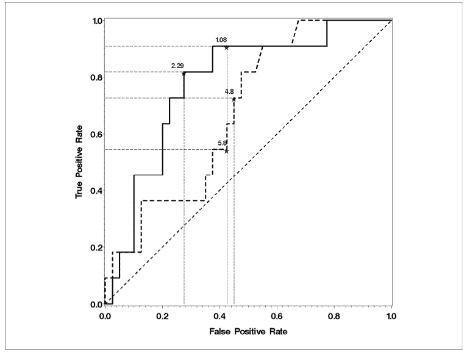
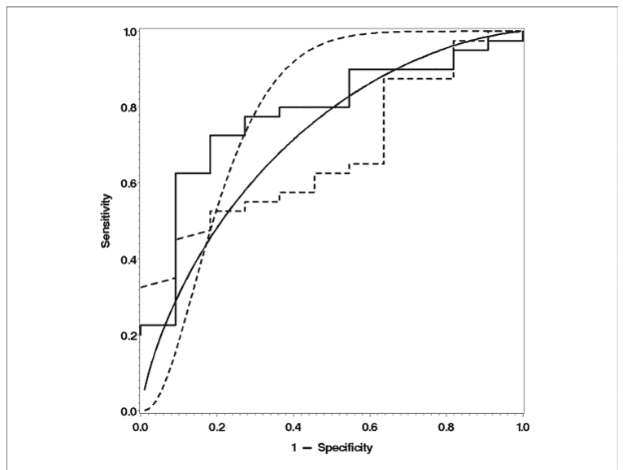

## ROC 曲线的比较与协变量调整

## 4.1 引言

在许多情况下，会有一组竞争性的预测方法可供选择，因此比较预测结果通常很有意义。例如，昂贵的侵入性检查或放射学扫描与简单的临床检查相比，在诊断某种疾病方面如何？或者，在已经拥有债务人简单财务摘要的情况下，花费大量成本获取详细的信用报告是否值得？增量的准确性提高是否能证明额外的成本合理？这里的成本一词使用较为宽泛；例如，对患者进行额外诊断扫描所带来的额外负担也被视为一种成本。当然，也需要考虑传统的成本：获取额外扫描的货币成本也需要纳入考虑。在决定这些成本是否合理之前，你需要评估预测准确性的提升。

比较竞争性预测因子的一种常见且简单的方法是为每个预测因子构建 ROC 曲线。这些 ROC 曲线的视觉比较通常会揭示几个有用的特征。此外，还可以对两条 ROC 曲线进行统计学显著性差异的比较。本章讨论了在统计上比较两条或多条 ROC 曲线的非参数和参数方法。

## 4.2 前列腺癌预后的一个例子

第 3 章使用了一个来自癌症诊断和监测的例子来介绍 ROC 曲线。本章使用一个来自癌症预后的例子来研究比较两条 ROC 曲线的方法。这次，数据来自患有骨转移的前列腺癌患者。传统上，这些患者会接受骨扫描，这是一种揭示骨骼异常的放射学检查。你可以计算一个汇总指标，称为骨扫描指数 ，它表示患者骨骼疾病的程度。一个竞争性的标志物是第 3 章中用于识别头颈部癌症的 PET 扫描中的 SUV。前列腺数据集包含 51 名患者的 BSI 和 SUV 测量值。感兴趣的结果是一年生存率——即在测量 BSI 和 SUV 后一年患者是否存活。每位患者至少随访一年并记录结果。40 名患者在一年时死亡，11 名存活。

本章在整个过程中使用此例子来比较 SUV 的 ROC 曲线与 BSI 的 ROC 曲线。但在进一步讨论之前，我们需要区分配对和非配对的数据收集机制，这是涉及 ROC 曲线比较的大多数数据集相关的重要问题。

## 4.3 配对与非配对比较

处理任何统计比较时，你需要区分非配对数据和配对数据。这里，非配对是指要比较的两组中的数据来自不同的抽样单元，而配对是指每个抽样单元恰好贡献了一对观测值：一个到每一组。

考虑随机临床试验评估筛查乳房X光检查的例子。女性被随机分配到标准护理，即定期临床检查，或乳房X光检查，即在标准护理基础上增加乳房X光检查。无论是否使用 ROC 曲线进行的比较，结果都是非配对的。研究中的每位女性要么在一个研究组，要么在另一个研究组。

现在，考虑另一项研究，评估手术前成像肿瘤的 PET。假设这方面的标准成像工具很可能是计算机断层扫描 。一种可能性是将患者随机分配接受 CT 或 PET，从而形成非配对比较。然而，比较两者的一种统计上更有效的方法是安排患者接受两次扫描，从而形成配对数据情况。

在传统统计学中，大多数比较涉及非配对数据而不是配对数据。例如，两样本 t 检验可能是应用最广泛的统计检验。其原因并非效率更高。事实上，对于固定的样本量，配对技术通常比非配对技术更有力。然而，实现配对设计更困难，有时甚至不可能。许多药物和干预措施的随机试验使用非配对设计，因为让受试者接受多种治疗或干预通常很困难，如果不是不可能的话。想象一下比较手术治疗与密切观察的试验，这是一种常见的选择，用于早期惰性肿瘤，如某些前列腺癌。患者不可能同时接受两种治疗。

配对比较在某些领域已成为首选设计，包括预测标志物的比较。所考虑的许多标志物可以应用于每个抽样单元，而不会带来太多负担、成本或不当后果。因此，本章重点介绍使用配对数据比较 ROC 曲线，尽管会提及非配对比较。

## 4.4 比较经验 ROC 曲线下的面积

除了配对与非配对数据的区别外，你还需要决定比较 ROC 曲线意味着什么。它可能是指比较整个曲线，也可能是指比较某些汇总指标，例如曲线下的面积。

处理经验 ROC 曲线时，通常的选择是比较汇总指标。替代方案，即比较整个曲线，在没有模型帮助的情况下是一项困难的任务。当然， caveat 是两个预测因子可能具有相同的 AUC 但非常不同的 ROC 曲线。因此，图形显示所比较的 ROC 曲线应始终伴随比较 AUC 的统计检验。

### 4.4.1 配对数据的比较

你可以以两种方式组织配对数据。最直观的方式是为每个受试者设置一行，为每个标志物设置一列，再加上结果的一列。等价的方式是为每个受试者-标志物组合设置一行，每个受试者产生两行。结果变量将在这两行中重复，并添加一个包含受试者标识符的额外列以跟踪配对。这两种数据结构分别称为宽格式和长格式，显然是指数据矩阵的形状。两者可以通过简单的 DATA 步指令相互转换。

第 3 章中用于获得 AUC 标准误估计的 %ROC 宏也可以用于比较两条 ROC 曲线，前提是数据是配对的。此宏中实现的方法本质上是非参数的。每个 AUC 均使用前一章中描述的一致性方法进行估计。一致性统计量是 U 统计量类中的一员。AUC 的方差及其之间的协方差可以使用 U 统计量理论的一般原理计算。有关更多信息，请参阅 DeLong 等人 1988 年的文献。

%ROC 宏期望数据采用宽格式。以下宏调用执行所需的比较：

```
%roc(data=bone, var=bsi suv1, response=gold, contrast=1 -1);
```

VAR 宏变量指定包含两个标志物值的变量名称。CONTRAST 宏变量期望的输入类似于 PROC GLM 中的 CONTRAST 语句，因此 1 -1 指的是 VAR 宏变量中所述两个变量的差值。


Output 4.1 显示了此调用的结果。每个 ROC 曲线的 AUC 估计值及其标准误差和（边际）置信区间首先出现。BSI 的 AUC 为 0.7795，与 SUV 的 0.6773 相比相当有利。然而标准误差相当大：BSI 为 0.0771，SUV 为 0.0836，导致置信区间很宽。BSI 的 AUC 的 95% 置信区间范围从 0.6284 到 0.9307。SUV 的置信区间在 0.5134 到 0.8412 之间。似乎 SUV 几乎无法与随机预测器区分开来（因为下限置信限仅略高于 0.50）。

## Output 4.1

```
The ROC Macro

    ROC Curve Areas and 95%
          Confidence Intervals
    ROC Area Std Error Confidence Limits

BSI    0.7795    0.0771    0.6284    0.9307
suv1   0.6773    0.0836    0.5134    0.8412

    Contrast Coefficients
            BSI       suv1

Row1       1        -1

        Tests and 95% Confidence Intervals for Contrast Rows
    Estimate  Std Error Confidence Limits     Chi-square Pr > ChiSq

Row1   0.1023    0.0954   -0.0847     0.2893      1.1491   0.2837

        Contrast Test Results
Chi-Square   DF      Pr > ChiSq

    1.1491    1      0.2837
```

接下来出现对比信息。这可用于验证结果是否针对预期比较，并推断差异的方向。在此示例中，AUC 曲线的正差异指向 BSI 是更好的检验。下一部分输出比较了两个 ROC 曲线。两个 AUC 的差异为 0.1023，如 Estimate 列下所示。这可以直接通过 0.7795 和 0.6773 之间的差值获得，即输出第一部分中报告的 BSI 和 SUV 的 AUC。然而，你不能根据单个面积的信息计算差异的标准误差，因为数据是配对的。基于此标准误差，两个 AUC 之间的差异不显著（p=0.2837），置信区间为（-0.0847，0.2893）跨越 0。

似乎检验统计量和 p 值被报告了两次。如果对比涉及多于一行，则对比行上的输出将为对比中的每一行包含一行。标记为“Contrast Test Results”的部分仍将报告一个具有 r−1 自由度的单一 p 值，其中 r 为行数。因此，只有在对比只有一行时，“Contrast Rows”部分和“Contrast Test”部分的信息才一致。

如本文所述，必须呈现 ROC 曲线的可视化显示以及 AUC 的比较。图 4.1 由第 3 章中介绍的 %PLOTROC 宏生成。语法修改与 %ROC 宏中的类似（即多个标记在 VAR 宏变量中指定，用空格分隔）。

```
%plotroc (bone bsi,suv,gold,anno=4,tlist1=1.08 2.29, tlist2=4.8 5.8);
```

## Figure 4.1 ROC Curves for BSI (Solid) and SUV (Dashed) Overlaid



图 4.1 显示 BSI 在特异性的大多数取值下比 SUV 具有更高的敏感性。在敏感性为 50% 至 80% 的范围内，BSI 的敏感性明显高于 SUV。BSI 的阈值为 2.29 可实现超过 80% 的敏感性和超过 70% 的特异性。SUV 的任何操作点都无法提供可比的准确性。尽管如此，请记住，显示的 AUC 估计具有较高的变异性，并且差异没有统计学意义。

### 4.4.2 Comparisons with Unpaired Data

从理论上讲，%ROC 宏只能在数据为配对时比较两个预测因子的 AUC。由于在 ROC 曲线领域中非配对设计非常罕见，没有宏执行所需比较。幸运的是，非配对比较可以通过手工或几行 DATA 步代码轻松完成：如果 AUC₁ 和 AUC₂ 是两个 AUC 估计值，其相关标准误差为 s₁ 和 s₂，则非配对比较的检验统计量如下：

T = (AUC₁ - AUC₂)² / (s₁² + s₂²)

在大样本中，在零假设下（即两个 AUC 确实相等时），T 将具有一个自由度的卡方分布。

请注意，AUC₁ 和 s₁ 是在仅对第一个预测因子执行 %ROC 宏时报告的，如第 3 章中所述。同样，AUC₂ 和 s₂ 是从第二次 %ROC 调用估计的。一旦计算出 T，两侧 p 值可使用 DATA 步中的以下行找到：

```
p_value=1-probchi(t_unpaired,1);
```

如果前列癌研究仅提供 PET 或 BSI（但不是两者），使得 resulting 数据结构为非配对，并且如果 AUC 估计值及其标准误差与之前所述相同（AUC 为 0.7795 和 0.6773，标准误差为 0.0771 和 0.0836），则 T 将为 0.8095，p 值为 0.3683。使用非配对设计 p 值增加可通过配对设计的有效性增加来解释，如第 4.3 节中简要讨论的那样。

## 4.5 Comparing the Binormal ROC Curves

第 3 章表明，你可以通过假设标记在患病组和未患病组的分布具有正态分布且参数可能不同来获得 ROC 曲线的模型化估计。具体而言，如果患病患者的标记值服从均值为 μ₁ 和方差为 σ₁² 的正态分布，并且未患病患者的标记值服从均值为 μ₀ 和方差为 σ₀² 的正态分布，则 ROC 曲线可函数写为

Φ(a + bΦ⁻¹(x))

AUC 给出为

Φ( a / √(1+b²) )

其中双正态参数 a 和 b 给出为

a = (μ₁ - μ₀)/σ₁,   b = σ₀/σ₁

接下来，我们详细讨论配对数据；关于非配对数据的评论出现在本节末尾。

### 4.5.1 Comparisons Based on the Binormal Model with Paired Data

数据的配对性质需要在继续之前对模型进行一些调整。设 Xᵢⱼ 表示第 i 个患者和第 j 个标记的标记值。然后 Xᵢⱼ（或其某种变换）假定在患者有阳性结果时具有以下正态分布：

Xᵢⱼ ~ N( μ₁ⱼ + uᵢ, σ₁ⱼ² )

如果患者有阴性结果，则 $X_{ij}$ 的分布为

$X_{ij} \sim N\left(\mu_{0j}+u_i,\sigma_{0j}^2\right)$

$u_i$ 也服从正态分布：

$u_i \sim N\left(0,\sigma_r^2\right)$

关键假设是 $u_i$ 和 $u_{i'}$ 对于 $i\neq i'$ 是独立的。

该模型为每个标记有四个基本参数：$\mu_{1i}$ 和 $\mu_{0i}$ 是标记 $j$ 的结果阳性和结果阴性患者的均值，$\sigma_{1i}$ 和 $\sigma_{0i}$ 是两个标准差。在这方面，它是每个标记单独的标准双正态模型。为了考虑同一受试者上两个标记测量之间的相关性，引入了随机效应 $u$。因为 $u_i$ 是受试者特异性效应，在同一患者上测量的两个标记值将具有相同的 $u_i$。这种共同性在同一受试者上进行的两个测量（每个标记一个）上诱导出相关性。因为 $u_i$ 和 $u_{i'}$ 对于 $i\neq i'$ 是独立的，所以在不同受试者上测量的标记值之间没有相关性。在大多数设置中使用随机效应来诱导受试者选定对上的相关性是一种标准技术。

以下代码段首先运行 PROC TRANSREG 以确定正态性变换。请参阅第 3.7 节，了解此步骤在拟合双正态模型中的作用的详细解释。

```
proc transreg data=bone;
    model boxcox(suv1/parameter=0.1 geometricmean)=class(gold);
    output out=trsuv;
run;

proc transreg data=bone;
    model boxcox(bsi/parameter=0.1 geometricmean)=class(gold);
    output out=trbsi;
run;
```

Box-Cox 模型确定对数变换对 BSI 和平方根变换对 SUV 是实现正态性的最佳可能变换（未显示详细的 PROC TRANSREG 输出）。输出数据集 TRSUV 和 TRBSI 由 PROC TRANSREG 中的 OUTPUT 语句创建，并包含变换后的协变量 TBSI 和 TSUV。这两个数据集合并形成 Long，即长格式的数据集。然后 PROC NLMIXED 找到如前所述的随机效应双正态模型的极大似然估计。

```
data long;
    set trbsi(keep=_name_ gold tbsi rename=(tbsi=result _name_=subid)
        in=in1)
        trsuv(keep=_name_ gold tsuv rename=(tsuv=result _name_=subid)
        in=in2);
    if in1 then marker=0; else if in2 then marker=1;
run;
```


```
proc nlmixed data=long method=firo technique=quanew;
    parms sr=1 s11=3 s10=0.3 s01=2 s00=0.2 m11=7 m10=1 m01=2 m00=0;
    bounds sr s11 s10 s01 s00>0;
    if gold=1 and marker=0 then do;
        m=m10+u; s=s10**2; end;
    if gold=1 and marker=1 then do;
        m=m11+u; s=s11**2; end;
    if gold=0 and marker=0 then do;
        m=m00+u; s=s00**2; end;
    if gold=0 and marker=1 then do;
        m=m01+u; s=s01**2; end;
    a1=(m11-m01)/s11;
    b1=s01/s11;
    a0=(m10-m00)/s10;
    b0=s00/s10;
    auc1=probnorm(a1/sqrt(1+b1**2));
    auc0=probnorm(a0/sqrt(1+b0**2));
    model result ~ normal(m,s);
    random u ~ normal(0,sr) subject=subid;
    estimate 'a1' a1;
    estimate 'b1' b1;
    estimate 'AUC1' auc1;
    estimate 'a0' a0;
    estimate 'b0' b0;
    estimate 'AUC0' auc0;
    estimate 'AUC1-AUC0' auc1-auc0;
    contrast 'AUC1-AUC0' auc1-auc0;
    contrast 'Equality of ROC curves' a1-a0, b1-b0;
run;
```

PROC NLMIXED 中对模型的根本描述与第 3.6 节中的描述相似，只是随机效应 u 有两个例外。RANDOM 语句将 u 声明为随机效应。对于熟悉 PROC MIXED 的人来说，RANDOM 语句具有类似的功能但语法不同。在 PROC MIXED 中，你不需要指定随机效应的分布，因为正态随机效应是唯一可用的选项。在 PROC NLMIXED 中，你必须指定随机效应的分布，因为 PROC NLMIXED 识别的任何内置分布都是一个选项。另一个区别是，在 PROC MIXED 中，指定 RANDOM 语句可确保随机效应被添加到模型中；在 PROC NLMIXED 中，你必须在编程语句中将项 u 添加到均值函数中。有关 PROC NLMIXED 的语法和功能简要介绍，请参阅附录。

除了随机效应的存在外，与第 3 章中的调用相比，此次对 PROC NLMIXED 的调用在其他几个方面也不同。例如，CONTRAST 语句提供了参数的联合检验。可以将其视为同时执行的多个 ESTIMATE 语句。为了说明这一点，注意

```
estimate 'AUC1-AUC0' auc1-auc0;
```

和

```
contrast 'AUC1-AUC0' auc1-auc0;
```

执行相同的检验（即 AUC 的相等性）。你通常会通过使用 ESTIMATE 语句来执行此操作；在此目的下包含 CONTRAST 语句仅用于演示。

在此处 CONTRAST 语句更重要的用途是检验两个 ROC 曲线的整体相等性。请注意，两个双正态 ROC 曲线只有在具有相同的双正态参数时才相同。因此，比较两个或多个双正态曲线的 a 和 b 提供了检验两条曲线是否相同的一种方法。这是通过以下 CONTRAST 语句实现的：

```
contrast 'Equality of ROC curves' a1-a0, b1-b0;
```

它检验原假设

H₀ : a₀ = a₁  &  b₀ = b₁

相对于备择假设，即至少有一个双正态参数不同。请注意，不可能使用 ESTIMATE 语句表达这一点。

## 输出 4.2

参数估计
Parameter | Estimate | Standard Error | DF | t Value | Pr > |t| | Alpha | Lower | Upper
sr | 2.5830 | 42.7645 | 101 | 0.06 | 0.9520 | 0.05 | -82.2504 | 87.4163
s11 | 1.2701 | 16.8601 | 101 | 0.08 | 0.9401 | 0.05 | -32.1758 | 34.7159
s10 | 1.3251 | 16.1371 | 101 | 0.08 | 0.9347 | 0.05 | -30.6866 | 33.3368
s01 | 2.8855 | 7.4207 | 101 | 0.39 | 0.6982 | 0.05 | -11.8353 | 17.6062
s00 | 1.8913 | 11.3087 | 101 | 0.17 | 0.8675 | 0.05 | -20.5422 | 24.3248
m11 | 4.8146 | 0.6176 | 101 | 7.80 | <.0001 | 0.05 | 3.5894 | 6.0398
m10 | 2.3499 | 0.6280 | 101 | 3.74 | 0.0003 | 0.05 | 1.1040 | 3.5958
m01 | 2.3526 | 0.5222 | 101 | 4.50 | <.0001 | 0.05 | 1.3166 | 3.3885
m00 | -0.1234 | 0.3924 | 101 | -0.31 | 0.7538 | 0.05 | -0.9019 | 0.6551

对比
Label | Num DF | Den DF | F Value | Pr > F
AUC1-AUC0 | 1 | 101 | 0.01 | 0.9369
Equality of ROC curves | 2 | 101 | 0.00 | 0.9963

附加估计
Label | Estimate | Standard Error | DF | t Value | Pr > |t| | Alpha | Lower | Upper
a1 | 1.9385 | 25.7415 | 101 | 0.08 | 0.9401 | 0.05 | -49.1258 | 53.0028
b1 | 2.2719 | 24.3351 | 101 | 0.09 | 0.9258 | 0.05 | -46.0023 | 50.5462
AUC1 | 0.7826 | 0.9919 | 101 | 0.79 | 0.4320 | 0.05 | -1.1850 | 2.7502
a0 | 1.8665 | 22.7369 | 101 | 0.08 | 0.9347 | 0.05 | -43.2374 | 46.9704
b0 | 1.4273 | 8.8715 | 101 | 0.16 | 0.8725 | 0.05 | -16.1713 | 19.0259
AUC0 | 0.8579 | 1.9318 | 101 | 0.44 | 0.6579 | 0.05 | -2.9742 | 4.690
AUC1-AUC0 | -0.07534 | 0.9492 | 101 | -0.08 | 0.9369 | 0.05 | -1.9583 | 1.8076

输出的参数估计部分给出了模型参数的估计，在这里用处不大。ROC 分析更有趣的部分是附加估计部分，它提供了 ESTIMATE 语句结果的信息，包括 BSI 的双正态参数（$a_0$ 和 $b_0$）和 SUV（$a_1$ 和 $b_1$）。该部分还报告了每个标记的隐含 AUC（$AUC_1$ 和 $AUC_0$）以及两个 AUC 之间的差异。我们看到 AUC 被估计为 SUV 为 0.7825，BSI 为 0.8579。它们的差异为 0.0753，且不显著，$p$=0.9369。

两个对比在对比部分报告。第一个是两个 AUC 之间的差异，仅在此重复以突出 ESTIMATE 和 CONTRAST 语句之间的相似性。该对比具有与 ESTIMATE 语句相同的 $p$ 值（理应如此），但使用的是 $F$ 统计量而非 $t$ 统计量。如果你熟悉方差分析，你会记得分子自由度为 1 的 $F$ 统计量与相应的 $t$ 统计量的平方相同。这里的原理也适用，尽管从此输出中很难看出，因为检验统计量的绝对值非常小。尽管如此，请注意 $t$=-0.08，其平方约为 0.01，四舍五入到小数点后两位。

真正感兴趣的对比是双正态参数相等性的联合检验。结果强烈表明，没有证据反对等 ROC 曲线假设（$p$=0.99）。

### 4.5.2 基于双正态模型且数据非配对的比较

如第 4.5.1 节所述，随机效应 $u$ 仅引入到双正态模型中以解释受试者内相关性。在非配对设计中，受试者内相关性按定义为 0。这提示了一种修改上一节代码的简单方法：移除 $u$。这相当于移除 RANDOM 语句并清理编程语句中 $m$ 的定义方式。

## 4.6 双正态与经验 ROC 曲线之间的差异

双正态模型和经验模型得出不同结论的情况并不少见。它们之间的差异类似于秩检验和 $t$ 检验之间的差异。如果双正态模型的基础假设成立，则双正态模型具有更高的功效，这可能解释了显著的结果。另一方面，如果模型假设不成立，则 I 类错误可能被夸大，这表现为假阳性结果增加。虽然不可能确定哪一个是驱动因素，但 PROC NLMIXED 的输出的某些特征以及如图 4.2 所示的探索性图形分析，仍然是检验双正态性假设的最佳方式。

图 4.2 叠加了经验和双正态 ROC 曲线，后者由 PROC NLMIXED 估计。实线表示 BSI，虚线表示 SUV。阶梯函数表示经验 ROC 曲线，而平滑曲线来自双正态模型。两个双正态曲线对经验曲线的拟合都很差。这也解释了 AUC 估计之间的差异。对于 BSI，经验 AUC 为 78%，而双正态 AUC 为 85%，对于 SUV，对应的估计值分别为 68% 和 78%。

## 图 4.2 前列腺癌数据的 ROC 曲线比较



拟合不良的另一个迹象是模型参数变异性的估计值异常大。a 和 b 的估计值看起来正常，但标准误差比模型参数大 10 到 20 倍。虽然在估计值接近 0 时可能会发生这种情况，但该模型中的估计值并不接近 0。

请注意，尽管双正态模型非常流行，但它们做出了一些强有力的假设。双正态 ROC 曲线不再基于秩；每个观测值都会对双正态斜率和截距的估计做出贡献。正态性的偏差可能会对估计曲线产生不当影响，并对统计推断产生后果。一般来说，使用双正态模型比较 ROC 曲线几乎没有理由，因为基于经验曲线的<|message|> 方法是高效的并且已在 SAS 中实现。

然而，你应该将双正态模型保留在你的工具箱中。当连续协变量可能影响标记的预测准确性时，就无法再使用经验 ROC 方法。你必须使用基于模型的技术，而双正态模型（以及后续章节中介绍的 Lehmann 家族）提供了一个全面的框架来得出推断。


## 4.7 经验 ROC 曲线下面积差异的 Bootstrap 置信区间

第 3 章中发展的 bootstrap 思想可以扩展以获得 AUC 差异的置信区间，以及检验差异是否显著的 p 值。策略与以下类似：

- 生成 B 个 bootstrap 样本。
- 对于每个样本 i，计算两个 ROC 曲线的 AUC，AUC0^(i) 和 AUC1^(i)，并计算差异 Δ^(i) = AUC0^(i) − AUC1^(i)。
- B 个数值，Δ^(1) 到 Δ^(B)，近似了两个 AUC 之间差异的抽样分布。

这可以通过使用 %BOOT2AUC 宏来实现，该宏可从本书的配套网站 support.sas.com/gonen 获得。%BOOT2AUC 宏与第 3.9 节中介绍的 %BOOT1AUC 宏类似。唯一的区别是它允许为 VAR 宏变量指定两个变量名。例如，以下调用请求比较 SUV 和 BSI：

```
%boot2auc(HeadNeck,suv bsi,ngold);
```

结果出现在输出 4.3 中。

### 输出 4.3

| AUC1 | SE | AUC2 | SE | Difference | SE |
|---|---|---|---|---|---|
| 0.761397 | 0.080334 | 0.674859 | 0.080334 | 0.086573 | 0.123361 |

95% Confidence Interval for Difference

| LowerLimit | UpperLimit |
|---|---|
| -0.24815 | 0.280488 |

H0: Difference=0
p=0.341

输出的第一部分报告了单个 AUC 的点估计值和标准误差，以及它们的差异。AUC 及其标准误差按宏调用中指定的顺序呈现并标记。BSI 的 bootstrap 估计 AUC 为 0.761，SUV 为 0.675。差异为 0.087，在临床上相当可观，但在统计上不显著，p=0.341，置信区间为 (−0.248, 0.280)，包含 0。

## 4.8 ROC 曲线的协变量调整

在某些情况下，协变量会影响预测的准确性。在这种情况下，你需要对这些协变量进行 ROC 曲线的调整。例如，在天气预报的背景下，产生预报的同一模型可能根据预报地点的地理位置的海拔高度而具有不同的准确性。在医学诊断领域，某些患者方面的因素，例如对治疗的既往暴露，可能影响诊断工具准确识别其当前医疗状况的能力。最后，在信用评分领域，相同的评分方法在不同国家可能表现不同，也许是由于对财务结果报告方式的不同法律要求。

区分协变量是结果的预测因子与协变量是结果的危险因素非常重要。为了使这种区别具体化，请考虑医学诊断领域的例子。淋巴瘤是淋巴结的癌症。恶性结节通常会增大，因此淋巴结的大小可以很好地预测淋巴瘤。然而，恶性并不是淋巴结增大的唯一原因。淋巴结在患者对抗感染时也会增大。因此，淋巴结的大小可能在最近未感染的患者中是一个很好的预测因子，但在患者最近感染过时则是一个较差的预测因子。另一方面，是否最近感染并不是淋巴瘤的良好预测因子。因此，最近感染是一个可能影响 ROC 曲线的协变量，但不是一个可用于预测癌症存在的协变量，无论是单独使用还是与其他预测因子结合使用。

相比之下，淋巴瘤（或也许任何癌症）的家族史会使患者患癌症的可能性更大，因为某些癌症是遗传的。这可以正式或非正式地纳入诊断。患者是否有癌症家族史通常不会影响淋巴结增大是否能很好地预测癌症。因此，癌症家族史不是调整 ROC 曲线的候选因素。

在最简单的形式中，对于分类协变量，调整意味着为协变量的每个取值估计单独的 ROC 曲线。对于连续协变量，你可以设想无限多个 ROC 曲线，每个可能的协变量值对应一个。这需要使用一个模型来假设协变量与 ROC 曲线参数之间的关系。毫不奇怪，主要的此类模型是回归。下一节将研究第 3 章研究的双正态模型如何被表述为回归模型。

## 4.9 双正态 ROC 曲线的回归模型

最简单的回归模型不包含任何协变量。它在实践中不是一个有用的模型，但有助于构建概念。在 ROC 曲线的背景下，如果 T 表示标记，D 表示疾病状态（金标准），则可以写成

T = α₀ + α₁ D + e^{2 D β} ε

其中 ε 具有均值为 0、方差为 σ₀² 的正态分布。经过一些代数运算，可以证明

a = α₁ / (e^{β} σ₀²),   b = e^{β}

记住，变量 D 的系数表示标记在 D=1 和 D=0 时均值的差异。这对任何线性模型都成立，并且将在后续章节中用于从更复杂的模型中提取与 ROC 曲线相关的信息。

该模型不能使用 SAS/STAT 软件中的标准线性模型程序（如 GLM 或 REG）拟合。然而，它可以用 PROC MIXED 拟合，正如我们在第 3 章中看到的那样，也可以用 PROC NLMIXED 拟合。PROC MIXED 语法更容易，因为它遵循大多数 SAS/STAT 程序的总体结构。另一方面，PROC NLMIXED 可以推广到有序标记的情况，正如我们在第 5 章中将看到的那样，因此采用 PROC NLMIXED 作为建模 ROC 曲线的 SAS/STAT 程序的主要选择是有价值的。

现在我们可以联合建模协变量。首先考虑一个二元标记 W：

```
T = α₀ + α₁D + α₂W + e^{2β} ε
```

这意味着

```
T = { α₀ + α₁D + e^{2Dβ} ε,   W = 0
      α₀ + α₂ + α₁D + e^{2Dβ} ε,   W = 1 }
```

这两个方程构成了模型所暗示的两个标记的 ROC 曲线的基础。请注意，D 的系数对两个 ROC 曲线都是相同的。事实上，这两个方程仅在截距上不同。因此，所暗示的双正态参数 a 和 b 相同。

你可以得出结论，仅将协变量作为主效应加入不会导致对两个 ROC 曲线进行单独建模。

现在考虑以下内容：

```
T = α₀ + α₁D + α₂W + α₃DW + e^{2βD} ε
```

这会产生 W=0 和 W=1 的以下子模型：

```
T = { α₀ + α₁D + e^{2βD} ε,          W = 0
      (α₀ + α₂) + (α₁ + α₃)D + e^{2βD} ε,   W = 1 }
```

这两个子模型生成两个不同的 ROC 曲线，因为 D 的系数相差 α₃。

特别对于 W=0

```
a = α₁ / (e^{β} σ₀²),   b = e^{β}
```

对于 W=1

```
a = (α₁ + α₃) / (e^{β} σ₀²),   b = e^{β}
```

注意，如果 α₃=0，则两个标记的 ROC 曲线相同。

原则上，该模型可以容纳在两个标记上收集的数据。你可以为任何标记创建一个二元变量，然后将其用作 W 的替代来进行比较。通常，标记比较与协变量调整之间存在两个实际差异：

- 标记比较通常涉及配对数据（如上一章解释的那样），而协变量调整涉及非配对数据。
- 标记比较通常使用 *异方差* 模型（允许由结果定义的两个组内方差不同），而协变量调整通常采用 *同方差* 模型（假设由结果定义的两个组内方差相等）。
