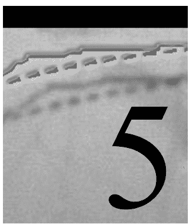
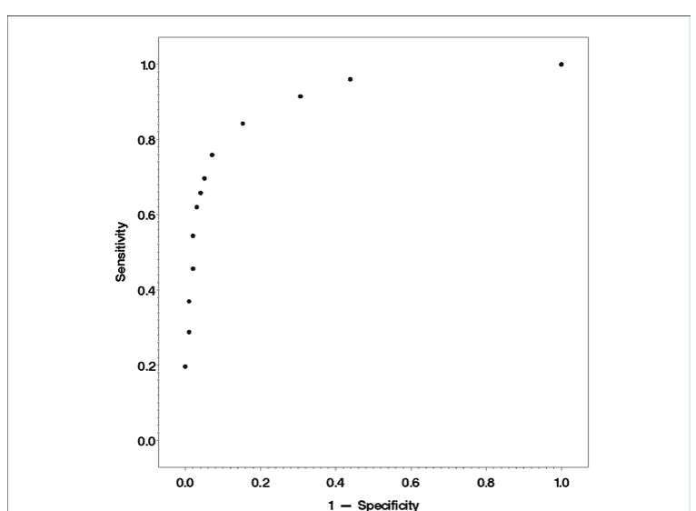
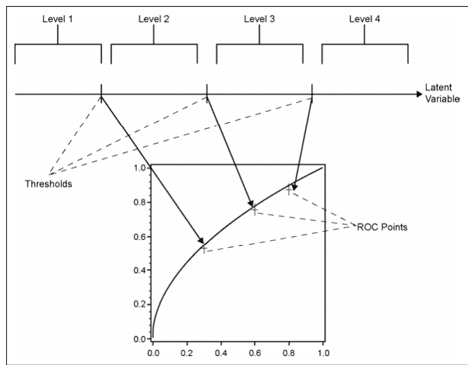
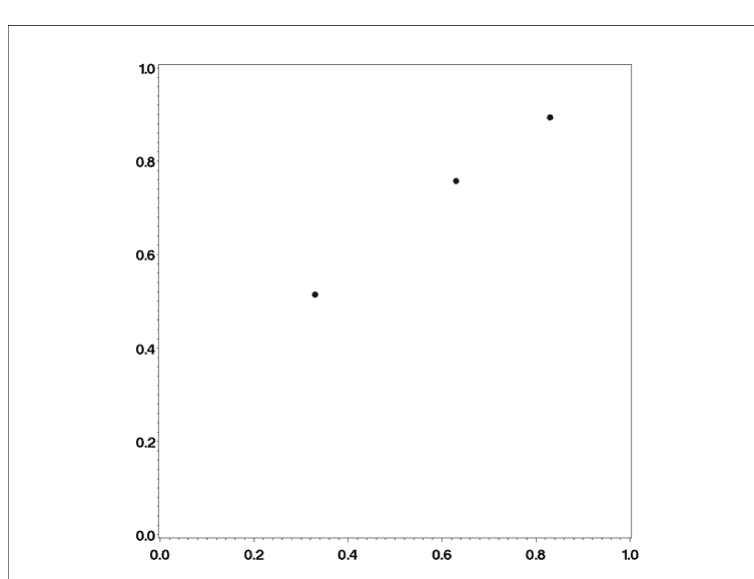
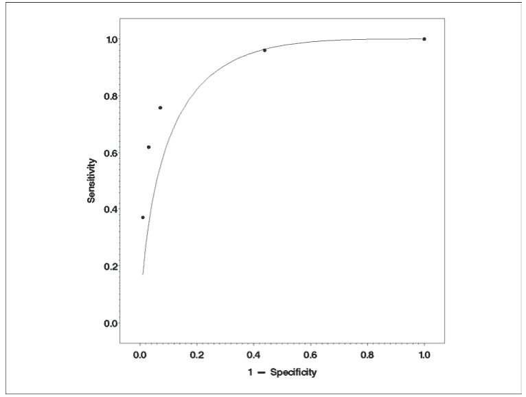

## 有序预测因子



- 5.1 Introduction ......................................................... 53
- 5.2 Credit Rating Example................................................... 54
- 5.3 Empirical ROC Curve for Ordinal Predictors............................... 54
- 5.4 Area under the Empirical ROC Curve ..................................... 56
- 5.5 Latent Variable Model .................................................. 57
- 5.6 Comparing ROC Curves for Ordinal Markers ............................... 63

## 5.1 引言

第 3 章讨论了单一连续预测因子，这可能是 ROC 曲线最自然、最常见的设定。尽管如此，ROC 曲线的思想同样适用于有序预测因子。本章研究如何将前一章的技术扩展以适应有序预测因子。

有序预测因子可以通过多种方式产生。有时，它们只是底层连续预测因子分类的结果。虽然这可能导致信息损失，从而降低预测准确性，但拥有简单且易于传达的预测因子的收益可能抵消这些损失。降雨预报可能提供一个例子。有时它们报告为低-中-高，其他时候则以 10% 的增量报告。无论使用何种术语报告分类预测因子，数据分析都可以使用预测因子作为有序变量进行。

有序预测也可能通过专家意见产生。大多数主观意见难以量化，但提供按其概率排序的几个情景相对容易——实际上是报告有序预测。例子可以在几乎任何领域找到，例如医学（诊断放射科医生报告其对疾病机会或严重程度的评估）、商业（顾问对消费者偏好可能性的看法）或金融（股票选择，报告为买入、持有或卖出）。


从 ROC 曲线的角度来看，连续预测因子和有序预测因子之间存在二元性。经验曲线和双正态模型都可以容纳有序预测因子，要么直接使用，要么经过一些修改。第 5.3 节和第 5.4 节提供了详细信息。

## 5.2 信用评级示例

考虑以下由 Güttler（2005）收集并发表的数据集，该数据集涉及世界上两家最著名的信用评估机构——穆迪和标准普尔的评分系统表现。表 5.1 报告了穆迪评级的数据，穆迪评级使用 17 个有序等级，从 Aaa（最有利评级）到 C（最不利评级）。Rating 行列出了这 17 个评级，Default 行包含研究随访期间违约的公司数量，而 Total 行则列出了同一时期获得特定信用评级的公司总数。本例的目的是评估穆迪评级作为违约可能性预测因子的准确性。对于从 Aaa 到 C 的 17 个评级中的每一个，都提供了样本中的总数以及该总数中违约的数量。

### 表 5.1 穆迪评级

| Rating | Aaa | Aa1 | Aa2 | A1 | A2 | A3 | A3- | Baa1 | Baa2 |
| Default | 0 | 0 | 0 | 0 | 0 | 1 | 0 | 1 | 0 |
| Total | 49 | 47 | 120 | 164 | 163 | 254 | 226 | 238 | 242 |
| Rating | Baa3 | Ba1 | Ba2 | Ba3 | B1 | B2 | B3 | C |  |
| Default | 1 | 1 | 1 | 2 | 8 | 15 | 13 | 55 |  |
| Total | 212 | 105 | 108 | 175 | 238 | 215 | 139 | 164 |  |

请注意，表 5.1 包含了所有数据。对于有序预测因子，你可以用近 3,000 个观测值完整地展示一个数据集，因为空间需求更多取决于类别的数量，而非实际样本量。这与连续数据形成对比，连续数据的原始数据通常由于空间限制而未被报告。

## 5.3 有序预测因子的经验 ROC 曲线

有序预测因子的经验 ROC 曲线建立在与连续预测因子的经验 ROC 曲线相同的原理上。事实上，由于经验 ROC 曲线仅基于数据的秩，因此预测因子是有序还是连续的，对 ROC 曲线的构建方式没有影响。因此，第 3 章的方法可用于构建和比较具有有序预测因子的经验 ROC 曲线。

简要回顾一下，使用有序预测因子的每个不同观测值作为可能阈值，你可以计算由此产生的二元预测因子的敏感性和特异性。对每个阈值绘制敏感性与 1 减去特异性的散点图就构成了 ROC 点。请注意，以下代码与第 3 章中用于连续预测因子的程序完全相同：

```
proc logistic data=moody;
    model default=moody / outroc=rocdata;
run;

axis1 length=12cm order=0 to 1 by 0.2 label=(f=swissb h=2)
value=(font=swissb h=2) offset=(.5 .5)cm;
axis2 length=12cm order=0 to 1 by 0.2 label=(a=90 f=swissb h=2)
value=(font=swissb h=2) offset=(.5 .5)cm;

symbol1 v=none i=join c=black;

proc gplot data=rocdata;
    plot _sensit_*_1mspec_ / haxis=axis1 vaxis=axis2;
run;
quit;
```

### 图 5.1 穆迪评级数据的 ROC 点



图 5.1 包含使用 PROC LOGISTIC 获得的穆迪评级的 ROC 点。请注意，对于此工作，变量 moody 必须是数值型。另请注意 AXIS 语句的 OFFSET= 选项的使用，用于在两个轴的两侧打印一些空白以改善显示效果。另请注意，没有一家获得前五个评级（AAA 至 A2）的公司违约，因此这五个评级都由右上角的同一点表示（100% 敏感性和 100% 特异性）。

特意使用术语 ROC 点。图 5.1 没有 ROC 曲线，只有每一点都是穆迪评级的可行操作点。可以连接这些点，就像我们对连续预测因子所做的那样，最终得到 ROC 曲线。你可以争辩说，由于有序预测因子的定义，未观察到的中间阈值是不可能的，因此由此产生的曲线没有意义。想象一下在图 5.1 中连接这些点。穆迪评分在 B2 和 C 之间没有分数，因此图中连接两个最左点线段上的点代表不存在的阈值的操作特征（即敏感性和特异性）。反驳意见认为，大多数有序量表的等级是任意定义的，可以更改。如果有序预测是通过对连续预测因子进行分类获得的，那么就可以明确地重新审视阈值。在主观意见的情况下，可以要求专家通过使用更多等级的量表来完善他们的预测。在我们的例子中，穆迪可能会在检查图 5.1 后决定 Aa1 和 Aa2 之间（从右数第二个和第三个点）的差距太宽。这可以通过在这两个之间引入新的阈值来解决。

连接点还有一个实际后果：它使得可以明确地定义有序预测因子的曲线下面积。因此，我建议对有序预测因子使用 ROC 曲线而不是 ROC 点。

## 5.4 经验 ROC 曲线下面积

经验 ROC 曲线下面积的计算使用梯形法则，与对连续标记的处理方式相同。%ROC 宏可用于此目的，因为经验 ROC 曲线及其下面积是基于秩的函数。宏调用与第 3 章中使用的完全相同：

```
%roc(data=moody,var=moody,response=def,contrast=1);
```

熟悉的 %ROC 输出（见输出 5.1）显示 AUC 为 0.915，95% 置信区间范围为 0.891 至 0.940。

### 输出 5.1

```
The ROC Macro

ROC Curve Areas and 95%
Confidence Intervals
ROC Area Std Error Confidence Limits
moody 0.9153 0.0124 0.8909 0.9397
```

与使用 %ROC 宏类似，你可以使用 %BOOT1AUC 宏来计算曲线下面积的基于自助法的估计值和标准误差。输出 5.2 显示了自助法的结果，与 %ROC 宏产生的结果相似。

### 输出 5.2

```
Bootstrap Analysis of the AUC for moody

    AUC    StdErr
    -----------
0.913584  0.012242

95% Confidence Interval

    LowerLimit    UpperLimit
    -----------
    0.888271      0.935495
```

## 5.5 潜变量模型

与连续预测因子一样，经验 ROC 曲线假设最少，但不易扩展以进行协变量调整。在第 3 章中，我们开发了双正态模型，并在第 4 章中演示了其在协变量调整中的应用。

也可以为有序预测因子开发双正态模型。想象一下，你从一个连续预测因子开始，但决定对其进行分类并仅报告有序预测因子，例如无、低、中和高（就像某些降雨预报那样）。预报的消费者只能观察到有序值。尽管这些连续预测，即潜变量，仍然未被观察到，但在每个有序值处的敏感性和特异性代表了潜变量的 ROC 曲线上的点。基本思想在图 5.2 中给出。

### 图 5.2 有序预测因子的三个 ROC 点



图的上部水平线代表潜变量的连续体。潜变量轴上的三个哈希标记表示与观察到的有序预测因子相对应的阈值。下部的实线是潜变量的 ROC 曲线，曲线上的哈希标记是 ROC 点。重要的是，有序变量的 ROC 点位于潜变量的 ROC 曲线上。

现在查看图 5.3，其中仅包含 ROC 点。在不知道或假设潜变量的某些特征的情况下，你无法仅使用 ROC 点来估计潜变量的 ROC 曲线。连接这些点不太可能代表潜变量的真实 ROC 曲线，因为真实的 ROC 曲线更可能是平滑的。你需要使用有关潜变量的信息在 ROC 点之间进行插值。当然，潜变量是不可观察的，因此你只能做出假设。


## 图 5.3 图 5.2 中同一序数预测变量的 ROC 点



最常见的假设是潜变量服从正态分布。这就产生了所谓的*潜二元正态模型*。目前，我们将潜二元正态模型与第 3 章中的模型区分开来。潜二元正态模型假设当 D=1 时，潜变量服从均值为 μ₁、方差为 σ₁² 的正态分布；当 D=0 时，服从均值为 μ₀、方差为 σ₀² 的正态分布。利用序数标记的观测频率（如表 5.1 中的）无法同时估计 μ₀、σ₀²、μ₁ 和 σ₁²。这四个参数存在多组（事实上无限多）组合可以产生相同的观测数据，且无法区分它们。然而，如果我们通过固定 μ₀ 和 σ₀² 来锚定其中一个正态分布，则可以估计 μ₁ 和 σ₁²。为简化起见，假设我们选择 μ₀=0 σ₀²=1 并得到 μ₁ 和 σ₁² 的估计值，记为 μ̂ 和 σ̂²。若我们设 μ₀=m σ₀²=s，则 μ₁ 和 σ₁² 的估计值将变为 μ̂ + m 和 s σ̂²。这可以证明，因为正态分布是所谓的*位置-尺度族*的成员。其含义是，在不失一般性的情况下，我们始终可以使用标准正态作为锚点，并将由此得到的估计值视为两个均值的差和两个方差的比。

这些考虑导致了 ROC 曲线专用序数回归模型的开发，最初由 Tosteson 和 Begg（1988）提出。在该模型中，D 是金标准的指示变量，即 D=0 或 D=1。潜变量 X 服从均值为 αD、方差为 e^{2βD} 的正态分布。这相当于假设 D=0 时为标准正态，而 D=1 时可能为不同的正态密度。因此，X 的这种表示与前面描述的潜二元正态模型一致。

假设 $R$ 是具有 $k$ 个水平的序数预测变量，由对 $X$ 应用阈值 $\theta_1..., \theta_k$ 产生。则 $R$ 等于 $k$ 的概率由下式给出：

$P(R=k)=P(\theta_{k-1}<X\le\theta_k)$
$=\Phi\left(\frac{\theta_k-\alpha D}{e^{\beta D}}\right)-\Phi\left(\frac{\theta_{k-1}-\alpha D}{e^{\beta D}}\right)$

我们在第 3 章中看到 ROC 曲线与累积分布密切相关。因此，使用 $\gamma_k(D)=P(R\le k)$ 而不是 $P(R=k)$ 得到以下 probit 回归模型：

$\gamma_k(D)=\Phi\left(\frac{\theta_k-\alpha D}{e^{\beta D}}\right)$

注意 $1-\gamma_k(D)$ 是标记超过阈值的概率，因而预测 D=1。这代表 D=1 时的灵敏度，以及 D=0 时的 1 减特异度。因此，对所有 $k$ 作出 $1-\gamma_k(0)$ 与 $1-\gamma_k(1)$ 的图即得到潜变量的 ROC 曲线。由此得到的平滑曲线，类似于连续预测变量的情况，为

$y=\Phi\left(\alpha+e^{-\beta}\Phi^{-1}(x)\right)$

其中 $x$ 为 1 减特异度，$y$ 为灵敏度。在该模型下，曲线下面积为

$A=\Phi\left(\frac{\alpha}{\sqrt{1+e^{-2\beta}}}\right)$

设 $a=\alpha$ 且 $b=e^{-\beta}$，你可以看到 AUC 的公式等价于单个连续预测变量的情况。这并不令人惊讶，因为我们在第 5.2 节和第 5.3 节中持续观察到连续预测变量与序数预测变量之间存在强烈的对偶性。

我们将此称为*序数-probit 回归模型*。其他序数回归模型可以通过假设潜变量服从不同的分布而得到，在这种情况下，推导中的 probit 链接将被所选分布的累积分布函数所取代。实际上，在潜模型设定中，使用其他分布的情况非常罕见。

熟悉 LOGISTIC、GENMOD 和 PROBIT 过程功能的人可能会错误地得出结论，这些过程可以作为序数预测变量分析的主要工具。事实上，这三个过程不足以容纳参数 $\beta$。只有在你愿意预先将 $\beta$ 固定为 1 仅估计 $\alpha$ 时才使用它们。这些过程被开发用于估计一类称为*广义线性模型*的模型，而这里定义的序数-probit 回归模型当且仅当 $\beta$=1 时才属于该族。因此，要以前面所述的完全一般性拟合序数 probit 模型，你需要使用 PROC NLMIXED 的功能。

我们将以穆迪的数据为例。注意，前五个类别（Aaa 至 A2）没有观察到的违约，因此灵敏度和特异度相同。用本章的语言来说，γ_k(0) 和 γ_k(1) 对 k=1,…,5 相同。因此，我们无法估计任何四个阈值（θ_1、θ_2、θ_3、θ_4），因为在假设的潜变量分布中从 −∞ 到 θ_5 之间的任意点都与我们的数据一致。为了使序数回归能够处理所有模型参数，我们需要合并一些类别。表 5.2 中的合并是为本次分析选择的。

## 表 5.2 穆迪评级数据的合并版本

| Rating | A | Baa | Ba | B | C |
|---|---|---|---|---|---|
| Default | 1 | 2 | 4 | 36 | 55 |
| Total | 1023 | 692 | 388 | 592 | 164 |

在合并版本中，A 代表 Aaa 至 A3-，Baa 代表 Baa1 至 Baa3，Ba 代表 Ba1 至 Ba3，B 代表 B1 至 B3。C 未与其他类别合并。

在继续拟合该模型之前，重要的是要强调潜变量是不可观测的，因此只能估计阈值的相对位置。换句话说，具有不同绝对值但相对位置相同（即它们之间的距离相同）的两组阈值将具有相同的似然。因此我们需要任意固定其中一个阈值，以便估计其他阈值。以下 PROC NLMIXED 代码假设第一个阈值为 0 并将前述序数-probit 回归模型拟合到合并版本的信用评级数据。

```
proc nlmixed data=moody gconv=0;
  parms alpha=1 theta1=1 theta2=2 theta3=3 beta=1;
  bounds theta1>0, theta2>0, theta3>0;
  eta1=alpha*default;
  eta2=exp(beta*default);
    if rating=1 then z = probnorm(-eta1/eta2);
  else if rating=2 then z = probnorm((theta1-eta1)/eta2)
                        probnorm(-eta1/eta2);
  else if rating=3 then z = probnorm((theta2+theta1-eta1)/eta2)
                        - probnorm((theta1-eta1)/eta2);
  else if rating=4 then z = probnorm((theta3+theta2+theta1-eta1)/eta2)
                        - probnorm((theta2+theta1-eta1)/eta2);
  else if rating=5 then z = 1 - probnorm((theta3+theta2+theta1-eta1)/eta2);
  if z>1e-6 then ll=log(z);
  else ll=-1e6;
  model rating ~ general(ll);
  estimate 'AUC' probnorm(alpha/sqrt(1+beta**2));
run;
```

如果不熟悉语法或输出，附录中关于 PROC NLMIXED 的简短介绍可能会有所帮助。输出 5.3 显示了结果。

## 输出 5.3

Parameter Estimates
Parameter Estimate Standard Error DF t Value Pr > |t| Alpha Lower Upper
alpha 1.9898 0.1157 2859 17.21 <.0001 0.05 1.7631 2.2166
theta1 0.5192 0.01679 2859 30.92 <.0001 0.05 0.4863 0.5521
theta2 0.3533 0.01667 2859 21.19 <.0001 0.05 0.3206 0.3860
theta3 0.9907 0.03948 2859 25.10 <.0001 0.05 0.9133 1.0681
beta -0.2368 0.1336 2859 -1.77 0.0764 0.05 -0.4987 0.02517

Parameter Estimates
Parameter Gradient
alpha 9.587E-7
theta1 0.000012
theta2 -2.58E-6
theta3 -3.04E-6
beta -8.23E-6

Additional Estimates
Label Estimate Standard Error DF t Value Pr > |t| Alpha Lower Upper
AUC 0.9736 0.009248 2859 105.27 <.0001 0.05 0.9555 0.9917

只要模型拟合过程收敛，迭代历史和梯度对我们来说就没用。最相关的模型参数估计值可在参数估计输出部分找到，其中 α̂ = 1.99 且 β̂ = −0.24。如第 3 章所述，ESTIMATE 语句是 PROC NLMIXED 的一个特别方便的功能；它可以计算模型参数任何一对一函数的估计值及其标准误。利用此功能，我们估计 AUC 为 97%，标准误为 0.9%，95% 置信区间为 95.6% 至 99.2%。从各方面来看，穆迪的评级都是违约的优秀预测因子。

虽然没有直接用处，但该模型也估计了三个阈值。它们估计值（在参数估计部分标记为 theta1、theta2 和 theta3）为 0、0.5192、0.5192+0.3533=0.8725 和 0.8725+0.9907=1.8632。记住潜变量对 D=0 为标准正态，对 D=1 为均值 1.99（α̂）且方差 0.62（e^{2β̂}）的正态分布，我们可以精确计算序数预测变量每个水平的预期比例。

或者，我们可以通过简单地代入 α 和 β 的估计值来计算 AUC 的估计值，但标准误的计算需要使用泰勒近似进行一些分析推导。

所得 ROC 点以图 5.4 中的黑色点给出，并叠加了二元正态模型的平滑线。拟合在高阈值（低灵敏度）时非常好，但在较高阈值时与经验曲线存在一些偏差。


### 图 5.4 潜变量双正态模型隐含的 ROC 曲线



## 5.6 有序标记 ROC 曲线的比较

比较有序 ROC 曲线可以基于经验曲线或潜变量双正态模型。%ROC 宏可用于比较两条经验 ROC 曲线下的面积。或者，潜变量双正态模型可用于比较两个潜变量双正态曲线的参数。

### 5.6.1 转移性结直肠癌示例

结肠和直肠中的一些肿瘤会扩散到肝脏，在这种情况下称为转移性结直肠癌。如果扩散仅限于肝脏，则可以手术切除。但如果存在其他转移部位，则肝脏手术不合适。因此，所有接受肝脏手术的转移性结直肠癌患者都会被仔细筛查肝外肿瘤。本节中的示例比较了两种不同的肝外成像方法：计算机断层扫描（CT）和正电子发射断层扫描（PET）。每位患者都接受了两种扫描，每张图像均由放射科医生使用三点量表进行评估：阳性（癌症存在）、可疑和阴性（癌症不存在）。

### 5.6.2 比较经验 ROC 曲线下的面积

正如使用 %ROC 宏可以构建有序预测变量的经验曲线一样，也可以使用该宏比较多条经验 ROC 曲线下的面积。以下对 %ROC 宏的调用可生成所需的比较：

```
%roc(version,data=modif,var=pet ct,response=surg,contrast=1 -1);
```

输出 5.4 显示了结果。

### 输出 5.4

ROC 宏

ROC 曲线面积及 95% 置信区间

| ROC Area | Std Error | Confidence Limits |
|---|---|---|
| pet 0.6744 | 0.2349 | 0.2141 1.1347 |
| ct 0.5526 | 0.2162 | 0.1289 0.9763 |

对比系数
pet ct
Row1 1 -1

对比行检验及 95% 置信区间
Estimate Std Error Confidence Limits Chi-square Pr > ChiSq
0.6744 0.2349 0.2141 1.1347 8.2461 0.0041
0.5526 0.2162 0.1289 0.9763 6.5346 0.0106

对比检验结果
Chi-Square DF Pr > ChiSq
11.6473 2 0.0030

曲线下面积为 PET 的 0.6744，CT 的 0.5526，置信区间很宽，在一种情况下超过 1。根据定义，AUC 不能超过 1，因此上限 1.1347 是用于置信区间计算的渐近方法的不足之处。通常，置信区间可从下方截断至 0，从上方截断至 1。经验 ROC 曲线下面积之差为 0.1218，且显著（p=0.003）。

### 5.6.3 比较潜变量双正态 ROC 曲线下的面积

作为经验方法的替代，可以对 PET 和 CT 均假设潜变量双正态模型。此时，不难看出比较两个潜变量双正态曲线的步骤可借鉴第 3 章的双正态方法。关键思想是考虑一个具有二元疾病状态（癌症/无癌症）和二元指示变量（PET/CT）主效应及其交互作用的回归模型。这导致右侧与第 4.9 节中考虑的模型相同。交互项系数的关键作用再次显现，代表两条 ROC 曲线之间的差异。随机项 u 代表由配对设计引起的两次检测之间的相关性。

以下代码中 α₃ 的 p 值可用于比较两个双正态曲线。变量 Test 是二元指示变量 CT/PET。

```
proc nlmixed gconv=0;
  parms alpha1=1 alpha2=1 alpha3=1 theta2=3 beta=1 s=1;
  bounds theta2>0;
  eta1=alpha1*surg+alpha2*test+alpha3*surg*test+u;
  eta2=exp(beta*surg);
    if result=1 then z = probnorm(-eta1/eta2);
  else if result=3 then z = probnorm((theta2-eta1)/eta2) - probnorm((theta2-eta1)/eta2);
  else if result=5 then z = 1 - probnorm((theta2-eta1)/eta2);
  if z>1e-6 then ll=log(z);
    else ll=-1e6;
  model result ~ general(ll);
  random u ~ normal(0,s) subject=patient;
run;
```

有序标记的协变量调整可使用第 4 章中的相同表示，通过使用交互项来实现。转移性结直肠癌示例中没有感兴趣的协变量，但假设患者的年龄可能影响 CT 扫描的准确性。然后可使用以下对 PROC NLMIXED 的调用获得 CT 扫描的年龄调整 ROC 曲线：

```
proc nlmixed gconv=0;
  parms alpha1=1 alpha2=1 alpha3=1 theta2=3 beta=1 s=1;
  bounds theta2>0;
  eta1=alpha1*surg+alpha2*age+alpha3*surg*age;
  eta2=exp(beta*surg);
    if result=1 then z = probnorm(-eta1/eta2);
  else if result=3 then z = probnorm((theta2-eta1)/eta2) - probnorm((theta2-eta1)/eta2);
  else if result=5 then z = 1 - probnorm((theta2-eta1)/eta2);
  if z>1e-6 then ll=log(z);
    else ll=-1e6;
  model result ~ general(ll);
run;
```

请注意此模型中随机效应 u 的缺失。正如我们在第 4 章中回顾的那样，标记比较与协变量调整之间的一个显著区别是，标记比较通常涉及配对数据（每位患者均由每个标记测量），而协变量调整不具有这一特征。
