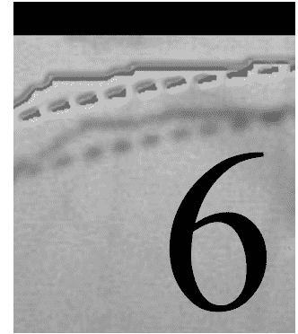
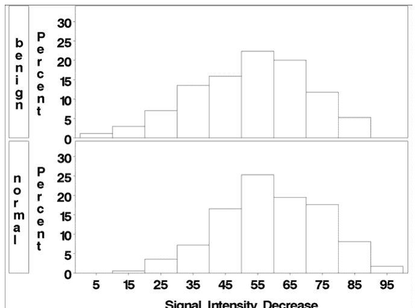
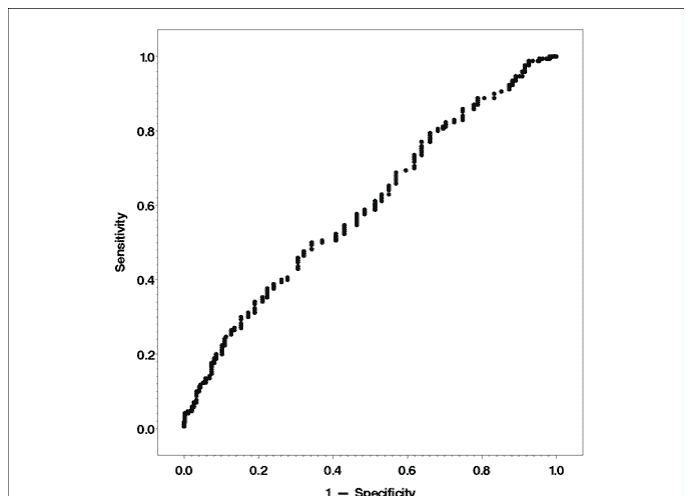
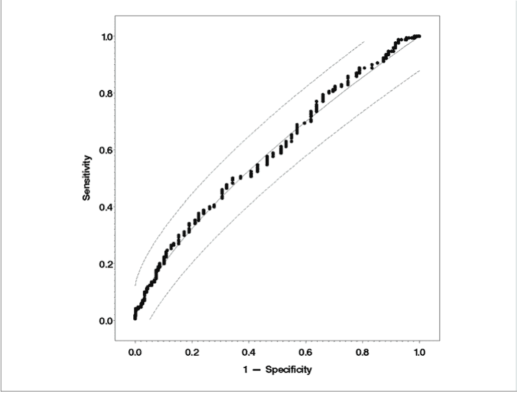
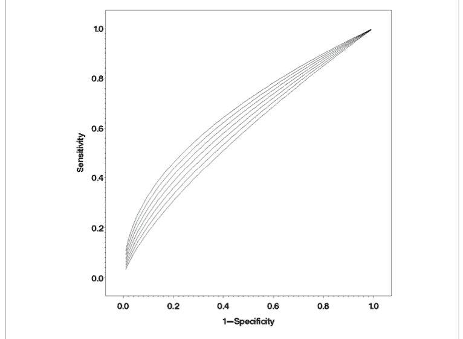
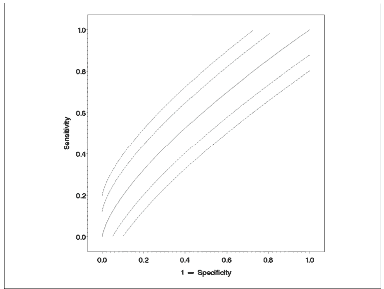

## Lehmann ROC 曲线族



- 6.1 引言 ........................................................................................ 67
- 6.2 Lehmann 分布族 ............................................................. 67
- 6.3 磁共振示例 ................................................................ 70
- 6.4 协变量调整......................................................................... 73
- 6.5 使用估计方程处理聚类数据 ............................... 75
- 6.6 使用 Lehmann ROC 曲线族比较标记............. 79
- 6.7 Lehmann ROC 曲线族的优点和缺点
ROC 曲线 ............................................................................................... 80

## 6.1 引言

前五章涵盖了分析 ROC 曲线的传统方法。本章介绍了一种构建连续预测变量 ROC 曲线的不同方法。该方法具有三个重要优势，即

- 对应于具有非常简单函数形式的 ROC 曲线
- 轻松与内置 SAS 过程配合使用
- 便于对比较 ROC 曲线和协变量调整进行易于推广。

## 6.2 Lehmann 分布族

在第 3 章中，我们根据金标准状态值的标记值条件累积分布函数的补集推导了 ROC 曲线的一般表示。如果 D=0,1 表示金标准，W 为标记，则我们定义

F(w) = P(W > w | D = 1)
G(w) = P(W > w | D = 0)

则 W 的 ROC 曲线由下式给出

y = F(G^{-1}(x))

该结果普遍成立，对 F 和 G 没有特别限制。第 3 章使用该结果通过简单地将 F 和 G 替换为正态分布的相应累积密度来推导双正态模型的 ROC 曲线的函数形式。

双正态族的替代方法是假设 F 和 G 彼此相关如下：

G(w) = F(w)^{θ}

由该方程定义的分布族称为 Lehmann 族。该族由 Lehmann 在其关于各种统计检验功效函数研究的开创性著作（Lehmann, 1953）中使用。因此，该分布族有时也被称为 Lehmann 备择。

必须认识到，该方程并不能唯一定义标记值的实际分布。它仅在彼此参照的情况下识别分布。因此，半参数一词常用于描述该族。指数分布属于 Lehmann 族。具有共同尺度参数的 Weibull 分布也属于该族。另一方面，正态和对数正态分布不是 Lehmann 族的成员。

前述方程意味着以下内容：

y = x^{θ}

这是对应于 Lehmann 族的 ROC 曲线的函数形式。换句话说，如果标记值的条件分布通过 θ 以 Lehmann 族的方式相互关联，则 ROC 曲线将具有该方程中的简单幂形式。因此，如果你能从数据中估计 θ，则 ROC 曲线的估计值将立即可用。

Lehmann 族的一个重要优点是 θ 的估计方法已得到广泛研究并已实现。为此，首先定义以下方程：

h_F(w) = f(w) / F(w)

其中 f 是对应于 F 的密度函数，h 通常称为风险函数，在生存分析中起着核心作用。如果 G = F^{θ}，则相应风险函数之间存在以下关系：


\(\frac{h_F(w)}{h_G(w)} = \theta\)

熟悉删失数据分析的统计学家会认识到这就是比例风险族。Lehmann族与比例风险族是相同的。Cox（1972，1975）在两篇关键论文中提出了偏似然的思想，并展示了如何用它来估计 θ。他的工作为 Cox（或比例风险）回归模型铺平了道路，而这些模型已成为建模删失数据的首要工具。SAS 中的 PHREG 过程实现了该方法，并为 Lehmann 族的参数估计提供了便捷的途径。

虽然熟悉比例风险模型和 PROC PHREG 有助于理解本章，但也可能导致混淆。因为比例风险模型几乎只用于删失数据，所以很容易错误地假设本章描述的是如何获得删失数据的 ROC 曲线。事实上，比例风险族和偏似然方法都不要求数据是删失的。本章中的数据集在结构上实际上与第 3 章和第 4 章中的数据集完全相同：连续标记和二元金标准。目标是提供对二元正态模型的替代方案，后者拥有完整的回归模型集合。

第 4 章中开发的二元正态模型的回归版本背后的原理是使用标记值作为因变量，金标准作为自变量纳入回归模型。我们在这里使用同样的思路。在比例风险回归的背景下，这意味着

\(h_F(w; D) = h_G(w) \exp\{\beta D\}\)

PROC PHREG 会产生 β 的估计值及其标准误。我们可以用这些值得到 θ 的估计值及其标准误。记住 W 是标记，D 是二元结局。因此，如果 D=0，则 h_F=h_G；如果 D=1，则 h_F=h_G e^β。整理后得到以下方程：

\(\frac{h_F(w)}{h_G(w)} = e^{\beta}\)

将此与 \(\frac{h_F(w)}{h_G(w)} = \theta\) 比较可得：

\(\hat{\theta} = e^{\beta}\)

你可以使用泰勒定理近似 \(\hat{\theta}\) 的方差如下：

\(V(\hat{\theta}) = \hat{\theta}^2 V(\hat{\beta})\)

\(\hat{\beta}\) 和 \(V(\hat{\beta})\) 均可从 PROC PHREG 输出中获得。

一旦 θ 被估计，ROC 曲线就完全确定，可以计算 AUC 等汇总指标。利用 Lehmann 族 ROC 曲线的函数形式，可以计算 AUC 的估计值为

AŪC = ∫ x^θ dx = 1 / (1 + θ̂)

而 AUC 估计值的方差为

V(AŪC) = V(θ̂) / (θ̂ + 1)^4

所有所需分量再次可从 PROC PHREG 输出中获得。你还可以使用 x^θ 的标准误为 ROC 曲线形成点估计置信带：

V(y(x)) = [x^θ̂ log x]^2 V(θ̂)

Gönen 和 Heller（2007）详细研究了 ROC 曲线的 Lehmann 族的使用。由 y = x^θ 给出的 ROC 曲线已在文献中被研究；例如参见 Hanley（1988）。它们使用 Lehmann 族的推导以及使用 Cox 回归过程的实现已由 Gönen 和 Heller（2007）明确提出。

## 6.3 磁共振示例

Zajick 等人（2005）报告了一项关于使用化学位移磁共振区分正常、良性和恶性椎体骨髓病变的研究。感兴趣的标记是同相和异相信号强度之间的百分比差异。该文章重点在于为正常椎体骨髓的信号强度变化建立一个值范围。在这里，我们用其数据实现不同目标：评估信号强度变化在区分正常和良性椎体骨髓病变方面的能力。

共对 75 名患者的 569 个正常椎体进行了评估，与 92 名患者的 215 个良性病变相比。图 6.1 展示了正常和良性椎体信号强度变化的并排直方图。该图由 UNIVARIATE 过程的 HISTOGRAM 语句生成。完整代码在第 3.1 节的正电子发射断层扫描示例中给出。从直方图可以明显看出两个分布存在一定重叠，表明该标记可能没有区分两类病变的能力。

### Figure 6.1 Histograms of the Change in Signal Intensity for Normal and Benign Vertebrae



图 6.2 中的经验 ROC 点验证了这一怀疑，因为 ROC 曲线仅略高于参考线。图 6.2 由 LOGISTIC 过程 MODEL 语句中的 OUTROC 选项生成，使用与第 3.2 节中类似的语句。

### Figure 6.2 ROC Points for the Change in Signal Intensity for Normal and Benign Vertebrae



在第一次分析中，忽略患者为分析贡献多个椎体这一事实；这相当于将 569 个数据点视为来自不同受试者。要估计 θ，使用对 PROC PHREG 的以下调用：

```
proc phreg data=tmp1.ph;
    model signal=grp / rl;
    if group='Normal' then grp=0;
    else if group='Benign' then grp=1;
run;
```

PROC PHREG 是 SAS/STAT 过程，允许编程语句。这些语句使你能够创建可在 MODEL 语句中使用的变量。在过程内部使用编程语句有助于避免在调用过程之前进行 DATA 步编程。一个重要的缺点是创建的变量是临时的；因此，如果新变量在分析的其他地方需要，使用 DATA 步会更有效。

在本例中，编程语句用于创建一个名为 GRP 的新变量。由于 PROC PHREG 仅处理数值变量，因此该变量是必要的。RL 选项请求风险比的置信区间。记住 θ，即 Lehmann 族中唯一的參数，与风险比相同。

Output 6.1 的相关部分如下：

### Output 6.1

Analysis of Maximum Likelihood Estimates
Parameter DF Parameter Estimate Standard Error Chi-Square Pr > ChiSq Hazard Ratio 95% Hazard Ratio Confidence Limits
grp 1 0.35541 0.08815 16.2559 <.0001 1.427 1.200 1.696

这里，θ 的估计值为 1/1.427=0.701。θ 是否大于或小于 1 取决于分组顺序。如果使用以下语句，结果将表明风险比小于 1：

```
proc phreg data=tmp1.ph;
    model signal=grp / rl;
    if group='Normal' then grp=1;
    else if group='Benign' then grp=0;
run;
```

记住这里的风险是指 grp=1 对应具有更高信号的几率。

β̂ 的标准误估计为 0.088，因为 θ̂ 的方差为 θ̂² Var(θ̂)=0.062。利用这些值，你可以绘制该数据集的 Lehmann 族 ROC，并附带 95% 点估计置信带（图 6.3）。

### Figure 6.3 The ROC Points (Dots), the Lehmann ROC Curve (Solid Line), and the 95% Confidence Intervals (Dashed Lines)



经验曲线的下面积计算为 0.597，标准误为 0.025（使用 %ROC 宏，细节省略），而 Lehmann ROC 曲线的下面积为 0.588，标准误为 0.030。后一对数值是使用第 9.1 节提供的解析关系计算的。经验估计与 Lehmann 估计的接近程度表明 Lehmann 模型对数据拟合良好。

## 6.4 调整协变量

正如我们在第 4 章中看到的，协变量可能会影响标记的准确性，ROC 曲线可能需要相应调整。将第 5 章研究的回归模型扩展到 Cox 回归的背景下很容易，如下所示：

h(V | D, U) = \tilde{h}(v) exp{β₁ D + β₂ U + β₃ D U}

这为 Lehmann ROC 曲线提供了基于回归的协变量调整。这种构造在包含金标准 D 与协变量 U 之间的交互作用方面是相似的。为了了解协变量调整的 ROC 曲线的形式，考虑一个 D=1 的观测与一个 D=0 的观测的风险函数之比：

h(V | U, D = 1) / h(V | U, D = 0) = exp{β₁ + β₃ U}


并且调整后 ROC 曲线的形式如下：

y = x^{θ(u)}

其中

θ(U) = β₁ + β₃U

正如第 5 章所述，协变量的 ROC 曲线不受 β₂ 影响，但必须在模型中包含年龄的主效应；否则，β₃ 的估计值，即 ROC 曲线的关键组成部分，可能会有偏倚。

继续以磁共振为例，年龄可能是这种类型的磁共振成像准确性的一个重要因素，该成像专注于组织中的水脂比。由于患者随着年龄增长自然会积累脂肪，该标记物在老年人中可能效果较差，存在将因年龄导致的脂肪误认为是良性病变导致的脂肪的可能性。

下面的 PHREG 调用提供了所需的估计值：

```
proc phreg data=tmp1.ph;
    model signal=grp age grpage/r1;
    if group='normal' then grp=0;
    else if group='benign' then grp=1;
    grpage=grp*age;
run;
```

再次注意编程语句的使用，不仅用于创建组变量，还用于创建交互项。输出 6.2 包含来自 PHREG 过程的相关数字。三个参数估计为 β₁=1.29，β₂=-0.003，和 β₃=-0.014。年龄系数的负号表明准确性随年龄增加而下降。输出 6.2 显示了结果。

## Output 6.2

| Analysis of Maximum Likelihood Estimates |
| Variable | DF | Parameter Estimate | Standard Error | Chi-Square | Pr > ChiSq | Hazard Ratio | 95% Hazard Ratio Confidence Limits |
| grp | 1 | 1.28789 | 0.44629 | 8.3276 | 0.0039 | 3.625 | 1.512 | 8.694 |
| Age | 1 | -0.00297 | 0.00320 | 0.8650 | 0.3523 | 0.997 | 0.991 | 1.003 |
| grpage | 1 | -0.01432 | 0.00706 | 4.1123 | 0.0426 | 0.986 | 0.972 | 1.000 |

将 β₁ 和 β₃ 代入 θ(u) = β₁ + β₃U 得到以下方程：

θ(AGE) = 1.288 − 0.014*AGE

将其代入 $y = x^{\theta(u)}$ 后，得到年龄调整后的 ROC 曲线：

$y = x^{1.288 - 0.014*AGE}$

你可以通过绘制几个选定年龄值的 ROC 曲线来获得图形表示（见图 6.4）。图 6.4 中的每条 ROC 曲线都是 $y = x^{1.288 - 0.014*AGE}$ 在不同年龄值下的绘制。最低曲线代表 70 岁患者，最高曲线代表 40 岁患者。中间的曲线代表以 5 年为增量的不同年龄水平。正如 $\beta_3$ 的负号所预期的那样，随着年龄的增加，ROC 曲线越来越接近对角线。

## Figure 6.4 ROC Curves for Different Age Values



也可以回答是否需要协变量调整的问题。请注意，当 $\beta_3=0$ 时，调整后和未调整的 ROC 曲线重合。因此，对 $\beta_3=0$ 的检验是一种判断是否应报告调整后或未调整 ROC 曲线的方法。该检验的 $p$-值为 0.0426（见输出 6.2）；因此，基于此分析，年龄调整后的 ROC 曲线是合适的。

## 6.5 Using Estimating Equations to Handle Clustered Data

迄今为止描述的所有方法都要求各个数据点彼此独立。当对每个个体单元只进行一次观测时，通常满足这一要求。这里的个体单元可以是等待诊断的患者、申请贷款的债务人，或用于发布天气预报的日历日。

正如磁共振示例中所述，有时可能从一个个体单元获得多个观测值。在这种情况下，研究问题集中于识别异常椎体骨髓过程并将其分类为正常或良性。进行磁共振成像的放射科医生根据图像指示测量信号的椎体数量。有些患者可能只提供一个测量值，而其他患者则提供多个测量值。当患者对分析贡献多个观测值时， resulting 数据集被称为 *clustered*。该术语源于这样的观察：来自同一单元的数据表现相似并倾向于聚在一起。

思考聚类数据的直观方式是，两个独立数据点所包含的信息通常多于两个聚类数据点所包含的信息。聚类使得个体数据点彼此表现得更像，而不像原本那样。净结果通常是标准误差增加（与数据点独立相比），而点估计通常不会受到实质性影响。

可以在其他领域想到聚类数据的例子。某一天的天气预报通常是多维的：温度、降水和气压都可能同时被预测。同一天的预测会倾向于聚类，因为它们都与相同的潜在气象事件的各个方面相关。

聚类数据并不总是源于每个观测单元的多次测量。也可能有其他原因怀疑观测值的一个子集彼此表现相似。例如，同一邮政编码区的债务人可能表现出相似的违约行为。同一工厂制造的零件可能表现出相似的故障模式。所有这些都会影响 ROC 曲线的分析。

聚类数据的分析本身就是一个统计学主题。从 SAS 用户的角度来看的概述可在 Littell 等人（2006）所著的 *SAS for Mixed Models, Second Edition* 中找到，适用于连续结果，以及 Stokes、Davis 和 Koch（2001）所著的 *Categorical Data Analysis Using the SAS System, Second Edition*。

处理聚类数据的一种方法是基于广义估计方程。这是一种使用对数据点独立性假设的偏离具有稳健性的方法来估计模型参数的方法。这种方法在分析相关的二元数据时非常流行，并且已扩展到删失数据的情形。它可以使用 PROC PHREG 中的 COVSANDWICH 选项拟合。该选项以协方差的夹心估计量命名，后者是估计方程得到的估计量的特征之一。

如果我们按如下方式修改对 PROC PHREG 的调用，则模型将使用估计方程拟合，而不是通常的部分似然。ID 语句定义了标识聚类变量的变量。共享相同 ID 值的记录被聚类。

```
proc phreg data=tpm1.ph covsandwich(aggregate);
    model signal=group/r1;
    if group='Normal' then grp=0;
    else if group='Benign' then grp=1;
    id name;
run;
```

使用 COVSANDWICH 选项时，PHREG 输出的格式不会改变。特别是我们看到 θ 估计为 1/1.427=0.701（与第 6.3 节相同），支持聚类对点估计几乎没有影响甚至没有影响的观点。由于 θ̂ 没有改变，AUC 的估计值保持在 0.588 不变。另一方面，β̂ 的标准误差现在为 0.144，从 0.088 上升，增加了 63.5%，如 StdErrRatio 列所示，这是 COVS 选项存在时 PROC PHREG 输出的唯一新增内容。见输出 6.3。这导致 θ̂ 的标准误差增加到 0.101，AUC 的标准误差从 0.030 增加到 0.050。

## Output 6.3

| Analysis of Maximum Likelihood Estimates |
| Parameter | DF | Parameter Estimate | Standard Error | StdErr Ratio | Chi-Square | Pr > ChiSq |
| group benign | 1 | 0.35541 | 0.14413 | 1.635 | 6.0808 | 0.0137 |
| Analysis of Maximum Likelihood Estimates |
| Parameter | Hazard Ratio | 95% Hazard Ratio Confidence Limits | Variable Label |
| group benign | 1.427 | 1.076 1.892 | group benign |

图 6.5 在图 6.4 的基础上增加了基于估计方程的置信带。虚线均表示 95% 置信区间，一个基于假设独立性的标准误差（较窄的带），另一个基于估计方程（较宽的带）。该图无意帮助你选择估计方法。是否应使用估计方程取决于根据研究的性质是否合理地预期存在聚类。


## 图 6.5 聚类对 ROC 曲线变异性的影响



估计方程的一个吸引人的特点是该方法基于回归模型，因此协变量调整在原则上和实现上都是微不足道的。例如，以下对 PROC PHREG 的调用拟合了一个年龄调整模型，同时考虑了每个患者有多个椎体骨髓过程的事实：

```
proc phreg data=ph covs(aggregate);
    model signal=grp age grpage / rl;
    id name;
    if group='normal' then grp=0;
    else if group='benign' then grp=1;
    grpage=grp*age;
run;
```

结果显示在输出 6.4 中，再次以使用偏似然拟合模型的方式呈现。年龄调整 ROC 曲线的函数形式与第 6.4 节中得到并给出的形式相同

y = x^{1.288−0.014*AGE}

主要区别，如你可能猜到的，是标准误差。参见输出 6.4。

## 输出 6.4

最大似然估计分析

| Variable | DF | Parameter Estimate | Standard Error | StdErr Ratio | Chi-Square | Pr > ChiSq | Hazard Ratio | 95% Hazard Ratio Confidence Limits |
|---|---|---|---|---|---|---|---|---|
| grp | 1 | 1.28789 | 0.89378 | 2.003 | 2.0763 | 0.1496 | 3.625 | 0.629 20.898 |
| Age | 1 | -0.00297 | 0.00881 | 2.758 | 0.1137 | 0.7359 | 0.997 | 0.980 1.014 |
| grpage | 1 | -0.01432 | 0.01337 | 1.894 | 1.1459 | 0.2844 | 0.986 | 0.960 1.012 |

β₃ 的标准误差增加了 89.4%。这导致 p 值为 0.284，与偏似然分析的 p 值相比要大得多。我们得出结论，在调整了聚类后，不需要对年龄进行进一步调整。

## 6.6 使用 Lehmann ROC 曲线族比较标记

第 5 章探讨了使用回归模型比较两个或多个 ROC 曲线的想法。主要思想是在回归模型中包含标记类型的指示变量。对于双正态模型，适当的回归模型是异方差正态回归。对于 Lehmann 族，适当的回归模型是比例风险回归，正如我们在第 6.3 节中已经看到的那样。

具体来说，设 U 为指示变量，对两个不同的标记或预测因子取值为 0 和 1。然后，遵循第 6.3 节的逻辑，你可以写出以下方程：

```
h(V | U, D = 1) / h(V | U, D = 0) = exp{β₁ + β₃U}
```

该模型与第 4 章和第 5 章中在双正态模型背景下的模型相似。它在形式上也与第 6.2 节中考虑的模型完全相同，其中 U 表示年龄，一个连续协变量。因此，PHREG 语句也完全相同，这里不再重复显示。

如果 β₃ = 0，则两个 ROC 曲线相同。因此，可以通过检验 H₀ : β₃ = 0 来进行正式比较。PROC PHREG 输出中 readily 可用的 Wald 检验可用于此目的。从操作角度来看，比较两个标记的 ROC 曲线与比较不同年龄组的 ROC 曲线没有区别，因此第 6.4 节中描述的步骤也适用于此。

标记比较可能与协变量比较不同的一个潜在重要方面是，正如我们在第 4 章中讨论的那样，配对设计是大多数涉及多个标记比较的研究中数据收集的主要形式。之前的模型在用偏似然估计时隐含假设观测是独立的。但第 6.4 节表明，使用估计方程方法拟合回归模型可以让你在数据相关时获得适当的标准误差估计。配对数据是相关数据的特例，前一节概述的边际模型方法可用于在存在配对数据的情况下拟合模型。

## 6.7 Lehmann ROC 曲线族的优点和缺点

随着单个预测因子 ROC 曲线的非参数方法的出现，你不需要使用双正态模型或 Lehmann 族。这些基于模型方法的实用性只有在考虑更复杂的问题时才会变得明显，例如协变量调整或相关数据。

与任何基于模型的统计方法一样，Lehmann ROC 曲线族的性能直接取决于数据生成过程被 Lehmann 假设近似的程度。如果有强有力的证据表明数据遵循 Lehmann 假设，则本章讨论的方法是适当且优选的。在这些条件下，ROC 曲线的常见统计任务，例如协变量调整、多个标记的比较以及使用聚类数据的分析，都可以使用 PROC PHREG 处理，这是 Lehmann 族的一个主要优势。

尽管尽最大努力验证或排除 Lehmann 假设，数据可能既不强烈偏离也不强烈支持 Lehmann 假设。虽然没有替代仔细和专业的统计分析，但你应该考虑 Lehmann 族和竞争方法的优点和缺点。Lehmann 族的主要优点是其简单的函数形式，使结果易于解释并获得洞察，以及软件的可用性。主要缺点是其灵活性不足：使用单个参数，可能无法容纳经验上明显的 ROC 曲线形状。
