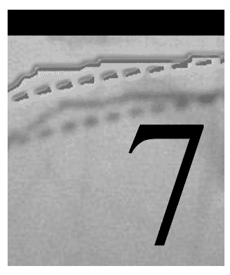
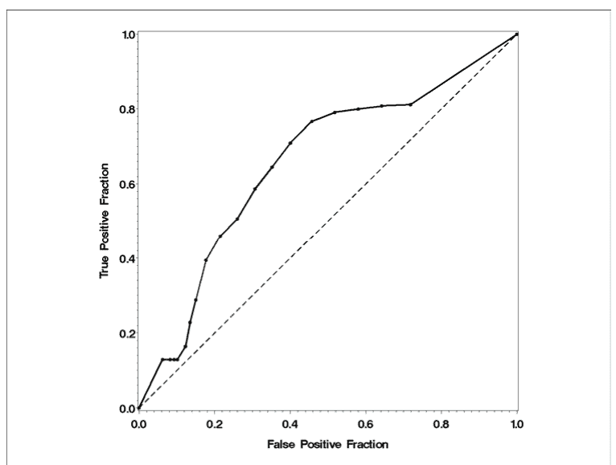
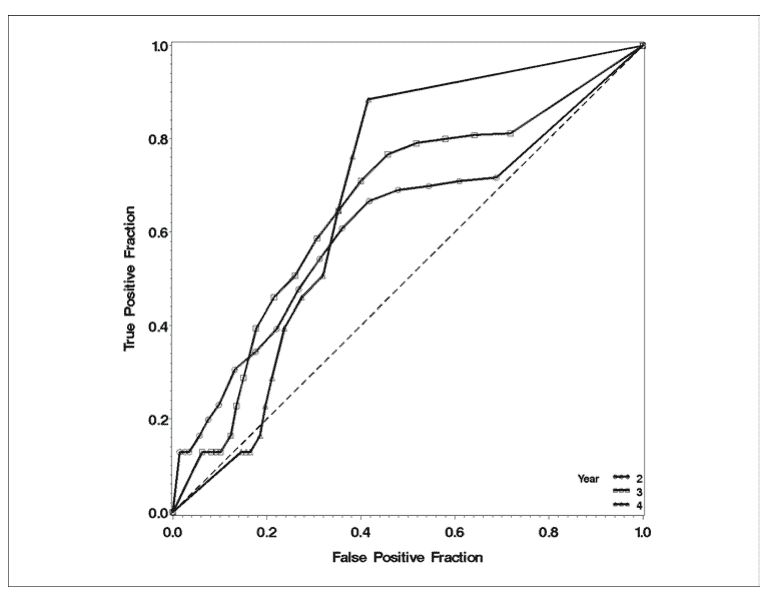
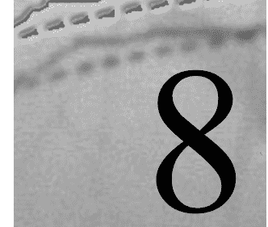

## 带删失数据的 ROC 曲线



- 7.1 引言 ......................................................... 81
- 7.2 肺癌示例 ................................................... 81
- 7.3 带删失数据的 ROC 曲线 ......................................... 82
- 7.4 带删失数据的符合概率 ........................... 88
- 7.5 符合概率与 Cox 模型 ............................ 91

## 7.1 引言

在许多应用中，二元结果事件并非立即可观察。例如，大多数信用评分算法试图预测到某一时间点的违约概率。如果数据集中每个受试者在至少到该时间点仍在观察中，则结果是真正二元的，我们迄今看到的方法适用。但可能不希望等待所有受试者的结果都被观察到。可以进行时间-事件分析，用违约发生前的经过时间替代是/否违约。这种分析的优点是可以容纳受试者之间不同的随访时间。虽然它不如等待所有受试者达到预设时间那样有力，但通常可以更快完成，且效率损失通常很小。

## 7.2 肺癌示例

肺癌是最常见和致命的癌症之一。其预后受两个因素 heavily 影响：肿瘤大小和淋巴结受累。使用这些因素，你可以预测死亡的可能性并据此计划进一步治疗。这些因素最好在手术中切除的肿瘤标本上测量。然而，在手术前准确描述预后有相当大的兴趣。第 3 章描述了来自正电子发射断层扫描（PET）扫描的标准化摄取值（SUV）。在本例中我们将研究 SUV 作为肺癌死亡率标记的准确性。本分析的目标是看看 SUV 是否能预测手术后肺癌患者的生存。由于 SUV 在手术前可用，如果它具有合理的预测价值，将具有重要的实际意义。

本研究的的数据集有三个变量：SUV、Survival 和 Status。Survival 是手术到死亡之间经过的时间。对于分析时仍存活的患者，它代表手术到最后随访之间的时间。Status 是一个二元变量，表示患者在最后联系时是死亡还是存活。如果 status=1，则患者死亡，Survival 变量是实际生存时间。如果 status=0，则患者存活，Survival 是随访时间。这些患者被称为删失，因为我们没有观察到他们的生存时间。

这种数据结构是删失数据的典型形式，它立即揭示了所需统计分析的复杂特征。结果（即生存时间）以特定方式由两个变量（Survival 和 Status）组合表示。此外，对于部分患者，实际结果未被观察到。传统的统计方法不能直接应用于 Survival 变量来推断生存时间。例如，Survival 变量的中位数会低估实际中位数，因为它把删失患者的随访时间当作实际生存时间处理。

因此，删失数据的分析需要特殊方法。由于删失数据在临床研究中无处不在，更不用说工程可靠性（设备故障时间）和金融（违约时间）等其他领域，这些特殊方法已被广泛研究。本章使用了两种更受欢迎的删失数据方法。一种是生存时间分布的 Kaplan-Meier 估计，另一种是比例风险（Cox）回归。我们在上一章中已经使用了 Cox 模型，尽管是从完全不同的角度。

严格来说，了解本章几乎不需要关于删失数据的先验知识，但要掌握细节而没有一些经验是困难的。Paul Allison 的 Survival Analysis Using the SAS System: A Practical Guide（1995）或 Alan Cantor 的 SAS Survival Analysis Techniques for Medical Research, Second Edition（2003），两者都是 SAS Press 出版的书籍，对此目的有帮助。

## 7.3 带删失数据的 ROC 曲线

我们反复强调生成 ROC 曲线需要二元结果。如果 W 是预测因子，D 是二元结果，你可以写

P(W > c | D = 1)
P(W ≤ c | D = 0)  (7.1)

来表示对应于某个阈值 c 的灵敏度和特异性。我们在第 3 章中看到，这两个概率可以用 W 的条件分布表示，并且它们构成了经验 ROC 曲线的<|message|>。

在生存模型背景下，结果是事件发生（例如死亡或违约）为止经过的时间。这可以被视为随时间变化的二元结果。方程（7.1）现在被替换为

P(W > c | D(t) = 1)
P(W ≤ c | D(t) = 0)  (7.2)


这突出了在删失数据的背景下，敏感性和特异性是时间的函数这一事实。

使用公式（7.2），我们可以估计每个 c 的敏感性和特异性，并绘制这些估计值以得到特定时间点 t 的 ROC 曲线。估计值可通过以下关系获得，该关系源于条件概率的定义以及贝叶斯定理的应用：

P(W > c | D(t) = 1) = {1 − S(t | W > c)} P(W > c) / (1 − S(t))
P(W ≤ c | D(t) = 0) = S(t | W ≤ c) P(W ≤ c) / S(t)  (7.3)

在公式（7.3）中以及本章其他地方，S(t) 表示生存函数——即 S(t)=P(T>t)。事实证明，公式（7.3）右边三个分量都可以用 SAS 计算出来。以下各节详细说明如何使用数据计算公式（7.3）。为说明起见，我们将使用 c=9 和 t=36，但以下步骤也可以对其他 c 和 t 值重复。

## 7.3.1 S(t) 的估计

如前所述，S(t)=P(T>t) 是变量 T 的生存函数（即熟悉的累积分布函数的相反数），它受删失影响。对删失变量的累积分布进行计算需要特殊方法。其中最流行的方法，另称为 Kaplan-Meier 或乘积极限估计方法，已在 SAS/STAT 软件的 PROC LIFETEST 中实现。PROC LIFETEST 是在使用公式（7.3）时计算所需分布的主要工具。以下调用返回 3 年时的生存概率：

```
proc lifetest data=lung timelist=(36);
    time survival*status(0);
run;
```

TIME 语句具有特殊的语法，将两列中的结果信息结合在一起。先指定的变量（在星号之前）是生存时间，后指定的变量（在星号之后）是状态。在状态变量之后用括号列出指示删失的状态变量值。最后，timelist=(36) 仅打印出 3 年（36 个月）生存函数的估计值。否则，默认情况下会打印数据集中所有观察到时间点的生存概率。

输出 7.1 显示了此次 PROC LIFETEST 调用的结果。相关部分标记为 Product-Limit Survival Estimates（product-limit 是 Kaplan-Meier 估计的另一种名称）。关注的时间点列在 Timelist 标题下，对应的概率标记为 Survival。请记住 S(t)=P(T>t)，并且 1−S(t)=P(T≤t) 给出在 Failure 标题下。我们从输出 7.1 的结果中看到 S(t)=0.7676 且 1−S(t)=0.2324。

### Output 7.1

The SAS System
The LIFETEST Procedure

### Product-Limit Survival Estimates

| Timelist | Survival | Survival | Failure | Survival Standard Error | Number Failed | Number Left |
| 36.0000 | 36.0000 | 0.7676 | 0.2324 | 0.0529 | 19 | 23 |

### Summary Statistics for Time Variable Survival

### Quartile Estimates

| Percent | Point Estimate | 95% Confidence Interval [Lower Upper) | |
| 75 | . | . | . |
| 50 | . | 49.0000 | . |
| 25 | 44.0000 | 24.0000 | . |

Mean    Standard Error
41.8379        1.4697

NOTE: The mean survival time and its standard error were underestimated because the largest observation was censored and the estimation was restricted to the largest event time.

### Summary of the Number of Censored and Uncensored Values

| Total | Failed | Censored | Percent Censored |
| 100 | 21 | 79 | 79.00 |

## 7.3.2 P(T|W) 的估计

P(T|W) 从根本上也是一个时间-事件分布，同样可以用 PROC LIFETEST 估计。需要记住的关键点是根据 W 中指定的条件排除适当的患者。因此，当你计算 P(T|W>9) 时，你需要仅包含 SUV 大于 9 的患者，如以下对 PROC LIFETEST 的调用所示：

```
proc lifetest data=lung(where=(suv>9)) timelist=(36);
    time survival*status(0);
run;
```

输出 7.2 的格式与输出 7.1 相同（仅显示相关部分），告知我们 1−S(T|W>9)=0.3665。类似获得的方程 S(T|W≤9) 等于 0.8960（此处未显示）。

### Output 7.2

The SAS System

The LIFETEST Procedure

Product-Limit Survival Estimates

| Timelist | Survival | Survival | Failure | Standard Error | Number Failed | Number Left |
| 36.0000 | 29.0000 | 0.6335 | 0.3665 | 0.0784 | 16 | 8 |

## 7.3.3 P(W) 的估计

W 不受删失影响，因此原则上 P(W>c) 是超过 c 的观测比例。P(W) 可以在 SAS 中以多种方式计算，包括使用 DATA 步或 PROC SQL 编程，以及使用 PROC UNIVARIATE 和 PROC FREQ。你也可以使用 PROC LIFETEST，因为在没有删失的情况下，Kaplan-Meier 方法会产生与标准方法相同的结果。由于指定状态变量是可选的，因此 PROC LIFETEST 可用于此目的，如下所示：

```
proc lifetest data=lung timelist=(9);
    time suv;
run;
```

这是与之前的 PROC LIFETEST 调用相比有些不寻常的调用。SUV 是需要分布的变量；因此 timelist=9。没有状态变量的原因是 W 不受删失影响。PROC LIFETEST 的输出（输出 7.3）表明 P(W>9)=0.50。这是 Timelist 和 SUV 标题下的值不同的第一个例子。前者列出 PROC LIFETEST 语句的 TIMELIST= 选项请求的值，而后者显示报告的生存和失败概率所适用的最近观测值。如果请求的时间点被观测到，则两列将具有相同的数字。

### Output 7.3

The SAS System

The LIFETEST Procedure

Product-Limit Survival Estimates

| Timelist | SUV | Survival | Failure | Standard Error | Number Failed | Number Left |
| 9.00000 | 8.9300 | 0.5000 | 0.5000 | 0.0500 | 50 | 50 |

## 7.3.4 综合起来

第 7.3.1 节至第 7.3.3 节演示了如何使用 SAS 过程 PROC LIFETEST 从数据中计算公式（7.3）的分量。利用这些节的结果，你可以按如下方式计算 SUV 为 9 时 3 年的敏感性和特异性：

P(W > c | D = 1) = {1 − S(t | W > c)} P(W > c) / (1 − S(t)) = (1 − 0.6335) * 0.5 / (1 − 0.7676) = 0.7885
P(W ≤ c | D = 0) = S(t | W ≤ c) P(W ≤ c) / S(t) = 0.8960 * 0.5 / 0.7676 = 0.5836

通过改变 c，你可以获得每个 c 的敏感性和 1 减去特异性。这些对的图构成 ROC 曲线。

这里有一个潜在问题。然而，在第 3 章中给出的例子中，ROC 曲线保证是单调递增的。对于删失数据则没有这种保证，因为 Kaplan-Meier 估计不是时间的光滑函数（它们有多个跳跃）。这意味着，随着 1 减去特异性的增加，敏感性偶尔可能会下降，违反了 ROC 曲线的核心前提。单调性缺失在小样本中可能很明显，但在大多数具有大样本和/或事件的数据集中几乎不易察觉。

如果 S(t) 的估计没有跳跃和平坦区域——即如果它本身是单调的——ROC 曲线也将是单调的。认识到这一点，Heagerty 等人（2000）建议使用不同的 S(t) 估计量，即加权 Kaplan-Meier 估计量。

宏 %TDROC 生成时间依赖 ROC 曲线。宏的必需输入是 DSN（数据集名称）、Marker、TimeVar、Status 和 TimePT。TimePT 变量指定进行预测的时间。Status 变量必须满足 PROC LIFETEST 的要求：它必须是数值，并且必须在括号后跟随指示删失的值列表。宏还具有一个选项（smooth=1），用于实现 S(t) 的光滑估计。默认情况下 smooth=0。另一个可选输入是 PLOT（默认值为 1），控制曲线是否被绘制。当 plot=0 时，仅提供敏感性和特异性对的数据集。

图 7.1 是 SUV 作为肺癌数据中 3 年预后标记的 ROC 曲线，由对 %TDROC 宏的以下调用生成：

```
%TDROC(DSN=lung, MARKER=suv, TIMEVAR=survival, STATUS=status(0),
    TIMEPT=36);
```


## 图 7.1 SUV 在肺癌中预测能力的 3 年 ROC 曲线



图 7.1 中 ROC 曲线的 AUC 为 0.657，表明其准确性处于中等水平。曲线本身从未远离对角线，支持相同的结论。当然，ROC 曲线应在预测方法的竞争背景下进行评估。在生存分析中，做出准确预测要困难得多，因为所预测的事件在某些情况下可能在数年后发生，在此期间患者可能发生许多其他事情。从这个角度来看，0.657 的 AUC 代表了相当可观的准确性水平。

很明显，选择时间点会影响结论。在某些情况下，研究人员有明确的目标时间点。其他研究缺乏这种明确性，可能给统计学家在选择时间点时带来问题。在这些情况下，尝试几个时间点并同时呈现结果，如图 7.2 所示。

## 图 7.2 SUV 在肺癌中预测能力的 2 年、3 年和 4 年 ROC 曲线



要生成如图 7.2 所示的显示，你需要了解 %TDROC 宏如何命名输出数据集。宏语言中的数据集名称为 &&DSN_&TIMEPT，因此对于肺癌示例，图 7.2 中三个 ROC 曲线的三个数据集分别命名为 LUNG_24、LUNG_36 和 LUNG_48。

总体而言，三条曲线形状相似，尽管在特异性较高水平时敏感性似乎随时间增加，而在特异性较低水平时随时间减少。三个曲线的 AUC 分别为 0.618、0.657 和 0.729，表明 SUV 在预测患者状态方面在较晚年份比较早年份更有效。另一方面，曲线之间的大部分差异出现在特异性小于 0.5 的区域，因此 AUC 的差异在实际意义上可能无关紧要。

## 7.4 带删失数据的符合概率

第 7.3 节解释了如何使用删失数据构建 ROC 曲线。其基本思想是在给定时间点对时间-事件结果进行二分化。因此，ROC 曲线是针对特定时间点定义的。为了了解标记的整体预测价值，你需要进行如图 7.2 所示的分析。

本节讨论一种替代方法来评估标记预测删失结果的整体价值。这种替代方法基于符合性的思想。在第 3 章中，我们看到，对于二元结果，经验 ROC 曲线下的面积等价于符合概率。作为提醒，符合概率是在一对受试者中定义，其中一对有结果而另一对没有。具有结果的受试者标记值大于另一受试者的概率称为符合概率。

以下表达符合概率的方式与该定义一致，并且也使其能够推广到删失结果。定义

```
ψ(W_i, W_j) = { 1    W_i > W_j
                  0.5  W_i = W_j
                  0    W_i < W_j }
```

因此 ψ 指示哪位成员的配对具有较高值，平局用 0.5 表示。假设有 n 名患者有结果，m 名患者没有结果。那么总共有 mn 对，符合概率可以写为如下：

```
1/(mn) Σ_{i=1}^n Σ_{j=1}^m ψ(W_i, W_j)
```

求和表示 W_i > W_j 的配对数（对平局进行了调整），因此整个表达式是患者配对中标记值较高者具有结果的比例。

你可以在时间-事件环境中使用符合性的思想。要了解如何将符合性的定义适用于删失结果，设 T_i 和 T_j 为标记值分别为 W_1 和 W_2 的一对患者中的事件时间。标记 W 与删失结果 T 之间的符合性定义为

```
CP(W, T) = P(T_1 > T_2 | W_1 > W_2)
```

由于 T 受到删失的影响，此估计量无法使用，因为结果是部分观察到的。

Harrell 等人（1982）提出了一种可以与删失数据一起使用的该估计量的修改方法。该方法基于这样一个认识：即使存在删失，一些配对的结果也可以排序。例如，如果第二个受试者死亡，其生存时间短于第一个仍存活受试者的随访时间，我们可以确定 T_1 > T_2。表 7.1 列出了所有可能性以及相应的 ψ(W_1, W_2) 值。如果 ψ(W_1, W_2)=1，则表示预测与结果一致。如果 ψ(W_1, W_2)=0，则表示预测与结果不一致。最后，(W_1, W_2)=? 表示由于删失，无法确定预测与结果是否一致或不一致。

## 表 7.1 带删失数据时所有可能的配对及符合状态

| Subject 1 | Subject 2 | T₁ and T₂ | Ψ(W₁,W₂) |
|---|---|---|---|
| Event | Event | T₁>T₂ | 1 |
| Event | No Event | T₁>T₂ | ? |
| No Event | Event | T₁>T₂ | 1 |
| No Event | No Event | T₁>T₂ | ? |
| Event | Event | T₁<T₂ | 0 |
| Event | No Event | T₁<T₂ | 0 |
| No Event | Event | T₁<T₂ | ? |
| No Event | No Event | T₁>T₂ | ? |

现在我们可以使用表 1 中的定义评估所有配对以查看它们是否一致。分母是有信息量的配对数（即我们可以做出决定的配对），在以下等式中用 k 表示。记号 (i,j)=1 到 (i,j)=k 表示求和是在 (i,j) 配对上进行，并且有 k 个这样的配对。由此得到的符合概率估计量通常称为 c-index。

```
c = 1/k Σ_{(i,j)=1}^k ψ(W_i, W_j)
```

c-index 有几个优点。它模仿了二元数据下 ROC 曲线下面积的计算，它是直观的，并且在概念上计算简单。尽管概念上简单，计算需要形成所有配对，可能需要很长时间。c-index 的计算并未内置于现有的 SAS 过程中，但可以从本书网站获得的 %CINDEX 宏可用于计算，如下所示：

```
%CINDEX (DSN=LUNG, PRED=SUV, SURV=SURVIVAL, CENS=CENS);
```

这里，DSN 是数据集的名称，Pred 是数据集中用作预测变量的变量，Surv 是生存时间变量，Cens 是删失指示符（1 表示删失，0 表示事件）。输出 7.4 仅报告 c-index。

## 输出 7.4

```
cindex
--------
0.692708
```

在肺癌示例的情况下，使用 c-index 作为估计量，符合概率估计为 0.69。

如果感兴趣的问题涉及多个标记或多变量预测模型，则 %CINDEX 宏的输入宏变量 PRED 应指向包含多变量模型预测的变量。

尽管有所有优点，c-index 有一个很大的缺点。它不是真实符合概率的一致估计量。一致估计量随着样本量的增加而更接近真实值。然而，即使样本量增加，c-index 仍可能远离真实值。因此，即使在大样本中，c-index 也可能给出“错误”的答案。根据我的经验，如果删失率较低（这意味着未决配对的比例较低），c-index 工作得相当好。随着删失率的增加，其性能变得不可预测。

c-index 不一致的原因，至少直观上，是它使用了观察到的生存或随访时间。除非采用参数模型，否则使用观察值的程序不会提供一致的估计值。因此，大多数非参数或半参数删失数据分析方法，例如 Kaplan-Meier 估计或比例风险回归，使用数据的秩，而不是其实际值。

在结束本节之前，请注意符合概率的一个有趣性质：

CP(W,T)=1−CP(−W,T)

该等式告诉我们，如果标记在结果不太可能时已知具有高值，则 CP 可能小于 0.5。这种情况下更有信息量的度量是 1−CP，它可以作为标记正确排序事件时间的度量。

## 7.5 符合概率与 Cox 模型

在一种非常重要的特殊情况下，计算符合概率有另一种方法。大多数涉及删失数据的回归情况，例如在连续协变量与删失结果之间或多个协变量与删失结果之间建模的关系，都在 Cox 模型（比例风险回归）框架内处理。事实证明，在 Cox 模型背景下，符合概率可以解析计算。以下推导来自 Gönen 和 Heller（2005）。


起始点是用于删失结局的符合概率定义，如第7.4节所述：

CP(W,T) = P(T₁ > T₂ | W₁ > W₂)

其中 T 为生存时间，W 为预测因子。暂时，我们将使用单一预测因子。对多个预测因子的情况的扩展将随后进行。Cox模型对此情形的规定为

h(t|W) = h₀(t) exp{βW}

其中 h(t) 为 t 的风险函数，写成两个项的乘积：一个仅涉及 t 的项（h₀，基线风险）和一个仅涉及 W 的项（线性部分）。利用风险与生存函数之间的关系，可以写出等价表达式：

S(t|W) = S₀(t) exp{βW}

有关如何证明这两个表达式等价的更多信息，可在大多数涵盖Cox模型的书籍中找到，例如 Survival Analysis Using the SAS System: A Practical Guide (Allison, 1995)。

现在你可以用生存函数重写符合概率：

P(T₁ > T₂ | W₁ > W₂) = ∫ S₁(t | W₁) dS₂(t | W₂)

理解该方程需要一定的高级概率知识，但在这里它用于说明符合概率可以用仅 S(t) 表示。如果将Cox模型中 S₁ 和 S₂ 的形式代入，则右手边的积分可以按如下方式求值：

P(T(βᵀW₂) > T(βᵀW₁)) = ∫ S₁(t | W₁) dS₂(t | W₂) = [1 + exp{βᵀ(W₂ − W₁)}]⁻¹

因此，要在Cox模型的背景下评估预测因子 W 的判别能力，你需要 β 的估计值以及数据所有可能配对的 W 值。请注意，T 仅通过 β 的估计进入计算，而 β 的估计可使用偏似然完成。因此，删失可通过拟合Cox模型的现有方法自然处理。这是计算符合概率的这种方法的一个特别优势。

如果存在多个预测因子，则 W 和 β 均为向量。相同的表达式可以用向量记号写成如下：

P(T(βᵀW₂) > T(βᵀW₁)) = [1 + exp{βᵀ(W₂ − W₁)}]⁻¹

迄今为止推导出的表达式涉及特定的观测对，记为 1 和 2。要在包含若干观测的数据集中使用，我们需要对每对观测计算该概率。这给出了符合概率估计的公式（标记为 CPE）：

CPE = 2 / [n(n-1)] Σ Σ_{i<j} { I(β̂^T w_{ji} < 0) / [1 + exp{-β̂^T w_{ji}}] + I(β̂^T w_{ji} ≥ 0) / [1 + exp{β̂^T w_{ji}}] }

其中 w_{ji} = w_j - w_i。求和项由两部分组成，表示预测因子较高值或较低值与更长生存相关的情况，这反映在回归系数的符号中。如果 β > 0，则协变量的较高值与风险的较高值相关。在这种情况下，对于特定配对，如果 w_j > w_i，则 T_j 大于 T_i 的概率应大于 0.5，因此求和项的第二项应适用，因为 β^T w_{ji} > 0 且 exp{β^T w_{ji}} > 0。因此，(1 + exp{β^T w_{ji}})^{-1} > 0.5。取决于 β 和 w_{ji} 符号的其他三种情况可以以类似方式解释。

如前所述，使用偏似然的Cox模型软件的可用性是主要的操作优势。它也构成理论优势之一。偏似然估计是一致的；也就是说，随着样本量的增长，结果越来越接近参数的底层真实但未知的数值。众所周知，一致估计量的函数也是一致的。由于计算 CPE 仅估计 β，因此 CPE 也是一致的。这是在Cox模型背景下应偏好 CPE 而非 c-index 的重要原因。

CPE 可使用 %CPE 宏进行估计，该宏可从本书的配套网站 support.sas.com/gonen 获取。宏调用与 %CINDEX 类似：

```
%CPE(DSN=LUNG, COVARIATES=SUV SIZE, SURV=SURVIVAL, CENS=CENS);
```

Output 7.5 显示了结果。

## Output 7.5

| Concordance Probability Estimate for the Cox Model |
| CPE | StdErr |
| 0.6524 | 0.0582 |

CINDEX 和 CPE 宏调用的一个重要区别是，预测因子以 MODEL 语句右手边出现的方式用空格列出。

我们看到肺部数据集的 CPE 小于 c-index。根据我的经验，这通常是这种情况。c-index 似乎高估了真实的符合概率，尤其是在删失比例高时。由于 CPE 是一个一致估计，而 c-index 不是（如前所述），因此在Cox回归模型预测的背景下，CPE 是一个更好的度量。



+   8.1 Introduction ........................................................... 95
+   8.2 Liver Surgery Example ................................................... 96
+   8.3 Resubstitution Estimate of the ROC Curve................................... 97
+   8.4 Split-Sample Estimates of the ROC Curve.................................... 99
+   8.5 Cross-Validation Estimates of the ROC Curve ............................... 102
+   8.6 Bootstrap-Validated Estimates of the ROC Curve ............................ 106
