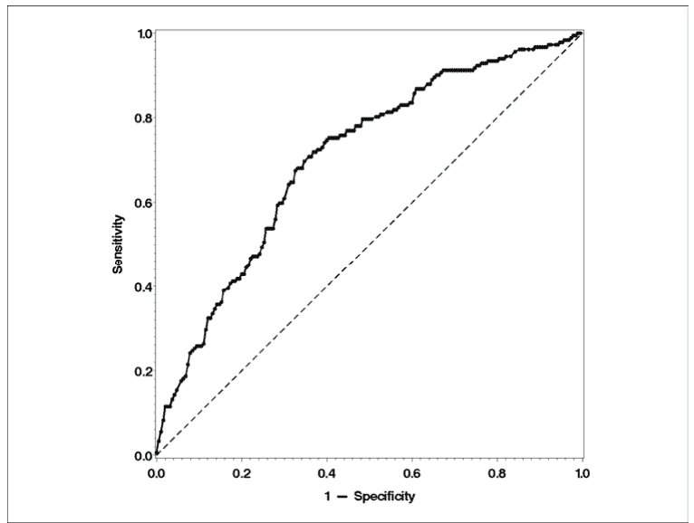
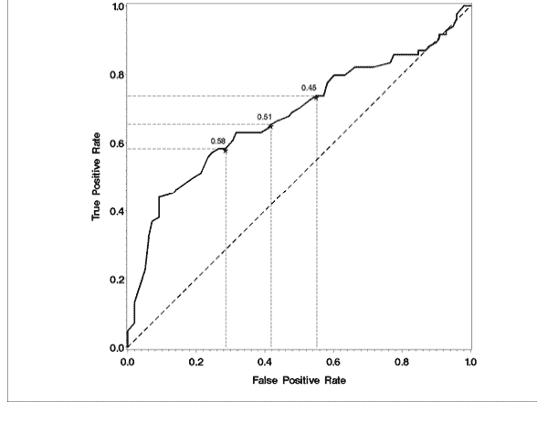
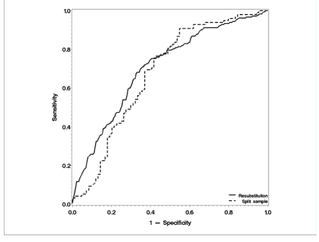
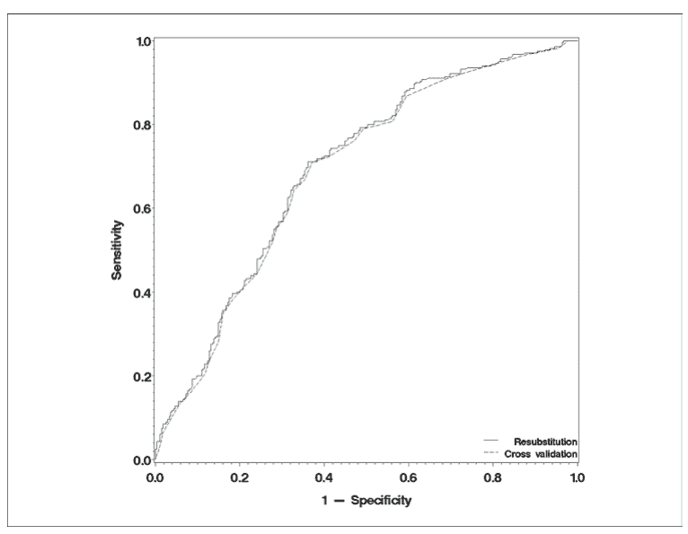
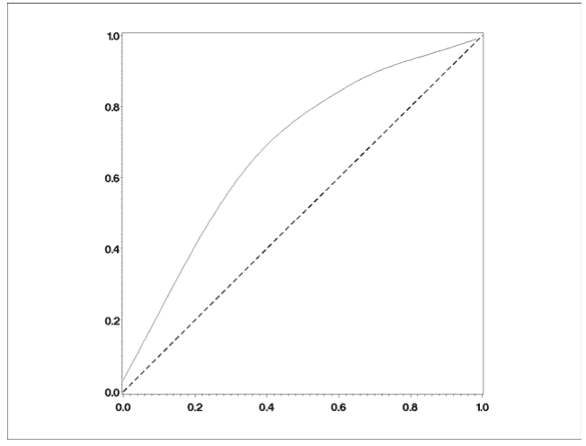

## Using the ROC Curve to Evaluate Multivariable Prediction Models

## 8.1 Introduction

我们迄今为止的讨论主要集中于单一预测因子。其他变量也被考虑，例如在比较几个预测因子或协变量调整的 ROC 曲线时，但不是以从多变量模型产生预测并评估其准确性的形式。第 8 章和第 9 章处理这个问题。

强调单一预测因子的原因值得讨论。首先，它们为评估更复杂的模型提供了基础。其次，单一预测因子应用在实践中很常见，因此值得特别关注。诊断放射学是一个很好的例子，其中预测因子通常是接受扫描的患者的产物。虽然将来自多个数据源的信息结合起来（如磁共振成像和计算机断层扫描等替代诊断扫描）可提高准确性，但压倒性的财务和伦理关注点在于最大限度地减少扫描次数。这导致了在少数候选中挑选最佳单一预测因子的关注。将来自多种扫描类型的信息结合起来很少是感兴趣的，因为准确性的增量改善通常无法证明患者接受额外诊断程序的成本和负担是合理的。

诊断放射学以外的多数预测问题涉及多个变量。通常，你设法预测的大多数结局都是复杂的、多个维度的实体，只能通过审慎使用多个变量来捕捉。这通常意味着构建模型，这需要从几个竞争模型中进行选择。该过程的目标是找到最适合数据的模型，但不可避免地导致过拟合。*过拟合* 指的是一个模型比它预见到未来观测的情况更好地描述了观测数据。

从用于模型拟合的数据集计算的模型性能度量（如 ROC 曲线或 ROC 曲线下面积）被称为通过 *自预测* 或 *重代入* 获得。这些术语源于使用模型预测生成自身的数据并将模型重新代入数据以获得预测的做法。对此方法的另一个、有些轻率的术语是 *双重使用*，指的是数据集被使用两次，一次用于拟合，一次用于预测。ROC 曲线及其汇总度量倾向于反映自预测中的乐观性，因为它们表明的准确性比模型在实践中允许的要好。

大多数统计学家建议采取措施防止过拟合。该过程通常称为 *验证*。以下是特别适用于 ROC 曲线且可在 SAS 中相对轻松实现的方法：拆分样本验证和样本重用验证。样本重用方法实际上可以用两种不同的方式实现：交叉验证和自助法。本章涵盖这些方法。

*拆分样本验证* 要求将样本分为两部分，即所谓的训练集和测试集。模型在训练集上拟合，其性能在测试集上评估。这模仿了模型在未参与模型开发的数据集上使用的现实生活情况。从测试集估计的性能度量比从训练集估计的度量更接近真实值（偏差更小）。拆分样本验证易于理解和实现。它也很好地近似现实生活。其主要缺点是数据使用效率低下：对于小到中等的样本量，训练集和测试集都不足以产生可重复的结果。

样本重用方法试图通过以不同方式重复使用观测数据点来提高效率。这种重复使用导致性能估计的方差更小。一般而言，然而，由于每个数据点被使用多次，偏差会增加。尽管如此，大多数研究在均方误差等综合标准方面更倾向于样本重用。换句话说，偏差的增加被方差的减少所抵消。

最知名的样本重用方法是 *交叉验证*。数据被分为 *k* 个段（通常大小相等），其中一部分留作测试，其余 *k−1* 部分用于训练模型。然后该过程对每个段重复，并将得到的准确性度量在 *k* 个段上平均。当 *k=n* 时，每个数据点构成一个段， resulting 过程称为 *留一法* 验证。

交叉验证的替代方法是使用自助样本。我们在前几章中看到，自助法可用于获得置信区间和 *p*-值。当目标是模型验证时，以相同方式获得的自助样本可用于校正过拟合。第 8.6 节将向你展示如何操作。

## 8.2 Liver Surgery Example

我们将在本章中作为示例使用来自肝脏外科领域的数据集。手术是肝癌患者最有希望的治疗选择。Liver 数据集包含 554 例切除肝肿瘤手术的记录。它是 Jarnagin 等人（2002）分析的数据的子集。变量包括人口统计学、术前患者特征如现有合并症、手术变量如失血量，以及术后变量如手术后并发症的发生和严重程度。


由于肝肿瘤的特性，以及肝脏具有独特的再生能力，大多数手术都包括切除肝脏的相当大一部分。这使患者面临并发症风险升高的情况。在手术前预测并发症的可能性，可以使负责的医生和护士团队根据需要增加对患者的术后监测。这对于向患者及其家属进行咨询也很有帮助。

我们将使用以下术前变量作为术后并发症的潜在预测因子：年龄、是否存在任何合并症、手术范围（广泛 vs. 局限，其中广泛定义为切除整个肝叶或一侧肝脏的手术）、双侧手术（是否涉及肝脏两侧叶的切除），以及切除的节段数（节段是肝脏的八个解剖分区之一）。年龄和节段数被视为连续变量。典型的切除节段数在 1 到 4 之间，但偶尔会切除 5 或 6 个节段。

## 8.3 ROC 曲线的再代入估计

下面的代码基于 PROC LOGISTIC 使用逐步模型选择方法构建预测。逻辑回归是 SAS/STAT 中可用于构建二元结果预测模型的众多选项之一。同样，逐步选择是多种可用的模型选择技术之一。这里的目标并不是声称逻辑回归是构建预测模型的最佳方法，也不是推广逐步作为模型选择策略。重点在于使用多种技术进行模型验证。

```
proc logistic data=liver;
    model complications=age_at_op comorb lobeormore_code
        bilat_resec_code numsegs_resec /selection=stepwise;
run;
```

此 PROC LOGISTIC 调用请求使用逐步方法选择模型。逐步选择一次引入一个变量，然后根据其统计显著性水平在需要时将其移除。以下是逐步选择的算法总结：

- 1. 对于每个候选变量，通过将该变量添加到上一步的现有模型中生成 p 值。在第一步，所有模型语句中的变量都是候选变量，现有模型是仅截距模型。
- 2. 选择显著性最高（p 值最低）的候选变量，并用所选变量的加入更新现有模型。如果没有变量满足进入标准（默认 p≤0.05，但可使用 MODEL 语句的 SLE 选项进行调整），则认为现有模型为最终模型。
- 3. 从现有模型中移除失去显著性（默认 p>0.05，但可使用 MODEL 语句的 SLS 选项进行调整）的任何变量。如果有多个变量失去显著性，则一次移除一个变量，从 p 值最高的变量开始。每次移除后，通过重新拟合模型重新生成 p 值。将被移除的变量返回到候选变量列表。
- 4. 此时，现有模型中的所有变量都应按 SLS 标准显著。所有其他变量应位于候选变量列表中。转到步骤 1 并重复该过程，直到候选变量均不显著且现有模型中的变量均无法移除。

逐步选择是一个被广泛研究且颇具争议的话题。这里使用它来演示模型选择的数据依赖性，并大致说明模型选择程序如何尝试选择一个对数据拟合最佳且对过拟合几乎没有或没有惩罚的模型。尽管逐步选择有替代方案或修改形式，但通常大多数形式的模型选择都会导致过拟合。

相关结果部分显示在输出 8.1 中。第一张表总结了逐步选择。在此示例中，六个变量中只有两个被发现显著：切除的节段数和年龄。

### Output 8.1

逐步选择摘要
Step  Effect  Number  Score  Wald
      Entered Removed DF In Chi-Square Chi-Square Pr > ChiSq
1 NUMSEGS_RESEC 1 1 52.6217 <.0001
2 AGE_AT_OP 1 2 7.9473 0.0048

最大似然估计分析
Parameter DF Estimate Standard Error Wald Chi-Square Pr > ChiSq
Intercept 1 2.0959 0.3867 29.3791 <.0001
AGE_AT_OP 1 -0.0166 0.00596 7.7810 0.0053
NUMSEGS_RESEC 1 -0.3475 0.0518 45.0295 <.0001

优势比估计
Effect Point Estimate 95% Wald Confidence Limits
AGE_AT_OP 0.984 0.972 0.995
NUMSEGS_RESEC 0.706 0.638 0.782

预测概率与观察响应的关联
Percent Concordant 69.4 Somers' D 0.392
Percent Discordant 30.3 Gamma 0.393
Percent Tied 0.3 Tau-a 0.196
Pairs 76720 c 0.696

熟悉的 PROC LOGISTIC 输出表明，该双变量模型的 AUC 为 0.696，我们认为该估计是乐观的，其原因如前所述。对应于该模型的 ROC 曲线绘制在图 8.1 中。当然，被高估的不仅是 ROC 曲线下的面积；对于每个特异性值而言，估计的敏感性也是乐观的。

## Figure 8.1 Resubstitution Estimate of the ROC Curve for the Liver Resection Data



## 8.4 ROC 曲线的样本分割估计

现在，我们将看到如何使用验证来减少再代入估计中的偏差。样本分割验证的第一步是将数据集分为两部分：训练样本和测试样本。它们不必大小相等。事实上，传统上训练集大于测试集。常用的分割比例是 2:1，其中三分之二的观测值分配给训练集，剩余三分之一分配给测试集。该分割通常是随机进行的，尽管有时你可能希望使用分层分割。分层分割确保一个变量（或最多几个变量）的比例在训练集和测试集中均出现。

在样本分割后，预测模型在训练集上构建，并在测试集上使用在训练集上优化的模型获得 ROC 曲线所需的估计。

在 SAS 中可以通过多种方式进行样本分割。以下 DATA 步是一个示例：

```
data training test;
    set liver;
    seed=12061996;
    unif=ranuni(seed);
    if unif>0.333 then output training;
    else output test;
run;
```

在此 DATA 步中，使用 RANUNI 函数生成均匀随机变量 Unif。然后根据 Unif 随机变量的相应实现，将每个观测值分配到训练集或测试数据集。基本上，Unif 变量代表一个有偏硬币翻转，决定所考虑的观测值是用于训练模型还是测试模型。

Unif 的阈值选为 0.333；因此，大约三分之一的记录将具有 unif<0.333。由于 Unif 是一个随机变量，此随机变量的每次实现都会产生 unif<0.333 的记录比例略有不同的结果。因此，这种方法并不总是产生精确的 2:1 匹配。如果需要精确的 2:1 分割，则可以先按 Unif 对数据进行排序，然后从排序序列的开头取出训练数据所需数量的记录（在此示例中为所有记录的恰好三分之二），其余记录分配给测试集。在大多数情况下，精确分割是不必要的，以上给出的代码就足够了。

创建训练集和测试集后，第一项任务是使用训练数据拟合模型，如下所示：

```
proc logistic data=training outmodel=model1;
    model complications=age_at_op comorb lobeormore_code
        bilat_resec_code numsegs_resec / selection=s;
run;
```

此对 PROC LOGISTIC 的调用与主要区别在于 OUTMODEL= 选项，该选项保存拟合模型的详细信息，例如参数估计值和标准误差。OUTMODEL= 选项的强大之处通常在与它的姐妹选项 INMODEL= 结合使用时更为明显，后者接受由 OUTMODEL= 选项保存的模型，如下所示：

```
proc logistic inmodel=model1;
    score data=test out=testscore;
run;
```

请注意没有 MODEL 语句。这是因为不希望进行新的模型拟合。相反，所有计算都基于 INMODEL= 选项指定的模型。SCORE 语句使用 INMODEL= 选项指定的拟合模型对测试数据集生成预测。SCORE 语句的 OUT= 选项生成一个数据集，其中包含预测概率以及 DATA= 选项指定的数据集中所有原始变量。

此时，你可以使用第 3 章中开发的技术使用 %PLOTROC 宏绘制 ROC 曲线，或使用 %ROC 宏计算曲线下面积。从测试集生成的 ROC 曲线及其下面积被认为是真实 ROC 曲线和 AUC 的无偏估计。关键观察是 SCORE 语句获得的预测概率充当标记值。例如，以下对 %ROC 宏的调用产生样本分割的 AUC 估计（见输出 8.2），结果为 0.677，大约比再代入估计的 0.696 低 0.02，说明了再代入估计中的乐观性：

```
%roc(data=testscore, var=p_1, response=complications, contrast=1,
        details=no, alpha=.05);
```


## Output 8.2

```
The ROC Macro

        ROC Curve Areas and 95%
            Confidence Intervals
    ROC Area Std Error Confidence Limits

P_1    0.6767    0.0414    0.5957    0.7578
```

请注意 P_1 是 SCORE 语句分配给预测值的变量名。

也可以使用第 3 章中介绍的 %PLOTROC 宏绘制分割样本 ROC 曲线。由于 P_1 给出到若干有效数字，因此在数据集 TESTSCORE 中创建了一个新变量 P1 以便于打印阈值。P1 的创建方式如下：

```
P1 = ROUND(P_1,0.01);
```

然后使用以下 %PLOTROC 调用：

```
%PLOTROC (dsn=testscore, marker=p1, gold=complications, anno=4,
                tlist=0.45 0.51 0.58);
```

## Figure 8.2 Split-Sample Estimate of the ROC Curve Using the %PLOTROC Macro



请注意，图 8.2 中的阈值以预测概率描述，因为绘制的标记是 logistic 模型中的预测概率（参见 %PLOTROC 宏调用中的 MARKER=）。

作为 %PLOTROC 宏的替代方案，您可以使用 SCORE 语句的 OUTROC= 选项，该选项生成的数据集在结构上与 MODEL 语句中的 OUTROC= 选项相同。具体而言，它包含变量 _SENSIT_ 和 _1MSPEC_，可用于 PROC GPLOT 调用中的 PLOT 语句。

```
proc logistic inmodel=model1;
    score data=test out=testscore outroc=rocvalid;
run;
```

最后，叠加重抽样估计和分割样本估计是有启发性的。这在图 8.3 中实现，该图显示了两条 ROC 曲线，一条通过重抽样获得，另一条通过分割样本验证获得。重抽样曲线在大部分情况下位于分割样本曲线之上，但存在分割样本曲线上升超过重抽样曲线的区域。这似乎与重抽样会导致 ROC 曲线上所有点都被高估的预期相悖。这突出了分割样本方法的首要缺点；即，它只提供一个测试集，在该测试集上可以计算准确性估计值（如给定特异性下的敏感性）。尽管它提供了无偏估计，但这些估计包含相当大的变异性，我们刚刚观察到的这种情况并不少见。这是使用下一节中讨论的样本重用方法的主要原因。

## Figure 8.3 Comparison of the Resubstitution and Split-Sample Estimates of the ROC Curve for the Liver Resection Example



## 8.5 Cross-Validation Estimates of the ROC Curve

### 8.5.1 Leave-One-Out Estimation

PROC LOGISTIC 提供了一个内置选项用于交叉验证，即执行留一法。如本章介绍中简要解释的那样，留一法通过暂时剔除一个观测值，在剩余数据集上构建模型，然后使用该模型预测被剔除的记录来实现。当此过程对每个观测值重复时，使用对预测观测值“盲”的模型为数据集中每条记录获得一个预测。这些预测构成了交叉验证 ROC 曲线的<|message|> 基础。

可以使用以下代码通过 PROC LOGISTIC 执行留一交叉验证。OUTPUT 语句中的 PREDPROBS=X 选项指定使用留一交叉验证而不是重抽样。此选项适用于 OUTPUT 语句生成的所有预测概率。如果省略 PREDPROBS= 选项，则预测概率使用重抽样计算。

```
proc logistic data=liver;
    model complications=age_at_op comorb lobeormore_code
        bilat_resec_code numsegs_resec / selection=s;
    output out=outx predprobs=x;
    ods output classification=classroc;
run;
```

现在可以使用与分割样本验证推荐的相同方法绘制 ROC 曲线，包括其中一个绘图宏。ROC 曲线下面积及其标准误差可通过 %ROC 宏获得。以下对 %ROC 宏的调用使用 PROC LOGISTIC 在指定 PREDPROBS=X 选项时创建的数据集，生成留一估计的 AUC（Output 8.3）。交叉验证预测概率的变量名为 XP_1：

```
%roc(data=outx, var=xp_1, response=complications, contrast=1);
```

## Output 8.3

```
The ROC Macro

        ROC Curve Areas and 95%
            Confidence Intervals
    ROC Area Std Error Confidence Limits

XP_1  0.6875    0.0226    0.6431    0.7318
```

通过留一交叉验证获得的 AUC 估计值为 0.6875，置信区间为 0.6431–0.7318。图 8.4 对比了 ROC 曲线的重抽样估计和留一估计。虽然两条曲线非常接近，但留一估计始终低于重抽样估计。

## Figure 8.4 Comparison of the Resubstitution and Leave-One-Out Estimates of the ROC Curve for the Liver Resection Example



乍一看，在此示例中使用 OUTROC= 选项绘制 ROC 曲线似乎是合理的。然而，PREDPROBS=X 选项不影响 MODEL 语句中 OUTROC= 选项创建的数据集。即使同时指定 OUTROC= 和 PREDPROBS=X 选项，OUTROC= 选项创建的数据集仍报告重抽样估计值。同样，相关性度量包括 c 和 Somers’ D 也按重抽样基准报告。因此，通常用于获得 ROC 点和曲线下面积的方法不适用于交叉验证，这些任务必须在 PROC LOGISTIC 外部手动执行。

### 8.5.2 K-Fold Cross-Validation

虽然指定 PREDPROBS=X 选项是获得留一估计的便捷方法，但您应该了解更多关于如何在 SAS 中使用 %XVAL 宏执行交叉验证的信息。您可以使用此宏执行 k 折交叉验证。当使用 PROBIT、GENMOD 或 GAM 等不提供标准交叉验证选项的其他过程进行预测时，这也很有帮助。

k 折交叉验证的起点涉及将数据划分为 k 个随机选择的段，其中 k 由用户提供。在 k 折交叉验证中，分析重复 k 次。对于每次分析，其中 k 个段中的一个被留作测试集，其余 k−1 个用于训练。在每次分析中，模型对测试数据是盲的。表 8.1 解释了 k=5 的特殊情况下每个段在交叉验证中的作用。

## Table 8.1 The Role of Segments within Each Analysis in Five-Fold Cross-Validation

|  | Segment 1 | Segment 2 | Segment 3 | Segment 4 | Segment 5 |
|---|---|---|---|---|---|
| Analysis 1 | Training | Training | Training | Training | Test |
| Analysis 2 | Training | Training | Training | Test | Training |
| Analysis 3 | Training | Training | Test | Training | Training |
| Analysis 4 | Training | Test | Training | Training | Training |
| Analysis 5 | Test | Training | Training | Training | Training |

这种验证方案有几个优点：

- 它在概念上很简单。
- 每个段（因此每个数据点，因为段不重叠）恰好在测试集中出现一次，因此对每个数据点只进行一次预测。
- k 的选择允许在训练集和测试集的大小上进行一定的灵活性。

第二点构成了我们目的的验证基础。由于每个观测值都有一个预测，因此可以直接从这些预测值获得 ROC 曲线。这可以通过使用上一节中描述的任何方法实现，因为从获得 ROC 曲线的角度来看，使用 PROC LOGISTIC 的 SCORE 语句获得的数据集与 k 折交叉验证的 k 次分析中合并的测试数据之间没有区别。

%XVAL 宏可从本书的配套网站 support.sas.com/gonen 获得，可执行交叉验证。K 是宏的输入之一，以及数据集名称、结果和协变量。%XVAL 宏不产生输出，但生成一个名为 _XVAL_ 的数据集，其中包含交叉验证的预测概率（P_0 和 P_1=1-P_0）以及原始变量。此结果数据集可用于对 %PLOTROC 和 %ROC 宏的调用，以获得 ROC 曲线及其下面积的交叉验证估计。例如，以下三个宏调用对 Liver 数据执行五折交叉验证：

```
%xval(dsn=liver,outcome=complications,covars=age_at_op comorb lobeormore_code bilat_resec_code numsegs_resec,k=5);
%plotroc(xval,P_1,COMPLICATIONS,anno=2);
%roc(data=xval,var=P_1,response=COMPLICATIONS,CONTRAST=1);
```

%PLOTROC 宏生成的 ROC 曲线出现在图 8.5 中，%ROC 宏的结果出现在 Output 8.4 中。五折验证 AUC 的估计值为 0.6883，标准误差为 0.0226，几乎与留一估计无法区分。


### 图 8.5 五折交叉验证的 ROC 曲线估计



## 输出 8.4

```
The ROC Macro

        ROC Curve Areas and 95%
            Confidence Intervals
ROC Area Std Error Confidence Limits
P_1  0.6883    0.0226    0.6440    0.7326
```

交叉验证的需求不仅限于由 PROC LOGISTIC 拟合的线性 logistic 模型。其他接受类似数据但使用不同方法拟合模型的 SAS 过程，例如 PROC GENMOD、PROC GAM 和 PROC PROBIT，也能从交叉验证方案中受益。很难编写一个适用于所有过程的通用宏，因为每个过程的输出语法和输出传送系统 Output Delivery System (ODS) 表名都不同。但相对容易将 %XVAL 宏为不同过程量身定制。宏中的初始 DATA 步在数据集中添加一个变量 XV，该变量取值从 1 到 K，表示观测值属于哪一折。此部分独立于统计预测模型或使用的 SAS 过程。你必须修改使用 PROC LOGISTIC 的代码部分。此修改需要特定过程的专业知识，可能由具有特定过程和宏编程经验的用户完成。

## 8.6 ROC 曲线的 Bootstrap 验证估计

另一种通过验证获得 ROC 曲线的样本重用方法是使用 bootstrap 样本。这不如交叉验证直观，但在某些情况下，其估计的方差可能更低。

Bootstrap 验证首先通过形成 B 个 bootstrap 样本开始。对于交叉验证，K 是一个较小数字，约为 5 到 10，而对于 bootstrap 验证，B 通常会更大，至少数百个，也许 1,000 个。然后每个 bootstrap 样本用作训练样本。然后原始数据集和 bootstrap 样本用作测试样本。感兴趣的度量，例如 AUC，使用原始数据作为测试样本估计的值与使用 bootstrap 样本作为测试样本估计的感兴趣度量之间的差异是 *乐观* 的度量。此差异可以从感兴趣度量的重代入估计中减去，以获得 bootstrap 验证估计。这样产生的估计有时称为 *乐观校正* 或 *乐观调整* 估计。

算法如下：

+   1. 在原始数据集上计算感兴趣的度量 M，记为 Mₒ。
+   2. 创建 B 个 bootstrap 样本。对于 i=1, ... B，执行以下操作：
+      a. 在 bootstrap 样本上训练模型
+      b. 使用训练好的模型在原始数据上计算 M；记为 Mₒᵢ
+      c. 使用训练好的模型在 bootstrap 样本上计算 M；记为 M_bᵢ
+      d. 计算差异：dᵢ = Mₒᵢ − M_bᵢ
+   3. 从 Mₒ 中减去 mean(dᵢ)。这是 bootstrap 验证的感兴趣度量。

%BVAL 宏，其语法与 %XVAL 宏相似，生成两个数据集 BVAL1 和 BVAL2，分别包含使用原始数据和 bootstrap 样本的预测概率。它还计算乐观 AUC、乐观校正和校正后 AUC。

```
%bval(dsn=liver,outcome=complications,covars=age_at_op comorb lobeormore_code bilat_resec_code numsegs_resec,B=100);
```

输出 8.5 是使用 100 个 bootstrap 样本运行 %BVAL 宏得到的结果。

## 输出 8.5

| The SAS System |
| Optimistic AUC | Optimism Correction | CorrectedAUC |
| 0.695842 | 0.007179 | 0.688663 |

当从重代入估计 0.695842 中减去 0.007179 的乐观校正时，AUC 的 bootstrap 验证估计为 0.6887。注意，这与上一节中获得的五折交叉验证估计几乎相同。实际上，对于合理大的数据集，留一法、k 折交叉验证和 bootstrap 方法会产生相似的结果，选择将取决于应用领域的传统以及软件的可及性。
