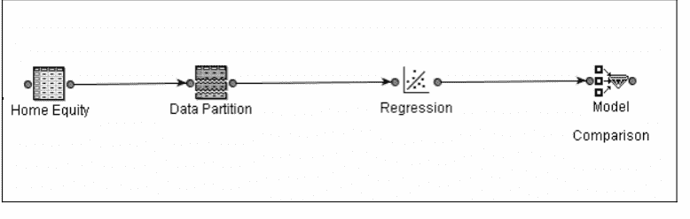
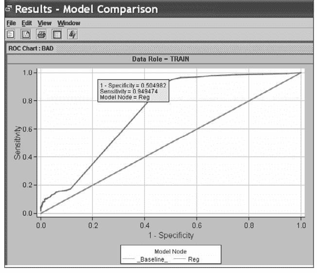
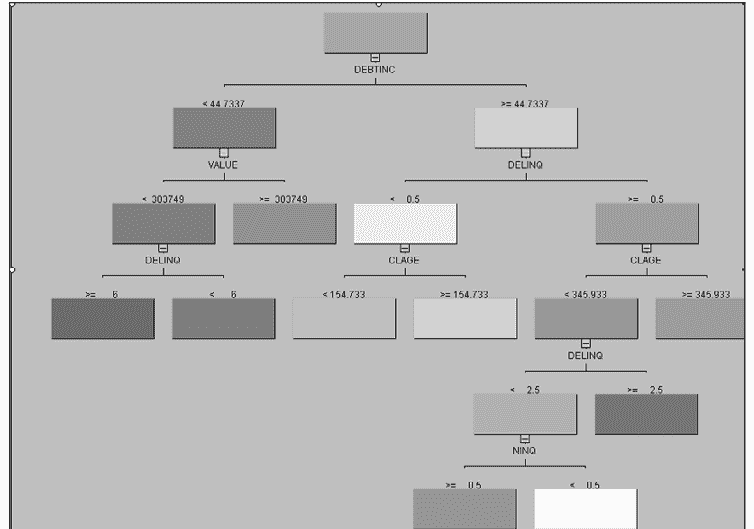
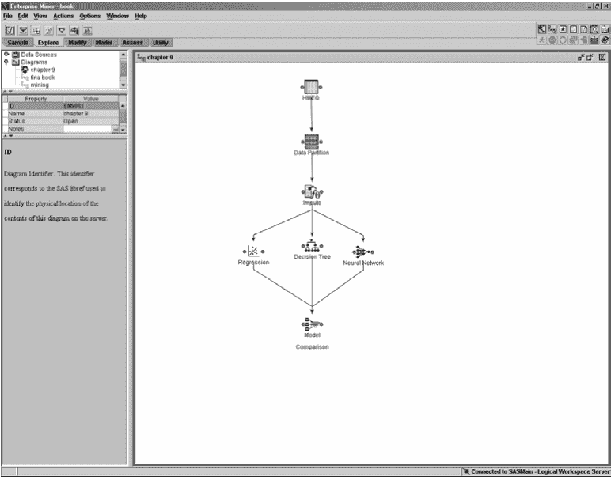
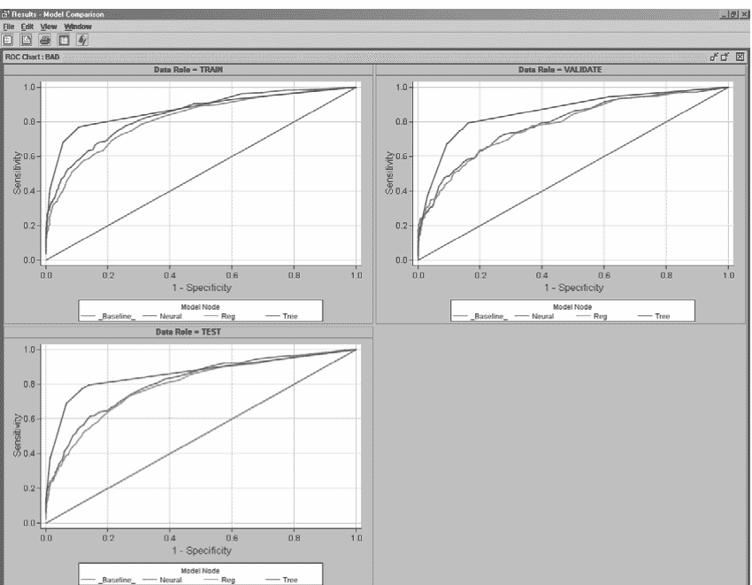
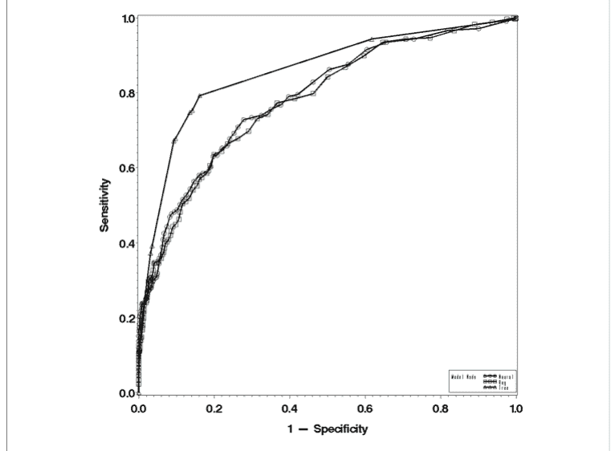

## SAS Enterprise Miner 中的 ROC 曲线


+   9.1 引言 ......................................................... 109
+   9.2 房屋净值贷款示例 ............................................... 110
+   9.3 SAS Enterprise Miner 中单个模型的 ROC 曲线 ............. 111
+   9.4 SAS Enterprise Miner 中竞争模型的 ROC 曲线 ........ 113
+   9.5 使用 PROC GPLOT 从 SAS Enterprise Miner 导出的 ROC 曲线 ......................................................... 116

## 9.1 引言

SAS Enterprise Miner 是一套数据挖掘工具。它于 1998 年推出，主要由营销分析师、数据库营销人员、风险分析师、欺诈调查员以及其他试图在大量数据中寻找模式的专业人士使用。SAS Enterprise Miner 运行在标准的 SAS 平台上，但它使用图形用户界面 GUI，与 SAS 使用的其他任何界面都不同。此外，虽然其运行的 SAS 引擎是可访问的，但 SAS Enterprise Miner 的设计前提是用户将通过其 GUI 访问它。这与本书迄今为止的重点 Base SAS 和 SAS/STAT 形成对比，后者主要通过程序编辑器和运行代码段来访问。

SAS Enterprise Miner 为数据挖掘提供多种方法，包括聚类、降维、链接分析和预测建模。本章重点关注预测建模。在第 8 章中，我们研究了多变量预测模型的 ROC 曲线，并保留 logistic 回归来演示多变量模型中出现的问题以及使用 SAS/STAT 的解决方案。在许多方面，本章是第 8 章的扩展，因为它使用 SAS Enterprise Miner 的功能来检查分类树和神经网络。

SAS Enterprise Miner 具有内置功能，可作为模型评估的一部分生成 ROC 曲线。此外，你可以从生成 ROC 曲线时在后台创建的表中创建一个 SAS 数据集。此数据集然后可与前几章中开发的技术一起用于增强绘图。最后，你可以在 SAS Enterprise Miner 中使用为此目的开发的预测模型对数据集进行评分。评分结果也可以保存为 SAS 数据集，使你能够根据需要访问第 3 章至第 6 章的建模方法。事实上，甚至可以生成用于评分的 SAS 代码。

本章无意作为 SAS Enterprise Miner 的全面指南。模型构建和选择的核心数据挖掘步骤仅在有助于你理解所得数据曲线的程度上进行介绍。我们在此使用的各种中间步骤，例如缺失数据插补，可能不适用于其他数据挖掘练习。要获得 SAS Enterprise Miner 的扎实背景，请参阅 Patricia Cerrito 所著的《使用 SAS Enterprise Miner 进行数据挖掘入门》2006 年版。

本章的读者是 SAS Enterprise Miner 用户，尤其是那些尚未使用该软件进行 ROC 曲线分析的用户。这里假设你已熟悉第 3 章水平的 ROC 曲线，因此此时快速阅读第 3 章可能有用。

## 9.2 房屋净值贷款示例

本章示例的数据来自 SAS Enterprise Miner 的示例数据库 Sampsio.Hmeq。库 Sampsio 在加载 SAS Enterprise Miner 时内部定义，其中包含此数据集。它包含近 6,000 条记录和 13 个变量，其中一个是数据挖掘语言中的结果变量或目标。数据集描绘了一家金融服务公司的房屋净值贷款记录。约 20% 的过去房屋净值信用额度导致违约。为了试图降低违约率，或许生成申请人定制的利率，公司希望建立一个预测房屋净值贷款违约风险的模型。目标变量称为 BAD，值为 1 表示违约，0 表示正常服务贷款。12 个预测变量及其简要定义如下：

+   - CLAGE：最老信用额度年龄（月）
+   - CLNO：信用额度数量
+   - DEBTINC：债务收入比
+   - DELINQ：拖欠信用额度数量
+   - DEROG：重大不良报告数量
+   - JOB：债务人职业
+   - LOAN：贷款金额
+   - MORTDUE：现有抵押贷款到期金额
+   - NINQ：近期信用查询次数
+   - REASON：贷款原因（债务合并或房屋改善）
+   - VALUE：房产价值
+   - YOJ：在现职工作年限

目标是使用数据集中另外 12 个变量为 BAD 变量找到一个预测模型。虽然我们将逐步进行构建预测模型所需的步骤，但重点是使用 SAS Enterprise Miner 的内置功能构建 ROC 曲线，以及探索如何将预测值导出到 SAS 数据集，以便可以使用前几章中讨论的方法和宏执行自定义分析。


## 9.3 SAS Enterprise Miner 中单个模型的 ROC 曲线

SAS Enterprise Miner 将其对象组织在流程图中，其中包含数据、模型和结果。流程图的组成部分称为节点，它们可以连接到流程中的其他节点。流程可以保存为项目，其中可能还包含其他流程。

SAS Enterprise Miner 中的大多数操作都可以通过三种等效方法指定：使用菜单、使用工具栏或使用项目导航器（SAS Enterprise Miner 启动时窗口的左侧部分）。工具栏和项目导航器包含可以拖放的图标，因此比使用菜单更方便。您还可以自定义这些图标。

按照以下步骤准备预测建模的数据。首先，定义数据源。这类似于在 SAS DATA 步中使用 LIBNAME 语句，然后使用 PROC COPY 将所需数据集带到工作区。然后，从数据源中选择一个具体的数据集进行工作。在数据挖掘中，将数据划分为训练、验证和测试数据集是惯例，可以使用数据划分节点完成。训练和验证数据在第 8 章中有讨论，其中术语测试数据与验证数据可互换使用。本章的术语遵循 SAS Enterprise Miner 的用法，因此此处的验证数据和测试数据指的是两个不同的实体。验证数据集的使用目的与第 8 章中相同，但此处的测试数据集主要用于对验证数据集的发现进行确认。这种做法在数据挖掘以外的领域中不太常见。

以下步骤更精确地描述了如何执行这些任务：

- 1. 通过在项目导航器中右键单击数据来源，选择创建数据源并按菜单操作进行。确保变量 BAD 的模型角色字段为目标且类型为二元。所有其他变量应列为输入。
- 2. 通过从工具栏或项目导航器拖放创建一个新图表。图表图标描绘了一系列相互连接的方框，上面有一个黄色星星。创建新图表的替代方法包括选择文件→新建→图表或按住 CTRL 和 Shift 键并按 D。
- 3. 双击窗口左上角的数据源。将 Home Equity 拖放到图表工作区中（窗口的右侧部分，此时应为空白）。
- 4. 通过将图标拖放到图表工作区中添加数据划分，或 alternatively 选择操作→添加节点→采样→数据划分。
- 5. 用箭头连接 Home Equity 和数据划分图标。当光标呈铅笔形状时可以绘制箭头。

请注意，图表指定了要执行的操作，但仅指定是不够的以便执行。流程，无论整体还是子集，都需要运行才能执行指定的操作。例如，当数据划分节点运行时，会创建训练、验证和测试集。要运行流程，请右键单击节点并选择运行。所选节点之前及包括该节点的所有节点将按顺序执行。可以随着图表的指定逐个运行每个节点，但分大块运行流程更高效。

现在我们准备进行建模。由于目标变量是二元的，逻辑回归是建模的合理起点。要在 SAS Enterprise Miner 中拟合逻辑模型，您需要添加一个指定此操作的节点，并将回归节点连接到数据划分节点创建的数据集。以下步骤描述了此过程：

- 1. 在模型选项卡高亮显示时，通过拖动图标将回归节点添加到图表中。
- 2. 用箭头将数据划分节点连接到回归节点。
- 3. 通过从评估选项卡拖放将模型比较节点添加到图表中，并用箭头将其连接到回归节点。

此时，显示应大致如图 9.1 所示。

## 图 9.1 使用逻辑回归预测房屋净值贷款违约



现在，右键单击模型比较节点并选择运行。一旦节点运行，其结果将在整个 SAS Enterprise Miner 会话中保持可用。图表和结果默认保存，并在以后重新启动 SAS Enterprise Miner 会话时可用。

当模型比较节点运行时，右键单击该节点并选择结果。会出现一个新窗口，其中包含标题为拟合统计、输出和 ROC 图的子窗口。在 ROC 图子窗口中，有三条 ROC 曲线，分别对应每个数据集：训练、验证和测试。图 9.2 仅聚焦于训练集的 ROC 曲线，显示在左上角。45 度参考线，在图例中称为基线，默认绘制。随着您沿曲线移动光标，弹出文本框会提供该 ROC 曲线点的灵敏度和特异性详细信息。图 9.2 包含一个示例点，其中灵敏度为 50.5%，一减去特异性为 94.9%。

## 图 9.2 使用房屋净值贷款数据对逻辑回归模型的 ROC 曲线



如输出 9.1 所示，曲线下面积在输出窗口中 readily 报告，标记为 ROC 指数，分别为训练、验证和测试集的 0.72385、0.69319 和 0.67768。

## 输出 9.1

```
Fit Statistics
Model selection based on _TMISC_

Train:      Valid:      Test:
Roc         Roc         Roc
Index       Index       Index
0.72385     0.69319     0.67768
```

## 9.4 SAS Enterprise Miner 中竞争模型的 ROC 曲线

除了逻辑回归外，我们还将使用 SAS Enterprise Miner 工具包中的另外两种方法：决策树和神经网络。它们在 SAS/STAT 中不可用，因此使用 SAS 的统计学家可能不熟悉它们。出于这个原因，这里简要描述这些方法。

决策树，也称为统计文献中的递归划分，主要是以分层方式考虑每个变量的二元分割。对于第一次分割，所有变量都会逐一考虑，并保留提供最佳分割的变量（根据常用的几个标准之一，例如误分类率或基尼指数）。不再进一步分割的节点称为*终端节点*或*叶节点*。一旦选择了该变量，相同的过程会再次重复两次，分别针对二元分割的两侧。SAS Enterprise Miner 还考虑一个节点一侧的多次分割，因此可能出现一侧为叶节点而另一侧分割多次的树。多项变量被分组为两组，以便得到的二元分组给出最佳分割。同样，连续变量也通过找到最佳截止值分割为两组。房屋净值贷款示例的 resulting 决策树出现在图 9.3 中。

## 图 9.3 房屋净值贷款示例的示例决策树



例如，第一个使用的变量是 DEBTINC，这是一个连续变量。它在 44.7337 处分割。对于负债收入比小于 44.7337 的人，下一个最佳分割是 VALUE，分割点为 303,749。

决策树在重要方面区别于逻辑回归和神经网络：没有统计模型。因为没有模型，所以没有预测方程。当对新观测进行评分时，它会从树的顶部“落下”，并根据协变量的值在每个节点遵循指定的路径，直到到达终端节点（或叶节点）。这可以描述为一系列 IF-THEN-ELSE 语句形式的规则。

树的二元分割结构是一个优势，因为它易于解释。它也可能是一个缺点，尤其是在某些预测变量是连续的情况下。对连续协变量的分类可能导致效率低下并对预测性能产生不利影响。决策树的另一个优点是它们能非常有效地处理缺失数据。这是通过在每个节点建立替代分割来实现的，当该节点的分割变量缺失时可以使用。

*神经网络*是一个总称，用来描述构建模仿大脑功能的模型的方法。它们的精确数学描述很复杂且不太可能


benefit an ROC-focused discussion. Think of neural networks as a specific yet flexible class of nonlinear regression models.

Before we run decision trees and neural networks on the same data set, there is one important issue to consider about missing data. Both logistic regression and neural networks require complete observations. If any portion of a record is missing, that record is completely ignored during model building. Decision trees are more forgiving. They consider surrogate splits in case the variable for the primary split is missing. For this reason, if we run logistic regression, neural networks, and decision trees on the same input data, the actual data that the predictive model rests on may not be identical from one method to the other. You could address this by imputing the value from a distribution derived from the normal density. An imputation node can be dragged and dropped from the Modify tab, as seen in Figure 9.4. The same figure also shows the addition of decision tree and neural network nodes, both dragged and dropped from the Model tab.

## Figure 9.4 SAS Enterprise Miner Diagram Workspace for the Competing Models Example



The flow in Figure 9.4 implies that the same data set will be analyzed three different ways and the results compared in the final node.

Three ROC curves, one for each method of analysis, are plotted to better assess the predictive power of the models (see Figure 9.5). Neural networks and logistic regression have very similar performance. The decision tree outperforms regression and neural networks. It has higher sensitivity than the other two for a given value of specificity for the most part, especially in the range where both sensitivity and specificity are above 0.5. The neural network method is slightly better than the regression method, although the difference between the two seems to dissipate in the validation and test sets. Output 9.2 reports the AUCs for each model and data set. The AUC for the decision tree is consistently above 85%, while the other two models’ AUCs cluster around 80%.

## Output 9.2

|  | Train: | Valid: | Test: |
| Model | Roc | Roc | Roc |
| Node | Index | Index | Index |
|  |  |  |  |
| Neural | 0.84003 | 0.78812 | 0.80917 |
| Reg | 0.81356 | 0.78147 | 0.79139 |
| Tree | 0.86871 | 0.85724 | 0.85971 |

## Figure 9.5 ROC Curves from SAS Enterprise Miner for Each of the Three Models and Data Sets



## 9.5 ROC Curves Using PROC GPLOT with Exported Data from SAS Enterprise Miner

While SAS Enterprise Miner provides a built-in capability for plotting the ROC curve, sometimes you might want to output the data set containing the ROC points so that you can use the %PLOTROC macro for custom graphics. This can be done by selecting View→Table, which displays the SAS data set behind the ROC curve. At this point, selecting File→Save As gives you the option to save the table as a permanent data set that can be accessed later using Base SAS and SAS/GRAPH.

To give you some ideas, Output 9.3 lists the first 23 observations in the data set produced by SAS Enterprise Miner using the flow in Figure 9.4. The key variables are SENSITIVITY and ONEMINUSSPECIFICITY. Additional useful variables are MODELNODE and DATAROLE. The MODEL variable contains four categories: _Baseline_ (denoting the model where no covariate information is used, which results in the 45-degree line), Neural (corresponding to the Neural Network node), Reg (corresponding to the Regression node), and Tree (corresponding to the Decision Tree node). DATAROLE simply indicates whether the corresponding observation is for training, validation, or testing only. Traditionally, ROC curves are plotted only for the validation data set, but you can compare the amount of overestimation with the availability of this variable in Output 9.3.

## Output 9.3

| Obs | Node | Model Node | Variable | Role | Event | Specificity | Sensitivity |
|---|---|---|---|---|---|---|---|
| 1 | Neural | _Baseline_ | BAD | TRAIN | 1 | 0.00000 | 0.00000 |
| 2 | Neural | _Baseline_ | BAD | TRAIN | 1 | 1.00000 | 1.00000 |
| 3 | Neural | _Baseline_ | BAD | VALIDATE | 1 | 0.00000 | 0.00000 |
| 4 | Neural | _Baseline_ | BAD | VALIDATE | 1 | 1.00000 | 1.00000 |
| 5 | Neural | _Baseline_ | BAD | TEST | 1 | 0.00000 | 0.00000 |
| 6 | Neural | _Baseline_ | BAD | TEST | 1 | 1.00000 | 1.00000 |
| 7 | Neural | Neural | BAD | TRAIN | 1 | 0.00000 | 0.08000 |
| 8 | Neural | Neural | BAD | TRAIN | 1 | 0.00000 | 0.09263 |
| 9 | Neural | Neural | BAD | TRAIN | 1 | 0.00000 | 0.10737 |
| 10 | Neural | Neural | BAD | TRAIN | 1 | 0.00000 | 0.11368 |
| 11 | Neural | Neural | BAD | TRAIN | 1 | 0.00000 | 0.12000 |
| 12 | Neural | Neural | BAD | TRAIN | 1 | 0.00000 | 0.12421 |
| 13 | Neural | Neural | BAD | TRAIN | 1 | 0.00000 | 0.12632 |
| 14 | Neural | Neural | BAD | TRAIN | 1 | 0.00000 | 0.13263 |
| 15 | Neural | Neural | BAD | TRAIN | 1 | 0.00000 | 0.13474 |
| 16 | Neural | Neural | BAD | TRAIN | 1 | 0.00000 | 0.14737 |
| 17 | Neural | Neural | BAD | TRAIN | 1 | 0.00052 | 0.15579 |
| 18 | Neural | Neural | BAD | TRAIN | 1 | 0.00052 | 0.16632 |
| 19 | Neural | Neural | BAD | TRAIN | 1 | 0.00052 | 0.18316 |
| 20 | Neural | Neural | BAD | TRAIN | 1 | 0.00210 | 0.19579 |
| 21 | Neural | Neural | BAD | TRAIN | 1 | 0.00315 | 0.20000 |
| 22 | Neural | Neural | BAD | TRAIN | 1 | 0.00315 | 0.20842 |
| 23 | Neural | Neural | BAD | TRAIN | 1 | 0.00367 | 0.21263 |

| Obs | True Positive | True Negative | False Positive | False Negative | First In Group | Last In Group | Up Posterior | Low Posterior |
|---|---|---|---|---|---|---|---|---|
| 1 | 357 | 0 | 1433 | 0 | 0.01638 | 0.01414 | 0.01649 | 0.00000 |
| 2 | 357 | 0 | 1433 | 0 | 0.01638 | 0.01414 | 0.01649 | 0.00000 |
| 3 | 357 | 0 | 1433 | 0 | 0.01638 | 0.01414 | 0.01649 | 0.00000 |
| 4 | 357 | 0 | 1433 | 0 | 0.01638 | 0.01414 | 0.01649 | 0.00000 |
| 5 | 357 | 0 | 1433 | 0 | 0.01638 | 0.01414 | 0.01649 | 0.00000 |
| 6 | 357 | 0 | 1433 | 0 | 0.01638 | 0.01414 | 0.01649 | 0.00000 |
| 7 | 38 | 1907 | 0 | 437 | 0.99957 | 0.99066 | 1.00000 | 0.98994 |
| 8 | 44 | 1907 | 0 | 431 | 0.98922 | 0.98331 | 0.98994 | 0.98054 |
| 9 | 51 | 1907 | 0 | 424 | 0.97777 | 0.96834 | 0.98054 | 0.96766 |
| 10 | 54 | 1907 | 0 | 421 | 0.96698 | 0.96111 | 0.96766 | 0.95897 |
| 11 | 57 | 1907 | 0 | 418 | 0.95682 | 0.94955 | 0.95897 | 0.94757 |
| 12 | 59 | 1907 | 0 | 416 | 0.94559 | 0.93612 | 0.94757 | 0.93349 |
| 13 | 60 | 1907 | 0 | 415 | 0.93087 | 0.93087 | 0.93349 | 0.92554 |
| 14 | 63 | 1907 | 0 | 412 | 0.92020 | 0.91320 | 0.92554 | 0.91079 |
| 15 | 64 | 1907 | 0 | 411 | 0.90838 | 0.90838 | 0.91079 | 0.90047 |
| 16 | 70 | 1907 | 0 | 405 | 0.89257 | 0.88287 | 0.90047 | 0.88271 |
| 17 | 74 | 1906 | 1 | 401 | 0.88255 | 0.87657 | 0.88271 | 0.87213 |
| 18 | 79 | 1906 | 1 | 396 | 0.86769 | 0.86015 | 0.87213 | 0.85448 |
| 19 | 87 | 1906 | 1 | 388 | 0.84880 | 0.84035 | 0.85448 | 0.83941 |
| 20 | 93 | 1903 | 4 | 382 | 0.83848 | 0.83108 | 0.83941 | 0.82600 |
| 21 | 95 | 1901 | 6 | 380 | 0.82092 | 0.81388 | 0.82600 | 0.81205 |
| 22 | 99 | 1901 | 6 | 376 | 0.81022 | 0.80096 | 0.81205 | 0.79862 |
| 23 | 101 | 1900 | 7 | 374 | 0.79628 | 0.78792 | 0.79862 | 0.78480 |

The ROC curves in Figure 9.6 are identical to the ones in the second panel of Figure 9.5 and are generated by PROC GPLOT using the following statements. You can exercise more control on the aesthetic and functional aspects of the curve with PROC GPLOT.

```
axis1 length=12cm order=0 to 1 by 0.2 label=(f=swissb h=2)
value=(font=swissb h=2);
axis2 length=12cm order=0 to 1 by 0.2 label=(a=90 f=swissb h=2)
value=(font=swissb h=2);

symbol1 v=none i=join w=2 c=black l=33 h=1.5;
symbol2 v=none i=join w=2 c=black l=1 h=1.5;
symbol3 v=none i=join w=2 c=black l=3 h=1.5;
symbol4 v=none i=join w=2 c=black l=9 h=1.5;

legend1 position=(inside right bottom) frame across=1;

proc gplot data=em(where=(datarole='VALIDATE'));
  plot sensitivity*oneminusspecificity=model / haxis=axis1
vaxis=axis2 legend=legend1;
run;
quit;
```

## Figure 9.6 ROC Curves for the Validation Data Using PROC GPLOT




