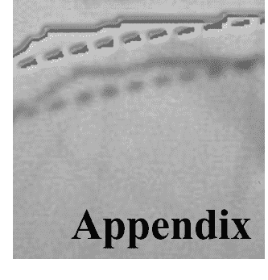

# PROC NLMIXED 简介



A.1 使用 PROC GLM 与 PROC NLMIXED 拟合简单线性模型 ............ 119
A.2 PROC NLMIXED 与双正态模型 ........................................ 124

PROC NLMIXED 在本书中发挥着核心作用。第 3、4 和 5 章使用它来拟合双正态模型，双正态模型是构建和分析 ROC 曲线的<|message|>基本工具之一。

PROC NLMIXED 提供了独特且范围广泛的功能，但其语法与其他大多数 SAS/STAT 模型过程不同。因此，对于习惯于通过研究模型拟合所用程序来获得见解的读者来说，PROC NLMIXED 代码可能难以辨认且更难掌握。本附录面向熟悉通用 SAS/STAT 模型语法但对 PROC NLMIXED 尚不熟悉的用户。以下过程的常规用户可能会发现本附录有所帮助：GLM、ANOVA、REG、GENMOD、LOGISTIC、PROBIT 和 MIXED。

本附录并非 PROC NLMIXED 所有特性的总结。相反，它侧重于与 ROC 曲线相关的功能。SAS/STAT 手册对 PROC NLMIXED 提供了详尽的覆盖，对于希望将该过程用于本附录所涵盖范围之外的用户而言，这些手册会很有帮助。

## A.1 使用 PROC GLM 与 PROC NLMIXED 拟合简单线性模型

考虑以下生成包含 100 个观测值的数据集的编程语句。存在一个分组变量 X，取值为 0 或 1，以及一个结果变量 Y，在每个组内服从正态分布。目标是使用 PROC GLM 和 PROC NLMIXED 将以下模型拟合到该数据集：

y = α + βX + ε

其中 ε 服从均值为 0、方差为 σ² 的正态分布。

```
data appendix;
    do i=1 to 100;
        x=rand('bernoulli',0.5);
        e=rannor(0);
        y=x+e;
        output;
    end;
run;
```

以下语句在 PROC GLM 中拟合该模型。PROC GLM 中的 MODEL 语句专门设计为识别该模型的这些特殊特征：

- 存在截距（有排除截距的选项）
- 模型项的线性
- 误差项服从方差恒定的正态分布。

因此，只需写出 model y=x 就足够了。

```
title "Simple Linear Model Using GLM";
proc glm;
    model y=x;
run;
quit;
```

输出 A.1 显示了 PROC GLM 的结果。α（标记为 Intercept）和 β（标记为 X）的参数估计值分别为 −0.241 和 1.254，标准误差分别为 0.148 和 0.197。σ² 的估计值由均方误差提供（0.9578）。

## Output A.1

Simple Linear Model Using GLM

The GLM Procedure

Number of Observations Read          100
Number of Observations Used          100

Dependent Variable: Y

Source       DF   Sum of Squares   Mean Square   F Value   Pr > F
Model        1    38.7439429       38.7439429    40.45     <.0001
Error        98   93.8638957       0.9577949
Corrected Total 99 132.6078386

R-Square   Coeff Var   Root MSE   y Mean
0.292169   212.2180    0.978670   0.461163

Source   DF   Type I SS   Mean Square   F Value   Pr > F
x        1    38.74394287 38.74394287   40.45     <.0001

## Output A.1 (continued)

| Source | DF | Type III SS | Mean Square | F Value | Pr > F |
|---|---|---|---|---|---|
| x | 1 | 38.74394287 | 38.74394287 | 40.45 | <.0001 |

| Parameter | Estimate | Standard Error | t Value | Pr > |t| |
|---|---|---|---|---|
| Intercept | -0.241051559 | 0.14754004 | -1.63 | 0.1055 |
| x | 1.253953858 | 0.19715868 | 6.36 | <.0001 |

PROC NLMIXED 没有具有这些特征的 MODEL 语句。相反，模型需要逐步传达给 PROC NLMIXED，并对模型和变量的分布提供具体说明。以下 PROC NLMIXED 代码拟合相同的模型：

```
title "Simple Linear Model Using NLMIXED";
proc nlmixed;
    parms var=1 alpha=0 beta=0;
    mu=alpha+x*beta;
    model y~normal(mu,var);
run;
quit;
```

从末尾开始拆解 PROC NLMIXED 程序最有用。MODEL 语句与 PROC GLM 中的语句没有相似之处。等号被波浪号（~）取代，其含义为“服从分布”。因此，此模型语句指定响应变量 Y 服从均值为 MU、标准差为 VAR 的正态分布。PROC GLM 语法与 PROC NLMIXED 语法之间的一个关键区别是，在 PROC NLMIXED 中，MODEL 语句的右侧只能允许参数，而在 PROC GLM 中，只能允许变量。

语句 mu=alpha+x*beta 将模型参数与数据集变量连接起来。它指定正态分布的均值与协变量 X 以线性方式相关。大多数 DATA 步函数都可用于 PROC NLMIXED 中的编程，因此您可以构建参数之间几乎任何函数关系。

最后，PARMS 语句告诉 PROC NLMIXED 哪些项是参数。PARMS 语句不是必需的。如果没有它，PROC NLMIXED 假定任何未从数据集中分配值，或未从过程内的编程语句中分配值的项都是参数。在本例中，可以很容易地检查省略 PARMS 语句不会改变输出。在更复杂的模型中，PARMS 语句有助于您跟踪模型参数。参数名称后等号后面的数字是 PROC NLMIXED 所采用的数值搜索方法的起始值。目前可以安全地忽略它们，直到本附录后面简要讨论 PROC NLMIXED 中使用最大似然的含义为止。

此 PROC NLMIXED 调用产生的输出如下所示。α、β 和 σ² 的参数估计值分别为 −0.241、1.254 和 0.9386，标准误差分别为 0.148、0.197 和 0.1327。α 和 β 的估计值与 PROC GLM 提供的估计值相同（在舍入范围内），但 σ² 的估计值似乎略有差异（0.9578 与 0.9386）。这种差异源于两个过程使用的不同估计方法。这种差异通常很小，尤其是在中等到大样本量时。我们接下来会讨论这个问题。

## Output A.2

```
Simple Linear Model Using NLMIXED

The NLMIXED Procedure

Specifications

Data Set                          WORK.APPENDIX
Dependent Variable                 Y
Distribution for Dependent Variable Normal
Optimization Technique             Dual Quasi-Newton
Integration Method                 None

Dimensions

Observations Used                  100
Observations Not Used               0
Total Observations                100
Parameters                          3

Parameters

var    alpha    beta    NegLogLike
1          0       0      168.83132

Iteration History

Iter    Calls    NegLogLike      Diff      MaxGrad      Slope
1          2    148.184071   20.64725   18.21043   -535.042
2          3    142.074894    6.109177  10.23585    -21.7239
3          6    140.056178    2.018716   7.234336     -8.129
4          7    139.602406    0.453772   9.640041    -4.14434
5          8    138.860921    0.741485   3.650731    -1.86665
6         10    138.744238    0.116683   1.583923    -0.32313
7         12    138.727766    0.016472   0.114029    -0.03642
8         14    138.727636    0.00013    0.008173    -0.00027
```

## Output A.2 (continued)

```
Simple Linear Model Using NLMIXED

The NLMIXED Procedure

Iteration History

Iter    Calls    NegLogLike    Diff    MaxGrad    Slope
9       16       138.727635    7.861E-7    0.000312    -1.62E-6
10      18       138.727635    2.272E-9    0.000024    -4.4E-9

NOTE: GCONV convergence criterion satisfied.

Fit Statistics

-2 Log Likelihood                     277.5
AIC (smaller is better)                283.5
AICC (smaller is better)               283.7
BIC (smaller is better)                291.3

Parameter Estimates

Parameter    Estimate    Standard Error    DF    t Value    Pr > |t|    Lower    Upper    Gradient
var          0.9386      0.1327            100   7.07       <.0001      0.6753   1.2020   -8.19E-6
alpha        -0.2411     0.1461            100   -1.65      0.1020      -0.5308  0.04872  -0.00002
beta         1.2540      0.1952            100   6.42       <.0001      0.8667   1.6412   -0.00002
```

PROC GLM 使用最小二乘法来寻找估计值。对于给定的统计线性模型，最小二乘方程具有闭式解；也就是说，您可以求解一组线性方程来获得估计值。PROC GLM 输出中的诸如平方和和均方等信息都与总平方和的方差分析分解有关，该概念与最小二乘方法密切相关。

相比之下，PROC NLMIXED 使用基于似然的方法。这些方法非常通用。它们可有效用于非线性或非正态模型。一般性的代价是缺乏闭式解。一般来说，似然方程是非线性的，只能通过数值搜索算法求解。例如，在 PROC NLMIXED 输出的 Specifications 标题下，优化方法列为 Dual Quasi-Newton。这是求解似然方程以获得估计值的一种方法。Dual Quasi-Newton 算法（以及 PROC NLMIXED 中可通过过程语句的 METHOD 选项指定的其他算法）是迭代的。该算法以小的步长，称为迭代，向解迈进。迭代的起点是 PARMS 语句中列出的（等号后）的值。输出中的 Iteration History 部分给出了每次迭代的详细信息。该表通常仅对 PROC NLMIXED 的高级用户有用。

σ² 估计值略有差异的原因是最大似然估计使用 n（总样本量）作为方差估计的分母，而最小二乘法使用 n−p，其中 p 是模型参数的数量。在 p 相对于 n 很小的程度上，估计值会接近。您可以通过将误差平方和（93.8639）除以 100 从 PROC GLM 输出中获得最大似然估计。


模型拟合通过似然准则进行评估，例如 PROC NLMIXED 中报告在 Fit Statistics 下的 Akaike 信息准则（AIC）或贝叶斯信息准则（BIC）。这些准则对于模型比较很有用。PROC MIXED 的用户，另一种使用似然方法的程序，会熟悉这些准则。相比之下，PROC GLM 中的模型拟合通常通过全模型 F 检验来评估，而 F 检验是平方和的函数。

Parameter Estimates 表的结构与其它 SAS/STAT 程序的输出相似。输出中通常还有一列标记为 Alpha，报告用于置信区间的显著性水平，这里为节省空间已删除。还提供了一个额外信息，即最终迭代时的梯度值，但这可能只对高级用户有益。

## A.2 PROC NLMIXED 与双变量正态模型

了解第 3 章和第 5 章中使用的 PROC NLMIXED 程序是如何开发的可能会很有用。首先，考虑第 3.5 节中的模型和代码：

```
proc nlmixed;
  parms m1=0 m0=0 s1=1 s0=1;
  if gold=1 then m=m1;else if gold=0 then m=m0;
  if gold=1 then s=s1**2;else if gold=0 then s=s0**2;
  a=(m1-m0)/s1;
  b=s0/s1;
  model y~normal(m,s);
  estimate 'a' a;
  estimate 'b' b;
  estimate 'AUC' probnorm(a/sqrt(1+b**2));
run;
quit;
```

MODEL 语句指定了一个均值为 M、方差为 S 的正态分布结果，均值和方差由两个 IF 语句定义。这会产生 ROC 分析，但你必须手动（或在 DATA 步中）生成双变量正态参数 a 和 b 以及 ROC 曲线下面积（AUC）的点估计。获得它们的方差将花费相当多的时间和一些 PROC IML 知识。这凸显了 ESTIMATE 语句的实用性，在其中你可以使用类似 DATA 步的编程方法定义任何非线性变换并获得点估计和标准误。以下代码展示了两种不同的方法：

- 1. 这些量可以先定义然后再估计。此方法用于上述代码中的双变量正态参数 a 和 b。
- 2. 定义可以在 ESTIMATE 步骤中执行。此方法用于上述代码中的 AUC。

请注意，PROC GLM 及其他 SAS/STAT 程序中的 ESTIMATE 语句仅适用于线性变换，因此使用例如 PROC GLM 获得 a、b 和 AUC 的估计是不可能的。

现在让我们重新审视第 5 章中的潜在双变量正态模型。这突出了 PROC NLMIXED 的一个主要优势：能够指定任意似然函数。

```
proc nlmixed data=moody gconv=0;
    parms alpha=1 theta1=1 theta2=2 theta3=3 beta=1;
    bounds theta1>0, theta2>0, theta3>0;
    eta1=alpha*def;
    eta2=exp(beta*def);
        if r11=1 then z=probnorm(-eta1/eta2);
    else if r11=2 then z=probnorm((theta1-eta1)/eta2)-
        probnorm(-eta1/eta2);
    else if r11=3 then z=probnorm((theta2+theta1-eta1)/eta2)-
        probnorm((theta1-eta1)/eta2);
    else if r11=4 then z=probnorm((theta3+theta2+theta1-eta1)/eta2)-
        probnorm((theta2+theta1-eta1)/eta2);
    else if r11=5 then z=1 - probnorm((theta3+theta2+theta1-
        eta1)/eta2);
    if z>1e-6 then ll=log(z);
    else ll=-1e6;
    model r11 ~ general(ll);
    estimate 'AUC' probnorm(alpha/sqrt(1+beta**2));
run;
```

MODEL 语句指定了一个 GENERAL（LL）模型。这意味着似然函数（的对数）由用户通过项 LL 定义。回想一下 R11 表示有序信用评分，底层模型是有序回归的潜在模型。每个 IF 语句指定了 R11 的每个可能取值对似然的贡献。这些贡献在第 5 章中被推导为

$$\gamma_k(z)=\Phi\left(\frac{\theta_k - \alpha D}{e^{\beta z}}\right)$$

IF 语句的结构与此公式非常接近。这些语句唯一地定义了 Z 的值，即似然，进而定义 LL，即 Z 的对数。贡献小于 10^-6 的似然将被计为 10^-6 的条件确保了非常小的贡献不会导致数值不稳定。
