## Part 1. Module 1

## Android 编程入门

掌握开发强大移动应用所需的所有 Java 和 Android 技能。

### Chapter 1. The First App

欢迎！本章我们将不浪费任何时间，直接开始开发 Android 应用。

我们将探讨 Android 到底有什么出色之处，Android 和 Java 究竟是什么，它们如何协同工作并相互补充，以及这对我们作为未来开发者意味着什么。

接下来，我们将花些时间搭建开发环境，然后立即构建并部署第一个应用。

本章结束时，我们将完成以下操作：

- 搭建 **Java 开发工具包 (JDK)**，这是必需的 Android 开发环境的一部分
- 安装了 Android Studio，这是我们 Android 开发环境的最后一部分
- 构建了我们的第一个 Android 应用
- 部署了 Android 模拟器
- 在 Android 模拟器和真实设备上运行我们的应用

#### Java 与 Android 如何协同工作

使用 Java 为 Android 编写程序后，我们点击一个按钮，将代码转换为 Android 能理解的另一种形式。这种形式称为 Dalvik 可执行 (DEX) 代码，转换过程称为编译。编译在点击该按钮后在开发机上进行。我们在搭建完开发环境后将立即看到这一过程。

Android 是一个相当复杂的系统，但您无需深入理解即可开发出惊人的应用。Android 系统中负责执行（运行）我们编译后的 DEX 代码的部分称为 Dalvik 虚拟机 (DVM)。DVM 本身是一段用另一种语言编写的软件，运行在经过特别调整的 Linux 操作系统版本上。因此，用户所见的 Android，本身只不过是运行在另一操作系统上的一个应用。

DVM 的目的是隐藏 Android 运行其上的硬件和软件的复杂性和多样性，但同时，其目的也是暴露所有有用功能。这种功能暴露通常以两种方式实现。DVM 本身必须能访问硬件，它确实可以，但这种访问必须对程序员友好且易于使用。得益于 Android 应用程序编程接口 (API)，DVM 允许我们的访问方式确实易于使用。

#### Android API

Android API 是让做出非凡功能变得非常简单的代码。可以用一台机器（比如汽车）来做简单类比。当你踩下油门时，引擎盖下会发生一大串事情。我们不需要了解燃烧或油泵，因为一位聪明的工程师为我们提供了一个 **界面**。在这里，这是一个机械界面——油门踏板。

请参考以下 Java 代码行；如果您完全是 Android 新手，这行代码可能看起来有点令人望而生畏：

```
locationManager.getLastKnownLocation(LocationManager.GPS_PROVIDER);
```

然而，一旦您了解这一行代码会搜索可用卫星，然后与环绕地球运行的卫星通信，同时检索您在地球上的精确纬度和经度，就很容易开始窥探 Android API 与 DVM 结合的强大功能和深度。即使这段代码此刻看起来有点挑战性，也想象一下用其他方式与卫星通信吧！

Android API 主要是一大堆 Java 代码。那么，如何利用所有这些代码来做酷炫的事情，又不被其复杂性淹没呢？如何在 Android API 中找到并操作油门、方向盘和天窗呢？

> **Note**
>
> 关于 Android 代码行数的估计各不相同。有些估计低至 100 万行，有些高达 2000 万行。可能令人惊讶的是，尽管代码量巨大，但在编程圈中，Android 以“轻量级”著称。

#### Java 是面向对象的

Java 是一种比 Android 早出现很多的编程语言。它是一门面向对象的语言。这意味着它使用可重用编程对象的概念。如果这听起来像是技术术语，另一个类比会有所帮助。Java 使我们和其他人（例如 Android 开发团队）能够编写基于现实世界“事物”构建的 Java 代码，而这里的关键是，这些代码可以被重复使用。

因此，借用汽车类比，我们可以问：如果制造商一天生产不止一辆汽车，他们会为每一辆汽车重新设计每一个零件吗？

答案当然是否定的。他们会让熟练的工程师开发出恰到好处的零部件，这些零部件经过多年的打磨、改进和完善。随后，相同的零部件会被反复使用，并偶尔进行改进。现在，如果您要对我的类比吹毛求疵，那么可以争辩说汽车的每个零部件仍然需要由真实工程师或机器人等利用原材料来制造。

这是事实。软件工程师编写代码时实际做的是为对象构建蓝图。然后我们使用 Java 代码根据他们的蓝图创建对象，一旦有了该对象，就可以对其进行配置、使用、与其他对象组合等。此外，我们还可以设计蓝图并从中创建对象。编译器随后将我们定制的创作翻译（制造）为 DEX 代码。

在 Java 中，蓝图称为类。当类转化为真正可运行的东西时，我们称其为对象。

> **Note**
>
> **对象概要**
>
> - Java 是一种允许我们一次编写代码并可反复使用的语言。
> - 这非常有用，因为它节省了时间，并允许我们使用他人的代码来执行我们原本可能没有时间或知识自行编写的任务。
> - 大多数时候，我们甚至不需要查看此代码，也不需要知道它如何工作！

最后一个类比。我们只需要知道如何使用这段代码，就像我们只需要学会开车一样。

因此，Google 总部的一位聪明的软件工程师编写了一个极其复杂的 Java 程序，可以与卫星通信。随后，他思考如何使这段代码对所有 Android 程序员都有用。他所做的一件事是，将获取设备在世界上的位置等功能变成一个简单的一行任务。因此，我们之前看到的那行代码会触发我们看不见的更多代码行。这是使用他人代码来使我们的代码无限简单的一个例子。

#### Android 究竟是什么？

我们知道，要在 Android 上完成任务，我们需要编写自己的 Java 代码，并且这些代码也使用 Android API 的 Java 代码。随后这些代码被编译为 DEX 代码，并由 DVM 运行，而 DVM 又与名为 Linux 的底层操作系统相连接。

然后，Android 设备和各个硬件组件的制造商编写名为驱动程序的高级软件，以确保其硬件（CPU、GPU、GPS 接收器等）可以在底层 Linux 操作系统上运行。

我们的编译后的 Java 代码连同一些其他资源，被放置在一个名为 **Android 应用程序包 (APK)** 的文件包中，DVM 需要它来运行我们的应用。此过程在下图中解释：

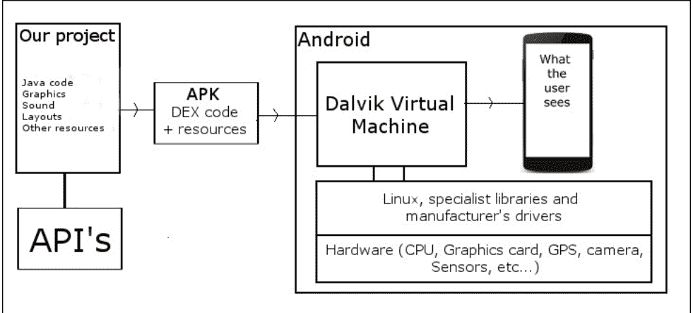

总之，我们只需学习如何阅读和编写 Java 代码，即可开始学习并利用 Android API。

所有这些工具都是免费的，所以让我们来看看我们将使用的开发环境。


## 开发环境

开发环境是指在一个地方拥有开发、设置和准备就绪所需的一切的术语。要开始，我们需要以下两件事：

- 我们讨论过将我们的 Java 代码以及其他人的 Java 代码编译为在 DVM 上运行、在人们的 Android 设备上运行的 DEX 代码。要使用 Java 代码，我们需要一个名为 JDK 的免费软件。JDK 还包括其他人的代码，这与 Android API 分开。
- 开发 Android 需要一整套工具，当然我们也需要 Android API。这一整套要求统称为 Android **软件开发工具包（SDK）**。幸运的是，下载并安装一个应用程序就会将所有这些内容打包在一起。这个应用程序称为 Android Studio。

Android Studio 是一个**集成开发环境（IDE）**，负责处理编译代码以及与 JDK 和 Android API 链接的所有复杂性。安装 JDK 和 Android Studio 后，我们就可以在这个应用程序中完成所需的一切。

### 提示

### 可能出什么问题？

我通过我的网站 [http://gamecodeschool.com](http://gamecodeschool.com) 收到了大量关于我之前一本书的反馈，那本书展示了如何安装 Android 开发环境。人们说设置这可能是最难的部分。所以我尽可能详细地写了这一节，因为不是每个人都有顺利的设置体验。

希望，你不需要所有这些额外提示和详细图表，但在设置开发环境时，有一些模棱两可的地方可能会让我们绊倒。

最有可能的是，这些说明会让你快速上手并解决所有问题。如果有我没能预料到的问题，不要让它击垮你！我保证你不是第一个遇到那个确切问题的人。Perform a eat you. 我保证你不是第一个遇到那个确切问题的人。执行网络搜索（使用 Google），在搜索条件中非常具体，我相信你很快就会开始编写代码。

本指南将在几小时内让大约 99% 的 Windows 用户完成设置。你需要的所有编码和开发信息都将 100% 逐步讲解。

对于 Mac 和 Linux 用户，这些说明中的大部分可以轻松理解，因为教程的重点更多在于我们在设置程序内所做的操作，而较少关注我们使用的特定环境。抱歉没有为每个操作系统提供全面的说明。

## 给使用 Eclipse 的现有开发者的说明

在开发 Android 应用时，有多种软件可供选择。在 Android 开发早期，名为 Eclipse 的 IDE 最常用。几年前，一个名为"官方"的最佳 Android IDE 新竞争者发布了。这就是 Android Studio。其首次发布后的问题是，它仍处于 beta（未完成）阶段。它有许多bug，包括一些相当笨拙的bug。然而，即便如此，由于其操作流畅、外观酷炫、官方地位和声望卓著的传承，它仍然是许多人的首选IDE。

现在 Android Studio 已经超过 1 版本，几乎没有理由使用其他任何东西，尤其是如果你刚开始学习 Android。如果你已经为 Android 开发设置了 Eclipse 并且真的不想更改，那也没关系，本书中的代码将可以工作。然而，说明中会有显著差异，尤其是关于**用户界面**（UI）设计器。另外，本书中的代码已经由其他人和我在 Android Studio 中彻底测试过。

以下各节将设置一个开发环境，使用 JDK 和 Android Studio 作为我们的首选 IDE。

## JDK

这可以简单到下载、双击下载的文件并按照安装说明操作。然而，有时并非如此。因此，值得逐步运行安装过程，并在途中指出一些可以使事情变得更容易的选项。

### 如果我已经安装了 Java？

大多数 PC/Mac 电脑已经安装了 Java。许多现代应用程序需要 Java，一个典型的例子就是游戏 *Minecraft*。Java 与 JDK 微妙但显著地不同。Java 本身只是运行为 PC 编写的 Java 程序。这是 DVM 的 PC 等效物。然而，Java 本身不会编译我们的代码，也不会使我们需要的其他人的代码可用。这种更常见的 Java 版本称为 **Java 运行时环境（JRE）**。当我们安装 JDK 时，它也会安装 JRE，无论你是否已经安装。因此，如果你在意保持硬盘整洁，可以在继续之前使用 Windows 控制面板以通常方式卸载 JRE。然后找到并删除你现有的 Java 文件夹。

本教程随后将重新安装最新版本的 JRE 以及 JDK。但是，如果你知道你有一个使用 Java 的程序并且不想修改其配置，那么请继续本教程，但请注意，你的硬盘上会有两个位置分别包含一个 JRE 和一个关联的 Java 文件夹。

为了防止上述内容不清楚，做一个总结：本教程假设你没有名为 Java 的现有文件夹，但即使有，也同样可以正常工作。

### 安装 JDK

在安装 JDK 之前，作为少量准备，你需要知道你使用哪种操作系统，以及是 32 位还是 64 位。如果不确定，可以使用这个小技巧来查明。

### 提示

### 我是 32 位还是 64 位 Windows 系统？

要查明，右键单击"我的电脑"（Windows 8 上的"此电脑"）图标，左键单击"属性"选项，查看"系统"标题下的

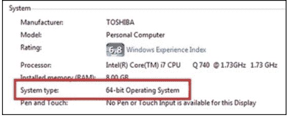

"系统类型"条目，如下所示：

现在我们准备安装 JDK 了。这组简单的步骤会快速设置 JDK。唯一的轻微延迟是下载本身，在较慢的网络连接上可能需要一些时间。实际安装过程应该快速且无故障：

- 访问 Java JDK 下载页面 http://www.oracle.com/technetwork/java/javase/downloads/jdk8-downloads-2133151.html。
- 如果链接已更改，请进行网络搜索以查找 Java JDK 下载。此阶段唯一可能的绊脚石是你点击了 JRE 的链接。我们需要的是 JDK。以下是此页面重要部分的截图：

| 产品 / 文件描述 | 文件大小 | 下载 |
|---|---|---|
| Linux x86 | 146.9 MB | jdk-8u51-linux-i586.rpm |
| Linux x86 | 166.95 MB | jdk-8u51-linux-i586.tar.gz |
| Linux x64 | 145.19 MB | jdk-8u51-linux-x64.rpm |
| Linux x64 | 165.25 MB | jdk-8u51-linux-x64.tar.gz |
| Mac OS X x64 | 222.09 MB | jdk-8u51-macosx-x64.dmg |
| Solaris SPARC 64-bit (SVR4 package) | 139.36 MB | jdk-8u51-solaris-sparcv9.tar.Z |
| Solaris SPARC 64-bit | 98.8 MB | jdk-8u51-solaris-sparcv9.tar.gz |
| Solaris x64 (SVR4 package) | 139.79 MB | jdk-8u51-solaris-x64.tar.Z |
| Solaris x64 | 96.45 MB | jdk-8u51-solaris-x64.tar.gz |
| Windows x86 | 176.02 MB | jdk-8u51-windows-i586.exe |
| Windows x64 | 180.51 MB | jdk-8u51-windows-x64.exe |

- 你的下载页面很可能略有不同。当你阅读这些文字时，会有更新版本的 JDK，因此 8u51 会不同。没关系，我们只需要最新版本。只需点击之前截图中高亮显示的 **接受许可协议** 单选按钮，然后点击右侧列中与你的操作系统对应的下载链接，该列在 **产品/文件描述** 列下。如果你不确定自己是 32 位还是 64 位 Windows，请参考本节前面的提示。
- 等待 JDK 下载到你的硬盘。
- 在下载 JDK 的文件夹中，右键单击 jdk-8u51-windows-x64.exe 文件并选择 **以管理员身份运行**。你的文件的确切名称将取决于你是 32 位还是 64 位 Windows 以及当时 JDK 的当前版本。
- 将出现一系列窗口引导我们完成安装过程。我们所要做的就是点击 **下一步** 继续。正如承诺的，我将逐一引导你完成它们，并指出你可能想要更改或记录事项的地方。以下是安装期间你将看到的第一个窗口的截图：

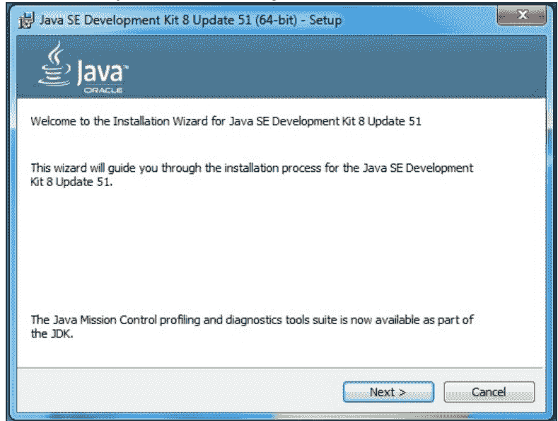

- 现在，点击 **下一步**，你将看到这个窗口：


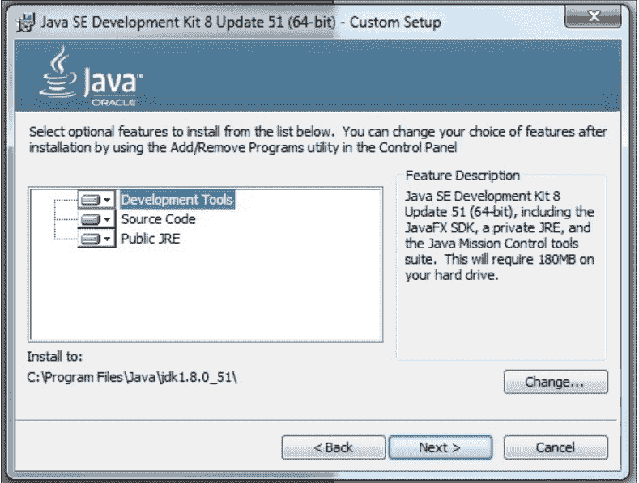

在上一张截图中所示的窗口上，我们可以将所有选项保留为默认值。它们正是我们需要的。不过，**安装到**设置值得考虑。等我们安装完 JDK、Android Studio 以及随附的所有额外工具和文件后，会有大约 6 GB 的文件和文件夹。请考虑，在本书学习过程中我们还会创建大量项目。理想情况下，我们希望所有这些文件、文件夹和项目都位于同一块硬盘上。它们不一定非要如此，但如果如此，或许可以避免日后出现一些问题。那么，你在默认选择的硬盘上是否至少有 6 GB 的空间？如果没有，你可能需要浏览到另一个文件夹。除此之外，如本教程后面所述，简化安装 JDK 时使用的文件夹名称会很方便（但不是必需的）。因此，单击 **更改** 按钮，你将看到以下窗口：

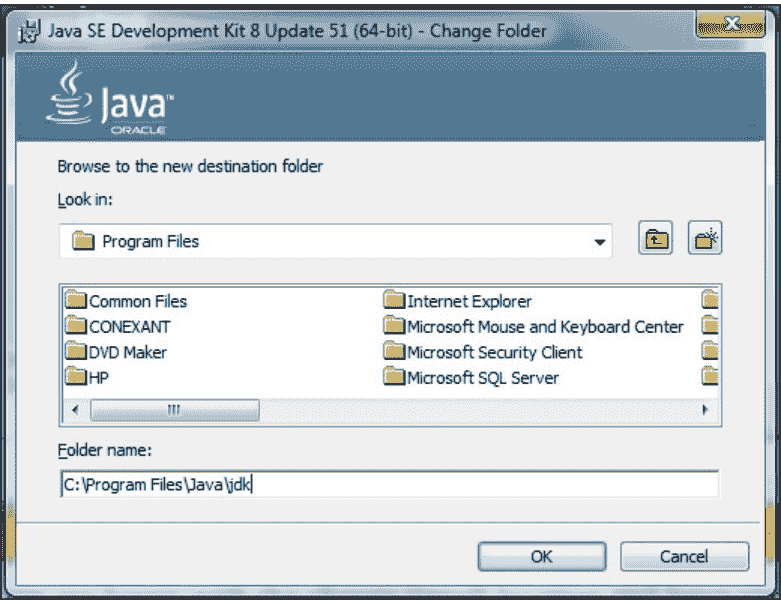

- 浏览到将安装所有开发工具的硬盘。然后，将安装 JDK 的文件夹名称简化为 Java\JDK\。如下一张截图所示，我已切换到我的 D:\ 驱动器，因为那里的空间更大：

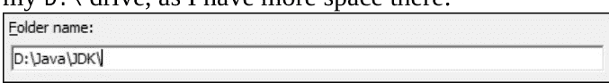

- 其实这些文件夹叫什么并不重要，只要你记住它们在哪里以及叫什么（包括大小写）即可。也许你可以记下笔记，或者将其复制并粘贴到桌面上的文件中。当你对所选安装位置和文件夹名称感到满意时，继续单击下一步。

- 下一个窗口不会在每次安装时都出现。如果你看不到下图所示的窗口，没关系，可以跳至步骤 13。如果你看到了该窗口，请继续执行步骤 12。

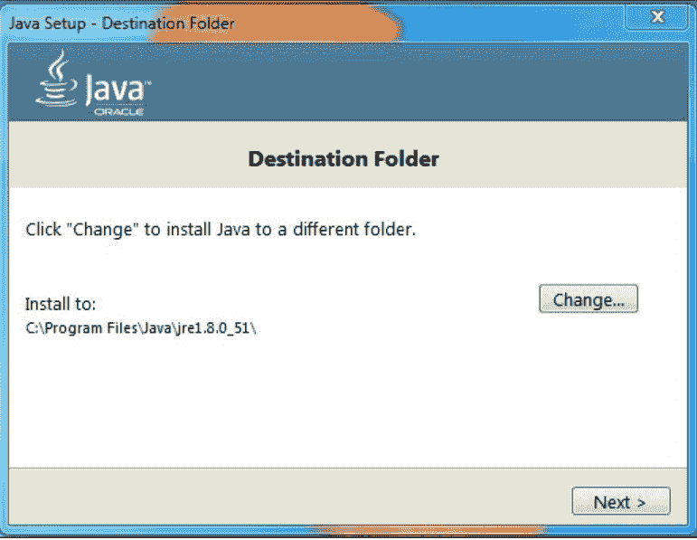

- 可以理解的是，如果你之前从未进行过 Java 开发，这个窗口可能会造成混淆。你可能会觉得我们已经为 Java 选择了目标文件夹。我们选择的是 JDK 的位置。这个窗口指的是标准 Java——即 JRE。它是运行 PC 上 Java 程序的环境，由于我们要为 Android 开发，所以不需要它。不过，为了继续操作，我们仍需要选择一个位置。接受默认值，直接单击下一步即可。如果你和我一样有强迫症，喜欢整洁，可以将其改为步骤 8 中的同一个 Java 文件夹，然后单击下一步。

- 接下来，你会看到写着“3 Billion Devices Run Java”的窗口。仅在撰写本书时，Android 设备就已超过 11 亿台，尽管 2015 年起步较慢。你可能还想知道，有超过 18,000 款不同的设备。说实话，如果你觉得这听起来很疯狂，可以在 Google 上搜索一下。你可以在等待安装完成时做这件事。

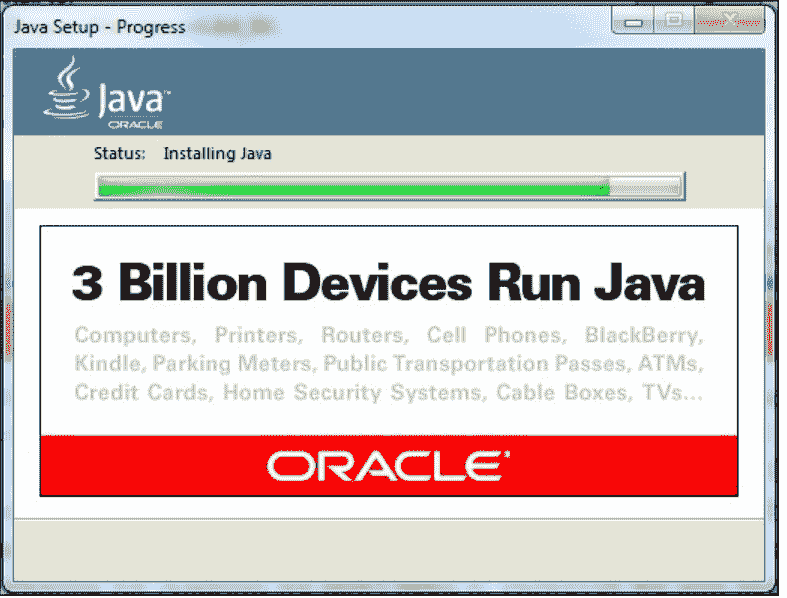

- 现在，你会看到最终屏幕。如果你好奇，可以单击后续步骤，但没有必要，因为我们将立即介绍 Android 特定的后续步骤。

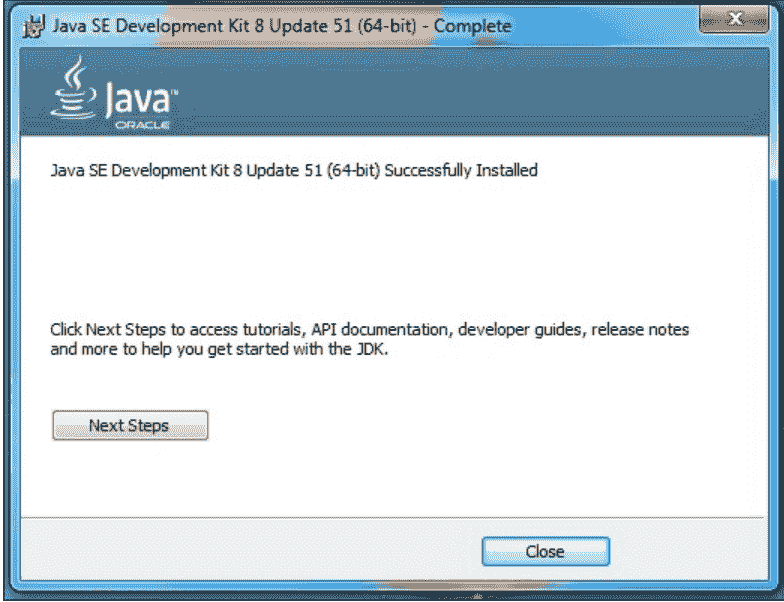

- 单击 **关闭**，JDK 即安装完毕，只剩下几个预防性步骤。

- 现在，我们将确保 Windows（及其所有应用程序）知道在哪里可以找到 JDK。右键单击“我的电脑”（Windows 8 上的“此电脑”）图标，然后选择 **属性** | **高级系统设置** | **环境变量** | **新建**（位于“系统变量”下，而非“用户变量”下）。现在你可以看到如下所示的 **新建系统变量** 对话框：

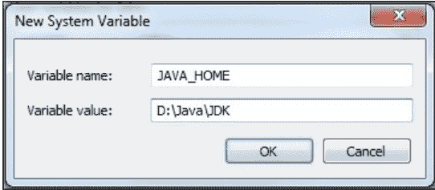

- 如上一张截图所示，在 **变量名** 中输入 JAVA_HOME，并在 **变量值** 字段中输入 D:\\Java\\JDK。如果你将 JDK 安装在了其他位置，那么在 **变量值** 字段中输入的文件路径需要指向你放置的位置。请确保输入正确，确保斜杠 \\ 方向正确，并且不要添加任何额外的斜杠。

- 单击 **确定** 保存新设置。现在，再次单击 **确定** 以关闭 **高级系统设置** 窗口。

我们已成功安装 JDK，这是使用 Android Studio 开发 Android 应用所需的。我们还安装了 JRE（如果之前未安装的话），尽管我们不会使用它，但这也不会造成任何问题。

## 设置 Android Studio

JDK 已安装并准备就绪，距离构建我们的第一个 Android 应用只有一步之遥。安装 Android Studio 可能比安装 JDK 花更长时间，而且稍微复杂一些，但对于一位坚定、有抱负的开发者来说，这都不是什么难事。

### 提示

#### 可能会出什么问题？

整个过程可能需要一两个小时。这并非因为我们有大量工作要做，而是因为我们需要启动一些相当大的下载。此外，在安装过程的多个阶段，Android Studio 会连接互联网并自行更新。如果你有快速的互联网连接，那么可以大大缩短我粗略估计的所需时间。

既然知道了预期情况，我们就可以开始安装 Android Studio了。按给定步骤操作即可。这里没有特别棘手的地方，少数可能需要考虑的方面将在出现时讨论：

1. 访问 https://developer.android.com/sdk/index.html 并单击“下载适用于 Windows 的 Android Studio”按钮。如果阅读时链接已更改，只需在 Google 上搜索“下载 Android Studio”即可。

2. 接下来，你会看到如下截图所示的“条款和条件”页面。

### 下载

在安装 Android Studio 或独立的 SDK 工具之前，你必须同意以下条款和条件。

### 条款和条件

这是 Android 软件开发工具包许可协议

### 1. 简介

1.1 Android 软件开发工具包（在本许可协议中称为“SDK”，具体包括 Android 系统文件、打包的 API 和 Google API 插件）按本许可协议的条款授予你使用许可。本许可协议构成你与 Google 之间关于你使用 SDK 的具有法律约束力的合同。

1.2 “Android”是指设备的 Android 软件堆栈，根据 Android 开源项目提供，该项目位于以下 URL：http://source.android.com/，并不时更新。

我已阅读并同意上述条款和条件

下载适用于 Windows 的 Android Studio

- 单击上一张截图中高亮显示的“我已阅读并同意上述条款和条件”复选框。

- 现在，单击“下载适用于 Windows 的 Android Studio”按钮。等待下载完成。

- 打开下载 Android Studio 的文件夹。右键单击 android-studio-bundle-141.1980579-windows.exe 文件并选择“以管理员身份运行”。你的文件大概率会有不同的名称，具体取决于当时 Android Studio 的当前版本。

- 当出现“是否允许以下程序对此计算机进行更改”消息时，单击“是”。你将看到安装过程的第一个窗口。

- 让我们逐个窗口地了解安装过程。接下来显示的是启动安装过程时你会看到的第一个窗口：

### 欢迎使用 Android Studio 安装程序

安装程序将引导你完成 Android Studio 的安装。

建议在启动安装程序之前关闭所有其他应用程序。这样可以在不重新启动计算机的情况下更新相关系统文件。

单击“下一步”继续。

- 单击“下一步”。现在，我们可以看到几个选项，如下一张截图所示：

### 选择组件

选择要安装的 Android Studio 功能。

选中要安装的组件，取消选中不想安装的组件。单击“下一步”继续。

选择要安装的组件：

- [x] Android Studio
- [x] Android SDK
- [x] Android 虚拟设备
- [x] 性能 (Intel® HAX

描述 将鼠标悬停在组件上以查看其说明。

所需空间：3.9GB

- 确保所有选项旁都有勾标记，然后单击“下一步”。

- 下一个窗口是许可协议。单击“我同意”，你将看到


值得简要讨论的一些设置。查看下一张截图，它显示了“安装位置”窗口：

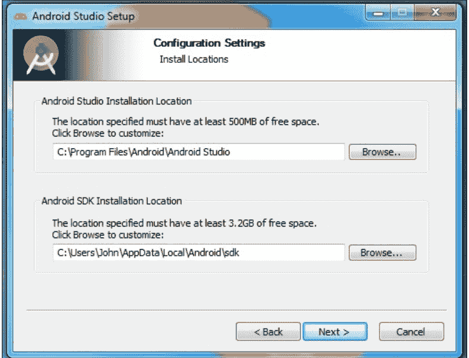

- 在这一步中，我们想要将Android Studio IDE和Android SDK安装到安装JDK的同一硬盘驱动器上。因此，此时你可能只需点击**下一步**。但是，如果你已将JDK安装到另一个驱动器，那么我们也需要更改此步骤中使用的驱动器和文件夹。这并非严格必需，但可以避免一些用户出现问题。
- 对于Android Studio安装位置，选择已安装JDK的驱动器根目录，然后加上\\Android Studio。因此，在我的例子中，这将是D:\\Android Studio。对于Android SDK安装位置，选择相同的硬盘，并直接将Android\\sdk添加为位置。因此，如果和我一样在D:上安装了JDK，则选择D:\\Android\\sdk。下一张截图将此说明清楚：

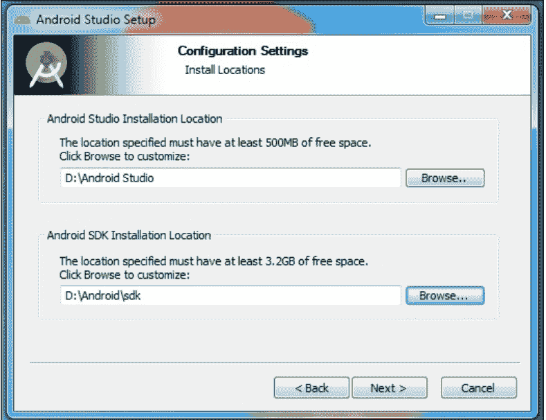

- 在选择安装位置后，点击**下一步**。
- 接下来，你可能会看到如下图所示的**模拟器设置**窗口。如果看到，则接受默认设置并点击**下一步**；否则，可以跳至步骤15。如果没看到此屏幕，不要担心，这只是与更流畅地运行Android模拟器有关的一个小问题。大多数时候，你可能还是想使用真实设备。

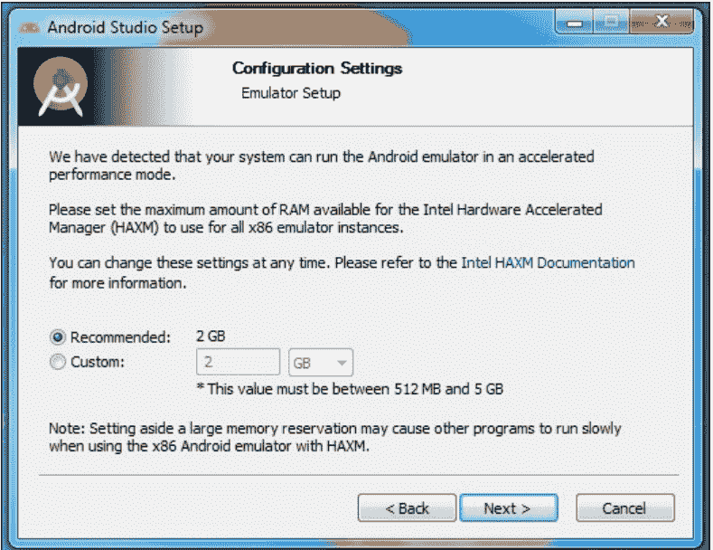

- 我们快完成了。下一个窗口要求你选择一个开始菜单文件夹，就像安装任何新Windows应用一样。你可能想要记下这个位置。点击**安装**以接受默认设置，Android Studio将开始安装自身，并将SDK提取到我们先前选择的适当文件夹。这可能需要一些时间。
- 当你看到**安装完成**窗口时，点击**下一步**。现在，你将看到以下窗口：

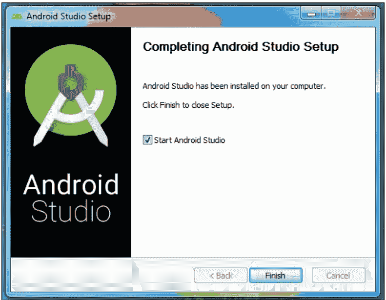

- 点击**完成**以调出安装过程的倒数第二个窗口。假设这是你第一次使用Android Studio，请点击**我没有之前的Android Studio版本或我不想导入我的设置**单选按钮，然后点击**确定**。

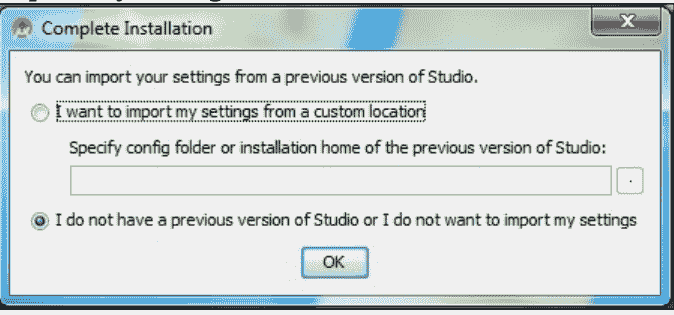

- 现在，在下图中，你可以选择Android Studio将使用的主题。如果你喜欢传统的白底黑字外观，则选择**IntelliJ**；如果想要酷炫的深色样式，则选择**Darcula**。如果你后来改变主意，可以在Android Studio内更改这些方案中的任何一个。

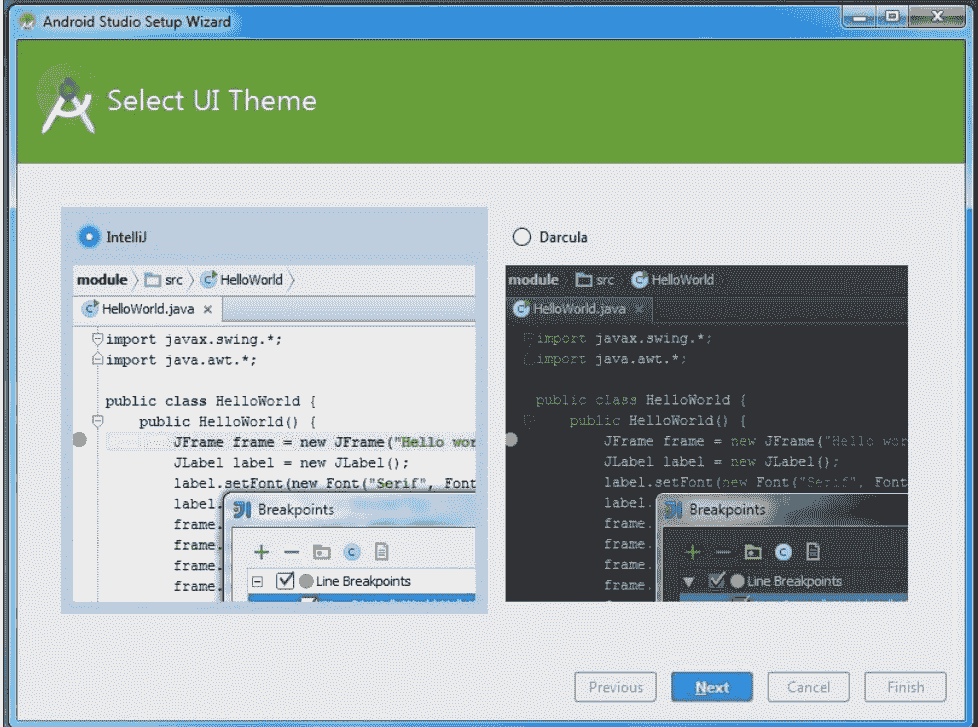

- 选择主题后，点击下一步。
- 现在Android Studio将连接到互联网并下载我们即将使用的一些Android工具。同样，这可能需要一段时间。
- 当“下载组件”窗口完成工作后，它会向你显示一个“完成”按钮。点击它。
- 最后，我们会看到“欢迎使用Android Studio”屏幕。除其他外，此屏幕允许我们启动新项目或打开现有项目。请查看下一张截图。

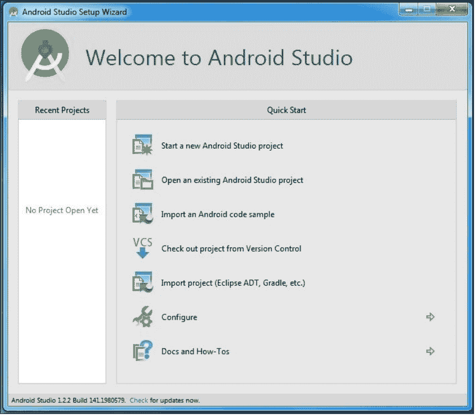

- 你可以关闭此窗口并休息一下，或者保持打开并继续阅读，因为我们很快就会再次回到这里。

这是一个相当冗长的教程，但希望没有太难。我们需要的Android Studio和支持工具已安装并准备就绪。我们现在离构建第一个应用非常近了。

首先，让我们简要了解一下Android应用的构成。

## 什么构成Android应用

我们已经知道，我们将编写Java代码，这些代码本身会使用他人的Java代码，并将被编译为在DVM上运行的DEX代码。除此之外，我们还将添加和编辑其他文件。这些文件称为Android资源。

### Android资源

我们的应用将包括图片、声音和用户界面布局等资源，这些资源保存在与Java代码分开的文件中。我们将在本书过程中逐渐介绍它们。

它们还将包含包含应用文本内容的文件。通过单独的文件来引用应用中的文本是一种惯例，因为这使得文本更容易更改，并从而更容易创建适用于多种不同语言的应用。

此外，尽管可以使用可视化设计器实现应用的实际UI布局，但Android实际上是从基于文本的文件中读取它们。

当然，Android（或任何计算机）无法以人类的方式读取和识别文本。因此，我们必须以高度组织和预定义的方式呈现我们的资源。为此，我们将使用可扩展标记语言(XML)。XML是一个庞大的主题，但幸运的是，其整个目的是既可由人类阅读，也可由机器阅读。我们不需要学习这门语言，只需遵守（然后符合）几条规则即可。

此外，大多数时候，当我们与XML交互时，将通过Android Studio提供的整洁可视化编辑器进行。当我们处理XML资源时可以判断出来，因为文件名将以.xml扩展名结尾。

你不需要记住这一点，因为我们将在全书中不断回到这个概念。

## Android Java代码的结构

除了这些资源之外，值得注意的是，在Android中使用的Java代码具有一定的结构。有数百万行代码可供我们利用。这段代码显然需要以易于查找和引用的方式进行组织。它按特定于Android的预定义包进行组织。

### Android包

每当我们创建一个新的Android应用时，都会选择一个名为**包**的唯一名称。我们将在_我们的第一个Android应用_部分中看到如何操作。包通常被分为**子包**，以便与其他类似的包归类在一起。我们可以简单地将这些视为文件夹和子文件夹。

我们还可以将Android API提供给我们的所有包视为图书馆中包含代码的书籍。我们将使用的一些常见Android包包括以下几项：

- android.graphics
- android.database
- android.view.animation

正如你所见，它们的排列和命名旨在使其中包含的内容尽可能明显。

### 提示

如果你想了解Android API的深度和广度，请参阅[Android软件包索引](http://developer.android.com/reference/packages.html)。

此前，我们了解到可转换为对象的可重用代码蓝图称为**类**。类包含在这些包中。我们将在第一个应用中看到如何轻松**导入**他人的包以及这些包中的特定类，以便在我们的项目中使用。一个类几乎总是包含在其自身的文件中，文件名与类名相同，并带有.java文件扩展名。

在Java中，我们进一步将类拆分为执行不同操作的部分。我们称这些部分为**方法**。这些通常是我们将用来访问数百万行代码中所提供功能的类的方法。我们不需要阅读代码。我们只需知道哪个类执行我们需要的操作，它在哪个包中，以及类中的哪些方法能给我们提供我们想要的精确结果即可。

下一张图展示了Android API的表示。我们可以用完全相同的方式思考我们将编写的代码的结构，尽管我们很可能每个应用只有一个包。当然，由于Java的面向对象特性，我们将只使用此API中的选择性部分。还要注意，每个类都有其自身独特的**数据**。通常，如果你想访问类中的数据，需要拥有该类的一个对象。

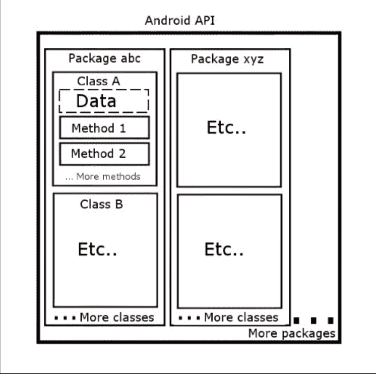


你无需记住这一点，因为我们将在全书中不断回到这个概念。

到本章结束时，我们将导入多个包以及其中的一些类，并使用他人的方法。到第 2 章“Java – 初识”时，我们甚至会编写自己的方法。

## 我们的第一个 Android 应用

在编程中，新手的第一个应用程序通常会使用他们所使用的任何语言/操作系统来向世界说“你好”。我们将快速构建一个正是这样做的应用，并在第 2 章“Java – 初识”中进一步添加一些真正响应用户的按钮。

## 创建项目

我们将从创建这个项目开始。以下是创建新项目的步骤。我每个步骤的说明可能看起来有点冗长，但那只是因为这是我们第一次执行这些步骤。几章之后，当我们创建新项目时，我可以用一句话来描述说明，而你将能在 30 秒内完成项目创建。既然这是第一个项目，让我们一步步来，并在过程中学习：

- 1. 单击你在上一教程第 15 步中选择的“开始”菜单文件夹中的 Android Studio 图标来启动 Android Studio。

### 提示

如果找不到图标，可以直接在安装 Android Studio 的位置的 bin 文件夹中找到该文件。在 64 位 PC 上找到 studio64.exe 文件，在 32 位 PC 上找到 studio.exe 文件，然后像启动其他 Windows 应用一样双击它。

- 2. 如果出现**“Windows 防火墙已阻止此程序的某些功能”**消息（如下一张截图所示），请单击**“允许访问”**：

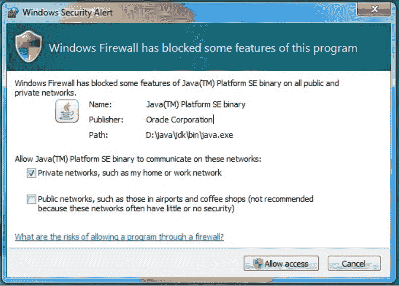

- 现在，你将看到上一教程结尾时出现的“欢迎使用 Android Studio”开始菜单。继续单击“开始一个新的 Android Studio 项目”。你将看到下一张截图所示的“新建项目”屏幕。启动新项目非常简单，主要是在几个不同的屏幕上接受默认设置。不过，让我们仔细查看一些选项，因为它们将增加我们对 Android 和 Android Studio 的理解：

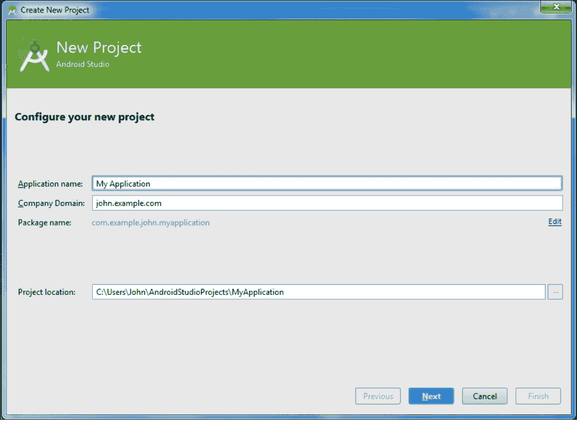

- 首先，请注意，我们可以在**“应用名称”**字段中命名我们的应用程序。你可以为第一个应用程序选择任何喜欢的名称，但请注意，Android Studio 很快就会为我们生成大量代码和文件，你选择的名称将在其中体现。如果你希望你的代码和文件与我们即将检查的内容一致，请将你的应用程序命名为 Hello Android。

- 接下来，请注意**“公司域”**字段。这是你输入公司详细信息的地方。使用公司网站的域名是一种惯例，而且非常实用（因为它是唯一的）。如果你没有公司或域名，请输入我使用的域名：gamecodeschool.com。与应用名称不同，使用不同的公司域对我们稍后将检查的代码和文件几乎没有影响。虽然，如果你使用自己的域名，请在本教程结束后参考提示“使用你自己的域名或应用名称”。选择并输入一个公司域名。

- 现在，请查看**“包名”**字段。它已从前两个字段自动推导。如果你使用了前两个步骤中建议的相同两个值，则你的包名将是 com.gamecodeschool.helloandroid。请记住，包是构成我们代码文件的 Java 类的集合，如果我们愿意，我们的应用可以包含一个或多个包，但至少必须包含一个包。我们可以通过单击编辑链接来编辑包名，但在此无需这样做。

- 最后，在**“项目位置”**字段中，你可以接受默认设置，也可以浏览到你希望存储所有 Android 项目的位置。你可以为创建的每个项目更改此位置。我将个人项目放在 Dropbox 文件夹中，因此如果我的电脑在项目进行中出故障，我知道我的文件是安全的。Android Studio 也可以从在线代码仓库（例如 GitHub）工作，但本书不涉及此内容。以下是执行步骤 5、6 和 7 后的“新建项目”窗口截图：

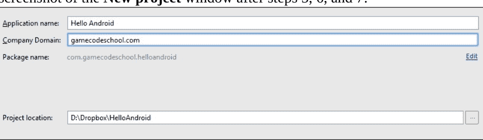

- 单击**“下一步”**按钮继续，你将看到**“目标 Android 设备”**窗口：

## 目标 Android 设备

选择你的应用将运行的外形规格
不同平台需要单独的 SDK

- 手机和平板电脑
- 电视
- 可穿戴设备
- 眼镜（未安装）

在这里，我们可以看到可以为手机、平板电脑、电视和可穿戴设备开发应用程序。可穿戴设备是指支持 Android 的智能手表系列。在前一张截图中，在窗口底部的灰色部分，我们还可以看到可以为 Glass 开发应用，Glass 是 Google 炫酷的支持 Android 的眼镜，尽管为此需要安装额外文件。在本书中，我们将为手机和平板电脑开发，因此已经选中的选项正是我们需要的。在这一屏幕上，我们还需要选择的唯一其他内容是最低 SDK。我们已经知道，Android SDK 是我们将用于开发应用的代码包集合。和任何优秀的 SDK 一样，Android SDK 会定期更新，每次重要更新后，版本号都会增加。简单来说，版本号越高，你可以使用的功能就越新；版本号越低，我们的应用可以运行的设备就越多。目前，默认设置 API 15：Android 4.0.3（IceCreamSandwich）将为我们提供众多出色的功能，并且与当前使用的 Android 设备至少有 90% 的兼容性。如果在阅读本书时，Android Studio 建议使用较新的 API，则直接采用即可。

- 单击**“下一步”**按钮。现在，我们可以看到**“向移动设备添加 Activity”**窗口：

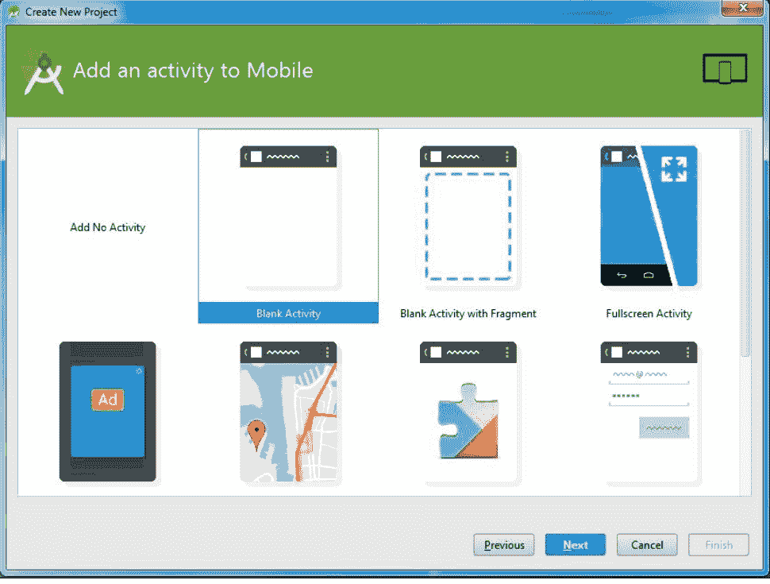

- 在前面的章节中，我们简要讨论了 Java 类。`Activity` 类是一个特殊的 Java 类，每个 Android 应用必须至少包含一个。当用户启动应用时，应用将从代码的这部分开始运行，这部分还会处理与用户的任何交互。此屏幕上的选项提供了 `Activity` 类代码的不同现成模板，以便程序员在创建各种类型的应用时能快速入门。由于我们是从零开始，最适合我们的选项是**“空 Activity”**。请确保通过单击选择**“空 Activity”**，然后单击**“下一步”**。现在，让我们来看看**“自定义 Activity”**窗口：

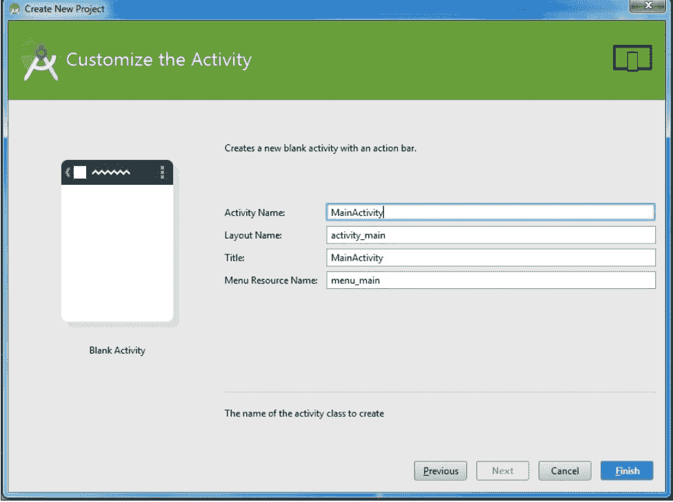

- **“自定义 Activity”**窗口为我们提供了四个可调整的项目。虽然完全可以保留默认设置，但我们还是将它们修改得更有意义，并讨论每一项的含义。Activity 名称 是将包含我们代码的类的名称。如果这听起来奇怪，更具体地说，我们将有一个名为我们在这里指定名称的 activity 类。请将 activity 命名为 MyActivity。

- 下一个字段是**布局名称**。我们在本章前面讨论过，Android UI 布局通常定义在单独的 XML 文本文件中，而不是与我们的 Java 代码一起。布局名称就是该文件的名称。请将布局命名为 my_layout。

- 下一个字段是**标题**。它与 Activity 名称 字段不同，Android 会在设备屏幕上将其用作应用名称。请将标题命名为 My App。

- 就此屏幕而言，最后一个字段是**菜单资源名称**。菜单是你在 Android 上（或许并不出人意料）单击时弹出的选项。


菜单按钮。它们也可能显示在应用顶部的栏中，称为操作栏。这取决于设备运行的Android版本。这些也被视为UI的一部分，通常定义在这个单独的XML文件中。将我们的菜单文件命名为my_menu。

- 非常重要：在第12、13、14和15步中输入的信息必须使用完全相同的大小写和间距。查看下一个特写图，确保您输入的文本完全正确：

| 活动名称: | MyActivity |
| 布局名称: | my_layout |
| 标题: | My App |
| 菜单资源名称: | my_menu |

- 单击完成按钮，Android Studio将根据我们在前16步中的选择为我们创建一个项目。

我们现在有一个可以部署或修改的项目了。

## 提示

## 使用您自己的域名和应用名称

使用您自己的域名和应用名称完全没问题。唯一需要注意的是，当我们查看Java代码时（在第2章，Java – 首次接触中），将看到的第一行代码会不同，并且必须不同。这就是包名。在本书的上下文中，我们永远不需要更改包名或对其做任何操作，因此您给应用命名为何，或者是否使用自己的域名，都无关紧要。

这只会在您创建项目（使用不同的名称或包名）然后从下载包中复制和粘贴代码时才会造成问题。原因是该代码将具有不同的包名。要解决此问题，您只需确保创建的项目与您复制粘贴的代码文件使用相同的包名，或者在复制粘贴代码后，更改第一行代码以反映您创建的项目的包名。

## 关于版本控制的说明

在本书中，我们将介绍发布专业应用所需了解的一切。我们不会讨论的一件事是作为团队一员进行协作开发，或您代码的任何备份策略。如果您只打算独立开发应用，那么不需要了解更多内容。然而，Android Studio与多种不同的版本控制系统（VCS）和代码仓库几乎可以无缝协作。VCS及其相关代码仓库有许多优势，具体如下：

- 可以允许多个程序员为同一项目甚至同一文件做出贡献
- 如果您发现出错了，可以单击按钮将工作回滚到指定位置
- 可以将代码无缝存储在云端/Web仓库中，并从任何开发机器上处理您的项目，而无需担心文件备份问题

实现所有这些好处并不复杂，在某些情况下甚至是免费的。在本书这类书籍中引入VCS的问题在于选项实在太多，没有简单且普遍最佳的方案能适合所有人。此外，在我们能够着手开发应用之前，它还增加了又一个障碍。

## 提示

如果版本控制这个话题听起来很有趣，可以尝试探索以下两个提供商：

- http://www.bitbucket.org
- http://www.github.com

现在，您可能会惊讶地发现，我们可以将应用部署到模拟器或真实的Android设备上。在本书中，每个项目的所有代码都以反映章节号的文件夹形式提供在下载包中。然而，第1章文件夹中没有代码，因为本项目中的所有代码均由Android Studio自动生成，我们无需为该项目输入任何内容。不过，我们将在下一章中检查、修改并补充这些自动生成的代码。

## 部署和测试应用

在开发过程中，我们需要频繁测试应用，以检查是否存在任何错误、崩溃或其他非预期情况。同样重要的是，确保应用在您要针对的每种设备类型/尺寸上都看起来良好且运行正常。显然，我们不可能拥有成千上万台Android设备中的每一台。这时模拟器就派上用场了。

然而，模拟器有时有点慢且笨拙，尽管最近有了很大改进。如果我们想获得用户将体验到的真实感觉，那么没有什么比将应用部署到真实设备上更好的了。因此，在开发应用时，我们可能希望同时使用真实设备和模拟器。

首先，我们将部署到模拟器，然后再部署到真实设备。

### 部署到模拟器

将应用部署到模拟器只需几次鼠标点击。Android Studio附带一个现成的模拟器。撰写本书时，该模拟器是Nexus 5。到您阅读本书时，它可能已更新为较新的设备。此处描述的基本功能很可能是相同的，但设备名称和屏幕截图可能与您的实际体验略有不同：

- 1. 菜单栏正下方有一排外观整洁的按钮，我们将随着书本深入探索它们。当前我们需要的按钮是代表播放的绿色三角形。使用下一个屏幕截图识别该按钮并单击它：

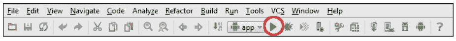

- 接下来，您将看到 **选择设备** 窗口。单击 **启动模拟器** 选项，如下一个屏幕截图所示：

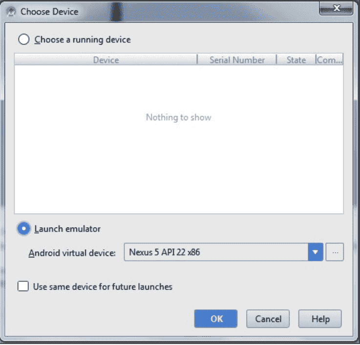

- 单击确定以启动模拟器。安装Android Studio时，Nexus 5已预配置，但您也可以自行选择和自定义模拟器。请参阅本教程后的提示 创建新模拟器。

- 模拟器启动可能需要一些时间！有时，甚至可能需要5分钟或更长。这在一定程度上取决于Android Studio在设置阶段是否检测到您的PC可以运行HAXM（硬件加速执行管理器）。无论如何，本书中的所有教程都将正常工作。等待模拟器启动。当您的模拟器加载完成后，您将看到类似于下一个屏幕截图的内容：

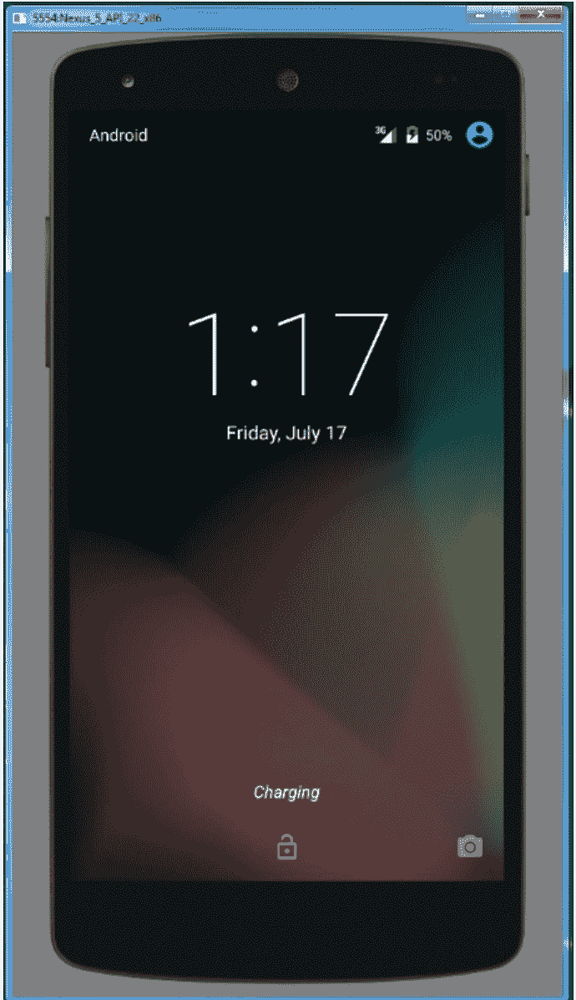

- 我们需要模拟在屏幕上向上滑动手指以解锁。因此，在模拟器屏幕底部附近的某个位置单击并向上拖动。您现在可以看到您的第一个应用在运行，如下图所示：

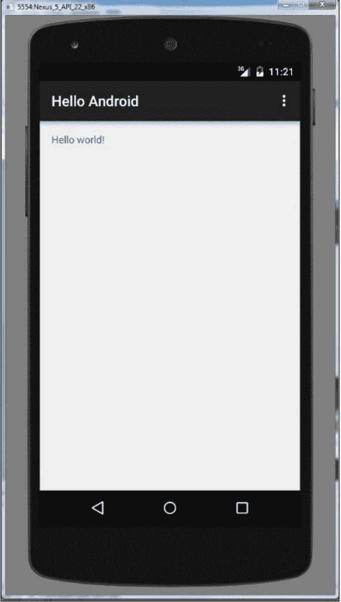

- 让我们稍微玩一下模拟器。单击返回按钮退出应用，如下一个屏幕截图所示：

- 请注意，您可以看到您的应用启动器图标，名称是您创建项目时给它的名称。显然，在将应用发布到世界之前，我们需要替换默认的Android图标。不过，暂时这样就可以了。

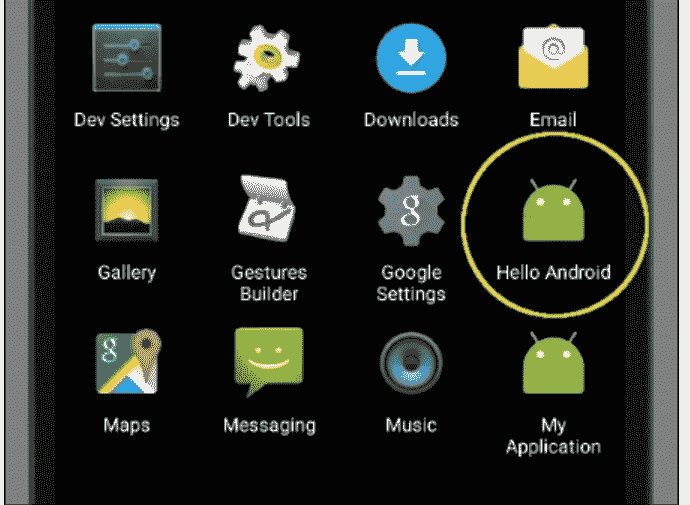

- 您可以单击启动器图标再次运行应用，或者尝试运行其他任何应用。与模拟器玩一会。

恭喜，您现在已经运行并试用了您的第一个应用。除此之外，我们还发现，在模拟器上可以完成许多以前只能在真实设备上完成的操作。

## 提示

## 模拟器启动需要时间

如果您打算很快再次使用模拟器，请保持其运行状态，以避免再次等待启动。

如果您想在平板电脑、电视甚至手表上试用您的应用，则需要一个不同的模拟器。

## 注意

## 创建新模拟器

如果您想为不同的Android设备创建模拟器，这非常简单。从主菜单中，导航到工具 | Android | AVD管理器。在 AVD Manager 窗口中，单击创建新虚拟设备。现在单击您想要创建的设备类型：TV、Phone、Wear 或 Tablet。然后单击下一步，按照说明创建新的AVD。下次运行应用时，新的AVD将作为运行应用的选项出现。

现在我们可以来看看如何将应用安装到真实设备上。

## 部署到真实的Android设备

首先要做的是访问设备制造商的网站，获取并安装设备和操作系统所需的任何驱动程序。

## 提示

许多较新的Android设备根本不需要驱动程序。您可以尝试直接插上！

接下来的几个步骤将设置Android设备以进行调试。请注意，不同制造商的菜单选项结构略有不同。但是，以下序列可能非常接近，甚至完全可以在大多数设备上启用调试：

- 1. 单击 **设置** 菜单选项或 **设置** 应用。
- 2. 单击 **开发者选项**。
- 3. 勾选 **USB调试** 复选框。
- 4. 将您的Android设备连接到开发系统的USB端口。您可以在下图中看到，在Android Studio窗口底部的 **Android** 选项卡的 **设备 | Logcat** 子选项卡上，我的 **Samsung GT I9100** 已被检测到：


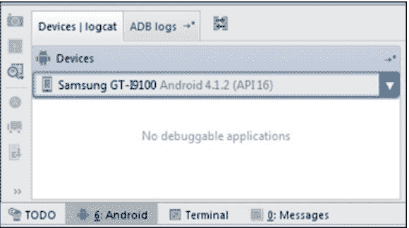

- 单击 Android Studio 工具栏上的 Play 图标，就像我们在模拟器上运行应用时所做的那样。
- 当 **选择设备** 窗口出现时，单击 **选择正在运行的设备**，然后单击你的设备；在我这里，将是 **三星 GT I9100**。
- 最后，单击 OK 在所选设备上调试应用。

现在，你可以在设备上看到你的应用展露无遗，并向你的朋友和崇拜者展示它。

请注意，尽管应用在真实设备上运行，但它仍处于调试模式，因此我们可以获取有关应用运行情况的反馈。在第 29 章"发布应用"中，我们将看到如何生成签名的、可分发的应用，以便上传到 Google Play。

### 常见问题解答

- 那么 Android 真的不是操作系统，而只是一个虚拟机吗？所有的手机和平板电脑真的是 Linux 机器吗？

  不，Android 设备的所有不同子系统（包括 Linux、DVM 以及库和驱动程序）共同构成了 Android 操作系统。

- 我仍然不明白所有这些技术术语，例如 DVM、面向对象、APK 等等。我需要重读这一章吗？

  不，没有必要，因为我们只需要介绍这些行话，随着书的进展，我们将回顾并澄清所有这些术语。你只需要了解以下几点：

  - 我们将编写 Java 代码并创建其他资源
  - Android Studio 将在 JDK 的帮助下，将这些代码和资源转化为真正的 Android 应用

现在，你可以继续前进，进入第 2 章 Java – 初次接触。

### 总结

到目前为止，我们已搭建好 Android 开发环境，并在模拟器和真实设备上创建并部署了应用。如果你还有未解答的问题（而且你可能比本章开始时有更多问题），请不要担心，因为随着我们深入 Android 和 Java 的世界，事情会变得更加清晰。随着章节的推进，你将对一切如何协同工作建立非常全面的理解，然后成功就只是实践和深入 Android API 的问题了。

在下一章中，我们将使用可视化设计器和原始 XML 代码编辑 UI，编写我们的第一个 Java 方法，并开始使用 Android API 提供的某些方法。
