## 第 2 章 Java – 初次接触

我们现在已经拥有一个可用的 Android 开发环境，并构建和部署了我们的第一个应用。然而，很明显，Android Studio 自动生成的代码无法造就 Google Play 上的下一个畅销应用。我们需要探索这段自动生成的代码，以便理解 Android，然后在此有用的模板基础上开始构建。为此，在本章中，我们将执行以下操作：

- 了解如何从我们的应用中获取技术反馈
- 检查我们第一个应用的 Java 代码和 UI XML 代码
- 初次体验使用 Android UI 设计器
- 编写我们的第一个 Java 代码
- 学习一些核心 Java 基础知识及其与 Android 的关系

首先，让我们看看如何发现问题出在哪里。

### 检查日志输出

在上一章中，我们提到我们的应用正在调试模式下运行，以便我们在出现问题时监控它并获取反馈。那么，所有这些反馈在哪里呢？

你可能已经注意到 Android Studio 窗口底部有一大滚动文本。如果没有，请单击屏幕左下角的 Android 选项卡，然后确保也选中了 logcat 选项卡，如下图中红色实心区域所示（虚线红色区域将在稍后讨论）：

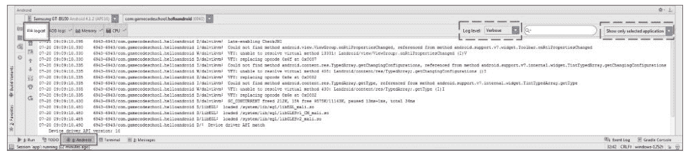

你可以拖动窗口使其变高，就像在大多数其他 Windows 应用程序中一样。

这被称为 logcat，有时也被称为控制台。它是我们的应用告诉我们用户看不到的底层发生了什么的方式。如果应用崩溃，原因或关于原因的线索将出现在这里。如果我们需要输出调试信息，也可以在这里完成。

### 提示

如果你无法弄清楚应用为什么崩溃，将 logcat 中的一段文本复制并粘贴到 Google 中，通常就能找到原因。

你可能已经注意到，大部分（如果不是全部的话）内容都相当难以理解。没关系。目前，我们只关注将以红色突出显示的错误以及你接下来将了解的调试信息。如果我们想在 logcat 窗口中看到更少不必要的文本，可以打开一个过滤器。

在上图中，我用虚线红色突出显示了两个区域。其中一个是控制此过滤器的下拉列表。现在单击它，并将其从 Verbose 更改为 Info。我们大幅减少了文本输出。当我们对应用进行一些更改并重新部署后，将看到这有多有用。我们将在探索了构成项目的代码和资源后执行此操作。另外，请再次检查第二个虚线红色突出显示的区域，如果它显示"仅显示所选应用程序"。如果不是，请立即单击它并将其更改为此。

现在，我们可以查看 Android Studio 自动为我们生成的内容，然后开始对其进行更改，以超越项目创建阶段所获得的内容来个性化它。

### 探索项目资源和代码

我们将查看包含定义简单 UI 布局的代码的资源文件，以及包含 Java 代码的文件。在这个阶段，我们不会试图完全理解它，因为你需要学习更多内容才能理解。然而，我们将看到这两个文件的基本内容和结构，以便我们能将其与已知的 Android 资源和 Java 知识相对照。

让我们先看看 Java 代码。你可以单击下图中显示的 **MyActivity.java** 选项卡来查看实际代码：

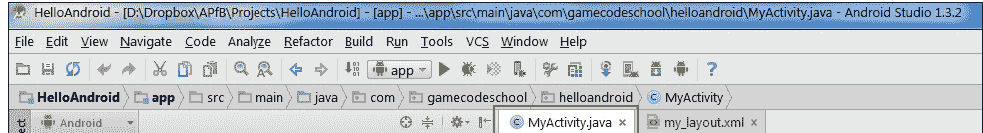

由于我们不查看代码的详细信息，带注释的截图可能比在文本中复制实际代码更有用。继续阅读时请参考下图。我已在此处标记了代码的关键部分，以便进一步解释：

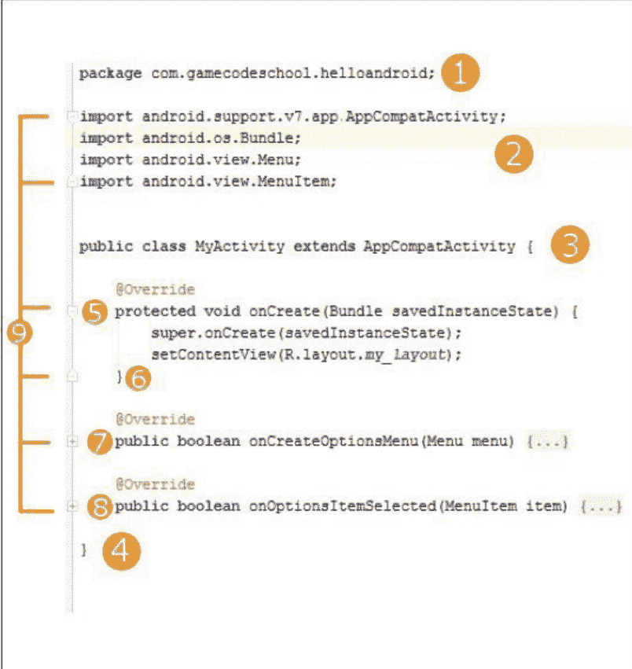

让我们更好地理解这段代码。首先要指出的是标记为 9 的部分。这指向编辑器中所有用于折叠和展开代码部分的小 + 和 - 按钮。我确实折叠了两部分代码：部分 7 和 8。之所以这样做，是因为它们目前不在我们的讨论范围内，并且不提供我们正在讨论的任何功能。因此，你在这里看到的内容可能与你直接在 Android Studio 中查看代码时略有不同。

标记为 1 的部分称为包声明，正如你所看到的，它包含我们创建项目时选择的包名。每个 Java 文件在代码顶部都会有一个包声明。

标记为 2 的部分是四行代码，均以单词 import 开头。在 import 单词之后，我们可以看到各种由点分隔的单词。每行的最后一个单词是该行导入到我们项目中的类的名称，而之前的所有单词都是包含这些类的包和子包。这意味着在我们的项目中，我们将能够访问 AppCompatActivity、Bundle、Menu 和 MenuItem。我们不会立即讨论所有这些类，只讨论导入的概念，这目前很重要。请注意，我们可以随时从任何包中添加其他类，我们将在稍后改进应用时这样做。

我们代码中标记为 3 的部分称为类声明。以下是该行的完整内容。我在此处高亮显示了一部分：

```
public class MyActivity extends AppCompatActivity {
```

类声明是类的开始。请注意高亮部分。在这里，MyActivity 是我们创建项目时选择的名称，与 MyActivity.java 文件名相同，正如我们之前讨论 Java 类时所期望的那样。extends 关键字意味着我们名为 MyActivity 的类将是 AppCompatActivity 类型。我们可以，也将在某些类中不使用这个 extends 部分。

我们在这里使用 extends 是因为我们想要使用 AppCompatActivity 类中的所有代码，同时也想向其中添加自己的代码。因此我们扩展它。这些内容及更多内容将在第 9 章"面向对象编程"中变得清晰。

最后，对于标记为 3 的部分，请看行末的左花括号：{。现在看图的底部，即我们代码中标记为 4 的部分。这个右花括号 } 表示类的结束。开花括号和右花括号之间的所有内容，{ ... }，都是类的一部分。

现在看代码中标记为 5 的部分。以下是该行代码的完整内容，包括我们目前讨论的关键部分，如所示高亮：

```
protected void onCreate(Bundle savedInstanceState) {


这是一个 **方法签名**。高亮部分 onCreate 是 **方法名称**。我们通过使用方法名称来使方法执行其代码。当我们这样做时，我们说我们正在 **调用** 方法。虽然我们暂时不会关心方法名称两侧的代码部分，但你可能注意到了 Bundle，它是我们在代码中标记为 2 的部分所导入的类之一。如果我们移除这个导入行，Android Studio 将不知道 Bundle 是什么，并且它将无法使用，并以红色下划线形式显示为错误。我们的代码将无法编译和运行。请注意，前一行代码的最后一个字符是左花括号 {。这表示 onCreate 方法中包含的代码的开始。现在，跳转到我们代码中标记为 6 的部分，你将看到一个右花括号 }。你可能猜到了，这是方法的结束。

标记为 7 和 8 的部分也是方法，我将它们折叠起来以使图表和讨论更加简单明了。它们的名称是 onCreateOptionsMenu 和 onOptionsItemSelected。

我们对 Java 代码已经了解足够多，可以取得一些进展。我们将在 *改进我们的应用并再次部署* 部分中真正看到这段代码并对其进行更改。

## 检查布局文件

现在我们将查看众多 .xml 文件中的其中一个。以下是 my_layout.xml 文件，它包含定义我们应用 UI 设计的 XML 代码。如果你想真正查看这段代码，只需点击我们之前用于查找 Java 代码的 MyActivity.java 选项卡旁边的 my_layout.xml 选项卡即可：

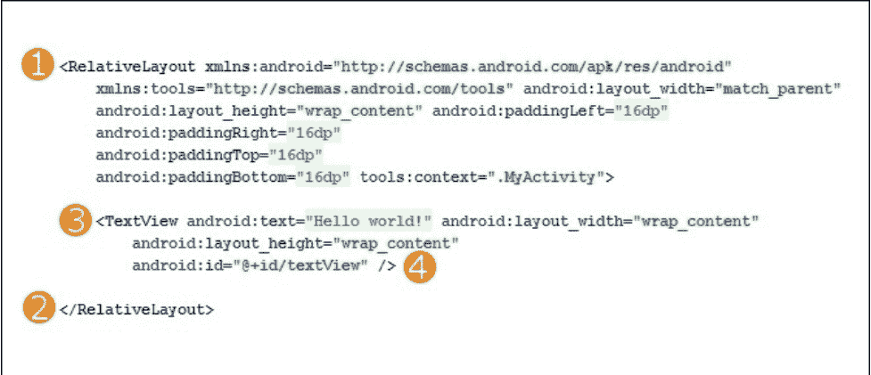

如果我们首先查看代码中标记为 1 的部分，可以看到最开始的内容是 <RelativeLayout... RelativeLayout 标签是一种 UI 元素，用于包装 UI 的其他部分。

在 Android 中向 UI 添加新元素时，我们总是以 < 开头，后跟元素的名称。随后的代码定义了该元素将具有的属性。这可能包括几十种不同的内容，具体取决于 UI 元素的类型。在此处，在其他一些 XML 代码中，我们可以看到 layout_height、paddingRight、paddingTop 和 paddingBottom 等属性。所有这些 **属性** 都定义了 RelativeLayout 在用户屏幕上的显示方式。RelativeLayout 的属性在第一个 > 符号处结束。

如果我们查看 XML 图表的底部，将看到标记为 2 的代码。此代码 </RelativeLayout> 标记了 RelativeLayout 的结束。在元素属性的结束 > 符号和定义其结束的 </RelativeLayout> 之间的所有内容，都被视为元素的 **子** 元素。因此，我们可以看到 RelativeLayout 有一个/包含一个子元素。让我们现在看看这个子元素。

利用你刚才学到的知识，我们可以推断出，图中位置 3 处开始的 UI 元素被称为 **TextView**。就像其父元素一样，标签以 < 开头，其名称为 <TextView... 如果我们进一步查看 TextView，可以看到它具有多个属性。它有一个 text 属性，设置为 "Hello world!"。当然，这就是我们的应用向用户显示的文本。它还具有 layout_width 和 layout_height 属性，两者都设置为 "wrap_content"。这告诉 TextView，它可以占据其所包含内容所需的所有空间。如在本书中我们将看到的，此元素和其他 UI 元素还有更多可用属性。TextView 中的最后一个属性是 id，我们将在改进第一个应用的下一部分中了解我们和 Android 如何使用 id 属性。

请注意，我们 XML 图中标记为 4 的部分的代码是 />。这标记了 TextView 元素的结束。这与 RelativeLayout 结束的写法略有不同。当 XML 中的元素不包含任何子元素时，我们可以像这样用 /> 结束它。当元素包含子元素，且其结束位置在属性定义之后的代码更靠后的位置时，通过重复其名称来结束元素（如 </RelativeLayout>）会更清晰。

我们将在下一部分中真正看到这段代码，了解更多关于属性的内容，以及看到一种全新的 UI 元素类型：Button。

# 改进我们的应用并再次部署

在下一章中，我们将更深入、更有条理地了解 Android Studio，特别是可视化设计器。目前，我认为在 UI 中进行小幅度添加以及编写我们的第一几行 Java 代码会很有帮助。

## 提示

你可以在下载包的第 2 章文件夹中获取此项目的完整代码文件。

在 Android 中，通常有多种方法可以完成同一件事。在这里，我们将看到如何直接从 UI 设计器或 XML 代码引用我们 Java 代码中的方法。完成此操作后，我们将跳转到 Java 代码，编写我们自己的方法，供新 UI 调用。不仅如此，我们还将在方法中编写代码，这些代码既可以在 logcat/控制台上输出结果，又可以使用一种很酷的 Android 功能向用户弹出消息。

## 修改 UI

在此处，我们将向屏幕添加几个按钮，然后看到一种非常快速的方法来让它们真正执行操作。我们将以两种不同的方式添加按钮。第一种，使用可视化设计器；第二种，直接添加和编辑 XML 代码。请按照 UI 设计器中的以下步骤操作：

- 1. 让我们尽可能清晰直观地查看 Android Studio。点击 **Android** 选项卡以隐藏 logcat。下次该窗口有新输出时，它会自动再次显示。

- 2. 通过单击主编辑窗口上方的选项卡，确保 `my_layout.xml` 文件被选中，如下图所示：


- 选中文件后，你有两种查看方式可供选择。可以从主编辑窗口下方的两个选项卡中选择 **Design** 或 **Text**。确保选择了 **Design**，如下图所示：

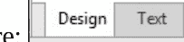

- 当你在编辑器窗口中看到一个智能手机模板中的应用漂亮的大视图时，就知道之前的步骤已成功，如下图所示：

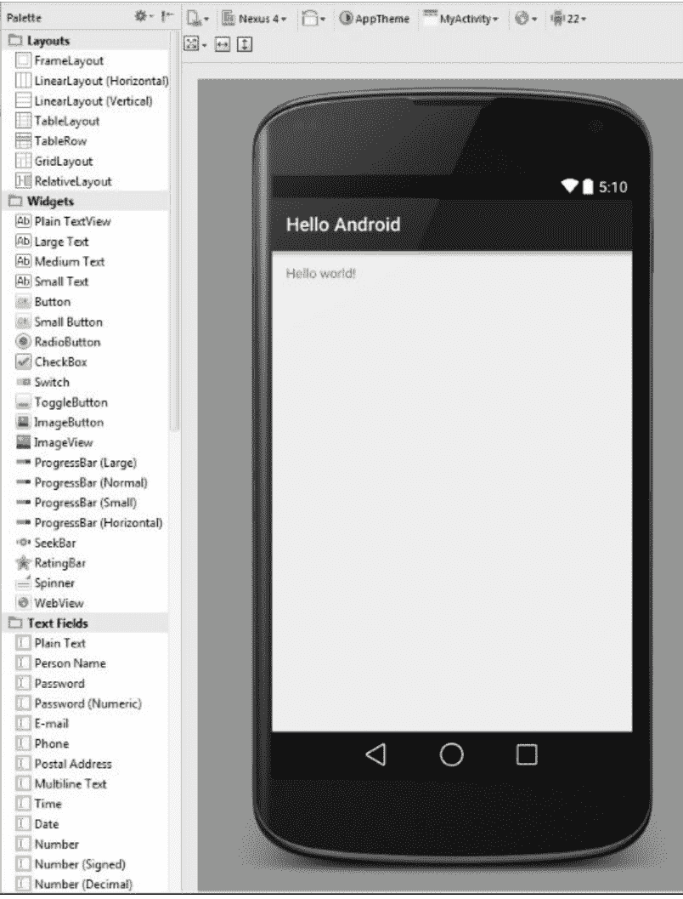

- 另外，在上一图中，请注意编辑器窗口中智能手机紧靠左侧的那条高而窄的区域。它称为 Palette，并相应地标记。

- 在 Palette 窗口中，在 Widgets 标题下找到 Button 小部件，如下图所示。根据显示器的大小和分辨率，你可能需要稍微滚动 Palette 窗口：

- 点击并按住 Button 小部件，然后将其拖动到智能手机上布局顶部和中心附近的某个位置。小部件不需要精确放置。事实上，只要它放在智能手机上的某个位置，放在哪里都没关系。不过，最好练习将其放置得准确些。因此，如果你对按钮的位置不满意，可以点击它在智能手机上将其选中，然后按键盘上的 Delete 键将其删除。现在，你可以重复此步骤，直到你有一个位置整齐、令你满意的按钮。也许，就像下图所示：

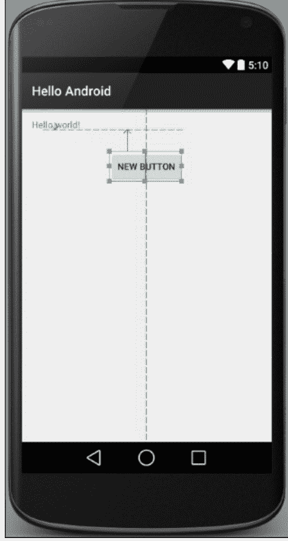

- 此时，我们可以在模拟器或真实设备上运行应用，按钮就会出现在那里。如果点击它，甚至会有一个简单的动画来表示按钮被按下并释放。如果你愿意，可以现在试一下。不过，Google Play 上下一个畅销应用需要做得更多。我们将使用 **Properties** 窗口来编辑小部件的属性。通过点击按钮确保其已被选中。现在，在编辑窗口右侧找到 **Properties** 窗口

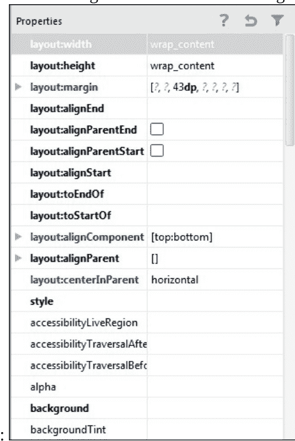

窗口，如下图所示：

- 正如你所见，这里在 UI 设计器中可以编辑的属性种类繁多。在 [第 10 章，万物皆为类] 中，我们还将在 Java 代码中编辑和操作这些属性。目前，我们只编辑一个属性。滚动 **Properties** 窗口，直到看到 **onClick** 属性，然后点击它选择进行编辑，如下图所示：


- 在可用字段中输入 topClick 并按键盘上的 Enter 键。请确保使用相同的大小写，包括略有反直觉的小写 t 和大写 C。我们在这里所做的，就是为当用户点击此按钮时我们想要调用的 Java 方法命名。名称是任意的，但由于此按钮位于屏幕顶部，这个名称看起来既有意义又容易记住。我们使用的这种奇怪的大小写是一种约定，将帮助我们保持代码清晰且易于阅读。随着我们的代码变得更长、更复杂，我们将看到这一点带来的好处。当然，在


此刻我们还没有名为 topClick 的方法。在我们研究另一种向 UI 添加小部件的方式后，将使用 Java 代码编写此方法。此时您可以运行应用，它仍然可以工作。但如果您点击按钮，应用会崩溃，用户会收到错误，因为该方法不存在。有关更多此类信息，请参阅这些步骤末尾的常见错误信息框。

- 现在我们将为本项目添加最后一个按钮。单击下方的文本选项卡

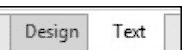

编辑器，以查看构成我们 UI 的 XML 代码：

- 您将看到一个按钮以及 XML 代码，通过该代码，我们仍可以在代码右侧的较小窗口中查看设计。单击 UI 设计中的按钮，您会注意到代表按钮开始和结束的代码被高亮显示，尽管非常微妙：

```
<RelativeLayout xmlns:android="http://schemas.android.com/apk/res/android"
    xmlns:tools="http://schemas.android.com/tools" android:layout_width="match_parent"
    android:layout_height="match_parent" android:paddingLeft="16dp"
    android:paddingRight="16dp"
    android:paddingTop="16dp"
    android:paddingBottom="16dp" tools:context=".MyActivity">
    <TextView android:text="Hello world!" android:layout_width="wrap_content"
        android:layout_height="wrap_content"
        android:id="@+id/textView" />
    <Button
        android:layout_width="wrap_content"
        android:layout_height="wrap_content"
        android:text="New Button"
        android:id="@+id/button"
        android:layout_below="@+id/textView"
        android:layout_centerHorizontal="true"
        android:layout_marginTop="43dp"
        android:onClick="topClick" />
</RelativeLayout>
```

- 非常仔细且准确地，将光标单击放在按钮代码的开头 < 符号之前。现在，单击并拖动先前的第一个 < 符号，一直拖到代表我们按钮的代码中最后一个 > 符号之后。这将高亮显示我们想要的代码，如下图所示：

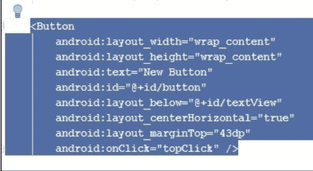

- 现在，使用键盘快捷键 Ctrl + c 复制代码。在按钮代码下方仅留一个空行并单击它以放置光标。然后，使用键盘快捷键 Ctrl + v 粘贴复制的代码。执行此操作后您将看到如下图：

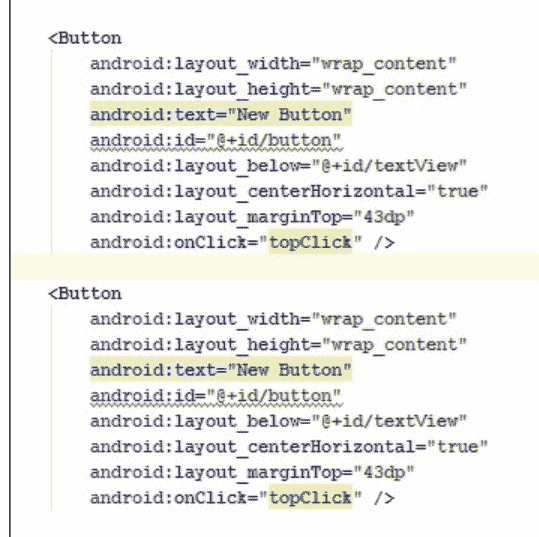

- 如果查看编辑器，您会看到我们代码中每个按钮都有一行被红色下划线标记，指示两个明显的错误。这是因为 Android Studio 无法区分我们的两个按钮。或者更具体地说，两个按钮都声称自己是同一个按钮。按钮通过其 ID 与其他按钮区分开来。我们可以直接在 XML 代码中设置按钮的 id 属性，或通过 **属性** 窗口设置。让我们通过使两个按钮拥有不同的 ID 来修复这两个错误。在第二个按钮上，只需更改以下行：

```
android:id="@+id/button"
```

将上一行代码更改为：

```
android:id="@+id/button2"
```

- 现在我们有两个具有唯一 ID 的不同按钮。我们将在第 9 章，面向对象编程 中了解如何通过在 Java 代码中引用这些 ID 来操作 UI 中的按钮。查看视觉设计。在这里，我们仍然只能看到一个按钮。查看同时存在于我们两个按钮中的以下 XML 代码行：

```
android:layout_below="@+id/textView"
```

- 这是告诉 Android 按钮应该在布局中位于何处的代码行。与我们的 ID 一样，在更改之前，这行代码在两个按钮中是相同的。因此，按钮位于完全相同的位置并不奇怪，这也是我们只能看到其中一个按钮的原因。同样，在第二个按钮中，将相关代码行更改为以下内容：

```
android:layout_below="@+id/button"
```

- 现在，第二个按钮位于第一个按钮下方。当我们再编辑一个属性时，我们将更仔细地检查发生了什么。下图

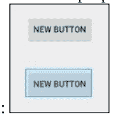

是我们 UI 设计中两个按钮的特写图：

- 在认为本项目的 UI 已完成之前，让我们再更改第二个按钮的一项内容。识别第二个按钮代码末尾的以下代码行：

```
android:onClick="topClick" />
```

请注意，它在双引号 "" 中包含了我们即将编写的方法的名称 topClick。

- 请确保您已识别第二个按钮中的代码，然后将单词 top 更改为 bottom。现在，我们必须创建两个 Java 方法（topClick 和 bottomClick），以避免用户开始点击按钮时应用崩溃。

- 运行应用，查看一切是否正常，除非您点击按钮导致应用崩溃。

通过这个简单的练习，我们取得了很大进展。诚然，大部分 XML 代码可能仍然大体难以理解。这没关系，因为在接下来的两章中，我们将真正掌握可视化设计器和 XML 代码。

我们看到，当我们将按钮拖到设计上时，XML 代码会为我们生成。同样，如果我们在 **属性** 窗口中更改属性，XML 代码也会为我们编辑。此外，我们可以直接键入（或者在我们的情况中，复制并粘贴）XML 代码，在 UI 上创建新按钮或编辑现有按钮。

尽管我们没有解释 XML 代码的实际组成，但您可能已从中推断出一些事情。如果您还没有花一分钟通读 XML，现在浏览一遍可能会有帮助。也许，以下是您的推断之一：

- 以 android:onClick=... 开头的行允许我们定义一个 Java 方法，用于处理点击该按钮时发生的情况。

- 以 android:layout_below=... 开头的行允许我们指定另一个 UI 元素的 ID，我们希望当前元素显示在该元素下方。

- 以 android:text=... 开头的行允许我们指定将显示在按钮上的文本。

- 我们可能还可以推测，行 android:layout_centerHorizontal="true" 会使按钮（或其他 UI 元素）水平居中。

- 任何做过一些基本 Web 编程的人都能推测，行 android:layout_marginTop="43dp" 将使元素顶部具有 43 个 dp 的边距（无论 dp 指的是什么）。

- 此外，每行定义或设置一个不同的属性，以 android: 开头，然后说明要定义的属性。例如，layout_marginTop=，然后是要设置该属性的值："43dp" 或 "true"。

- 我们还可以看到，按钮以代码 <Button 开头，以代码 /> 结尾。

您不需要记住所有这些要点，因为我们将在整本书中不断遇到它们，以及其他类似的惯例，尤其是在接下来的两章中。

## 提示

## 常见错误

还记得当我们点击按钮时，由于尚未编写它调用的方法，应用崩溃了吗？如果您从用户界面调用一个不存在的方法，您将在 logcat 中收到一条长而有用的错误消息，该消息中将包含许多其他内容，其中包含 caused by:
java.lang.NoSuchMethodException: topClick 消息。我们将在整本书中逐渐熟悉像这样的提示中可能看到的常见错误。

如果您从用户界面调用一个不存在的方法，用户将收到此消息。

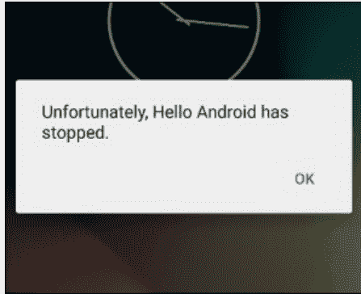

在 [第 4 章，设计布局] 中，我们将更仔细地研究如何从调色板中控制许多不同小部件和其他 UI 元素的位置和外观。您还将确切了解 dp 和其他有用的 Android 度量单位是什么。

现在，让我们编写第一个 Java 代码，并通过为按钮编写方法来连接它们。


## 初识 Java

查看 **MyActivity.java** 标签页。在这里，我们可以看到简要讨论过的代码。

在编写自己的方法以对应按钮已经连接好要调用的方法之前，让我们先看看 Java **注释**。无论是对学习编程的人还是经验丰富的开发者，Java 注释都非常实用。

### Java 注释

在编程中，编写被称为代码注释的消息，并大量地将它们散布在代码中，始终是个好主意。这样做是为了提醒我们当初在做什么，当用户点击应用图标运行应用时。在 [第 6 章，The Life and Times of an Android App] 中，我们将探索 Android 生命周期，到时候将非常清楚哪些代码在什么时候被执行。现在你不需要完全理解这一点。我只是想让你了解当时发生了什么。

让我们快速试一下。我们知道，onCreate 方法在应用真正启动之前被调用。让我们将以下几行代码复制粘贴到我们 Hello Android 应用的 onCreate 方法中，看看运行时会发生什么：

- 1. 找到 onCreate 方法的右花括号 }，并添加高亮显示的代码，如下一个代码片段所示：

```
@Override
protected void onCreate(Bundle savedInstanceState) {
    super.onCreate(savedInstanceState);
    setContentView(R.layout.my_layout);

    // Let's take a look at Toast and Log in action
    Toast.makeText(this, "Can you see me",
    Toast.LENGTH_SHORT).show();

    Log.i("info", "Done creating the app");
}
```

- 2. 请注意，Android Studio 中 Toast 和 Log 这两个单词的两个实例都被高亮显示为红色。它们是错误。我们知道 Toast 和 Log 是类，而类是代码的容器。在我们告诉 Android Studio 它们之前，它不知道它们。我们必须为每个类添加 import。幸运的是，这是半自动的。在 onCreate 方法中的任意位置单击。

- 3. 按住 Alt 键，然后按 Enter 键。你需要执行此步骤两次。一次针对 Toast，一次针对 Log。Android Studio 会在代码顶部的其他 import 语句旁添加 import 指令，这样一来，错误就消失了。

- 4. 滚动到 MyActivity.java 的顶部，查看添加的 import 指令。以下是这些指令，以防你正在平板电脑或纸质书上跟随学习，且没有将开发机器放在身边：

```
import android.util.Log;
import android.widget.Toast;
```

- 5. 现在，以通常的方式运行应用。

下一张图是 logcat 窗口中输出的截图：

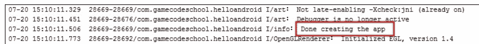

查看 logcat，你可以看到我们的消息 Done creating the app 是输出内容。尽管它与我们目前不感兴趣的其他系统消息混在一起。如果你在应用首次启动时观察模拟器，你还会看到用户会看到的那个整洁的弹出消息。

你可能会好奇为什么消息会在当时被输出。简单的回答是，onCreate 方法在应用开始实际响应用户之前被调用。我们通常会在这个方法中放置代码，以设置应用并使其准备好接收用户输入。这是 Android 应用生命周期的一部分，你将在第 6 章，The Life and Times of an Android App 中了解更多关于它的内容。

### 小贴士

Alt + E 只是众多有用键盘快捷键中的一个。以下是 Android Studio 的键盘快捷键参考。更具体地说，这是适用于 IntelliJ Idea IDE 的参考，Android Studio 基于此 IDE 开发。请查看并收藏此网页，在本书学习过程中它将非常有价值：http://www.jetbrains.com/idea/docs/IntelliJIDEA_ReferenceCard.pdf

现在，我们将更进一步，编写由 UI 按钮调用的自己的方法。我们将在其中放置类似的 Log 和 Toast 消息。

## 编写我们自己的 Java 方法

让我们直接开始编写我们的第一个 Java 方法，在其中放入一些额外的 Log 和 Toast 消息。如果还没有打开 Hello Android 项目，请在 Android Studio 中打开它：

- 1. 找到 MyActivity 类的右花括号 }，如前面讨论过的那样。在该花括号内，输入我们刚刚处理过的 onCreate 方法之后高亮显示的以下代码：

```
@Override
protected void onCreate(Bundle savedInstanceState) {
    super.onCreate(savedInstanceState);
    setContentView(R.layout.my_layout);
}
```

```
// Let's take a look at Toast and Log in action
Toast.makeText(this, "Can you see me",
Toast.LENGTH_SHORT).show();
Log.i("info", "Done creating the app");
}
```

```
public void topClick(View v){
    Toast.makeText(this, "Top button clicked",
    Toast.LENGTH_SHORT).show();
    Log.i("info", "The user clicked the top button");
}
```

```
public void bottomClick(View v){
    Toast.makeText(this, "Bottom button clicked",
    Toast.LENGTH_SHORT).show();
    Log.i("info", "The user clicked the bottom button");
}
```

- 2. 首先，请注意，我们似乎有两行代码，每行都包含 Toast 代码的一部分。这并不完全正确。问题在于，这行代码是


相当长，并且在这本书中会换行到第二行。如果你检查下载包中的代码，你会发现它在同一行上。方法中一行代码的实际结束位置可以通过分号的位置来确定。当你输入步骤 1 中的代码时，请务必将所有 Toast 代码输入在同一行上。

- 3. 请注意，单词 "View" 的两个实例显示为红色，表示有错误。只需使用 Alt + Enter 键盘组合来导入 View 类并删除错误。

- 4. 将应用部署到真实设备或模拟器上，并开始不断点击，以便我们可以观察输出。

最终，我们的应用做了我们告诉它要做的事情，并且在我们告诉它的时候去做。我们可以看到，我们在按钮属性中定义的方法名称在按钮被点击时确实被调用了。诚然，我们仍然不明白 Toast 和 Log 究竟是如何工作的，我们也不完全理解我们方法语法中 public void 和 (View v) 这些部分。随着我们深入学习，这将变得清晰。

### 注意

### 尽可能清晰地展示代码

未来的代码通常不会以编号步骤的形式呈现。本次，我将代码作为教程中某些编号步骤的一部分来呈现。在书中呈现代码，尤其是在移动设备上阅读时，可能会出现问题。一旦一行代码太长，超出其呈现媒介的宽度，该行就会换行到下一行，导致清晰度下降。我们在上一教程中就遇到了 Toast 代码的这种情况。正如我们将看到的，在某种程度上这是不可避免的，但为了尽可能缓解这一问题，代码块通常不再以编号步骤的形式展示。相反，我会努力确保代码的上下文以及应该输入代码的顺序通过其他方式清晰明了。

### 检查日志输出

如果你检查 logcat 输出，你会看到 onCreate 方法中记录了一条日志条目，和之前一样，以及我们每次点击按钮时编写的两个方法中也记录了日志。

在下一张图中，你可以看到顶部按钮已被点击，topClick 方法被调用，触发了 Toast 弹出消息，该消息在下图中高亮显示：

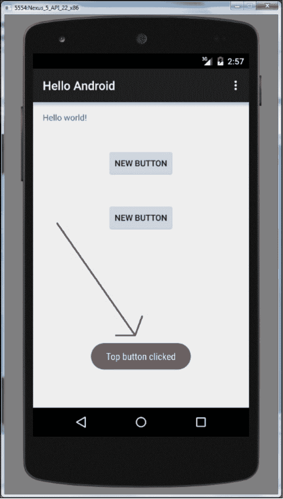

在整本书中，我们会定期向 logcat 提供输出，以便我们可以看到应用 UI 后面发生了什么。Toast 消息更适合通知用户某事已发生，例如下载完成或新邮件到达。

### 常见问题解答

- 1. 你能提醒我什么是方法吗？

方法是我们代码的容器，可以从代码的其他部分执行（调用）。方法包含在一个类中。

- 2. 和上一章一样，我觉得本章很难。我需要重新阅读它吗？

不，只要你已经构建了应用，你就取得了足够的进度来处理下一章。随着本书的推进，我们知识中的所有空白都会逐渐被填满，并被辉煌的顿悟时刻所取代。

### 总结

在本章中，我们取得了相当多的成果。我们使用 UI 设计器以及通过修改原始代码这两种方式查看和编辑了布局 XML 文件。我们一窥了第一段 Java 代码，甚至添加了自己的方法，以便向控制台输出调试消息，并向用户弹出 Toast 消息。

在下一章中，我们将对 Android Studio 进行完整的导览，以确切了解不同操作同时在哪里进行，理解我们的项目资产（如文件和文件夹）的结构，并学习如何管理它们。这将为我们在第 4 章“设计布局”和第 5 章“实际布局”中更深入地研究 UI 设计，并为我们的应用构建一些重要的实际布局做好准备。
