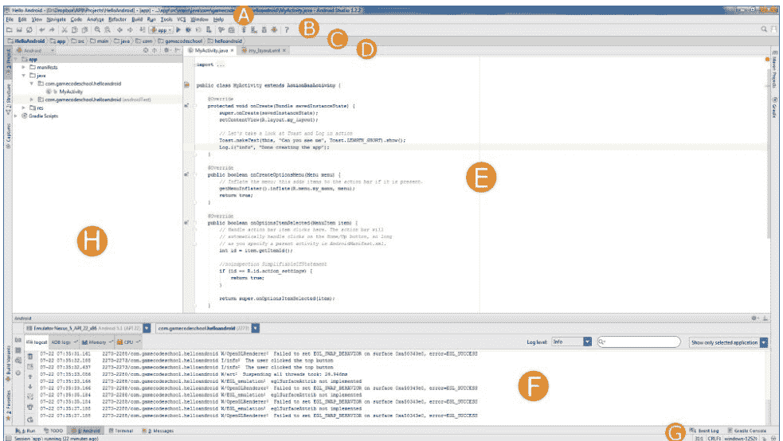
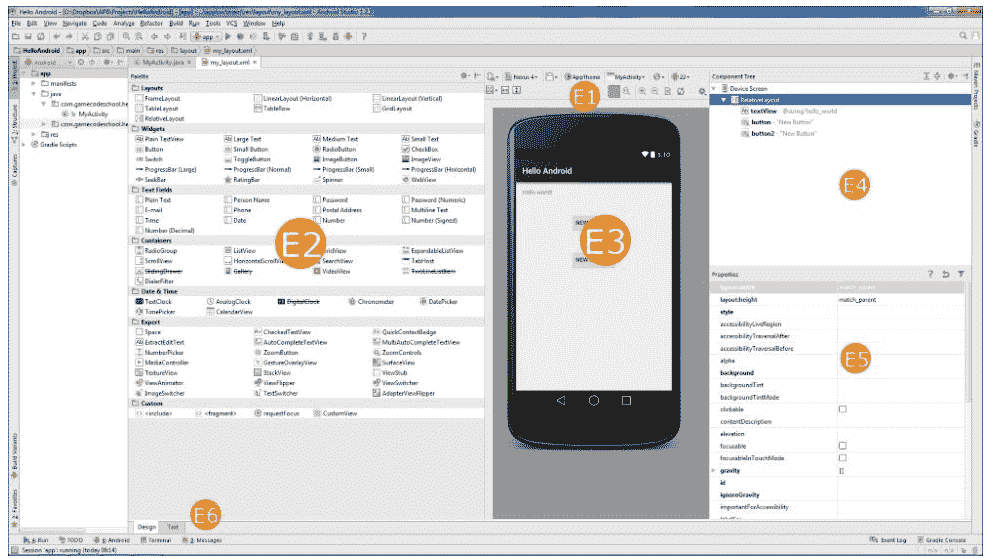
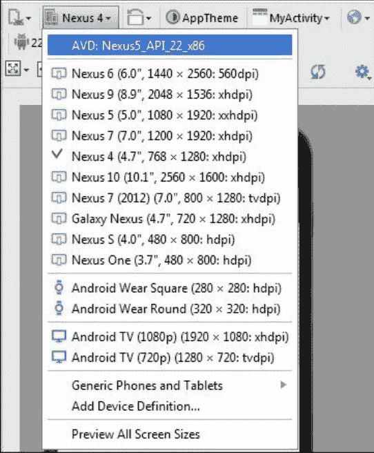
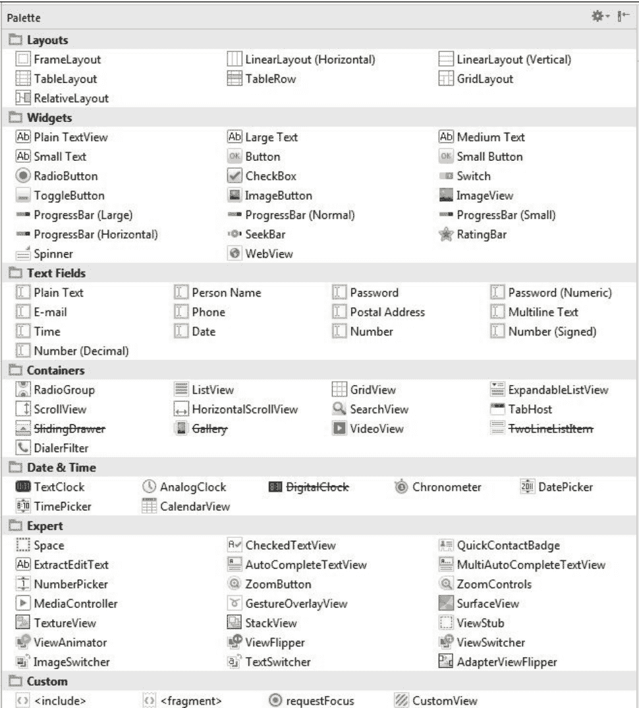
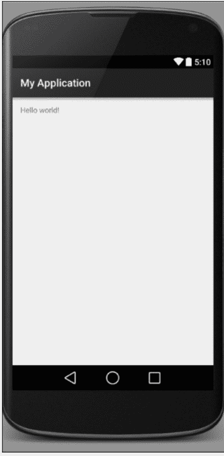
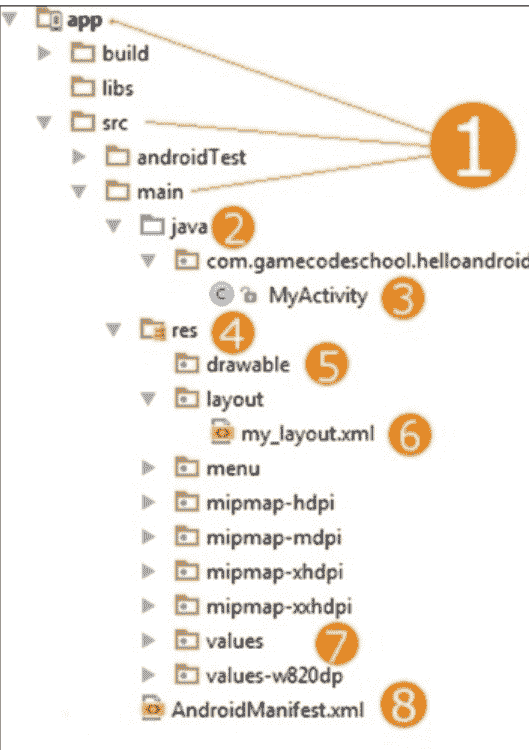

## 第 3 章 探索 Android Studio

在本章中，我们将对 Android Studio 最重要的区域进行导览。这样我们就可以快速轻松地讨论我们将执行的不同操作发生在*哪里*。这是本书中唯一一章我们不会实际构建应用或进行编码的章节，但它简短且会为我们构建的所有应用做好准备。

以下是我们将要做的关键事情：

- 我们将对 Android Studio 的窗口、选项卡和功能进行相当详细的导览
- 我们将熟悉 Android 项目中涉及的不同文件和文件夹

让我们开始 Android Studio 导览。

### Android Studio 导览

Android Studio 会记住你在关闭它之前正在做什么。因此，当你下次启动它时，它最初看起来可能与我在这里展示和描述的有所不同。开始阅读本导览，只需点击几下即可跟进并检查所有不同区域。

我很少建议值得背诵信息，因为反复使用和实践概念是使重要想法深入人心的更好方法。然而，本次值得记住关键 Android Studio 窗口的名称；这样，在我们进行未来教程时，你可以轻松跟进操作所在的位置。当然，我们已经看到了其中几个（例如编辑器和属性窗口），如果你记不全，以后可以轻松查阅本节。

### 提示

### 每日提示

每次启动 Android Studio 时，你都会看到一个“每日提示”消息框。阅读这些提示非常有价值，因为虽然有些提示此刻可能说不通，但其中许多包含真正有价值的信息，可以节省时间或以某种方式启发我们。

### UI 的各个部分

在下一张图中，你可以看到 Android Studio 打开了上一章中的 Hello Android 应用。虽然我们已经完成了这个项目，但它在此处还能派上一次用场。



让我们快速查看上一张截图中标记的不同区域，然后我们可以专注于 Android Studio 提供的设计视图：

- A：这是**菜单栏**。与大多数应用程序一样，我们可以从此处访问几乎任何选项。
- B：这是**工具栏**，你可以从此处访问众多快速启动图标之一。从此处，一些最常用的选项可以通过单击一次来访问。
- C：这是**导航栏**。它显示编辑器窗口中当前打开的文件在我们项目中的位置，并允许我们快速导航到文件或文件夹。
- D：这些是**编辑器选项卡**。我们可以点击选项卡以在编辑器窗口中查看其内容。请注意，我们项目中的文件比编辑器选项卡中显示的更多。我们可以通过在项目资源管理器中双击文件来将其添加到编辑器选项卡。请参阅 H 以查看文件和文件夹。
- E：这是编辑器，也是我们将花费大部分时间的地方。请注意，虽然上一张截图显示编辑器中是一个普通的旧代码文件，但当我们选择打开布局文件时，编辑器窗口会将其自身转变为一个微型设计工作室。并且，正如我们在本书余下部分将看到的，它还会针对其他文件类型执行一些其他上下文感知转换。

### 控制台

上一张截图中的 F 窗口标记为 Android。我们一直在查看 logcat 输出。但是，请注意，在这个窗口的顶部，有以下选项卡：

- logcat：错误、Log 输出和其他有用信息将出现在此处。
- ADB 日志：这就像一个虚拟控制台，我们可以从命令行完成事情。本书中不需要这样做。
- 内存：当你的应用运行时，点击此选项卡查看应用内存使用情况的漂亮图表。我们可以使用此选项卡查找内存使用中的意外激增，并努力使我们的应用更省内存。
- CPU：当你的应用运行时，点击此选项卡查看应用 CPU 使用情况的漂亮图表。我们可以使用此选项卡查找 CPU 使用中的意外激增，并努力使我们的应用更高效。

包括我们刚才讨论的四个选项卡，窗口下方还有另外四个选项卡。如果你点击以下选项卡之一，Android 窗口会更改窗口名称或将当前窗口分为两部分。以下是你可以使用 Android 窗口下方的四个选项卡所做的操作：

- TODO：这显示项目代码中分布的 TODO 注释。这非常有用；试试看：在代码的任何地方输入 // TODO 给自己的备忘。例如：

```
 // TODO: The flashing pig bug might be caused by the code below!
```

无论你有多少个代码文件，你都会看到你的备忘，并能够直接从 TODO 跳转到代码中的精确行。


能够直接从 TODO 窗口跳转到代码中的精确行。可以把它看作是强化版的代码注释。现在为什么不试试看？

- **Android**: 这将带我们回到 Android 窗口以及我们之前讨论过的四个选项卡。
- **Terminal**: 你可以使用它来导航你的操作系统，并执行从控制台（DOS）窗口中能做的任何操作。
- **Messages**: 顾名思义，你将在此窗口中获得系统和错误消息。

## 更多控制台功能

在上一张截图角落标记为 G 的部分，我们有两个额外的选项卡：**事件日志** 和 **Gradle 控制台**。这两个选项卡正下方是**状态栏**。当 Android Studio 正忙于为我们做某事时，它会在此处通知我们。所以如果事情看起来有点无响应，或者你不确定是否真的点击了播放图标，那么在再次点击之前，请先检查此处。

现在让我们详细看看这两个选项卡：

- **事件日志**: 每次 Android Studio 完成一个重要事件时，都会在此处记录。所以如果你记不清到目前为止所采取的步骤，或者某个特定过程是否已成功完成，你可以在此处查看。
- **Gradle 控制台**: Gradle 是一个构建系统。在我们甚至没有意识到的情况下，Android Studio 一直在使用 Gradle 来自动化将项目中的文件转换为可在设备上运行的应用的过程。此控制台允许你向 Gradle 工具发送一些命令并查看其响应。不过，我们不需要这样做。

## 提示

如果你想了解更多有关 Gradle 的知识，并超越完成本书所需的知识，你可以通过这个探索性教程来做到这一点：http://www.vogella.com/tutorials/AndroidBuild/article.html

## 项目资源管理器

标记为 H 的部分是**项目资源管理器**。这本质上是一个文件浏览器。我们将在下一节中探索项目的文件和文件夹结构，但只需知道你可以在此窗口中导航到一个文件，双击它以打开它，并为其在编辑器窗口中添加一个选项卡。

请注意，Android Studio 左侧有许多选项卡，它们会导致项目资源管理器窗口被替换。以下是从上到下的主要选项卡功能快速概述：

- **项目**: 点击此选项卡以切换回我们刚才讨论过的项目资源管理器。
- **结构**: 在这里，我们可以看到项目被分解为类、方法和其他组件的层次结构。然后，我们可以简单地点击层次结构中的一部分，以跳转到编辑器窗口中选定的代码部分。
- **构建变体**: Android Studio 使我们能够测试我们的应用的多个不同版本——构建版本。这不是本书需要讨论的内容。
- **收藏夹**: 通过它，你可以查看访问最多的所有位置、书签文件，或你一直在调试的代码中的点。

## 将编辑器转换为设计工作室

我没有在 UI 边缘标记所有可能的选项卡选项，因为它们太多了，而且正如我们所见，有时你能看到的确切选项卡取决于上下文和当前占用给定窗口的视图。在快速导览中，当我们谈论离它们最近的窗口时，我们提到了大部分选项卡。

需要进一步介绍的一组选项卡是包含打开文件的选项卡（D）。之所以如此，是因为编辑器窗口（E）会根据其中打开的文件类型而完全转变自身。当我们在 Java 代码和布局文件之间切换时，我们已经见过编辑器窗口转变自身的情况。

作为提醒，单击 my_layout.xml 选项卡（D）。接下来，通过单击编辑器窗口左下角的 **设计** 选项卡，确保我们处于主设计视图。以下是另一张带标签的截图，以确保在设计视图中我们指的是编辑器窗口的正确部分：



在接下来的几章中，我们将大部分时间在编辑器窗口的设计视图中度过。如果上一张截图与你的布局看起来略有不同，那么你可以采取以下步骤来使你的布局更加适合设计：

- 通过确保 Android 窗口已关闭，使编辑器窗口变大。如果窗口打开，请单击 Android 选项卡，这将使其消失。
- 通过将项目资源管理器窗口与编辑器之间的区域向左拖动，使项目资源管理器窗口变小。
- 通过将 Palette 区域（E2）的右侧边缘向右拖动，使其变大。
- 根据你的偏好调整所有窗口大小。

你会注意到，我们从 A 到 H 讨论过的所有窗口仍然存在/可用，只是编辑器窗口发生了根本性的转变。让我们通过遵循上一张截图上的标签，来看看编辑器窗口有什么可提供的。

### E1 – 预览工具栏

Android Studio 这个虽小但有用的区域绝对值得讨论。我不会介绍每个按钮，但以下是一些亮点。如果你想查看你的布局在特定手机或平板电脑上的样子，请单击虚拟设备下拉列表并选择你想要的设备，如下图所示：



你还可以单击如下图所示的按钮将预览旋转为横向。单击此处显示的按钮来尝试：


如你所料，这将使我们的布局看起来大不相同。我们将在本章后面和整本书中开始了解如何处理这一点。

我们可以使用此处显示的按钮对布局设计进行放大和缩小：


接下来显示的按钮是刷新按钮，就像网页浏览器中的刷新按钮一样。如果布局预览没有自动更新，它会强制更新布局预览。


我们没有介绍每个按钮或控件，但我们已经看到了足够多的内容，可以继续下去了。

### E2 – 探索 Palette

接下来，我们有 Palette 窗口。Palette 包含几十种不同的设计元素，我们可以将其拖到布局上。它们被划分为类别，并在以下部分中全部介绍。本章的关键类别是小部件和布局，因此我们将比其他类别更彻底地介绍它们。请看 Palette 的这张特写：



让我们浏览 Palette 的一些关键部分，之后，我们将开始实际使用它们：

- Layouts: 布局，顾名思义，用于布局其中的所有其他元素。但是，关键的是，随着我们的进展，将变得明显的是，不同的布局更适合不同的情况。此外，我们可以在不同类型的布局上使用相同的小部件，为我们生成的 XML 代码会有很大差异。这对我们来说不会成为问题，因为我们将查看大量示例，并且如我们稍后将看到的，我们不需要记住每种布局类型的不同语法；我们只需了解每种布局类型适合的不同情况即可。此外，我们会经常在同一个设计中使用多个布局。也就是说，会有布局嵌套布局。只需考虑将不同形状和大小的存储容器放入更大的容器中。这是同样的概念。你将通过实践了解在不同情况下哪些容器最适合哪些内容。
- **小部件**: 是 Palette 上最常用的元素。通常，一个布局中会包含多个小部件。小部件是用户最常看到并与之交互的布局部分。我们已经见过 **Button** 和 **PlainTextView** 小部件。
- **文本字段**: 这些类似于 **小部件** 类别中的 **PlainTextView**，但非常特定于它们最适合的文本类型，并且当用户实际与它们交互或更改其持有的值时最常用。查看 **文本字段** 类别中元素的名称，你会发现它们都暗示其可能用途的名称。
- **容器**: 容器类似于具有特定目的的布局。例如，**Radio Group** 容器将保存小部件类别中的多个 **Radio Button** 元素。**ScrollView** 容器将保存一大堆其他元素并使用户可以浏览它们。**VideoView** 是一种快速简便的方法，允许用户几乎无需编码即可拥有一个功能齐全的视频播放器。我们将在本书后面看到这些容器的一些实际应用。
- **日期和时间**: 你是否曾想过，为什么那么多应用中的弹出日期或日历选择器看起来如此相似？那是因为它们使用了日期和时间元素。
- **专家**: 这些元素彼此相当多样。我们将在整本书中看到专家类别中的一些元素。例如，在第 28 章“线程、触摸、绘图和一个简单游戏”中，当我们快速浏览如何为 Android 制作动画 2D 游戏时，我们将看到 **SurfaceView** 的实际应用。
- **自定义**: 我们可以将这些视为专用布局的构建块


元素。Fragment 可能是所有布局元素中最强大、最多功能的，我们将在本书后半部分的大部分时间里充分利用它。

快速浏览完调色板后，让我们进入 E3。

## E3 – 布局预览

这是布局预览，我们将在此预览我们的杰作。仔细看看 E1，了解如何在横屏和竖屏之间切换、刷新或缩放预览，以及更改虚拟设备。下面是 E3 的特写视图，显示的是新项目启动后不久的布局预览：



如我们将在查看标记为 E6 的区域时看到，我们可以以可视化方式或代码形式查看布局/设计。

## E4 – 组件树

这是 **组件树**。它可以是 UI 设计师的救命稻草。随着我们的布局变得越来越复杂，布局元素嵌套在其他布局元素中，控件散布各处，整个 XML 代码可能变得难以导航。组件树允许我们查看设计的结构以及各个单独的元素。我们可以展开和折叠它的部分；跳转到 XML 代码的特定部分；还可以使用它拖动、放置和重新排列设计的各个部分。

## E5 – 属性窗口

这是 **属性** 窗口。在 **第 2 章 Java – 初次接触** 编辑小部件属性时，我们已经来到这里了。我们已经看到，我们可以在 XML 代码和属性窗口中编辑属性。这样做没有对错之分，很可能你最终会两者都用。当我们刚开始为 Android 编程时，属性窗口在两个方面非常有帮助。一个显而易见，另一个不那么显而易见。显而易见的好处是，我们不必在那些看起来令人不快的 XML 代码中折腾。另一个好处是，即使我们对 XML 代码感到自如，也需要很长时间才能记住所有属性的名称。属性窗口允许我们浏览所选元素的所有可用属性。当我们添加属性时，它当然会添加完整的 XML 行，从而省去了我们记住属性名称以及添加它所需的复杂语法的需要。

## E6 – 文本和设计视图选项卡

在这里，我们可以看到用于在 **文本** (XML) 视图和 **设计** 视图之间切换的选项卡。只有在查看具有这些视图的文件时，这些选项卡才可见。例如，当我们查看 Java 代码时，这些选项卡不会出现。

现在让我们进一步讨论项目文件夹和文件结构。

## 项目文件夹和文件结构

让我们仔细看看项目中的文件和文件夹。打开前面的 Hello Android 应用程序以跟进。Android 是个挑剔的东西，它喜欢所有不同的资源（布局文件、代码、图片、声音等）放在正确的文件夹里，否则它会抱怨，并且无法正确编译或运行。

Android Studio 借助 Gradle 会跟踪我们项目中的资源，并在我们尝试使用不存在的东西或例如拼写错误图片或声音文件名时提醒我们。在将资源添加到项目后的几乎瞬间，Android Studio 就会“知晓”它并使其可供我们使用。

如果你在项目资源管理器中展开所有文件夹，即使是来自第 1 章“第一个应用”的简单项目，你也会看到大量的文件和文件夹。

如果一些文件和文件夹的庞大和深度有点让人生畏，那么你会很高兴地了解到，我们永远不需要查看或编辑其中的大部分。其中大部分由 Android Studio 管理。我们将专注于作为 Android 开发者我们将使用的关键文件夹和文件类型。

展开以下文件夹（如果尚未展开）：单击每个文件夹左侧的小三角形，依次展开：app、src、main、java、res、main 和 layout 文件夹。你将看到类似于下图的内容。这张图是我们最感兴趣的文件夹的特写视图。像往常一样，我标记了最有用的部分，以便我们可以引用和描述它们。



如 (1) 所示，我们几乎可以找到所需的所有文件和文件夹在 app/src/main 文件夹中。

请注意，在 java 文件夹 (2) 中，位于与本项目包名相同的子文件夹（com.gamecodeschool.helloadroid）内，我们可以看到 MyActivity.java (3) 代码文件。Android Studio 隐藏了 .java 文件的扩展名，但位于 java 文件夹内应该足以让我们清楚正在处理什么。如果在项目中创建两个或更多不同的包，那么带有包名称的子文件夹将出现在 java 文件夹中，并且，当然，将包含它们的 .java 文件，正如我们所期望的那样。

在我们的 Android 项目中，我们还将不断添加和编辑的另一大主要内容是资源。这些资源都包含在 res 文件夹 (4) 中。正如我们在第 1 章“第一个应用”中看到的，我们的项目可以使用的资源种类繁多。让我们看看其中一些资源的去向。

drawable 文件夹 (5) 是所有图形资源的存放位置。如果我们设计一个花哨的按钮、背景或图标，这就是它的位置。除此之外，我们将在 res 文件夹中创建包含图形资源缩放版本的子文件夹。这些子文件夹由屏幕密度和大小各异的设备使用，名称如 drawable-hdpi、drawable-mdpi、drawable-xhdpi 和 drawable-xxhdpi。

这些文件夹将为高密度 (h)、中密度 (m)、超高密度 (xh) 和超超高密度 (xxh) 屏幕的设备提供等效的图形资源。这是可选的，因为如果未提供针对当前屏幕类型的特定版本，Android 会缩放任何图形；然而，这通常会导致拉伸或低质量的外观。

在 layout 文件夹中，我们可以找到 my_layout.xml (6) 文件，它当然包含我们项目的布局。我们可以在一个项目中拥有不止一个布局，创建后它们将出现在这个文件夹中。例如，我们可能有一个包含 home_layout.xml、settings_layout.xml 和 main_layout.xml 的项目。除此之外，就像 drawable 文件夹一样，我们可以在 res 中为不同 dpi 屏幕的设备拥有布局的子文件夹。名称相当可预测，但为了清晰起见，它们将是 layout-hdpi、layout-mdpi 等等。

我们还可以添加处理不同方向的文件夹，例如 layout-landscape 和 layout-portrait。

此外，我们可以添加处理屏幕大小（而非密度）的文件夹，例如 layout-large、layout-xlarge 等等。

## 提示

## 文件夹繁多

谈论这么多文件夹可能会让你脑袋发胀。首先要注意的是，正如我们之前提到的 drawable 文件夹，额外的文件夹始终是可选的。你可以轻松地只用一组图形和布局文件来构建一个应用程序。事实上，本书后半部分学到的技术减少了对 res 文件夹中几十个不同文件夹的需求。然而，了解不同尺寸/密度的设备、在相关模拟器上测试，并在必要时进行适配，将使你的应用程序真正多功能且外观一致。现在说说坏消息；这里提到的主要限定符之外，还有更多的屏幕限定符。如果你想查看，可以访问 http://developer.android.com/guide/practices/screens_support.html。我们将在整本书中使用这些不同的文件夹，并在使用时逐步处理它们。

转到文件夹结构图中的第 7 项，我们有 values 文件夹。它包含 strings.xml 文件。请注意，我们的应用程序名称在 Java 代码中任何地方都没有提及。原因是，虽然你可以将文本硬编码到 Java 代码或布局文件中，但在 strings.xml 文件中使用 **字符串资源** 要好得多。理由如下。字符串资源是用户在我们的应用程序中看到的索引文本（单词和短语），例如 Hello world！，包含在 strings.xml 文件中。

假设你有一个设置屏幕，并且在该设置屏幕布局中，你硬编码了“Settings”、“Volume”和“Theme”这些词。目前为止没问题。现在考虑一下，你的应用程序可能有多个不同的屏幕，每个屏幕都有一个用户可以点击的按钮，用于进入设置屏幕。没关系，也在按钮中硬编码文本即可。现在想象一下，首席设计师决定设置屏幕应该叫做“Options”而不是“Settings”，而且该应用程序还将在德国市场发布，当然这需要将所有字符串更改为德语。现在考虑一下，你的应用程序不仅仅有一个设置屏幕；也许，它还有关于如何使用你的应用程序的弹出提示。即使看似简单直接的应用程序标题，翻译成其他语言时可能也不同，甚至可能因某些国家的文化原因而不同。

通过使用字符串资源，我们可以简单地管理这个问题。双击 values 文件夹中的 strings.xml 文件来查看它。以下是为你方便提供的内容。请注意，我在下面的代码片段中高亮显示了一行代码：

```xml
<resources>
    <string name="app_name">Hello Android</string>
    <string name="hello_world">Hello world!</string>
    <string name="action_settings">Settings</string>
```


现在看看下一个图，它展示了 Hello Android 项目中 `my_layout.xml` 文件里 `TextView` 上的一行代码：

```
<TextView android:text="Hello world!" android:layout_width="wrap_content"
<TextView android:text="@string/hello_world" android:layout_width="wrap_content"
```

在前一个图中，我将鼠标光标悬停在短语 "Hello world!" 上。请注意，代码读取为 `text="Hello world!"`，但弹出窗口显示，该短语实际上并不直接包含在 `TextView` 标签本身中，而是通过 `@string/hello_world` 标识符在 `strings.xml` 文件中被引用。

因此，字符串资源允许我们定义应用中出现的文本，然后在 `strings.xml` 文件中引用其索引。这使得多次出现的单词和短语或翻译成新语言等问题变得更加容易管理。

这种做法对于一个简单的短语来说似乎确实有点啰嗦，但当我们考虑之前提到的设置屏幕场景时，其优势就很明显了。在本书中，我们会根据情况选择硬编码或使用字符串资源。一般来说，在实现完整项目时，我们会正确地做事；而在仅为学习概念而制作简单的应用时，我们会偷懒，直接对字符串进行硬编码。

### Tip

### 并非一切看上去都如此

如果你使用操作系统的文件浏览器并浏览到项目文件夹，你会发现情况与项目资源管理器中显示的有很大不同。子文件夹比项目资源管理器显示的要多得多。项目资源管理器不仅让你可以访问所需的所有文件和文件夹，还简化了它们的位置，并将它们稍微“挖出来”一点。真实的文件和文件夹结构是 Android 所要求的，因此我们不应该尝试更改它。所以，直接通过 Android Studio 执行所有编辑、移动和添加操作，直接通过 Android Studio 执行所有剪切、移动和添加操作，是个好主意。

没必要记住我们关于文件和文件夹所说的所有内容。每次我们需要对文件夹或文件进行某些操作时，我都会非常具体地说明该怎么做。只是对 Android 正常工作所需的结构有一个总体了解会很有帮助。你可以把 Android 想象成一个讲究（但可爱的）室友，他绝对必须让每样东西都有自己的位置，并且每样东西都在其位置上。

### FAQ

- 1. 我怎么可能跟踪所有不同的文件和文件夹放在哪里呢？

诚然，Android 是文件系统的控制狂，我们需要确保每个文件都被仔细命名和放置。但是，你不需要记住细节，因为我们将在继续进行时讨论具体应该把东西放在哪里。

- 2. 字符串资源看起来似乎会成为一种负担，是吗？

向应用添加文本的正确方法是使用字符串资源。在本书中，当我们只是查看示例时，通常不会费心使用字符串资源，但在实现本书中的主要项目时，我们会按其预期用途使用字符串资源。因此，大多数时间我们会避免额外开销，只在真正能节省时间或带来实际好处时使用它们。

## 总结

既然我们知道了 Android Studio 所有关键部分的名称和位置，就可以快速取得进展了。

在下一章中，我们将开始更深入地研究 UI 设计器，并通过更熟悉 XML 布局代码和 UI 设计器，了解如何同时控制设计的位置和外观。让我们开始进行一些 UI 设计吧。
