## 第 4 章. 设计布局

在本章中，我们将学习一些 UI 基础知识，例如如何控制布局中微件的大小和位置。我们将进一步理解略显吓人的 XML 代码，并了解使用 UI 设计器避免直接编辑代码的新方法，具体内容如下：

- 查看 UI 设计/布局底层的代码结构
- 学习如何精确定位微件
- 从头构建三个非常简单的 UI 设计

### 探索 Android UI 设计

在 Android UI 设计中，我们会发现所学的很多内容都与上下文相关。一个微件的 x 属性如何影响其外观，可能取决于该微件的 y 属性。这可能无法死记硬背。最好是指望通过练习逐渐获得更好、更快的结果。

例如，如果你在设计器中通过拖放微件到设计上来进行操作，生成的 XML 代码将根据你使用的布局类型而有很大差异。这是因为不同的布局类型使用不同的方法来确定其子元素的位置。我们将在本章后面介绍 RelativeLayout 时，或许最清楚地看到这一点。

这些信息起初可能看起来像是一个问题，或者一个坏主意，而且一开始确实有点笨拙。然而，我们将逐渐认识到，这种表面上丰富的布局选项及其各自的特性实际上是一件好事，因为它们为我们提供了几乎无限的设计潜力。你所能想象的几乎没有什么布局是无法实现的。

然而，这种无限的潜力伴随着一点复杂性。因此，与其提供缺乏解释的几个逐步示例，不如采用三管齐下的方法更有价值。一点理论，一点实验，最后是一些实际示例。本章涉及理论和实验，在下一章中，我们将处理实际示例。

### UI 设计的结构

当我们创建新项目时，Android Studio 会为我们创建一个新布局。如我们所见，这个自动生成的布局非常简单，只包含一个 TextView 微件。TextView 微件不出所料是显示文本的标准方式。在调色板上它被标记为 **普通 TextView**，但在 XML 代码中它只写作 TextView。我将根据当前上下文以最合适的方式来引用它。

### 提示

随着我们深入学习，这会变得显而易见，但在此有必要说明清楚：我们所有的布局都将在 XML 中设计，而不是在 Java 中。在后面的章节中，你将学习更多 Java，然后我们将看到如何编写 Java 代码来操作这些布局。

我们没有那么仔细地查看的是，生成的 activity_main.xml 文件也包含一个布局。布局有几种不同的类型，与我们的自动生成布局一起提供的布局称为 RelativeLayout。下面是构建这个布局的 XML：

```xml
<RelativeLayout
    xmlns:android="http://schemas.android.com/apk/res/android"
    xmlns:tools="http://schemas.android.com/tools"
    android:layout_width="match_parent"
    android:layout_height="match_parent"
    android:paddingLeft="@dimen/activity_horizontal_margin"
    android:paddingRight="@dimen/activity_horizontal_margin"
    android:paddingTop="@dimen/activity_vertical_margin"
    android:paddingBottom="@dimen/activity_vertical_margin"
    tools:context=".LayoutExperiments">
</RelativeLayout>
```

在定义布局自身属性的闭合 > 和 </RelativeLayout> 之间的任何内容都是布局的子元素（就像我们那孤零零的 TextView 那样）。该子元素将受其父元素属性的影响，并且必须使用适合其父元素的属性。例如，在第 2 章 Java – 初次接触中，当我们将按钮作为 RelativeLayout 的子元素放置时，它使用以下语法将自身定位在 ID 为 textview 的 TextView 正下方：

```
android:layout_below="@+id/textView"
```

根据子元素所在的布局类型，它需要使用适当的语法来影响其外观/位置。学习不同布局类型的所有复杂细节以及它们如何影响子微件的唯一方法，就是开始使用它们。

### 提示

在本节中，当我们添加、编辑和删除微件及视图时，不需要让你的项目与我的完全一样。本节的目的不是为了达到一个有意义的最终结果，而是尽可能在尽可能少的页面中探索尽可能多的微件、布局及其属性。**要**尝试一切。**不要**担心使它与图片完全相同或逐字遵循说明。如果我向微件添加了一个小边距或其他属性，如果你想试一试，可以自由添加一个巨大的边距。如果你想查看我确切创建了什么，项目文件在下载包中的 chapter 4 文件夹里。

首先，我们将探索简单的微件及其属性，然后是布局，最后我们将在一系列微型布局项目中有意义地共同使用它们。


## 配置和使用小部件

小部件是调色板上 **小部件** 标题下的所有 UI 元素。首先让我们来看看小部件的一些属性。请注意，有些小部件拥有独属于自己的属性，但所有小部件都共享许多属性，这些属性值得一看。在真正使用小部件之前，让我们先了解一些可以配置和使用小部件的方式。

### 小部件属性

如我们已经看到，小部件拥有属性，我们可以在 XML 中设置这些属性，也可以通过 **属性** 窗口进行设置。

### 设置大小

小部件的大小可能取决于多个属性以及使用它们的上下文。最直接的方法可能是使用实际的大小单位。我们在上一章中简要地见过这一点，但没有深入探讨。

### 使用 dp 进行大小设置

众所周知，有成千上万种不同的 Android 设备。为了尝试建立一种在不同设备上都适用的度量系统，Android 使用**密度无关像素**或**dp**作为度量单位。其工作原理是先计算应用运行所在设备上的像素密度。

### 提示

我们可以通过将屏幕的水平分辨率除以水平尺寸（英寸）来计算密度。这一切都在我们的应用运行的设备上实时完成。

我们所要做的就是在设置小部件各种属性的大小时，将 **dp** 与数字配合使用。使用密度无关的度量，我们可以设计出布局，使其能够在尽可能多的不同屏幕上缩放，从而呈现出统一的外观。

那么，问题就解决了吗？我们到处都使用 **dp**，我们的布局就会到处都能用了吗？不幸的是，密度无关只是解决方案的一部分。

在本章和本书的其余部分，我们将看到如何让我们的应用在各种不同的屏幕上看起来很棒。

例如，我们可以通过将以下代码添加到小部件的属性中来直接影响小部件的高度和宽度：

```
android:height="50dp"
android:width="150dp"
```

或者，我们可以使用属性窗口，通过相应的编辑框如下所示来添加它们。使用哪个选项将取决于您的个人偏好，但在特定情况下，有时一种方式会比另一种方式感觉更合适。两种方式都是正确的，在本书制作小型应用的过程中，我通常会指出哪种方式比另一种方式*更好*。

| 属性 | 值 |
| --- | --- |
| height | 50dp |
| width | 150dp |

或者，我们可以使用相同的 dp 单位来设置其他属性，例如外边距和内边距。我们将在稍后介绍外边距和内边距。

### 使用 sp 设置字体大小

另一种用于设置 Android 字体大小的设备相关度量单位是**可缩放像素**或**sp**。sp 度量单位用于字体，其像素密度依赖方式与 dp 完全相同。当 Android 设备根据您使用的 sp 值决定字体大小时，还会考虑用户自己的字体大小设置这一额外计算。因此，如果您在字体大小为正常的设备和模拟器上测试应用，那么一名有视觉障碍（或只是喜欢大字体）且将字体设置为大的用户，将看到与您在测试期间看到的不同的效果。

如果您想尝试调整 Android 设备的字体大小设置，可以选择 **设置** | **显示** | **字体大小**，如图所示：

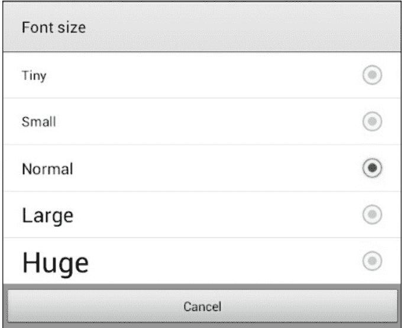

如前图所示，有相当多的设置，如果您尝试 **超大**，区别就很大了，嗯，非常大！

我们可以使用 sp 在任何包含文本的小部件中设置字体大小。这包括 Button、TextView，以及调色板 **文本字段** 类别下的所有 UI 元素，以及其他一些元素。我们可以通过设置 textsize 属性来实现：

```
android:textSize="50sp"
```

和往常一样，我们也可以使用属性窗口来实现相同的效果。

### 使用 wrap 或 match 确定大小

我们还可以确定小部件和许多其他 UI 元素的大小如何与包含/父元素相关联。我们可以通过将 layoutWidth 和 layoutHeight 属性设置为 wrap_content 或 match_parent 来实现这一点。

例如，如果我们将布局上单个按钮的属性设置为以下内容：

```
android:layout_width="match_parent"
android:layout_height="match_parent"
```

那么按钮将在高度和宽度上都扩展以匹配父元素。我们可以看到，下一张截图中的按钮填满了整个屏幕：

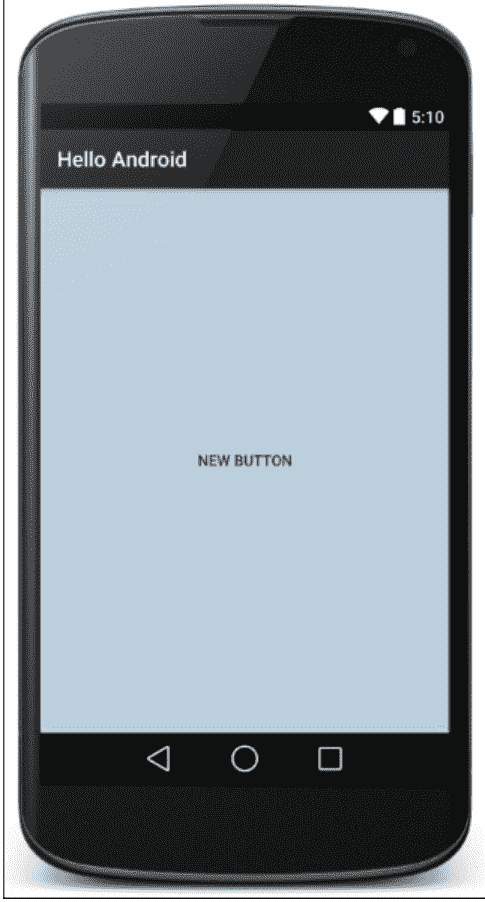

对于按钮来说，更常见的是 wrap_content，如下所示：

```
android:layout_width="wrap_content"
android:layout_height="wrap_content"
```

这会使按钮尽可能大以容纳其内容（宽度和高度为 dp，文本为 sp）。

### 使用内边距和外边距

如果您做过任何网页设计，那么您对接下来的两个属性一定非常熟悉。内边距是小部件边缘到小部件中内容开始处的空间。外边距是小部件外部的空间，位于其他小部件之间——包括其他小部件的外边距，如果它们有的话。以下是一个可视化表示：

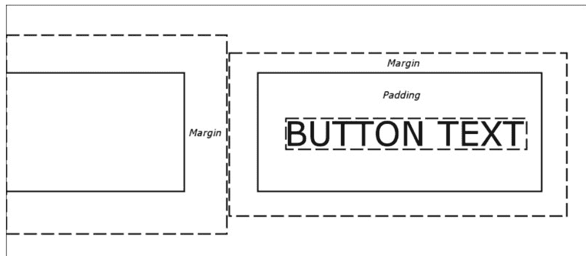

我们可以以简单的方式设置内边距和外边距，对所有边都相同，如下所示：

```
android:layout_margin="43dp"
android:padding="10dp"
```

请注意 margin 和 padding 命名约定的细微差别。内边距仅称为 padding，而外边距被称为 layout_margin。这反映了这样一个事实：内边距仅影响小部件本身，而外边距可能影响布局中的其他小部件。

或者，我们可以指定不同的顶部、底部、左侧和右侧外边距和内边距，如下所示：

```
android:layout_marginTop="43dp"
android:layout_marginBottom="43dp"
android:paddingLeft="5dp"
android:paddingRight="5dp"
```

为小部件指定外边距和内边距值是可选的，如果未指定任何内容，将假定值为零。我们也可以选择指定某些不同边的外边距和内边距，而不指定其他边，如上一个示例所示。

这可能已经很明显，我们设计布局的方式非常灵活，但要在如此多的选项中实现精确结果，还需要一些练习。我们甚至可以指定负外边距值来创建重叠的小部件。

让我们再看几个属性，然后我们将开始真正地摆弄几个小部件。

### 使用 layout_weight 属性

权重是指与其他 UI 元素相比的相对量。因此，为了使 layout_weight 有用，我们需要在两个或多个元素上为 layout_weight 属性分配一个值。然后我们可以分配总计 100% 的部分。这在 UI 的各个部分之间划分屏幕空间时尤其有用，我们希望它们所占的相对空间无论屏幕大小如何都保持不变。将 layout_weight 与 sp 和 dp 单位配合使用，可以创建一个非常简单且灵活的布局。例如，看一下这段代码：

```
<Button
    android:layout_width="match_parent"
    android:layout_height="0dp"
    android:layout_weight=".1"
    android:text="one tenth" >
<Button
    android:layout_width="match_parent"
    android:layout_height="0dp"
    android:layout_weight=".2"
    android:text="two tenths" >
<Button
    android:layout_width="match_parent"
    android:layout_height="0dp"
    android:layout_weight=".3"
    android:text="three tenths" >
<Button
    android:layout_width="match_parent"
    android:layout_height="0dp"
    android:layout_weight=".4"
    android:text="four tenths" >
```

这段代码将做以下事情：


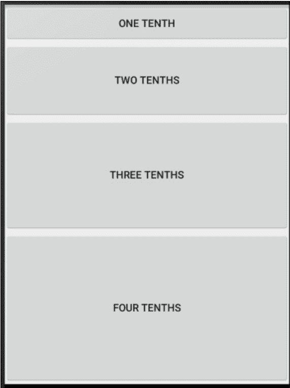

注意，所有的 layout_height 属性都设置为 0dp。实际上，layout_weight 正在替代 layout_height 属性。我们使用 layout_weight 的上下文很重要（否则它不会起作用），我们很快将在真实项目中看到这一点。还要注意，我们不必使用 1 的分数，可以使用整数、百分比和任何其他数字，只要它们相互关联，就很可能实现你想要的效果。请注意，layout_weight 仅在某些上下文中有效，我们将在构建一些布局时看到它在哪里有效。

## 使用重力

重力可以成为我们的朋友，并且可以在我们的布局中以许多方式使用。它通过将小部件向给定方向移动来帮助我们影响小部件的位置；就像它受到重力作用一样。了解重力能做什么的最佳方法是查看一些示例代码和图片。

将按钮（或其他小部件）的 gravity 属性设置为 left|center_vertical，如下所示：

```
android:gravity="left|center_vertical"
```

将产生如下所示的效果：

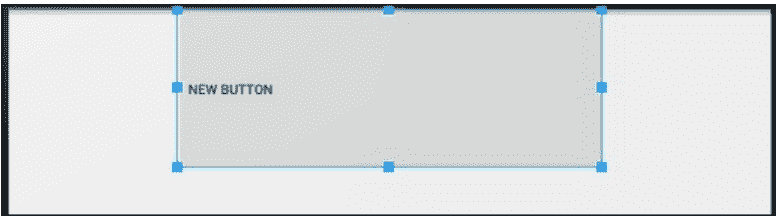

请注意，小部件的内容（在此示例中为按钮的文本）确实已左对齐并垂直居中。

此外，小部件可以使用 layout_gravity 元素影响其在布局元素内的自身位置，如下所示：

```
android:layout_gravity="left"
```

这将在其布局中设置小部件，可能符合预期，如下所示：

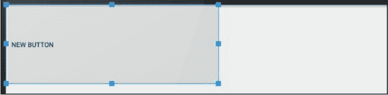

前面的代码允许同一布局中的不同小部件受到影响，就像布局具有多个不同的重力一样。

布局中所有小部件的内容都可以通过使用与小部件相同的代码来受其父布局的 gravity 属性影响：

```
android:gravity="left"
```

让我们再提几个属性，然后我们就可以开始使用其中一些属性了。

## 更多属性

实际上，比我们讨论过的属性多得多。有些我们在这本书中不会用到，有些相当晦涩，你在整个 Android 职业生涯中可能永远不需要它们。但其他一些相当常用，例如：background、textColor、alignment、typeface、visibility 和 shadowColor；但这些最好通过实际实验来探索。那么现在就让我们这样做。

## 尝试使用小部件

如果您对以下任何步骤不确定，请返回第 1 章“第一个应用”以查找大多数步骤的进一步讨论和图片。您可以在第 4 章/Widget Experiments 中找到本教程的完整代码文件：

- 1. 通过左键单击 **文件 | 新建项目** 启动新项目向导。如果您在 **欢迎使用 Android Studio** 开始菜单上，则左键单击 **启动新的 Android Studio 项目**。
- 2. 将应用程序命名为 **Widget Experiments**，输入您首选的域名和项目位置，然后单击 **下一步**。
- 3. 在 **目标 Android 设备** 窗口中，通过左键单击 **下一步** 接受默认设置。
- 4. 在 **向移动设备添加 Activity** 窗口中，左键单击 **空 Activity**，然后左键单击 **下一步** 继续。
- 5. 在 **自定义 Activity** 窗口中，将活动命名为 **WidgetExperimentsActivity**，将标题设置为 **Widget Experiments**，并将其他所有内容保留为默认。现在按 **完成**。
- 6. 等待 Android Studio 创建新项目。
- 7. 如果您在本教程开始时已经打开一个项目，那么现在您将有两个完全分开的 Android Studio 实例在运行。您可以关闭之前的那个。
- 8. 像我们之前做的那样安排设计视图，为 **调色板**、**组件树** 和 **属性** 窗口提供额外空间。
- 9. 现在我们有了一个新项目，我们将讨论并玩弄一些小部件。从调色板的 **小部件** 类别中左键单击并拖动一个 **按钮** 到设计预览的左上角。
- 10. 在 **属性** 窗口中滚动找到文本属性，并将其更改为 `Left Button`。
- 11. 在属性窗口中滚动找到宽度属性，并将其更改为 150dp。请注意 150 和 dp 之间没有空格。
- 12. 滚动到 **layout:margin** 属性。请注意左侧有一个小灰色三角形，单击后将显示该属性的更多选项。将 `left` 属性设置为 10dp，`top` 属性设置为 100dp，`right` 属性设置为 50dp，`bottom` 属性设置为 50dp。下一个截图应该有助于此步骤：

| layout:margin | [?, 10dp, 100dp, 50dp, 50dp, ?, ?] |
|---|---|
| 全部 | |
| 左侧 | 10dp |
| 顶部 | 100dp |
| 右侧 | 50dp |
| 底部 | 50dp |

- 13. 当然，如果我们希望按钮四周都有统一的边距，可以在 `all` 属性中输入一个值。观察这些步骤后的设计预览。我们可以看到较大的 `100dp` `top` 边距和较小的 `10dp` `left` 边距的效果。我们还可以看到按钮文本与我们设置的一样，按钮更加拉长，因为我们将 `width` 属性设置为 150dp。目前 `right` 和 `bottom` 边距在视觉上不明显。

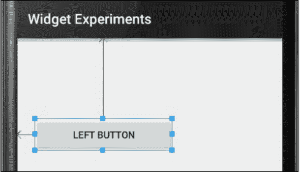

- 14. 现在，将另一个 **按钮** 拖动到布局上，并将其垂直放置在前一个按钮的旁边并靠右。
- 15. 将 `text` 属性设置为 `Right`，将 `width` 属性设置为 `80dp`。请注意，按钮确实缩小了一点。让我们再试验一下。
- 16. 将 **纯文本视图** 拖动到布局上，并将其水平居中并置于两个按钮下方。

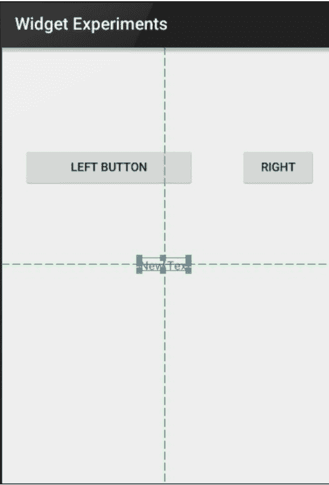

- 17. 将文本大小属性更改为 100sp。我们可以在下一个截图中看到，文本太宽，无法放在一行上，而换行到两行。我们还可以通过 TextView 周围的蓝色矩形看到，它甚至重叠了上面的两个按钮：

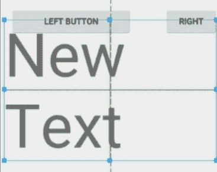

- 18. 现在，将宽度和高度属性都更改为 150dp。我们现在已经限制了 TextView，但是我们设置的文本大小属性仍然存在，导致文本部分被遮挡。

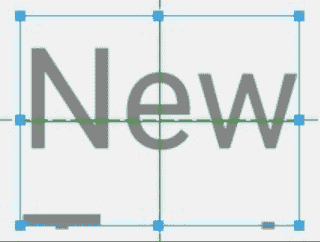

- 19. 让我们修复这个问题，并通过更多属性添加一些增强功能。将文本大小属性更改为 65sp。将 layout_width 属性更改为 match_parent。这将使其宽度与父布局（RelativeLayout）一样宽。将 gravity 属性更改为 center。将 alpha 属性（更改透明度）设置为 .5。请注意，文本现在非常合适，因为它更小，并且拥有整个设备的宽度，并且也居中对齐。

- 20. 现在查找并单击背景属性，左键单击三个点 ...，然后左键单击颜色选项卡。您现在可以单击任意您喜欢的颜色上的颜色选择器。现在我们的 TextView 具有一个背景颜色。

- 21. 查找并左键单击 textColor 属性。左键单击颜色选项卡，为您的文本选择一种与您在上一步中选择的背景颜色相协调的颜色。

- 22. 现在将 typeface 属性更改为 serif，并注意字体已更改。

- 23. 从调色板中添加 ImageView，位于 TextView 下方。请注意，它几乎不可见。这是因为它需要一张图像来显示。滚动到 src 属性，左键单击三个点 ...，然后向下滚动我们图像的可能来源列表。在 Mip Map 标题下的末尾附近，双击左键 ic_launcher。我们现在在 ImageView 中有了可爱的 Android 徽标。下一个截图显示了我的实验结束时的样子。显然，如果您正在阅读印刷版，您将无法看到文本和背景的精确颜色：

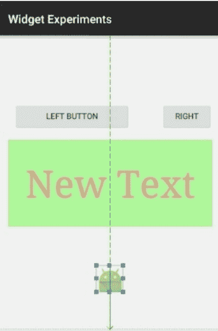

- 24. 最后，左键单击 `TextView` 以将其选中。查找 `visibility` 属性。默认情况下，此属性设置为 `visible`。尝试将其更改为 `invisible`。它消失了。这可能是您所期望的，也不是本章的重点。但现在尝试将 `visibility` 属性更改为 `gone`。请注意 `ImageView` 跳到布局中按钮下方。它确实表现得好像文本 "消失" 一样。您可能记得，我们说过可以使用 Java 代码在应用程序运行时随时更改属性。在 `visible`、`invisible` 和 `gone` 之间切换可能非常有用。

- 25. 您可以在模拟器或真实设备上运行此应用程序。

在这个小部件实验中，我们可以看到我们讨论过的许多属性如何相互作用。我们还看到了一些新属性。您可能还注意到，在实验之前我们详细提到的几个属性尚未演示。最值得注意的是 `padding`。这些属性最好使用调色板中的 **布局** 来展示，我们很快就会看到。


只需瞥一眼 **调色板** 窗口和 **属性** 窗口，就能意识到我们在 Android 布局选项方面才刚刚触及表面。但我们所学到的内容实际上将使我们能够设计出惊人多样的布局。

让我们来看看一些布局。

## 在布局中包含小部件

我们知道布局是我们用户界面的主要构建块之一。在 Android 中，我们可以从多种布局类型中选择，以满足特定的设计目标。

现在我们将对几种主要布局类型进行一些实验。

### RelativeLayout

这就是在我们的 Hello Android 项目中自动包含的布局类型。让我们再多玩玩它。

### RelativeLayout 实战

如果对以下任何步骤不确定，请回到第 1 章《第一个应用》查看大部分步骤的更多讨论和图片。本小应用的代码可在 Chapter 4/Layout Experiments 文件夹中找到：

- 1. 如果已打开现有项目，请通过左键单击 **文件 | 新建项目** 启动新项目向导；如果您在 **欢迎使用 Android Studio** 开始菜单上，请左键单击 **开始一个新的 Android Studio 项目**。
- 2. 将应用程序命名为 Layout Experiments，输入您首选的域名和项目位置，然后单击 **下一步**。
- 3. 在 **目标 Android 设备** 窗口中，通过左键单击 **下一步** 接受默认设置。
- 4. 在 **将 Activity 添加到移动设备** 窗口中左键单击 **空白 Activity**，然后左键单击 **下一步** 继续。
- 5. 在 **自定义 Activity** 窗口中将 Activity 命名为 LayoutExperimentsActivity，将应用标题设为 Layout Experiments，其余内容保持默认。您无需更改 Activity 名称即可使其正常工作，这样做只是让这个项目与我们将构建的其他项目有所区别。现在按 **完成**。
- 6. 等待 Android Studio 创建新项目。
- 7. 像之前一样安排设计视图，为 **调色板**、**组件树** 和 **属性** 窗口留出额外空间。

现在我们有了一个新项目，将讨论并尝试一些布局。注意 **组件树** 窗口中 **设备屏幕** 元素之后的顶级元素。我们默认已经有了 `RelativeLayout`。这种布局类型允许其子项使用相对于自身及其他子项的位置描述。让我们探索一下：

- 1. 从调色板中左键单击并拖动一个 **普通文本视图** 小部件，将其放置在现有 **普通文本视图** 的正下方。
- 2. 现在对 **按钮** 执行相同操作，将其放置在上一步添加的 `TextView` 下方。
- 3. 接下来将 **开关** 小部件放置在上一步的 **按钮** 小部件下方。

您的布局可能看起来像下面这张截图，这是 UI 设计器左上角的特写视图：

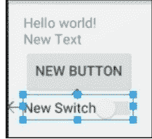

不过，比外观更有趣的是生成的 XML 代码。现在让我们来探索一下。左键单击编辑器窗口下方的 **文本** 选项卡以揭示生成的 XML。

下面是 `activity_layout_experiments.xml` 的全部内容，其中移除了父级 `RelativeLayout` 的代码。查看代码，并仔细看看三行高亮代码：

```
<TextView
    android:text="@string/hello_world"
    android:layout_width="wrap_content"
    android:layout_height="wrap_content"
    android:id="@+id/textView" >

<TextView
    android:layout_width="wrap_content"
    android:layout_height="wrap_content"
    android:text="New Text"
    android:id="@+id/textView2"
    android:layout_below="@+id/textView"
    android:layout_alignParentLeft="true"
    android:layout_alignParentStart="true" >
```

```
<Button
    android:layout_width="wrap_content"
    android:layout_height="wrap_content"
    android:text="New Button"
    android:id="@+id/button"
    android:layout_below="@+id/textView2"
    android:layout_alignParentLeft="true"
    android:layout_alignParentStart="true" >
```

```
<Switch
    android:layout_width="wrap_content"
    android:layout_height="wrap_content"
    android:text="New Switch"
    android:id="@+id/switch1"
    android:layout_below="@+id/button"
    android:layout_alignParentLeft="true"
    android:layout_alignParentStart="true" />
```

在代码中，我们可以通过每个代码块的开头单词来识别添加到布局中的每个小部件。因此，第一个 `<TextView` 块是上一张截图中显示 **你好，世界！** 文本的开始。因此，以 `<TextView` 开头的第二个块就是我们自己拖到 UI 设计上的 TextView。这个 TextView 就是上一张截图中显示 **新文本** 的那个。

此外，以 `<Button` 开头的代码块当然是上一张截图中标记为 **新按钮** 的按钮。此时你可能已经猜到，以 `<Switch` 开头的代码块就是开关小部件。

还要注意，每个小部件的最后两行代码都是相同的。如下：

```
android:layout_alignParentLeft="true"
android:layout_alignParentStart="true" />
```

这实际上是在说将此小部件放置在其父级的左上角。

您可能期望小部件互相重叠？

此前我建议仔细查看代码中的三行高亮代码。让我们来看看第一行高亮代码，它来自我们在已有 TextView（即显示 Hello world! 的那个）下方添加的第一个 TextView。这是高亮代码行：

```
android:layout_below="@+id/textView"
```

这表示将我放置在 id 为 textView 的小部件下方。如果您再次查看主代码列表，您会发现包含 Hello world! 文本的 TextView 的 id 属性通过以下 XML 行设置为 textView：

```
android:id="@+id/textView" />
```

描述布局内容位置的方法仅适用于 RelativeLayout。它非常适合某些类型的实际应用设计（可能是表单），但对其他类型则非常别扭。

让我们探索一些其他布局类型，然后我们将构建一些布局，充分利用我们实验过的每种布局类型。

## 使用 LinearLayout

对于这种布局，名字里就有门道。LinearLayout 中包含的所有小部件都将按照添加顺序显示。我们当然仍然可以添加边距、填充等，但顺序是固定的。它是线性的（或顺序的）。LinearLayout 适用于垂直或水平排序。让我们快速创建一个项目，将几个 LinearLayout 与一些小部件组合起来。

本小应用的代码可在 Chapter 4/Linear Layout Experiment 文件夹中找到：

- 1. 在 Android Studio 中创建一个新项目。将其命名为 Linear Layout Experiment，选择空白 Activity，其余设置保持默认。
- 2. 让我们从一张完全空白的纸开始。在项目资源管理器中右键单击 layout 文件夹。从菜单中选择 新建 | 布局资源文件，如下一张截图所示：

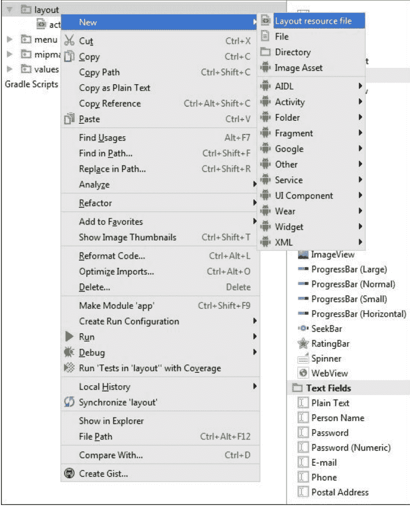

- 3. 然后在 **文件名** 字段中输入 `linear_experiment`，然后左键单击 **确定**。
- 4. 新文件被创建并在编辑器中打开。如果文件未自动在设计视图中打开，请左键单击编辑器窗口左下角的 **设计** 选项卡。
- 5. 查看 **组件树** 窗口，您会发现默认情况下我们的设计根节点是 `LinearLayout`。还要注意括号中的单词 **垂直**，这表明这是一个 _垂直_ `LinearLayout`。
- 6. 从调色板的 **布局** 类别中拖动一个 **线性布局 (水平)** 到设计区。将其放置在布局顶部。
- 7. 现在将 **线性布局 (垂直)** 拖到设计区，并在 **组件树** 中确认它确实已添加到之前的 `LinearLayout` 之后，如下所示：

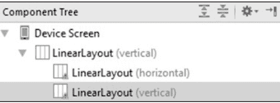

- 8. 现在在当前选定的 `LinearLayout` 的 **属性** 窗口中找到 `layout:weight` 属性并将其设置为 .5。对我们添加的另一个 `LinearLayout` 也这样做：在 **组件树** 中左键单击它，找到 `layout:weight` 属性，并将其设置为 .5。我们可以看到，当设计本身无法清楚显示构成布局的元素的确切位置时，**组件树** 尤其有用。我们现在有两个垂直嵌套的 `LinearLayout`s，顶部是水平 `LinearLayout`，底部是垂直 `LinearLayout`。它们各自恰好占据屏幕的 .5（一半）。
- 9. 从调色板的 **小部件** 类别中添加两个 **按钮** 到顶部（水平）`LinearLayout`。注意它们是如何水平排列的。但它们相当凌乱地贴在布局的左侧。
- 10. 通过在设计区或 **组件树** 中左键单击来选择水平（顶部）`LinearLayout`。找到 gravity 属性，左键单击 gravity 单词左侧的小三角形以显示该属性的选项。现在左键单击 center_horizontal 复选框。下一张图片应该能清楚地说明这一步：


| gravity | [center_horizontal] |
|---|---|
| 顶部 | ☐ |
| 底部 | ☐ |
| 左侧 | ☐ |
| 右侧 | ☐ |
| 垂直居中 | ☐ |
| 垂直填充 | ☐ |
| 水平居中 | ☑ |
| 水平填充 | ☐ |
| 居中 | ☐ |
| 填充 | ☐ |
| 垂直裁剪 | ☐ |
| 水平裁剪 | ☐ |
| 开始 | ☐ |
| 结束 | ☐ |

- 11. 现在将三个 **纯文本 TextView** 小部件从调色板拖放到垂直（底部）LinearLayout 中。注意它们从上到下井然有序地排列，但被挤压到了顶部。

- 12. 通过在布局或组件树中单击它来选择垂直（底部）LinearLayout。找到 gravity 属性并单击三角形以显示选项，就像我们在第 8 步中对另一个 LinearLayout 做的那样。左键单击 center_vertical 的复选框。现在 TextViews 已整齐居中，但被挤在一起了。

- 13. 让我们为每个 TextView 小部件添加外边距来解决这个问题。左键单击以选择最顶部的 TextView。向下滚动查找 layout_margin 属性。左键单击 layout_margin 属性，然后在顶部选项旁添加值 20dp。

- 14. 对每个 TextView 重复上一步。

Now we have a nice neat layout of buttons and text, as shown in the following screenshot:

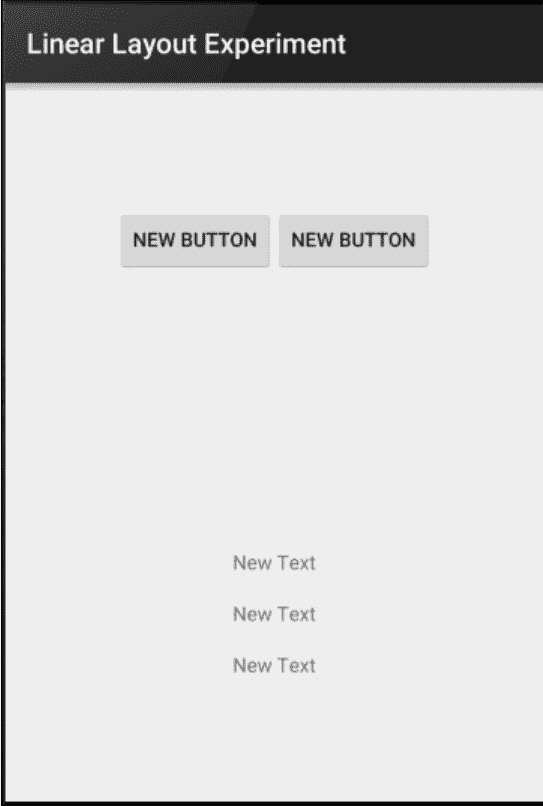

之所以这样工作，是因为第一个垂直 LinearLayout 将另外两个叠放在一起。我们在包裹布局中使用 layout_weight 使它们各自占据一半屏幕空间。第一个包裹布局将其按钮从左到右排列，因为它是水平的；第二个包裹布局将其文本从上到下排列，因为它是垂直的。此外，两个包裹布局都使用 gravity 属性来居中小部件。

如果您尝试在模拟器或真实设备上运行应用程序，您会注意到的一个问题是：向用户显示的是 activity_main.xml 文件中的默认“Hello world！”布局，而不是我们的 linear_experiment.xml 布局。

我们可以通过以下简单步骤修复此问题：

- 1. 在编辑器中打开 MainActivity.java。

- 2. 查看 onCreate 方法并找到以下代码行：
   setContentView(R.layout.activity_main);

- 3. 将高亮部分 activity_main 更改为我们要显示的布局名称 linear_experiment。

- 4. 再次运行应用程序，它将显示我们整洁有序的实验。

这里可以看到，onCreate 方法中的 setContentView 方法调用才是向用户显示布局的关键。我们只需将 XML 布局的名称作为参数传入。我们附加 R.（针对 res 文件夹）和 layout.（针对 layout 文件夹），它就能正常工作。不必过分担心新术语，我们将在第 8 章 “Coding in Java Part 2 – Methods” 中探讨传递参数。

我们刚刚获得的关于如何在 XML 中使用 Java 显示给定 UI 布局的新知识，在下一个项目中将会很有用。

我们可能已经做够了实验。现在让我们构建一些稍微更贴近实际的 UI。

## 摘要

虽然本章的布局项目本质上并不十分现实，但它们已达到介绍 Android UI 设计许多方面的目的。我们了解了大小、位置、间距和 gravity。我们还看到了一些布局类型选项，例如 Relative 和 LinearLayout。

在下一章中，我们将构建一些类似于实际应用中可能遇到的 UI 布局。
