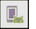
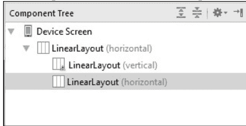
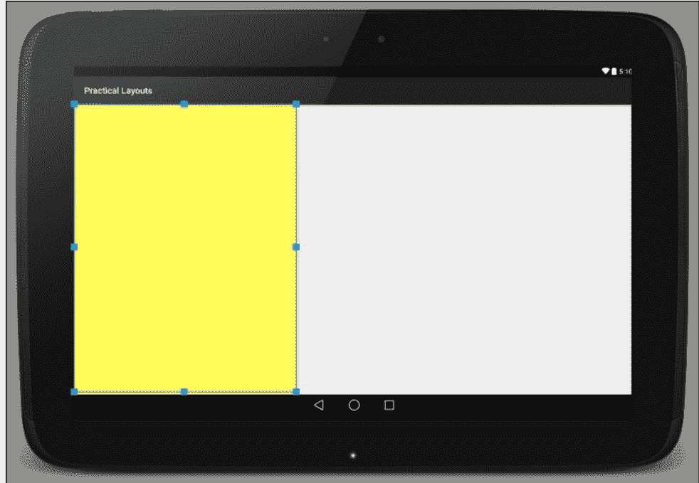
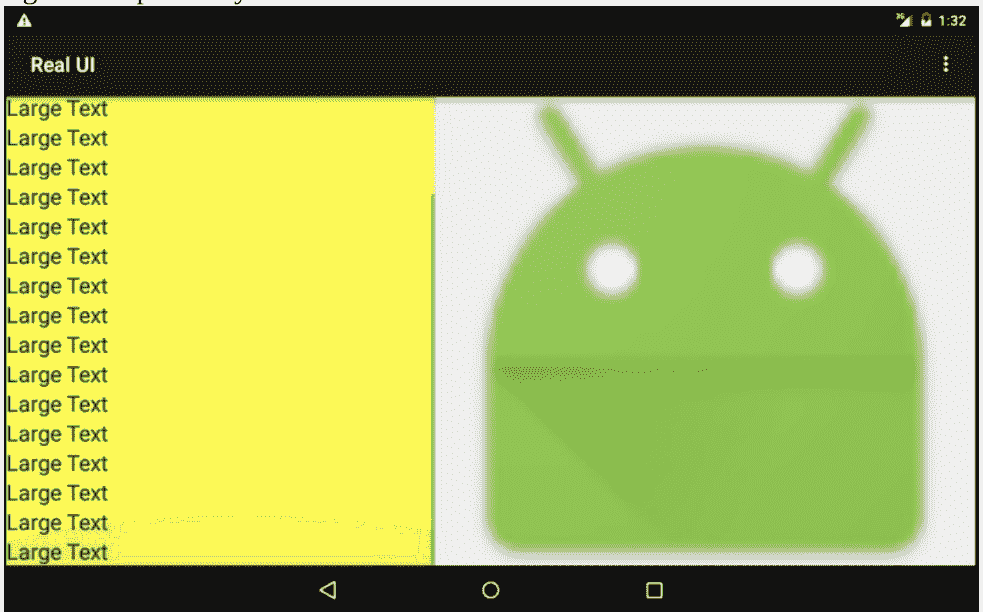
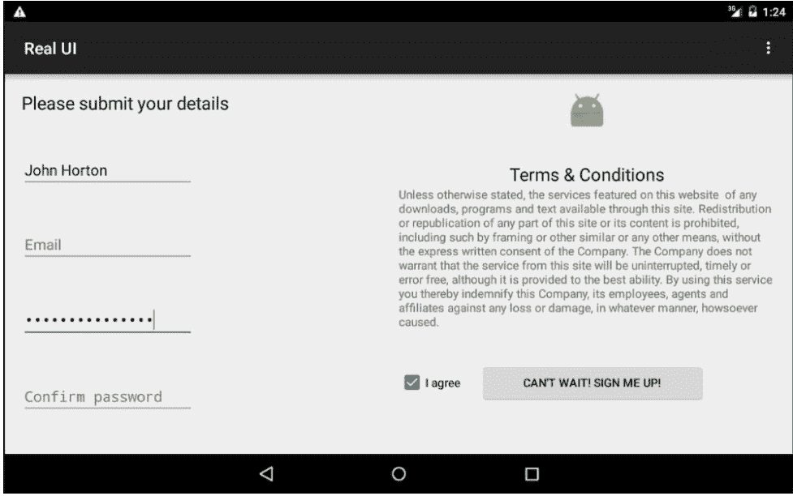
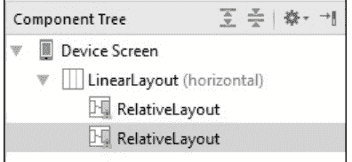
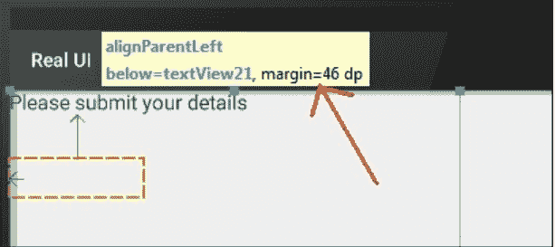
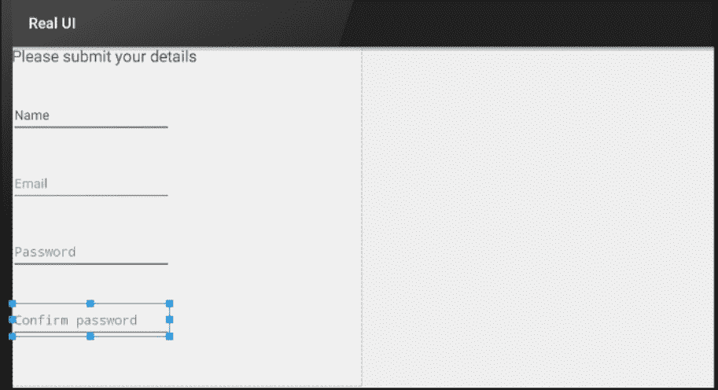
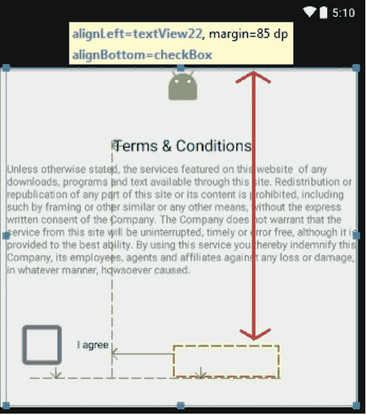
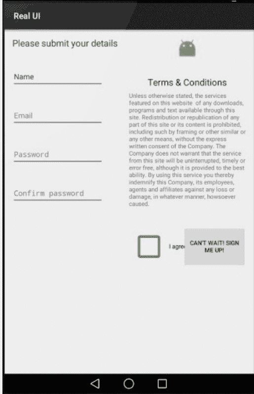

## 第 5 章。实际布局

到目前为止，我们只使用了一个手机模拟器。由于我们将构建更适合 Android 平板电脑的布局，是时候研究如何配置平板电脑模拟器了。届时，我们可以在 UI 设计上稍微大胆一些。我们将构建两种不同的 UI 设计，但都将在同一个小型应用中完成。我们很快就会看到如何更改 Java 代码以查看我们当前感兴趣的布局。在本章中，我们将介绍以下内容：

- 配置平板电脑模拟器
- 构建滚动列表-详情布局
- 构建相当复杂的表单提交布局

### 构建实际 UI

这些简单而实用的项目将开始展示如何创建可能真正进入实际应用的设计。

和往常一样，本节的所有代码都可以在 chapter_5/RealUI 文件夹的下载包中找到。

为了增加一些变化，我们可以看看创建新模拟器的过程；让我们为自己创建一个 Nexus 7 AVD。

### 创建平板电脑模拟器

因此，我们可以大展身手进行设计，添加大量新的小部件和视图；让我们制作一个屏幕空间更大的模拟器。请注意，后续的 UI 项目在手机上也能正常运行（虽然看起来会更挤一点），但现在看来是研究制作新模拟器的好时机：

- 1. 单击工具栏中的 **AVD 管理器** 图标。



- 2. 在 **您的虚拟设备** 屏幕上，左键单击 **创建虚拟设备...** 按钮。
- 3. 现在我们可以看到 **选择硬件** 窗口。在 **类别** 列中左键单击 **平板电脑**。在 **名称** 列中左键单击 **Nexus 7 (2012)**。现在左键单击 **下一步**。
- 4. 在 **系统镜像** 屏幕上左键单击 **下一步** 以接受默认选项。
- 5. 左键单击 **完成**，我们就有了一个崭新的 Nexus 7 模拟器，准备好测试我们未来的应用程序了。

您可以重复这些步骤，在第 3 步中选择不同的设备类型和型号，在第 4 步中根据喜好进一步自定义设备。

### 提示

### 帮助，我的模拟器卡住了

运行某些模拟器时，它们会稍微显示在屏幕外。如果隐藏的是窗口的标题栏，移动或关闭会非常棘手。按 **Alt + Space**，然后从上下文菜单中选择 **移动**。您现在可以使用键盘箭头（光标）键或鼠标移动模拟器窗口。左键单击以将模拟器窗口放置在更好的位置。

现在我们将构建两个实际 UI。创建一个新项目并将其命名为 **实用 UI**。和往常一样，选择 **空白活动**，并将所有其他设置保留为默认值。

现在，通过从我们在 Android Studio 导览中发现的 AVD 下拉列表中左键单击我们的新 Nexus 7，切换到设计视图中的它。单击旋转按钮将设计视图切换为横向。

我们所有的实用 UI 都将在这个项目中。但是，对于每个 UI，我们将创建一个新的布局文件。自动生成的 layout_main.xml 文件将不会被使用。当然，在完成 UI 构建后，我们需要更改 Java 代码中对 setContentView 的调用，以选择我们想要查看的 UI。

让我们从 LinearLayout 开始。

### 带有 ScrollView 和 LinearLayout 的列表-详情布局

在许多 Android 应用中常见的一种布局是列表-详情布局。也就是说，屏幕的一部分显示某些项目类型的列表（也许是小图片和产品名称），而屏幕的另一部分则显示列表中当前选定项目的详细信息。

要制作此类完全功能的应用程序需要更多 Java 实践，但我们可以快速了解如何制作这种简单的布局：

- 1. 使用我们最近创建的 **实用 UI** 项目，但让我们为布局从零开始。在项目资源管理器中右键单击 `layout` 文件夹。从弹出的上下文相关选项菜单中，选择 **新建 | 布局资源文件**。
- 2. 确保 **根元素** 已选择 **LinearLayout**。
- 3. 将文件命名为 `list_detail_layout`，然后左键单击 **确定**。
- 4. 在 **属性** 窗口中，找到默认提供的 `LinearLayout` 的 `orientation` 属性，并将其更改为 `horizontal`。
- 5. 将一个 **LinearLayout(垂直)** 拖放到设计图上。
- 6. 现在将一个 **LinearLayout(水平)** 拖放到设计图上。
- 7. 为了能够区分我们刚刚添加的两个新布局，您可能需要查看组件窗口。以下是步骤 6 后的组件窗口图片：



- • 在根 `LinearLayout` 中选择第一个（垂直）`LinearLayout`，找到其 `layout_weight` 属性，并将其设置为 `40`。通过查找并左键单击 **背景** 属性省略号 ...，然后左键单击 **颜色** 选项卡并选择一种颜色来设置其背景。


在根 LinearLayout 中选择第二个（水平）LinearLayout，找到其 **layout:weight** 属性，并将其设置为 60。我们现在有两个清晰可辨的屏幕区域：一个占 40%，另一个占 60%，如下所示：



- 现在从调色板的 **Containers** 部分拖动一个 **ScrollView**，并将其放置在左侧较小的（40%）宽度的 **LinearLayout** 上。
- 现在在 ScrollView 上方拖动另一个 **LinearLayout(vertical)**。
- 现在将大约 20 个（认真的！） **Large Text** 小部件拖动到上一步中添加的 **LinearLayout** 上。由于 **LinearLayout** 最初被压扁了，通过组件树窗口将 **Large Text** 小部件拖动到 **LinearLayout** 上会更容易开始。
- 现在将一个 **ImageView** 拖动到右侧 **LinearLayout** 上。通过找到其 **src** 属性并在 **Projects** 选项卡列表末尾浏览到 **ic_launcher** 来使其显示 Android 图标，就像我们之前尝试 **ImageView** 时所做的那样。此图像在此处没有其他用途，只是为了证明它与我们即将在 UI 左侧见到的功能完全不同。

- 将 `ImageView` 的 `layout:weight` 属性更改为 1 以使图像更大。
- 将 `MainActivity.java` 中对 `setContentView` 的调用更改为与下一行代码相同：
  `setContentView(R.layout.list_detail_layout);`
- 代码现在将把我们的新布局设置为应用的布局。在 Nexus 7 模拟器上运行应用。

应用运行时，你可以左键单击并拖动应用左侧窗格来上下滚动内容。请注意，右侧窗格中的 Android 图像保持不动：



我们通过在根 `LinearLayout` 中添加两个 `LinearLayout` 实现了这一点。我们通过将它们的 `layout_weight` 属性分别设置为 40 和 60，使其中一个覆盖父容器的 40%，另一个覆盖 60%。然后我们将一个 `ScrollView` 放入左侧 `LinearLayout`，并将另一个垂直 `LinearLayout` 放入 `ScrollView`。我们执行此步骤是因为 `ScrollView` 只能有一个子项（非常明智）。但是，一旦我们在 `ScrollView` 中有了 `LinearLayout`，就可以添加任意数量的小部件，它们都会很好地滚动，就像我们之前看到的那样。

## 使用 RelativeLayout 设计表单

我们已经摆弄过 RelativeLayout 了，因为它是创建新项目时的默认布局。在这个项目中，我们将布置一个相当全面的表单——类似于你在订阅服务时可能要求用户填写的表单。

在开始之前，先看一下布局可能会有所帮助。所以这里是已经填好名称和密码字段的布局，这样我们可以看到不同字段的外观：



现在我们可以看到最终目标，让我们开始真正创建它：

- 使用与之前布局相同的项目，但让我们从完全干净的布局开始。在项目资源管理器中右键单击 layout 文件夹。从弹出的上下文敏感选项菜单中，选择 New | Layout resource file。
- 确保 Root element 选择了 LinearLayout。为什么我们在应该学习 RelativeLayout 时使用 LinearLayout 很快就会显而易见。
- 将文件命名为 form_layout，然后左键单击 OK。
- 选择设计根部的 `LinearLayout`，并从属性窗口将其 **orientation** 属性从 vertical 更改为 horizontal。
- 将两个 `RelativeLayout` 元素拖放到设计上。确保它们都是根 `LinearLayout` 的子项。如果这样做很别扭，请记住你可以将它们直接拖放到组件树视图上，以确保它们有预期的父项。最终结果如下图所示：



- 现在我们将确保每个 `RelativeLayout` 元素各自恰好占据屏幕一半。依次查找每个元素的 `layout:weight` 属性，并将两者都设置为 `.5`。这样每个布局将各占一半空间。只要这些数值相对即可工作。如果你偏好，也可以使用 50 和 50。
- 作为预防措施，检查两个 RelativeLayout 元素的 **layout:margin** 属性中是否没有设置任何值。有时当我们将元素拖放到设计上时，Android Studio 会在我们未意识到的情况下添加边距。如果任何 RelativeLayout 边距中有任何值，请将其删除。你现在应该有两个等大小的布局填充整个设计。
- 将 **Large Text** 小部件拖放到设计的左上角。将其放在角落里，暂时不用担心留出边距。
- 双击上一步中的小部件以打开其 text 属性的编辑窗口。输入文本 `Please submit your details`。这与在 **Properties** 窗口中编辑 `text` 属性的效果完全相同。
- 从调色板的 **Text Fields** 类别中，拖动一个 **Person Name** 小部件到设计上，但不要立即释放。将小部件紧贴设计左侧，并稍微低于步骤 9 中添加的前一个文本。注意，当你上下移动 **Edit Text** 时，可以看到 margin 属性在变化。下一张图应该能让此变得清晰：



- 尽量将 margin 属性调整到尽可能接近 46 dp，然后在仍然紧贴设计左侧的情况下，释放 Edit Text。如果边距没有完全调整好，在 Properties 窗口中将 margin:top 设置为 46dp。
- 在属性窗口中找到 hint 属性并将其设置为 Name。这将在小部件上放置文本，但一旦用户点击它以输入姓名，文本就会消失。
- 从调色板的 Text Fields 类别中，拖动一个 Email 小部件到设计上，但不要立即释放。将小部件紧贴设计左侧，并稍微低于步骤 9 中添加的前一个文本。和之前一样，注意当你上下移动小部件时，可以看到 margin 属性在变化。当它正好为 46 dp 时释放，或者在 Properties 窗口中编辑 margin:top。
- 找到 hint 属性并将其更改为 Email。
- 从调色板的 Text Fields 类别中，拖动一个 Password 小部件到设计上，但不要立即释放。将小部件紧贴设计左侧，并稍微低于步骤 9 中添加的前一个文本。当它正好为 46 dp 时释放，或者在 Properties 窗口中编辑 margin:top。Password 小部件只是一个可编辑的文本字段，它会模糊用户输入的内容。你可以在此教程之前看到的完成布局图像中看到这一点。
- 找到 hint 属性并将其更改为 Password。
- 从调色板的 Text Fields 类别中，拖动一个 Password 小部件到设计上，但不要立即释放。将小部件紧贴设计左侧，并稍微低于步骤 15 中添加的前一个文本。当它正好为 46 dp 时释放，或者在 Properties 窗口中编辑 margin:top。
- 找到 hint 属性并将其更改为 confirm password。此时你的布局应该看起来像下一张图像：



- 接下来转到表单的右侧，拖动一个 **ImageView** 并将其放置在右侧 RelativeLayout 的最左侧和最上方。
- 通过左键单击 ... 链接并在 **Projects** 选项卡上浏览到它，将其 **src** 属性设置为 ic_launcher，就像我们之前做过的那样。
- 将 **layout:width** 属性设置为 match_parent。这不会使实际图像变大，但可以防止其被包裹，以便下一步可以正常工作。
- 找到 **layout:centerInParent** 属性并将其设置为 horizontal。Android 机器人图像现在应该位于右侧 RelativeLayout 的顶部中心。
- 从调色板拖动一个 **Large Text** 小部件到右侧 RelativeLayout 上。你应该能够将其居中，并在释放前将其与 ImageView 之间的边距设置为 46 dp。如果你的鼠标灵敏度不足以实现这一点，可以在 **Properties** 窗口中设置 **margin:top**。如果需要，还可以使用 **Properties** 窗口将 **layout:centerInParent** 属性设置为 horizontal。
- 现在我们将添加实际的条款和条件。显然，遵循所有条款和条件的悠久传统，我们希望此文本比表单上的其他文本更小。将 **Small Text** 小部件拖动到上一个 Large Text 小部件下方 10 dp 且正好居中的位置。你


可以使用与上一步中完全相同的技术来实现这一点。

- 25. 在**属性**窗口中找到 **text** 属性。复制并粘贴一些随机文本，其长度应大致填充与本教程之前查看的完成布局图片中条款与条件所占用空间相同的区域。为按钮和下方的边距留出足够空间。
- 26. 将**复选框**小部件拖动到布局上，并将其定位在右侧 `RelativeLayout` 的最左侧，位于条款与条件下方 46 dp 处。
- 27. 将 **text** 属性编辑为 `I agree`。
- 28. 将**按钮**拖动到布局上，并使其与复选 `框` 的底部边缘对齐，距离右侧约 `85 dp`。下一张图片应该能清楚地说明这一点，同时展示我们到目前为止的所有进展：



- 29. 将 **text** 属性更改为 `Can't wait! Sign me up!`。
- 30. 接下来，你会注意到按钮的底部与复选框的底部对齐，但顶部没有。在**属性**窗口中找到 `layout:alignComponent` 属性，并在 `top:top` 子属性中选择 `checkBox` 小部件。
- 31. 现在进入根 `LinearLayout` 并找到 **内边距** 属性，将其子属性 `all` 设置为 `20dp`。

- 32. 将 MainActivity.java 中对 setContentView 的调用更改为与下一行代码相同：

```
setContentView(R.layout.form_layout);
```

- 33. 该代码现在将把我们的新布局设置为应用的布局。在 Nexus 7 模拟器上运行该应用。

你现在应该拥有与本教程开始前看到的图片几乎完全相同的布局。我们通过在父水平 LinearLayout 中插入两个 RelativeLayout 来实现这些整洁的结果。实际上，我们本可以只用一个 RelativeLayout 实现一个初始看起来整齐的布局。问题是，如果我们这样做了，第二列小部件将使用来自左侧列的边距进行定位。dp 单位非常适合创建小边距和填充，但当我们在屏幕的大量空间上使用它们时，我们会在不同设备上得到非常不一致的结果。

通过首先基于 weight 属性将屏幕分为两半，我们可以获得始终整洁的布局。如果表单更复杂，我们可能还希望进一步细分屏幕，以便更加确定当我们相对布置各个小部件时，它们始终保持一致。

作为一个实验，尝试将屏幕旋转为纵向方向。你可以在模拟器上使用 Ctrl + F11 键盘组合来执行此操作。



还不算太差，但肯定不完美。解决这个问题有几种可能的方案：

- 1. 在文件中提供一个同名的其他布局，并将其放置在 res 文件夹中名为 `layout-portrait` 的文件夹内。
- 2. 将布局锁定为横向，防止用户旋转布局。我们可以在 XML 或 Java 代码中执行此操作。
- 3. 使用 **片段** 设计一个更优雅但略复杂的解决方案。

当我们从第 12 章《与用户对话》构建第一个完整应用直到第 17 章《声音效果和支持不同版本的 Android》时，我们将使用第二种方案。当我们从第 18 章《设计模式、片段和现实世界》开始构建更高级的应用时，我们将看到第三种方案。所有方案都有优缺点，使用哪一种取决于你希望用户获得的体验。它们各自都同样有效。

## 摘要

本章的主要收获是，经验和实践比海量知识更有价值。如果你对一个酷炫的新 UI 有很好的创意，但本章没有向你展示如何实现，那么很可能其他人已经分享了相关知识，快速的网络搜索通常会提供相关教程或讨论。现在你已经熟悉了 UI 设计器，网络上的教程应该很容易理解。

随着书籍的推进，我们将探讨比目前更高级的 UI。希望本章能成为在 Android Studio 可视化设计器中构建更多现实世界 UI 的一个良好全面介绍。

尽管取得了显著进展，但房间里有一头非常大的“大象”。当然，我们的 UI 实际上什么也不做！我们看起来整洁的表单不会收集一丁点数据，我们的智能滚动列表在点击其中一项时也不会显示任何详细信息。

要解决这些问题，我们首先需要真正熟悉 Java。我们将从下一章开始做这件事。
