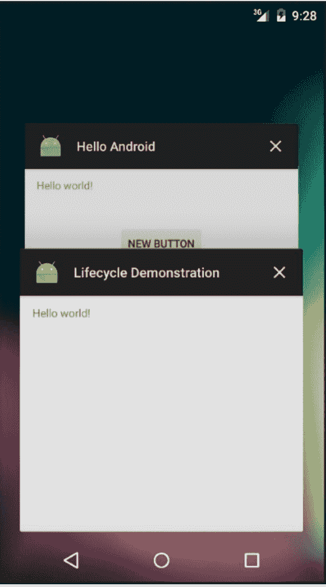

## 第 6 章。Android 应用的生命周期

在本章中，我们将探讨 Android 应用的生命周期。起初，计算机程序有生命周期听起来可能有点奇怪，但很快就会说得通。我们将看到应用经历的各个阶段，从创建到销毁，以及这如何帮助我们知道将 Java 代码放在哪里，具体取决于我们想要实现什么。

简而言之，我们将探讨：

- Android 生命周期简介
- 什么是方法重写 @override
- Android 生命周期的各个阶段
- 编写应用程序所需确切了解和执行的操作
- 生命周期演示小型应用
- 对代码结构的快速了解，以便在下一章开始 Java 编码

让我们开始学习 Android 生命周期。

## Android 生命周期简介

我们之前稍微谈过代码的结构；我们编写类，并在其中编写包含代码的方法。我们还知道，当我们想要让方法中的代码运行（被 **执行**）时，我们通过使用其名称来 **调用** 该方法。

另外，在 [第 2 章，Java - 初次接触] 中，我们了解到 Android 本身会在应用准备好启动前立即调用 onCreate 方法。当我们向 logcat 输出并使用 Toast 类向用户发送弹出消息时，我们就看到了这一点。

我们现在要探讨的是我们编写的每个应用的整个生命周期中发生的事情：它何时启动和结束，以及中间的几个阶段。我们将看到，Android 实际上在每次运行应用时都会多次与我们的应用进行交互。

它通过调用 `Activity` 类中包含的方法来实现这一点。即使该方法在我们的 Java 代码中不可见，它仍然会在适当的时候由 Android 调用。如果这似乎不太合理，请继续阅读。

你是否曾好奇过为什么 `onCreate` 方法前面有那么一行看起来奇怪的代码？

```
@Override
```

这里的情况是，当你调用 `onCreate` 时，我们是在请求 Android 请使用我们重写的版本，因为我们在那个时刻有一些事情要做。

此外，你可能还记得 `onCreate` 方法中那个看起来奇怪的第一行代码：

```
super.onCreate(savedInstanceState)
```

这是告诉 Android 在继续执行我们的重写版本之前，先调用 `onCreate` 的原始/官方版本。这不仅仅是 Android 的一个特性，方法重写是 Java 内置的功能。

还有相当多的其他方法我们可以选择性地重写，它们允许我们在 Android 应用生命周期的适当时间添加我们的代码。

我们需要关心 Android 随时调用的应用方法，原因在于它们控制着我们代码的生死。例如，如果我们的应用允许用户在假想的记事本应用中输入灵感时刻，也许是一首诗或重要提醒，而半路电话响起，我们的应用消失了，数据（备注）也就不见了？

至关重要的是，幸运的是，我们学习 Android 将在应用生命周期中调用哪些方法、何时调用以及为什么调用，这并不算太难。然后我们可以知道在哪里重写方法来添加自己的代码，以及在哪里添加定义我们应用的真实功能（代码）。让我们来探讨 Android 生命周期，然后我们可以继续深入了解 Java，并确切知道将我们编写的代码放在哪里。


## Android 生命周期的简化解释

如果您曾经使用过 Android 设备，可能已经注意到它的工作方式与许多其他操作系统截然不同。例如，您可能正在使用某个应用，比如说，查看朋友在 Facebook 上的动态。然后您收到一封电子邮件通知，点击电子邮件图标去阅读。在阅读邮件的过程中，您可能会收到一条 Twitter 通知，因为您正等待关注的人的重要消息，于是您中断阅读邮件，轻触一下切换到 Twitter 应用。

读完推文后，您想玩一局愤怒的小鸟，但在第一次大胆弹射的途中，您突然想起了那条 Facebook 帖子。于是您退出愤怒的小鸟，点击 Facebook 图标。

然后您恢复使用 Facebook，很可能是在您离开的同一点。您也可以继续阅读电子邮件，决定回复推文，或者启动一个全新的应用。

所有这些来回切换，在操作系统层面需要进行大量管理，且这看起来与各个应用本身无关。

就刚才讨论的背景而言，比如说 Windows PC 和 Android 之间的区别在于：在 Android 中，虽然用户决定使用哪个应用，但操作系统决定是否以及何时实际关闭（销毁）一个应用程序，连同其中的用户数据（例如假设的便签）。我们在编写应用程序时只需考虑这一点即可。

## 生命周期阶段 – 我们需要知道的

Android 系统中，任何给定的应用都可能处于多个不同的 _阶段_ 中。根据所处阶段，Android 系统决定用户如何查看该应用，或者是否查看该应用。Android 拥有这些阶段，以便决定哪个应用当前正在使用，并相应分配适量的资源，例如内存和处理能力。但它也允许我们作为应用开发者与这些阶段进行交互。

我们已经提出过这个问题：如果用户退出我们的应用去接听电话，他们的进度/数据/重要便签会丢失吗？

Android 拥有一个相当复杂的系统，为了解释方便稍作简化，这意味着 Android 设备上的每个应用都处于以下阶段之一：

- 正在创建
- 启动中
- 恢复中
- 运行中
- 暂停中
- 停止中
- 正在销毁

希望这个阶段列表看起来相当合乎逻辑。例如，用户按下 Facebook 应用图标，应用被 **创建**。然后它被 **启动**。到目前为止一切都很直接，但列表中的下一个是 **恢复**。它看起来可能不如第一印象那样不合逻辑。如果我们暂时可以接受应用在启动后恢复，那么随着我们继续，一切都会变得清晰。

在 **恢复** 之后，应用处于 **运行** 状态。这时 Facebook 应用控制着屏幕，并且可能占据了大部分系统内存和处理能力。那么，当我们从 Facebook 应用切换到电子邮件应用的例子中会发生什么呢？

当我们点击去阅读电子邮件时，Facebook 应用很可能已进入 **暂停** 阶段，随后停止，而电子邮件应用将进入 **正在创建** 阶段，随后 **恢复**，然后 **运行**。如果我们决定重新访问 Facebook，如之前场景所示，Facebook 应用很可能会跳过创建，然后它会 **重新启动**、**恢复**，并再次 **运行**，很可能就停留在我们离开的那条帖子上。

请注意，随时 Android 都可以决定 **停止** 然后 **销毁** 一个应用。在这种情况下，当我们再次运行该应用时，它需要从第一阶段重新 **创建**。因此，如果 Facebook 应用处于非活动状态足够长时间，或者愤怒的小鸟需要占用大量系统资源导致 Android **销毁** 了 Facebook 应用，那么我们重新找到先前阅读的那条帖子的体验可能会有所不同。

如果所有这些阶段内容开始让您感到困惑，那么您会很高兴地知道，提及它的唯一原因是为了：

- 让您知道它的存在
- 我们偶尔需要与之交互
- 我们会在进行交互时循序渐进

## 生命周期阶段 – 我们需要做什么

在编写应用程序时，我们该如何与这种复杂性交互呢？好消息是，我们在创建第一个项目时自动生成的 Android 代码为我们完成了大部分工作。如我们所讨论的，我们只是看不到处理这些内容的方法，但我们确实有机会 **重写** 这些方法，并向该阶段添加自己的代码。

这意味着我们可以继续学习 Java 并开发 Android 应用，直到遇到少数几种需要在某个特定阶段执行操作的情况。

### 提示

### 每个 Activity 都有自己的生命周期

实际上，此讨论仅涉及一个 Activity。因此，如果我们的应用有多个 Activity，它们各自都会有自己的生命周期。这并不一定会使事情变得复杂，从长远来看，这会让我们的工作更加轻松。

以下是 Android 为我们方便管理生命周期阶段而提供的方法的简要说明。为了澄清我们关于生命周期方法的讨论，这些方法与我们讨论的相应阶段一起列出。然而，如您所见，方法名称本身就足够清楚地表明它们在哪个阶段中。

同时，还会简要说明或建议我们何时可能使用某个方法，从而在特定阶段进行交互。随着我们逐步阅读本书，将会遇到其中的大多数方法。当然，我们已经见过 onCreate：

- **onCreate**：当 Activity 正在创建时执行此方法。在这里，我们为应用做好一切准备，包括 UI（例如调用 setContentView）、图形和声音。

- **onStart**：当应用处于启动阶段时执行此方法。

- **onResume**：此方法在 onStart 之后运行，但也可能在我们的 Activity 在先前暂停后恢复时进入（这可能是最合理的情况）。我们可能会重新加载应用中断时（例如由于来电或用户运行另一个应用）之前保存的用户数据（例如重要便签）。

- **onPause**：您可能已经掌握了这些方法的诀窍。这发生在我们的应用暂停时。在这里，我们可能会保存未保存的数据（例如便签），以便在 onResume 中重新加载。当另一个 UI 元素显示在当前 Activity 上方时（例如弹出对话框），或者当 Activity 即将停止时（例如用户导航到另一个 Activity），Activity 总会进入暂停状态。

- **onStop**：这与停止阶段相关。在这里，我们可能会撤销在 onCreate 中所做的一切，例如释放系统资源或将信息写入数据库。如果我们到了这一步，那么我们很快可能就会被销毁。

- **onDestroy**：这是我们的 Activity 最终被销毁时。在这个阶段无法再回头。这是我们最后一次有序拆解我们的应用的机会。如果我们到了这一步，下次肯定会从生命周期的开始阶段重新经历一遍。

所有方法描述及其相关阶段都应该看起来很直接。也许唯一真正的问题是：运行阶段呢？正如我们将在其他方法/阶段中编写代码时看到的，onCreate、onStart 和 onResume 方法会准备好应用，然后应用保持运行，形成运行阶段。之后将发生 onPause、onStop 和 onDestroy 方法。现在，我们可以实际查看这些生命周期方法的运行情况。我们将通过重写它们全部，并向每个方法添加 Log 消息和 Toast 消息来实现这一点。

## 生命周期演示应用

这个快速实验将帮助我们熟悉应用使用的生命周期方法，并让我们有机会多玩点 Java 代码：

- 启动一个新项目并将其命名为 `Lifecycle Demonstration`。当然，如果您希望参考或复制粘贴代码，代码位于章节 `6/Lifecycle Demonstration` 文件夹中的下载包内。

- 接受默认的目标设备。

- 选择 **空白 Activity**，无需担心自定义 Activity 选项。

- 在代码编辑器中打开 `MainActivity.java` 文件，如果它未默认自动打开，则左键单击编辑器上方的 **MainActivity** 标签页。

### 注意

如果上述步骤不够详细，请回顾我们创建新项目的任何之前一次过程以获取更多详细信息。

您已使用所有默认设置创建了一个新项目。此次演示我们只需要 `MainActivity.java` 文件，并且不会构建 UI。

在 `MainActivity.java` 文件中，找到 onCreate 方法，在标志着 onCreate 方法结束的右大括号 `}` 之前添加这两行代码：

```
Toast.makeText(this, "In onCreate", Toast.LENGTH_SHORT).show();
Log.i("info", "In onCreate");
```

现在整个 onCreate 方法应该完全如下所示，高亮代码即为我们刚刚添加的两行：

```
@Override
protected void onCreate(Bundle savedInstanceState) {
super.onCreate(savedInstanceState);
setContentView(R.layout.activity_main);
Toast.makeText(this, "In onCreate", Toast.LENGTH_SHORT).show();
```


Log.i("info", "In onCreate");
}
```

在 onCreate 方法的右花括号 } 之后，留出一行空行，然后添加以下五个生命周期方法及其包含的代码。请记住，您需要两次使用 Alt + Enter 键组合来导入 Toast 和 Log 所需的类。还要注意，我们添加重写方法的顺序无关紧要。无论我们按什么顺序输入它们，Android 都会按正确的顺序调用它们：

```
@Override
public void onStart() {
	// First call the "official" version of this method
	super.onStart();

	Toast.makeText(this, "In onStart", Toast.LENGTH_SHORT).show();
	Log.i("info", "In onStart");
}
```

```
@Override
public void onResume() {
	// First call the "official" version of this method
	super.onResume();

	Toast.makeText(this, "In onResume", Toast.LENGTH_SHORT).show();
	Log.i("info", "In onResume");
}
```

```
@Override
public void onPause() {
	// First call the "official" version of this method
	super.onPause();

	Toast.makeText(this, "In onPause", Toast.LENGTH_SHORT).show();
	Log.i("info", "In onPause");
}
```

```
@Override
public void onStop() {
	// First call the "official" version of this method
	super.onStop();

	Toast.makeText(this, "In onStop", Toast.LENGTH_SHORT).show();
	Log.i("info", "In onStop");
}
```

```
@Override
public void onDestroy() {
    // First call the "official" version of this method
    super.onDestroy();

    Toast.makeText(this, "In onDestroy", Toast.LENGTH_SHORT).show();
    Log.i("info", "In onDestroy");
}
```

首先，让我们谈谈代码本身。请注意，方法名称都对应我们刚才讨论过的生命周期方法和阶段。请注意，所有方法声明之前都有一行 @override 代码。另外，可以看到每个方法内部的第一行代码都是 super.on...

这里发生的情况如下：

- Android 在我们已经讨论过的各个时间点调用我们的方法。
- @override 关键字表示这些方法替换/重写了 Android API 提供的方法的原始版本。请注意，我们看不到这些被重写的方法，但它们存在，如果我们不重写它们，Android 会调用这些原始版本，而不是我们的方法。
- super.on... 语法（即每个重写方法内部的第一行代码）随后会调用这些原始版本。

因此，我们不仅仅是为了添加自己的代码而重写这些原始方法，我们也会调用它们，并且它们的代码也会被执行。

## 提示

对于好奇的人来说，super 关键字是指超类。随着我们的学习深入，将在几个章节中探讨方法重写和超类。

最后，你添加的代码会使每个方法输出一条 Toast 消息和一条 Log 消息。但是，输出的消息各不相同，可以通过双引号 "" 之间的文本看出。输出的消息会清楚地表明是哪个方法产生的。

现在我们已经看过了代码，可以运行我们的应用，并从所发生的情况中了解生命周期：

- 1. 在设备或模拟器上运行该应用。
- 2. 观察模拟器屏幕，你会看到以下内容依次作为 Toast 消息出现在屏幕上：**在 onCreate 中**、**在 onStart 中** 和 **在 onResume 中**。
- 3. 注意 logcat 窗口中的以下消息。如果消息太多，请记住你可以通过将 **日志级别** 下拉菜单设置为 **信息** 来过滤它们：

```
info:in onCreate
info:in onStart
info:in onResume
```

- 4. 现在点按模拟器或设备上的返回按钮。请注意你会按以下顺序收到三条 Toast 消息：**在 onPause 中**、**在 onStop 中**、**在 onDestroy 中**。验证 logcat 窗口中是否有匹配的输出。
- 5. 接下来，运行另一个应用。也许是通过点按模拟器屏幕上的图标来运行 [第 1 章，第一个应用] 中的 Hello Android 应用。
- 6. 现在试试这个：点按任务管理器按钮。这是模拟器上的一个正方形（如下所示），但在不同设备上可能略有不同：


- 7. 现在你应该能在设备上看到所有最近运行的应用。我的 Nexus 5 模拟器此时的样子如下：



- 8. 点按 **生命周期演示** 应用，你会看到通常显示的三条启动消息。这是因为我们的应用之前已被销毁。
- 9. 但是，现在再次点按任务管理器按钮并切换到 **Hello Android** 应用。请注意，这次只显示了 **在 onPause 中** 和 **在 onStop 中** 的消息。验证 logcat 中是否有匹配的输出。

该应用**没有**被销毁。

- 10. 现在，再次使用任务管理器按钮，切换到 **生命周期演示** 应用。你会看到只显示了 **在 onStart 中** 和 **在 onResume 中** 的消息，表明不需要运行 onCreate 就能让应用重新运行。这是预料之中的，因为该应用之前并未被销毁，只是被停止了。

接下来，让我们谈谈运行应用时我们看到了什么。当我们第一次启动 *生命周期演示* 应用时，我们看到调用了 *onCreate*、*onStart* 和 *onResume* 方法。然后，当我们使用返回按钮关闭应用时，调用了 *onPause*、*onStop* 和 *onDestroy* 方法。此外，从我们的代码可知，所有这些方法的原始版本也会被调用，因为我们通过 *super.on...* 代码自己调用了它们，这是我们在每个重写方法中所做的第一件事。

我们的应用行为的特别之处在于，当我们使用任务管理器在应用之间切换时，以及当从 生命周期演示 切换出去时，它并未被销毁；随后，当切换回来时，不需要再次运行 onCreate。

## 注意

## 我的 Toast 在哪里？

实际上，开头的三条和结尾的三条 *Toast* 消息是排队的，在它们显示时方法已经执行完毕。你可以通过再次运行实验来验证这一点，你会看到所有三条启动/关闭日志消息都在第二条 *Toast* 消息显示之前输出。但是，*Toast* 消息确实强化了我们对顺序的了解，尽管不是对时机的了解。

当你遵循之前的步骤时，完全可能（但不太可能）得到略有不同的结果。可以肯定的是，当我们的应用由数以百万计的用户在成千上万种不同设备上运行，并且他们与设备交互的偏好各不相同时，Android 会在我们无法真正预测的时间点调用生命周期方法。

例如，当用户按主页按钮退出应用时会发生什么？当我们先后打开两个应用，然后使用返回按钮切换到之前的应用：是会销毁该应用，还是只是停止它？当用户在任务管理器中有十几个应用，而操作系统需要销毁一些之前仅被停止的应用时：我们的应用会是“受害者”之一吗？

你当然可以在模拟器上测试所有这些场景，但结果仅适用于你测试的那一次。不能保证每次都会出现相同的行为，当然也不能在每种不同的 Android 设备上都出现相同行为。

终于有些好消息了！应对所有这些复杂性的办法是遵循几条简单的规则：

- 在 onCreate 方法中准备好运行你的应用
- 在 onResume 方法中加载用户的数据
- 在 onPause 方法中保存用户的数据
- 在 onDestroy 方法中整理你的应用，使其成为一个良好的 Android 公民
- 在整本书中留意几个可能想使用 onStart 和 onStop 的场景

如果我们做到这些，并且我们将在本书过程中看到如何做到，我们就可以不再担心所有这些生命周期问题，让 Android 来处理吧！

还有几种方法我们也可以重写。那么让我们来看看它们。


## 其他一些被覆盖的方法

你几乎肯定已经注意到，在迄今为止所有项目的代码中，还有另外两个自动生成的方法。它们是 onCreateOptionsMenu 和 onOptionsItemSelected。大多数 Android 应用都有弹出菜单，因此 Android Studio 默认会生成一个；包括使其工作的基本代码。

你可以在项目资源管理器的 menu/menu_main.xml 中查看描述菜单的 XML。关键的 XML 代码行如下：

```
<item android:id="@+id/action_settings"
android:title="@string/action_settings"
android:orderInCategory="100" app:showAsAction="never" />
```

这描述了一个带有文本 **设置** 的 **菜单项**。如果你运行迄今为止创建的任何应用，你可以看到该按钮，如下所示：


如果你点击该按钮，可以看到它的实际效果，如下所示：


那么，onCreateOptionsMenu 和 onOptionsItemSelected 方法是如何产生这些结果的呢？

onCreateOptionsMenu 方法使用以下代码行从 menu_main.xml 文件加载菜单：

```
getMenuInflater().inflate(R.menu.menu_main, menu);
```

它由 onCreate 方法的默认版本调用，这就是为什么我们看不到它发生。

## 注意

一些非常旧版本的 Android 处理方式略有不同，但在本书的语境下，我们无需关心此问题。

当用户点击菜单按钮时，会调用 onOptionsItemSelected 方法。此方法处理选择特定项时会发生什么。目前什么也不会发生，它只是返回 true。

请随时向这些方法中添加 Toast 和 Log 消息，以测试我刚才描述的顺序和时机。

我们将在第一个主要应用项目中使用菜单。我只是觉得现在是一个快速介绍这两个方法的好时机，因为它们一直潜伏在我们的代码中却未得到介绍，我不想让它们感到被排挤。

既然我们已经了解了 Android 生命周期的工作原理，并接触到了一大堆可以覆盖以与生命周期交互的方法，那我们最好先学习 Java 的基础知识，这样就能编写一些放入这些方法以及我们自己的方法中的代码了。

## Java 代码结构 – 再探

我们已经看到，每次创建新 Android 项目时，我们也会创建一个新的 Java **包**，作为我们将要编写的代码的一种容器。

我们还学习并摆弄过 **类**。我们已经导入并直接利用了来自 Android API 的类，例如 Log 和 Toast。我们也使用过 AppCompatActivity 类，但方式与 Log 和 Toast 不同。你可能记得，迄今为止所有项目中，`import` 语句之后的第一行代码使用了 `extends` 关键字：

```
public class MyActivity extends AppCompatActivity {
```

当我们扩展一个类而不仅仅是导入它时，我们实际上是在把它据为己有。事实上，如果你再看一眼这行代码，可以看到我们正在创建一个新类，取名为 MyActivity，但它是基于 Android API 中的 AppCompatActivity 类的。

## 注意

AppCompatActivity 是 Activity 的一个略经修改的版本。它基本上为旧版 Android 提供了原本不会具备的额外功能。我们关于 Activity 的讨论内容同样适用于 AppCompatActivity。随着我们的深入，还会看到 Activity 类的一些更多变体。完全有可能你使用的类不是 AppCompatActivity，这取决于自撰写本文以来发生的变化。Android Studio 的更新通常会更改其创建新项目时使用的默认 Activity 类。只要类名以 ... Activity 结尾，就无关紧要，因为我们讨论过的和将要讨论的内容都同样适用。我通常会将这个类简称为 Activity。

总而言之，我们可以导入类来使用它们，可以扩展类来使用它们，而且，非常重要的是，我们最终会创建自己的类。

## 提示

### 关键点

类以各种形式存在，是 Java 中每一行代码的基础。Java 中的一切要么是类，要么是类的一部分。

我们自己的类以及他人编写的类是我们代码的构建块，而类中的方法封装了功能代码，即真正执行工作的代码。

我们可以编写位于我们扩展的类中的方法，就像我们在第 2 章“Java – 初次接触”中使用 topClick 和 bottomClick 所做的那样。此外，我们还会覆盖他人编写的类中已有的方法，例如 onCreate、onPause 等等。

然而，我们在这些方法中放入的唯一代码只是几个使用 Toast 和 Log 的调用。仅凭这些，我们无法编写下一个杀手级应用。

## 摘要

在本章中，我们看到，不仅是我们可以调用自己的代码。操作系统也可以调用我们覆盖的方法中包含的代码。通过在适当的覆盖生命周期方法中添加适当的代码，我们可以确保正确的代码在正确的时间执行。

我们现在需要做的是学习如何编写更多 Java 代码。
