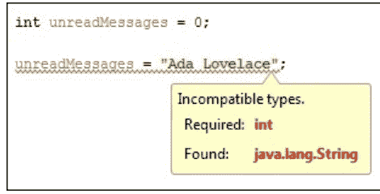
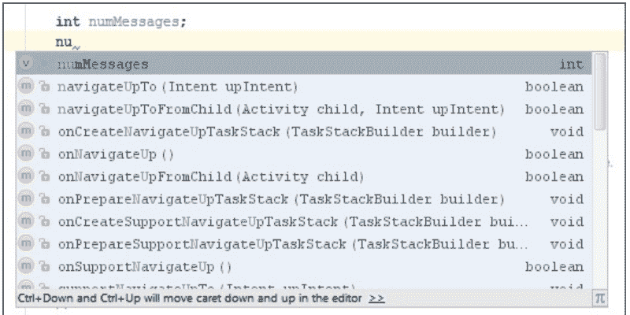
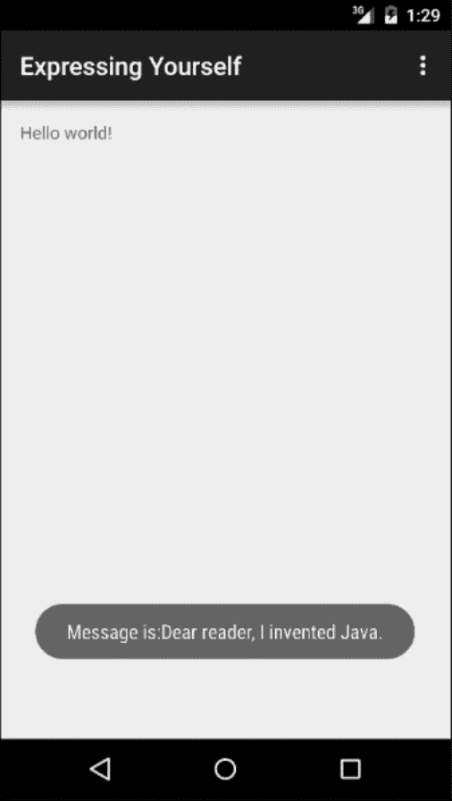
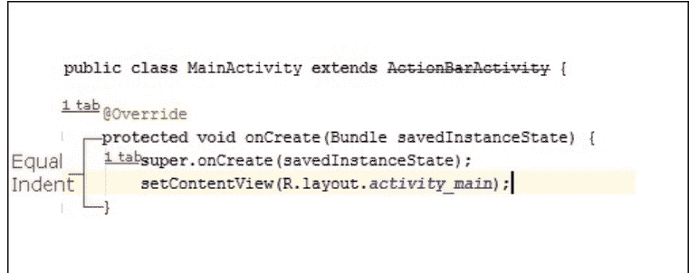
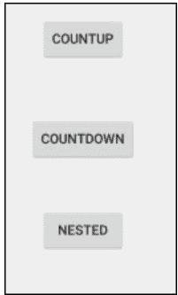

## 第 7 章. 用 Java 编程 第 1 部分 – 变量、决策和循环

在本章中，我们将学习并实践 Java 的核心基础知识，即进入类和我们创建的方法中的代码，以及代码作用的数据。

我们还将快速回顾之前章节中关于 Java 的所学内容，然后立即深入学习如何编写我们自己的 Java 代码。我们即将学习的原理不仅适用于 Java，也适用于其他编程语言。到本章结束时，你将能够熟练编写真正在 Android 中创建和使用数据的 Java 代码。

本章将带你了解：

- Java 语法和术语
- 变量、运算符和表达式
- 决策与分支
- 循环

## Java 无处不在

我们即将学习的核心 Java 基础知识既适用于我们继承的类（例如 Activity），也适用于我们自己编写的类（我们将从第 9 章“面向对象编程”开始这样做）。由于在编写自己的类之前先学习基础知识更合理，本章我们将在大量的小型项目中使用扩展的 Activity 类来学习和实践 Java，并会再次使用 Log 和 Toast 来观察我们编码的结果。此外，我们还将使用更多我们自己编写的方法（从按钮调用），以及 Activity 类的覆盖方法，以触发我们代码的执行。

不过，当我们进入第 9 章“面向对象编程”并开始编写自己的类，以及更多地了解他人编写的类的工作原理时，我们在这里学到的一切也将适用。事实上，如果将本章学到的所有 Java 代码从 Activity 类中剥离并粘贴到以下环境中，它们都可以工作：

- 任何主要的桌面操作系统
- 许多现代电视
- 导航仪
- 智能冰箱以及更多...

## 提示

### 召唤所有 Java 大牛

如果你已经进行过一些 Java 编程并理解以下词汇：if、else、while、do while、switch 和 for，那么你可能可以跳到下一章。或者你可以快速浏览此信息作为复习。

让我们开始学习如何用 Java 编码吧。

## 语法和术语

在本书中，我们将使用通俗易懂的英语来讨论一些相当技术性的内容。你永远不会被要求阅读尚未用非技术语言解释过的 Java 或 Android 概念的技术解释。

到目前为止，有几次我要求你接受一个简化的解释，以便在更合适的时间提供更完整的解释，就像类和方法一样。

话虽如此，Java 和 Android 社区中充斥着使用技术术语的人，要想加入并从这些社区中学习，你需要理解他们使用的术语。因此，本书采用的方法是：使用完全通俗易懂的语言来学习概念或欣赏想法，但同时，将行话/技术术语作为学习的一部分来介绍。

Java 语法是我们组合 Java 语言元素的方式，以生成在 Dalvik 虚拟机中运行的代码。Java 语法是我们使用的单词以及将这些单词组成句状结构（即我们的代码）的组合。

这些 Java“单词”数量众多，但分小块学习几乎肯定比任何人类口语语言都容易。我们将这些单词称为 **关键字**。

我相信，如果你会阅读，那么你就能学习 Java，因为学习 Java 容易得多。那么，完成初级 Java 课程的人和专家程序员之间有什么区别呢？这正是语言学习者与大师诗人之间的区别。Java 专长不在于我们知道多少 Java 关键字，而在于我们如何使用它们。语言精通来自于实践、进一步学习以及更熟练地使用关键字。许多人认为编程既是一门艺术也是一门科学，这很可能有些道理。


## 更多代码注释

随着你编写 Java 程序水平的提高，用于创建程序的解决方案将变得越来越长且越来越复杂。此外，正如我们在后面章节中将看到的，Java 的设计初衷是通过让我们将代码分割到独立的类中（通常跨多个文件）来管理复杂性。

**代码注释**是 Java 程序的一部分，在程序本身中没有任何功能。编译器会忽略它们。它们的作用是帮助程序员记录、解释和澄清他们的代码，以便自己在稍后日期或其他可能需要使用或修改的程序员更容易理解。

我们已经看到了单行注释：

```
// this is a comment explaining what is going on
```

上一条注释以两个正斜杠字符 `//` 开头。注释在行尾结束。因此，该行上的任何内容仅供人类阅读，而下一行上的任何内容（除非是另一条注释）都需要是语法正确的 Java 代码：

```
// I can write anything I like here
but this line will cause an error
```

我们可以使用多个单行注释：

```
// Below is an important note
// I am an important note
// We can have as many single line comments like this as we like
```

如果我们想暂时禁用一行代码，单行注释也很有用。我们可以在代码前面加上 `//`，它就不会被包含在程序中。还记得这段代码吗，它告诉 Android 加载我们的布局？

```
// setContentView(R.layout.activity_main);
```

在之前的情况下，布局将不会被加载，应用程序运行时会出现空白屏幕，因为整行代码被编译器忽略了。

Java 中还有另一种注释，称为多行注释。多行注释适用于跨多行的较长注释，也适用于在代码文件顶部添加版权信息等内容。与单行注释类似，多行注释可以用于暂时禁用代码，在此情况下跨多行。

编译器会忽略起始 `/*` 和结束 `*/` 之间的所有内容。以下是一些示例：

```
/*
You can tell I am good at this because my
code has so many helpful comments in it.
*/
```

多行注释的行数没有限制。使用哪种类型的注释最好将取决于具体情况。在这本书中，我将始终在文本中明确解释每一行代码，但你通常会在代码本身中发现大量散布的注释，这些注释提供了进一步的解释、见解或上下文。因此，彻底阅读所有代码也是个好主意：

```
/*
The winning lottery numbers for next Saturday are
9,7,12,34,29,22
But you still want to make Android apps?
*/
```

### 提示

所有优秀的 Java 程序员都会在代码中大量添加注释！

## 使用变量存储和使用数据

我们可以将 **变量** 视为一个带名称的存储盒。我们选择一个名称，也许是 variableA。这些名称有点像我们程序员窥视用户 Android 设备内存的窗口。

变量是内存中的值，在必要时可以使用适当的名称来使用或修改。

计算机内存有一个高度复杂的寻址系统，幸运的是我们不需要与之交互。Java 变量允许我们为程序需要处理的所有数据创建自己方便的名称。DVM 将处理与操作系统交互的所有技术细节，而操作系统则反过来与物理内存交互。

因此，我们可以将 Android 设备的内存视为一个巨大的仓库，正等着我们添加变量。当我们为变量指定名称时，它们存储在仓库中，以备需要时使用。当我们使用变量的名称时，设备确切地知道我们在指代什么。然后我们可以告诉它执行诸如：获取 variableA 并将其添加到 variableC，删除 variableB，等等的操作。

在典型的应用中，我们可能有一个名为 unreadMessages 的变量，也许用于保存用户未读消息的数量。当有新消息到达时，我们可以增加它；当用户读取消息时，我们可以减少它；并在应用布局的某个位置向用户显示它，这样他们就知道有多少未读消息。

可能出现的一些情况是：

- 用户收到三条新消息，因此将三加到 unreadMessages 的值上。
- 用户登录应用，因此使用 Toast 显示一条消息，并伴随 unreadMessages 中存储的值。
- 用户看到很多消息来自她不喜欢的人，并删除了六条消息。我们可以从 unreadMessages 中减去六。

这些是相当随意的变量名示例，只要你不使用 Java 限制的任何字符或关键字，你实际上可以随意命名你的变量。

但是，在实际操作中，最好采用 **命名约定**，以便你的变量名保持一致。在这本书中，我们将使用一种宽松的约定：变量名以小写字母开头。当变量名包含多个单词时，第二个单词将以大写字母开头。这称为 **驼峰命名法**。

例如：

- unreadMessages
- contactName
- isFriend

在查看一些带有变量的实际 Java 代码之前，我们首先需要了解可以创建和使用的变量 **类型**。

## 变量类型

不难想象，即使是一个简单的应用程序也可能有相当多的变量。在上一节中，我们将 unreadMessages 变量作为假设示例进行了介绍。如果应用程序有一个联系人列表并需要记住每个联系人的姓名，那我们可能需要为每个联系人创建变量。

那么，当应用程序需要知道一个联系人是否也是朋友，或者只是普通联系人时呢？我们可能需要代码来测试朋友状态，然后将该联系人的消息添加到适当的文件夹中，这样用户就知道消息是否来自朋友。

计算机程序（包括 Android 应用）中的另一个常见要求是正确或错误的计算。计算机程序使用 true 或 false 来表示正确或错误的计算。

为了涵盖这些以及许多你可能想要存储或操作的其他数据类型，Java 有类型。

## 原始类型

有很多变量类型，我们甚至可以发明自己的类型。但目前，我们将查看最常用的内置 Java 类型。公平地说，它们涵盖了我们在一段时间内可能遇到的几乎所有情况。这些示例是解释类型的最佳方式。

我们已经讨论过假设的 unreadMessages 变量。这个变量当然是一个数字，所以我们必须通过给它一个适当的类型来告诉 Java 编译器这一点。

假设的 contactName 当然会保存组成联系人姓名的字符。

再往后看几个段落，保存常规数字的类型称为 int，保存类似名称的数据的类型称为 String。

如果我们尝试将联系人姓名（例如 "Ada Lovelace"）存储在像 unreadMessages 这样的用于数字的 int 中，我们肯定会遇到麻烦，正如我们从下一个屏幕截图中可以看到的：



正如我们所见，Java 的设计初衷就是让这类错误不可能进入运行中的程序。有编译器保护我们免受自身错误的影响，还可能出什么问题呢？

以下是 Java 中的主要类型，然后我们将了解如何开始使用它们：

- int: int 类型用于存储整数，即整数。该类型使用 32 位（bits）内存，因此可以存储数值略大于二十亿的值，包括负值。
- long: 正如名称所暗示的，当需要更大的数字时，可以使用 long 数据类型。long 类型使用 64 位内存，2 的 63 次方是我们可以存储的值。如果你想看看那是什么样子，它是这样：9,223,372,036,854,775,807。也许令人惊讶的是，还有


用于 long 变量，但关键是，如果使用较小的变量就足够了，我们就应该使用它，因为我们的程序会占用更少的内存。

### 注意

你可能在想什么时候会用到如此巨大的数字。很明显的例子是执行复杂计算的数学或科学应用程序，但另一个用途可能是计时。当你计时某事花费了多长时间时，Java Date 类使用的是自 1970 年 1 月 1 日以来的毫秒数。一毫秒是一秒的千分之一，因此自 1970 年以来已经经历了相当多的毫秒。

- float：用于浮点数。也就是说，小数点后具有精度的数字。由于数字的小数部分和整数部分一样占用内存空间，float 中可能的数值范围因此比非浮点数要小。所以，除非我们的变量肯定会使用额外的精度，否则 float 就不会是我们的首选数据类型。

- double：当 float 的精度不够时，我们就有 double 了。

- boolean：在本书中我们将大量使用布尔值。boolean 变量类型只能是 true 或 false；没有其他值。也许布尔值用于回答诸如以下的问题：
  - 该联系人是朋友吗？
  - 是否有新消息？
  - 两个布尔值示例足够吗？

- char：char 中存储单个字母数字字符。它本身不会改变世界，但如果将大量字符放在一起，可能会很有用。

### 提示

我将本节关于数据类型的讨论保持在实用水平，这在本书的语境中很有用。如果你有兴趣了解数据类型的值是如何存储的，以及限制为什么是这个样子，可以参考 Oracle Java 教程网站：http://docs.oracle.com/javase/tutorial/java/nutsandbolts/datatypes.html。
请注意，继续本书学习不需要比我们已经讨论过的更多信息。

正如我们刚刚学到的，我们可能想要存储的每种数据类型都需要特定数量的内存；因此，在开始使用变量之前，必须让 Java 编译器知道变量的类型。

前面提到的变量称为 **原始** 类型。它们使用预定义的内存量，因此，借用我们的仓库存储类比，适合于预定义大小的存储箱。

正如 "primitive" 标签所暗示的，它们不如 **引用** 类型那么复杂。

## 引用类型

你可能已经注意到，我们没有涵盖之前用来介绍保存姓名等字母数字数据的变量概念的 `String` 变量类型。

字符串是一种特殊的变量类型，称为 **引用** 类型。它们简单地引用变量存储开始的内存位置，但引用类型本身并不定义特定的内存大小。原因很简单。

这是因为在程序实际运行之前，我们并不总是知道需要在其中存储多少数据。

我们可以将字符串和其他引用类型视为不断扩展和收缩的存储箱。那么，这些 `String` 引用类型最终会不会与另一个变量发生碰撞呢？

当我们将设备内存视为一个装满贴有标签的存储箱货架的巨大仓库时，你可以把 DVM 想象成一名超高效的叉车司机，将不同类型的存储箱放置在最合适的位置。

如果有必要，DVM 会在不到一秒的时间内快速移动东西以避免碰撞。同样，在适当的时候，Dalvik 叉车司机甚至会焚烧不需要的存储箱。这发生在不断卸载各种新存储箱并将其放置在最适合该类型变量的位置的同时。Dalvik 将引用变量存储在与原始变量不同的仓库区域。我们将在 `Chapter 9, Object-Oriented Programming` 中了解更多详细信息。

因此，字符串可用于存储任何键盘字符。有点像 `char`，但长度几乎可以是任意长度。从联系人姓名到整本书，任何内容都可以存储在一个 `String` 中。我们将经常使用字符串，包括在本章中。

还有几种引用类型我们将探索。**数组** 是一种存储大量相同类型变量的方法，以便快速高效地访问。我们将在第 13 章“处理和显示数据数组”中查看数组。

将数组视为我们仓库中的一个过道，其中某一类型的所有变量按精确顺序排列。数组是引用类型，因此 Dalvik 将它们与字符串保存在仓库的同一部分。例如，我们可以使用数组存储几十个联系人。

另一种引用类型是类，我们已经讨论过但尚未正确解释。我们将在第 9 章“面向对象编程”中熟悉类。

现在我们知道，我们可能想要存储的每种数据类型都需要一定数量的内存。因此，在开始使用变量之前，必须让 Java 编译器知道变量的类型。我们通过变量声明来完成此操作。

## 变量声明

理论就讲这么多。让我们看看如何实际使用变量和类型。请记住，每种原始类型都需要特定数量的实际设备内存。这是编译器需要知道变量类型的原因之一。因此，在尝试对变量做任何操作之前，我们必须先声明变量及其类型。

要声明名为 `unreadMessages` 的 `int` 类型变量，我们将输入：

```
int unreadMessages;
```

就这样，只需声明类型，在此例中为 `int`，然后留出一个空格并输入要用于此变量的名称。请注意，行末的分号 `;` 会告诉编译器此行已结束，之后的任何内容（如果有）都不是声明的一部分。

同样，对于几乎所有其他变量类型，声明的方式也相同。以下是一些示例。示例中的变量名称是任意的。这就像在仓库中预留一个贴有标签的存储箱：

```
long millisecondsElapsed;
float accountBalance;
boolean isFriend;
char contactFirstInitial;
String messageText;
```

## 变量初始化

**初始化** 是下一步。在这里，对于每种类型，我们将值初始化到变量中。想想将值放入存储箱中：

```
unreadMessages = 10;
millisecondsElapsed = 1438165116841l;// 29th July 2016 11:19am
accountBalance = 129.52f;
isFriend = true;
contactFirstInitial = 'C';
messageText = "Hi reader, Just thought I would let you know that Charles Babbage was an early computing pioneer and he invented the difference engine. If you want to know more about him you can click this link www.charlesbabbage.net. Thanks, John";
```

请注意，char 变量对初始化值使用单引号 '，而 String 使用双引号 "。

我们还可以将声明和初始化步骤合并。在以下示例中，我们声明并初始化之前相同的变量，但只需一步：

```
int unreadMessages = 10;
long millisecondsElapsed = 1438165116841l;//29th July 2016 11:19am
float accountBalance = 129.52f;
boolean isFriend = true;
char contactFirstInitial = 'C';
String messageText = "Hi reader, Just thought I would let you know that Charles Babbage was an early computing pioneer and he invented the difference engine. If you want to know more about him you can click this link http://www.charlesbabbage.net/. Thanks, John";
```

无论是分开还是一起声明和初始化，可能取决于具体情况。重要的是我们必须两者都做：

```
int a;
// That's me declared and ready to go?
// The line below attempts to output a to the console
Log.i("info", "int a = " + a);
// Oh no I forgot to initialize a!!
```

这将导致以下情况：

**编译器错误：变量 a 可能未初始化**


这条规则有一个显著的例外。在某些情况下，变量可以具有默认值。我们将在第 9 章“面向对象编程”中看到这一点；但是，同时声明和初始化变量是一种良好的做法。

## 使用运算符更改变量中的值

当然，在几乎所有程序中，我们都需要对这些值进行一些操作。我们使用**运算符**来操纵（更改）变量。以下是一份可能最常见的 Java 运算符列表，它们允许我们操纵变量。您不需要背诵它们，因为我们会在首次使用时查看每一行代码。我们在初始化变量时已经见过第一个运算符，但我们将以更冒险的方式再见到它：

- **赋值**运算符 (=)：这会使运算符左侧的变量与右侧的值相同。例如，unreadMessages = newMessages；。
- **加法**运算符 (+)：这会将运算符两侧的值相加。它通常与赋值运算符一起使用，或者略有不同；将包含数值的两个变量相加。也许像这样 unreadMessages = newMessages + unreadMessages；或 accountBalance = yesterdaysBalance + todaysDeposits；。请注意，在运算符两侧同时使用同一个变量是完全可以接受的。
- **减法**运算符 (-)：这会从运算符左侧的值中减去右侧的值。通常与赋值运算符一起使用。也许 unreadMessages = unreadMessages - 1；或 accountBalance = accountBalance - withdrawals；。
- **除法**运算符 (/)：这会将左侧的数除以右侧的数。同样，通常与赋值运算符一起使用。例如，fairShare = numSweets / numChildren；。
- **乘法**运算符 (*)：这会将变量和数字相乘。例如，answer = 10 * 10；或 biggerAnswer = 10 * 10 * 10；。
- **自增**运算符 (++)：这是给某物加 1 的一种非常巧妙的方法。myVariable = myVariable + 1；与 myVariable ++；相同。
- **自减**运算符 (--)：你猜对了。这是从某物中减去 1 的一种非常巧妙的方法。myVariable = myVariable - 1；与
    ```
    myVariable --;
    ```
    相同。

### 注意

这些运算符的正式名称与之前解释的略有不同。例如，除法运算符实际上是乘法运算符之一，但之前给出的名称对于学习 Java 来说要有用得多，如果你在与 Java 社区的人交谈时使用“除法运算符”这一术语，他们就会知道你的意思。

Java 中实际上还有比这多得多的运算符。我们将在本章后面学习 Java 中的决策时遇到更多运算符。

### 提示

如果您对运算符感兴趣，可以在 Java 网站上找到它们的完整列表：http://docs.oracle.com/javase/tutorial/java/nutsandbolts/operators.html。完成本书项目所需的所有运算符都将在本书中得到完整解释。该链接是为好奇的读者提供的。

## 表达自我演示应用

让我们尝试使用一些声明、赋值和运算符。当我们将这些元素组合成有意义的语法时，我们称之为表达式。所以让我们写一个快速应用来尝试一下。然后我们将使用 Toast 和 Log 来检查结果。

创建一个名为“表达自我”的新项目，使用空白活动，并将所有其他设置保留为默认值。我们将在本项目中编写的完整代码可以在下载包的 chapter 7/Expressing Yourself 文件夹中找到。

切换到编辑器中的 MainActivity 选项卡，我们将编写一些代码。在 onCreate 方法中，就在右花括号 } 之前，添加此代码：

```
int numMessages;
```

在上一行代码的正下方，我们将为 numMessages 分配一个值。但是，当你开始输入 nu 时，你会注意到我们会看到类似这样的弹出消息：



如果你查看弹出消息中的第一个选项，那实际上就是 numMessages。Android Studio 正在帮我们自动完成输入。我们可以左键单击 numMessages 以自动完成变量名，或者直接按键盘上的 Enter 键选择它（因为它已经被高亮显示）。每当 Android Studio 认为它可能知道我们想要输入什么时，它就会弹出一些选项。养成使用此功能的习惯可以节省大量时间。

使用自动完成功能添加这一行代码：

```
numMessages = 10;
```

现在我们已经介绍了这个非常实用的代码完成功能，我们将添加一大段代码。在上一行代码之后、onCreate 的右闭合 } 之前，添加以下代码：

```
// Output the value of numMessages
Log.i("numMessages = ", "" + numMessages);

numMessages++;
numMessages = numMessages + 1;
Log.i("numMessages = ", "" + numMessages);

// Now a boolean (just true or false)
boolean isFriend = true;
Log.i("isFriend = ", "" + isFriend);

// A contact and an important message
String contact = "James Gosling";
String message = "Dear reader, I invented Java.";

// Now let's play with those String variables
Toast.makeText(this, "Message from" + contact,
Toast.LENGTH_SHORT).show();

Toast.makeText(this, "Message is:" + message,
Toast.LENGTH_SHORT).show();
```

运行应用，我们可以检查输出，然后再检查代码。在 logcat 窗口中，你将看到以下输出：

```
numMessages = 10
numMessages = 12
isFriend = true
```

在屏幕上，你会看到两个弹出的 Toast 消息。第一条显示 Message from James Gosling。第二条显示 Message is: Dear Reader, I invented Java.，如下一个截图所示：



让我们逐行查看代码，确保每一行都清楚明了，然后再继续。

首先，我们声明并初始化了一个名为 numMessages 的 int 类型变量。我们可以把它写在一行上，但我们是这样做的：

```
int numMessages;
numMessages = 10;
```

接下来，我们使用 Log 输出一条消息。这次我们没有简单地将消息输入双引号 "" 之间，而是使用 + 运算符将 numMessages 添加到输出中。正如我们在控制台中看到的，输出的是 numMessages 的实际值：

```
Log.i("numMessages = ", "" + numMessages);
```

为了进一步证明我们的 numMessages 变量足够通用，我们使用 ++ 运算符，它应该将其值加 1，然后将 numMessages 自身加 1。然后我们输出 numMessages 的新值，并确实发现其值从 10 增加到了 12：

```
numMessages++;
numMessages = numMessages + 1;
Log.i("numMessages = ", "" + numMessages);
```

接下来，我们创建了一个名为 isFriend 的 boolean 类型变量，并将其输出到控制台。从输出中我们看到显示了 true。当我们在下一节中查看决策时，这种变量类型将充分展示其用途：

```
boolean isFriend = true;
Log.i("isFriend = ", "" + isFriend);
```

之后，我们声明并初始化了两个 String 类型的变量：

```
String contact = "James Gosling";
String message = "Dear reader, I invented Java.";
```

最后，我们使用 Toast 输出 String 变量。我们使用了消息的硬编码部分 "Message from "，并通过 + contact 添加了消息的变量部分。我们使用相同的技术来构建第二个 Toast 消息。当我们将两个字符串相加以形成更长的字符串时，这称为串联：

```
Toast.makeText(this, "Message from " + contact,
Toast.LENGTH_SHORT).show();

Toast.makeText(this, "Message is:" + message,
Toast.LENGTH_SHORT).show();
```


现在我们可以声明变量，将它们初始化为某个值，对其进行一些修改，并使用 Toast 或 Log 输出它们。现在让我们来看看如何根据这些变量的值做出决策，以及这对我们有什么用。

## 决策

我们的 Java 代码将不断地做出决策。例如，我们可能需要知道用户是否有新消息，或者他们是否有特定数量的朋友。我们需要能够测试我们的变量，看它们是否满足某些条件，然后根据条件是否成立来执行某个代码段。

在本节中，随着我们的代码变得更加深入，以一种更易读的方式来呈现代码会有所帮助。让我们来看看代码缩进，以使我们关于决策的讨论更加容易。

## 缩进我们的代码

你可能已经注意到，我们项目中的 Java 代码是缩进的。例如，MainActivity 类内的第一行代码缩进了一个制表符。每个方法内的第一行代码也都是缩进的。下面是一张带有注释的图片，作为另一个快速示例来澄清这一点：



还要注意，当缩进块结束时，通常是以右花括号 } 结尾，这个 } 与开始该块的代码行具有相同的缩进程度。

我们这样做是为了让代码更易读。然而，这不是 Java 语法的一部分，即使我们不这么做，代码仍然可以编译。

随着我们的代码变得更加复杂，缩进配合注释有助于保持代码的含义和结构清晰。我现在提到这一点，是因为当我们开始学习 Java 中做出决策的语法时，缩进变得特别有用，并且建议你以同样的方式缩进你的代码。

Android Studio 会为我们完成大部分缩进工作，但并非全部。

既然我们知道如何以更清晰的方式呈现代码，那么让我们学习更多运算符，接着我们就可以真正开始使用 Java 进行决策了。

## 更多运算符

我们已经可以使用运算符进行加法（+）、减法（-）、乘法（*）、除法（/）、赋值（=）、自增（++）和自减（--）了。让我们介绍一些更超级有用的运算符，然后我们将直接进入实际理解如何在 Java 中使用它们。

### 提示

不必担心要记住以下每个运算符。浏览它们及其解释，然后快速进入下一节。在那里我们将使用一些运算符，当我们看到一些示例，了解它们允许我们做什么时，它们会变得清晰得多。这里以列表形式呈现它们，只是为了从一开始就清楚运算符的种类和范围。当列表与随后的实现讨论不混在一起时，该列表也更方便以后查阅。

我们使用运算符来创建一个结果为 `true` 或 `false` 的表达式。我们像这样将该表达式包装在括号中，（此处放入表达式）：

- **==**: 这个**比较**运算符测试相等性，结果为 true 或 false。例如，表达式 `(10 == 9)` 是 `false`。`10` 显然不等于 `9`。
- **!**: 这是逻辑非运算符。表达式 `( ! (2+2 == 5))` 是 `true`，因为 `2+2` 不是 `5`。
- **!=**: 另一个比较运算符。这测试某事物是否**不相等**。例如，表达式 `(10 != 9)` 是 `true`。`10` 不等于 `9`。
- **>**: 另一个比较运算符；实际上还有几个。这测试某事物是否**大于**另一事物。表达式 `(10 > 9)` 是 `true`。
- **<**: 你猜到了。这测试值是否**小于**。表达式 `(10 < 9)` 是 `false`。
- **>=**: 这个运算符测试一个值是否**大于或等于**另一个值，如果任一条件为真，结果为 `true`。例如，表达式 `(10 >= 9)` 是 `true`。表达式 `(10 >= 10)` 也是 `true`。
- **<=**: 与前一个运算符类似，这个运算符测试两个条件，但这次是**小于或等于**。表达式 `(10 <= 9)` 是 `false`。表达式 `(10 <= 10)` 是 `true`。

- &&: 这个运算符称为逻辑与。它测试表达式中两个或更多独立部分，所有部分都必须为真，结果才为真。逻辑与通常与其他运算符一起用来构建更复杂的测试。表达式 `((10 > 9) && (10 < 11))` 为 true，因为两部分都为真，所以表达式为真。表达式 `((10 > 9) && (10 < 9))` 为 false，因为表达式只有一部分为真，另一部分为假。

- ||: 这个运算符称为逻辑或，它与逻辑与非常类似，只是表达式中两个或更多部分需要只有一部分为真，表达式才为真。让我们看看我们刚才使用的最后一个示例，但将 && 替换为 ||。表达式 `((10 > 9) || (10 < 9))` 现在为 true，因为表达式的一部分为真。

如果没有正确使用它们来影响真实变量和代码的真实决策的方法，所有这些运算符几乎都无用。

现在我们拥有了所需的所有信息，可以来看一个假设的情况，然后实际看一些决策代码。

## 如果他们过桥，就射杀他们

如我们所见，运算符本身用处不大，但了解可供我们使用的广泛而多样的运算符中的一部分可能很有用。现在，当我们开始使用最常见的运算符 == 时，我们可以开始看到它们提供的强大而精细的控制。

让我们使之前的示例不那么抽象。认识一下 Java 的 if 关键字。我们将使用 if 以及一些条件运算符，配合一个小故事来演示它们的用法。接下来是一个虚构的军事情况，希望它比之前的示例更不抽象。

队长快要死了，他知道他剩下的下属经验不足，于是决定写一个 Java 程序，在他去世后传达他的最后命令。部队必须在等待增援时守住桥的一侧。

队长希望确保他的部队理解的第一个命令是：

*如果他们过桥，就射杀他们。*

那么，我们如何在 Java 中模拟这种情况？我们需要一个布尔变量 isComingOverBridge。下面的代码假设 isComingOverBridge 变量已声明并初始化为 true 或 false。

然后我们可以这样使用 if：

```
if(isComingOverBridge){
    // Shoot them
}
```

如果 isComingOverBridge 布尔值为 true，则花括号内的代码将运行。否则，程序将继续执行 if 块之后的代码，而不运行其中的代码。

## 否则执行此操作

队长还想告诉他的部队，如果敌人不过桥，该怎么做（原地待命）。

现在我们介绍另一个 Java 关键字 else。当我们想在 if 评估结果不为 true 时明确执行某些操作时，可以使用 else。

例如，如果要告诉部队在敌人不过桥时原地待命，我们可以写这样的代码：

```
if(isComingOverBridge){
    // Shoot them
}else{
    // Hold position
}
```

随后队长意识到问题没有他最初想的那么简单。如果敌人过桥，但兵力过多怎么办？他的小队会被击溃。于是，他想出了这样的代码（这次我们也会使用一些变量）：

```
boolean isComingOverBridge;
int enemyTroops;
int friendlyTroops;
// Code that initializes the above variables one way or another

// Now the if
if(isComingOverBridge && friendlyTroops > enemyTroops){
    // shoot them
}else if(isComingOverBridge && friendlyTroops < enemyTroops) {
    // blow the bridge
}else{
    // Hold position
}
```

前面的代码有三条可能的执行路径。第一，如果敌人过桥且友军人数更多：

```
if(isComingOverBridge && friendlyTroops > enemyTroops)
```

第二，如果敌军过桥但人数超过友军：

```
else if(isComingOverBridge && friendlyTroops < enemyTroops)
```

然后是第三种也是最后一种可能的结果，如果前两种都不为真，则由没有 if 条件的最后一个 else 捕获。

### 提示

### 读者挑战

你能发现前面代码中的一个缺陷吗？一个可能导致一群经验不足的部队陷入完全混乱的缺陷？敌军和友军人数恰好相等的情况没有被明确处理，因此将由最后一个 else 处理，而那个 else 本意是用于没有敌军的情况。我想，任何自重的队长都会希望他的部队在这种情况下战斗，他本可以修改第一个 if 语句来适应这种可能性：

```
if(isComingOverBridge && friendlyTroops >= enemyTroops)
```

最后，队长的最后一个担忧是，如果敌人举着白旗投降过桥，却被立即屠杀，那么他的人就会成为战犯。需要的 Java 代码很明显。使用 wavingWhiteFlag 布尔变量，他写了这个测试：

```
if (wavingWhiteFlag){
    // Take prisoners
}
```

但将此代码放在哪里就不那么清楚了。最终，队长选择了以下嵌套解决方案，并修改了 wavingWhiteFlag 的测试以


逻辑非，如下所示：

```
if (!wavingWhiteFlag){
  // not surrendering so check everything else
  if(isComingOverTheBridge && friendlyTroops >= enemyTroops){
    // shoot them
  }else if(isComingOverTheBridge && friendlyTroops < enemyTroops) {
    // blow the bridge
  }
}else{
  // this is the else for our first if
  // Take prisoners
}
// Holding position
```

这表明我们可以将 if 和 else 语句相互嵌套，以创建相当深入且详细的决策。

我们可以继续使用 if 和 else 做出越来越复杂的决策，但我们已看到的内容作为入门已足够。值得注意的是，解决一个问题通常不止一种方法。*正确*的方式通常是以最清晰、最简单的方式解决问题的方法。

让我们看看在 Java 中做出决策的其他一些方式，然后我们可以将它们全部整合到一个应用中。

## 使用 switch 做决策

我们已看到将 Java 运算符与 if 和 else 语句结合使用的广阔且几乎无限的可能性。但有时，在 Java 中做决策有其他更好的方式。

当我们需要基于一个清晰的可能性列表做决策，且该列表不涉及复杂组合时，switch 通常是首选。

我们这样开始一个 switch 决策：

```
switch(argument){
}
```

在前一个示例中，**参数** 可以是一个表达式或变量。在花括号 {} 内，我们可以基于参数 使用 case 和 break 元素来做决策：

```
case x:
// code to for case x
break;

case y:
// code for case y
break;
```

在前一个示例中，可以看到每个 case 说明一个可能的结果，每个 break 表示该 case 的结束，同时也是不应再评估其他 case 语句的点。

遇到的第一个 break 会跳出 switch 块，继续执行整个 switch 块右花括号 } 之后的下一行代码。

我们还可以使用不带值的 default 来运行一些代码，以防没有任何 case 语句评估为 true。如下所示：

```
default: // Look no value
// Do something here if no other case statements are true
break;
```

让我们编写一个快速使用 switch 的演示应用。

## Switch 演示应用

要开始，创建一个名为 Switch Demo 的新 Android 项目，使用 Blank Activity，并将所有其他设置保留为默认值。通过左键单击编辑器上方的 MainActivity.java 标签切换到 MainActivity.java 文件，然后我们就可以开始编码了。

假设我们正在编写一款老式文本冒险游戏，即玩家输入诸如 "Go East"、"Go West"、"Take Sword" 等命令的那种游戏。在这种情况下，switch 可以使用以下代码处理该情况，我们可以使用 default 来处理玩家输入未明确处理的命令。

在 onCreate 方法中右花括号 } 之前输入以下代码：

```
switch(command){
    case "go east":
        Log.i("Player: ", "Moves to the east" );
        break;

    case "go west":
        Log.i("Player: ", "Moves to the West" );
        break;

    case "go north":
        Log.i("Player: ", "Moves to the North" );
        break;

    case "go south":
        Log.i("Player: ", "Moves to the South" );
        break;

    case "take sword":
        Log.i("Player: ", "Takes the silver sword" );
        break;

    // more possible cases

    default:
        Log.i("Message: ", "Sorry I don't speak Elfish" );
        break;
}
```

运行几次应用。每次，将 command 的初始化更改为新内容。请注意，当你将 command 初始化为由 case 语句明确处理的内容时，我们会得到预期输出。否则，我们会得到默认值 **对不起，我不说精灵语**。

如果针对某个 case 需要执行大量代码，我们可以将其全部包含在一个方法中，例如，就像接下来的这段代码。我已突出显示新的一行：

```
default:
goWest();
break;
```

当然，我们之后需要编写新的 goWest 方法。然后，当 command 初始化为 "go west" 时，goWest 方法将被执行，执行将返回到 break 语句，这将导致代码在 switch 块之后继续。

当然，这段代码严重缺少的一点是与 UI 的交互。我们已看到如何从按钮点击调用方法，但即便如此，也不足以让这段代码在真实应用中发挥作用。我们将在第 10 章 "Everything's a Class" 中看到如何解决这个问题。

我们面临的另一个问题是，代码执行完毕后就结束了。我们需要它不断地向玩家请求指令，而不仅仅是一次，而是一遍又一遍。我们将在下一节探讨这个问题的解决方案。

## 使用循环重复代码

在这里，我们将学习如何通过查看 Java 中不同类型的循环，以受控且精确的方式反复执行代码的一部分。这些包括 while 循环、do while 循环和 for 循环。我们还将学习使用不同类型循环的最合适情况。

询问循环与编程有什么关系是完全合理的，但它们正是名字所暗示的那样。它们是重复同一部分代码多次的一种方式，或者循环遍历同一部分代码，尽管每次可能会产生不同的结果。

这可能只是简单地一直做同一件事，直到被循环（迭代）的代码提示循环结束。它可能是由循环代码本身指定的预定迭代次数。也可能是在满足预定情况或条件之前。或者，可能是上述多种情况的组合。与 if、else 和 switch 一起，循环是 Java 控制流语句的一部分。

我们将查看 Java 提供给我们用于控制代码的所有主要类型的循环，并将使用其中一些来实现一个可工作的小应用，以确保我们完全理解它们。让我们先看看 Java 中称为 while 循环的第一种也是最简单的循环类型。

### While 循环

Java while 循环具有最简单的语法。回想一下 if 语句。我们可以在 if 语句的条件表达式中放入几乎任何运算符和变量的组合。如果表达式评估为 true，则执行 if 块体中的代码。while 循环中我们也会放入一个可以评估为 true 或 false 的表达式。看一下这段代码：

```
int x = 10;
while(x > 0){
x--;
// x decreases by one each pass through the loop
}
```

这里发生的情况是：while 循环之外，声明并初始化了一个名为 x 的 int，值为 10。然后，while 循环开始。其条件是 x > 0。因此，while 循环将继续循环执行其体中的代码，直到条件评估为 false。所以前面的代码将执行 10 次。

在第一次遍历中，x = 10，然后是 9，然后是 8，以此类推。但一旦 x 等于 0，它自然不再大于 0，程序将退出循环并继续执行 while 循环后的第一行代码。

与 if 语句一样，while 循环可能一次都不执行。看一下这个：

```
int x = 10;
while(x > 10){
// more code here.
// but it will never run unless x is greater than 10.
}
```

此外，条件表达式的复杂性或可以放入循环体中的代码量都没有限制：

```
int newMessages = 3;
int unreadMessages = 0;
while(newMessages > 0 || unreadMessages > 0){
// Display next message
// etc.
}
```

```
// continue here when newMessages and unreadMessages equal 0
```

前面的 while 循环将继续执行，直到 newMessages 和 unreadMessages 都等于或小于零。由于条件使用逻辑 OR 运算符 ||，只要其中任何一个条件为 true，就会导致 while 循环继续执行。

值得注意的是，一旦进入循环体，它将始终完成，即使表达式中途评估为 false，因为它不会再次测试，直到代码尝试开始另一次遍。例如：

```
int x = 1;

while(x > 0){
  x--;
  // x is now 0 so the condition is false
  // But this line still runs
  // and this one
  // and me!
}
```

前面的循环体将恰好执行一次。我们还可以设置一个永远运行的 while 循环，不出所料地称为无限循环。如下所示：

```
int x = 0;

while(true){
  x++; // I am going to get mighty big!
```

### 跳出循环

我们可能像这样使用一个无限循环，以便可以从循环体内部决定何时退出循环。我们会在准备离开循环体时使用 break 关键字来实现这一点。如下所示：

```
int x = 0;

while(true){
  x++; // I am going to get mighty big!
```


x++; // I am going to get mighty big!
break; // No you're not haha.
// code doesn't reach here
}

And you might have been able to guess that we can combine any of the decision-making tools like if, else, and switch within our while loops and all the rest of the loops we will look at in a minute. For example:

```
int x = 0;
int tooBig = 10;
while(true){
x++; // I am going to get mighty big!
if(x == tooBig){
break;
} // No you're not haha.
// code reaches here only until x = 10
}
```

It would be simple to go on for many more pages demonstrating the versatility of while loops, but at some point we want to get back to doing some real programming. So, here is one last concept combined with while loops.

## 继续

The continue keyword acts in a similar way to break, up to a point. The continue keyword will break out of the loop body but will also check the condition expression afterwards so the loop could run again. An example will help:

```
int x = 0;
int tooBig = 10;
int tooBigToPrint = 5;
while(true){
x++; // I am going to get mighty big!
if(x == tooBig){
break;
} // No you're not haha.
// code reaches here only until x = 10
if(x >= tooBigToPrint){
// No more printing but keep looping
continue;
}
// code reaches here only until x = 5
// Print out x
}
```

## Do while 循环

A do while loop is very much the same as a while loop with the exception that
a do while loop evaluates its expression _after_ the body. This means that a do
while loop will always execute at least once before checking the loop condition:

```
int x = 0;
do {
    x++;
}while(x < 10);
// x now = 10
```

### Note

Note that break and continue can also be used in do while loops.

## For 循环

A for loop has a slightly more complicated syntax than while or do while loops as it takes three parts to initialize. Have a look at the code first then we will break it apart:

```
for(int i = 0; i < 10; i++){
  //Something that needs to happen 10 times goes here
}
```

The apparently obscure form of the for loop is clearer when put like this:

```
for(declaration and initialization; condition; change after each pass through loop)
```

To clarify further we have:

- **Declaration and initialization**: We create a new int variable i and initialize it to zero.
- **Condition**: Just like the other loops, it refers to the condition that must evaluate to true for the loop to continue.
- **Change after each pass through loop**: In the example, i++ means that 1 is added/incremented to i on each pass. We could also use i-- to reduce/decrement i each pass. Consider the following code:

```
for(int i = 10; i > 0; i--){
  // countdown
}
// blast off i = 0
```

### Note

Note that break and continue can also be used in for loops.

The for loop essentially takes control of initialization, condition evaluation, and the control variable itself.

## 循环演示应用

To get started, create a new Android project called Loops, use a Blank Activity, and leave all the other settings at their default.

Let's add a few buttons to our UI to make this more fun:

- 1. Drag a button onto the UI and center it horizontally near the top.
- 2. In the Properties window change the text property to countUp.
- 3. In the properties window change the onClick property to countup.
- 4. Place a new button just below the previous one and repeat steps 2 and 3, but this time use countDown for the text property and the onClick property.
- 5. Place a new button just below the previous one and repeat steps 2 and 3, but this time use nested for the text property and the onClick property.

Looks are not important for this demo but the layout should look something like this next screenshot:



What is important is that we have three buttons labeled COUNTUP, COUNTDOWN, and NESTED, which call methods named countup, countDown, and nested.

Switch to the MainActivity.java file by left-clicking the MainActivity.java tab above the editor and we can start coding our methods.

After the closing curly brace of the onCreate method, add the countUp method as shown next:

```
public void countUp(View v){
    Log.i("message:","In countUp method");

    int x = 0;

    // Now an apparently infinite while loop
    while(true){
        // Add 1 to x each time
        x++;
        Log.i("x = ", "" + x);

        if(x == 3){
            // Get me out of here
            break;
        }
    }
}
```

We will be able to call this method we have just written, from the appropriately
labeled button.

After the closing curly brace of the countUp method, add the countDown method:

```
public void countDown(View v){
    Log.i("message:","In countDown method");
    int x = 4;
    // Now an apparently infinite while loop
    while(true){
        // Add 1 to x each time
        x--;
        Log.i("x =", "" + x);
        if(x == 1){
            // Get me out of here
            break;
        }
    }
}
```

We will be able to call this method we have just written, from the appropriately
labeled button.

After the closing curly brace of the countDown method, add the nested method:

```
public void nested(View v){
    Log.i("message:","In nested method");

    // a nested for loop
    for(int i = 0; i < 3; i++){

        for(int j = 3; j > 0; j--){

            // Output the values of i and j
            Log.i("i = " + i,"j=" + j);
        }
    }
}
```

We will be able to call this method we have just written, from the appropriately labeled button.

Now, let's run the app and start tapping buttons. If you tap each of the buttons once from top to bottom, this is the console output you will see:

```
message:: In countUp method
x =: 1
x =: 2
x =: 3
message:: In countDown method
x =: 3
x =: 2
x =: 1
message:: In nested method
i =0: j=3
i =0: j=2
i =0: j=1
i =1: j=3
i =1: j=2
i =1: j=1
i =2: j=3
i =2: j=2
i =2: j=1
```

We can see that the countUp method does exactly that. The int x variable is initialized to zero, an infinite while loop is entered, and x is incremented with the increment ++ operator. Fortunately, on each iteration of the loop, we test for x being equal to 3 with if (x == 3) and break when this is true.

Next, in the countDown method, we do the same in reverse. The int x variable is initialized to 4, an infinite while loop is entered, and x is decremented with the decrement -- operator. This time, on each iteration of the loop, we test for x being equal to 1 with if (x == 1) and break when this is true.

Finally, we nest two for loops within each other. We can see from the output that for each time i (which is controlled by the outer loop) is incremented, j (which is controlled by the inner loop) is decremented from 3 to 1. Look carefully at this image that shows where the start and end of each for loop is, to help fully understand this:

```
// a nested for loop
for(int i = 0; i < 3; i++) {
    for(int j = 3; j > 0; j--) {
        // Output the values of i and j
        Log.i("i=" + i,"j=" + j);
    }
}
```

You can of course keep tapping to observe each button's output for as long as you like. As an experiment, try making the loops longer, perhaps 1,000.

## Summary

At last we have used some serious Java. We learned about variables, declaration, and initialization. We saw how to use operators to change the value of variables, we used if, else, and switch to make decisions with expressions and branch our code. We saw and practiced while, for, and do while to repeat parts of our code.

It doesn't matter if you don't remember everything straight away as we will constantly be using these techniques and keywords throughout the book.

Next, we will take a much closer look at Java methods, which is where all our code will go.
