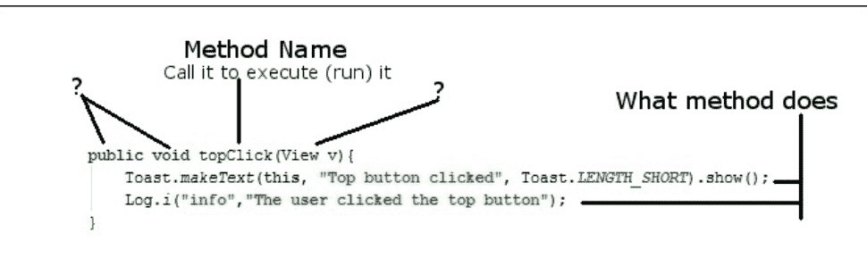

## 第 8 章。使用 Java 编程 第 2 部分 – 方法

As we are starting to get comfortable with Java programming, in this chapter, we will take a closer look at methods because although we know that you can call them to make them execute their code, it is plain that there is more to them than has been discussed so far.

In this chapter, we will look at the following topics:

- The method structure
- Method overloading versus overriding
- A method's demo mini app
- How methods affect our variables

First, let's go through a quick method recap.


## 重新审视方法

这张图大概粗略地总结了我们目前对方法的理解状况：



如前图所示，方法周围仍有一些问号。我们将完全揭开方法的面纱，了解它们的工作原理，以及方法的其他部分在稍后的章节中为我们做了什么。在 [第 9 章，面向对象编程]，我们将澄清方法之谜的最后几个部分。

那么，Java 方法究竟是什么？方法是一组变量、表达式和控制流语句，它们被打包在一个由名称引导的左花括号和右花括号内。我们已经使用了很多方法，但只是还没有仔细观察它们。

让我们从方法结构开始。

### 方法结构

我们编写的方法的第一部分称为 **签名**。以下是一个假设的方法签名：

```
public boolean addContact(boolean isFriend, String name)
```

如果我们添加一对左花括号和右花括号，{}，以及方法执行的一些代码，那么我们就有了一个完整的方法——**定义**。以下是另一个编造的、但在语法上正确的方法：

```
private void setCoordinates(int x, int y){
// code to set coordinates goes here
}
```

如前面所示，我们可以从代码的另一部分使用我们的新方法，如下所示：

```
// I like it here
setCoordinates(4,6);
// now I am going off to setCoordinates method
// Phew, I'm back again - code continues here
```

在调用 setCoordinates 的地方，程序的执行将分支到该方法内部包含的代码。方法将逐步执行其内部的所有语句，直到到达末尾并将控制权返回给调用它的代码，或者如果遇到 return 语句则更早返回。然后，代码将从方法调用后的第一行继续运行。

以下是另一个方法示例，其中包含使方法返回到调用它的代码的代码：

```
int addAtoB(int a, int b){
    int answer = a + b;
    return answer;
}
```

调用前面方法的代码可能如下所示：

```
int myAnswer = addAtoB(2, 4);
```

显然，我们不需要编写方法来将两个 int 变量相加，但示例帮助我们更深入地了解方法的工作原理。首先，我们传入值 2 和 4。在签名中，值 2 被赋给 int a，值 4 被赋给 int b。

在方法体中，变量 a 和 b 相加并用于初始化新的 int answer 变量。return answer 行将 answer 中存储的值返回给调用代码，导致 myAnswer 被初始化为值 6。

请注意，前面示例中的每个方法签名都略有不同。原因是 Java 方法签名非常灵活，允许我们构建所需的精确方法。

方法签名如何定义方法必须如何调用以及方法必须如何返回值，值得进一步讨论。让我们给签名的每个部分命名，以便我们可以将其分解为块并了解各个部分。

### 提示

以下是一个带有已标记各部分并准备好讨论的方法签名。同时，请查看表格以进一步识别签名的哪一部分是哪一部分。这将使我们后续关于方法的讨论更加直接：

```
modifier | return type | name of method (parameters)
```

以下是我们目前使用的几个示例，以便您可以清楚地识别正在讨论的签名部分：

| 签名部分 | 示例 |
|---|---|
| 修饰符 | public, private, 和 package-private（未指定修饰符） |
| 返回类型 | int，你也可以使用任何 Java 原始类型（例如 boolean、float、double、char、int 和 long）或任何预定义的引用类型（例如 String）和用户定义的类型（例如 Employee、Person） |
| 方法名称 | addContact、setCoordinates 和 addAToB |
| 参数 | (boolean isFriend, String name)、(int x, int y) 和 (int a, int b) |

### 修饰符

在前面的示例中，我们只在几个示例中使用了修饰符，部分原因是方法不必使用修饰符。修饰符是指定哪些代码可以使用（调用）您的方法的一种方式，使用 public 和 private 等修饰符。实际上，普通变量也可以有修饰符，例如：

```
// Most code can see me
public int a;

// Code in other classes can't see me
private String secret = "Shhh, I am private";
```

修饰符（用于方法和变量）是 Java 的一个基本话题，但最好在我们讨论另一个我们已经绕过很多次的重要 Java 话题时再处理——类。我们将在下一章讨论它们。

### 注意

如前面的示例方法以及我们迄今编写的所有代码运行良好这一事实所示，修饰符对于迄今为止的学习不是必需的，尽管它们将是从第 9 章，面向对象编程开始的未来学习的重要组成部分。

### 返回类型

接下来是返回类型。像修饰符一样，返回类型是可选的。所以，让我们更仔细地看看它。我们已经看到我们的方法会执行某些操作。但是，如果我们需要它们所做操作的结果怎么办？我们迄今为止看到的返回类型的最简单示例是：

```
int addAToB(int a, int b){
```

```
int answer = a + b;
return answer;
}
```

这里，签名中的返回类型被高亮显示，因此返回类型是 int。addAtoB 方法将一个可以装入 int 变量的值发送回（返回给）调用它的代码。

返回类型可以是我们迄今看到的任何 Java 类型。但是，方法不必返回值。在这种情况下，签名必须使用 void 关键字作为返回类型。当使用 void 关键字时，方法体不得尝试返回值，因为这会导致编译器错误。但是，它可以不带值地使用 return 关键字。以下是返回类型和 return 关键字使用的一些有效组合：

```
void doSomething(){
// our code

// I'm done going back to calling code here
// no return is necessary
}
```

另一种组合如下：

```
void doSomethingElse(){
// our code

// I can do this as long as I don't try and add a value
return;
}
```

以下代码是另一种组合：

```
void doYetAnotherThing(){
// some code
if(someCondition){

// if someCondition is true returning to calling code
// before the end of the method body
return;
}

// More code that might or might not get executed

return;
}
```

```
/**
 As I'm at the bottom of the method body
 and the return type is void, I'm
 really not necessary but I suppose I make it
 clear that the method is over.
 */
}
```

在这个最后的示例中，我们返回一个 String：

```
String joinTogether(String firstName, String lastName){
 return firstName + lastName;
}
```

我们可以依次调用前面的每个方法，如下所示：

```
// OK time to call some methods
doSomething();
doSomethingElse();
doYetAnotherThing();
String fullName = joinTogether("Alan ","Turing");
// fullName now = Alan Turing
// continue with code from here
```

前面的代码将依次执行每个方法中的所有代码。

### 方法名称

设计我们自己的方法时，方法名称是任意的。但是，使用动词的惯例来清楚地解释方法将做什么。此外，使用名称中第一个单词的首字母小写和后续单词的首字母大写的惯例。这就像我们在学习变量名称时学到的驼峰命名法，例如：

```
XGHHY78802c(){
 // code here
}
```

前面的方法完全合法且可行；但是，让我们看一个使用惯例的更清晰的示例：

```
doSomeVerySpecificTask(){
 // code here
```


```
}
getMyFriendsList(){
// code here
}

startNewMessage(){
// code here
}
```

现在这清晰多了，让我们来看看方法中的参数。

## 参数

我们知道方法可以将结果返回给调用代码。但是，如果我们需要将一些数据值*从*调用代码*与*方法共享，该怎么办？

**参数**允许我们将值与方法共享。我们在学习返回类型时实际上已经见过一个带参数的示例。我们将再次查看同一个示例，不过会更仔细地看一下参数：

```
int addAtoB(int a, int b){
int answer = a + b;
return answer;
}
```

在前面的代码中，参数已被高亮显示。参数包含在紧跟在方法名称后面的括号内（参数放在这里）。请注意，在方法体的第一行中，我们使用 a + b，就好像它们是已声明并初始化的变量一样。这是因为它们确实如此。方法签名中的参数就是它们的声明，而调用方法的代码会对它们进行初始化，如下一行代码所示：

```
int returnedAnswer = addAtoB(10, 5);
```

同样，如前面的示例部分所示，在参数中我们不必只使用 int，可以使用任何 Java 类型，包括我们自己设计的类型。不仅如此，我们还可以混合使用不同的类型。我们还可以根据需要使用任意数量的参数来解决问题。下面的示例可能会有所帮助：

```java
void addToAddressBook(char firstInitial, String lastName, String city, int age){
/*
 all the parameters are now living breathing,
 declared and initialized variables.

 The code to add details to address book goes here.
 */
}
```

现在，是时候认真对待我们的方法体了（显然是指方法体）。

## 在方法体中工作

方法体是我们之前用诸如这样的注释回避的部分：

```
// code here
```

或者诸如这样的注释：

```
// some code
```

但实际上，我们早就知道方法体中该做什么。我们迄今学过的任何 Java 语法都可以在方法体中使用。事实上，如果回想一下，我们迄今编写的所有代码*都*位于方法之中。

接下来我们能做的最好的事情就是编写一些方法体中真正能执行操作的方法。

## 使用方法 – 演示应用

在此，我们将快速构建两个应用来进一步探索方法。首先，我们将通过 Real World Methods 应用深入了解基础知识，然后通过 Exploring Method Overloading 应用亲身体验新主题**方法重载**。

像往常一样，你可以按常规方式打开已经准备好的代码文件。关于方法的下面两个示例可以在下载包中的第 8 章文件夹以及 Real World Methods 和 Exploring Method Overloading 子文件夹中找到。

### 现实世界中的方法

首先，让我们创建一些简单的可用方法，包含返回类型、参数和完全功能的方法体。

开始之前，创建一个名为 Real World Methods 的新 Android 项目，使用 **空白活动** 模板，并将所有其他设置保持默认。单击编辑器上方的 **MainActivity.java** 标签切换到 MainActivity.java 文件，然后即可开始编码。

首先，将这三个方法添加到 MainActivity。将它们添加在 onCreate 方法的闭合花括号 } 之后：

```java
String joinThese(String a, String b, String c){
  return a + b + c;
}

float getAreaCircle(float radius){
  return 3.141f * radius * radius;
}

void changeA(int a){
  a++;
}
```

我们添加的第一个方法名为 joinThese。它将返回一个 String 变量，并需要传入三个字符串变量。在方法体中，只有一行代码。return a + b + c 代码会连接传入的三个字符串，并将连接后的字符串作为结果返回。

下一个方法 getAreaCircle 接受一个 float 变量作为参数，并返回一个 float 变量。该方法体简单地使用圆面积公式，结合传入的半径，然后将答案返回给调用代码。3.141 末尾那个看起来奇怪的 f 是为了让编译器知道该数字的类型是 float。任何浮点数默认都被视为 double 类型，除非它带有尾随的 f。

第三个也是最后一个方法是所有方法中最简单的。请注意，它不返回任何内容；它具有 void 返回类型。我们包含此方法是为了阐明一个关于方法的重要要点，我们希望记住这一点。不过，让我们先在实际操作中看看它，再讨论它。

现在，在 onCreate 中，在调用 setContentView 之后，添加调用我们方法的代码：

```java
String joinedString = joinThese("Methods ", "are ", "cool ");
Log.i("joinedString = ","" + joinedString);

float area = getAreaCircle(5f);
Log.i("area = ","" + area);

int a = 0;
changeA(a);
Log.i("a = ","" + a);
```

运行应用，并在 logcat 窗口中观察输出，如下所示（供你参考）：

```
joinedString =: Methods are cool
area =: 78.525
a =: 0
```

在 logcat 输出中，我们首先看到的是字符串 joinedString 的值。如预期，它是我们传递给 joinThese 方法的三个单词的连接结果。

接下来，我们可以看到 getAreaCircle 确实根据传入的半径长度计算并返回了圆的面积。

输出的最后一行或许最有趣：a=: 0。在 onCreate 方法中，我们声明并将 int a 初始化为 0，然后调用了 changeA。在 changeA 的方法体中，我们使用 a++ 代码对 a 进行了递增。然而，回到 onCreate 中，我们看到当使用 Log 在 logcat 窗口打印 a 的值时，它仍然是 0。

因此，当我们将 a 传递给 changeA 方法时，实际传递的是 a 中存储的值，而不是变量 a 本身。在 Java 中，这被称为按值传递。

### 提示

当我们在方法中声明变量时，它只能在该方法中被看到。当我们在另一个方法中声明变量时，即使名称完全相同，它也不是同一个变量。变量仅在其声明所在的方法中具有作用域。

对于所有基本类型变量，向方法传递它们的工作方式就是这样。对于引用变量，其工作方式略有不同，我们将在下一章中看到它的工作原理。

### 注意

我曾与许多 Java 新手讨论过这个作用域概念。对一些人来说，这似乎显而易见，甚至是自然而然的。然而，对另一些人来说，这却是持续困惑的原因。如果你属于后者，请不要担心，因为我们将在本章后面再多讨论一些，并在后续章节中详细探讨作用域，确保它不再成为问题。

让我们再看一个实际的方法示例，同时学习一些新知识。

## 探索方法重载

如你所见，方法作为一个主题，确实十分多样且深入。但希望，通过一步一步来，我们会发现它们绝不令人生畏。我们还将在下一章回到方法。现在，让我们创建一个新项目来探索方法重载。

创建一个名为 Exploring Method Overloading 的新空白项目，然后我们将编写三个方法，不过带有一点变化。

如我们现在将看到的，只要参数不同，我们就可以创建多个同名方法。本项目中的代码非常简单。其工作原理乍看之下可能略显奇怪，直到我们事后分析为止。

在第一个方法中，我们将简单地将其命名为 printStuff，并通过参数传入一个要打印的 int 变量。将此方法插入到 onCreate 的闭合花括号 } 之后，但在 MainActivity 的闭合花括号 } 之前。请记住以常规方式导入 Log 类：

```java
void printStuff(int myInt){
    Log.i("info", "This is the int only version");
    Log.i("info", "myInt = "+ myInt);
}
```

在这个第二个方法中，我们也将其命名为 printStuff，但传入一个要打印的 String 变量。将此方法插入到 onCreate 的闭合花括号 } 之后，但在 MainActivity 的闭合花括号 } 之前：

```java
void printStuff(String myString){
    Log.i("info", "This is the String only version");
    Log.i("info", "myString = "+ myString);
}
```

在这个第三个方法中，我们将其命名为 printStuff，但传入一个要打印的 String 变量和 int。将此方法插入到 onCreate 的闭合花括号 } 之后，但在 MainActivity 的闭合花括号 } 之前：

```java
void printStuff(int myInt, String myString){
    Log.i("info", "This is the combined int and String version");
    Log.i("info", "myInt = "+ myInt);
    Log.i("info", "myString = "+ myString);
}
```

现在，将此代码插入到 onCreate 方法的闭合花括号 } 之前，以调用方法并在 Android 控制台打印一些值：

```java
// Declare and initialize a String and an int
int anInt = 10;
String aString = "I am a string";
```


```
// Now call the different versions of printStuff
// The name stays the same, only the parameters vary
printStuff(anInt);
printStuff(aString);
printStuff(anInt, aString);
```

Now, we can run the app on the emulator or a real device. Here is the console output:

```
**info**: This is the int only version
**info**: myInt = 10
**info**: This is the String only version
**info**: myString = I am a string
**info**: This is the combined int and String version
**info**: myInt = 10
**info**: myString = I am a string
```

As you can see, Java has treated three methods with the same name as totally different methods. This, as we have just demonstrated, can be really useful. It is called **method overloading**.

### Note

### Method overloading and overriding confusion

**Overloading** is when we have more than one method with the same name but different parameters.

**Overriding** is when we essentially replace a method with the same name and the same parameter list.

We know enough about overloading and overriding to complete this book, but if you are brave and your mind is wandering, yes you can override an overloaded method; however, that is something that we've kept for another time.

This is how it all works. In each of the steps in which we wrote code, we created a method called printStuff. But each printStuff method has different parameters, so each is actually a different method that can be called individually:

```
void printStuff(int myInt){
...
```

```
void printStuff(String myString){
...
}
```

```
void printStuff(int myInt, String myString){
...
}
```

The body of each of the methods is simple and just prints out the passed-in parameters and confirms which version of the method is being called currently.

The next important part of our code is when we make it plain, which we mean to call by using the appropriate arguments that match the parameters in the signature. Then, we call each method in turn, using the appropriate parameters so that the compiler knows the exact method required:

```
printStuff(anInt);
printStuff(aString);
printStuff(anInt, aString);
```

We now know all we need to about methods, so let's take a quick second look at the relationship between methods and variables. Then, we'll get our heads around this scope phenomenon a bit more.

### Scope and variables revisited

You might remember that in the Real World Methods project, the slightly disturbing anomaly was that variables in one method were not apparently the same as those from another, even if they did have the same name. If you declare a variable in a method, whether that is one of the lifecycle methods or one of our own methods, it can only be used within that method.

It is no use doing this in onCreate:

```
int a = 0;
```

And then, trying to do this in onPause or some other method:

```
a++;
```

We will get an error because a is only visible within the method it was declared in. At first, this might seem like a problem, but perhaps surprisingly, it is actually a very useful feature of Java.

The term used to describe this is "scope". A variable is said to be in a scope when it is usable and out of the scope when it is not. The topic of scope is best discussed along with classes, and we will in the next chapter, but as a sneak look at what lies ahead you might like to know that a class can have its very own variables, and when it does, they have a scope for the whole class. That is, all its methods can see and use them. We call them member variables or fields.

To declare a member variable, you can simply use the usual syntax after the start of the class, outside of any method declared in the class. If our app started like this:

```
public class MainActivity extends AppCompatActivity {
    int mSomeVariable = 0;
    // Rest of code and methods follow as usual
    // ...
```

We could use mSomeVariable anywhere, inside any method in this class. Our new variable, mSomeVariable, has class scope. We append m to the variable name simply to remind us when we see it that it is a member variable. This is not required, but it is a useful convention.

Here are a couple of hypothetical method questions to try and make some of what we have learned stick a little more. Try and answer them yourself.

### FAQ

- What is wrong with this method definition?

```
doSomething(){
 // Do something here
}
```

No return type is declared. You do not have to return a value from a method, but its return type must be void in this case. This is how the method should look:

```
void doSomething(){
 // Do something here
}
```

- What is wrong with this method definition?

```
float getBalance(){
 String customerName = "Linus Torvalds";
 float balance = 429.66f;
 return customerName;
}
```

The method returns a String (userName) variable, but the signature states that it must return a float. With a method name like getBalance, this code is probably what was intended:

```
float getBalance(){
 String customerName = "Linus Torvalds";
 float balance = 429.66f;
 return balance;
}
```

- When do we call the onCreate method? !Trick question alert!

We don't. Android decides when to call onCreate as well as all the other methods that make up the lifecycle of an Activity. We just override the ones that are useful to us. We do, however, call super.onCreate so that our overridden version and the original version both get executed.

### Note

For the sake of technical accuracy, it is possible to call the lifecycle methods from our code, but we will never need to do this in the context of this book. It is best to leave these things to Android.

### Further reading

You have learned enough Java to proceed with this book. It is always beneficial, however, to see more examples of Java in action and to go beyond the minimum necessary to proceed. If you want a good source to learn Java in greater depth, then the official Oracle website is good. Note that you do not need to study this website to continue with this book. Also note that the tutorials are not set in an Android context. The site is a useful resource to bookmark and browse all the same. The official Java tutorials can be found at https://docs.oracle.com/javase/tutorial/.

### Summary

In previous chapters, we got quite proficient with a whole array of widgets and other UI elements and we built a fairly good selection of UI layouts. In this chapter and the previous two, we explored Java and the Android Activity lifecycle in quite significant depth, especially considering how quickly we have done it.

What we really need to do now is bring these things together so that we can begin to display and manipulate our data using the Android UI. To achieve this, we need to understand a bit more about classes. They have been lurking in our code since Chapter 1, The First App, and we have even used them a bit. Up until now, however, we haven't tackled them properly other than constantly referring to Chapter 9, Object-Oriented Programming. In the next chapter, we will quickly get to grips with classes and then we can finally start to build apps in which the UI designs and our Java code work in perfect harmony.
